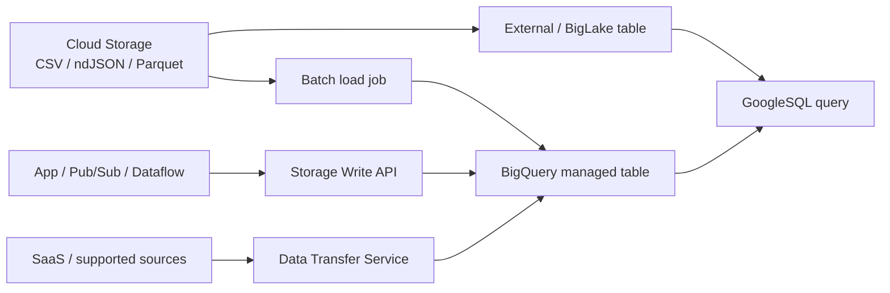

# Load Jobs, External Tables, and Ingestion Options

An e-commerce system writes order events to **Cloud Storage** every hour. The operations team wants fast, low-cost BigQuery reports; the analytics team wants to query the newly exported Parquet files without building an ETL pipeline yet. **BigQuery** offers several ways to ingest and access data: **batch load jobs**, **external tables**, **BigLake**, **streaming Storage Write API**, and **Data Transfer Service**. The right choice depends on latency, query frequency, format, access governance, and total cost.

This lesson belongs to the **BigQuery** chapter of the `CLOUD_PROVIDERS_GCP` module. Learners apply knowledge of Cloud Storage, IAM, Cloud Run/GKE, and Pub/Sub to choose ingestion methods, protect resources, automate pipeline releases, and monitor reliability and costs. Example resources are illustrative; commands that create, write, or delete infrastructure may incur charges—use only in an authorized sandbox.

## 1. Learning Objectives

After this lesson, you will be able to:

1. Distinguish between a **BigQuery managed (native) table**, **load job**, **external table**, **BigLake**, and **streaming ingestion**.
2. Choose CSV, newline-delimited JSON, Avro, Parquet, or ORC based on data and schema requirements.
3. Run **`bq load`**, inspect jobs/schemas, perform append/overwrite operations, and handle malformed data.
4. Create a **Cloud Storage external table** via SQL or `bq mkdef`, and understand permission and performance limitations.
5. Use partitioning/clustering on managed tables, and Hive partitioning/metadata caching where appropriate.
6. Choose between **Storage Write API**, Pub/Sub → Dataflow, Data Transfer Service, or CTAS/scheduled queries.
7. Design ingestion with **idempotency, staging, data-quality gates, monitoring, and budgets**.
8. Solve exercises on selecting BigQuery ingestion methods for real-world requirements.

## 2. Where Does BigQuery Store Data?



**Managed (native) table** means BigQuery stores data in an optimized format for querying; it incurs storage and query costs according to the chosen model. An **external table** is metadata/schema pointing to external bytes, such as in Cloud Storage; it does not automatically copy data into managed storage. A **BigLake external table** also reads external data but uses **connection/access delegation** and can leverage metadata caching.

| Approach | Where Primary Data Resides | Freshness / Latency | Strengths and Trade-offs |
| --- | --- | --- | --- |
| **Batch load job** | After load: BigQuery managed table. | Once the job completes. | Suited for hourly/daily batches and repeated queries; requires managing jobs/schedules. |
| **Standard external table** | Cloud Storage/Bigtable/Drive per source. | Reflects source at query time, subject to consistency limits. | No copy required; can be slower, requires permissions on **both table and source**. |
| **BigLake external table** | Supported external sources. | Per query and metadata cache if enabled. | Manages source access via connection identity; extra configuration step. |
| **Storage Write API** | BigQuery managed table. | Near real-time per write stream. | Data available for fast querying; must manage retries, stream offsets/duplicates. |
| **Data Transfer Service** | BigQuery managed table. | Per supported schedule/connector. | Automates ingestion from specific sources; connector-dependent quotas/fees apply. |
| **CTAS/`INSERT`/`LOAD DATA` SQL** | Typically managed table. | Once the query/job completes. | Transforms via SQL; incurs query processing charges where applicable. |

**External tables are not streaming.** They allow querying files sitting outside BigQuery. Whether newly arrived files are visible depends on URI patterns, metadata caching, permissions, and source state.

## 3. Choosing Source Formats and Schema Contracts

| Format | Benefits | Risks |
| --- | --- | --- |
| **CSV** | Human-readable and easy for flat data exchange. | Headers/delimiters, quotes, date/time formats, BOM, NULLs; no nested/repeated fields. |
| **ndJSON** (`NEWLINE_DELIMITED_JSON`) | One JSON object per line; flexible with nested fields. | A single file-wide JSON array is **not** ndJSON; schema drift, large numbers, type mismatches. |
| **Avro** | Binary, self-describing schema, supports parallel reads and block compression. | Schema evolution/type conversions must stay compatible. |
| **Parquet** | Columnar, efficient for data lakes; embedded schema. | Heterogeneous file schemas, partition layout, type conversions. |
| **ORC** | Columnar, fits certain Hadoop pipelines. | Schema conversions, file compatibility. |

### 3.1. Sample Dataset Used Throughout

File `orders.csv`:

```csv
order_id,tenant_id,event_date,amount_cents,status
O-1001,t1,2026-11-19,2500,PAID
O-1002,t1,2026-11-19,1300,PENDING
O-1003,t2,2026-11-18,8100,PAID
```

| Column | BigQuery Type | Meaning |
| --- | --- | --- |
| `order_id` | STRING | Business ID; used for dedup/idempotency. |
| `tenant_id` | STRING | Tenant identifier for filtering and business authorization. |
| `event_date` | DATE | Event date, suitable for partitioning. |
| `amount_cents` | INT64 | Monetary amount in cents to avoid floating-point rounding errors. |
| `status` | STRING | Status at snapshot time. |

In production, add `event_id`, `source_version`, `ingested_at`, and batch metadata to handle updates/duplicates. A single `order_id` does not represent a unique event if an order undergoes multiple state changes.

### 3.2. Explicit Schema or Autodetect?

An **explicit schema** clearly defines `DATE`, `INT64`, NULLABLE/REQUIRED constraints, and valid columns. `--autodetect` is convenient for quick tests but can guess wrong: an all-string CSV might fail header detection, and a malformed numeric column or timezone-less timestamp can cause surprises.

With Parquet/Avro/ORC, the schema is usually embedded in the files, but you still must verify **schema compatibility** across files matched by wildcards. In production, version schemas and test missing or extra columns.

### 3.3. Location and Source Access Permissions

The **Cloud Storage bucket** location and **BigQuery dataset/job** location must be compatible per BigQuery location rules; do not assume a bucket in any region works with any dataset. Wildcard URIs require the load identity to hold **`storage.objects.list`** in addition to object read permissions. Load jobs do not accept Cloud Storage object generation numbers in URIs like `gs://...#123`.

Standard external tables typically require Cloud Storage permissions at **query time**; table/dataset permissions alone cannot read the files without source access.

## 4. Load Jobs: Batch Ingestion into Managed Tables

A **load job** reads local files or Cloud Storage objects and writes them into a BigQuery managed table. It supports CSV, ndJSON, Avro, Parquet, and ORC, and can be triggered via `bq load`, the API, the Console, or GoogleSQL `LOAD DATA`. It fits workloads where data arrives in batches, dashboards tolerate minutes-to-hours latency, and queries run repeatedly against stable data.

### 4.1. Append, Overwrite, and Atomicity

| Goal | Mechanism | Trade-offs |
| --- | --- | --- |
| Add a batch | Default `bq load` / `--noreplace`. | Appends rows; re-running the same batch can create duplicate rows. |
| Replace entire table | `--replace`. | Overwrites; targeting the wrong table causes data loss. |
| Replace one partition | Partition decorator or SQL with appropriate filter. | Safe only when target partition is verified. |
| Write only if target is empty/new | API `WRITE_EMPTY` plus precondition checks. | Useful for immutable per-batch tables. |

A successful load job commits **atomically for that job**: queries never see half-loaded data. However, running **two jobs that append the same file** still creates duplicate rows. Design idempotency using source manifests/object identities, batch IDs, staging + dedup/`MERGE`, or appropriate job identities.

### 4.2. Format Errors and Data Quality

Common options: `--skip_leading_rows`, `--field_delimiter`, `--max_bad_records`, `--ignore_unknown_values`, `--autodetect`. For critical data, start with **`max_bad_records=0`**; if intentionally skipping malformed records, collect metrics/alerts and verify business totals.

CSV errors often stem from headers, BOMs, quoted newlines, or invalid DATE formats; ndJSON fails when a file is a JSON array rather than one object per line. Gzip-compressed CSV/ndJSON can **reduce parallelization** compared to uncompressed files; benchmark load times rather than looking solely at file size.

### 4.3. Load Job Quotas

Per current BigQuery quotas documentation, notable default limits include **1,500 load jobs/table/day**, **100,000 load jobs/project/day**, and **15 TB input/job**. Conditions and counting rules vary by table/job and may change; check [BigQuery quotas](https://cloud.google.com/bigquery/quotas) before designing pipelines that launch tens of thousands of tiny jobs daily. Often, **grouping multiple URIs/files into a single load job** is more efficient than invoking separate loads per file.

## 5. Lab 1 — Loading Local CSV and Cloud Storage Files

**Prerequisites:** Cloud Shell/Bash with `gcloud` and `bq` CLIs, a sandbox project with BigQuery API/billing enabled; principal has `bigquery.jobs.create`, permissions to create/write tables, and read Cloud Storage. Commands below use illustrative names—do not run in production.

### 5.1. Verify Environment and Create Dataset

```bash
PROJECT_ID="orders-lab"
LOCATION="asia-southeast1"
DATASET="ingestion_lab"
BUCKET="orders-ingestion-lab"

# READ-ONLY.
gcloud auth list
gcloud config get-value project
bq ls --project_id="$PROJECT_ID"

# CREATES REAL DATASET: only if not existing and approved.
bq --location="$LOCATION" mk --dataset "$PROJECT_ID:$DATASET"
```

Save the CSV from Section 3.1 as **`orders.csv` in a separate lab directory** (UTF-8, with header). Do not commit this file into the course repository.

### 5.2. Create a Partitioned and Clustered Native Table

In the BigQuery SQL editor, adjust the project ID and run:

```sql
-- CREATES REAL TABLE in sandbox dataset.
CREATE TABLE IF NOT EXISTS `orders-lab.ingestion_lab.orders_native` (
  order_id STRING,
  tenant_id STRING,
  event_date DATE,
  amount_cents INT64,
  status STRING
)
PARTITION BY event_date
CLUSTER BY tenant_id, status
OPTIONS (description = 'Lab orders, partitioned and clustered');
```

**Partitioning** allows skipping irrelevant partitions when queries filter on `event_date`. **Clustering** groups blocks by `tenant_id` and `status` to reduce scans in certain queries; it is not a B-tree secondary index.

### 5.3. Load Local CSV with an Explicit Schema

```bash
# WRITES TO REAL TABLE: defaults to APPEND.
bq --location="$LOCATION" load \
  --source_format=CSV \
  --skip_leading_rows=1 \
  --max_bad_records=0 \
  "$PROJECT_ID:$DATASET.orders_native" \
  ./orders.csv \
  'order_id:STRING,tenant_id:STRING,event_date:DATE,amount_cents:INT64,status:STRING'

# READ-ONLY: inspect schema and sample rows.
bq show "$PROJECT_ID:$DATASET.orders_native"
bq head -n 5 "$PROJECT_ID:$DATASET.orders_native"
```

If the table was initially empty, expect **3 rows**. Running `bq load` again **appends 3 more rows** without deduplicating by `order_id`. Only use `--replace` if you intend to overwrite the entire table and have verified the impact.

### 5.4. Load from Cloud Storage into Staging

```bash
# READ-ONLY: bucket must already exist in a compatible location.
gcloud storage buckets describe "gs://$BUCKET" \
  --project="$PROJECT_ID"

# MUTATES CLOUD STORAGE: upload lab file.
gcloud storage cp ./orders.csv \
  "gs://$BUCKET/landing/orders-2026-11-19.csv"

# MUTATES BIGQUERY: load file into staging table.
bq --location="$LOCATION" load \
  --source_format=CSV \
  --skip_leading_rows=1 \
  --max_bad_records=0 \
  "$PROJECT_ID:$DATASET.orders_stage" \
  "gs://$BUCKET/landing/orders-2026-11-19.csv" \
  'order_id:STRING,tenant_id:STRING,event_date:DATE,amount_cents:INT64,status:STRING'

# READ-ONLY.
bq head -n 5 "$PROJECT_ID:$DATASET.orders_stage"
```

In production, follow a **landing → staging → serving** pattern: validate row counts, NULLs, duplicate keys, monetary totals, and schema before merging. Wildcards like `gs://bucket/landing/orders-*.csv` are safe only when all matching files share the same format and compatible schemas.

### 5.5. Inspect Load Jobs and Errors

```bash
# READ-ONLY: list recent jobs.
bq --location="$LOCATION" ls -j --max_results=20 "$PROJECT_ID"

# Replace JOB_ID with an actual ID from the list:
bq --location="$LOCATION" show -j \
  --format=prettyjson "$PROJECT_ID:JOB_ID"
```

Inspect `status.errorResult`, `errors`, `statistics.load.inputFiles`, `outputRows`, `badRecords`, and execution time. A job in `DONE` state **does not automatically mean success** if `errorResult` is present. Log the job ID, source URI, file checksum, schema version, and batch ID for investigation or reruns.

## 6. External Tables: Querying Data Without Loading

A **Cloud Storage external table** stores only metadata/schema in BigQuery, while the bytes stay in Cloud Storage. On `SELECT`, BigQuery reads the underlying files. This suits data lakes/raw staging or ad-hoc exploration; if the same data is queried frequently, a native table is often more effective.

### 6.1. Create an External Table via GoogleSQL

```sql
-- CREATES/REPLACES REAL EXTERNAL TABLE, sandbox dataset only.
CREATE OR REPLACE EXTERNAL TABLE `orders-lab.ingestion_lab.orders_external` (
  order_id STRING,
  tenant_id STRING,
  event_date DATE,
  amount_cents INT64,
  status STRING
)
OPTIONS (
  format = 'CSV',
  uris = ['gs://orders-ingestion-lab/landing/orders-2026-11-19.csv'],
  skip_leading_rows = 1
);

-- QUERY may incur charges.
SELECT tenant_id, COUNT(*) AS order_count,
       SUM(amount_cents) AS total_cents
FROM `orders-lab.ingestion_lab.orders_external`
GROUP BY tenant_id
ORDER BY tenant_id;
```

`CREATE OR REPLACE` can overwrite an external table currently in use; apply only to sandbox names. For CSV sources, configure header handling properly even when the file contents are immediately visible in the bucket.

### 6.2. Create an External Table Using `bq mkdef`

```bash
# WRITES LOCAL FILE in lab directory.
bq mkdef --source_format=CSV \
  "gs://$BUCKET/landing/orders-2026-11-19.csv" > orders_external_def

# CREATES REAL EXTERNAL TABLE; explicit schema.
bq --location="$LOCATION" mk --table \
  --external_table_definition=orders_external_def \
  "$PROJECT_ID:$DATASET.orders_external_cli" \
  'order_id:STRING,tenant_id:STRING,event_date:DATE,amount_cents:INT64,status:STRING'
```

The minimal `mkdef` example above **does not set `skip_leading_rows=1`**, so this CSV external table with headers needs that option added to the definition file before querying. For quick hands-on practice with files containing headers, use the complete SQL in Section 6.1; never assume every minimal `mkdef` output is ready to query immediately.

### 6.3. Limitations of Standard External Tables

- Callers need both **BigQuery job/table** permissions and **Cloud Storage object access**, unless using a delegation mechanism like BigLake.
- There is no snapshot consistency guarantee at the source if files are modified **during a query**. Prefer immutable files/manifests.
- External tables generally do not support native **clustering**; partitioning is only supported in specific setups such as Hive partition layouts.
- You cannot use a **copy job** to directly copy an external table as a native table; you can materialize it via `CREATE TABLE AS SELECT`.
- Dry runs for some external queries may report **0 bytes / lower bound**, not a reliable cost estimate.
- Repeated queries or strict SLOs often benefit from **loading into a managed table**.

### 6.4. Materializing via CTAS

```sql
-- WRITES REAL MANAGED TABLE via query job.
CREATE TABLE `orders-lab.ingestion_lab.orders_from_external`
PARTITION BY event_date
CLUSTER BY tenant_id
AS SELECT *
FROM `orders-lab.ingestion_lab.orders_external`;
```

**CTAS** reads the external data and writes a new copy into BigQuery managed storage. It **does not auto-update** when new files arrive; a separate scheduled or incremental pipeline is needed. Both the table-creation query and native storage can incur charges.

## 7. BigLake: Access Delegation and Metadata Caching

A **BigLake external table** reads data in Cloud Storage using a **BigQuery connection service account** to access the source. Callers receive appropriate BigQuery permissions without necessarily having direct bucket read permissions.

| Characteristic | Standard External Table | BigLake External Table |
| --- | --- | --- |
| Source data in Cloud Storage | Yes | Yes |
| Caller needs direct bucket IAM | Usually **yes** | **No**, if connection/access delegation is configured properly |
| Connection identity governs source access | No | **Yes** |
| Metadata caching | No equivalent BigLake mode | **Can be enabled** for file/partition metadata |
| Automatically copies to native storage | No | No |

Metadata caching **is not the query result cache**. It caches metadata about files/partitions to reduce listing/pruning overhead. For Cloud Storage BigLake tables, supported cache freshness ranges from **30 minutes to 7 days**. Depending on table type, choose automatic or manual refresh based on required data freshness. Avoid overly long cache windows if reports must see new files immediately.

Illustrative example (requires an existing connection with IAM configured; do not run unreviewed in production):

```sql
CREATE EXTERNAL TABLE `orders-lab.ingestion_lab.orders_biglake`
WITH CONNECTION `orders-lab.asia-southeast1.lake_connection`
OPTIONS (
  format = 'PARQUET',
  uris = ['gs://orders-ingestion-lab/parquet/orders/*.parquet'],
  max_staleness = INTERVAL 1 HOUR,
  metadata_cache_mode = 'AUTOMATIC'
);
```

This is an architectural pattern, **not a command that creates the connection itself**. Verify syntax, region, file schemas, connection identity, and source access permissions against policy before deploying.

### 7.1. Hive Partitioning for File Lakes

```text
gs://orders-ingestion-lab/parquet/orders/event_date=2026-11-19/part-000.parquet
gs://orders-ingestion-lab/parquet/orders/event_date=2026-11-20/part-001.parquet
```

When **Hive partitioning** is configured, BigQuery extracts partition values from the path and can skip reading irrelevant files. This differs from native table `PARTITION BY`: external partition pruning depends on directory layout, URI prefixes, options like `require_hive_partition_filter`, and metadata; benchmark it on real data.

## 8. When to Use Streaming, Transfer, or ETL Pipelines?

### 8.1. BigQuery Storage Write API

When events must be queryable within **seconds or near real time**, applications or Dataflow can write using the **BigQuery Storage Write API (gRPC)** instead of creating load jobs per microbatch.

| Storage Write API Mode | Semantics | When to Use |
| --- | --- | --- |
| **Default stream** | **At-least-once**; rows are queryable once writes are acknowledged. | Data has business/event IDs for deduplication, high throughput. |
| **Application-created committed stream + offsets** | Can achieve **exactly-once within each stream** when the app manages offsets properly. | Need to avoid duplicate appends at the write stream layer and can manage state. |
| **Pending stream** | Data becomes visible only after the stream is finalized/committed per protocol. | Batch ingestion needing controlled atomic data publication timing. |

**Exactly-once within a stream does not equal end-to-end business exactly-once**: a publisher might emit the same event twice, pipelines restart, and upstream databases can still send duplicates. Rely on `event_id` and deduplication policies, not just stream offsets.

The Storage Write API is usually preferable to thousands of small load jobs because it avoids load job quotas. However, it comes with its own **pricing, stream/throughput quotas, backpressure, retries, schema evolution, and client complexity**. Do not pick streaming simply because it is available: if reports tolerate a 1-hour delay, batch loads are usually simpler.

### 8.2. Pub/Sub → BigQuery Subscription or Dataflow

- **Pub/Sub BigQuery subscription:** exports messages directly into a schema-compatible table; suited for raw event landing with minimal transformation. Requires managing Pub/Sub service agent IAM, delivery failures, and duplicates.
- **Pub/Sub → Dataflow → BigQuery:** suited for parsing, enrichment, validation, windowing, deduplication, schema mapping, or dead-lettering malformed payloads. Incurs pipeline runtime costs and requires backlog/worker monitoring.
- **Cloud Run/worker → Storage Write API:** suited when the application directly controls ingestion and implements full retry/buffering/monitoring.

Do not stream payment events straight into an analytical table and treat that as committing a business transaction. BigQuery serves analytics—it does not replace OLTP systems and idempotent update workflows.

### 8.3. BigQuery Data Transfer Service and Scheduled Queries

**BigQuery Data Transfer Service** automates loads from supported sources, such as selected SaaS/Google products or Cloud Storage files per transfer configuration. Load timing follows **schedule/connector limits**, not always real time. **Scheduled queries** run GoogleSQL periodically to transform data already in BigQuery or external sources into serving tables.

Choose Data Transfer when a matching connector exists and you do not want to build/maintain an extractor; choose load jobs when you control file batches; choose scheduled queries/CTAS when transforming **via SQL**. Do not equate a `SUCCEEDED` transfer with all business records passing quality gates: verify row counts, freshness, and per-source errors.

## 9. Making Ingestion Idempotent with Data-Quality Gates

### 9.1. Why Can Retries Create Duplicate Data?

Suppose `orders-2026-11-19.csv` loaded successfully, but the orchestrator lost the response and retried. Two `WRITE_APPEND` load jobs can cause the same 3 rows to appear **twice**. BigQuery does not enforce PostgreSQL-style unique key constraints by default to block duplicates automatically.

A robust design combines:

1. **Manifest:** store `batch_id`, source URI, object generation/checksum, and processing status in durable state storage.
2. **Staging:** load batch data into staging tables alongside `event_id` or business keys.
3. **Quality gate:** verify schema, row counts, NULLs, uniqueness, totals, timestamps, and checksums.
4. **Dedup/`MERGE`:** publish each business key/version once into the serving table.
5. **Checkpoint & retry:** record load job IDs to avoid launching duplicate jobs on API timeouts; retry with backoff and quota budgets.

Illustrative `MERGE` example using `orders_stage` and `orders_native`:

```sql
-- MUTATES SERVING TABLE. Run only on lab data.
MERGE `orders-lab.ingestion_lab.orders_native` T
USING (
  SELECT * EXCEPT (rn)
  FROM (
    SELECT s.*,
           ROW_NUMBER() OVER (
             PARTITION BY order_id ORDER BY event_date DESC
           ) AS rn
    FROM `orders-lab.ingestion_lab.orders_stage` s
  )
  WHERE rn = 1
) S
ON T.order_id = S.order_id
WHEN MATCHED THEN UPDATE SET
  tenant_id = S.tenant_id,
  event_date = S.event_date,
  amount_cents = S.amount_cents,
  status = S.status
WHEN NOT MATCHED THEN INSERT
  (order_id, tenant_id, event_date, amount_cents, status)
  VALUES
  (S.order_id, S.tenant_id, S.event_date, S.amount_cents, S.status);
```

**Warning:** this example picks the row with the latest `event_date`, which becomes **nondeterministic** if multiple events share the same date. Production requires `event_timestamp` and `source_sequence`/`event_id` as tie-breakers; staging tables can store append-only history while serving tables hold the latest state. `MERGE` also cannot fix duplicates that already exist in the target table—data quality checks are essential.

### 9.2. Quality SQL to Verify a Batch

```sql
-- READ-ONLY; incurs query charges per configuration.
SELECT
  COUNT(*) AS row_count,
  COUNTIF(order_id IS NULL OR order_id = '') AS bad_keys,
  COUNT(*) - COUNT(DISTINCT order_id) AS duplicate_keys,
  SUM(amount_cents) AS total_cents
FROM `orders-lab.ingestion_lab.orders_stage`;
```

Reconcile `row_count` and `total_cents` against the manifest/source ledger. On large datasets, `COUNT(DISTINCT)` can be resource-intensive; use scheduled checks or approximate/metadata diagnostics with awareness of their limits. Never treat "table has rows" alone as passing ingestion validation.

## 10. Performance, Security, and Cost

### 10.1. Comparing Ingestion Paths by Total Pipeline Cost

| Cost / Latency Dimension | Batch Load → Native | External / BigLake | Streaming Write API |
| --- | --- | --- | --- |
| Ingestion | Batch loads are typically offered at no per-byte charge on shared slots; quotas apply. | No ingest copy step. | Charged per streaming/write pricing/API. |
| Storage | BigQuery managed storage. | Cloud Storage + metadata, no managed copy. | BigQuery managed storage. |
| Query | Leverages native partitioning/clustering/columnar execution. | Queries external source; file listing/I/O and metadata caching affect speed. | Queries native table once writes are visible. |
| Freshness | After job completion. | Per source files/cache/listing. | Near real-time with appropriate write stream. |
| Operations | Job scheduling, quotas, schema/quality gates. | Source IAM, consistency, schema, external file lifecycle. | Client offsets/retries, throughput, streaming monitoring. |

Do not conclude "external is always cheaper" simply because there is no BigQuery managed storage bill: Cloud Storage bytes/operations, BigQuery external query processing, cross-region transfers, retries, and caching/connections all carry costs. Check [BigQuery pricing](https://cloud.google.com/bigquery/pricing) and Cloud Billing by **region/SKU** against your SLOs.

### 10.2. IAM and Sensitive Data

| Principal | Minimum Permissions to Verify |
| --- | --- |
| **Load job principal** | `bigquery.jobs.create`, update permission on destination table, read access to GCS objects/buckets as needed. |
| **BigQuery query user** | Permission to create jobs and read the target table/dataset. |
| **Standard external table** | BigQuery query permissions **and** GCS object permissions on the source. |
| **BigLake connection service account** | Read access only on authorized GCS buckets/prefixes; query users do not need direct GCS access when delegation is configured. |
| **Dataflow/Cloud Run ingestion identity** | Appropriate BigQuery Write role plus scoped Pub/Sub/Storage access; never Owner. |

Separate **deployment**, **data loading**, **querying**, and **source object access**. For sensitive data, evaluate data location, encryption/CMEK where needed, row-level/column-level security, policy tags, VPC Service Controls, audit logs, and retention. **Never place JSON account keys inside CSVs, source code, or repositories**; prefer Workload Identity/ADC.

### 10.3. Observing Jobs and Data Freshness

- **Job health:** `PENDING/RUNNING/DONE`, `errorResult`, retries, load `badRecords/outputRows`, bytes, duration, and quotas.
- **Data freshness:** `MAX(event_timestamp/ingested_at)` or batch watermarks; alert when lagging beyond SLA.
- **Data correctness:** source file count/size/checksums, row counts, duplicates, NULLs, and monetary totals.
- **External queries:** source bucket/object permissions, file counts, path layouts, metadata-cache freshness, p95 latency, and billed bytes.
- **Streaming:** append errors, offsets, duplicates, backlog, schema changes, and write throughput.
- **Finance:** storage/scan bytes, slots/reservations, Cloud Storage operations, network transfer, and query costs.

BigQuery `INFORMATION_SCHEMA.JOBS_BY_PROJECT` and Cloud Logging/Monitoring help audit jobs by time and principal; visible metadata depends on IAM. Never look only at a job's `DONE` status while ignoring `errorResult` or output validation.

## 11. Common Issues and Troubleshooting

| Symptom | Possible Cause | Check |
| --- | --- | --- |
| Load fails with `locationMismatch` | Dataset/job location incompatible with bucket. | Dataset location, bucket region/multi-region, and job location. |
| CSV missing columns or wrong types | Header not skipped, BOM/delimiter, schema mismatch. | `--skip_leading_rows`, explicit schema, file sample. |
| JSON load fails | File is a JSON array instead of ndJSON; wrong data types. | One object per line, schema, source encoding. |
| Duplicate rows loaded | Appending/reading the same file multiple times on retry. | Manifest/job ID, staging, dedup/`MERGE`. |
| External table `Access Denied` | Query user lacks GCS access or BigLake connection SA lacks permissions. | Effective principal, bucket IAM, BigQuery connection. |
| External query is slow | Many small files, missing partition pruning, Parquet layout unsuited to query. | URI/layout, Hive partitions, caching, CTAS/native. |
| BigLake does not see new files | Metadata cache not refreshed yet, wrong source file/prefix. | Cache mode/max staleness, source listing. |
| Batch load hits `quotaExceeded` | Too many jobs per table, bursts, or project quota limits. | Group files/batches, adjust schedule, use Storage Write API if appropriate. |
| Streaming produces duplicate records | Default stream is at-least-once; retries without deduplication. | Event ID, stream offsets, application idempotency. |
| Job `DONE` but table has no rows | Job errored or loaded into a different project/dataset/table. | `errorResult`, job destination, row stats. |

## 12. Applied Exercises with Answers

**Exercise 1 — Frequency.** A pipeline exports Parquet files to Cloud Storage every hour, and dashboards run hundreds of queries against the same dataset. What should you choose?

*Answer:* **Batch load into a managed table**, with partitioning/clustering and staging/quality gates, is generally the strongest baseline for periodic batch data with frequent queries.

**Exercise 2 — Data Exploration.** Analysts want to run exploratory SQL over 50 Parquet files in a data lake without copying the data yet.

*Answer:* **External table**; if IAM delegation is needed so users do not access the bucket directly and better governance is desired, evaluate **BigLake**.

**Exercise 3 — Header Errors.** A CSV `bq load` fails with parse errors even though the data rows are valid; the file starts with header `order_id,tenant_id,...`.

*Answer:* Set **`--skip_leading_rows=1`**, provide an explicit schema, and check for BOM or delimiter issues.

**Exercise 4 — Append on Retry.** A job successfully loads 3 rows, but the orchestrator retries `WRITE_APPEND`; the table ends up with 6 rows. How do you fix this?

*Answer:* Do not rely on append for deduplication. Use batch manifests/job identities, **staging → quality gate → `MERGE`** by business/event ID, or separate immutable per-batch tables.

**Exercise 5 — Real-Time Requirement.** 10,000 messages/sec must be queryable within seconds of generation. Should you launch one load job per message?

*Answer:* **No.** Evaluate the **Storage Write API** or Pub/Sub → Dataflow/BigQuery subscription depending on transformation needs; factor in throughput, offsets/idempotency, quotas, and streaming costs.

**Exercise 6 — External Permissions.** A user is granted `bigquery.dataViewer` on an external table, but querying Cloud Storage returns 403.

*Answer:* Standard external tables typically require **GCS source permissions**; BigLake can provide **access delegation** via a connection identity. Never grant project-wide Storage Admin just to silence the error.

**Exercise 7 — External vs. Native Tables.** An external table queries CSV files on GCS. After materializing it into a native table via CTAS, will uploading a new CSV automatically update the native table?

*Answer:* **No.** CTAS materializes a snapshot at execution time; you need an incremental pipeline/load/`MERGE` or scheduled query.

**Exercise 8 — Data Freshness.** A BigLake table has metadata caching set to 1 hour, but new files must be visible within 1 minute.

*Answer:* There is a **staleness** conflict. Adjust the caching/refresh strategy or switch to managed table ingestion aligned with the SLO; never assume metadata cache reflects live file state.

**Exercise 9 — Partitioning.** A dataset holds 2 years of orders partitioned by `event_date`. A dashboard filters on `tenant_id` without a date filter.

*Answer:* The query may scan many partitions despite clustering by tenant. Filter on `event_date` whenever possible, consider `require_partition_filter`, and measure billed bytes.

**Exercise 10 — SQL Query Costs.** Batch load jobs may have low ingestion cost, yet the BigQuery bill keeps rising. Why?

*Answer:* **Native storage, query processing, slots/reservations, GCS storage/operations, egress, and logging** still incur charges. Measure the entire pipeline, not just the load job.

## 13. Pre-Production Checklist

- [ ] Define freshness SLOs, query frequency, query shapes, and budget limits.
- [ ] Choose batch, external/BigLake, transfer, or streaming based on actual requirements rather than habit.
- [ ] Verify region/bucket locations, service accounts, IAM, and source permissions.
- [ ] Define schema versioning, header/encoding rules, bad-records policies, nullability, and monetary arithmetic.
- [ ] Configure load jobs with batch IDs/source manifests, retry/backoff, quota awareness, and `errorResult` checks.
- [ ] Load into staging, validate row counts/unique keys/totals, and then `MERGE`/publish to serving tables.
- [ ] Partition/cluster native tables to match query filters, and apply pruning and dry runs appropriately.
- [ ] Review external URI/file schema stability, BigLake access delegation, and metadata staleness settings.
- [ ] Document Storage Write API offset/deduplication semantics; do not overclaim end-to-end exactly-once.
- [ ] Set alerts for job failures, schema drift, freshness lag, backlog, bytes scanned, and costs.
- [ ] Ensure sensitive data uses appropriate encryption, policy tags/row access, retention, and audit logs.
- [ ] Maintain runbooks for backfills, rollbacks, data reconciliation, and cleanup scoped strictly to lab resources.

### 13.1. Safely Cleaning Up Lab Resources

After recording results, delete only **the tables and objects you created** once you confirm no one else is using them:

```bash
# READ-ONLY: inspect existing tables and objects.
bq ls "$PROJECT_ID:$DATASET"
gcloud storage ls "gs://$BUCKET/landing/"

# REAL DELETION: illustrative commands, intentionally commented out.
# bq rm -f -t "$PROJECT_ID:$DATASET.orders_stage"
# bq rm -f -t "$PROJECT_ID:$DATASET.orders_external"
# bq rm -f -t "$PROJECT_ID:$DATASET.orders_external_cli"
# bq rm -f -t "$PROJECT_ID:$DATASET.orders_from_external"
# bq rm -f -t "$PROJECT_ID:$DATASET.orders_native"
# gcloud storage rm "gs://$BUCKET/landing/orders-2026-11-19.csv"
```

Never delete shared buckets/datasets or another team's BigLake connection. Deleting an external table **does not delete source files**; deleting a managed table can permanently remove active analytical data. Always verify backups/retention and ownership before deleting.

## 14. Summary

**Load jobs** bring data into BigQuery managed storage, fitting periodic batches and repeated queries. **External tables** query source files directly; **BigLake** strengthens access governance and adds metadata caching when data stays in the lake. The **Storage Write API** handles low-latency ingestion, while **Data Transfer Service/Dataflow/scheduled queries** automate ingestion depending on sources and transformation complexity.

The right choice balances **freshness + query performance + cost + security + reliability**. Regardless of the path chosen, production ingestion requires a schema contract, monitoring, duplicate prevention, quality gates, and backfill/reconciliation capabilities.

### Official Google Cloud References

- [Introduction to loading data](https://cloud.google.com/bigquery/docs/loading-data)
- [Load CSV data from Cloud Storage](https://cloud.google.com/bigquery/docs/loading-data-cloud-storage-csv)
- [Load newline-delimited JSON](https://cloud.google.com/bigquery/docs/loading-data-cloud-storage-json)
- [Load Parquet data](https://cloud.google.com/bigquery/docs/loading-data-cloud-storage-parquet)
- [Introduction to external tables](https://cloud.google.com/bigquery/docs/external-tables)
- [Create Cloud Storage external tables](https://cloud.google.com/bigquery/docs/external-data-cloud-storage)
- [Use metadata caching for external sources](https://cloud.google.com/bigquery/docs/metadata-caching-external-tables)
- [Introduction to external data sources and BigLake](https://cloud.google.com/bigquery/docs/external-data-sources)
- [Stream data using Storage Write API](https://cloud.google.com/bigquery/docs/write-api-streaming)
- [BigQuery Data Transfer Service](https://cloud.google.com/bigquery/docs/dts-introduction)
- [Quotas and limits](https://cloud.google.com/bigquery/quotas)
- [BigQuery pricing](https://cloud.google.com/bigquery/pricing)
