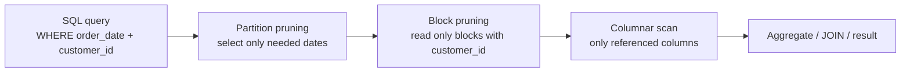

# Partitioning, Clustering, and Data Pruning in BigQuery

## 1. Why Organize Data Before Tuning SQL?

An enterprise stores three years of orders in **BigQuery**, ingested from Cloud Storage, Pub/Sub/Dataflow, or services running on Cloud Run/GKE. A dashboard only needs revenue for **the past seven days for a subset of customers**, yet the query scans nearly the entire history. BigQuery is a columnar analytical data warehouse capable of processing massive volumes; however, reading too much data increases **bytes processed**, execution time, and cost under the **on-demand** model.

Two table-organization techniques help avoid scanning irrelevant data:

- **Partitioning:** divides a table into **partitions** by time or integer range; a query with a matching filter reads only the required partitions (**partition pruning**).
- **Clustering:** sorts data within **storage blocks** by up to four columns; filters on clustered columns allow skipping irrelevant blocks (**block pruning**).

This lesson belongs to the **BigQuery** chapter of the **CLOUD_PROVIDERS_GCP** module, connecting project/IAM governance, networking, Cloud Run, GKE, storage services, and databases with automation, reliability, and query cost control.

**After this lesson, you will be able to:** choose a partitioning type and granularity; design clustering column order; write predicates that enable pruning; create practice tables using GoogleSQL; measure bytes with `bq query --dry_run` and Job details; and handle retention, streaming, DML, IAM, and mistakes that break pruning.

> **Lab scope:** All project/dataset/table names below are illustrative. Commands that create tables, INSERT, UPDATE, or delete data must only be run in an approved lab project and may incur BigQuery charges. Never target a production table with `CREATE OR REPLACE`.

## 2. Storage Model: Two Pruning Layers



Suppose the `orders` table holds two years of data, each day is one partition, and each partition is **CLUSTER BY customer_id, status**:

```text
orders
├── partition 2026-11-16
│   ├── blocks customer A...D
│   ├── blocks customer E...M
│   └── blocks customer N...Z
├── partition 2026-11-17
│   ├── blocks customer A...D
│   └── ...
└── partition 2026-11-18
    ├── blocks customer A...D
    └── ...
```

The query `WHERE order_date = DATE '2026-11-18' AND customer_id = 'C017'` can **eliminate partitions for other dates first**, then **prune blocks** based on customer value ranges. Finally, BigQuery reads only the referenced columns, such as `amount` and `customer_id`.

| Layer | Based On | What Gets Skipped | Estimate Certainty |
| --- | --- | --- | --- |
| **Partition pruning** | Partition metadata + partition key predicates | Entire non-matching partitions | Dry run usually estimates bytes reasonably well |
| **Block pruning** | Min/max metadata of clustered storage blocks | Blocks outside clustered filter values | Actual bytes drop at runtime; dry run may report only an **upper bound** |
| **Column pruning** | List of referenced columns in columnar storage | Unused columns | Avoid `SELECT *`, especially on wide tables |

**Pruning is not filtering results after reading the entire table.** It is the ability to **avoid reading** portions of data. However, fewer partitions do not guarantee a query is always fast: JOIN shuffles, aggregations, UDFs, skew, and limited slot capacity can still dominate runtime.

## 3. Three Common Partitioning Types

| Type | Partition Key | When to Use | How to Filter |
| --- | --- | --- | --- |
| **Time-unit column** | Actual `DATE`, `TIMESTAMP`, or `DATETIME` column in the table | Queries filter by **business date / event time** | Filter `order_date` or `event_ts` directly |
| **Ingestion-time** | Timestamp when BigQuery receives/loads the row | No reliable event date, or workflow cares about load time | `_PARTITIONTIME` or `_PARTITIONDATE` |
| **Integer-range** | `INT64` column partitioned into integer buckets | Queries filter by account/tenant ID with clear numeric ranges | Filter the integer column by range |

### 3.1. Time-Unit Column Partitioning

```sql
-- Daily partition on a DATE column
CREATE TABLE `acme-bq-lab.analytics_lab.orders_by_date` (
  order_id STRING, order_date DATE, amount NUMERIC
)
PARTITION BY order_date;

-- Hourly partition on TIMESTAMP: useful when querying by hour
CREATE TABLE `acme-bq-lab.analytics_lab.events_by_hour` (
  event_id STRING, event_ts TIMESTAMP, payload STRING
)
PARTITION BY TIMESTAMP_TRUNC(event_ts, HOUR);

-- Monthly partition on DATE to cap partition count
CREATE TABLE `acme-bq-lab.analytics_lab.orders_by_month` (
  order_id STRING, order_date DATE, amount NUMERIC
)
PARTITION BY DATE_TRUNC(order_date, MONTH);
```

`DATE` supports day/month/year; `TIMESTAMP` and `DATETIME` also support **hour**. Time-partition boundaries are based on **UTC** where applicable; distinguish business timezones from UTC dates so reports do not drift.

### 3.2. Ingestion-Time Partitioning

```sql
CREATE TABLE `acme-bq-lab.analytics_lab.ingested_events` (
  event_id STRING,
  event_ts TIMESTAMP,
  source STRING
)
PARTITION BY _PARTITIONDATE
OPTIONS (require_partition_filter = TRUE);

SELECT event_id, event_ts
FROM `acme-bq-lab.analytics_lab.ingested_events`
WHERE _PARTITIONDATE = DATE '2026-11-19';
```

`_PARTITIONTIME` is a `TIMESTAMP` pseudocolumn, while `_PARTITIONDATE` is the `DATE` of the ingestion partition. They do not appear in `SELECT *`; to display them, select and alias them explicitly. **Ingestion date differs from event date**: yesterday's event loaded today lands in today's partition.

For recently streamed data, rows sitting in write-optimized storage may temporarily reside in `__UNPARTITIONED__` with `_PARTITIONTIME IS NULL`. Do not assume ingestion failed merely because a query filtering on today's partition does not yet see buffered rows.

### 3.3. Integer-Range Partitioning

```sql
CREATE TABLE `acme-bq-lab.analytics_lab.account_metrics` (
  account_id INT64, metric_date DATE, amount NUMERIC
)
PARTITION BY RANGE_BUCKET(
  account_id,
  GENERATE_ARRAY(0, 100000, 1000)
);

SELECT account_id, amount
FROM `acme-bq-lab.analytics_lab.account_metrics`
WHERE account_id BETWEEN 12000 AND 12999;
```

The range `[12000,13000)` uses a bucket width of 1,000; out-of-range values go to `__UNPARTITIONED__` and `NULL` goes to `__NULL__`. **Integer-range partitions do not support `partition_expiration_days`**. Do not pick ID partitioning just because `order_id` exists: randomly distributed IDs or date-driven queries can create many partitions with little pruning benefit.

## 4. Choosing a Partition Key and Granularity

### Guidelines

1. **Start from the `WHERE` clauses of real queries**, not from column names that sound natural.
2. Choose **event/business date** if most reports filter by transaction time; choose ingestion time if workflows care about warehouse arrival time.
3. Use **daily** for standard day/week/month queries; **hourly** when volume is huge and filters are hourly; **monthly/yearly** if time spans are very long with tiny daily volume.
4. A BigQuery native table has **one partitioning specification**, which can be combined with up to **four clustering columns**.
5. Do not treat partitioning as a security boundary; access control still relies on IAM, row access policies, and column policy tags.

Under current quotas, a BigQuery native partitioned table is limited to **10,000 partitions per table**, alongside load/copy/query modification limits. **Many tiny partitions** increase metadata overhead and can hurt efficiency. Google recommends considering partitioning when average partition size is **around 10 GiB or more** or when stable pre-query cost estimation is needed; this is a **design guideline**, not a mandatory minimum size.

### Example of a Poor Choice

An application writes **2,000 rows/day** (~2 MiB/day) but partitions **hourly** over three years: the partition count becomes huge while each partition is tiny, and most reports filter only by `order_date`. **Switching to daily/monthly**, or clustering an unpartitioned table on frequently filtered columns, may be a better fit.

A table receiving **2 TiB/day** where dashboards always filter the **last 6 hours** can benefit from hourly partitioning, provided quotas and streaming/backfill volumes are accounted for.

## 5. Partition Pruning: Writing `WHERE` So BigQuery Skips Partitions

### Good Query: Filter Directly on the Partition Key

```sql
SELECT customer_id, SUM(amount) AS revenue
FROM `acme-bq-lab.analytics_lab.orders_by_date`
WHERE order_date BETWEEN DATE '2026-11-16' AND DATE '2026-11-18'
GROUP BY customer_id;
```

BigQuery only needs partitions for those three days. For tables partitioned by `event_ts`, place a direct range predicate on the timestamp:

```sql
SELECT event_id
FROM `acme-bq-lab.analytics_lab.events_by_hour`
WHERE event_ts >= TIMESTAMP '2026-11-18 10:00:00+00'
  AND event_ts <  TIMESTAMP '2026-11-18 13:00:00+00';
```

A **half-open range** (`>= start AND < end`) avoids double-counting at day/hour boundaries, especially with microsecond-precision `TIMESTAMP`s.

### Queries That Break or Reduce Pruning

```sql
-- DISADVANTAGEOUS: partition filter depends on another table query
SELECT o.order_id
FROM `acme-bq-lab.analytics_lab.orders_by_date` AS o
WHERE o.order_date = (
  SELECT MAX(p.report_date)
  FROM `acme-bq-lab.analytics_lab.report_parameters` AS p
);

-- BETTER: application/scheduler resolves date first and passes literal/parameter
SELECT order_id
FROM `acme-bq-lab.analytics_lab.orders_by_date`
WHERE order_date = @target_date;
```

The `@target_date` parameter is bound as `DATE` when creating the query job; **never concatenate user input directly into SQL**. With dynamic filters from subqueries or joins, BigQuery may not know the partition set before scanning, reducing pruning effectiveness. Do not confuse `CURRENT_DATE()` or `CURRENT_TIMESTAMP()` with data subqueries: the optimizer can treat them as query-level constants for pruning.

**Avoid wrapping the partition column in complex expressions when direct filtering is possible.** The optimizer can still prune through certain expressions; the reliable way to verify is **dry run / Job details**, rather than assuming every function call disables pruning.

## 6. `require_partition_filter`: Guardrail Against Full Scans

```sql
CREATE TABLE `acme-bq-lab.analytics_lab.guarded_orders` (
  order_id STRING, order_date DATE, amount NUMERIC
)
PARTITION BY order_date
OPTIONS (require_partition_filter = TRUE);

-- Accepted: includes an explicit predicate on the partitioning column
SELECT order_id, amount
FROM `acme-bq-lab.analytics_lab.guarded_orders`
WHERE order_date >= DATE '2026-11-01';

-- Rejected: missing predicate on the partitioning column
SELECT order_id
FROM `acme-bq-lab.analytics_lab.guarded_orders`
WHERE amount > 100;
```

BigQuery typically returns an error like: `Cannot query over table ... without a filter that can be used for partition elimination`. This requirement also applies to queries through **views/materialized views** referencing the table.

To enable it on an existing partitioned table:

```sql
ALTER TABLE `acme-bq-lab.analytics_lab.orders_by_date`
SET OPTIONS (require_partition_filter = TRUE);
```

**Understand accurately:** The guardrail requires a filter **referencing only the partitioning column**; it does **not** enforce high selectivity. For example, `WHERE order_date IS NOT NULL` may still read nearly every partition. Never bypass the error with an overly broad predicate; supply a **meaningful business time window**.

**Rollout warning:** enabling the guardrail in production can break dashboards, scheduled queries, views, DML/`MERGE` jobs, or legacy apps that omit date filters. Inventory dependencies and roll out in stages before enforcing it.

## 7. Clustering: Block-Level Sorting, Not an Index

Clustering **sorts data in the order of clustered columns** inside adaptive storage blocks. It is **not a B-tree index** and does not guarantee row ordering in `SELECT` results; to guarantee output order, still use `ORDER BY`.

```sql
CREATE TABLE `acme-bq-lab.analytics_lab.orders_clustered` (
  order_id STRING,
  customer_id STRING,
  status STRING,
  order_date DATE,
  amount NUMERIC
)
CLUSTER BY customer_id, status;
```

- Up to **four top-level non-repeated clustering columns** are allowed, of supported types such as `STRING`, `INT64`, `NUMERIC`, `DATE`, `TIMESTAMP`, `BOOL`, `GEOGRAPHY`, etc.
- **Column order determines sort priority**: with `CLUSTER BY customer_id, status`, filtering on `customer_id` typically prunes blocks better than filtering **only on `status`**.
- BigQuery **automatically reclusters** data in the background as needed; you do not need to add `ORDER BY` to every `INSERT` to maintain clustering.
- On an **unpartitioned clustered table**, clustering benefits appear clearly at larger data volumes; if a lab table is only a few KiB, all rows may sit in one block with no measurable difference.

### Good vs. Poor Filters

```sql
-- GOOD: equality on the leading cluster key, optionally plus the second key
SELECT SUM(amount)
FROM `acme-bq-lab.analytics_lab.orders_clustered`
WHERE customer_id = 'C017' AND status = 'PAID';

-- POOR: filtering only on the second cluster key
SELECT SUM(amount)
FROM `acme-bq-lab.analytics_lab.orders_clustered`
WHERE status = 'PAID';

-- POOR: transforming the cluster key with a function instead of direct comparison
SELECT SUM(amount)
FROM `acme-bq-lab.analytics_lab.orders_clustered`
WHERE UPPER(customer_id) = 'C017';
```

A query filtering only on the second column **can still achieve partial pruning** depending on block layout, though usually less effectively than the leftmost key. Writing `WHERE status=... AND customer_id=...` instead of the reverse **does not alter cluster order**—what matters is the **column order in `CLUSTER BY`**, not the textual order of predicates.

## 8. Combining Partitioning and Clustering

```sql
CREATE TABLE `acme-bq-lab.analytics_lab.orders_optimized` (
  order_id STRING NOT NULL,
  order_date DATE NOT NULL,
  created_at TIMESTAMP,
  customer_id STRING NOT NULL,
  status STRING,
  amount NUMERIC
)
PARTITION BY order_date
CLUSTER BY customer_id, status
OPTIONS (
  require_partition_filter = TRUE,
  partition_expiration_days = 365,
  description = 'Orders lab: partition by order_date, cluster by customer and status'
);
```

Sample query:

```sql
SELECT customer_id, SUM(amount) AS revenue
FROM `acme-bq-lab.analytics_lab.orders_optimized`
WHERE order_date >= DATE '2026-11-16'
  AND order_date <  DATE '2026-11-19'
  AND customer_id = 'C017'
  AND status = 'PAID'
GROUP BY customer_id;
```

**Two distinct pruning steps:** the partition filter selects three days; the customer/status filters narrow blocks within those selected partitions. If `order_date` is omitted, the query is rejected by `require_partition_filter` even though `customer_id` is highly selective.

**Do not pick cluster keys mechanically based purely on cardinality.** Measure common filters, selectivity, actual bytes scanned, table/partition sizes, and JOIN/grouping patterns. A `status` column with only two values that appears in every query can still be useful as the **second cluster key**; putting it first could hurt queries filtering primarily on `customer_id`.

## 9. Lab A — Creating a Dataset and a Partitioned + Clustered Table

This lab uses **BigQuery native GoogleSQL** and requires no Compute Engine/GKE or production data sources. Assumptions:

```text
Project:  acme-bq-lab
Location: asia-southeast1
Dataset:  analytics_lab
Table:    orders_optimized
```

**Preflight:** Billing and the BigQuery API are enabled; the operator has `bigquery.datasets.create` if creating the dataset, `bigquery.tables.create` and `bigquery.tables.updateData` on the dataset, and `bigquery.jobs.create` to run queries. Use an approved project and location, and never put copies of real customer data into a lab dataset.

### 9.1. Create the Dataset

```bash
# MUTATES: run only in the LAB project
bq --project_id=acme-bq-lab mk \
  --dataset \
  --location=asia-southeast1 \
  acme-bq-lab:analytics_lab

# READ-ONLY
bq --project_id=acme-bq-lab ls --datasets
bq show --format=prettyjson acme-bq-lab:analytics_lab
```

If the dataset already exists or is shared, **do not delete it or alter its metadata**. When querying, set the job location to **match the dataset location** to avoid cross-location errors.

### 9.2. Create a Table with Partition Filter Enforcement

Run the SQL in BigQuery Studio or via `bq query --use_legacy_sql=false`:

```sql
CREATE TABLE `acme-bq-lab.analytics_lab.orders_optimized` (
  order_id STRING NOT NULL,
  order_date DATE NOT NULL,
  created_at TIMESTAMP,
  customer_id STRING NOT NULL,
  status STRING,
  amount NUMERIC
)
PARTITION BY order_date
CLUSTER BY customer_id, status
OPTIONS (
  require_partition_filter = TRUE,
  partition_expiration_days = 365,
  description = 'Partition/clustering learning lab'
);
```

If you already created the table in Section 8, **do not re-run CREATE TABLE**; both examples have the same goal. Inspect the schema, clustering order, and partitions:

```bash
# READ-ONLY
bq show --format=prettyjson \
  acme-bq-lab:analytics_lab.orders_optimized
```

In the metadata, verify `timePartitioning`, `clustering.fields`, `requirePartitionFilter`, and `timePartitioning.expirationMs`. Setting partition expiration to **365 days** is illustrative only; do not apply it to data governed by longer legal retention policies.

### 9.3. Insert Sample Data and Verify Results

```sql
-- MUTATES LAB DATA. Never run in a real environment.
INSERT INTO `acme-bq-lab.analytics_lab.orders_optimized`
  (order_id, order_date, created_at, customer_id, status, amount)
VALUES
  ('O-1001', DATE '2026-11-16', TIMESTAMP '2026-11-16 08:00:00+00', 'C017', 'PAID', 100.50),
  ('O-1002', DATE '2026-11-16', TIMESTAMP '2026-11-16 09:00:00+00', 'C018', 'NEW', 50.00),
  ('O-1003', DATE '2026-11-17', TIMESTAMP '2026-11-17 10:00:00+00', 'C017', 'PAID', 250.00),
  ('O-1004', DATE '2026-11-17', TIMESTAMP '2026-11-17 11:00:00+00', 'C019', 'PAID', 75.25),
  ('O-1005', DATE '2026-11-18', TIMESTAMP '2026-11-18 12:00:00+00', 'C017', 'NEW', 80.00),
  ('O-1006', DATE '2026-11-18', TIMESTAMP '2026-11-18 13:00:00+00', 'C017', 'PAID', 120.00);

-- READ-ONLY, satisfies require_partition_filter
SELECT order_date, customer_id, status, amount
FROM `acme-bq-lab.analytics_lab.orders_optimized`
WHERE order_date BETWEEN DATE '2026-11-16' AND DATE '2026-11-18'
ORDER BY order_date, customer_id;
```

**Result:** six rows across three partitions. For instance, paid orders for `C017` total `100.50 + 250.00 + 120.00 = 470.50`. **Do not expect measurable block pruning** on six rows: the table is far too small to split into multiple clustered blocks.

## 10. Lab B — Comparing Queries With and Without Pruning

### 10.1. Ask the Same Business Question with Different Scan Scopes

```sql
-- Q1: two pruning layers; date + customer_id and status
SELECT SUM(amount) AS revenue
FROM `acme-bq-lab.analytics_lab.orders_optimized`
WHERE order_date BETWEEN DATE '2026-11-16' AND DATE '2026-11-18'
  AND customer_id = 'C017'
  AND status = 'PAID';

-- Q2: partition pruning present, missing clustered predicate
SELECT SUM(amount) AS revenue
FROM `acme-bq-lab.analytics_lab.orders_optimized`
WHERE order_date BETWEEN DATE '2026-11-16' AND DATE '2026-11-18';

-- Q3: rejected due to missing required partition filter
SELECT SUM(amount) AS revenue
FROM `acme-bq-lab.analytics_lab.orders_optimized`
WHERE customer_id = 'C017';
```

Q1 returns `470.50`, Q2 returns total revenue across all three days, and Q3 is expected to **fail due to `require_partition_filter`**. On a tiny table, Q1 will not always show lower billed bytes than Q2: block metadata, minimum bytes billed, result caching, and actual table layout affect observations.

### 10.2. Expanding the Dataset (Optional, May Incur Charges)

If you need a larger table to observe behavior, increase data only inside the **lab dataset** after budget approval. Example generating **30,000 synthetic rows**:

```sql
-- MUTATES: 30 days x 1,000 rows; do not run if already loaded previously
INSERT INTO `acme-bq-lab.analytics_lab.orders_optimized`
  (order_id, order_date, created_at, customer_id, status, amount)
SELECT
  FORMAT('LAB-%02d-%06d', d, n),
  DATE_ADD(DATE '2026-10-01', INTERVAL d DAY),
  TIMESTAMP(DATE_ADD(DATE '2026-10-01', INTERVAL d DAY)),
  FORMAT('C%04d', MOD(n, 200)),
  IF(MOD(n, 4) = 0, 'PAID', 'NEW'),
  CAST(MOD(n * 37, 10000) AS NUMERIC)
FROM UNNEST(GENERATE_ARRAY(0, 29)) AS d
CROSS JOIN UNNEST(GENERATE_ARRAY(1, 1000)) AS n;
```

Even 30,000 rows **may still be too small** for BigQuery to split across many storage blocks, so treat this as a syntax lab, **not a benchmark proving a fixed savings ratio**. For production benchmarking, use a representative-scale copy and run repeated controlled measurements.

### 10.3. `bq query --dry_run`: Estimating Bytes Before Running

```bash
# READ-ONLY/DRY RUN, does not execute query or consume query slots
bq query \
  --project_id=acme-bq-lab \
  --location=asia-southeast1 \
  --use_legacy_sql=false \
  --dry_run \
  'SELECT customer_id, SUM(amount)
   FROM `acme-bq-lab.analytics_lab.orders_optimized`
   WHERE order_date BETWEEN DATE("2026-11-16") AND DATE("2026-11-18")
     AND customer_id = "C017"
   GROUP BY customer_id'
```

Dry run returns **estimated** bytes for the query and catches SQL/`require_partition_filter` errors. **Important note:** for clustering, BigQuery does not know the exact number of blocks skipped until the query **executes**. Thus dry run may report **more bytes than actually read**; never claim clustering isn't working just because dry runs for Q1 and Q2 look identical.

Under **on-demand pricing**, `maximumBytesBilled` checks the **pre-execution upper bound** before block pruning, so queries on clustered tables may still be rejected even when actual runtime bytes would be small. Address this by tightening **partition/column predicates** first, then choosing an appropriate limit—never raise the limit unconditionally.

## 11. Lab C — Measuring Effectiveness After Execution

Run Q1 and Q2 once in BigQuery Studio and inspect **Execution details → Query plan, bytes processed/billed, slot milliseconds, cache hit**. If a query hits the cache, do not treat ~0 bytes as proof of pruning; test with controlled uncached queries/data and document benchmark conditions.

### Per-Partition Metadata

```sql
-- READ-ONLY: INFORMATION_SCHEMA.PARTITIONS is in Preview
SELECT
  partition_id,
  total_rows,
  total_logical_bytes,
  storage_tier,
  last_modified_time
FROM `acme-bq-lab.analytics_lab.INFORMATION_SCHEMA.PARTITIONS`
WHERE table_name = 'orders_optimized'
ORDER BY partition_id DESC;
```

`partition_id` has format `YYYYMMDD` for daily partitions, `__NULL__` if the partition key is NULL, or `__UNPARTITIONED__` for out-of-range or eligible streaming data. This view has a metadata query limit of **1,000 tables**; filter with `WHERE table_name` and select only needed columns. `total_logical_bytes` reflects logical bytes, **not directly the storage bill**, especially under physical storage billing.

### Query Job Statistics by Region

```sql
-- READ-ONLY: inspect recent query jobs
SELECT
  creation_time,
  job_id,
  cache_hit,
  total_bytes_processed,
  total_bytes_billed,
  total_slot_ms,
  state,
  error_result.message AS error_message
FROM `acme-bq-lab.region-asia-southeast1.INFORMATION_SCHEMA.JOBS_BY_PROJECT`
WHERE creation_time >= TIMESTAMP_SUB(CURRENT_TIMESTAMP(), INTERVAL 1 DAY)
  AND job_type = 'QUERY'
ORDER BY creation_time DESC
LIMIT 20;
```

`INFORMATION_SCHEMA.JOBS_BY_PROJECT` requires appropriate job-metadata permissions and a location qualifier **matching where the job ran**. Bytes billed follows on-demand minimum billing units, so it does not map 1:1 to `total_bytes_processed`. Under BigQuery Editions/reservations, **slot capacity** and billing formulas differ from on-demand; inspect both `total_slot_ms` and the billing model.

## 12. Column Pruning and `LIMIT`: Two Common Traps

BigQuery stores data **by column**, so:

```sql
-- GOOD: reads only the two required columns
SELECT customer_id, amount
FROM `acme-bq-lab.analytics_lab.orders_optimized`
WHERE order_date = DATE '2026-11-18';

-- POOR: reads every column even if the client only uses two
SELECT *
FROM `acme-bq-lab.analytics_lab.orders_optimized`
WHERE order_date = DATE '2026-11-18';

-- LIMIT does not replace partition filters or column pruning
SELECT *
FROM `acme-bq-lab.analytics_lab.orders_optimized`
WHERE order_date = DATE '2026-11-18'
LIMIT 10;
```

`LIMIT 10` caps **returned rows** without guaranteeing BigQuery reads only 10 rows' worth of data. On large tables, reduce costs by prioritizing **partition filters, clustered keys, column projection**, and using samples/aggregates/marts when only a subset is truly needed.

## 13. Joins and Filter Expressions That Can Hide Pruning

### Avoid Assuming Join Conditions Infer Partition Ranges

```sql
-- Illustrative: report_parameters is a hypothetical table;
-- the optimizer may not prune partitions from dynamic join values.
SELECT o.order_id, o.amount
FROM `acme-bq-lab.analytics_lab.orders_optimized` AS o
JOIN `acme-bq-lab.analytics_lab.report_parameters` AS r
  ON o.order_date = r.report_date
WHERE r.report_id = 'R-20261118';

-- Prefer independent predicates known at plan time:
SELECT order_id, amount
FROM `acme-bq-lab.analytics_lab.orders_optimized`
WHERE order_date = DATE '2026-11-18'
  AND customer_id = 'C017';
```

If a BI tool generates dynamic filters from dimension joins, inspect the **query plan and dry run**. For recurring reports, pass date ranges as query parameters; never inject fake date filters that silently drop valid records.

### Avoid Unnecessary Functions on Cluster Keys

```sql
-- POOR: UPPER(customer_id) hinders block pruning
SELECT SUM(amount)
FROM `acme-bq-lab.analytics_lab.orders_optimized`
WHERE order_date = DATE '2026-11-18'
  AND UPPER(customer_id) = 'C017';

-- GOOD: normalize customer_id at ingestion, then compare directly
SELECT SUM(amount)
FROM `acme-bq-lab.analytics_lab.orders_optimized`
WHERE order_date = DATE '2026-11-18'
  AND customer_id = 'C017';
```

To preserve correctness with normalized keys, standardize casing/character formatting in the ingestion pipeline; never swap in a semantically wrong filter just for speed. While some optimizer transformations still support pruning, **direct comparisons verified via job statistics** are easiest to rely on.

## 14. DML, `MERGE`, and Altering Table Layout

Partitioning **does not only affect `SELECT`**. `UPDATE`, `DELETE`, and `MERGE` DML statements may need to read target and source partitions; missing filters can make them expensive or fail `require_partition_filter`.

```sql
-- MUTATES: UPDATE with an explicit partition predicate
UPDATE `acme-bq-lab.analytics_lab.orders_optimized`
SET status = 'SHIPPED'
WHERE order_date = DATE '2026-11-18'
  AND order_id = 'O-1006';

-- MUTATES: DELETE targeting specific rows in a lab partition
DELETE FROM `acme-bq-lab.analytics_lab.orders_optimized`
WHERE order_date = DATE '2026-11-18'
  AND order_id = 'O-1005';
```

**Caution:** DML mutates data and changes results for subsequent exercises. Run the statements above only when intentionally practicing DML in the lab—they are **not mandatory steps**.

With `MERGE`, place partition predicates appropriately in `USING`, `ON`, or `WHEN ... AND` per the query plan so the optimizer prunes **both source and target**. Filtering only the source table does not guarantee target partition pruning. When `require_partition_filter` is enabled, test the actual query before deploying to production.

### Changing Partitioning/Clustering on an Existing Table

- You can **update clustering specifications** via metadata per documentation, but **existing data in a previously unclustered table is not automatically re-sorted** simply by adding `CLUSTER BY`; a backfill/rewrite process is required per guidelines.
- To convert an unpartitioned table to partitioned or change the **partition key/granularity**, you typically create a **new table** via `CREATE TABLE ... PARTITION BY ... AS SELECT`, verify, and cut over views/consumers; never assume an `ALTER TABLE` changes physical partitioning in place.
- When backfilling many partitions, batch with checkpoints and check **partition modification quotas**, schemas, job locations, and late-arriving data.
- Preserve access permissions, row access policies/column security, labels, expirations, and downstream views after migration.

**Safe migration:** dry run queries on a small copy, design the target table, bulk load, reconcile rows/bytes and dashboards, cut over aliases/views or consumers, keep a rollback window, and clean up the old table last.

## 15. Partition Expiration, Retention, and Late-Arriving Data

```sql
-- MUTATES policy of a time-unit partitioned table
ALTER TABLE `acme-bq-lab.analytics_lab.orders_optimized`
SET OPTIONS (
  partition_expiration_days = 90,
  require_partition_filter = TRUE
);
```

**Never run this on a table holding historical data that must be retained** without an approved backup/retention plan. Partition expiration is evaluated against **UTC partition boundaries**, not each row's ingestion timestamp. With daily partitions, all rows sharing a date expire on the **partition boundary**; older partitions may **be dropped immediately** when you shorten retention.

- **Table partition expiration** overrides **dataset default partition expiration** if set; table expiration (if configured) can delete the **entire table** before partition expiration runs.
- **Integer-range partitioned tables do not support partition expiration**: cleanup must follow a separate process.
- **Late-arriving data:** ingesting a record whose `order_date` is older than retention means its partition may already be expired or expire immediately; design an appropriate quarantine/backfill policy.
- BigQuery **time travel/fail-safe** and Cloud Storage exports do not replace a dedicated retention/backup SLA. Never assume expired rows can always be recovered via SQL.

**In production:** audit retention changes and table-update IAM permissions; use labels and budget alerts to track storage impact. Combine partition expiration with sensitive-data deletion policies rather than treating partitioning as the sole compliance mechanism.

## 16. Quotas, Performance, and Real-World Costs

| Issue | What to Monitor | How to Resolve |
| --- | --- | --- |
| **Many small partitions** | Partition count, logical bytes/partition | Coarsen granularity from hourly to daily/monthly; consider clustering-only tables |
| **Hitting partition quota** | Current limit **10,000 partitions/table** | Pick suitable granularity/ranges and cold-storage archiving |
| **Loading/backfilling too many partitions** | Partition modification quotas, job failures | Batch updates and reduce affected partitions per job |
| **Low clustering effectiveness** | Actual bytes, cluster key order, block/table size | Prioritize common filters; avoid functions on keys; measure post-execution |
| **Query rejected by max bytes billed** | Dry-run upper bound, especially with clustering | Prune partitions/columns first; set an appropriate budget |
| **High slot usage despite low bytes** | `total_slot_ms`, JOIN shuffles, skew/aggregations | Optimize SQL/joins and reservation capacity |
| **Growing storage bill** | Active/long-term logical or physical bytes, expiration | Enforce retention, remove redundant data, apply lifecycle policies |

### Simple Volume Estimate

Assume 730 days of history averaging **5 GiB/day**, and a dashboard reads exactly **7 days**:

```text
Without partition pruning: up to ~730 × 5 GiB = 3,650 GiB
With 7-day pruning:             ~7 × 5 GiB =    35 GiB
Data ratio by days:                   7 / 730 ≈ 0.96%
```

This is a **raw volume illustration**, not an invoice: BigQuery reads by columns, blocks, compression/billing units, cache, table metadata, and on-demand/slot-based pricing. Adding a cluster filter can reduce actual bytes below 35 GiB, though there is no fixed pre-run "savings multiplier."

### Two Billing Models to Distinguish

- **On-demand:** query cost ties to **bytes billed** per SKU rules and minimum billable bytes; pruning and column selection typically reduce bills directly.
- **Capacity-based (BigQuery Editions/reservations):** costs depend on slot capacity and reservation/autoscaling policies; pruning reduces work, latency, and slot pressure, yet **savings cannot be calculated simply from GiB skipped**.

Use **BigQuery Job details**, `INFORMATION_SCHEMA.JOBS_BY_PROJECT`, Cloud Monitoring, and **Cloud Billing export** to measure impact over a representative window instead of estimating from row counts.

## 17. IAM, Security, and Partition Governance

**Partitioning and clustering organize storage—they are not authorization boundaries.** Someone permitted to query a table is not automatically restricted to today's partition unless proper access controls are configured.

| Identity | Typical Work | Recommended Scope |
| --- | --- | --- |
| Dashboard/analyst | `roles/bigquery.jobUser` on execution project; `roles/bigquery.dataViewer` on dataset/tables to read | No DDL or retention modification rights |
| Data ingestion/ETL SA | Read source / write target tables; `bigquery.jobs.create` | Only datasets owned by the pipeline |
| Data platform engineer | Create/alter tables, clustering/partition policies | Via code review/IaC with separate production approval |
| Billing/FinOps | View metrics, jobs, and cost exports | No default read access to sensitive table rows |

### Guardrails

1. Enable `require_partition_filter=TRUE` on large tables once dashboards/queries are compatible.
2. Organize datasets by **data residency** and dev/prod boundaries; avoid creating datasets in the wrong region and attempting cross-location queries.
3. Apply **row-level security, column-level access control, policy tags, or authorized views** for tenant/PII isolation; clustering by tenant does not enforce tenant isolation.
4. Restrict permissions to alter `partition_expiration_days`: one command can immediately drop data outside retention.
5. Separate user/service accounts that submit jobs from accounts that manage schemas; apply budget/slot quotas and audit logging.
6. With row-level security, **dry run may return a 0-byte estimate** to prevent data inference; never treat that figure as a real cost commitment.

**Multi-tenant example:** clustering by `tenant_id` cuts block scans for tenant queries, yet callers must still pass through **IAM and row access policies / backend authorization**. Arbitrary SQL can drop a tenant filter if the application does not enforce it.

## 18. Troubleshooting: Where Did Pruning Break?

| Symptom | Possible Cause | Resolution |
| --- | --- | --- |
| `Cannot query ... without a filter...` | Table enforces `require_partition_filter`, SQL omits partition column | Add an accurate range on the partition key; fix views/dashboards |
| Query runs but scans massive bytes | Date filter inside dynamic subquery/join, missing projection | Move literal/parameter predicate to scan; avoid `SELECT *` |
| Dry run for Q1 and Q2 looks identical | Cluster pruning only resolves accurately at runtime | Compare post-execution bytes processed/billed and cache status |
| Filtering `status` yields poor cluster pruning | `CLUSTER BY customer_id, status` skips leading key | Evaluate workload to reorder cluster keys or filter customer too |
| `UPPER(customer_id)` is slow | Cluster key wrapped in function | Normalize at ingestion and compare directly |
| 6-row lab table shows no cluster benefit | All rows reside in very few storage blocks | Benchmark on a larger copy with representative distribution |
| Today's data missing from ingestion-time partition | Streaming buffer `__UNPARTITIONED__`, or UTC vs. local time offset | Check `_PARTITIONTIME IS NULL` and ingestion timestamps |
| Table loses old partitions | Partition expiration / table expiration changed | Review `TABLE_OPTIONS`, audit logs, and retention policy |
| Query hits wrong date despite yesterday's event | Using ingestion-time instead of event-time | Filter on the business timestamp column and convert timezones |
| Table hits quota | Too many daily/hourly partitions or excessive load modifications | Coarsen granularity and batch backfill jobs |
| `MERGE` is expensive / rejected by guardrail | Target partitions not pruned | Inspect target/source predicates and query plan |
| `Access Denied` when querying | Missing `bigquery.jobs.create` or `bigquery.tables.getData` | Grant least-privilege roles on the right project/dataset |
| `Location mismatch` | Query job location differs from dataset location | Set `--location`/job region to match the dataset |

### Runbook for Optimizing a Production Query

1. **Capture baseline:** full SQL, parameters, bytes processed/billed, slot milliseconds, duration, `cache_hit`, and dataset location.
2. **Inspect table structure:** partition key/type/granularity, `require_partition_filter`, clustering order, partition counts/bytes.
3. **Verify pruning predicates:** date range on partition key, leading cluster key predicates, and projected columns.
4. **Run dry run:** confirm SQL validity and expected partition pruning; do not treat it as exact block pruning.
5. **Run bounded benchmark:** use a representative dataset and inspect actual Job details under consistent conditions.
6. **Verify correctness:** ensure aggregates and edge cases (timezones, NULLs, late events) remain unchanged.
7. **Deploy with rollback:** manage via DDL/IaC, monitor query/cost metrics, retain backups/retention, and document before/after results.

**Never change a production partition key or shorten retention just because of one high dry-run estimate.** Check `WHERE` predicates, column selection, caching, and actual workload patterns first.

## 19. Three Design Scenarios

### 19.1. Three Years of Order Analytics

**Requirements:** daily/weekly dashboards frequently filtering `customer_id` and `status`; Cloud Run backend writes orders to Cloud SQL/Spanner, and a pipeline streams events to BigQuery.

**Recommendation:** partition by `order_date`, cluster by `customer_id, status`, and enable `require_partition_filter`. BI queries pass explicit date ranges and select only columns needed by dashboards.

**Testing:** reconcile total revenue, compare bytes scanned for a single day vs. a full year, and verify late-arriving orders and UTC reporting date alignment.

### 19.2. IoT Telemetry from Pub/Sub/Dataflow

**Requirements:** billions of events/day, queries mostly inspect the last 30 minutes per `device_id`; Dataflow ingests data into BigQuery.

**Recommendation:** evaluate hourly partitioning on `event_ts` and clustering by `device_id`; if the 10,000-partition limit or pipeline metadata overhead becomes an issue, switch to daily + clustering. Account for streaming data in `__UNPARTITIONED__` if using ingestion partitioning, and handle late/out-of-order events.

**Testing:** compare p95 latency, bytes, slot-ms, and data freshness; never alter event-time semantics purely to chase cost savings.

### 19.3. Multi-Tenant SaaS Reporting

**Requirements:** each tenant views 90 days of its own data. One dataset holds many tenants, and queries typically filter by `tenant_id` + `order_date`.

**Recommendation:** partition by `order_date`, cluster by `tenant_id` first, and add status if beneficial. **Do not rely on clustering for security**: enforce row-level security/authorized views or backend tenant authorization. Set budget alerts and test queries that intentionally omit the tenant filter.

**Testing:** confirm tenant A cannot read tenant B, 90-day queries prune partitions, and reports cannot leak data via dynamic SQL or spoofed tenant context.

## 20. Self-Check Exercises

1. **Two pruning layers:** How do partitioning by `order_date` and clustering by `customer_id` differ? **Hint:** partitioning skips whole partitions; clustering skips storage blocks within selected data.
2. **Choosing a key:** A table has `event_ts` and `ingested_at`; reports follow event time, and data can arrive a day late. Which column should you partition on? **Answer:** usually `event_ts` so event-time queries prune accurately.
3. **Granularity:** Three years of logs at 1 MiB/hour, and dashboards query monthly. Why is hourly partitioning poor? **Hint:** high partition count and metadata overhead with tiny partitions.
4. **Cluster order:** `CLUSTER BY country, customer_id, status`. Does `WHERE customer_id='C017'` prune as well as filtering `country` + `customer_id`? **Usually not**, because it skips the leading `country` key.
5. **Required filter:** Does `WHERE status='PAID'` work on a table with `require_partition_filter=TRUE`? **No**; a qualifying predicate on the partition column is required.
6. **Constant expression:** Compare `WHERE order_date=DATE '2026-11-18'` with `WHERE order_date=(SELECT MAX(day)...)`. Which prunes more reliably? **Answer:** the literal/parameter known at planning time.
7. **Dry run:** Dry runs for Q1 and Q2 show identical bytes even though Q1 filters a cluster key. Can you conclude clustering is ineffective? **No**; compare actual post-execution bytes with caching excluded.
8. **Small table:** Six rows across three partitions show nearly identical bytes across queries. Should you immediately drop clustering? **No**; benchmark on a representative dataset and factor in growth.
9. **Integer range:** `RANGE_BUCKET(account_id, GENERATE_ARRAY(0, 100000, 1000))`. Which partition holds account ID 12,345? **Answer:** the range starting at 12,000.
10. **Expiration:** Daily partitions with a 90-day TTL receive a row whose `order_date` is 200 days old. What is the risk? **Hint:** the partition is expired/cannot be retained long; a late-data policy is needed.
11. **DML:** Updating 1,000 rows without a partition predicate on a large table. What is the risk? **Hint:** scans many partitions, spikes bytes, or gets rejected by the guardrail.
12. **Security:** A table is clustered by `tenant_id`. Is that enough to prevent user A from reading tenant B? **No**; enforce access control via IAM, row policies, or the application layer.
13. **Observability:** From Job details and `INFORMATION_SCHEMA.JOBS_BY_PROJECT`, list four metrics to compare before and after optimization. **Hint:** total bytes processed, bytes billed, slot-ms, duration/cache hit.
14. **Hands-on lab:** In a lab project, create `orders_optimized`, insert six rows, and run `bq --dry_run` for date-only, date+customer, and a query omitting date. Record outputs, the guardrail error, and explain why block pruning **cannot be proven** with a tiny row count.

## 21. Production Checklist

- [ ] Partition type reflects **actual query paths** (event-time, ingestion-time, or integer ranges).
- [ ] Granularity fits partition sizes and stays within **10,000 partitions/table**.
- [ ] Up to four supported clustering columns chosen; left-to-right order matches common filters.
- [ ] Combined partitioning + clustering evaluated when per-partition data volume is substantial.
- [ ] Direct `WHERE` predicates on the partition key use literals, parameters, or real time windows.
- [ ] `require_partition_filter` enabled after auditing dashboards, views, DML, and scheduled queries.
- [ ] `SELECT *` and `LIMIT` are not misused as substitutes for pruning and column selection.
- [ ] Both dry run and **actual post-execution bytes** checked, without confusing cluster estimates with runtime scans.
- [ ] Cache hits, on-demand bytes billed, and Editions slot-based billing are properly distinguished.
- [ ] Appropriate retention/partition expiration and late-arriving/backfill policies are in place.
- [ ] Plans exist for schema management, changing partitioning/clustering, data reconciliation, and rollback.
- [ ] Dataset location, Cloud Run/GKE service accounts, BigQuery IAM, and policy tags are properly configured.
- [ ] Tenant/PII isolation does not rely solely on physical clustering.
- [ ] Partition counts/bytes, job failures, query bytes/slot-ms, cost trends, and quotas are monitored.
- [ ] Benchmarks run on representative data distributions with baseline/result correctness verified before rollout.

## 22. Official Google Cloud References

1. [BigQuery partitioned tables overview](https://cloud.google.com/bigquery/docs/partitioned-tables).
2. [Create partitioned tables](https://cloud.google.com/bigquery/docs/creating-partitioned-tables).
3. [Query partitioned tables and partition pruning](https://cloud.google.com/bigquery/docs/querying-partitioned-tables).
4. [Manage partitioned tables and require partition filters](https://cloud.google.com/bigquery/docs/managing-partitioned-tables).
5. [BigQuery clustered tables overview](https://cloud.google.com/bigquery/docs/clustered-tables).
6. [Create clustered tables](https://cloud.google.com/bigquery/docs/creating-clustered-tables).
7. [Query clustered tables and block pruning](https://cloud.google.com/bigquery/docs/querying-clustered-tables).
8. [BigQuery partitioned table DML](https://cloud.google.com/bigquery/docs/using-dml-with-partitioned-tables).
9. [Optimize BigQuery query computation](https://cloud.google.com/bigquery/docs/best-practices-performance-compute).
10. [BigQuery dry runs and jobs](https://cloud.google.com/bigquery/docs/running-queries).
11. [INFORMATION_SCHEMA.PARTITIONS view](https://cloud.google.com/bigquery/docs/information-schema-partitions).
12. [INFORMATION_SCHEMA.JOBS views](https://cloud.google.com/bigquery/docs/information-schema-jobs).
13. [BigQuery quotas and limits](https://cloud.google.com/bigquery/quotas).
14. [BigQuery pricing](https://cloud.google.com/bigquery/pricing).
15. [BigQuery access control with IAM](https://cloud.google.com/bigquery/docs/access-control).
16. [Row-level security](https://cloud.google.com/bigquery/docs/row-level-security-intro).

**Key takeaway:** **Partitioning** lets BigQuery skip partitions by key/time; **clustering** lets BigQuery skip storage blocks by clustered columns; **column selection** avoids reading unused columns. Use **prunable** filters, measure **dry runs and actual bytes** properly, manage retention/quotas, and enforce IAM to optimize queries without corrupting data or increasing cost risk.
