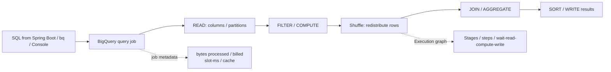
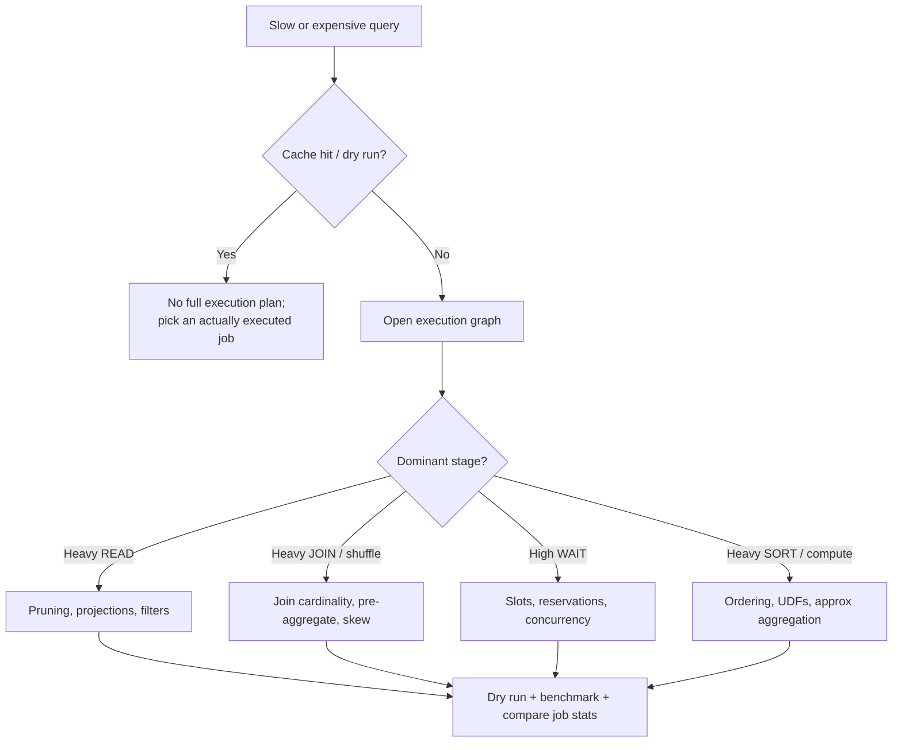
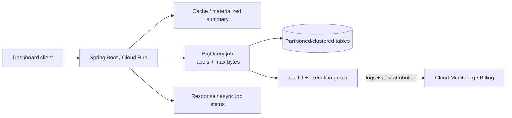

# Query Plans and Query Cost Analysis

## 1. The Problem: Slow Java Dashboard and Rising BigQuery Costs

A **Java/Spring Boot** service running on **Cloud Run** uses **BigQuery** to aggregate revenue. After adding a customer filter feature, the `GET /reports/revenue` dashboard slowed from 3 to 25 seconds, while monthly query costs climbed. The engineering team needs to answer: Is BigQuery reading too much data, is a JOIN multiplying millions of rows, or are jobs waiting for slots? Are queries billed **per byte**, or is the workload inside a **reservation**?

BigQuery is a serverless analytical data warehouse with a distributed SQL engine; unlike **Cloud SQL/Spanner**, it is not meant for small individual OLTP transactions. Every query produces **job metadata**, and for executed queries BigQuery provides a **query plan/execution graph**, timeline, bytes processed, and slot usage. Proper analysis points to the right fix: **partition pruning, column pruning, better JOIN/aggregation, reduced shuffle**, or tuning capacity/concurrency.

Within the **BigQuery** chapter of the **CLOUD_PROVIDERS_GCP** module, this lesson links SQL, IAM, the Java client, Cloud Monitoring, and FinOps into a workflow of **measure before → diagnose → optimize → measure after**, avoiding guesswork based solely on wall-clock duration.

**Learning objectives:**

1. Read stages, steps, and metrics (**READ, COMPUTE, WAIT, WRITE, shuffle**) in the execution graph.
2. Distinguish **total_bytes_processed, total_bytes_billed, total_slot_ms, elapsed time**, and cache hits.
3. Estimate costs with **dry runs** and enforce **maximum bytes billed** to block queries exceeding on-demand budgets.
4. Use **`INFORMATION_SCHEMA.JOBS_BY_PROJECT`** to track down byte- and slot-heavy queries without double-counting script parents.
5. Diagnose broad scans, row-multiplying JOINs, skew/shuffle, and slot contention, and apply verified SQL optimizations.
6. Write a Java 21 **dry-run cost guard**, run a safe lab, and reconcile against billing.

> **Safety:** querying job statistics and dry runs requires metadata read permissions; **real analytical queries, even SELECTs, can incur charges**. This lesson does not run commands directly on Google Cloud. Practice only in an authorized project/dataset; run `--dry_run` first and check location and max bytes before any real query.

## 2. How Does BigQuery Execute a Query?

The optimizer translates a SQL query into an **execution graph** composed of **stages**. Each stage runs parallel **steps** across workers/slots; intermediate data moves between stages via **shuffle** for JOIN, AGGREGATE, and SORT operations.



BigQuery can **dynamically insert repartition stages at runtime** to mitigate skew. Therefore, a plan is **evidence of a single execution**, not an immutable graph identical across every run.

### 2.1. Stages and Steps

| Operation | Meaning | What to Check When Slow/Expensive |
| --- | --- | --- |
| `READ` | Scans table columns or intermediate stage output | Bytes/rows read, partition pruning, `SELECT *` |
| `FILTER` | Evaluates `WHERE/HAVING` predicates | Late filtering, expressions blocking pruning |
| `COMPUTE` | Evaluates SQL expressions/functions, UDFs | High CPU, repeated string/JSON parsing |
| `JOIN` | Combines two inputs | Output rows >> input rows, skewed keys, shuffle |
| `AGGREGATE` | `GROUP BY`, `COUNT`, `SUM` | Group cardinality, shuffle bytes |
| `SORT` | `ORDER BY` | Sorting large datasets before limiting |
| `WRITE` | Writes final output or intermediate shuffle | Shuffle output / spilled bytes |

**Never sum stage durations to compute wall-clock time**: multiple stages and workers execute **concurrently**. Total `slot-ms` can vastly exceed elapsed milliseconds because many slots work in parallel.

### 2.2. Average vs. Slowest Worker Timing

Each stage reports timing and volume breakdowns:

| Component | What It Measures | Diagnostic Clue |
| --- | --- | --- |
| `waitMsAvg` / `waitMsMax` | Time workers waited to be scheduled | Slot contention or upstream bottleneck |
| `readMsAvg` / `readMsMax` | Time spent reading inputs | Excessive data scans or block I/O |
| `computeMsAvg` / `computeMsMax` | Computation time | Expensive functions, join/aggregation skew |
| `writeMsAvg` / `writeMsMax` | Writing output/shuffle | Large intermediate payloads |
| `shuffleOutputBytes` | Bytes written into shuffle | JOIN/AGGREGATE generating heavy intermediate data |
| `shuffleOutputBytesSpilled` | Shuffle bytes spilled to disk | Shuffle memory pressure, severe slowdown |
| `recordsRead` / `recordsWritten` | Rows entering/exiting the stage | JOIN multiplying rows, late filtering |

If `computeMsMax` is dramatically higher than `computeMsAvg`, a handful of workers may be suffering from **data skew**. If `waitMsMax` is high while `READ` is small, adding indexes won't help: inspect **reservation capacity, concurrent queries, and upstream stages**.

## 3. Reading the Execution Graph and Query Performance Insights

In the Google Cloud Console:

1. Navigate to **BigQuery → Job history → Personal history/Project history**.
2. Open the specific **query job** (verify project, region, user, timestamp, labels, job ID).
3. Inspect the **Execution graph** or **Execution details**; select the longest or heaviest stage.
4. Review **steps** and compare `recordsRead → recordsWritten`, `shuffleOutputBytes`, and wait/compute/read/write ratios.
5. Check **Performance insights** when present (slot contention, high-cardinality JOINs, insufficient shuffle quota, partition skew).
6. Compare against a **similar prior job**, keeping SQL, data window, traffic, caching, and capacity as aligned as possible.



**Two important limitations:**

- **Dry run** only validates syntax and estimates bytes **without executing**, so it **has no execution graph**. A **result cache hit** may also lack a full plan because execution resources were skipped.
- Performance insights are **best-effort hints**, not guaranteed root causes. A query can spend time **before the first stage** or **after the last stage** on metadata/optimization, so total elapsed time does not always fit inside stage timings alone.

## 4. Four Commonly Confused Numbers

| Field | Meaning | Is It a Dollar Amount? |
| --- | --- | --- |
| `total_bytes_processed` | Bytes read/processed per job stats | Not necessarily equal to billed bytes |
| `total_bytes_billed` | Input to **on-demand** billing (subject to rounding/free tier/rules) | Billing input, not USD |
| `total_slot_ms` | Total slot-milliseconds consumed by the job | Measures compute usage; **not a direct capacity bill** |
| `TIMESTAMP_DIFF(end_time,start_time,...)` | Job elapsed wall-clock runtime | Not total CPU/slot time |
| `cache_hit` | Reused cached query results | Cached queries typically bill zero processing bytes |

A job running for **10 seconds** with `total_slot_ms=500000` averaged **approximately 50 slots** (500,000 / 10,000), **not 500,000 slots**. This is only an average across the runtime, not the peak slot demand of any individual stage.

**Caution:** byte/plan fields can be **NULL** or restricted when querying tables with **row-level access policies**, multi-statement scripts, failed jobs, or special modes. `0 bytes billed` does not prove the entire workload is free (storage, capacity reservations, and external services may still incur charges).

## 5. Two Compute Cost Models

### 5.1. On-Demand: Billed by Bytes Processed

Under **on-demand** pricing, query cost depends on **bytes billed**, the **price per TiB** for the region/tier, and billing rules. There is a **monthly free allowance** under current BigQuery policy, though you should not subtract that allowance per query when comparing two designs.

```text
ILLUSTRATIVE example:
  Monthly total billed bytes = 4 TiB
  Applicable free allowance = 1 TiB (if eligible)
  Illustrative rate = P USD/TiB

  Approximate on-demand compute = 3 × P USD
  + storage + ingest + egress + related services.
```

**Query cost is not determined by output size:** returning 20 rows while scanning 5 TiB still bills for the scan. `LIMIT 20` on a **non-clustered table** usually does not reduce bytes processed. Prioritize **column selection, partition pruning, and target table design**.

### 5.2. Capacity-Based: Reservations, Editions, and Slot-Hours

Under **BigQuery editions**, organizations pay for **slot capacity** provisioned, committed, or autoscaled in a reservation, billed over time by edition tier. **A query's bytes billed does not translate directly into USD** in this model. Measure overall utilization and reservation cost rather than multiplying `total_bytes_billed × price/TiB`.

| Model | Primary Resource Unit | Cost Controls |
| --- | --- | --- |
| On-demand | Bytes billed per query | Dry run, maximum bytes billed, custom query quotas |
| Capacity-based | Slot-hours / edition / reservation / commitments | Baseline/max slots, autoscaling, reservations, workload assignments |

**Slot-ms remains useful** for finding compute-heavy queries and internal chargebacks, yet **slot-ms / 3,600,000 × slot-hour rate is not the exact marginal cost of a job** when reservations already pay for idle baseline capacity, shared slots, autoscalers, or commitments. An optimized query may **free capacity for other workloads** without lowering the invoice immediately.

### 5.3. Costs Outside Query Compute

**Active/long-term** storage, physical/logical storage billing models, streaming ingestion, BigQuery Storage API, BigQuery ML, external services, BigLake/remote functions, Cloud Storage, and network egress each carry separate pricing rules. **Cloud Billing Reports** are the source of truth for invoices, whereas `INFORMATION_SCHEMA.JOBS` is **technical telemetry** scoped by project/region.

## 6. Dry Run and Maximum Bytes Billed: Cost Guardrails

### 6.1. Dry Run with `bq`

This example uses a public dataset in the **US multi-region** containing no user data. The caller still needs a project with Billing/IAM to create job metadata:

```bash
# Estimates only; DOES NOT execute the query or produce query results:
bq query --location=US --use_legacy_sql=false --dry_run \
  'SELECT state, COUNT(*) AS records
   FROM `bigquery-public-data.usa_names.usa_1910_2013`
   WHERE year BETWEEN 2010 AND 2015
   GROUP BY state'
```

To run it in a **lab project** after checking the estimate, cap the bytes:

```bash
# Replace LIMIT_BYTES with an integer suited to the estimate.
bq query --location=US --use_legacy_sql=false \
  --maximum_bytes_billed=LIMIT_BYTES \
  'SELECT state, COUNT(*) AS records
   FROM `bigquery-public-data.usa_names.usa_1910_2013`
   WHERE year BETWEEN 2010 AND 2015
   GROUP BY state'
```

**`--maximum_bytes_billed` is a byte-based cap**, effective for on-demand queries. If the estimate exceeds the cap, BigQuery **rejects the query before execution**. Do not treat it as an absolute dollar budget—especially with **capacity-based reservations**, external services, storage, or non-SELECT workloads.

**Dry run gives an upper-bound estimate** in many cases; on **clustered tables**, actual bytes scanned may be lower than the estimate. With **row-level security**, dry run may report **0 bytes** to prevent data leakage—this does not mean the real query is free. Always reference [BigQuery Pricing](https://cloud.google.com/bigquery/pricing) rather than hardcoding prices in application code.

### 6.2. Inspecting the Query Plan After Execution

```bash
# After running an approved real job, inspect metadata:
bq show --location=US --format=prettyjson -j LAB_PROJECT_ID:JOB_ID
```

Under `statistics.query`, look for `totalBytesProcessed`, `totalBytesBilled`, `totalSlotMs`, `cacheHit`, `queryPlan`, and `timeline` when available. If the job was tiny or hit the cache, do not expect full stage plans.

## 7. SQL Lab: Partition Pruning, Clustering, and Column Selection

The following example uses **dataset `LAB_PROJECT_ID.bq_cost_lab` in an isolated lab project** and a synthetic **`orders`** table. Creation commands are **optional** and should only run after verifying dataset location, IAM, and Billing/quotas; **never run in production**.

### 7.1. Create the Dataset and a Small Controlled Table

```bash
# LAB ONLY: create a US dataset if it does not yet exist in your lab project.
bq --location=US mk --dataset LAB_PROJECT_ID:bq_cost_lab
```

```sql
-- LAB ONLY; synthetic schema/table for testing query plans.
CREATE TABLE `LAB_PROJECT_ID.bq_cost_lab.orders` (
  order_id INT64,
  order_date DATE,
  customer_id INT64,
  amount_minor INT64,
  status STRING
)
PARTITION BY order_date
CLUSTER BY customer_id
OPTIONS (require_partition_filter = TRUE);

INSERT INTO `LAB_PROJECT_ID.bq_cost_lab.orders`
SELECT n,
       DATE_SUB(CURRENT_DATE(), INTERVAL MOD(n, 30) DAY),
       MOD(n, 200),
       n * 100,
       IF(MOD(n, 3) = 0, 'PAID', 'CREATED')
FROM UNNEST(GENERATE_ARRAY(1, 10000)) AS n;
```

**Do not re-run `INSERT` if you want exactly 10,000 rows**; use a fresh lab table or clean up via an approved procedure. `require_partition_filter=TRUE` forces queries to provide a prunable filter, preventing accidental full-table scans from omitted date predicates.

### 7.2. Well-Structured Analytical Query for Partition Pruning

```sql
SELECT customer_id, COUNT(*) AS orders, SUM(amount_minor) AS revenue_minor
FROM `LAB_PROJECT_ID.bq_cost_lab.orders`
WHERE order_date BETWEEN DATE_SUB(CURRENT_DATE(), INTERVAL 6 DAY)
                     AND CURRENT_DATE()
  AND customer_id BETWEEN 10 AND 20
  AND status = 'PAID'
GROUP BY customer_id
ORDER BY revenue_minor DESC
LIMIT 10;
```

The query filters on **partition column `order_date`**, reading 7 days instead of 30. **Clustering by `customer_id`** can skip irrelevant storage blocks, though on a tiny 10,000-row dataset the savings may be **minimal or unobservable**. Before clicking Run, perform a dry run and record the estimate.

### 7.3. Comparison with an Unoptimized Query

On a table without `require_partition_filter` (or a lab copy), a query like this can be costly:

```sql
SELECT *
FROM `LAB_PROJECT_ID.bq_cost_lab.orders`
WHERE customer_id = 17
LIMIT 10;
```

On **the current lab table, this query must be rejected** because it lacks a partition predicate; do not disable the flag just to run the bad query. This illustrates that `LIMIT 10` does not guarantee lower bytes scanned on non-clustered/unpruned tables. Good queries **select only needed columns**, apply **`WHERE` on the partition column**, and filter clustering keys when appropriate.

### 7.4. Why Doesn't Every Filter Prune?

```sql
-- Good: filter the partition column directly with constants/parameters.
WHERE order_date >= DATE '2026-11-01'
  AND order_date < DATE '2026-11-08'

-- Risk of reduced efficiency or lost pruning due to expression wrapping:
WHERE DATE_ADD(order_date, INTERVAL 1 DAY) >= DATE '2026-11-01'
```

The optimizer can fold some expressions, yet **never assume** transforming a partition column preserves pruning. Verify using **dry-run bytes** and job stats. With **ingestion-time partitioned tables**, filter via `_PARTITIONTIME`/`_PARTITIONDATE` per that table type rather than mixing syntaxes.

## 8. Diagnosing JOINs, Shuffle, and Data Skew

Suppose `orders` has 1 million rows, while `customer_segments` should have **one row per customer** but accidentally contains 10 duplicate rows for some customers. A `JOIN` can multiply **one order into 10 output rows**, inflating intermediate data and corrupting revenue sums:

```sql
-- Risk if a customer_id appears in multiple segment rows:
SELECT o.customer_id, SUM(o.amount_minor) AS total_minor
FROM `LAB_PROJECT_ID.bq_cost_lab.orders` AS o
JOIN `LAB_PROJECT_ID.bq_cost_lab.customer_segments` AS s
  USING (customer_id)
WHERE o.order_date BETWEEN DATE '2026-11-01' AND DATE '2026-11-07'
GROUP BY o.customer_id;
```

**`customer_segments` is not created in the basic lab**; this snippet illustrates a join bug and should only run if you create a matching synthetic table. Before joining, check key multiplicity:

```sql
-- Only if a lab customer_segments table exists:
SELECT customer_id, COUNT(*) AS copies
FROM `LAB_PROJECT_ID.bq_cost_lab.customer_segments`
GROUP BY customer_id
HAVING COUNT(*) > 1
ORDER BY copies DESC
LIMIT 20;
```

### Reading Execution Graph Signals

| Signal | Possible Cause | Investigation |
| --- | --- | --- |
| `JOIN recordsWritten` many times larger than `recordsRead` | High-cardinality join / duplicate keys | Check join-key uniqueness and join type |
| Large `shuffleOutputBytes` | JOIN/GROUP BY over unfiltered data | Filter and pre-aggregate earlier when valid |
| `shuffleOutputBytesSpilled > 0` | Insufficient shuffle memory | Reduce intermediate data, review capacity |
| `computeMsMax >> computeMsAvg` | Hot keys / partition skew | Inspect value distribution on join/group keys |
| High `waitMsAvg` | Contention/insufficient slots or upstream delay | Check reservations, concurrent jobs, and timeline |

**Never slap `SELECT DISTINCT` onto a broken JOIN to hide duplicates.** It increases compute and can strip valid rows; fix the underlying cardinality and grain instead. If you only need to check whether a customer belongs to a segment, evaluate `EXISTS` / semi-joins rather than multiplying rows, depending on the optimizer plan.

### High-Impact Optimizations

- **Pre-aggregate** large inputs before joining when business logic allows and row reduction is substantial.
- **Use clean dimension tables** with one row per join key; deduplicate keys in the ingestion pipeline.
- **Avoid uncontrolled cross joins:** N × M rows can cause massive shuffle/output growth.
- **Use `APPROX_COUNT_DISTINCT`** when estimates suffice; never replace `COUNT(DISTINCT)` when exact billing numbers are required.
- **Eliminate redundant UDFs/functions**, repeated JSON parsing, or timestamp casts over billions of rows and unused columns.
- **Push filters before joins and sorts**, while always verifying results and plans; BigQuery's optimizer rewrites many expressions automatically, and not every CTE is materialized.

## 9. `INFORMATION_SCHEMA.JOBS_BY_PROJECT`: Finding Resource-Heavy Queries

BigQuery exposes job metadata by **region**, such as `region-us` for the US multi-region or `region-asia-southeast1` for that single region. **The query job location must match the INFORMATION_SCHEMA view's region**. If an organization runs jobs across multiple regions, query **each region separately**—there is no single global view.

**Permissions:** viewing project-wide jobs requires permissions like `bigquery.jobs.listAll`, included in `roles/bigquery.resourceViewer` or a scoped custom role; submitting jobs requires `bigquery.jobs.create` via `roles/bigquery.jobUser`. Never grant `roles/bigquery.admin` just to inspect metadata. Job records can expose sensitive **SQL text, `user_email`, and labels**; restrict access and log usage.

### 9.1. Top Jobs by Billed Bytes and Slot-ms

This example queries metadata **only within a lab project in location US**:

```sql
SELECT
  job_id,
  user_email,
  creation_time,
  statement_type,
  cache_hit,
  total_bytes_processed,
  total_bytes_billed,
  total_slot_ms,
  ROUND(SAFE_DIVIDE(
    total_slot_ms,
    TIMESTAMP_DIFF(end_time, start_time, MILLISECOND)
  ), 2) AS avg_slots,
  query_info.resource_warning AS resource_warning
FROM `LAB_PROJECT_ID.region-us.INFORMATION_SCHEMA.JOBS_BY_PROJECT`
WHERE creation_time >= TIMESTAMP_SUB(CURRENT_TIMESTAMP(), INTERVAL 7 DAY)
  AND job_type = 'QUERY'
  AND state = 'DONE'
  AND error_result IS NULL
  AND (statement_type IS NULL OR statement_type != 'SCRIPT')
ORDER BY total_bytes_billed DESC NULLS LAST
LIMIT 20;
```

Swap `ORDER BY total_bytes_billed` for `ORDER BY total_slot_ms` to find the most compute-intensive jobs. For **multi-statement scripts**, the parent `SCRIPT` job aggregates child job resource usage; **exclude the parent** to avoid double-counting.

**Important:** `total_bytes_billed` can be NULL with **row-level access policies**, and under **capacity-based pricing** it does not reflect actual byte unit costs. `avg_slots` is the average across execution time, not the peak slots of any stage.

### 9.2. Aggregating by User or Workload

```sql
SELECT
  user_email,
  COUNT(*) AS query_jobs,
  ROUND(SUM(IFNULL(total_bytes_billed, 0)) / POW(1024, 4), 3)
    AS billed_tib_observed,
  ROUND(SUM(IFNULL(total_slot_ms, 0)) / 3600000, 2)
    AS slot_hours_consumed_observed
FROM `LAB_PROJECT_ID.region-us.INFORMATION_SCHEMA.JOBS_BY_PROJECT`
WHERE creation_time >= TIMESTAMP_SUB(CURRENT_TIMESTAMP(), INTERVAL 7 DAY)
  AND job_type = 'QUERY'
  AND state = 'DONE'
  AND (statement_type IS NULL OR statement_type != 'SCRIPT')
GROUP BY user_email
ORDER BY billed_tib_observed DESC
LIMIT 20;
```

These figures represent **observed consumption**, not an exact invoice: `IFNULL` here is for demo aggregation and can hide jobs whose bytes are **omitted** by policies; a production report should **flag jobs with NULL bytes**, filter errors/cache appropriately, and reconcile against Cloud Billing by **billing SKU, reservations, and project**.

### 9.3. Performance Insights from Job Metadata

For jobs with populated telemetry, inspect `query_info.performance_insights` and `query_info.resource_warning`:

```sql
SELECT job_id,
       query_info.resource_warning,
       query_info.performance_insights
FROM `LAB_PROJECT_ID.region-us.INFORMATION_SCHEMA.JOBS_BY_PROJECT`
WHERE creation_time >= TIMESTAMP_SUB(CURRENT_TIMESTAMP(), INTERVAL 7 DAY)
  AND job_type = 'QUERY'
  AND state = 'DONE'
  AND error_result IS NULL
  AND (statement_type IS NULL OR statement_type != 'SCRIPT')
  AND query_info.performance_insights IS NOT NULL
LIMIT 20;
```

These fields can highlight **slot_contention, high_cardinality_joins, insufficient_shuffle_quota, and partition_skew**. Not every job generates insights; **`NULL` does not prove a query is optimal**. `JOBS_BY_PROJECT` retains recent job metadata (retention is service-defined, typically up to **180 days**) and enforces IAM and region constraints.

## 10. Java 21: Checking Bytes Before Submitting a Query

The Java client **`com.google.cloud:google-cloud-bigquery`** supports dry runs, `QueryJobConfiguration.setMaximumBytesBilled`, and parameterized queries. In a Spring Boot app, place dry-run checks in **report/batch runners** or SQL review tooling rather than running a dry run on **every synchronous HTTP request**, which adds API round-trips and latency.

### 10.1. Minimal `pom.xml`

```xml
<?xml version="1.0" encoding="UTF-8"?>
<project xmlns="http://maven.apache.org/POM/4.0.0"
         xmlns:xsi="http://www.w3.org/2001/XMLSchema-instance"
         xsi:schemaLocation="http://maven.apache.org/POM/4.0.0 https://maven.apache.org/xsd/maven-4.0.0.xsd">
  <modelVersion>4.0.0</modelVersion>
  <groupId>dev.example</groupId>
  <artifactId>bigquery-cost-guard</artifactId>
  <version>1.0.0</version>
  <properties>
    <maven.compiler.release>21</maven.compiler.release>
    <project.build.sourceEncoding>UTF-8</project.build.sourceEncoding>
  </properties>
  <dependencies>
    <dependency>
      <groupId>com.google.cloud</groupId>
      <artifactId>google-cloud-bigquery</artifactId>
      <version>2.73.0</version>
    </dependency>
  </dependencies>
  <build>
    <plugins>
      <plugin>
        <groupId>org.apache.maven.plugins</groupId>
        <artifactId>maven-compiler-plugin</artifactId>
        <version>3.13.0</version>
      </plugin>
    </plugins>
  </build>
</project>
```

The dependency version is illustrative as of writing; production services should use the **Google Cloud Java BOM** and keep supported versions updated. Authentication uses **Application Default Credentials**; never store service-account JSON keys or OAuth tokens in Git.

### 10.2. `BigQueryDryRun.java` — Estimate Only

```java
package dev.example.bigquery;

import com.google.cloud.bigquery.BigQuery;
import com.google.cloud.bigquery.BigQueryOptions;
import com.google.cloud.bigquery.Job;
import com.google.cloud.bigquery.JobInfo;
import com.google.cloud.bigquery.JobStatistics;
import com.google.cloud.bigquery.QueryJobConfiguration;

public final class BigQueryDryRun {
    private static final String SQL = """
        SELECT state, COUNT(*) AS records
        FROM `bigquery-public-data.usa_names.usa_1910_2013`
        WHERE year BETWEEN 2010 AND 2015
        GROUP BY state
        """;

    public static void main(String[] args) {
        if (args.length != 1) {
            throw new IllegalArgumentException(
                "Usage: LAB_PROJECT_ID (datasets in US location)");
        }

        BigQuery bigQuery = BigQueryOptions.newBuilder()
            .setProjectId(args[0])
            .build()
            .getService();

        QueryJobConfiguration config = QueryJobConfiguration.newBuilder(SQL)
            .setDryRun(true)
            .setUseLegacySql(false)
            .setUseQueryCache(false)
            .build();

        // Dry run: validation + estimate, does not execute SQL.
        Job job = bigQuery.create(JobInfo.of(config));
        JobStatistics.QueryStatistics stats = job.getStatistics();
        long estimatedBytes = stats.getTotalBytesProcessed();
        long maxBytes = 1024L * 1024 * 1024; // 1 GiB, example.
        System.out.printf("Dry run estimated %d bytes%n", estimatedBytes);

        if (estimatedBytes > maxBytes) {
            throw new IllegalStateException("Estimate exceeds lab budget");
        }

        // Illustrates configuration of a real guarded job only:
        // QueryJobConfiguration guarded = QueryJobConfiguration
        //     .newBuilder(SQL).setUseLegacySql(false)
        //     .setMaximumBytesBilled(maxBytes).build();
        // Do not submit guarded via bigQuery.query(...) in this lab.
    }
}
```

This code checks an **upper-bound estimate before permitting execution** without running the query itself. `maxBytes` is a **technical byte guardrail**, not a price quote; if using **capacity reservations**, add reservation/slot usage controls as well. For production, use **named query parameters**, low-cardinality `service/env/team` labels, and timeouts; never interpolate raw user input into SQL.

**About location:** this example references a public dataset in **US**; when datasets live in another region, set the **job location to match the data location**. `bq --location=US` in Section 6 makes this explicit; in multi-location Java projects, construct `JobId` or job configuration with the explicit location and verify it in job metadata instead of relying on defaults.

## 11. Value of Caching, Partitioning, and Materialized Views

### 11.1. Result Cache

BigQuery provides a **query result cache** for eligible queries. A cache hit returns fast results with **zero query processing bytes**, yet **not every query is cacheable** (for example when underlying data changes or non-deterministic functions/unsupported sources are involved). Therefore, when benchmarking:

- Record `cache_hit`; never compare a cache-hit run against a full-scan run and claim SQL optimization.
- When measuring real compute, consider **disabling `useQueryCache` in a lab project**; this incurs charges, so enforce a cap.
- Never rely on the result cache for data freshness or transactional correctness.

### 11.2. Partitioning and Clustering

**Partitioning** splits data by day/hour/range and enables **partition pruning** on filters. **Clustering** orders storage blocks by selected columns to skip blocks on matching filters; dry runs on clustered tables can **overestimate actual runtime bytes** due to dynamic block pruning.

**Do not create hundreds of separate daily tables** when a single partitioned table works: sharded tables inflate metadata/permission overhead and complicate maintenance. Choose partitions large enough to be worthwhile and frequently filtered; avoid partitioning by near-unique columns or creating thousands of tiny partitions unnecessarily.

### 11.3. Materialized Views and Summary Tables

If dashboards repeatedly run the exact same `SUM(amount_minor) GROUP BY date/customer` across billions of orders, evaluate a supported **materialized view** or scheduled summary table. Trade-offs include **storage, refresh compute, freshness/consistency**, and operational complexity. Ensure financial reports clearly define **data staleness** and never settle payments from unrefreshed figures.

## 12. Optimizing in a Java/Spring Boot Architecture

In synchronous APIs, a BigQuery job can take several seconds and faces **API retries, quotas, and cold starts**. Decouple analytical reporting from user transactions:



In production:

1. Use **JDBC/Hibernate/Cloud SQL/Spanner for OLTP**, and BigQuery for analytical aggregation; do not scan whole BigQuery datasets on every UI button click.
2. For heavy reports, use **async jobs**: the API submits the job, returns `jobId`, and the authenticated client polls status and fetches results once ready.
3. Enforce `maximumBytesBilled` for on-demand queries, `jobTimeoutMs` aligned to SLOs, and **IAM quotas**; do not confuse a timeout with a cost cap.
4. Use **query parameters** instead of string interpolation, project explicit columns, and enforce tenant isolation via authorized views or row-level security as required.
5. Attach low-cardinality **job labels** like `service=orders-report` and `env=staging`; never use high-cardinality `userId`/`orderId` values as labels.
6. Log **`jobId`, `region`, `labels`, `total_bytes_processed`, `total_slot_ms`, `cache_hit`**, duration, and errors; never log SQL containing PII or tokens.

**Do not assume dropping a query on HTTP client timeout cancels the backend BigQuery job:** check job state and consider calling **`jobs.cancel`** per permissions/policy, because an active job can keep consuming capacity after the Java HTTP request closes.

## 13. Runbook When a BigQuery Query Is Slow, Expensive, or Failing

| Symptom | First Data Source | Suggested Action |
| --- | --- | --- |
| Sharp jump in billed bytes | Dry run, `total_bytes_processed/billed`, SQL text | Apply partition/column pruning, drop `SELECT *` |
| Huge `READ` despite tiny output | READ stage + referenced tables | Narrow columns, add partition filters, redesign access pattern |
| `JOIN` multiplies output manyfold | `recordsRead` vs. `recordsWritten`, keys | Fix join grain, deduplicate keys, pre-aggregate |
| High `shuffleOutputBytesSpilled` | Shuffle graph, JOIN/AGGREGATE | Shrink intermediate data, evaluate slots/shuffle quota |
| `computeMsMax` far above average | Distribution across group/join keys | Mitigate skew/hot keys, split query if needed |
| High `waitMsAvg` and rising pending units | Query timeline, reservation utilization | Throttle concurrency, stagger schedules, or carefully resize capacity |
| High `total_slot_ms` with low billed bytes | CPU/UDFs/JOINs, capacity model | Improve algorithm/SQL, avoid redundant computation |
| Query has `LIMIT` yet still scans heavily | Execution graph, table layout | Partition/cluster, project fewer columns |
| Query missing execution plan | Cache hit or dry run | Inspect an actually executed job with metadata |
| Rejected by `maximum bytes billed` | Dry-run upper bound, clustered scan estimate | Optimize query or obtain approval for higher cap |
| Job metrics/queries missing or NULL | Region/IAM, row-level policy, script parent | Verify job metadata and required permissions |
| Billing rises while query metadata looks flat | Storage, reservations, loads/streaming/egress | Inspect Cloud Billing report by SKU/project |

### 7-Step Diagnostic Process

1. **Identify:** record `job_id`, `project`, `location`, user/service account, SQL version, and UTC time window.
2. **Classify billing:** on-demand or capacity reservation? Capture both **bytes billed and slot-ms**, and evaluate using the right billing unit.
3. **Estimate:** dry run the current SQL; if executing a real test, set `maximumBytesBilled` and test on a lab dataset/snapshot.
4. **Inspect the graph:** trace READ → JOIN/AGGREGATE/SORT → shuffle → output and timeline; locate the **dominant stage**.
5. **Form hypotheses:** missing partition pruning, row-multiplying JOIN, skew, slot contention, or repeated UDF/compute work.
6. **Canary:** change **one variable** (SQL, partitioning/clustering, materialized summary, or reservation) and re-measure on the same workload; verify **exact business result parity**.
7. **Reconcile:** compare job metadata, p95/p99, row counts, and Cloud Billing; update CI/dry-run policies and roll back if the plan regresses.

**Never "optimize" by immediately buying more reservation slots whenever a query is slow.** If 90% of execution goes to scanning unneeded data or an exploding JOIN, fixing SQL outperforms adding capacity. Conversely, well-tuned SQL with persistently high pending units signals a need to **reschedule workloads or adjust slot capacity**.

## 14. IAM, Security, and Budgets

| Persona | Permissions to Consider | Key Note |
| --- | --- | --- |
| Java reporting service | `roles/bigquery.jobUser` on execution project + `roles/bigquery.dataViewer` on dataset/table | Does not need BigQuery Admin |
| Project-wide job analysis | `roles/bigquery.resourceViewer` or custom role with `bigquery.jobs.listAll` | Job metadata/query text may be sensitive |
| Data platform operator | Table creation/editing, reservations, assignments by scoped role | Do not mix slot management with reading all PII |
| FinOps/auditor | Billing viewer + required job metadata | Reconcile by SKU; never infer invoices from slot-ms |

**Data exposure risk:** `INFORMATION_SCHEMA.JOBS_BY_PROJECT` can reveal SQL text, identifiers, `user_email`, labels, and query patterns; query plans also expose table and column names. Use **parameterized SQL**, least-privilege dataset/table permissions, and row-level/column-level security where needed. Avoid putting sensitive values inside SQL comments, job labels, or logs.

**Layered limits:** `maximumBytesBilled` for on-demand queries; **custom query quotas** at user/project scope for hard daily caps; **reservations** and autoscaling max slots for capacity; and Billing budgets/alerts for visibility. **A budget alert does not automatically stop queries or halt billing.** Never disable audit logs or quotas just to bypass `PERMISSION_DENIED` or budget warnings.

**Environment governance:** separate dev/staging/prod projects, attach job labels, run **dry runs** in CI for SQL changes, require review for queries estimated above thresholds and before raising reservations/max slots, and combine **Query Optimizer/partition filters/authorized views** to control costs in the data model itself.

## 15. Lab Cleanup and Scope Verification

If you created the lab dataset/table in Section 7:

```bash
# Inspect metadata before deleting:
bq --location=US ls LAB_PROJECT_ID:bq_cost_lab
bq show --format=prettyjson LAB_PROJECT_ID:bq_cost_lab.orders

# ONLY after the owner confirms the entire dataset was created for the lab
# and holds no other users' tables, data, or jobs:
# bq --location=US rm -r -f -d LAB_PROJECT_ID:bq_cost_lab
```

**The delete command is intentionally commented out**; deleting a dataset removes all tables inside it and can break other pipelines. Never delete public datasets, billing accounts, or shared reservations. Afterward, review **Job history, Cloud Billing reports, datasets/storage, and alerts**; BigQuery billing records can appear with delay.

## 16. Exercises and Checklist

### Exercise A — Reading an Execution Graph

A query shows a `READ` stage of **80 GiB**, a `JOIN` reading 2 million rows but writing 90 million rows, and rising `shuffleOutputBytesSpilled`. Give three hypotheses, the metrics to inspect, and two priority SQL/data-model changes. Why is adding slots alone insufficient proof of optimization?

### Exercise B — Distinguishing the Numbers

A job runs for **20 seconds** with `total_slot_ms=600000`, `total_bytes_processed=2 TiB`, and `total_bytes_billed=2 TiB`. Compute **30 average slots**. Compare how cost translates when the project uses **on-demand** versus an **Enterprise reservation**; do not apply the same pricing formula to both modes.

### Exercise C — Dry Run and Cost Guardrails

Run `bq query --dry_run` on `SELECT state, COUNT(*)` from Section 6. Record the estimate, set `--maximum_bytes_billed` **below the estimate** in a lab, and confirm the query is rejected without scanning. Propose how to integrate dry runs into pull-request checks for SQL reports.

### Exercise D — Partition Pruning

On `bq_cost_lab.orders` partitioned by `order_date`, write two queries: one filtering a 7-day range and one missing the filter. Explain why the filterless query is **blocked** when `require_partition_filter=TRUE` and why `LIMIT 10` does not guarantee fewer scanned bytes.

### Exercise E — `JOBS_BY_PROJECT` and Governance

Write an `INFORMATION_SCHEMA.JOBS_BY_PROJECT` query finding the **top 10 jobs by `total_slot_ms`** over the last 7 days in `region-us`, excluding `SCRIPT` parents and filtering `creation_time`. Propose `team/env/service` labels and explain why total slot-ms is not the exact capacity invoice.

### Exercise F — Java Dry Run

Using `BigQueryDryRun` in Java 21 with ADC and a lab project, check the estimate before running a real query. Explain how `setDryRun(true)` differs from `setMaximumBytesBilled(...)` and what IAM permissions the Java runtime requires.

### Exercise G — Post-Release Incident

A new Spring Boot release slows a dashboard from 3 to 25 seconds while `total_bytes_billed` barely changes, and `waitMsAvg` plus pending units rise. Build a runbook distinguishing **slot contention** from data skew/upstream bottlenecks, checking reservation assignments, and executing a canary rollback.

### Pre-Production Checklist

- [ ] I understand a BigQuery plan consists of **stages/steps/shuffle** and that stages can execute concurrently.
- [ ] I can read `READ/JOIN/AGGREGATE/WRITE` and wait/read/compute/write timings.
- [ ] I distinguish **bytes processed/billed, slot-ms, elapsed time, and cache hits**.
- [ ] I apply the right pricing model: **on-demand per TiB** vs. **capacity by slots**.
- [ ] I run dry runs and set `maximumBytesBilled` where appropriate.
- [ ] I use partition pruning, project only needed columns, and understand `LIMIT`'s limits.
- [ ] I check join keys/cardinality, shuffle spills, skew, and slot contention.
- [ ] I query `INFORMATION_SCHEMA.JOBS_BY_PROJECT` in the right **region/IAM** and exclude script parents to avoid double-counting.
- [ ] I implement a Java cost guard, parameterized SQL, and low-cardinality job labels.
- [ ] I maintain baselines, SQL result reconciliation, canary/rollbacks, Billing checks, and SLOs.

**Conclusion:** optimizing BigQuery is more than rewriting "slow SQL." You must combine **execution graphs + job metadata + the active pricing model**: read less data to lower on-demand bytes, address JOINs/shuffle/capacity to lower slot consumption, and verify results and costs against real workloads. For Java on Google Cloud, **dry run and cap costs before execution**, label jobs, observe the right region, and protect data and permissions throughout the pipeline.

## 17. Official References

- [Query plan and timeline](https://cloud.google.com/bigquery/docs/query-plan-explanation)
- [Get query performance insights / execution graph](https://cloud.google.com/bigquery/docs/query-insights)
- [Optimize query computation](https://cloud.google.com/bigquery/docs/best-practices-performance-compute)
- [Estimate and control costs](https://cloud.google.com/bigquery/docs/best-practices-costs)
- [BigQuery pricing — on-demand and editions](https://cloud.google.com/bigquery/pricing)
- [INFORMATION_SCHEMA.JOBS views](https://cloud.google.com/bigquery/docs/information-schema-jobs)
- [JOBS_TIMELINE view](https://cloud.google.com/bigquery/docs/information-schema-jobs-timeline)
- [Query partitioned tables/pruning](https://cloud.google.com/bigquery/docs/querying-partitioned-tables)
- [Manage partition filter requirements](https://cloud.google.com/bigquery/docs/managing-partitioned-tables)
- [Clustered tables](https://cloud.google.com/bigquery/docs/clustered-tables)
- [Cache query results](https://cloud.google.com/bigquery/docs/cached-results)
- [Best practices for BigQuery materialized views](https://cloud.google.com/bigquery/docs/materialized-views-intro)
- [Java sample: dry run](https://cloud.google.com/bigquery/docs/samples/bigquery-query-dry-run)
- [Java QueryJobConfiguration](https://cloud.google.com/java/docs/reference/google-cloud-bigquery/latest/com.google.cloud.bigquery.QueryJobConfiguration)
- [BigQuery IAM roles](https://cloud.google.com/bigquery/docs/access-control)
- [Cloud Billing reports](https://cloud.google.com/billing/docs/how-to/reports)
