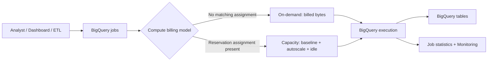
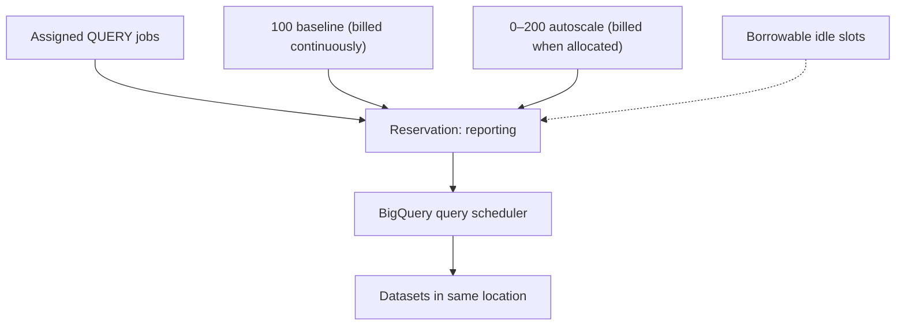
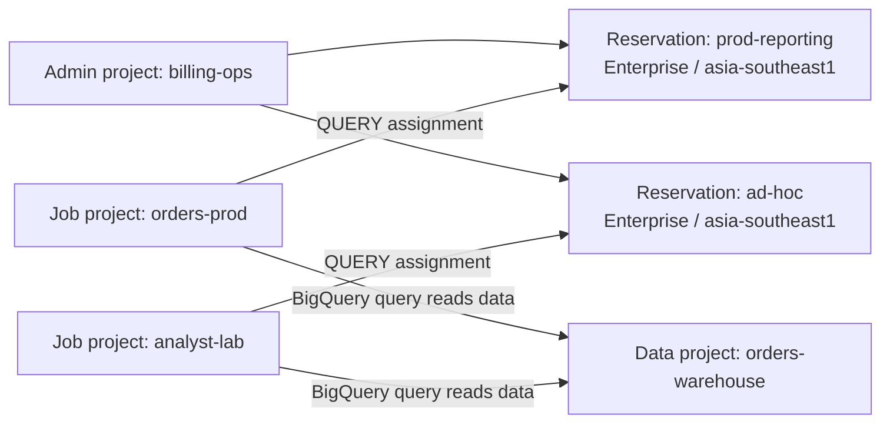
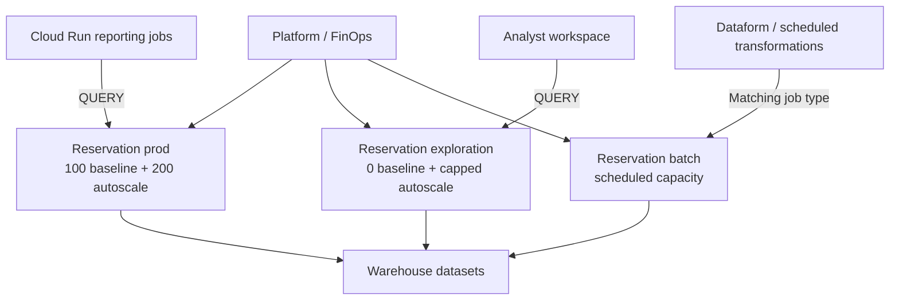

# On-Demand Analysis, Reservations, and Slots

An Orders operations team uses BigQuery to monitor daily revenue. During the first month, the team runs only a few queries per week, making **on-demand analysis** simple and easy to govern. As dashboards, scheduled ETL, and analyst users grow, query bills fluctuate and jobs compete for compute. **BigQuery reservations and slots** let you allocate processing capacity per workload using baselines, autoscaling, and explicit job assignments.

This lesson belongs to the **BigQuery** chapter of the `CLOUD_PROVIDERS_GCP` module, connecting Google Cloud service selection, IAM, Cloud Run/GKE deployments, data pipelines from Pub/Sub/Cloud Storage, cost governance, and reliability monitoring. The goal is to understand **what gets billed, which pool a job actually runs in, and when to switch billing models**.

> Project names, datasets, tables, and costs in examples are illustrative. Commands that create reservations, purchase commitments, assign workloads, or run data-writing queries can incur charges and affect other projects. Modify resources only in an approved sandbox. Verify pricing, quotas, editions, and autoscaling rules against [BigQuery pricing](https://cloud.google.com/bigquery/pricing) by region.

## 1. Learning Outcomes

After this lesson, you will be able to:

1. Explain the two compute billing models: **on-demand per TiB** and **capacity-based per slot-hour**.
2. Distinguish **slot**, **slot-ms**, **reservation**, **baseline**, **autoscaling slots**, **idle slots**, and **capacity commitment**.
3. Use `bq query --dry_run`, `--maximum_bytes_billed`, partitioning, and clustering to control on-demand costs.
4. Create a reservation and **assignment** by job type and location, and verify which pool a job uses.
5. Analyze `INFORMATION_SCHEMA.JOBS_BY_PROJECT` by bytes billed, slot time, concurrency, and latency.
6. Isolate production dashboards from ETL/ad-hoc queries, evaluate break-even trade-offs, and monitor SLOs and costs.

## 2. Jobs, Slots, and the Two Billing Models

BigQuery creates a **job** for every query, load, copy, or export. A query executes across multiple parallel stages. A **slot** is BigQuery's virtual unit of compute capacity serving a job—**not equivalent to a fixed vCPU or a dedicated customer VM**.



| Concept | Practical Meaning | Do Not Confuse With |
| --- | --- | --- |
| `total_bytes_processed` | Bytes read/processed per job stats | Bytes returned to the client |
| `total_bytes_billed` | Bytes used to calculate **on-demand analysis** charges | Total cost across all models |
| `slot` | A scheduled unit of virtual compute | A Compute Engine node |
| `total_slot_ms` | Total slot-milliseconds consumed by the job | Wall-clock runtime |
| `reservation` | Compute pool with edition, location, baseline, and autoscaling | Where tables or datasets live |
| `assignment` | Rule routing jobs into a reservation by source and job type | User `SELECT` permissions |
| `commitment` | Time-bound capacity purchase for discounted pricing | Guarantee of zero contention for every query |

**Both models use slots to execute.** Under on-demand, you pay for compute based on data processed; under capacity, you manage reservations and pay for slot capacity over time. Storage, networking, and certain service SKUs **are still billed separately**.

### 2.1. Slot-ms Differs from Query Wall-Clock Seconds

Suppose a job runs for **12 seconds** and uses an average of **150 slots**:

```text
total_slot_ms = 12 s × 150 slots × 1,000 ms/s
              = 1,800,000 slot-ms
avg_slots     = 1,800,000 / 12,000 = 150 slots
```

Slot count varies across query stages; 150 is an **average**, not the exact slot count at every instant. Queries waiting for slots can stretch wall-clock time without increasing slot-ms proportionally. Never multiply slot-ms by a TiB price to estimate on-demand costs.

### 2.2. On-Demand Analysis: Paying for Data Processed

When no valid reservation assignment applies to a job's type and location, standard queries run **on-demand**. Estimation formula:

```text
Analysis cost ≈ (total_bytes_billed / 2^40) × price per TiB
```

Unit prices depend on location and usage date, and a monthly free tier may apply. On-demand enforces a **minimum billable byte threshold** per BigQuery rules (currently documented as a 10 MiB minimum per referenced table where applicable). Returning 10 rows from a 1 TiB table **does not mean you only pay for 10 rows**.

On-demand uses a shared compute quota, typically documented as around **2,000 slots/project** by default under fair scheduling; **this is not a guarantee that every query always receives 2,000 slots**. If you need quota changes or burst tuning, check current limits.

### 2.3. Capacity-Based: Paying for Capacity

In the capacity model, reservations allocate **baseline slots** and/or **autoscaling slots**. Compute billing is based on **allocated/billed slots over time**, not per-query scanned bytes:

```text
Capacity cost ≈ baseline_slot_hours × baseline rate/slot-hour
              + autoscaled_slot_hours × autoscale rate/slot-hour
              - commitment discounts/credits (if any)
```

This is a **conceptual formula**: edition, scaling increments, idle sharing, commitments, and other SKUs affect the final bill. A reservation with zero active jobs still pays for allocated baseline slots. Autoscaling generally enforces a **one-minute minimum billing duration**, unless supported **fluid scaling** is enabled.

## 3. Choosing On-Demand or Reservations?

| Need | On-Demand | Capacity-Based |
| --- | --- | --- |
| Infrequent queries, early experimentation | Minimal setup, well suited | Baseline slots may sit idle and cost money |
| Steady dashboards/ETL for many hours daily | Bills can fluctuate | Predictability and commitments pay off at high utilization |
| Isolating production from ad-hoc | No dedicated workload pools | **Create separate reservations** and slot policies |
| Cost attribution per query | Direct per-query bytes billed | Re-allocate **reservation fees** internally |
| Elastic compute | BigQuery allocates on-demand automatically | Baseline + autoscaling within quotas and capacity availability |
| Multiple projects | Each project pays on-demand independently | Admin project manages shared pools and assignments |

Neither model is universally cheaper. For sparse, low-scan queries, on-demand is often sensible; workloads with steady slot demand benefit from capacity and commitments. **Always measure real load** before committing a baseline.

### 3.1. Mixing Both Models

An organization can run `prod-reporting` on an Enterprise reservation while keeping `analyst-sandbox` on-demand. Projects **without a matching assignment** generally fall back to on-demand. A **`None` reservation** assignment can explicitly opt out of an inherited assignment to stay on-demand. Always verify assignment inheritance, **job type**, and **job location**: creating a reservation alone **does not move jobs onto capacity**.

## 4. Controlling On-Demand Costs Before Running Queries

Suppose you have `orders-lab.analytics.orders` with columns `order_id`, `order_date DATE`, `country`, and `amount NUMERIC`. This table is illustrative; substitute an actual sandbox dataset/table. Datasets must reside in a location compatible with the job rather than querying arbitrarily across regions.

### 4.1. Dry Run and Maximum Bytes Billed

```bash
PROJECT_ID="orders-lab"
LOCATION="asia-southeast1"
SQL='SELECT order_date, SUM(amount) AS revenue
     FROM `orders-lab.analytics.orders`
     WHERE order_date >= DATE_SUB(CURRENT_DATE(), INTERVAL 7 DAY)
     GROUP BY order_date'

# CHECK ONLY: validates SQL and estimates bytes without running the query.
bq query --project_id="$PROJECT_ID" --location="$LOCATION" \
  --use_legacy_sql=false --dry_run "$SQL"

# MAY INCUR CHARGES: sandbox only, capped at 5 GiB.
bq query --project_id="$PROJECT_ID" --location="$LOCATION" \
  --use_legacy_sql=false --maximum_bytes_billed=5368709120 "$SQL"
```

**Dry run typically returns an upper-bound estimate**, not necessarily final bytes billed (especially on clustered tables). If estimated bytes exceed `maximum_bytes_billed`, BigQuery rejects the query **before execution** and charges no compute for the rejected job. On tables with row-level access policies, dry run may return 0 bytes to prevent side-channel inference: **never interpret 0 bytes as guaranteed free**.

### 4.2. Reducing Bytes Scanned Effectively

| Technique | Effect | Common Mistake |
| --- | --- | --- |
| Select only needed columns | Cuts columnar scans | `SELECT *` when only 2 columns are used |
| Filter **partitioning column** | Partition pruning cuts data read | Filtering with non-prunable expressions |
| Cluster on query keys | Block pruning where applicable | Assuming clustering speeds up every query |
| Materialized views / pre-aggregation | Reduces repeated scans when queries match | Forgetting separate maintenance/storage costs |
| Query results cache | Avoids re-scanning on cache hits | Assuming every repeated query hits cache |
| Table preview or `bq head` | Inspects sample rows without full query | Running `SELECT * LIMIT 10` to "save bytes" |
| Job labels, custom cost controls | Tracks owners and enforces guardrails | Treating `LIMIT` as a cost cap |

```sql
-- CREATES RESOURCE: run only if table does not exist in sandbox.
CREATE TABLE `orders-lab.analytics.orders` (
  order_id STRING NOT NULL,
  order_date DATE NOT NULL,
  country STRING,
  amount NUMERIC
)
PARTITION BY order_date
CLUSTER BY country, order_id
OPTIONS (require_partition_filter = TRUE);
```

```sql
-- Partition pruning by date, block pruning by country.
SELECT country, SUM(amount) AS revenue
FROM `orders-lab.analytics.orders`
WHERE order_date BETWEEN DATE '2026-11-01' AND DATE '2026-11-07'
  AND country = 'VN'
GROUP BY country;
```

`require_partition_filter` forces queries to supply a prunable partition predicate. Adding a `WHERE` clause on a date column alone **does not convert an existing unpartitioned table into a partitioned one**. `LIMIT 100` on an unclustered table can still scan massive data before returning 100 rows; **column projection + pruning** matters far more than output row count.

## 5. Capacity-Based: Editions, Baseline, Autoscaling, and Idle Slots

BigQuery **editions** currently include Standard, Enterprise, and Enterprise Plus, each with distinct features, pricing, and limits. Reservations manage **job compute capacity**; they do not alter data read permissions or dataset locations.

### 5.1. Reservation Sizing

Suppose an Enterprise reservation is configured as:

| Setting | Illustrative Value | Meaning |
| --- | ---: | --- |
| Baseline slots | 100 | Always reserved/billed even when no queries run |
| Maximum autoscaling slots | 200 | Can scale up by **up to 200 additional** slots |
| Maximum reservation size | 300 | **100 baseline + 200 autoscale**, subject to capacity availability |
| Idle slot sharing | Enabled (not ignored) | Can borrow idle capacity from eligible sibling reservations |
| Edition | Enterprise | Determines features and unit rates |
| Location | `asia-southeast1` | Must match assigned jobs' location |



**Autoscaling does not always reach the maximum**: it depends on demand and regional capacity availability. Slots typically scale in multiples of 50; billed duration has minimum rules (one minute by default, with fluid scaling options where supported). A **zero-baseline** reservation can fit intermittent workloads, yet **offers no guaranteed capacity during sudden spikes** and requires careful autoscaling and idle-sharing configuration.

### 5.2. Idle Slots and Isolation

By default, eligible reservations can borrow **idle slots** from other pools under the same administration project, edition, and location within supported limits. Setting `ignore_idle_slots=true` avoids relying on borrowed idle capacity, though it **does not guarantee the reservation always hits its max size**. If production requires predictable latency, configure an adequate baseline, isolate ad-hoc workloads, and manage admission/concurrency.

Some newer policies distinguish `ALL_SLOTS`, `AUTOSCALE_ONLY`, and `IDLE_SLOTS_ONLY` (features may be in Preview). **Do not combine `--autoscale_max_slots` with `--max_slots/--scaling_mode`** in the same command; follow one supported configuration branch. Reservation sizing changes can take up to a minute to apply, and usage can occasionally exceed max briefly due to scheduler behavior without extra overage billing beyond the reservation model.

### 5.3. Capacity Commitments

A **commitment** purchases capacity for a fixed term at discounted rates and is **not required** to use autoscaling. Commitments make sense only when baseline utilization is steady and the organization accepts the financial obligation for the commitment term. **Never buy a commitment just to test this lesson**: purchasing can start billing immediately, and long-term commitments carry strict cancellation/renewal rules.

## 6. How Reservations and Assignments Work Together



The **admin project** owns reservations/capacity and pays for capacity; the **job project** is where queries are submitted and assignments are evaluated, which can differ from the **data project** storing tables. For example, a Cloud Run job in `orders-prod` reading tables in `orders-warehouse` needs an assignment on `orders-prod`, **not automatically on `orders-warehouse`**.

| Assignment | Jobs Routed | Risk If Overlooked |
| --- | --- | --- |
| `PROJECT + QUERY` | Queries created in the matching project | Assigning only the data project while jobs run in another project |
| `FOLDER/ORGANIZATION + QUERY` | Eligible child projects inherit the assignment | New project accidentally consumes a shared production pool |
| Identity/user assignment | Routes jobs for specific principals per supported features | Identity rules can override project-level assignments |
| `PIPELINE/BACKGROUND/CONTINUOUS` | Routes specific non-QUERY job types | Assigning only QUERY and assuming load/copy jobs also use slots |
| `None` | Explicitly opts out of an inherited assignment to run on-demand | Unintended loss of capacity predictability if unmonitored |

Reservation assignments must match **location + job type + hierarchy/identity**, while IAM checks on query jobs and tables still apply independently. When an assignment points to a reservation **with zero baseline, zero autoscale, and no available idle slots**, the assignment may stay **pending** and queries run on-demand. After changing assignments, verify via **job statistics**, not just the configuration UI.

## 7. `bq` CLI Lab: Creating a Reservation and Assigning QUERY Jobs

This lab assumes an **admin project** `billing-ops` and **job project** `orders-prod` exist in the same organization with appropriate permissions. Set region `asia-southeast1` to match jobs; both project names are illustrative placeholders.

### 7.1. Inspect Metadata Before Making Changes

```bash
ADMIN_PROJECT="billing-ops"
JOB_PROJECT="orders-prod"
LOCATION="asia-southeast1"
RESERVATION="prod-reporting"

# READ-ONLY: list reservations in admin project/location.
bq ls --project_id="$ADMIN_PROJECT" \
  --location="$LOCATION" --reservation

# READ-ONLY: check active assignment for the job project.
# This show flag has Cloud Shell caveats; use Console/SQL as an alternative.
bq show --project_id="$ADMIN_PROJECT" \
  --location="$LOCATION" \
  --reservation_assignment \
  --assignee_type=PROJECT \
  --assignee_id="$JOB_PROJECT" \
  --job_type=QUERY
```

Do not overwrite assignments if the project already inherits an organization pool: creating multiple assignments at the same scope/type can conflict or alter routing. Distinguish **permission to create reservations** from **permission to assign projects/folders**; operators need `bigquery.reservations.create` and `bigquery.reservationAssignments.create` plus corresponding permissions on the assignee—not just `bigquery.jobs.create`.

### 7.2. Create an Enterprise Reservation with 100 + 200 Slots

```bash
# MUTATES/BILLS: creates 100 baseline + up to 200 additional autoscale slots.
# Do not run without budget, quota, and capacity approval.
bq mk --project_id="$ADMIN_PROJECT" \
  --location="$LOCATION" \
  --reservation \
  --edition=ENTERPRISE \
  --slots=100 \
  --autoscale_max_slots=200 \
  --ignore_idle_slots=false \
  "$RESERVATION"
```

The 100 baseline slots can begin accruing charges even before any jobs are assigned. `--autoscale_max_slots=200` specifies the **additional scaling headroom**, not total max slots. Here, total max size = 300 slots if capacity is available; **never pass both `--max_slots` and `--autoscale_max_slots`**. Newer/Preview scaling policies use different syntax and should not be mixed into this command.

### 7.3. Assign `orders-prod` Query Jobs

```bash
# MUTATES compute billing behavior for JOB_PROJECT once active.
bq mk --project_id="$ADMIN_PROJECT" \
  --location="$LOCATION" \
  --reservation_assignment \
  --reservation_id="$RESERVATION" \
  --assignee_type=PROJECT \
  --assignee_id="$JOB_PROJECT" \
  --job_type=QUERY
```

**Wait at least ~5 minutes per documentation** before running verification queries; a new assignment may not take effect immediately, causing early jobs to still run on-demand. If `orders-prod` sits under a folder/org assignment, check hierarchy/identity precedence. Jobs **already executed before the switch** are not retroactively moved to the reservation.

Next, run **one small dry-run-checked query** in `orders-prod` in `asia-southeast1` and verify `reservation_id` using Section 8. Assigning `QUERY` does not automatically move `LOAD`/`COPY`/`EXPORT`/`CONTINUOUS`/`BACKGROUND` jobs: create assignments per job type if those workloads also need slot capacity.

### 7.4. Resizing Capacity and Rolling Back Assignments

```bash
# MUTATES/BILLS: raises baseline to 150 while keeping +200 autoscale.
bq update --project_id="$ADMIN_PROJECT" \
  --location="$LOCATION" \
  --reservation \
  --slots=150 \
  --autoscale_max_slots=200 \
  "$RESERVATION"
```

**Never run this in production merely to test.** Capacity edits can take up to a minute to reach the scheduler and alter billing immediately. To return a project to on-demand, **update or delete the assignment per runbook** or assign `None` after checking inheritance; never delete a reservation while other jobs still depend on its capacity. Monitor job types/locations and billing after rollback.

## 8. Verifying with `INFORMATION_SCHEMA`

**Never guess billing from reservation names.** With job-metadata permissions (typically `bigquery.jobs.listAll` or a matching role), query `INFORMATION_SCHEMA.JOBS_BY_PROJECT` for the **actual job project and region**. While this view holds metadata, querying it still requires permissions and obeys visibility limits.

### 8.1. Which Jobs Ran On-Demand vs. Slots?

```sql
-- READ-ONLY: run in project orders-prod, location asia-southeast1.
-- Replace project/location with your real environment.
SELECT
  project_id,
  job_id,
  creation_time,
  reservation_id,
  total_bytes_processed,
  total_bytes_billed,
  total_slot_ms,
  ROUND(total_slot_ms / 3600000.0, 3) AS slot_hours_used,
  TIMESTAMP_DIFF(end_time, start_time, MILLISECOND) AS runtime_ms,
  ROUND(
    SAFE_DIVIDE(
      total_slot_ms,
      TIMESTAMP_DIFF(end_time, start_time, MILLISECOND)
    ), 2
  ) AS avg_slots
FROM `orders-prod.region-asia-southeast1.INFORMATION_SCHEMA.JOBS_BY_PROJECT`
WHERE creation_time >= TIMESTAMP_SUB(CURRENT_TIMESTAMP(), INTERVAL 7 DAY)
  AND job_type = 'QUERY'
  AND (statement_type IS NULL OR statement_type != 'SCRIPT')
  AND state = 'DONE'
ORDER BY creation_time DESC
LIMIT 100;
```

**Interpret the output accurately:** `reservation_id` shows which reservation executed the job when assigned; it can be `NULL` for on-demand/unassigned runs. `total_bytes_billed` must not be multiplied by a TiB rate to compute **capacity job** costs, since compute is billed through the reservation. `avg_slots` measures average **slot-ms / wall-clock runtime**, not peak slot demand. For multi-statement scripts, exclude parent jobs via `statement_type != 'SCRIPT'` to avoid **double-counting** child job slot usage.

### 8.2. Viewing Slot Usage Over Time

```sql
-- READ-ONLY: one-second time slices aggregated per minute.
SELECT
  TIMESTAMP_TRUNC(period_start, MINUTE) AS minute,
  ROUND(SUM(period_slot_ms) / 60000.0, 1) AS avg_slots,
  COUNT(DISTINCT job_id) AS active_jobs_in_minute
FROM `orders-prod.region-asia-southeast1.INFORMATION_SCHEMA.JOBS_TIMELINE_BY_PROJECT`
WHERE job_creation_time >= TIMESTAMP_SUB(CURRENT_TIMESTAMP(), INTERVAL 1 DAY)
  AND period_start >= TIMESTAMP_SUB(CURRENT_TIMESTAMP(), INTERVAL 1 HOUR)
GROUP BY minute
ORDER BY minute;
```

Each row in `JOBS_TIMELINE_BY_PROJECT` represents a 1-second slice of a job. One minute contains 60,000 slot-ms for **one continuously active slot**, so `SUM(period_slot_ms) / 60,000` equals average slots used in that minute. `active_jobs_in_minute` counts jobs **present during that minute**, not peak instantaneous concurrency or queue depth. To spot contention/queueing, also inspect **Admin resource charts**, `estimated_runnable_units`, and Monitoring.

### 8.3. Billed Per Job or Per Reservation?

| Job Metadata | On-Demand | Capacity |
| --- | --- | --- |
| `total_bytes_billed` | Basis for per-TiB analysis cost | Still useful telemetry, **does not directly generate query charges** |
| `total_slot_ms` | Helps analyze parallelism/efficiency | Useful for cost attribution / capacity estimation |
| `reservation_id` | Typically unassigned | Verifies which pool executed the job |
| Cloud Billing SKU | Analysis bytes (and other fees) | Slot-hours / baseline / autoscale / commitment (and other fees) |

To allocate pool costs across teams, use **cost attribution** from Cloud Billing exports or an allocation model accounting for idle baseline, commitments, and shared idle slots. **Never sum job `slot-ms` across jobs and equate it to billed slot-hours**, because idle baseline slots are billed even with zero jobs, and autoscale enforces minimum billing durations.

## 9. Capacity Sizing and Break-Even Evaluation

Required slots depend on concurrent jobs, query complexity, SQL plans, peak demand, and **SLOs**—not simply TiB scanned. Example from `JOBS_BY_PROJECT`:

| Workload | Jobs/Day | Peak Hours | Avg Slots/Job | SLO |
| --- | ---: | --- | ---: | --- |
| Revenue dashboards | 500 | 09:00–11:00 | 40 | p95 under 10 seconds |
| ETL transformations | 80 | 01:00–03:00 | 120 | Complete before 05:00 |
| Ad-hoc analysts | Variable | Business shifts | 80 | Best-effort |

These numbers are **illustrative**; you cannot multiply `500 × 40` to get required slots because jobs do not all run simultaneously. Measure slot usage **by second/minute** and runnable units to observe real contention windows.

### 9.1. Practical Sizing Workflow

1. Collect **7–30 days** of job history covering peaks, weekends, batch loads, and anomaly days.
2. Categorize by job project, principal, labels, job type, data location, and business criticality.
3. Measure **p50/p95 job runtime**, queue/wait times, `total_slot_ms`, estimated concurrent slots, and peak demand.
4. Optimize queries, partitioning, and clustering before switching compute models; eliminate wasteful scans and accidental cross joins.
5. Trial a **baseline + autoscale max** aligned to SLOs, quotas, and budget; **isolate ad-hoc jobs in a separate pool** if they risk starving production slots.
6. Migrate one small project/team first and observe at least one full load cycle; tune carefully before purchasing commitments.

**High capacity does not guarantee proportional query speedups**: if a query is bottlenecked on shuffle, skewed joins, low parallelism, or external APIs, adding slots may raise slot-ms with minimal runtime gain. For workloads with high query concurrency, inspect admission/concurrency limits as well as max slots.

### 9.2. Illustrative Break-Even Calculation

Suppose a team processes **12 TiB billed/day** on-demand. They compare it against a reservation with 100 baseline slots running 24/7 plus 100 autoscaled slots for 3 hours/day.

```text
Monthly on-demand TiB ≈ 12 × 30 = 360 TiB
Monthly on-demand     ≈ 360 × price/TiB

Monthly baseline slot-hours ≈ 100 × 24 × 30 = 72,000 slot-hours
Monthly autoscale slot-hours≈ 100 × 3 × 30 = 9,000 slot-hours
Monthly capacity            ≈ (72,000 × baseline rate/slot-hour)
                            + (9,000 × autoscale rate/slot-hour)
                            - discounts/credits if any
```

This illustration exists only to **plug current unit prices into matching units**; it omits free tiers, minimum billing rules, idle slots, commitments, and low-traffic days. Key takeaway: **never compare a TiB price directly against a slot-hour price**; convert both via processed data and **billed capacity over time**. The autoscale term above assumes full 100-slot utilization across all 3 hours; if autoscaling spikes only briefly, read actual billed slot-hours from metrics and Billing.

## 10. Isolating Workloads, Limiting Contention, and Cost Governance

An organizational layout:



This diagram **illustrates policy separation**, not a configuration that guarantees sufficient slots at every moment. Zero-baseline ad-hoc depends on proper autoscaling and capacity availability; scheduled batch baselines still bill for the duration baseline slots are provisioned.

### 10.1. Layered Guardrails

| Layer | Control | Limitation |
| --- | --- | --- |
| Query design | Partition filters, clustering, materialized views | Cannot replace capacity planning when demand is high |
| On-demand cost | Dry run, `maximum_bytes_billed`, custom cost controls | Caps bytes directly, not reservation slot-hours |
| Assignment | Project/folder/identity + job type | Wrong location/type can fall back to on-demand |
| Capacity | Baseline/autoscale max, concurrency, project caps | Scheduler is best-effort; spikes can still queue |
| IAM | Data access vs. job creation vs. reservation admin | Reservations do not grant data access |
| Billing | Budgets, labels, cost attribution, anomaly alerts | Budget alerts do not automatically shut off BigQuery |
| Monitoring | Slot utilization, queue time, job failures, SQL insights | Job metrics alone do not reflect idle baseline bills |

### 10.2. Least-Privilege IAM and Separation of Duties

- **Analyst/job runner:** `roles/bigquery.jobUser` on the job project; `roles/bigquery.dataViewer`/data roles on required datasets or tables. Needs no reservation edit rights.
- **Platform capacity operator:** `roles/bigquery.resourceAdmin` or custom role for reservations and assignments, plus appropriate permissions on assignees. Never grant org-wide BigQuery Admin to every developer.
- **Data owner:** manages tables/datasets, row-level security, column-level policy tags, and encryption; **never assume a reservation assignment grants table read permissions**.
- **FinOps:** Cloud Billing export, budgets, cost attribution, and total slot-hour reporting; scope access to sensitive data strictly on need.

Jobs execute under the **caller/service account's identity**, not a "reservation identity." Switching from on-demand to reserved slots **does not bypass IAM, data masking, VPC Service Controls, or data residency**. If data lives in another region, plan supported transfers or cross-region queries; **a reservation in region A does not automatically serve jobs in region B**.

## 11. Observing SLOs and Detecting Overload

In Google Cloud Console → **BigQuery → Monitoring / Resource utilization charts**, track:

| Signal | Question to Answer | Action |
| --- | --- | --- |
| Assigned baseline/autoscaled slots | How much capacity is allocated and billed? | Tune baseline/max; reconcile against Billing |
| Utilized slots, borrowed/lent slots | How many slots are actively executing jobs? | Distinguish idle capacity from contention |
| Estimated runnable units | Is ready work piling up waiting for slots? | Inspect concurrency/capacity and SQL plans |
| Queued jobs / waiting time | Are dashboards waiting on admission or capacity? | Throttle ad-hoc, adjust pool size with evidence |
| Query p95, failure rate | Are users meeting SLOs? | Review SQL plans, errors, and dependencies |
| Total slot-ms / bytes billed by group | Where is resource consumption concentrated? | Cost attribution, labels, query reviews |
| On-demand charges post-assignment | Are jobs falling back unexpectedly? | Check assignments, location, job type, propagation |

**Quotas** and **Monitoring** can display different slot numbers: provisioned baseline with no active jobs counts toward allocated capacity/cost, whereas utilization charts show active work. Borrowed idle slots can push sampled usage above baseline/max during certain intervals; **do not assume overage fees solely from a utilized-slots spike**.

For slow jobs, inspect **Execution details → Query plan/Execution graph** for shuffle, skew, wait time, spills, and bytes read—do not fix every problem by buying more slots. Use Cloud Audit Logs and Cloud Billing to detect changes to reservations, assignments, commitments, and data configurations.

## 12. Orders Case Study: Stabilizing the Revenue Dashboard

The Orders team keeps invoice data in BigQuery:

- Cloud Run API submits revenue dashboard query jobs with job project `orders-prod`.
- Dataform/ETL runs transformations at 02:00 with job project `orders-etl`.
- Analysts use `analyst-sandbox` for exploration; large JOIN queries consume heavy slots.
- Source tables live in `orders-warehouse`, dataset location `asia-southeast1`.

Before optimization, everything ran on-demand; dashboard p95 degraded from 7 seconds to 38 seconds when 40 analyst queries ran concurrently, and scan bills climbed due to `SELECT *`.

### 12.1. Phased Improvement Plan

1. **Baseline:** query `JOBS_BY_PROJECT` across the job projects in the same location; record billed TiB, slot-ms, p95, peak runnable units, and top expensive queries.
2. **Optimize SQL:** add partition filters on `order_date`, replace `SELECT *` with needed columns, and evaluate pre-aggregated dashboard tables.
3. **Isolate workloads:** create Enterprise reservation `prod-reporting` (100 baseline + 200 autoscale); assign `orders-prod` `QUERY` jobs to it. Keep analysts on-demand or route them to a separate ad-hoc pool per budget.
4. **Verify propagation:** once the assignment is active, run small dry-run-validated queries from `orders-prod` in `asia-southeast1` and confirm `reservation_id` and Billing.
5. **Measure SLOs:** compare dashboard p50/p95, queue time, slot utilization, data freshness, error rate, and total cost across at least one peak cycle.
6. **Tune:** if borrowed slots or queued jobs stay high, tune SQL and concurrency first; increase baseline/max only when justified. Hold off on commitments until load stabilizes.

Illustrative post-tuning outcome: dashboard p95 drops to **9 seconds**, error rate stays flat, scanned bytes drop, and analyst queries no longer starve dashboards. These numbers are **illustrative**, not a BigQuery benchmark or capacity SLA.

### 12.2. Incident: Reservation Created, Yet Jobs Still Bill On-Demand

A day later, FinOps spots unexpected on-demand analysis charges under `orders-prod`. Investigate step by step:

1. Query `JOBS_BY_PROJECT` for jobs in that window whose `reservation_id` is unassigned or unexpected.
2. Verify whether the actual **job project** is `orders-prod` or another project submitting jobs on the app's behalf.
3. Verify the job's **location** is `asia-southeast1`; reservations never span locations automatically.
4. Verify the assignment is **active**, targets `QUERY`, matches hierarchy/identity, and is not pending; jobs launched right after creation may still have billed on-demand.
5. Check whether other job types (`PIPELINE`/`BACKGROUND`/`ML`/`CONTINUOUS`) remain unassigned.
6. Reconcile Cloud Billing SKUs and **usage timestamps**; never misinterpret delayed charges from an earlier period as new usage.

If a new job project lacked an assignment, update assignments per approval or intentionally keep it on-demand with cost guardrails. **Never delete an already-billed reservation expecting a "refund"**; fix assignment governance and set alerts for unexpected fallback.

## 13. Quick Troubleshooting

| Symptom | Likely Cause | Check / Action |
| --- | --- | --- |
| Dry run shows 0 bytes, real query incurs charges | Row-level security or dry-run limitations | Query validator, Billing, permissions, and actual data |
| `LIMIT 10` still scans terabytes | Missing partition/cluster pruning | Column projection, partition filters, pre-aggregation |
| Query exceeds `maximum_bytes_billed` | Estimate exceeds cap; clustered estimate is upper bound | Optimize SQL or raise cap with approval |
| Job is slow despite low `total_slot_ms` | Waiting on slots, low parallelism, or external wait | Query timeline, runnable units, and execution graph |
| Job bills on-demand despite reservation | Project unassigned, pending/propagation, location/type mismatch | Verify assignment + `reservation_id` in job history |
| `bq mk --reservation` fails | Missing IAM, quota/edition/location, or invalid slot count | Resource Admin, region, multiples of 50, capacity availability |
| Configured 100 baseline + 200 autoscale expecting 200 max | Confused autoscale headroom with total max | Max size = baseline + autoscale max |
| Reservation has slots yet jobs still queue | Concurrency cap, job bursts, skew, insufficient free slots | Resource charts, running jobs, policies, and query plan |
| Autoscaling does not reach max | Capacity availability, quotas, or scaling policy | Autoscaler metrics, quotas, baseline, and admission |
| Few idle slots borrowed | Edition/location/admin project mismatch or sharing disabled | Check `ignore_idle_slots` and sibling idle capacity |
| Job usage exceeds baseline | Autoscaled/borrowed slots or sampled utilization | Compare billed vs. utilized/borrowed slots |
| High bill despite few jobs | Baseline always bills, commitment/autoscale minimum duration | Cloud Billing export by SKU + slot-hours |
| Jobs missing from `INFORMATION_SCHEMA` | Wrong region/project, missing `jobs.listAll`, wrong time window | Region qualifier, job project, and IAM |
| Job runs in a project lacking data access | Assignments do not grant `SELECT` | BigQuery Data Viewer / row policies on dataset/table |
| ETL impacts dashboards | Shared reservation without isolation or concurrency controls | Separate job projects/reservations; set workload priorities |

## 14. Practical Exercises

### Exercise A — On-Demand or Capacity?

One team runs only 10 queries/day, each billing 500 GiB; another runs dashboards every minute plus ETL for 8 hours/day. Choose a starting model for each team. Which metrics must be measured before concluding capacity is cheaper?

### Exercise B — Dry Run and Partition Pruning

Create a sandbox table partitioned by `order_date`, compare dry runs for an unfiltered `SELECT *` (if permitted) versus a two-column query with a partition filter. Set an appropriate `maximum_bytes_billed`. Why doesn't `LIMIT 10` guarantee lower cost?

### Exercise C — Calculating Slot-ms

A query runs for 20 seconds with `total_slot_ms=2,400,000`. Compute average slots. A second query runs for 10 seconds using `1,800,000 slot-ms`; which consumed more total slot time, and which averaged higher parallelism? Why can't you determine peak slots from these two numbers alone?

### Exercise D — Creating a Reservation and Assignment

In an approved sandbox, assume an Enterprise reservation with **100 baseline + 200 autoscaling slots** in `asia-southeast1`. Write the `bq mk --reservation` and `bq mk --reservation_assignment` commands for `orders-prod` `QUERY` jobs. Check project/region, permissions, and propagation delay before running the verification job. When does a pending assignment cause a job to run on-demand?

### Exercise E — Analyzing `INFORMATION_SCHEMA`

Write a query grouping jobs by day and `reservation_id`, summing total billed TiB and job slot-hours. Exclude `statement_type='SCRIPT'` parent records. Explain why summing job slot-hours does not equal the exact billed baseline cost.

### Exercise F — Break-Even Modeling

Use **12 TiB/day**, 100 baseline slots running 24 hours, and 100 autoscaling slots for 3 hours/day. Denote current TiB and slot-hour unit prices symbolically and write two 30-day cost expressions. List missing variables: idle slots, commitments, minimum durations, region, and other SKUs.

### Exercise G — Workload Isolation

An analyst group causes production dashboard p95 latency to jump from 7 to 38 seconds. Propose how to separate job projects, reservation assignments, and quotas/SQL tuning, and how to verify you neither overload primary ETL nor push jobs onto on-demand unexpectedly.

### Exercise H — IAM and Rollback Procedure

Design two roles: analysts who create queries + view tables, and platform operators who manage reservations/assignments. When moving workloads to capacity triggers a large backlog, outline an approved rollback sequence and Billing check that preserves data read access.

### Self-Check Questions

1. Does one slot equal one VM vCPU?
2. Does on-demand bill by `total_slot_ms` or billed bytes?
3. Why can a faster query consume more `slot-ms` than a slower query?
4. With 100 baseline and 200 autoscale max, what is the maximum reservation size?
5. Does a reservation automatically apply to all jobs reading data from a dataset?
6. Why must both job project and location be verified when assigning a reservation?
7. Does a `QUERY` reservation assignment cover pipeline/background jobs?
8. Why doesn't `maximum_bytes_billed` cap capacity charges?
9. Why can an idle reservation with zero jobs still incur charges?
10. Can two systems with identical billed TiB but different slot-hours require different capacity sizing?

## 15. Deployment Checklist and Official Documentation

- [ ] Measured bytes billed, slot-ms, p95, and peak concurrency by **job project/location**.
- [ ] On-demand jobs use dry runs, `maximum_bytes_billed`, partition pruning, and cost quotas.
- [ ] Billing model choice reflects workload/SLOs and total regional pricing, not scanned TiB alone.
- [ ] Reservation edition, baseline, autoscale max, and idle sharing are documented and approved.
- [ ] Assignments match hierarchy/identity, **job type**, and location; verified after propagation.
- [ ] Production, ad-hoc, and batch workloads are isolated by SLO, IAM, and priority.
- [ ] Cloud Billing exports/cost attribution and alerts cover idle baselines, autoscale, and on-demand fallback.
- [ ] Runbooks define approval for capacity/assignment edits, rollback steps, and job-stats verification.

Official Google Cloud documentation to verify before deployment:

- [Introduction to BigQuery workload management](https://cloud.google.com/bigquery/docs/reservations-intro)
- [Understand BigQuery slots](https://cloud.google.com/bigquery/docs/slots)
- [Understand reservations](https://cloud.google.com/bigquery/docs/reservations-workload-management)
- [Manage workload reservations](https://cloud.google.com/bigquery/docs/reservations-tasks)
- [Manage workload assignments](https://cloud.google.com/bigquery/docs/reservations-assignments)
- [Introduction to BigQuery editions](https://cloud.google.com/bigquery/docs/editions-intro)
- [Estimate and control costs](https://cloud.google.com/bigquery/docs/best-practices-costs)
- [JOBS information schema](https://cloud.google.com/bigquery/docs/information-schema-jobs)
- [JOBS_TIMELINE information schema](https://cloud.google.com/bigquery/docs/information-schema-jobs-timeline)
- [Monitor reservations](https://cloud.google.com/bigquery/docs/reservations-monitoring)
- [BigQuery capacity pricing](https://cloud.google.com/bigquery/pricing)
- [IAM roles for BigQuery](https://cloud.google.com/bigquery/docs/access-control)
- [BigQuery query performance best practices](https://cloud.google.com/bigquery/docs/best-practices-performance-overview)

**Key takeaway:** On-demand bills compute by **bytes billed**, while capacity-based billing charges for **allocated slots over time**. Reservations allocate capacity to **jobs matching an assignment**, not directly to datasets. Run dry runs, optimize SQL, verify `reservation_id`/`total_slot_ms`, account for baseline/autoscaling/idle costs, and protect production SLOs before purchasing commitments.
