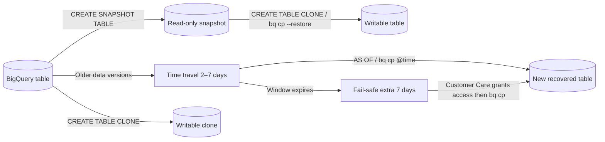
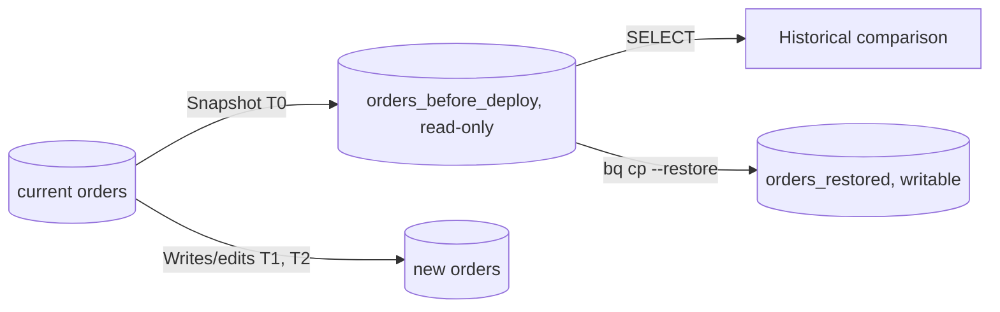

# Time Travel, Table Snapshots, and Data Recovery in BigQuery

> **Chapter:** BigQuery  
> **Module:** CLOUD_PROVIDERS_GCP  
> **Module scope:** Explore Google Cloud from project organization, IAM, and VPCs to Compute Engine, GKE, Cloud Run, storage services, and databases. Through deployment scenarios, learners select services, secure resources, automate releases, and monitor reliability and cost.

An ETL job runs `CREATE OR REPLACE TABLE` and overwrites the revenue table; the analytics team catches the mistake 30 minutes later. If the table is still inside the **time travel window**, BigQuery can query the older version or copy it to a **new table**. However, after several days that history expires; to preserve a recovery point longer, the team must proactively create **table snapshots** or retain appropriate copies.

This lesson distinguishes **time travel**, **table snapshots**, **table clones**, **fail-safe**, and **copy/restore**, covering IAM, costs, and incident recovery procedures. Hands-on exercises prioritize **read-only checks on an existing sandbox dataset**; commands creating snapshots or restores are **optional and require approval**—never run them against production tables.

## Learning Objectives

After this lesson, you will be able to:

1. Determine the dataset-level **time travel** window (7 days default, configurable 2–7 days) and the additional 7-day **fail-safe** limit.
2. Use GoogleSQL `FOR SYSTEM_TIME AS OF` to query an **existing table** at a valid historical timestamp.
3. Restore a **deleted table** using `bq cp` with a `@<time>` time decorator, without confusing it with SQL time travel queries.
4. Create, inspect, and restore **table snapshots**, understanding read-only semantics, retention, data location, and writable restores.
5. Distinguish snapshots from clones, physical copies, and fail-safe; define **RPO/RTO**, permissions, and costs.
6. Execute a recovery runbook that **does not overwrite the source**, reconciles data, and safely restores dependencies.

## 1. Four Retention and Recovery Mechanisms



| Mechanism | Purpose | Characteristics |
|---|---|---|
| **Time travel** | Inspect/recover recent states | History configured per **dataset**, 7 days default; `AS OF` queries work while the table exists |
| **Table snapshot** | Preserve table state at a **fixed point in time** | **Read-only**, queryable, separate expiration; retains beyond time travel |
| **Table clone** | Lightweight copy for testing and modification | **Writable**, copy-on-write; not an immutable recovery point |
| **Fail-safe** | Emergency data recovery after time travel | **Extra 7 days**, cannot be queried or copied without Cloud Customer Care access |

**A standard copy** (`bq cp` without `--snapshot`/`--restore`) creates an independent new table, distinct from snapshots and clones. **Extracting/exporting to Cloud Storage** is another archival/cross-region option with its own format, IAM, encryption, and lifecycle requirements.

## 2. Time Travel Window and Fail-Safe

Every dataset has a `max_time_travel_hours` property. Supported tables within that dataset share the same historical access window.

| Property | Value / Limit |
|---|---|
| Default time travel | **168 hours = 7 days** |
| Configurable durations | **48, 72, 96, 120, 144, or 168 hours** (2–7 days) |
| Configuration scope | **Dataset**, not per table |
| Valid timestamps | Within the window **and not before the table was created** |
| Fail-safe after window | **7 days**, fixed and non-extendable |
| After fail-safe expires | Expired data is **unrecoverable**, even via support |

When adjusting retention, a DBA can use GoogleSQL (substitute the exact dataset only after change approval):

```sql
-- MUTATES DATASET CONFIGURATION; do not run in a read-only lab.
-- 72 hours = 3 days; only 48–168 hours in 24-hour increments are allowed.
ALTER SCHEMA `my-project.analytics_lab`
SET OPTIONS (max_time_travel_hours = 72);
```

If a table is deleted at 10:00 with a **3-day** time travel window, self-service recovery via `bq cp` is available during the first three days. Afterward, **7 days of fail-safe** may remain, requiring you to **contact Cloud Customer Care** for emergency access before copying. Never plan RTO assuming SQL queries can always read deleted data.

### 2.1. Data Versions Are Not Cell-Level Logs

When `UPDATE`/`DELETE`/`MERGE`/`CREATE OR REPLACE` mutates data, BigQuery retains **prior storage block versions**. Modifying a single value can preserve the entire column block; historical byte growth does not equal the size of a single changed cell. Deleted resources follow the **window in effect at deletion time**: raising time travel from 2 to 7 days after a deletion does not extend recovery for the earlier deletion.

Time travel protects **data**, not automatically all metadata, IAM bindings, tags, policy tags, or pipeline configs. To retain snapshots for 30–180 days for compliance, **create snapshots while still inside the time travel window** or maintain an independent archival plan.

### 2.2. Fail-Safe Is a Support-Assisted Process, Not an "Undo" Button

Current BigQuery documentation outlines:

1. Identify the project, dataset, table name, **last known good timestamp**, and incident time.
2. Within the **7-day fail-safe period**, contact **Cloud Customer Care** to request **temporary fail-safe recovery access** on the dataset.
3. Once granted, an operator runs `bq cp` with the exact **source table and `@TIME` decorator**.
4. Copying very large tables from fail-safe can take a long time or hit timeouts/transient errors. Retry with the **exact same source and timestamp**; block recovery can resume progress.
5. The copy must finish before **fail-safe expires**—merely opening a ticket before the deadline is not enough.

Fail-safe **does not allow `FOR SYSTEM_TIME AS OF` on data past the time travel window**. It is a conditional emergency safety net for supported events such as **table deletion/replacement**, not a proactive backup strategy with guaranteed RPO/RTO.

## 3. Querying History with `FOR SYSTEM_TIME AS OF`

GoogleSQL can read an **existing native table** as of a past timestamp:

```sql
-- Table must have existed >=1 hour and timestamp must fall within time travel.
SELECT order_id, total_amount, status
FROM `my-project.analytics.orders`
  FOR SYSTEM_TIME AS OF
    TIMESTAMP_SUB(CURRENT_TIMESTAMP(), INTERVAL 1 HOUR)
WHERE order_id = 'order-001';
```

The query reads the table's state at the specified timestamp **without altering current data**. If the table was created less than an hour ago or the timestamp is outside the window, BigQuery rejects the historical timestamp.

### 3.1. When Should You Query History?

- Inspect bad rows and pinpoint the **exact pre-incident timestamp**.
- Compare revenue numbers before and after an ETL job or migration.
- Choose the right timestamp for a subsequent snapshot or copy.

**You cannot use `FOR SYSTEM_TIME AS OF` on a deleted table** because it is no longer in the catalog: SQL returns `Not found`. Use **`bq cp table@TIME new_table`** to restore it first, then query the new table.

### 3.2. Controlling Historical Query Costs

**`LIMIT` does not guarantee a cheap query**: BigQuery can scan substantial data before returning a few rows. On large tables, run a dry run / byte estimate, project only needed columns, apply partition filters if valid, and set `--maximum_bytes_billed`. **Lab A in Section 10** provides a read-only `bq query` command with a billed-bytes cap looking 15 minutes back; run it only on tables that already existed before that point.

## 4. Restoring Deleted/Overwritten Tables with `bq cp`

### 4.1. Understanding Time Decorators

| Syntax | Meaning |
|---|---|
| `orders@-3600000` | Version **1 hour ago**, **millisecond** offset |
| `orders@1732010400000` | An **absolute Unix epoch milliseconds** timestamp (illustrative) |
| `orders@0` | Earliest available historical snapshot per BigQuery rules |

Never put a minus sign in front of an absolute epoch millisecond value: `@-1732010400000` means **~55 years ago**, not a 2024 timestamp. During a long-running incident, use a verified **absolute** timestamp rather than a relative offset, because `@-3600000` keeps sliding forward with the current clock.

### 4.2. Copy the One-Hour-Old Version to a NEW Table

```bash
# Source table must have existed one hour ago and still be within time travel.
# Destination must not exist; never overwrite live data.
RESTORED_TABLE="orders_recovered_lab"

bq cp --location="$LOCATION" --no_clobber \
  "${PROJECT_ID}:${DATASET_ID}.${TABLE_ID}@-3600000" \
  "${PROJECT_ID}:${DATASET_ID}.${RESTORED_TABLE}"

bq show --format=prettyjson \
  "${PROJECT_ID}:${DATASET_ID}.${RESTORED_TABLE}"
```

`--no_clobber` ensures the command **fails if the destination already exists**. If the source table was dropped yet remains inside time travel, `bq cp` can recover the data; SQL `AS OF` cannot read a dropped table.

### 4.3. Using an Absolute Timestamp for Recovery

```bash
# Illustrates converting an incident timestamp to epoch milliseconds in Cloud Shell.
# Replace with a real timestamp inside the time travel window!
RECOVERY_TIME_UTC="2026-11-19 03:04:00 UTC"
RECOVERY_MS="$(($(date -u -d "$RECOVERY_TIME_UTC" +%s) * 1000))"
printf 'Recovery timestamp (ms): %s\n' "$RECOVERY_MS"

# Only when authorized to create a new destination in a sandbox dataset:
# bq cp --location="$LOCATION" --no_clobber \
#   "${PROJECT_ID}:${DATASET_ID}.${TABLE_ID}@${RECOVERY_MS}" \
#   "${PROJECT_ID}:${DATASET_ID}.orders_recovered_at_timestamp"
```

Example dates quickly **expire**, so never copy them verbatim into production. On PowerShell, use `[DateTimeOffset]::Parse(...).ToUnixTimeMilliseconds()` instead of GNU `date`. The timestamp must be **after table creation**, before deletion, and inside the valid window.

### 4.4. Do Not Assume Copy Restores All Metadata

Google Cloud documentation notes that when restoring a deleted table via time decorator, **tags are not copied** and **partitioning information may not be preserved** on the destination. Always inspect and restore:

1. Schema, partitioning/clustering, table expiration, labels/tags, and policy tags.
2. Row-level access policies, authorized views, dataset permissions, and CMEK.
3. Materialized views or downstream apps referencing the old table.
4. IaC / Audit Logs recording pre-incident DDL and settings.

**Restoring individual partitions** via `table$PARTITION@TIME` is **not supported**; restore the **entire table** and extract slices afterward if needed. Deleted **external tables or materialized views** cannot be restored directly via time-travel table copy; recreate their definitions/sources. Never run `CREATE OR REPLACE` on the source table while active writers exist.

## 5. Table Snapshots: Retaining Long-Term Recovery Points

A **table snapshot** is a **read-only** table resource frozen at a point in time; it is queryable like a standard table, yet rejects `INSERT/UPDATE/DELETE`. Unlike the 2–7 day time travel window, snapshots can carry retention **far beyond the window** unless deleted or expired.



### 5.1. Why Are Snapshots Usually Cheaper Than Full Copies?

BigQuery uses **shared storage blocks / copy-on-write**: at creation, unmodified bytes are shared with the base table; as source data is updated or deleted, blocks preserved solely for the snapshot accrue storage charges. If the base table is deleted, bytes retained by the snapshot are billed to the appropriate resource. **Snapshots are not free**, and storage savings shrink when the base table mutates heavily.

A snapshot **protects only one table at one chosen timestamp**; it does not snapshot entire datasets, views, pipelines, routines, IAM, row policies, external sources, or downstream reports. Maintain separate backup/metadata plans for the rest of the system.

### 5.2. Location, Organization, and Separate Datasets

Place snapshots in a **backup dataset separate from the source dataset**, in the same location and **same organization**, so an accidental source dataset deletion leaves the backup intact. Creating a snapshot in another location may cause BigQuery to treat it as a **full table copy** rather than a block-sharing snapshot; verify product rules, pricing, and residency. For cross-region DR, implement an approved replication/export plan rather than assuming snapshots move data across regions automatically.

### 5.3. Key Limitations

- You cannot snapshot **logical views, materialized views, or external tables** as native base tables.
- Data still in the **streaming buffer / write-optimized storage** on the source and not yet flushed to managed storage **will not appear in the snapshot**.
- Snapshots **do not automatically inherit the source's partition expiration** in every scenario; verify dataset defaults and snapshot metadata afterward.
- Historical snapshots can only target timestamps **still within the time travel window**; you cannot snapshot past the window.
- While snapshot data is read-only, **metadata, expiration, and IAM** can still change; accidentally setting a short expiration can delete the recovery point.

## 6. Creating Table Snapshots

> **Resource-creation commands in this section must run only in a dedicated sandbox** once the owner approves region, IAM, retention, and costs. Never run them against production tables during practice.

### 6.1. GoogleSQL `CREATE SNAPSHOT TABLE`

```sql
-- Backup dataset must exist in the same location and organization as the base table.
CREATE SNAPSHOT TABLE `my-project.bq_backup_lab.orders_before_fix`
CLONE `my-project.analytics_lab.orders_lab`;
```

To snapshot a version from **one hour ago** while the source **still exists**, existed before that time, and sits within time travel:

```sql
CREATE SNAPSHOT TABLE `my-project.bq_backup_lab.orders_one_hour_ago`
CLONE `my-project.analytics_lab.orders_lab`
FOR SYSTEM_TIME AS OF
  TIMESTAMP_SUB(CURRENT_TIMESTAMP(), INTERVAL 1 HOUR);
```

**Snapshots do not create the backup dataset automatically**; verify both source and target first. The `FOR SYSTEM_TIME AS OF` timestamp must be valid; if the source **has already been deleted**, recover it via `bq cp @TIME` first.

### 6.2. `bq cp --snapshot` with 7-Day Retention

The CLI uses `bq cp --snapshot --no_clobber --expiration=604800 SOURCE TARGET`; 604,800 seconds equals 7 days. **Lab B in Section 11** shows all variables, creation commands, and metadata verification steps. Always keep `--no_clobber` to avoid overwriting an existing snapshot.

Snapshotting a **historical** version with `bq cp`:

```bash
# Only if source existed 1h ago and dataset window permits.
# bq cp --location="$LOCATION" --snapshot --no_clobber \
#   "${PROJECT_ID}:${DATASET_ID}.${TABLE_ID}@-3600000" \
#   "${PROJECT_ID}:${BACKUP_DATASET_ID}.orders_snapshot_1h_ago"
```

**Encryption/CMEK:** SQL-created snapshots inherit the source table's encryption key, whereas `bq cp` snapshots can adopt the destination dataset's default key per documentation. Verify CMEK region, key availability, and BigQuery encryption service agent permissions.

### 6.3. Viewing Snapshot Metadata

```sql
SELECT
  table_name,
  base_table_catalog,
  base_table_schema,
  base_table_name,
  snapshot_time
FROM `my-project.bq_backup_lab.INFORMATION_SCHEMA.TABLE_SNAPSHOTS`
WHERE table_name = 'orders_snapshot_lab';
```

`TABLE_SNAPSHOTS` returns metadata, not table rows. For data you are authorized to read:

```sql
SELECT COUNT(*) AS row_count
FROM `my-project.bq_backup_lab.orders_snapshot_lab`;
```

**`COUNT(*)` can incur query charges** depending on pricing model. Inspect snapshot timestamp and expiration in `bq show`; never assume a freshly taken snapshot includes rows still buffered in streaming storage.

## 7. Restoring a Snapshot into a Writable Table

To modify data after recovery, create a **new table** from the snapshot rather than trying to make the snapshot writable.

### 7.1. SQL Clone from Snapshot

```sql
-- Target table must not already exist; it becomes writable once created.
CREATE TABLE `my-project.analytics_lab.orders_from_snapshot_lab`
CLONE `my-project.bq_backup_lab.orders_snapshot_lab`;
```

### 7.2. CLI `bq cp --restore`

Use `bq cp --restore --no_clobber SNAPSHOT TARGET` with a **new destination table name**. **Lab B in Section 11** includes the execution and post-restore validation steps.

### 7.3. Four Operations to Distinguish

| Statement | Result |
|---|---|
| `CREATE SNAPSHOT TABLE target CLONE source` | **Read-only** snapshot |
| `CREATE TABLE target CLONE source` | **Writable** clone |
| `CREATE TABLE target CLONE snapshot` | **Writable** table from snapshot |
| `bq cp --restore snapshot target` | **Writable** table from snapshot |
| `bq cp source@TIME target` | **Writable** table from history, including deleted tables still in window |

**Whichever method you choose:** restore to a new target, verify data/schema/security, and never overwrite a table actively receiving application writes.

## 8. IAM and Security of Recovered Data

Reading historical data is sensitive: older versions may contain records intentionally purged under compliance policies. Restrict operators, audit logs, retention, and snapshot storage locations.

| Action | Key Permissions |
|---|---|
| View metadata/tables | `bigquery.tables.list`, `bigquery.tables.get` |
| Query history/snapshots | `bigquery.tables.getData` + `bigquery.jobs.create` |
| Create snapshot | `bigquery.tables.createSnapshot` on source, `bigquery.tables.create` on target, plus read/job permissions |
| Restore snapshot | `bigquery.tables.restoreSnapshot` on snapshot + `bigquery.tables.create` on destination dataset |
| Change time travel window | `bigquery.datasets.update` |
| Restore deleted table | Copy job permissions, historical read access, and destination table creation per IAM/resource policy |

**Row-level access policies:** if a table **has or ever had** row-level access policies, querying historical data requires `bigquery.rowAccessPolicies.overrideTimeTravelRestrictions`, included in `roles/bigquery.admin`. Never grant project-wide Admin to learners for a lab; have an approved operator handle restricted steps. **Column policy tags, IAM, authorized views, CMEK, and VPC Service Controls** can also affect recovery.

Restoring **does not automatically recreate all tags, policies, partitioning, IAM, and pipeline dependencies**. Reconcile settings against IaC and Cloud Audit Logs before exposing a restored table in production.

## 9. Storage Billing, Retention, and RPO/RTO

### 9.1. Time Travel Does Not Save Full Table Copies Every Hour

BigQuery tracks **storage block versions**, so historical storage overhead reflects actual changed blocks rather than raw updated row counts. Even a small `UPDATE` can retain an older copy of a block holding many rows. With snapshots/clones, when versions share bytes, BigQuery avoids double-charging shared storage; once the base table changes or is dropped, retained bytes are billed to the snapshot.

| Item | Logical Storage Billing | Physical Storage Billing |
|---|---|---|
| Active/long-term storage | Billed by logical bytes | Billed by compressed/physical bytes |
| Time travel + fail-safe | Included in base storage pricing | Historical/fail-safe bytes **billed separately** by physical bytes |
| Snapshot/clone | Retained unique bytes per snapshot/clone model | Retained unique physical bytes per snapshot/clone model |
| SQL queries over history/snapshots | May incur query bytes processed / slot usage | Same, per compute pricing model |

**Never assume snapshots are free**: tables with frequent updates, deletes, or `CREATE OR REPLACE` cause snapshots to retain many unshared blocks. Under physical storage billing, lowering time travel from 7 to 2 days reduces storage bills while **increasing the risk of missing a recovery window**. Budgets alert only—they do not block charges.

### 9.2. Inspecting Storage via `INFORMATION_SCHEMA`

```sql
-- Metadata read-only. Columns show byte counts, not a complete invoice.
SELECT
  table_name,
  active_logical_bytes,
  active_physical_bytes,
  time_travel_physical_bytes,
  fail_safe_physical_bytes
FROM `my-project.analytics_lab.INFORMATION_SCHEMA.TABLE_STORAGE`
WHERE table_name = 'orders_lab';
```

Metadata updates carry latency; actual invoices also depend on active/long-term tiers, snapshot ownership, query/copy jobs, CMEK, and project policies. Combine **Billing Reports + Job history + INFORMATION_SCHEMA** for budgeting. For recurring snapshots, enforce **expirations** and ownership rather than accumulating snapshots indefinitely.

### 9.3. Defining RPO and RTO

- **RPO (Recovery Point Objective):** maximum acceptable time window of lost data.
- **RTO (Recovery Time Objective):** maximum acceptable time to restore service functionality.

| Scenario | Option | Risks to Factor Into RTO |
|---|---|---|
| Bad ETL detected after 30 minutes | Time travel, copy to new table | Identifying exact timestamp, copy, diff, cutover |
| Safety point before schema/data migration | Pre-release snapshot | Existing snapshot, restore IAM, schema and consumer checks |
| Need 90-day historical read point | Snapshot with 90-day retention | Storage growth, expiration policy, dependent snapshots |
| Data lost past time travel, still in fail-safe | Cloud Customer Care + copy job | Support grant turnaround, slow block recovery, strict deadline |
| Need cross-region DR | Dedicated copy/export/replication design | Data residency, egress, replication lag, IAM, and encryption |

Having snapshots or time travel **alone does not prove RTO targets are met**; rehearse restores, verify permissions, and time copies on production-sized tables.

## 10. Lab A — Read-Only Inventory of an Existing Dataset

> **Prerequisites:** a sandbox project with the BigQuery API enabled, a pre-existing native table, and a read-only identity permitted to view metadata and historical data. If no sandbox dataset is available, complete the exercises in Section 14; **never create datasets, snapshots, or new roles on a company project just to test**.

### 10.1. Inspect Dataset, Table, and Time Travel Window

In Cloud Shell/Bash:

```bash
PROJECT_ID="my-bq-sandbox"
DATASET_ID="analytics_lab"
TABLE_ID="orders_lab"
LOCATION="asia-southeast1"

gcloud auth list --filter="status:ACTIVE"
bq show --format=prettyjson "${PROJECT_ID}:${DATASET_ID}"
bq show --format=prettyjson "${PROJECT_ID}:${DATASET_ID}.${TABLE_ID}"
bq ls --format=prettyjson "${PROJECT_ID}:${DATASET_ID}"
```

Check `location`, `maxTimeTravelHours`, creation/last-modified timestamps, partitioning/clustering, expiration, and encryption. If `maxTimeTravelHours` is not explicitly shown in the response, confirm in the Console or with the DBA: default is 168h, though the dataset may be configured shorter.

### 10.2. Small Historical Query

```bash
# Lab table must have existed for >=15 minutes.
# Cap billed bytes to prevent excessive scanning.
bq query --use_legacy_sql=false --location="$LOCATION" \
  --maximum_bytes_billed=1000000000 \
  "SELECT COUNT(*) AS rows_15_minutes_ago
   FROM \`${PROJECT_ID}.${DATASET_ID}.${TABLE_ID}\`
   FOR SYSTEM_TIME AS OF
     TIMESTAMP_SUB(CURRENT_TIMESTAMP(), INTERVAL 15 MINUTE)"
```

**Expected:** returns the row count as of 15 minutes ago; if the table is younger than 15 minutes, BigQuery reports an invalid timestamp. Do not mutate a table just to observe two different counts. On large tables, filter safely by partition/subset and run a dry run first.

### 10.3. Inspect Authorized Snapshots

```bash
BACKUP_DATASET_ID="bq_backup_lab"

# Read-only if the backup dataset exists and the owner granted access.
bq ls --format=prettyjson \
  "${PROJECT_ID}:${BACKUP_DATASET_ID}"
```

```sql
SELECT table_name, base_table_name, snapshot_time
FROM `my-bq-sandbox.bq_backup_lab.INFORMATION_SCHEMA.TABLE_SNAPSHOTS`
ORDER BY snapshot_time DESC
LIMIT 20;
```

If the backup dataset does not exist, **skip this step**. Do not create a new dataset solely to run this read check.

## 11. Lab B — Snapshot and Restore in Sandbox (Optional)

### 11.1. Write-Operation Preflight

Proceed **only when** the owner confirms:

1. Both source and backup datasets are dedicated to the lab, contain non-sensitive data, and share the **same location and organization**.
2. The source table has no pending streaming buffer that must be included at snapshot time.
3. Both snapshot and restored table names **do not exist** and have no active consumers.
4. IAM includes `createSnapshot`/`restoreSnapshot` and target dataset permissions, with approved budget and retention.

### 11.2. Create a Snapshot with 7-Day Expiration

```bash
BACKUP_DATASET_ID="bq_backup_lab"
SNAPSHOT_TABLE_ID="orders_snapshot_lab"

# WRITE OPERATION: only on an approved lab table.
bq cp --location="$LOCATION" --snapshot --no_clobber \
  --expiration=604800 \
  "${PROJECT_ID}:${DATASET_ID}.${TABLE_ID}" \
  "${PROJECT_ID}:${BACKUP_DATASET_ID}.${SNAPSHOT_TABLE_ID}"

bq show --format=prettyjson \
  "${PROJECT_ID}:${BACKUP_DATASET_ID}.${SNAPSHOT_TABLE_ID}"
```

Verify `type=SNAPSHOT`, `baseTableReference`, snapshot time, expiration, and encryption key in metadata. If `Already Exists` occurs, **do not remove `--no_clobber`**; choose a fresh snapshot name after inventorying.

### 11.3. Restore into a NEW Table

```bash
RESTORE_FROM_SNAPSHOT="orders_restored_lab"

bq cp --location="$LOCATION" --restore --no_clobber \
  "${PROJECT_ID}:${BACKUP_DATASET_ID}.${SNAPSHOT_TABLE_ID}" \
  "${PROJECT_ID}:${DATASET_ID}.${RESTORE_FROM_SNAPSHOT}"

bq show --format=prettyjson \
  "${PROJECT_ID}:${DATASET_ID}.${RESTORE_FROM_SNAPSHOT}"
```

The new table is writable, yet **not immediately production-ready**. Compare row counts, sums, partitions, schemas, policy tags/row policies, and IAM. This lab objective is satisfied even when an operator plans the steps without write permissions to execute copy jobs.

### 11.4. Comparing Without Altering or Deleting the Source

| Read Path | Expected View |
|---|---|
| `SELECT ... FROM source` | Current live state |
| `SELECT ... FROM source FOR SYSTEM_TIME AS OF t` | State at `t` while inside time travel |
| `SELECT ... FROM snapshot` | State when the snapshot was taken |
| `SELECT ... FROM restored table` | Restored state, independently mutable afterward |

No `DELETE` or `UPDATE` is needed to prove immutability; comparing metadata and queries suffices for a non-destructive lab.

## 12. Incident Recovery Runbook

Suppose an ETL job wrote corrupted/missing rows at **10:05**, discovered at **10:15**, and the last known good state was **10:04**.

1. **Contain and halt the fault:** pause the faulty writer/job per runbook, record job IDs and current state; never drop the table or shrink the time travel window during investigation.
2. **Identify source and timestamp:** project, dataset, table ID, region, **exact UTC timestamp**, table created/deleted timestamps, existing snapshots, and retention.
3. **Select mechanism:** table still exists → `AS OF` / `bq cp @TIME`; table dropped within window → `bq cp @TIME`; snapshot exists → `--restore`; past window yet in fail-safe → contact **Cloud Customer Care** immediately.
4. **Restore to a new target table** with `--no_clobber`, leaving the live table intact if writers are active; save metadata/configs from IaC and Audit Logs.
5. **Validate data:** row counts, sums/checksums, business keys, partitioning/clustering, per-partition/tenant sampling, and legitimate deltas after 10:04.
6. **Validate security:** IAM, tags/policy tags, row access policies, CMEK, authorized views, and dataset permissions.
7. **Controlled cutover:** switch views/table references or selectively merge after sign-off; avoid overwriting valid writes made after the incident.
8. **Post-recovery monitoring:** watch query failures, BI dashboards, scheduled queries, materialized views, RPO/RTO metrics, and billing; add pre-migration snapshots for future releases.

### 12.1. SQL to Reconcile Restored Data

Assuming both tables share `order_id` and `NUMERIC` column `total_amount`:

```sql
SELECT 'restored' AS source,
       COUNT(*) AS row_count,
       SUM(total_amount) AS sum_amount
FROM `my-project.analytics_lab.orders_restored_lab`
UNION ALL
SELECT 'current' AS source,
       COUNT(*) AS row_count,
       SUM(total_amount) AS sum_amount
FROM `my-project.analytics_lab.orders_lab`;
```

**Never assume both sides must have identical counts**: an older recovery point lacks valid transactions committed after 10:04. Reconcile against upstream ledgers, ETL job logs, and partition/business dates—not just whole-table totals.

## 13. Troubleshooting

| Symptom | Likely Cause | Resolution |
|---|---|---|
| `Invalid snapshot time / Cannot read before...` | Timestamp outside window or before table creation | Check `maxTimeTravelHours`, creation time, UTC timestamp |
| `Not found` on SQL `AS OF` after dropping table | Cannot SQL-query a deleted table | Run `bq cp table@TIME new_table` |
| Historical `bq cp` fails | Wrong timestamp, location, missing IAM, or expired window | Check deletion time, decorator syntax, Audit Logs |
| Data remains only in fail-safe | Lacks temporary recovery grant | Contact Cloud Customer Care, then copy with exact `@TIME` |
| `Already Exists` creating snapshot | Destination name already taken | Keep `--no_clobber`; pick a new name |
| Snapshot taken yet missing newly streamed rows | Rows still in streaming buffer | Check ingestion buffer, wait for flush, then snapshot |
| Snapshot across regions/organizations | Cannot share blocks under snapshot semantics | Use a matching backup dataset or dedicated copy/DR |
| `UPDATE snapshot` rejected | Snapshots are read-only | Run `bq cp --restore` to a writable table |
| Historical query gets access denied | Missing `getData` or row-access override permission | Check `overrideTimeTravelRestrictions` |
| Restored table lacks tags/partitioning | Time-travel copy omits some metadata | Reapply partitioning, tags, and IAM via IaC/Audit Logs |
| CMEK error during query/copy | Key disabled or KMS IAM misconfigured | Verify key region/state and BigQuery encryption service agent |
| Storage bill grows after creating snapshots | Heavy block churn, deleted base, or long expiration | Check `TABLE_STORAGE`, Billing Reports, and retention schedule |
| Query expensive despite small `LIMIT` | Large bytes processed | Dry run, partition filters, `maximum_bytes_billed` |
| Dependent views/BI fail after restore | Table ID, permissions, or schema changed | Update references and rebuild materialized views if needed |

### 13.1. Decision Tree

```text
Need to recover a BigQuery table?
  ├─ Table still exists?
  │    ├─ Timestamp inside window → SQL AS OF to inspect → bq cp @TIME
  │    └─ Dropped, inside window  → bq cp @TIME to a new table
  ├─ Separate snapshot exists?    → bq cp --restore / CREATE TABLE CLONE
  ├─ Past window, inside fail-safe?
  │    └─ Cloud Customer Care grant → emergency bq cp @TIME
  └─ Past all windows             → check archives / cross-region DR

After restore → data checks + IAM/metadata + controlled cutover.
```

## 14. Exercises and Answers

### Exercise 1 — ETL Recovery After 30 Minutes

An existing table received bad writes 30 minutes ago; time travel = 7 days. You need to inspect the prior state without altering the source.

**Answer:** `SELECT ... FROM table FOR SYSTEM_TIME AS OF pre_error_timestamp` within the window; to save it as a new table, run `bq cp table@TIME restored`.

### Exercise 2 — Dropped Table

`orders` was dropped via `DROP TABLE` two hours ago; querying `AS OF` returns `Not found`. What can you do?

**Answer:** While inside time travel, run `bq cp orders@-7200000 orders_restored`. Do not run SQL against the dropped table name.

### Exercise 3 — Data Now in Fail-Safe

A dataset has a 3-day time travel window, and a table was deleted 5 days ago. Can you run `bq cp` immediately?

**Answer:** Not via normal self-service. Up to **7 days of fail-safe** remain after the window; request temporary recovery access from Cloud Customer Care and complete the emergency copy before the deadline.

### Exercise 4 — Keeping a 90-Day Recovery Point

You need to keep a pre-migration state for 90 days—queryable, yet immutable. What should you choose?

**Answer:** A **read-only table snapshot** in a separate backup dataset with matching expiration and IAM. Clones are writable, and time travel maxes out at 7 days.

### Exercise 5 — Newly Streamed Data

A snapshot taken immediately after streaming is missing some rows. Why?

**Answer:** Snapshots exclude rows still sitting in the **write-optimized / streaming buffer**; verify ingestion state and snapshot timing.

### Exercise 6 — Physical Storage Billing

A dataset uses physical storage billing with frequent `UPDATE`s and 7-day time travel. Why does the bill rise?

**Answer:** Older block versions increase `TIME_TRAVEL_PHYSICAL_BYTES` and `FAIL_SAFE_PHYSICAL_BYTES`, which are billed separately. Logical billing bundles those into the base storage rate, though snapshots, copies, and queries still incur separate charges.

### Exercise 7 — Historical Read Permissions

A table previously had a row-level access policy. A user with `bigquery.tables.getData` is denied when querying `AS OF`.

**Answer:** `bigquery.rowAccessPolicies.overrideTimeTravelRestrictions` on the table is required; an authorized operator or scoped role must perform recovery rather than granting project-wide Admin carelessly.

### Exercise 8 — Preserving Valid New Writes

The application is actively writing to the current table. Should you run `CREATE OR REPLACE TABLE current AS SELECT ... AS OF 09:00` to roll back?

**Answer:** No. Restore to a new table, diff by business keys, and reconcile valid changes after 09:00 before a controlled cutover.

### Exercise 9 — Post-Restore Metadata

Recovered rows are accurate, yet partition settings and tags differ from before. Did the copy corrupt rows?

**Answer:** Not necessarily. Historical copies have metadata limitations; restore partitioning, tags, and IAM from IaC/Audit Logs and verify.

### Exercise 10 — Cross-Region Snapshots

The base table is in `asia-southeast1`, and you want a snapshot in `us-central1` that still shares storage blocks. Is that valid?

**Answer:** No. Block-sharing snapshots require the same region/location and organization; cross-region copies require dedicated copy/replication/export under a separate DR plan.

## 15. Production Checklist and Cleanup

### 15.1. Deployment Checklist

| Item | Pass Criteria |
|---|---|
| **Time travel** | Window (48–168h) aligned with RPO; changes approved by owner |
| **Fail-safe** | Cloud Customer Care contact path and emergency access runbook documented |
| **Snapshots** | Separate backup dataset, same region/org, expiration + IAM configured |
| **Restore** | New destination table, `--no_clobber`, data thoroughly validated |
| **Metadata** | Schema, partitions, clustering, tags, policies, expiration, and CMEK restored |
| **Streaming** | Confirmed rows flushed from streaming buffer before snapshot timestamp |
| **Security** | Row-level history restrictions, policy tags, and Audit Logs verified |
| **Cutover** | Valid concurrent writes preserved; downstream consumers and rollback plan ready |
| **Cost** | Logical/physical billing, block churn, query/copy jobs, and retention tracked |
| **Operations** | RPO/RTO drills practiced; owners, alerts, and incident logs established |

### 15.2. Safe Cleanup

**Read-only Lab A:** created no resources and needs no cleanup. **Optional Lab B** may leave snapshot/restored tables incurring storage costs. Delete only after the owner confirms these tables were **created for the lab** and are no longer needed as evidence:

```bash
# Metadata inventory only:
bq show --format=prettyjson \
  "${PROJECT_ID}:${BACKUP_DATASET_ID}.${SNAPSHOT_TABLE_ID}"
bq show --format=prettyjson \
  "${PROJECT_ID}:${DATASET_ID}.${RESTORE_FROM_SNAPSHOT}"

# Delete commands are ILLUSTRATIVE ONLY; do not run without approval:
# bq rm --table --force \
#   "${PROJECT_ID}:${DATASET_ID}.${RESTORE_FROM_SNAPSHOT}"
# bq rm --table --force \
#   "${PROJECT_ID}:${BACKUP_DATASET_ID}.${SNAPSHOT_TABLE_ID}"
```

**Never delete** source tables, shared datasets, shared snapshots, or alter time travel windows just to clean up a lab. Once a snapshot is deleted and the source timestamp passes the time travel window, that recovery point **cannot be recreated**. Check Billing Reports afterward since storage charges update with delay.

## Key Takeaways

**Time travel** lets you read versions from the last **2–7 days**: use `FOR SYSTEM_TIME AS OF` while the table exists and `bq cp @TIME` to restore even deleted tables. **Table snapshots** preserve read-only points in time much longer; use `bq cp --restore` or `CREATE TABLE CLONE` to produce a writable table. **Fail-safe** adds 7 conditional days requiring temporary access from Cloud Customer Care—not self-service SQL queries. Every recovery workflow must validate **data, metadata, IAM, costs, and downstream consumers** before switching live traffic.

## Official References

- [BigQuery — Data retention with time travel and fail-safe](https://cloud.google.com/bigquery/docs/time-travel)
- [BigQuery — Access historical data](https://cloud.google.com/bigquery/docs/access-historical-data)
- [BigQuery — Restore deleted tables](https://cloud.google.com/bigquery/docs/restore-deleted-tables)
- [BigQuery — Update dataset time travel window](https://cloud.google.com/bigquery/docs/updating-datasets)
- [BigQuery — Introduction to table snapshots](https://cloud.google.com/bigquery/docs/table-snapshots-intro)
- [BigQuery — Create table snapshots](https://cloud.google.com/bigquery/docs/table-snapshots-create)
- [BigQuery — Restore table snapshots](https://cloud.google.com/bigquery/docs/table-snapshots-restore)
- [BigQuery — Table snapshot metadata](https://cloud.google.com/bigquery/docs/table-snapshots-metadata)
- [BigQuery — TABLE_SNAPSHOTS view](https://cloud.google.com/bigquery/docs/information-schema-snapshots)
- [BigQuery — Introduction to table clones](https://cloud.google.com/bigquery/docs/table-clones-intro)
- [BigQuery — TABLE_STORAGE view](https://cloud.google.com/bigquery/docs/information-schema-table-storage)
- [BigQuery — Row-level security with time travel](https://cloud.google.com/bigquery/docs/using-row-level-security-with-features)
- [BigQuery — Storage pricing](https://cloud.google.com/bigquery/pricing#storage)
