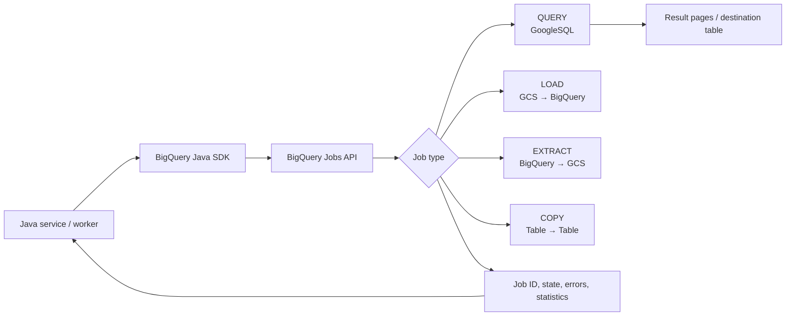
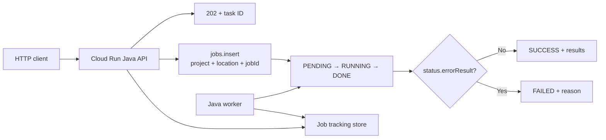

# BigQuery Java Client and Application Job Execution

A Spring Boot API needs daily revenue totals from **BigQuery**, while a separate Java worker must load Parquet files from **Cloud Storage** into an analytical table every hour. Both interact with BigQuery, yet their request lifecycles differ: a small query can wait for results inline, whereas data loads or long-running queries should **submit a job, record the Job ID, poll status, and retry safely**.

This lesson belongs to the **BigQuery** chapter of the `CLOUD_PROVIDERS_GCP` module. Learners combine IAM, Cloud Storage, Cloud Run/GKE, Cloud SQL, and data pipeline concepts to use the **`google-cloud-bigquery` Java library**, run query/load/extract jobs, control costs, and monitor reliability. Examples use synthetic data and sandbox projects; BigQuery calls can incur processing, storage, or egress charges.

> **Core rule:** BigQuery is an analytical system (OLAP), not a per-request order transaction database like Cloud SQL/AlloyDB. Never trigger a full-table scan on every user interaction; use caching, summary tables, partition pruning, or batch processing for high-QPS APIs.

## 1. Learning Objectives

After this lesson, you will be able to:

1. Create and reuse a **`BigQuery` client** with Application Default Credentials (ADC).
2. Distinguish **synchronous queries** from **asynchronous jobs** (`QUERY`, `LOAD`, `EXTRACT`, `COPY`).
3. Use **GoogleSQL named parameters** instead of concatenating user input into SQL.
4. Configure **location, Job ID, labels, dry runs, and maximum bytes billed** to govern jobs.
5. Check **`DONE` alongside `status.errorResult`** properly, handling polling, timeouts, and interrupts.
6. Read **`TableResult`** safely with null/type/pagination checks without loading unbounded rows into heap.
7. Design **idempotent retries** for load and DML jobs, distinguishing duplicate submissions from duplicate business rows.
8. Set up a Java/Maven lab, verify IAM, inspect job metadata and costs, and solve applied exercises.

## 2. What Is a BigQuery Job?

BigQuery jobs are server-side operations. Your application submits a **job configuration** and receives a **job reference**, rather than downloading entire tables to compute in Java:



| Type | What It Does | When to Use from Java |
| --- | --- | --- |
| **QUERY** | Executes GoogleSQL: `SELECT`, `INSERT`, `MERGE`, DDL, scripts. | Reporting APIs, SQL backfills, scheduled aggregations. |
| **LOAD** | Loads data from GCS/supported files into a managed table. | Worker triggered by file/batch ready signals. |
| **EXTRACT** | Exports a BigQuery table to Cloud Storage. | Exporting reports, data lake sharing, archiving. |
| **COPY** | Copies a table or snapshot within job constraints. | Environment seeding, copying analytical tables. |

### 2.1. State Does Not Equal Outcome

Jobs transition through **`PENDING` → `RUNNING` → `DONE`**. **`DONE` means finished, not succeeded.** Always inspect `Job.getStatus().getError()` (REST: `status.errorResult`); `getExecutionErrors()` may also expose details or non-fatal warnings. A load job can even "succeed" while skipping malformed records if configured to allow them.

### 2.2. Quick Queries vs. Long-Running Jobs

- **`bigquery.query(QueryJobConfiguration)`**: convenience helper that waits for query completion and returns `TableResult`. Suits small queries returning within the active request flow.
- **`bigquery.create(JobInfo.of(jobId, config))`**: explicitly creates a job with a **`Job ID`**, allowing the API to persist the ID, return `202 Accepted`, poll from another worker, support retries, and maintain auditability.
- **`Job.waitFor(...)`**: waits for completion but can time out or be interrupted; **a client-side timeout does not mean the BigQuery job stopped**.
- **`Job.getQueryResults(...)`**: fetches result pages of a completed query job.

Do not run multi-minute queries inside an HTTP handler holding the connection open indefinitely. Prefer **submit job → persist job reference → return task ID → callback/poll status → read results or destination table**.

## 3. Setting Up the Java Environment and Access Permissions

### 3.1. IAM and Application Default Credentials

| Principal | Typical Permissions | Limitations |
| --- | --- | --- |
| Java query-only service | `roles/bigquery.jobUser` on job project; `roles/bigquery.dataViewer` on target dataset/table. | Job User **does not automatically** grant table read access. |
| Data load worker | `bigquery.jobs.create`, create/update target table; GCS object read and list (for wildcards). | Keep separate from project admin accounts. |
| Extract worker | Read table and create jobs; write GCS objects to target bucket. | Govern sensitive data and egress. |
| CI/CD/deployer | Deploy app and assign runtime service account per policy. | Never grant Owner to runtime workloads. |

In local dev, **ADC** can come from `gcloud auth application-default login`; note this identity can differ from `gcloud auth login` in some setups. On **Cloud Run, GKE Workload Identity Federation, or Compute Engine**, attach a **service account** to the workload so ADC works **without JSON key files**.

In Bash/Cloud Shell (read-only except the commented login line):

```bash
PROJECT_ID="orders-analytics-lab"
LOCATION="asia-southeast1"
DATASET_ID="java_jobs_lab"

gcloud auth list
gcloud config get-value project
gcloud services list --enabled --project="$PROJECT_ID" \
  --filter="name:bigquery.googleapis.com"
bq ls --project_id="$PROJECT_ID"

# On an authorized developer workstation, configure ADC if missing.
# gcloud auth application-default login
```

**Location:** Set the job's `location` to match source/destination datasets, e.g., `asia-southeast1`; a dataset in `US` cannot arbitrarily run jobs in `asia-southeast1`. GCS resources used in `LOAD`/`EXTRACT` must also satisfy location compatibility rules. **Job ID and location must be paired when looking up a job.**

### 3.2. Minimal Maven Project Setup

In a separate lab directory **outside the course repository**, create `pom.xml`:

```xml
<project xmlns="http://maven.apache.org/POM/4.0.0"
         xmlns:xsi="http://www.w3.org/2001/XMLSchema-instance"
         xsi:schemaLocation="http://maven.apache.org/POM/4.0.0
           https://maven.apache.org/xsd/maven-4.0.0.xsd">
  <modelVersion>4.0.0</modelVersion>
  <groupId>example</groupId>
  <artifactId>bigquery-java-jobs-lab</artifactId>
  <version>1.0.0</version>
  <properties>
    <maven.compiler.release>17</maven.compiler.release>
    <project.build.sourceEncoding>UTF-8</project.build.sourceEncoding>
  </properties>
  <dependencies>
    <dependency>
      <groupId>com.google.cloud</groupId>
      <artifactId>google-cloud-bigquery</artifactId>
      <version>2.73.0</version>
    </dependency>
  </dependencies>
  <build>
    <plugins>
      <plugin>
        <groupId>org.apache.maven.plugins</groupId>
        <artifactId>maven-compiler-plugin</artifactId>
        <version>3.14.0</version>
      </plugin>
      <plugin>
        <groupId>org.codehaus.mojo</groupId>
        <artifactId>exec-maven-plugin</artifactId>
        <version>3.6.2</version>
      </plugin>
    </plugins>
  </build>
</project>
```

The example uses `google-cloud-bigquery 2.73.0` from Java SDK docs at writing time; **in production, manage versions via the Google Cloud Libraries BOM and lock/CI policies** to avoid conflicting Google Cloud library versions. Examples target **Java 17**.

### 3.3. Create Sandbox Data for the Lab

Once authorized to create resources and after checking the project/dataset:

```bash
# MUTATES REAL BIGQUERY; run only once if dataset does not yet exist.
bq --location="$LOCATION" mk --dataset "$PROJECT_ID:$DATASET_ID"
```

In the BigQuery SQL editor, adjust the sample project ID and run **only in the sandbox**:

```sql
CREATE TABLE IF NOT EXISTS `orders-analytics-lab.java_jobs_lab.orders_lab` (
  order_id STRING,
  tenant_id STRING,
  event_date DATE,
  amount_cents INT64,
  status STRING
)
PARTITION BY event_date
CLUSTER BY tenant_id;

-- INSERTS REAL DATA: re-running creates duplicates unless cleaned up first.
INSERT INTO `orders-analytics-lab.java_jobs_lab.orders_lab`
  (order_id, tenant_id, event_date, amount_cents, status)
VALUES
  ('O-1001', 't1', DATE '2026-11-19', 2500, 'PAID'),
  ('O-1002', 't1', DATE '2026-11-19', 1300, 'PENDING'),
  ('O-1003', 't2', DATE '2026-11-18', 8100, 'PAID');
```

**Note:** `CREATE TABLE IF NOT EXISTS` does not verify that a pre-existing table matches your schema. Use a dedicated lab table and verify state before `INSERT`; BigQuery does not automatically enforce uniqueness on `order_id`.

## 4. Lab 1 — Synchronous Java Query with Named Parameters

An API needs orders exceeding `minAmount` on a specific date. **Never** construct SQL from user input via string concatenation; bind `@day` and `@min_amount`.

Create `src/main/java/example/QueryOrders.java`:

```java
package example;

import com.google.cloud.bigquery.BigQuery;
import com.google.cloud.bigquery.BigQueryOptions;
import com.google.cloud.bigquery.FieldValueList;
import com.google.cloud.bigquery.QueryJobConfiguration;
import com.google.cloud.bigquery.QueryParameterValue;
import com.google.cloud.bigquery.TableResult;

public final class QueryOrders {
  public static void main(String[] args) throws InterruptedException {
    String project = System.getenv("PROJECT_ID");
    if (project == null || project.isBlank()) {
      throw new IllegalArgumentException("PROJECT_ID required");
    }
    BigQuery bigquery = BigQueryOptions.newBuilder()
        .setProjectId(project)
        .build()
        .getService();

    // Project/dataset/table are fixed application identifiers,
    // never taken arbitrarily from HTTP requests.
    if (!project.matches("[a-z][a-z0-9-]{4,62}")) {
      throw new IllegalArgumentException("Invalid sandbox project ID");
    }
    String sql = """
        SELECT order_id, tenant_id, amount_cents
        FROM `%s.java_jobs_lab.orders_lab`
        WHERE event_date = @day AND amount_cents >= @min_amount
        ORDER BY amount_cents DESC
        LIMIT 10
        """.formatted(project);
    QueryJobConfiguration query = QueryJobConfiguration.newBuilder(sql)
        .setUseLegacySql(false)
        .addNamedParameter("day", QueryParameterValue.date("2026-11-19"))
        .addNamedParameter("min_amount", QueryParameterValue.int64(2000L))
        .setMaximumBytesBilled(100_000_000L)
        .build();

    TableResult result = bigquery.query(query);
    for (FieldValueList row : result.getValues()) {
      // Reads one page: at most 10 rows due to SQL LIMIT.
      if (!row.get("order_id").isNull()) {
        System.out.printf("%s (%s): %d cents%n",
            row.get("order_id").getStringValue(),
            row.get("tenant_id").getStringValue(),
            row.get("amount_cents").getLongValue());
      }
    }
  }
}
```

This example accepts only a valid project ID from application config and formats it into a **fixed table identifier**. For dynamic dataset/table selection, **validate identifiers against an allowlist**; **GoogleSQL parameters cannot bind table or dataset identifiers**.

Run in a lab with Maven and ADC:

```bash
export PROJECT_ID="orders-analytics-lab"
mvn -q compile exec:java -Dexec.mainClass=example.QueryOrders
```

Expected: prints `O-1001` with `2500 cents` matching the sample rows. **`setMaximumBytesBilled(100_000_000L)`** is an illustrative cap for a tiny query; on large tables, the query is rejected if the byte estimate exceeds the cap. **`LIMIT 10` does not guarantee scanning only 10 rows' worth of data**: BigQuery may scan many blocks or partitions before capping output.

### 4.1. Working Safely with `TableResult`

- `row.get("column").getStringValue()/getLongValue()` must match the BigQuery column type; check `isNull()` before reading nullable columns.
- `getValues()` iterates **only the current page**; `iterateAll()` fetches all pages automatically and can pull huge data over the network.
- For millions of rows, **do not serialize directly in a JSON API** or accumulate a `List` in heap; materialize to a destination table/GCS and read in batches, or use the **BigQuery Storage Read API** for high-throughput reads.
- `getTotalRows()` returns total result rows (when available)—**not** bytes scanned or rows in the current page.

## 5. Dry Run and Pre-Execution Cost Caps

**Dry run** validates the SQL and estimates bytes processed **without executing the query**. Create `DryRunOrders.java`:

```java
package example;

import com.google.cloud.bigquery.BigQuery;
import com.google.cloud.bigquery.BigQueryOptions;
import com.google.cloud.bigquery.Job;
import com.google.cloud.bigquery.JobInfo;
import com.google.cloud.bigquery.JobStatistics;
import com.google.cloud.bigquery.QueryJobConfiguration;
import com.google.cloud.bigquery.QueryParameterValue;

public final class DryRunOrders {
  public static void main(String[] args) {
    String project = System.getenv("PROJECT_ID");
    if (project == null || !project.matches("[a-z][a-z0-9-]{4,62}")) {
      throw new IllegalArgumentException("Set valid PROJECT_ID");
    }
    BigQuery bigquery = BigQueryOptions.newBuilder()
        .setProjectId(project).build().getService();
    String sql = """
        SELECT COUNT(*) AS n
        FROM `%s.java_jobs_lab.orders_lab`
        WHERE event_date = @day
        """.formatted(project);
    QueryJobConfiguration config = QueryJobConfiguration.newBuilder(sql)
        .setUseLegacySql(false)
        .addNamedParameter("day", QueryParameterValue.date("2026-11-19"))
        .setDryRun(true)
        .setUseQueryCache(false)
        .build();

    Job job = bigquery.create(JobInfo.of(config));
    JobStatistics.QueryStatistics stats = job.getStatistics();
    System.out.println("Estimated bytes processed: "
        + stats.getTotalBytesProcessed());
  }
}
```

Dry run produces no output rows and **does not replace functional result tests**. Estimates can differ from actual bytes scanned—especially with **external tables**, clustering/pruning, or complex plans; `maximumBytesBilled` is enforced against the pre-execution estimate, which may exceed actual billed bytes under cluster pruning. Under BigQuery Editions/Reservations, bytes processed and **slot consumption** are distinct cost dimensions.

## 6. Lab 2 — Asynchronous Jobs: Submit, Poll, and Read Results

Suppose a worker needs to generate a report while the user's HTTP request must return within 3 seconds. Solution:

1. The API receives the request, authenticates the user, and generates a stable **business request ID**.
2. Derive an immutable **Job ID** and job configuration from the request ID; submit once.
3. Persist `project, location, jobId, query_version, status` in a state table/queue.
4. Return `202 Accepted` with the task ID; a background worker calls `Job.getStatus()` or `waitFor()`.
5. On success, expose results or the destination table path; on failure, record the reason and apply retry policy.



### 6.1. Java: Submitting Jobs and Handling Duplicate Job IDs

Create `src/main/java/example/SubmitQueryJob.java`:

```java
package example;

import com.google.cloud.bigquery.BigQuery;
import com.google.cloud.bigquery.BigQueryException;
import com.google.cloud.bigquery.BigQueryOptions;
import com.google.cloud.bigquery.Job;
import com.google.cloud.bigquery.JobId;
import com.google.cloud.bigquery.JobInfo;
import com.google.cloud.bigquery.QueryJobConfiguration;
import java.util.Map;

public final class SubmitQueryJob {
  public static void main(String[] args) {
    String project = required("PROJECT_ID");
    String location = required("LOCATION"); // Same location as the dataset.
    String requestKey = required("REQUEST_KEY"); // e.g., 20261119_t1_v1
    if (!requestKey.matches("[A-Za-z0-9_-]{1,80}")) {
      throw new IllegalArgumentException("Invalid request key");
    }

    BigQuery bq = BigQueryOptions.newBuilder()
        .setProjectId(project).build().getService();
    JobId id = JobId.newBuilder()
        .setProject(project)
        .setLocation(location)
        .setJob("report_" + requestKey)
        .build();

    QueryJobConfiguration config =
        QueryJobConfiguration.newBuilder(
            "SELECT 42 AS answer, CURRENT_DATE() AS executed_date")
        .setUseLegacySql(false)
        .setLabels(Map.of("service", "orders_api", "env", "lab"))
        .setMaximumBytesBilled(100_000_000L)
        .build();

    Job job;
    try {
      job = bq.create(JobInfo.of(id, config));
      System.out.println("Created " + id.getJob());
    } catch (BigQueryException e) {
      if (e.getCode() != 409) {
        throw e; // Auth, quota, syntax, or other errors must be handled separately.
      }
      // Server may have accepted the request before the network failed.
      job = bq.getJob(id);
      if (job == null) {
        throw new IllegalStateException("409 but job was not found", e);
      }
      System.out.println("Reusing existing " + id.getJob());
    }

    // Do not wait here: pass full project/location/id to the status worker.
    System.out.printf("job=%s location=%s state=%s%n",
        job.getJobId().getJob(), location, job.getStatus().getState());
  }

  static String required(String name) {
    String value = System.getenv(name);
    if (value == null || value.isBlank()) {
      throw new IllegalArgumentException("Missing " + name);
    }
    return value;
  }
}
```

Run with a **fixed request key per logical request**—never generate a fresh random key on retry:

```bash
export PROJECT_ID="orders-analytics-lab"
export LOCATION="asia-southeast1"
export REQUEST_KEY="20261119_t1_v1"

# CREATES A REAL QUERY JOB. Sample query scans no tables.
mvn -q compile exec:java -Dexec.mainClass=example.SubmitQueryJob
```

**Remember:** The `Job ID` here is `report_20261119_t1_v1`. Preserve it across retries **for the exact same job payload**. Different business requests must use different IDs. On a 409, fetch the **existing job and verify it matches your stored request/config**—never assume an existing Job ID with different SQL represents success.

### 6.2. Java: Polling with Timeout and Proper Error Checks

Create `src/main/java/example/CheckQueryJob.java`:

```java
package example;

import com.google.cloud.RetryOption;
import com.google.cloud.bigquery.BigQuery;
import com.google.cloud.bigquery.BigQueryOptions;
import com.google.cloud.bigquery.FieldValueList;
import com.google.cloud.bigquery.Job;
import com.google.cloud.bigquery.JobId;
import com.google.cloud.bigquery.JobStatus;
import com.google.cloud.bigquery.TableResult;
import java.time.Duration;

public final class CheckQueryJob {
  public static void main(String[] args) throws InterruptedException {
    String project = System.getenv("PROJECT_ID");
    String location = System.getenv("LOCATION");
    String requestKey = System.getenv("REQUEST_KEY");
    if (project == null || location == null || requestKey == null) {
      throw new IllegalArgumentException("Set PROJECT_ID, LOCATION, REQUEST_KEY");
    }

    BigQuery bq = BigQueryOptions.newBuilder()
        .setProjectId(project).build().getService();
    JobId id = JobId.newBuilder().setProject(project)
        .setLocation(location).setJob("report_" + requestKey).build();

    Job job = bq.getJob(id);
    if (job == null) {
      throw new IllegalStateException("Job not found: " + id.getJob());
    }

    Job finished = job.waitFor(
        RetryOption.totalTimeoutDuration(Duration.ofMinutes(2)));
    if (finished == null) {
      throw new IllegalStateException("Job disappeared: " + id.getJob());
    }
    if (finished.getStatus().getState() != JobStatus.State.DONE) {
      System.out.println("Job not finished yet; check again: " + id.getJob());
      return;
    }
    if (finished.getStatus().getError() != null) {
      throw new IllegalStateException(
          "Job failed: " + finished.getStatus().getError());
    }
    System.out.println("SUCCESS: " + id.getJob());

    // Sample query returns one row; pageSize=10 is sufficient.
    TableResult results = finished.getQueryResults(
        BigQuery.QueryResultsOption.pageSize(10));
    for (FieldValueList row : results.getValues()) {
      System.out.println("answer=" + row.get("answer").getLongValue());
    }
  }
}
```

When a query returns many rows, iterate pages in bounded chunks:

```java
TableResult page = finished.getQueryResults(
    BigQuery.QueryResultsOption.pageSize(100));
int pageCount = 0;
while (page != null && pageCount++ < 5) {
  for (FieldValueList row : page.getValues()) {
    // Process each row inline; avoid collecting all into a List.
    System.out.println(row);
  }
  page = page.hasNextPage() ? page.getNextPage() : null;
}
```

**Note:** `waitFor` can time out or throw client-side; this **does not prove the server job failed**. On polling timeouts, retain the job reference and continue polling or re-enqueue—**never immediately launch a duplicate job with a new UUID**. When interrupted, propagate `InterruptedException` or restore the interrupt flag with `Thread.currentThread().interrupt()` instead of swallowing it and looping forever.

### 6.3. Using Job IDs for Proper Retries

| Failure Mode | Do | Do Not |
| --- | --- | --- |
| `jobs.insert` succeeded on server, HTTP response lost | Call `getJob(project, location, jobId)` or resubmit with the same ID to check status. | Generate a new UUID, especially with `WRITE_APPEND`. |
| Server returns `409 ALREADY_EXISTS` | Verify the existing job ID matches the stored business request and config. | Assume 409 always means the job finished successfully. |
| `waitFor` times out | Keep polling the original ID while `PENDING`/`RUNNING`. | Submit another job just because the client timed out. |
| Job `DONE` with `status.errorResult` | Diagnose error, check partial side effects, fix root cause, then submit a **new** tracked job. | Blindly swap IDs and retry in a tight loop. |
| Job `DONE` without errors | Mark job succeeded, then run business data quality gates / manifest checks. | Rely on `DONE` state alone. |

BigQuery rejects **reusing the same Job ID**, providing vital protection against duplicate job submissions on network retries. However, **distinct Job IDs can still load the same file twice**, so business-level exactly-once requires stable **batch IDs, event IDs, staging/`MERGE`, and audit trails**.

## 7. Lab 3 — `LOAD` Job from Cloud Storage in Java

Suppose GCS holds Parquet file `gs://<bucket>/landing/orders-2026-11-19.parquet`, verified to match the target table schema. Java simply submits the job while BigQuery executes the load; the worker **never downloads the entire file into JVM heap**.

**Prerequisites:** existing bucket, location-compatible object and dataset, service account granted `storage.objects.get`/`storage.objects.list` as needed, plus BigQuery destination write permissions. This **mutates a real table**:

```java
import com.google.cloud.bigquery.BigQuery;
import com.google.cloud.bigquery.BigQueryOptions;
import com.google.cloud.bigquery.FormatOptions;
import com.google.cloud.bigquery.Job;
import com.google.cloud.bigquery.JobId;
import com.google.cloud.bigquery.JobInfo;
import com.google.cloud.bigquery.LoadJobConfiguration;
import com.google.cloud.bigquery.TableId;

String project = "orders-analytics-lab";
String location = "asia-southeast1";
String sourceUri = "gs://orders-lab-bucket/landing/orders-2026-11-19.parquet";
TableId destination = TableId.of(project, "java_jobs_lab", "orders_stage");

BigQuery bq = BigQueryOptions.newBuilder()
    .setProjectId(project).build().getService();
LoadJobConfiguration config = LoadJobConfiguration
    .builder(destination, sourceUri)
    .setFormatOptions(FormatOptions.parquet())
    .setWriteDisposition(JobInfo.WriteDisposition.WRITE_APPEND)
    .build();
JobId id = JobId.newBuilder()
    .setProject(project).setLocation(location)
    .setJob("load_orders_20261119_batch_001")
    .build();
Job submitted = bq.create(JobInfo.of(id, config)); // Writes REAL data.
Job done = submitted.waitFor();
if (done == null || done.getStatus().getError() != null) {
  throw new IllegalStateException("LOAD failed or job disappeared");
}
System.out.println("Loaded batch: " + done.getJobId().getJob());
```

This is a **snippet meant inside a method declaring `throws InterruptedException`** (not a standalone Java file) to focus on `LOAD` configuration. In real services:

- Inspect `bigquery.getTable(destination)` and verify schemas before loading; avoid letting jobs create unreviewed tables implicitly.
- `WRITE_APPEND` appends rows; running two jobs with **different IDs** on the same file creates duplicates.
- `WRITE_TRUNCATE` replaces the entire target table and can wipe unrelated batches. Use only with explicit approval and scoped targets—never as a "quick fix."
- `WRITE_EMPTY` succeeds only if the target is empty, useful for immutable per-batch staging tables.
- Load jobs commit atomically at the job level; they do **not** deduplicate by `order_id` or validate business data contracts automatically.
- For CSV/ndJSON, configure `FormatOptions.csv()/json()`, schema, headers/encoding, and bad-record limits; Parquet embeds schema, yet compatibility across files still requires checks.

### 7.1. Idempotent Ingestion Architecture

```text
GCS immutable batch + checksum/manifest
  → Java worker receives batch_id
  → Job ID = deterministic function of batch_id + version
  → LOAD into batch-scoped staging table
  → reconcile source rows/amounts/schema/duplicates
  → BigQuery MERGE or publish partition under commit policy
  → persist completed batch_id + source URI/object generation + Job ID
```

When receiving the same batch again, check the tracking store and Job ID—**never blindly re-load into the same staging table under a brand-new Job ID** without a deduplication policy. With mutable GCS objects, a single URI can point to different bytes over time; record object generation and checksum separately and treat **content changes** as a new batch version. Do not put generation fragments in `LOAD` URIs expecting BigQuery `LOAD` to support arbitrary object versions.

## 8. `EXTRACT` and `COPY` Jobs: Quick Reference

### 8.1. `EXTRACT` — Table → Cloud Storage

```java
import com.google.cloud.bigquery.ExtractJobConfiguration;

// Table and bucket must exist; location and IAM must be compatible.
// Destination URI includes wildcard to shard output files if needed.
ExtractJobConfiguration exportConfig = ExtractJobConfiguration.of(
    TableId.of("orders-analytics-lab", "java_jobs_lab", "orders_lab"),
    "gs://orders-lab-bucket/export/orders-*.parquet",
    "PARQUET");
Job exportJob = bq.create(JobInfo.of(exportConfig));
Job exported = exportJob.waitFor();
if (exported == null || exported.getStatus().getError() != null) {
  throw new IllegalStateException("EXTRACT failed");
}
```

This snippet reuses the **`bq`/`Job` client and imports** from the `LOAD` example; it is an **in-method snippet**, not a standalone file. Writing files to GCS **can incur storage and network charges**; it requires table read and object write permissions, and must never export unauthorized PII. On large tables, wildcards produce multiple sharded files. Never assume Parquet export works without format/type constraints.

### 8.2. `COPY` — Source Table → Destination Table

```java
import com.google.cloud.bigquery.CopyJobConfiguration;

CopyJobConfiguration copyConfig = CopyJobConfiguration.newBuilder(
    TableId.of("orders-analytics-lab", "java_jobs_lab", "orders_copy"),
    TableId.of("orders-analytics-lab", "java_jobs_lab", "orders_lab")
).build();
Job copyJob = bq.create(JobInfo.of(copyConfig));
Job copied = copyJob.waitFor();
if (copied == null || copied.getStatus().getError() != null) {
  throw new IllegalStateException("COPY failed");
}
```

`COPY` obeys table copy constraints, dataset location rules, and source read / target write IAM. Set `writeDisposition` explicitly if overwriting rather than relying on defaults, and verify the destination table; **`COPY` is not equivalent to `CLONE`/`SNAPSHOT`** or free cross-region data movement.

### 8.3. Comparing the APIs

| Use Case | Java API | Idempotency Considerations |
| --- | --- | --- |
| Query returning a few rows | `BigQuery.query(config)` | Named parameters, deadline/cost cap, and null-safe reads. |
| Long query / REST API returning task ID | `BigQuery.create(JobInfo)` → `Job.waitFor/getQueryResults` | Deterministic Job ID and tracking store. |
| GCS batch → table | `LoadJobConfiguration` | `WRITE_APPEND`/`TRUNCATE`/`EMPTY`, manifest/source version. |
| Table → GCS | `ExtractJobConfiguration` | Avoid unintended destination URI collisions. |
| Table → table | `CopyJobConfiguration` | Destination existence/overwrite rules and region. |

## 9. Integrating with Cloud Run / Spring Boot: Never Block HTTP Requests on Long Jobs

### 9.1. Choosing an Execution Flow

| Scenario | Integration Pattern | Limits / Trade-offs |
| --- | --- | --- |
| API returns a few aggregated rows via tuned query | Java `bigquery.query(...)` with short timeout and caching where valid. | Prevent users from triggering unbounded full scans. |
| Report exceeds HTTP request deadlines | Submit `QUERY` job with stable ID → return `202` → poll or background worker. | Requires tracking store, TTL, result auth, and cleanup. |
| GCS files arrive hourly | Pub/Sub/Eventarc triggers Cloud Run job/worker, or Scheduler → BigQuery `LOAD`. | Events can redeliver; dedup by batch manifest/Job ID. |
| Scheduled multi-step SQL transforms | Scheduled queries/Workflows or BigQuery scripting. | Avoid building custom HTTP polling loops for every step. |
| Very large query output | Write query to destination table; batch extract or Storage Read API. | Never serialize millions of rows into an API JSON response. |

In Java services on Cloud Run/GKE, construct and **reuse a single `BigQuery` client** (dependency injection / singleton)—never instantiate a new client per row or HTTP request. Client libraries handle transport retries on some RPCs, yet **do not guarantee business idempotency**; combine job tracking, request IDs, circuit breakers/rate limits, and deadlines in the application layer.

### 9.2. Application Task State Schema

Example `job_requests` status table in Cloud SQL/Firestore (enforce IAM and optimistic concurrency):

| Field | Example Value | Purpose |
| --- | --- | --- |
| `request_id` | `report-20261119-t1` | Business deduplication key, unique per logical request. |
| `job_id` | `report_20261119_t1_v1` | BigQuery Job ID; never regenerated on retry. |
| `job_project` | `orders-analytics-lab` | Project billed for executing the job. |
| `job_location` | `asia-southeast1` | Required to look up regional jobs. |
| `job_type` | `QUERY` | Determines result handling and permission checks. |
| `state` | `SUBMITTED/RUNNING/SUCCEEDED/FAILED` | Application-level workflow state. |
| `config_hash` | Hash of SQL, parameters, and source batch. | Verifies a 409 Job ID matches the exact payload. |
| `last_error` | Sanitized error code without sensitive info. | Debugging and retry-storm prevention. |

**Never store SQL containing PII, service account tokens, or sensitive raw query parameters in status stores or logs.** When outputs contain tenant data, `GET /reports/{id}` must enforce user/tenant authorization at the application layer—knowing a Job ID **is not proof** of authorization to read the data.

## 10. Diagnosing Jobs and Observing Costs

### 10.1. Inspecting Jobs in Console/CLI

BigQuery **Jobs explorer / Job history** shows SQL, duration, slots, stages, bytes, and errors per IAM. The CLI also inspects job metadata:

```bash
# READ-ONLY: jobs in the selected project and location.
bq --location="$LOCATION" ls -j \
  --max_results=20 "$PROJECT_ID"

# READ-ONLY: replace JOB_ID with an actual run ID.
bq --location="$LOCATION" show -j \
  --format=prettyjson "$PROJECT_ID:JOB_ID"
```

Always pass `--location` **matching the actual job**, or `bq` can return `NOT_FOUND` even when the job exists in another region. Inspect `status.state`, `status.errorResult`/`errors`, `statistics.query` or `statistics.load`, labels, and creation/start/end timestamps. In Java, for a completed `QUERY` job:

```java
import com.google.cloud.bigquery.JobStatistics;

JobStatistics.QueryStatistics stats = finished.getStatistics();
if (stats != null) {
  System.out.println("Processed bytes: " + stats.getTotalBytesProcessed());
  System.out.println("Billed bytes: " + stats.getTotalBytesBilled());
}
```

This snippet extends `CheckQueryJob` and applies only to **`QUERY` jobs**. For cache hits, `totalBytesBilled` can be 0; under Editions/Reservations, also monitor slot usage and capacity spend rather than inferring bills from a single byte metric.

### 10.2. Querying `INFORMATION_SCHEMA.JOBS_BY_PROJECT`

When datasets live in `asia-southeast1`, job metadata resides in `region-asia-southeast1`. **Read-only** SQL example:

```sql
SELECT
  job_id, user_email, job_type, state,
  error_result.message AS error_message,
  total_bytes_processed, total_bytes_billed, total_slot_ms,
  creation_time
FROM `orders-analytics-lab.region-asia-southeast1.INFORMATION_SCHEMA.JOBS_BY_PROJECT`
WHERE creation_time >= TIMESTAMP_SUB(CURRENT_TIMESTAMP(), INTERVAL 1 DAY)
  AND job_type IN ('QUERY', 'LOAD', 'EXTRACT', 'COPY')
ORDER BY creation_time DESC
LIMIT 50;
```

**Limits:** IAM determines whose jobs you can see; regional metadata views have specific retention/scopes and do not replace long-term audit logs. `user_email` is sensitive audit data that must be protected. For slow queries, examine **query plans, partition pruning, joins/shuffles, reservation slot usage, and result cache** to find bottlenecks instead of blindly scaling application threads.

### 10.3. Operational Signals Worth Alerting On

| Signal | Suggested Threshold / Alert |
| --- | --- |
| **Job failure rate** | Rising `status.errorResult`, classified by invalidQuery/permission/quota. |
| **PENDING/RUNNING duration** | Jobs exceeding SLO without duplicating Job IDs. |
| **Bytes scanned/billed** | Exceeding query budgets or cost per report. |
| **Load quality** | Row counts, source checksums, duplicate IDs, bad records. |
| **Data freshness** | `MAX(event_date/ingested_at)` failing to advance on schedule. |
| **Retries/409s** | Retry storms, tracking-state bugs, or Job ID collisions. |
| **GCS & BigQuery IAM** | 403s after service account, bucket location, or CMEK key changes. |

## 11. Security and Cost Control

### 11.1. SQL Injection and Data Read Permissions

GoogleSQL **named parameters** bind **values**, never identifiers, column names, table names, sort directions, or arbitrary SQL fragments. If an API lets callers pick tables, enforce an **allowlist** of authorized datasets/tables rather than splicing HTTP inputs into SQL strings.

BigQuery checks IAM of the **job-executing principal** against read/written tables and datasets; however, if a backend service account holds broad access, the application **must still enforce tenant ownership** before selecting data. Row access policies, column policy tags, and authorized views reinforce BigQuery protection—never allow users to submit arbitrary SQL executed under a privileged service account.

### 11.2. Application-Driven Costs

- **On-demand queries:** billed per bytes processed (subject to minimums and billing rules), so filter partitions and avoid `SELECT *`. `LIMIT` does not replace scan reduction.
- **Editions/Reservations:** billed by compute slots/capacity/autoscaling; do not treat `maximumBytesBilled` as a total capacity cost forecast.
- **Storage:** staging/curated tables, materialized query results, exports, and backups.
- **API/network:** Storage Read API, GCS egress, cross-region transfers, and logging.
- **Job quotas/concurrency:** request bursts and thousands of tiny jobs strain quotas, queues, and operations; batch whenever possible.

**Controls:** set budgets/alerts, scope project/dataset IAM tightly, use `maximumBytesBilled`/dry runs on ad-hoc queries, attach service/team labels, leverage query cache appropriately, and apply partitioning, clustering, pruning, and precomputed aggregates for high-QPS dashboards. Pricing and quotas evolve; check current pricing/quota pages at deployment rather than hardcoding USD rates.

## 12. Testing and Error Handling

### 12.1. Layered Testing

1. **Unit tests (no cloud calls):** build `QueryJobConfiguration`, verify SQL placeholders, named parameter types, max bytes, labels, Job ID naming, and source-batch hashing.
2. **Sandbox integration tests:** query a small table; test `403` IAM denials, wrong dataset location, parameter type mismatches, and null values.
3. **Retry tests:** simulate an HTTP timeout immediately after `jobs.insert`, then retry with the **same Job ID**; verify only one business job runs.
4. **Load/export tests:** test immutable GCS files, append retries, malformed rows, manifest/quality gates, and cleanup.
5. **Load/SLO tests:** verify p95 latency, job queueing, quotas, pagination memory footprint, and costs under realistic traffic.

**Do not run unit tests against the live BigQuery API by default:** they create jobs, incur charges, and flake on network/IAM issues in CI. Keep unit tests offline for config/logic, and isolate integration tests in a dedicated sandbox project.

### 12.2. Common Errors and Responses

| Symptom | Cause | Resolution |
| --- | --- | --- |
| `401/403 PERMISSION_DENIED` | Wrong ADC identity, missing `bigquery.jobs.create`, or missing table IAM. | Log sanitized principal; inspect workload SA, project, and dataset bindings. |
| `404 NOT_FOUND` for job | Wrong project, `location`, or Job ID, or job does not exist. | Look up by `(project, location, jobId)` tuple; do not create anew before verifying. |
| `invalidQuery` | Syntax error, wrong parameter type, or missing column. | Fix SQL/config and dry run with identical parameters. |
| `bytesBilledLimitExceeded` | Pre-execution estimate exceeds `maximumBytesBilled`. | Optimize partition/column scans or obtain budget approval to raise cap. |
| `409 ALREADY_EXISTS` | Job ID already used. | Fetch existing job and verify config match; never auto-swap UUIDs. |
| `quotaExceeded/rateLimitExceeded` | Job bursts, byte/scan/slot quotas, or API rate limits. | Exponential backoff + jitter, concurrency caps, reduce workload. |
| `DONE` yet no output visible | Job has `errorResult`, wrong project/table, or failed quality gate. | Inspect job status, destination metadata, and data reconciliation. |
| Duplicate rows loaded | `WRITE_APPEND` of the same file across different Job IDs or replays. | Batch ID/manifest, staging/`MERGE`, unique key policies. |
| Rising memory / JVM heap | `iterateAll()` or collecting large results into a `List`. | Pagination, limits, destination tables/GCS, or Storage Read API. |
| Very slow API queries | Wide scans, missing partition filters, or high concurrency. | Async job/task IDs, aggregates/cache, query plans, and reservations. |

**Error handling:** separate **permanent** errors (schema/IAM/invalid SQL) from **transient** ones (429/503/network). Retry with bounded budgets, exponential backoff, and jitter while preserving Job IDs—never hide failures in infinite loops. If `waitFor` throws `InterruptedException`, keep job state undetermined and let callers handle interruption cleanly.

## 13. Applied Exercises (with Answers)

**Exercise 1 — Choosing an API.** A REST endpoint returns total revenue from a small table with ~300 ms p95 latency. Use `bigquery.query` or an async job?

*Answer:* `bigquery.query` can fit if protected by cost caps, deadlines, caching, and zero per-request full-table scans. For unpredictable or lengthy runtimes, use async jobs with task IDs.

**Exercise 2 — Query Security.** A user inputs `min_amount`, and Java concatenates `"WHERE amount >= " + input`. Is this acceptable?

*Answer:* No. Use `@min_amount` with `QueryParameterValue.int64(...)`. Query parameters protect **values** only, not identifiers.

**Exercise 3 — Cost.** Does `SELECT * FROM huge_table LIMIT 5` automatically scan only 5 rows?

*Answer:* No. `LIMIT` usually caps output only; use column selection, partition pruning, clustering, and dry runs/byte caps.

**Exercise 4 — Job `DONE`.** A worker sees `JobStatus.State.DONE` and immediately returns "success." Is that valid?

*Answer:* Not yet. Inspect `getStatus().getError()`; for loads, also verify skipped bad records and data-quality gates.

**Exercise 5 — Timeouts.** A `WRITE_APPEND` load job loses its connection; the client generates a new UUID and resubmits. What can happen?

*Answer:* Two jobs can append the same batch and create duplicates. Use a **deterministic Job ID** per batch, look up the original job if the response is lost, and use staging/`MERGE`.

**Exercise 6 — 409.** `jobs.insert` returns `ALREADY_EXISTS`. Does that guarantee the earlier job succeeded?

*Answer:* No. It only means the ID exists. Fetch the job by `project/location/id` and inspect status, SQL/config hash, and business request parity.

**Exercise 7 — Location.** The dataset is in `asia-southeast1`, while Java submits the query job in `US`. Is that safe?

*Answer:* No. Job location must match dataset compatibility rules; specify the right location for both submit and `getJob`.

**Exercise 8 — `NULL`s.** A BigQuery column is `NULL`, and Java calls `getLongValue()` directly. What should you do?

*Answer:* Check `FieldValue.isNull()` before reading typed values; map `NULL` to `Optional` or `null` per application contracts.

**Exercise 9 — Returning Large Results.** An API reads 10 million rows via `iterateAll()` and buffers them in an `ArrayList`. What are the risks?

*Answer:* OOM crashes, high latency, and network cost. Use pagination, write to destination tables/GCS, or use the Storage Read API when appropriate.

**Exercise 10 — IAM.** A backend holds `roles/bigquery.jobUser`, yet querying `orders` fails with 403.

*Answer:* Job User grants job creation, not table read rights. Grant `bigquery.dataViewer`/table permissions on the target dataset and enforce tenant authorization.

**Exercise 11 — `COPY` vs. `EXTRACT`.** You want to export a BigQuery table as Parquet files in GCS for another pipeline. Which do you choose?

*Answer:* **`EXTRACT` job** with Parquet format and GCS destination; `COPY` is table → table and does not write GCS files.

**Exercise 12 — End-to-End Exactly-Once.** A `LOAD` job commits atomically. Does that guarantee `order_id` has no duplicates in the table?

*Answer:* No. Per-job atomic commits differ from business-key uniqueness; enforce event/batch IDs, deduplication, and quality gates.

## 14. Production Checklist

- [ ] `BigQuery` Java client instantiated and reused at proper scope; dependency versions managed cleanly.
- [ ] Standard ADC/workload identity configured; zero service account JSON key files stored in repos.
- [ ] IAM separates job submission, reads, writes, and extracts; tenant access enforced.
- [ ] All user-supplied values use **named parameters**; dynamic identifiers are allowlisted.
- [ ] Location, project, and Job ID are explicit and persisted alongside request/batch config hashes.
- [ ] Synchronous calls restricted to benchmarked small queries; long jobs run asynchronously.
- [ ] `DONE` checks always inspect `errorResult`, DML affected rows, and quality gates where needed.
- [ ] Submission retries reuse deterministic Job IDs; 409s and timeouts resolve via lookup.
- [ ] `WRITE_APPEND`/`WRITE_TRUNCATE`/`WRITE_EMPTY` chosen deliberately.
- [ ] `TableResult` paginated/bounded; large datasets never buffered in JVM heap.
- [ ] Dry runs, byte caps, partitioning/clustering, and slot costs accounted for.
- [ ] Job labels, dashboards, logging/auditing, and alerts cover failures, freshness, and bytes.
- [ ] Integration tests cover IAM, locations, malformed records, timeouts, and duplicate submissions.
- [ ] Staging/GCS cleanup and sensitive data retention policies enforced.

## 15. Summary and Lab Cleanup

The **BigQuery Java SDK** lets applications submit GoogleSQL, `LOAD`, `EXTRACT`, and `COPY` jobs, while **BigQuery executes all data processing server-side**. For tiny queries, `bigquery.query()` is concise; for longer workloads, **submit with a deterministic Job ID → store the reference → poll → check `errorResult` → read or reconcile outputs** provides far stronger reliability.

When finished with the lab, delete only tables and objects **you created**, after confirming with the owner that nobody else uses them:

```bash
# READ-ONLY: inspect resources first.
bq ls "$PROJECT_ID:$DATASET_ID"

# REAL DELETION: commented out intentionally; run only when approved.
# bq rm -f -t "$PROJECT_ID:$DATASET_ID.orders_lab"
# bq rm -f -t "$PROJECT_ID:$DATASET_ID.orders_stage"
# bq rm -f -t "$PROJECT_ID:$DATASET_ID.orders_copy"
# bq rm -f -d "$PROJECT_ID:$DATASET_ID"
```

Never delete shared datasets, production tables, or unreconciled GCS objects. Canceling Java-side polling **does not automatically cancel the BigQuery job**; track and clean up active jobs before tearing down the environment.

### Official Google Cloud References

- [Java client libraries — BigQuery](https://docs.cloud.google.com/bigquery/docs/reference/libraries)
- [Java quickstart](https://docs.cloud.google.com/bigquery/docs/quickstarts/quickstart-client-libraries)
- [Running jobs programmatically](https://docs.cloud.google.com/bigquery/docs/running-jobs)
- [Java BigQuery client reference](https://docs.cloud.google.com/java/docs/reference/google-cloud-bigquery/latest/com.google.cloud.bigquery.BigQuery)
- [Java QueryJobConfiguration.Builder](https://docs.cloud.google.com/java/docs/reference/google-cloud-bigquery/latest/com.google.cloud.bigquery.QueryJobConfiguration.Builder)
- [Java Job and TableResult APIs](https://docs.cloud.google.com/java/docs/reference/google-cloud-bigquery/latest/com.google.cloud.bigquery.Job)
- [Run query with named parameters (Java sample)](https://docs.cloud.google.com/bigquery/docs/samples/bigquery-query-params-named)
- [Dry run a BigQuery query (Java sample)](https://docs.cloud.google.com/bigquery/docs/samples/bigquery-query-dry-run)
- [Create a job (Java sample)](https://docs.cloud.google.com/bigquery/docs/samples/bigquery-create-job)
- [Load CSV/Parquet from GCS (Java samples)](https://docs.cloud.google.com/bigquery/docs/samples/bigquery-load-table-gcs-parquet)
- [Export BigQuery data to Cloud Storage](https://docs.cloud.google.com/bigquery/docs/exporting-data)
- [BigQuery IAM roles](https://docs.cloud.google.com/bigquery/docs/access-control)
- [Job reliability and retries](https://docs.cloud.google.com/bigquery/docs/reliability-intro)
- [Query cost and maximum bytes billed](https://docs.cloud.google.com/bigquery/docs/best-practices-costs)
- [BigQuery pricing](https://cloud.google.com/bigquery/pricing)
