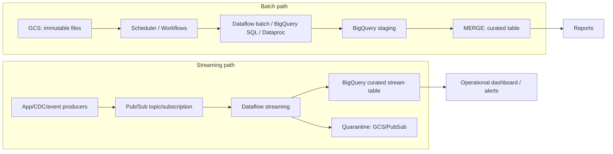
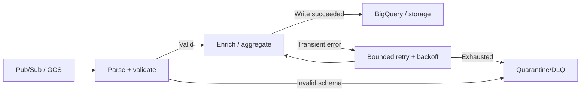

# Designing Batch Pipelines and Streaming Pipelines on GCP

An e-commerce marketplace generates `order_created` and `payment_completed` events. The finance team wants an accurate **previous-day report** before 07:00; the operations team wants to **detect payment errors within 30 seconds**. Both requirements use the same event data, but they differ in **latency, late-data handling, reprocessing mechanisms, resources, and cost**. That is why you must choose properly between a **batch pipeline** and a **streaming pipeline**, or combine both.

This lesson belongs to the **Data Pipelines and Processing** chapter of the `CLOUD_PROVIDERS_GCP` module. Learners combine Cloud Storage, Pub/Sub, Dataflow/Apache Beam, BigQuery, IAM, Cloud Run/GKE, Workflows, and Cloud Monitoring to design data flows that are **business-accurate, secure, scalable, and operable**.

> **Scope:** Examples use hypothetical projects and resources. The main hands-on lab runs **locally with Apache Beam DirectRunner** to avoid creating billable resources; running Dataflow on the cloud is presented as a controlled deployment workflow and is **not executed on production by default**. Pricing and features may vary by region, SDK version, and billing mode.

## 1. Learning Objectives

After this lesson, you will be able to:

1. Distinguish **bounded/unbounded data**, and batch/microbatch/streaming by freshness SLO and completeness.
2. Choose **Cloud Storage, Pub/Sub, Dataflow, BigQuery, Dataproc Serverless, Workflows, and Scheduler** by role instead of assembling redundant services.
3. Design **ingestion → validation → transformation → enrichment → aggregation → serving** along with an error-data branch.
4. Write an **Apache Beam batch job** that runs locally, and distinguish it from a continuous event-emitting pipeline.
5. Explain **event time, processing time, watermark, windows, triggers, and allowed lateness** and the consequences of late events.
6. Distinguish **at-least-once**, Dataflow **exactly-once processing**, and **exactly-once business side effects**.
7. Design replay/backfill, idempotency, data-quality gates, IAM, monitoring, autoscaling, and cost optimization.
8. Make architectural decisions in production scenarios and solve exercises with answers.

## 2. How Do Batch and Streaming Differ?

| Criterion | **Batch pipeline** | **Streaming pipeline** |
| --- | --- | --- |
| Source data | **Bounded**: a finite set of files/partitions/snapshots. | **Unbounded**: continuous events from Pub/Sub/Kafka/CDC. |
| When it runs | On a schedule, on user demand, or when a batch is ready. | Long-running or continuously receiving events. |
| Typical freshness | Minutes, hours, or days depending on schedule. | Seconds or near real time, depending on window/trigger. |
| Result completeness | Easy to know "which input set has finished processing". | Must define window/late-data policy; there is no "end of stream". |
| Reprocessing | Rerun a marked file/partition/batch. | Replay by retention/offset; must prevent duplicates. |
| Resources | Workers can stop after the job; suited for bursty workloads. | Workers/backend can run long-term; requires autoscale/backpressure. |
| Core challenges | File completeness, schema, idempotent load, partitions. | Ordering, event time, watermark, state, retry, backlog. |
| Best suited for | Daily reports, ELT, backfill, periodic record synchronization. | Real-time alerts, live dashboards, enrichment, fraud detection. |

**Microbatch** groups events into small batches (for example, a few minutes). Implementation-wise, it can be a periodic batch job or a periodic-output sink/transform inside a streaming pipeline. Do not call a Scheduler job running every 5 minutes "streaming" if it only scans closed files, and do not use real-time processing when the SLO allows a simple batch job.

### 2.1. A Sample Data Contract

A valid event contains the following fields:

```json
{
  "event_id": "evt-001",
  "order_id": "ord-1001",
  "tenant_id": "t1",
  "event_type": "payment_completed",
  "amount_cents": 2500,
  "event_time": "2026-11-19T08:01:20Z",
  "schema_version": 1
}
```

`event_id` enables deduplication; `order_id` is used for business grouping; `event_time` is generated by the source, which is **different** from when Pub/Sub receives it or Dataflow processes it; `schema_version` helps handle contract changes. Monetary values are stored as **integer cents** to avoid floating-point rounding errors. For events without monetary amounts, the schema may allow `amount_cents` to be omitted, provided there is an explicit rule.

### 2.2. Choose by SLO, Not Just by Data Volume

| Requirement | Starting choice | Rationale |
| --- | --- | --- |
| Daily report before 07:00, data finalized at 03:00 | **Batch**: GCS → Dataflow/BigQuery SQL → BigQuery. | Leaves time to verify file completeness, rerun, and reconcile. |
| Detect failed transactions within 30 seconds | **Streaming**: Pub/Sub → Dataflow → alert/sink. | Requires continuous reaction and event-time lag management. |
| Store raw Pub/Sub events in BigQuery without transforms | **Pub/Sub BigQuery subscription** or direct ingestion. | No Dataflow needed if simply exporting schema-compatible data. |
| Consolidate multiple Spark/Hadoop sources in batch | **Dataproc Serverless for Apache Spark** or Dataflow batch. | Reuses existing Spark jobs and ecosystem where appropriate. |
| Call APIs, wait for job completion, branch on success/failure | **Workflows** orchestrates the steps. | Workflows is **not a distributed transform engine**. |

## 3. GCP Services in a Pipeline



| Service | Primary responsibility | Misuse to avoid |
| --- | --- | --- |
| **Cloud Storage** | Raw/landing files, immutable snapshots, archives, and replay input. | Reading an in-progress upload as a completed batch. |
| **Pub/Sub** | Buffers and distributes messages, retention/replay, at-least-once delivery per subscription. | Treating a successful publish as already committed to BigQuery/DB. |
| **Dataflow (Apache Beam)** | Distributed ETL/ELT, batch and streaming, windows, stateful transforms, autoscaling. | Using it for pipelines that only forward raw messages when Pub/Sub export suffices. |
| **BigQuery** | SQL analytics, staging/curated tables, partitions, clustering, aggregation, CDC serving per capabilities. | Replacing an OLTP database storing payment transactions. |
| **Workflows / Cloud Scheduler** | Orchestrates ordered jobs, retries, schedules, and failure alerts. | Processing high-volume individual records inside Workflows. |
| **Dataproc Serverless** | Runs Spark batch/streaming jobs when matching Spark code/libraries exist. | Assuming Spark has Beam-like event-time semantics without configuration. |
| **Cloud Run jobs** | Runs a containerized task with a finite end. | Operating a long-running streaming engine without state/checkpointing/backpressure. |
| **Cloud Monitoring/Logging** | Observes health, data freshness, error budgets, and costs. | Looking only at the number of `RUNNING` jobs and concluding data is correct. |

### 3.1. Separation Point Between Control Plane and Data Plane

The **Control plane** consists of Scheduler/Workflows/CI/CD: it decides *when to run, which configuration to run, and how to retry jobs*. The **Data plane** consists of Dataflow/Dataproc/BigQuery: it transforms millions of records. Workflows can start a Dataflow job and track its outcome, and should **not** pass individual messages or rows through a workflow execution.

## 4. Designing a Re-runnable Batch Pipeline

### 4.1. Reference Architecture: Orders Daily Report

1. **Landing:** sources write immutable files under `gs://<bucket>/raw/orders/date=YYYY-MM-DD/`. Do not mutate content under the same object key after publishing.
2. **Manifest/ready signal:** the publisher emits a list of object names, generations/checksums, schema version, and `batch_id` **after all files are ready**.
3. **Orchestration:** Scheduler/Workflows or an event handler runs a job **for an incomplete batch ID**; attach job labels and attempt numbers.
4. **Transform:** Beam batch reads sources, parses, validates, normalizes timezones/amounts, and deduplicates per contract; invalid records go to **quarantine**.
5. **Load staging:** Dataflow writes to a BigQuery staging table/partition containing `batch_id` and source metadata.
6. **Quality gate:** compare expected vs. actual counts, sums, nulls, duplicate event IDs, and required fields.
7. **Publish:** use `MERGE` or partition replacement per explicit rules; update manifest state upon success.
8. **Observe/cleanup:** emit freshness metrics and alerts, retain raw data long enough for replay, and clean up staging per policy.

**Do not rely solely on "a file has appeared" to infer that the entire batch is complete.** An object finalize event only signals that one object is ready, not that every file for that day has arrived. To avoid race conditions, the producer needs a **manifest + ready marker** or a consistent batch-closing condition.

### 4.2. Idempotency at Three Levels

| Level | Identifier | How to avoid duplicate writes |
| --- | --- | --- |
| **Source batch** | `batch_id + object generation/checksum` | Do not reprocess the same immutable input set if already recorded as complete. |
| **Processing job** | Workflows execution/job ID/attempt. | Retry with state checks; do not launch two concurrent jobs updating the same target without coordination. |
| **Sink row** | `event_id` or business key + version. | Dedupe/`MERGE`; do not expect BigQuery to enforce unique constraints on its own. |

A Dataflow job that fails after partially writing to an external sink can be retried. **Re-running the exact same input does not guarantee idempotent output** if the destination uses uncontrolled appends. Using separate staging and promoting only after a quality gate is the easiest approach to verify.

### 4.3. Partitioning, Clustering, and File Formats

For BigQuery managed tables, **partition by `event_date`** and cluster by `tenant_id`/`order_id` when query patterns align. For GCS raw storage, prefer Parquet/Avro or ndJSON per contract; compression and file sizing should balance **parallelism, listing overhead, network, and schema evolution**. Very large numbers of 1 KB files can incur higher overhead than fewer files sized appropriately for parallel reads.

BigQuery **load jobs** are the simplest choice when you only need to load raw/schema-compatible files into the warehouse. If you need complex parsing/enrichment, multi-source joins, or specialized quality checks, consider Dataflow batch/Dataproc. If transforms are expressible in SQL, evaluate **BigQuery ELT** before adding an external engine.

## 5. Streaming Pipelines: Event Time and Windows

### 5.1. Event Time vs. Processing Time

An offline device records an event at **10:03:20** but only sends it to Pub/Sub at **10:05:10**:

- **Event time:** 10:03:20 — when the business action actually occurred.
- **Processing time:** 10:05:10 or later — when Dataflow processes it.
- **Ingestion time:** when Pub/Sub receives it — distinct from both times above.

If amounts are grouped by processing time, the record may be counted in the **10:05–10:10** window instead of **10:00–10:05**. Business reports usually require event time; alerts for "the system just received an error" may use processing time depending on the SLO.

### 5.2. Fixed, Sliding, and Session Windows

| Window | Example | Best suited for |
| --- | --- | --- |
| **Fixed/tumbling** | `[10:00,10:05)`, `[10:05,10:10)` | Total revenue every 5 minutes, non-overlapping. |
| **Sliding/hopping** | 5 minutes, sliding every 1 minute. | Rolling averages; each event may belong to multiple windows. |
| **Session** | Grouped per user/key with a 10-minute inactivity gap. | User sessions, behavior without fixed intervals. |

An unbounded stream cannot `GroupByKey` forever for the same key without bounding state. **Windowing** divides data into finite sets by event time; stateful aggregations also require appropriate **triggers/allowed lateness/retention**.

### 5.3. Watermarks, Triggers, and Late Data

A **Watermark** is an estimated progress point in event time by which the system expects most older data to have arrived—**not a guarantee that every older event has arrived**. For window `[10:00,10:05)`:

```text
Event time:                 10:03:20
Processing/arrival time:    10:05:10
Watermark on arrival:       10:05:00
Event's window:             [10:00, 10:05)
Conclusion:                 The event arrived LATE relative to the watermark
```

| Concept | Effect |
| --- | --- |
| **On-time trigger** | Emits results when the watermark passes the end of the window. |
| **Early trigger** | Emits speculative results before the watermark for early UI updates. |
| **Late trigger** | Re-emits/updates when a late event arrives within the retained limit. |
| **Allowed lateness** | Duration a window keeps accepting late events after the watermark passes; beyond this threshold, events may be dropped. |
| **Accumulating panes** | Subsequent panes re-emit the accumulated result of previous panes. |
| **Discarding panes** | Subsequent panes contain only the new data since the previous emission. |

**Pitfall:** if you use accumulating panes and then **append all panes** into BigQuery while downstream queries run `SUM` across all rows, monetary amounts may be **double-counted**. To display updated numbers, include `window_start, window_end, key, pane_index` and use **upsert/read-latest-version**, or choose explicitly designed discarding/delta semantics.

### 5.4. A Late-Event Output Example

| Time | Event | Result for window 10:00–10:05 |
| --- | --- | --- |
| 10:04 | Two payments of 100 and 200 arrive on time. | Early pane may emit **300**. |
| 10:05 | Watermark passes 10:05. | On-time pane emits **300**. |
| 10:06 | Payment of 50 with event time 10:03 arrives late. | If allowed lateness is still active, accumulating late pane emits **350**. |
| 10:20 | Extremely late event arrives after window has been garbage-collected. | May be dropped; requires backfill/reconciliation if business demands completeness. |

**Exactly-once processing does not guarantee complete window results** if the business requires counting every extremely late event. Late-data and reconciliation policies are product and operational decisions, not just a Dataflow flag.

## 6. Reliability: ACK, Exactly-Once, and Side Effects

### 6.1. Three Commonly Confused Guarantees

| Scope | Guarantee / capability | What it does NOT guarantee automatically |
| --- | --- | --- |
| **Pub/Sub delivery** | Typically **at-least-once**; messages may be redelivered when ACK/lease fails. Pub/Sub exactly-once delivery has conditions and applies to **pull subscriptions**. | That consumers will not perform duplicate database writes. |
| **Dataflow streaming mode** | **Exactly-once processing** by default; **at-least-once** can be chosen to lower cost/latency if duplicates are tolerable. | That a `DoFn` with an external side effect is called only once. |
| **Destination business state** | Depends on sink, business keys, transactions, deduplication, and commit protocol. | Automatically being correct just by enabling an upstream Dataflow mode. |

Dataflow can **re-execute a `DoFn`** during retries or recovery even in exactly-once mode. If a `DoFn` calls a payment-capture API or sends an email, **that request may be invoked multiple times**. Do not place non-idempotent side effects directly inside a `ParDo` and assume they happen once simply because Dataflow deduplicates internal outputs.

### 6.2. Dataflow Streaming Modes

- **Exactly-once mode (default):** reduces duplicate/lost records **within the pipeline** and suits aggregations requiring accuracy. Incurs additional state/deduplication overhead.
- **At-least-once mode:** allows duplicates and can often reduce latency/cost for map-only pipelines or sinks that already deduplicate. Do not use for revenue summation if downstream does not deduplicate.
- **Sink semantics:** when writing to BigQuery via the **Storage Write API**, Beam's `STORAGE_WRITE_API` and `STORAGE_API_AT_LEAST_ONCE` options have trade-offs. When writing to Pub/Sub, the **Pub/Sub output connector does not guarantee exactly-once delivery** even when the pipeline uses exactly-once processing.

For example, an event `evt-001` is sent twice by a producer with two different Pub/Sub message IDs. Dataflow cannot automatically know that two messages represent the **same business event** unless the source provides an appropriate ID/duplicate definition. The solution is a stable `event_id` and contract-based deduplication, while protecting the sink with `MERGE`/conditional writes.

### 6.3. Poison Records and DLQ

A record with a **permanent** schema error should not make the entire pipeline retry forever:



Quarantine records should include **source/event ID, reason code, schema version, timestamp, pipeline version, and replay path**, while **redacting PII/secrets** before logging. A DLQ is not a place where data heals itself: it requires an owner/alert, retention, a fix/replay procedure, and safeguards against infinite reprocessing loops.

## 7. Local Lab: Apache Beam Batch Pipeline

The lab uses **Python 3 and the Apache Beam Python SDK** with **DirectRunner**; it **does not call GCP APIs** and incurs no Dataflow/BigQuery billing. Learners create lab files **in a separate directory**, not inside the lesson repository. Pin a Beam version compatible with your environment's Python/runtime for reproducible results.

### 7.1. Environment Setup and Sample Data

In Bash (Linux/macOS/Cloud Shell), create a Python virtual environment and install Beam:

```bash
mkdir -p beam-pipeline-lab
cd beam-pipeline-lab
python3 -m venv .venv
source .venv/bin/activate
python -m pip install --upgrade pip
python -m pip install "apache-beam[gcp]"
```

Create `orders.jsonl` — **one JSON object per line**:

```jsonl
{"event_id":"evt-001","order_id":"ord-1001","tenant_id":"t1","event_type":"payment_completed","amount_cents":2500,"event_time":"2026-11-19T08:01:20Z","schema_version":1}
{"event_id":"evt-002","order_id":"ord-1002","tenant_id":"t1","event_type":"payment_completed","amount_cents":1300,"event_time":"2026-11-19T08:01:35Z","schema_version":1}
{"event_id":"evt-003","order_id":"ord-1003","tenant_id":"t2","event_type":"payment_completed","amount_cents":8100,"event_time":"2026-11-19T08:01:50Z","schema_version":1}
{"event_id":"evt-004","order_id":"ord-1004","tenant_id":"t1","event_type":"order_created","amount_cents":0,"event_time":"2026-11-19T08:02:10Z","schema_version":1}
{"event_id":"evt-005","order_id":"ord-1005","tenant_id":"t1","event_type":"payment_completed","amount_cents":"oops","event_time":"2026-11-19T08:02:15Z","schema_version":1}
```

This is **ndJSON**, distinct from a JSON array. Record `evt-005` intentionally has an invalid amount type to test the quarantine branch. The demo data has **no duplicate event IDs**; in production, a source/sink deduplication step is required.

### 7.2. Complete Pipeline Code

Create `batch_orders.py`:

```python
import argparse
import json
from pathlib import Path

import apache_beam as beam
from apache_beam import pvalue
from apache_beam.options.pipeline_options import PipelineOptions


class ParsePayments(beam.DoFn):
    def process(self, line):
        try:
            event = json.loads(line)
            if not event["event_id"] or not event["tenant_id"]:
                raise ValueError("missing required identifier")
            if event["event_type"] != "payment_completed":
                return  # Valid event, but does not count toward revenue.
            cents = int(event["amount_cents"])
            if cents < 0:
                raise ValueError("negative amount")
            yield (event["tenant_id"], cents)
        except (ValueError, TypeError, KeyError, json.JSONDecodeError) as exc:
            yield pvalue.TaggedOutput(
                "invalid",
                json.dumps({
                    "error_type": type(exc).__name__,
                    "raw": line
                }, ensure_ascii=False)
            )


def to_json(record):
    tenant_id, total = record
    return json.dumps({
        "tenant_id": tenant_id,
        "total_cents": total
    }, ensure_ascii=False)


def main():
    parser = argparse.ArgumentParser()
    parser.add_argument("--input", required=True)
    parser.add_argument("--output_dir", required=True)
    args, beam_args = parser.parse_known_args()
    Path(args.output_dir).mkdir(parents=True, exist_ok=True)

    options = PipelineOptions(beam_args)
    with beam.Pipeline(options=options) as pipeline:
        parsed = (
            pipeline
            | "Read ndJSON" >> beam.io.ReadFromText(args.input)
            | "Parse payment" >> beam.ParDo(ParsePayments()).with_outputs(
                "invalid", main="valid"
              )
        )

        (
            parsed.valid
            | "Sum per tenant" >> beam.CombinePerKey(sum)
            | "Format summary" >> beam.Map(to_json)
            | "Write totals" >> beam.io.WriteToText(
                f"{args.output_dir}/totals", num_shards=1
            )
        )

        (
            parsed.invalid
            | "Write quarantine" >> beam.io.WriteToText(
                f"{args.output_dir}/invalid", num_shards=1
            )
        )


if __name__ == "__main__":
    main()
```

Run:

```bash
python batch_orders.py \
  --input orders.jsonl \
  --output_dir out \
  --runner DirectRunner

cat out/totals-*
cat out/invalid-*
```

**Expected output** (line order of aggregated results is not guaranteed by Beam):

```jsonl
{"tenant_id": "t1", "total_cents": 3800}
{"tenant_id": "t2", "total_cents": 8100}
```

The `invalid-*` file contains one record `evt-005` with an `error_type` reflecting the numeric parse error; `order_created` is excluded because it is a valid event but not payment revenue. If re-running into the same `out` directory, check/clean up beforehand to avoid mixing outputs from multiple runs. In production pipelines, quarantine records should not contain raw sensitive data in cleartext.

### 7.3. Limitations of the Lab

- `CombinePerKey(sum)` here applies to **bounded input**, so no window is required. The same transform on an **unbounded stream** requires a window/trigger and state policy.
- The sample **does not deduplicate event IDs** and lacks staging/`MERGE`; DirectRunner only tests basic semantics and **does not** prove production Dataflow will exhibit the same latency/cost.
- When moving to Cloud Storage, use `gs://...` paths and `DataflowRunner` with proper permissions/region/temp bucket; when moving to BigQuery, define an explicit sink contract and schema.

## 8. Streaming Pattern: Pub/Sub → Beam Window → BigQuery

The following example illustrates the **core data plane** of a continuous pipeline. Prerequisites: an existing Pub/Sub **subscription**, BigQuery table, IAM, staging/temp bucket, Dataflow worker service account, and quota; `DataflowRunner` configuration is passed at submission time. Do not run with hypothetical projects/URLs.

### 8.1. Apache Beam Python Skeleton

```python
import argparse
import json
from datetime import datetime

import apache_beam as beam
from apache_beam.io.gcp.pubsub import ReadFromPubSub
from apache_beam.options.pipeline_options import PipelineOptions
from apache_beam.transforms.window import FixedWindows


def parse_payment(raw):
    event = json.loads(raw.decode("utf-8"))
    # Minimal skeleton: production must validate, DLQ, and dedup.
    return event


def attach_event_time(event):
    timestamp = datetime.fromisoformat(
        event["event_time"].replace("Z", "+00:00")
    ).timestamp()
    return beam.window.TimestampedValue(
        (event["tenant_id"], int(event["amount_cents"])),
        timestamp
    )


def to_row(item, window=beam.DoFn.WindowParam):
    tenant_id, total = item
    return {
        "tenant_id": tenant_id,
        "window_start": window.start.to_utc_datetime().isoformat(),
        "window_end": window.end.to_utc_datetime().isoformat(),
        "total_cents": total,
    }


parser = argparse.ArgumentParser()
parser.add_argument("--subscription", required=True)
parser.add_argument("--table", required=True)
known, pipeline_args = parser.parse_known_args()

options = PipelineOptions(pipeline_args, streaming=True)
with beam.Pipeline(options=options) as pipeline:
    (
        pipeline
        | "Read PubSub" >> ReadFromPubSub(subscription=known.subscription)
        | "Decode" >> beam.Map(parse_payment)
        | "Only payment" >> beam.Filter(
            lambda x: x["event_type"] == "payment_completed"
        )
        | "Assign event time" >> beam.Map(attach_event_time)
        | "Fixed 1-minute windows" >> beam.WindowInto(FixedWindows(60))
        | "Sum tenant amount" >> beam.CombinePerKey(sum)
        | "Build BigQuery row" >> beam.Map(to_row)
        | "Write BigQuery" >> beam.io.WriteToBigQuery(
            known.table,
            schema=(
                "tenant_id:STRING,window_start:STRING,"
                "window_end:STRING,total_cents:INTEGER"
            ),
            create_disposition=(
                beam.io.BigQueryDisposition.CREATE_NEVER
            ),
            write_disposition=(
                beam.io.BigQueryDisposition.WRITE_APPEND
            ),
            method=beam.io.WriteToBigQuery.Method.STORAGE_WRITE_API,
        )
    )
```

**Intentional limitations of the skeleton:**

1. No **bad-record output**, schema validation, event ID deduplication, or tenant enforcement. `json.loads` or missing fields can cause the pipeline to retry continuously; production must route permanent failures to a DLQ.
2. `WindowInto(FixedWindows(60))` uses the **default trigger** (on-time), without configuring late triggers or allowed lateness. Late events outside the policy may be dropped, making it **unsuitable as an official financial ledger**.
3. Output is a **single total snapshot per tenant/window**; early/late panes are omitted to prevent multiple cumulative totals from being appended redundantly. If adding triggers, you must design `pane_index` and explicit upsert/version handling.
4. Throughput/worker autoscaling, subnet/VPC, KMS, rollback, and error budgets are unconfigured. This is a **learning skeleton**, not a complete production pipeline.
5. When using the Storage Write API, the destination table must have a compatible schema, appropriate BigQuery roles, and write-stream quota. Choose exactly-once/at-least-once mode according to workload and sinks, and never assume every replay is automatically safe.

### 8.2. Sample Dataflow Deployment Command (Do Not Run by Default)

```bash
PROJECT_ID="orders-lab"
REGION="asia-southeast1"
SUBSCRIPTION="projects/$PROJECT_ID/subscriptions/orders-stream-sub"
TABLE="$PROJECT_ID:analytics_lab.payment_minute"
TEMP_BUCKET="gs://orders-dataflow-temp-lab"
WORKER_SA="dataflow-worker@$PROJECT_ID.iam.gserviceaccount.com"

# READ-ONLY: verify resources exist first.
gcloud pubsub subscriptions describe "orders-stream-sub" \
  --project="$PROJECT_ID"
bq show "$TABLE"
gcloud storage buckets describe "$TEMP_BUCKET" \
  --project="$PROJECT_ID"

# MODIFIES INFRASTRUCTURE, CREATES A CONTINUOUS BILLABLE STREAMING JOB.
# Run only after approval, IAM/VPC setup, and updating to real files.
# python stream_orders.py \
#   --subscription "$SUBSCRIPTION" \
#   --table "$TABLE" \
#   --runner DataflowRunner \
#   --project "$PROJECT_ID" \
#   --region "$REGION" \
#   --temp_location "$TEMP_BUCKET/tmp" \
#   --staging_location "$TEMP_BUCKET/staging" \
#   --service_account_email "$WORKER_SA" \
#   --max_num_workers 5 \
#   --streaming
```

**Important:** A Dataflow streaming job does not stop automatically like a batch job. Establish ownership, alerts, max workers, and a **drain/cancel plan** before deploying; draining can take time to finish windows/state per configuration and does not mean automatically backfilling all late events.

### 8.3. Templates and CI/CD

Not every project needs Beam written from scratch. For well-established patterns (Pub/Sub → BigQuery, GCS → BigQuery, etc.), consider **Dataflow templates**. **Flex Templates** package the pipeline and runtime dependencies in a container image, making versioning, CI/CD, and launch-parameter configuration convenient.

A deployment workflow should include local transform tests → staging Dataflow (with synthetic data) → verifying schema, IAM, region, and image digest → rollout with checkpoint/rollback → monitoring. For long-running streaming jobs, **updating pipeline/version state** requires checking compatibility, state/transform names, and replacement/drain strategies; never treat redeploying code as having zero impact.

## 9. Replay, Backfill, and Late-Data Handling

**Replay** re-reads retained source data; **backfill** recomputes historical data or fills gaps. Both require planning because **old events can arrive while the new pipeline is still writing**.

### 9.1. Choosing a Data Source for Replay

| Source | How can it be replayed? | Limitations |
| --- | --- | --- |
| **GCS raw immutable files** | Run batch jobs for old partitions/manifests using version/checksum. | Requires retention policy, schema versioning, and duplicate-append protection. |
| **Pub/Sub** | Seek/snapshot or replay within retention if configured and data remains. | Not an infinite historical store; seek affects subscription consumers. |
| **BigQuery staging/raw event table** | Query historical partitions, then reprocess/publish curated output. | Must avoid updating the same serving table while streaming jobs also write to it. |
| **CDC log / operational source** | Resume by offset/checkpoint/LSN depending on connector. | Must control retention, transaction boundaries, and schema evolution. |

### 9.2. Safe Backfill Procedure

1. **Define scope:** affected dates/tenants/order IDs, authoritative source, and root cause.
2. **Freeze contract:** fixed transformation and schema version, tested on representative data.
3. **Create separate output:** a `_backfill` table/partition or versioned table; do not overwrite dashboards immediately.
4. **Run a bounded job** reading the exact files/partitions, tagging `backfill_id` and measuring row counts/sums.
5. **Reconcile:** compare `event_id`, total amounts, late-event ratio, schema errors, and timestamps.
6. **Idempotent promotion:** planned `MERGE`/partition swap; control race conditions with streaming updates.
7. **Save audit/rollback:** manifest, job ID, record counts, and how to revert to the previous data version.

When **batch fixes history** while **streaming updates current state**, design ownership by time range/partition and merge conditions based on **source event version/time**; otherwise, an older backfill could overwrite newer state from the stream. Replacing the whole table and hoping the live stream "fixes itself" is not a rollback strategy.

### 9.3. Data Quality vs. Pipeline Liveness

A job with `JOB_STATE_RUNNING` or `JOB_STATE_DONE` does not prove **the data is correct**. Separate:

- **Pipeline availability:** job is running, workers are healthy, no fatal errors.
- **Data freshness:** most recent event timestamp updated at the sink compared to now; measured per tenant/source.
- **Completeness:** % of expected records present, source delay, and late-data drops compared against manifest/ledger.
- **Correctness:** monetary sums, unique events, error-record categorization, and schema versions.

For financial reporting, an **end-of-day batch reconciliation** is usually still necessary, even when a streaming dashboard exists. Streaming enables fast detection, while batch enables controlled recomputation and reconciliation of late-arriving data.

## 10. IAM, Networking, and Data Security

| Principal | Typical permissions to verify | Avoid |
| --- | --- | --- |
| **CI/CD/deployer** | Permissions to submit/update Dataflow jobs, act as worker SA, and build/stage artifacts. | Granting Project Owner for the entire pipeline. |
| **Dataflow worker service account** | `roles/dataflow.worker`, read GCS raw/temp, pull Pub/Sub subscription, write BigQuery sink with narrow scope. | Using the default compute SA with broad Editor permissions. |
| **Dataflow service agent** | Google Cloud–managed service-level permissions to provision worker resources. | Confusing the service agent with the worker service account when debugging `403`. |
| **Pub/Sub publisher** | `roles/pubsub.publisher` on the source topic. | Granting unnecessary admin/delete subscription permissions. |
| **Analytics consumer** | `bigquery.jobUser` on the query project and `dataViewer` on allowed tables/datasets. | Granting raw PII read access just to view aggregates. |

In real deployments, exact roles depend on job/temp bucket creation, BigQuery dataset permissions, network subnets, and KMS policies. **`roles/dataflow.worker` alone does not allow reading Pub/Sub or writing BigQuery.** The deployment identity and worker identity can differ; verify the actual principal in logs when errors occur.

### 10.1. VPC, Location, and Data Governance

- Choose Dataflow job region, Pub/Sub topic/subscription, Cloud Storage bucket, and BigQuery dataset for **location compatibility, data residency, and egress**. Cross-region traffic can increase cost and latency.
- If workers need private Cloud SQL/Redis/on-prem access, configure the appropriate **subnetwork/VPC**, routes/firewalls, and private access; never open public IPs/firewalls just to test.
- For personal data, enforce **field allowlists, pseudonymization, retention, Cloud KMS/CMEK where needed**, audit logging, policy tags, and dataset IAM.
- Never print raw payloads containing **tokens, emails, payment cards, or addresses** to logs/quarantine. The DLQ has the same security and retention requirements as the source.
- For multi-tenant workloads, the pipeline must preserve `tenant_id` and enforce authorization at the **serving/query layer**; filtering inside the pipeline does not replace Row Access Policies or API-level tenant checks.

## 11. Monitoring, SLOs, and Troubleshooting

### 11.1. Minimum Dashboard

| Metric | Batch pipeline | Streaming pipeline |
| --- | --- | --- |
| **Freshness** | When did the latest batch complete? | How recent is the event time updated in the sink? |
| **Completeness** | File/row counts vs. manifest; did jobs succeed? | Backlog, unacked age, watermark lag, late/drop count? |
| **Latency** | Job duration, queue wait, time-to-publish. | System latency, data freshness, end-to-end p95/p99. |
| **Failures** | Bad records, source parse errors, failed loads/quality gates. | Retry storms, poison messages, DLQ, sink write failures. |
| **Capacity** | Worker vCPU, memory, shuffle, skewed keys. | Worker autoscaling, backpressure, hot keys/state, Streaming Engine. |
| **Cost** | Cost per batch/GB/partition. | Cost per million events and continuous idle/run cost. |

**Watermark lag is not the same as system lag**: a delayed watermark may result from old event-time data, stalled source progress, or late events; system latency reflects internal queuing and processing time. A pipeline with low worker CPU can still have a **stuck watermark** due to the input/source or a stateful transform waiting to emit output.

### 11.2. Common Failure Modes

| Symptom | Possible cause | Investigation / remediation |
| --- | --- | --- |
| Batch reports a missing day | Incomplete files, manifest never closed, wrong path/date. | Compare manifest against source objects; do not close batch prematurely. |
| Batch rerun doubles total revenue | Re-appended the same batch without event ID deduplication. | Staging + `MERGE`, batch manifest/checkpoint. |
| Streaming backlog growing | Insufficient worker capacity, slow downstream BigQuery, hot key, schema error. | Dataflow stages/backpressure, Pub/Sub unacked messages, sink metrics. |
| Watermark not advancing | Stalled old events, slow source, timer/state, or heavy transform. | Event timestamps, oldest unacked age, processing bottleneck. |
| Late events missing from dashboard | Missing allowed lateness/trigger, window expired. | Inspect windowing, replay/backfill policy. |
| Window revenue summed multiple times | Accumulating panes appended multiple snapshots. | Pane metadata and upsert/latest-version or delta semantics. |
| `PERMISSION_DENIED` | Worker SA lacks Pub/Sub/GCS/BigQuery role or KMS access. | Check IAM of the actual principal, resource scope, and service agent. |
| Workers autoscale without throughput gain | Key skew, destination quota, or shuffle/state bottleneck. | Hot keys, sink capacity, pipeline graph/worker logs. |
| Streaming job too expensive | Workers running 24/7, stateful shuffle, excessive logs, idle capacity. | Review freshness SLO, tune worker bounds, Streaming Engine, processing mode. |
| Dataflow job `DONE` but table is empty | Bad records, sink errors, or wrong target/table. | Dataflow counters, sink job errors, dataset/location, and output validation. |

### 11.3. Runbook When a Streaming Pipeline Misses SLA

1. **Verify scope:** input event rate, which tenants/keys are delayed, BigQuery freshness, and Pub/Sub backlog.
2. **Locate bottleneck:** Dataflow graph, worker CPU/heap, step throughput, watermarks, hot keys, and sink write errors.
3. **Classify:** slow source, overloaded compute, data skew, sink quota, auth failure, or poison record.
4. **Mitigate impact:** scale workers **within quota**, split hot keys, or throttle producer/traffic; avoid retry storms hitting the sink.
5. **Recover data:** replay/backfill from retained source; reconcile event IDs and data after lag clears.
6. **Close incident:** verify freshness/p95, errors, duplicates, and total cost; document lessons in the runbook.

Do not assume increasing `--max_num_workers` fixes every issue: a hot key or a BigQuery sink hitting quota limits can remain a bottleneck regardless of added workers.

## 12. Resource and Cost Optimization

### 12.1. What Does Dataflow Charge For?

Dataflow billing components include **worker vCPU/memory, persistent disk, Dataflow Shuffle for batch, Streaming Engine for streaming**, or **Dataflow Prime Data Compute Units (DCUs)** depending on selection/configuration. External services such as Pub/Sub, BigQuery, Cloud Storage, Logging, and egress are **billed separately**.

- **Batch:** stops after completion, reducing idle cost; **Dataflow Shuffle** offloads shuffle to the backend with a per-GB processed fee. If delay windows allow, **FlexRS** can lower batch compute costs via flexible scheduling in exchange for startup latency.
- **Streaming:** jobs typically run long-term; **Streaming Engine** moves shuffle/state processing off worker VMs with separate pricing. Balance latency, freshness, and min/max worker bounds.
- **At-least-once vs. exactly-once:** if the workload tolerates duplicates and the sink deduplicates, at-least-once can lower cost/latency. For critical aggregations, never switch modes solely for lower cost.
- **Window state:** very large allowed lateness, wide session windows, or high-cardinality keys increase state/shuffle volume, raising both latency and cost.
- **Source/sink:** tiny files, poorly chosen BigQuery partitions, verbose payload logging, and cross-region traffic can cost more than the transforms themselves.

### 12.2. Simple Metric-Based Sizing

Example: a source peaks at **2,000 events/s**, and one benchmarked worker safely processes **400 events/s** with the same schema/sink. A rough lower bound is:

\[
\frac{2,000\ \text{events/s}}{400\ \text{events/s/worker}} = 5\ \text{workers}
\]

**5 is not a production worker count that guarantees the SLO**: you must leave headroom for skew/bursts, state/window overhead, sink throughput, autoscaling lag, and failover. Measure p95 end-to-end latency, watermark lag, error rate, and cost under representative load before setting min/max workers.

## 13. Applied Exercises (With Answers)

**Exercise 1 — Choosing batch vs. streaming.** A 100 GB/day dataset needs a finalized report before 07:00, with no need to view intraday data. Is Dataflow streaming required?

*Answer:* **No.** Scheduled batch load/ELT or Dataflow batch is usually simpler and cheaper; add quality gates and retry/backfill.

**Exercise 2 — Late-arriving record.** A payment has event time 10:03 but reaches the pipeline at 10:06, after the watermark has passed the end of the 10:00–10:05 window. Is it automatically added to the on-time result?

*Answer:* **Not by default.** Appropriate allowed lateness/late triggers are required; if past the limit, use replay/backfill and reconciliation.

**Exercise 3 — Early panes.** A revenue window emits 300 at 10:04, 300 when the watermark passes 10:05, and 350 after a late event. The BigQuery table holds all three rows; what does `SUM(total)` return and is it correct?

*Answer:* `300 + 300 + 350 = 950`, which **double-counts** if these are accumulating snapshots. You need latest-pane/upsert or delta semantics; the true total for the window is **350**.

**Exercise 4 — Side effects.** Does Dataflow exactly-once mode guarantee a `DoFn` calling a payment API is invoked only once?

*Answer:* **No.** Workers can retry/re-execute a `DoFn`; use an API idempotency key, transactional outbox, or an appropriate transactional service.

**Exercise 5 — Batch rerun.** A file is loaded into BigQuery and then Scheduler retries, doubling the rows. Choose a fix.

*Answer:* Use an **immutable manifest/batch ID**, staging, deduplication by `event_id`, and controlled `MERGE`/partition replacement; never append unconditionally on retry.

**Exercise 6 — Pub/Sub source.** A stream has Pub/Sub messages sent twice with the **same business `event_id`** but two different message IDs. Does Dataflow automatically recognize them as one event?

*Answer:* **Do not assume so.** Design keying to deduplicate by business event ID and protect the sink; distinguish producer-level duplicates from transport retries.

**Exercise 7 — DLQ.** An event with `amount_cents="oops"` triggers a parse error; should Dataflow retry it indefinitely?

*Answer:* **No.** Route permanent schema errors to quarantine/DLQ with reason, schema/source metadata, alerts, and a fix/replay plan. Use bounded retry/backoff only for transient network errors.

**Exercise 8 — Hot key.** Autoscaling grows from 5 to 20 workers, yet a `GroupByKey` step on `tenant_id` remains bottlenecked when one large tenant accounts for 90% of traffic.

*Answer:* **Key skew**. Inspect hot-key metrics and design fan-out/sharded aggregation if the computation allows; do not just add workers.

**Exercise 9 — Data freshness.** Dataflow reports `RUNNING` and Pub/Sub backlog is 0, yet the newest BigQuery event is two hours old. What is your conclusion?

*Answer:* Pipeline liveness and backlog **are not enough**: check producer event rate/event-time, sink errors, output watermark, destination table, and freshness watermark. The source may have stopped emitting or the pipeline may be filtering/dropping records.

**Exercise 10 — Permissions.** A worker has `roles/dataflow.worker` but cannot read the Pub/Sub subscription. Should you grant Owner?

*Answer:* No. Grant **`roles/pubsub.subscriber`** to the exact worker SA on that subscription, check the service agent/deployer only if relevant, and never grant broad Owner access.

**Exercise 11 — Backfill.** You need to reprocess data for November 1 while streaming continues updating current orders. Is it safe to overwrite the entire curated table?

*Answer:* **No.** Isolate staging/partitions/versions, reconcile, and then `MERGE` by event version/time to avoid overwriting newer rows, keeping audit/rollback records.

**Exercise 12 — Cost.** A streaming job processes zero events at night yet still incurs cost. How can you reduce it?

*Answer:* Check whether the SLO allows switching to batch/microbatch; if streaming is mandatory, tune worker bounds/autoscaling, Streaming Engine, state/window retention, and sink/logging costs. Do not arbitrarily cancel the job if real-time data is still required.

## 14. Pre-Production Checklist

- [ ] Freshness SLO, completeness/correctness contract, and representative sample data are defined.
- [ ] Batch/streaming/microbatch chosen by business need and cost, not solely by data size.
- [ ] Source provides schema version, event ID, event time, retention, and a replay mechanism.
- [ ] Batch includes manifest/ready marker, staged outputs, quality gates, and idempotent promotion.
- [ ] Streaming defines window/trigger/allowed lateness, pane semantics, and data freshness.
- [ ] Processing exactly-once is distinguished from business side effects; all critical external writes are idempotent.
- [ ] Poison records route to quarantine/DLQ with owner, retention, alerts, and replay runbook.
- [ ] Worker SA, service agent/deployer, GCS, Pub/Sub, BigQuery, and KMS IAM roles are separated.
- [ ] Location, VPC/subnet/egress, and data residency are approved.
- [ ] Tested against duplicates, out-of-order, late events, source outages, sink quotas, worker restarts, and replay.
- [ ] Dashboards cover Dataflow autoscaling/hot-key metrics, watermark lag, freshness, and BigQuery data quality.
- [ ] Cost limits are set for workers/shuffle/Streaming Engine, Pub/Sub, BigQuery, GCS, and Logging.
- [ ] CI/CD, versioned templates, staging canary, drain/cancel plan, and backfill/rollback procedures are in place.

## 15. Summary

**Batch pipelines** fit finite datasets, scheduled runs, and verifiable completeness; **streaming pipelines** fit continuous processing with short freshness SLOs but require managing event time, windows, late data, state, and backlog. On GCP, **Apache Beam/Dataflow** is a versatile choice for both; **Cloud Storage** stores replayable sources, **Pub/Sub** buffers events, **BigQuery** serves analytics, **Scheduler/Workflows** orchestrates, and **Monitoring** observes health.

A reliable pipeline architecture always answers: **Which data has arrived? Which data might arrive late? Is this result provisional or final? If the job retries, will it write duplicates? When data is wrong, who owns fixing and replaying it?** Answering these questions matters more than how many services appear in the diagram.

### Google Cloud and Apache Beam References

- [Plan your Dataflow pipeline](https://cloud.google.com/dataflow/docs/guides/plan-pipelines)
- [Dataflow streaming pipelines, watermarks, and triggers](https://cloud.google.com/dataflow/docs/concepts/streaming-pipelines)
- [Dataflow streaming modes: exactly-once and at-least-once](https://cloud.google.com/dataflow/docs/guides/streaming-modes)
- [Exactly-once processing in Dataflow](https://cloud.google.com/dataflow/docs/concepts/exactly-once)
- [Dataflow pipeline best practices](https://cloud.google.com/dataflow/docs/guides/pipeline-best-practices)
- [Read Pub/Sub in Dataflow](https://cloud.google.com/dataflow/docs/concepts/streaming-with-cloud-pubsub)
- [Write from Dataflow to BigQuery](https://cloud.google.com/dataflow/docs/guides/write-to-bigquery)
- [Dataflow Streaming Engine](https://cloud.google.com/dataflow/docs/streaming-engine)
- [Dataflow Flex Templates](https://cloud.google.com/dataflow/docs/guides/templates/using-flex-templates)
- [Dataflow monitoring](https://cloud.google.com/dataflow/docs/guides/using-monitoring-intf)
- [Dataflow pricing](https://cloud.google.com/dataflow/pricing)
- [Apache Beam programming guide — windowing](https://beam.apache.org/documentation/programming-guide/#windowing)
