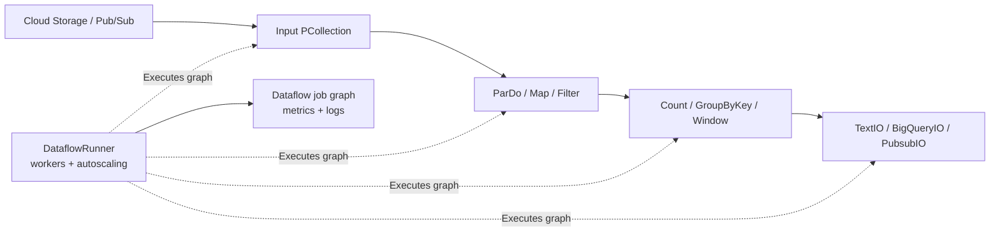
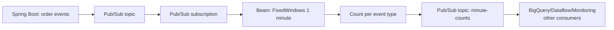
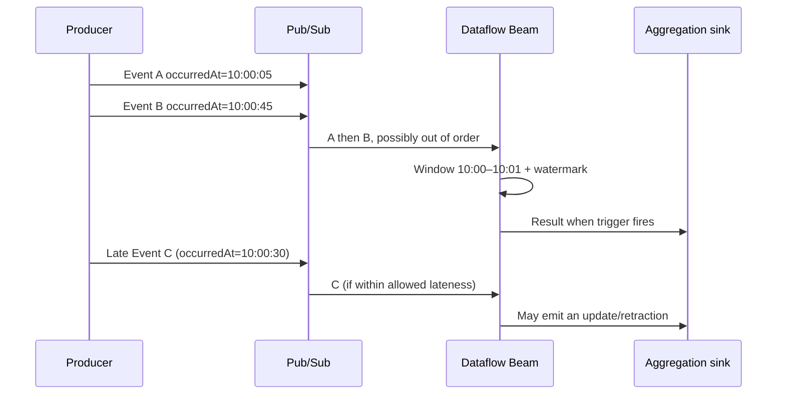
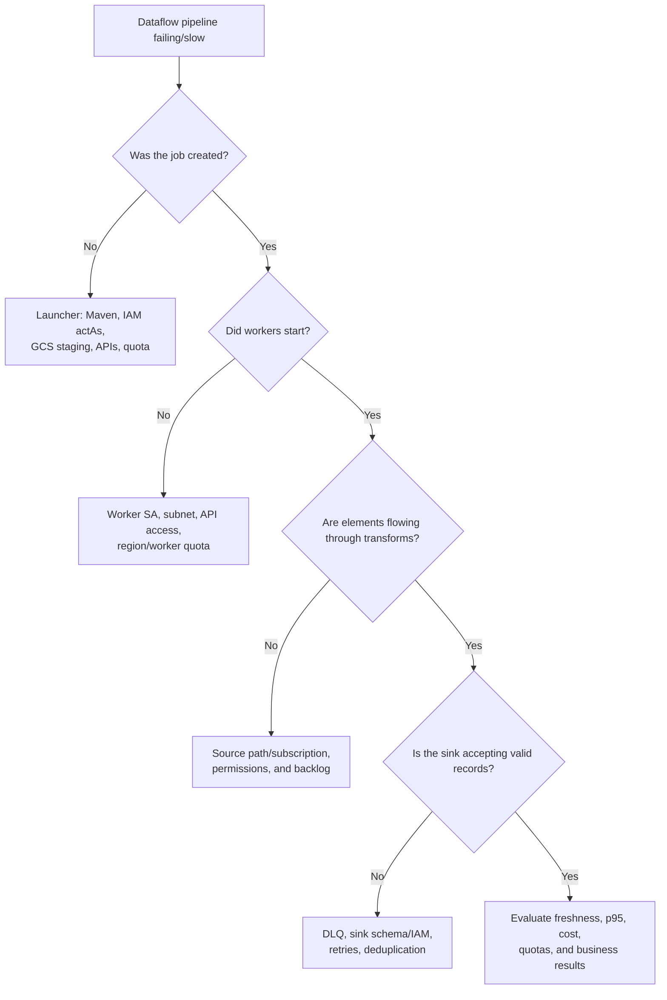

# Deploying a Dataflow Pipeline Using Java

## 1. Context: Turning Raw Data into Usable Data

A **Java/Spring Boot** system on Cloud Run receives orders, publishes events to **Pub/Sub**, and stores logs in **Cloud Storage**. The data team needs to normalize events, filter out invalid records, aggregate over time windows, and deliver results to **BigQuery**. If the team wrote manual Java loops across multiple workers, they would have to manage work distribution, retries, checkpointing, scaling, late-arriving data, and updating the program while it is running.

**Apache Beam** provides a Java **pipeline** programming model; **Google Cloud Dataflow** is a managed runner service that executes pipelines on autoscaling workers. Beam describes *what to process*; Dataflow largely decides *where to run, how to scale, and how to orchestrate*. A pipeline can run in **batch (bounded)** or **streaming (unbounded)** mode, though source design, windowing, sinks, and job termination differ.

This lesson belongs to the **Data Pipelines and Processing** chapter of the **CLOUD_PROVIDERS_GCP** module. The focus is on **building, testing, and deploying a Java pipeline to Dataflow**, then understanding how to transition to event processing, security, reliability observability, and cost control.

**After this lesson, you will be able to:**

1. Read a **PCollection → PTransform → runner** graph and distinguish batch from streaming.
2. Build a **Java 21 + Maven** word-count pipeline, run it with `DirectRunner`, and deploy it with `DataflowRunner`.
3. Configure `project`, `region`, `gcpTempLocation`, `stagingLocation`, worker service account, and worker limits.
4. Describe the streaming flow **Pub/Sub → window/aggregate → sink**, distinguishing event time from processing time.
5. Inspect the **job graph, logs, counters, watermark, backlog, and autoscaling**, and know how to **cancel, drain, and update**.
6. Apply IAM/networking, idempotency, CI/CD, Flex Templates, and cost control.

> **Lab note:** Creating Dataflow jobs, worker VMs, Cloud Storage buckets, and destination data can all **incur charges**. Work only in an **authorized sandbox/lab project**, and never run example pipelines against production topics or datasets. While authoring this lesson, **no commands were executed** and no cloud resources were created.

## 2. How Do Beam and Dataflow Work?



| Concept | Role | Example |
| --- | --- | --- |
| **Pipeline** | Data processing graph | Read logs → split words → count → write files |
| **PCollection** | Distributed dataset, bounded or unbounded | Lines, events, `KV<String, Long>` |
| **PTransform** | Data transformation, potentially parallel | `ParDo`, `MapElements`, `Filter`, `Count` |
| **DoFn** | Function processing each element in a transform | Parse JSON, validate events |
| **Runner** | Engine executing the pipeline | Local `DirectRunner` or cloud `DataflowRunner` |
| **PipelineOptions** | Deployment/runtime parameters | Input/output URI, region, project, temp path |
| **Window / watermark / trigger** | Rules for grouping and emitting stream results | 1-minute windows, late-event handling |

**Batch** reads a finite source such as GCS files and transitions to `JOB_STATE_DONE` upon completion; **streaming** continuously reads from Pub/Sub/Kafka and typically remains in `JOB_STATE_RUNNING` until an operator stops or replaces it. **Dataflow is not Cloud Run**: the Java program on a developer machine is a *launcher*, while transform code runs on workers; never expect the launcher to act as an always-on web server.

**Dataflow Runner** automatically optimizes the graph, potentially **fusing transforms**, scheduling bundles, and managing shuffles to reduce overhead. Therefore, the steps you write in Java do not necessarily correspond 1:1 to workers/VMs or displayed stages.

## 3. Planning Before Running

Before deploying, document:

| Decision | Batch WordCount (lab) | Production streaming |
| --- | --- | --- |
| Source | `gs://.../input/sample.txt` | Pub/Sub subscription or Kafka |
| Sink | `gs://.../output/wordcount-*` | BigQuery, Cloud Storage, or Pub/Sub |
| Boundedness | Bounded | Unbounded |
| Language | Beam Java 21 | Java Beam + connector libraries |
| Runner | DirectRunner → DataflowRunner | DataflowRunner/Streaming Engine |
| Scaling | Capped at 1–2 workers in lab | Driven by backlog/throughput/SLO |
| Duplicates | Input file is controlled | Retries and duplicate events must be idempotent |
| Stopping | Wait for `DONE` or cancel | Drain/cancel/update with state evaluation |
| Success | Accurate word counts | Data freshness, output correctness, minimal DLQ |

Choose a **Dataflow region** close to your **buckets, Pub/Sub/BigQuery, and target systems** where residency and pricing align. Artifact buckets must **already exist**, and the runtime service account must have read/write access. Never pick a region arbitrarily, because cross-region data transfer increases latency and egress costs.

## 4. Preparing Java, Maven, and Your Google Cloud Project

Examples use **JDK 21** and **Apache Beam Java SDK 2.77.0** (a version supporting Java 21 under the current support schedule). For production deployments, check **Beam releases, Dataflow SDK support policy, and release notes**, then pin a supported release; never lock onto a single version forever.

Prerequisites: JDK 21, compatible Maven 3.x, Google Cloud CLI, a lab project with Billing enabled, permissions to create jobs/service accounts, and a Cloud Storage bucket. In Bash/Cloud Shell:

```bash
java -version
mvn -version
gcloud config set project LAB_PROJECT_ID

# Run ONLY on the LAB project after checking permissions and billing.
gcloud services enable \
  dataflow.googleapis.com compute.googleapis.com storage.googleapis.com \
  cloudresourcemanager.googleapis.com logging.googleapis.com

# Bucket name must be globally unique; choose the same region as Dataflow.
gcloud storage buckets create gs://UNIQUE_LAB_BUCKET \
  --project=LAB_PROJECT_ID \
  --location=us-central1 \
  --uniform-bucket-level-access
```

**Do not recreate the bucket if an authorized lab bucket already exists.** Staging/temp buckets can hold JARs, metadata, and temporary files; never place secrets/PII in object names. Control retention, lifecycle rules, and **Cloud Storage soft delete** if you do not want storage charges for deleted temporary objects.

### 4.1. Service Accounts and Least Privilege

Dataflow uses **two key identities**:

- **Dataflow service agent** (service-managed): orchestrates jobs and worker resources; do not use it as the runtime identity for Java business code.
- **Worker service account** (user-managed): used by workers to read inputs, write outputs, emit metrics, and access Pub/Sub/BigQuery.

The identity **submitting the job** needs appropriate Dataflow permissions (e.g., `roles/dataflow.developer`) and `iam.serviceAccounts.actAs` on the worker SA. The worker SA needs `roles/dataflow.worker` on the project and access to the **exact buckets/sources/sinks**. Never grant Editor/Owner to workers just to bypass a `403` error.

```bash
# Create a DEDICATED SA in the lab project.
gcloud iam service-accounts create dataflow-worker-lab \
  --project=LAB_PROJECT_ID \
  --display-name="Dataflow Java batch lab worker"

gcloud projects add-iam-policy-binding LAB_PROJECT_ID \
  --member="serviceAccount:dataflow-worker-lab@LAB_PROJECT_ID.iam.gserviceaccount.com" \
  --role="roles/dataflow.worker"

# ONLY on the LAB bucket; workers need to read staging/input and write temp/output.
gcloud storage buckets add-iam-policy-binding gs://UNIQUE_LAB_BUCKET \
  --member="serviceAccount:dataflow-worker-lab@LAB_PROJECT_ID.iam.gserviceaccount.com" \
  --role="roles/storage.objectAdmin"
```

These illustrative IAM commands **have not yet granted submitter permissions**. Grant `roles/iam.serviceAccountUser` to the **specific user/CI identity on the specific service account** through your organization's IAM process. In production, separate **read-only input** and **write-only output** when buckets differ; use Object Admin only on a lab bucket you own.

## 5. Maven Project and Complete Java Pipeline

This lab **reads a finite text file**, splits Unicode words, counts occurrences, and writes output files. Neither Spring Boot nor a database is needed; Beam `PTransform`s can be packaged as libraries for other Java applications.

```text
dataflow-wordcount-lab/
├── pom.xml
├── sample.txt
└── src/main/java/dev/example/dataflow/WordCountJob.java
```

### 5.1. `pom.xml`

```xml
<?xml version="1.0" encoding="UTF-8"?>
<project xmlns="http://maven.apache.org/POM/4.0.0"
         xmlns:xsi="http://www.w3.org/2001/XMLSchema-instance"
         xsi:schemaLocation="http://maven.apache.org/POM/4.0.0 https://maven.apache.org/xsd/maven-4.0.0.xsd">
  <modelVersion>4.0.0</modelVersion>
  <groupId>dev.example</groupId>
  <artifactId>dataflow-wordcount-lab</artifactId>
  <version>1.0.0</version>

  <properties>
    <maven.compiler.release>21</maven.compiler.release>
    <project.build.sourceEncoding>UTF-8</project.build.sourceEncoding>
    <beam.version>2.77.0</beam.version>
  </properties>

  <dependencies>
    <dependency>
      <groupId>org.apache.beam</groupId>
      <artifactId>beam-sdks-java-core</artifactId>
      <version>${beam.version}</version>
    </dependency>
    <dependency>
      <groupId>org.apache.beam</groupId>
      <artifactId>beam-sdks-java-io-google-cloud-platform</artifactId>
      <version>${beam.version}</version>
    </dependency>
    <dependency>
      <groupId>org.apache.beam</groupId>
      <artifactId>beam-runners-direct-java</artifactId>
      <version>${beam.version}</version>
      <scope>runtime</scope>
    </dependency>
    <dependency>
      <groupId>org.apache.beam</groupId>
      <artifactId>beam-runners-google-cloud-dataflow-java</artifactId>
      <version>${beam.version}</version>
      <scope>runtime</scope>
    </dependency>
  </dependencies>

  <build>
    <plugins>
      <plugin>
        <groupId>org.apache.maven.plugins</groupId>
        <artifactId>maven-compiler-plugin</artifactId>
        <version>3.14.1</version>
      </plugin>
      <plugin>
        <groupId>org.codehaus.mojo</groupId>
        <artifactId>exec-maven-plugin</artifactId>
        <version>3.5.1</version>
      </plugin>
    </plugins>
  </build>
</project>
```

The `beam-sdks-java-io-google-cloud-platform` dependency provides GCP I/O connectors; `DirectRunner` runs locally and `DataflowRunner` runs on Google Cloud. When packaging artifacts for CI/CD, align the **SDK, runner, Java runtime, and container**; `mvn exec:java` in the lab uses the Maven classpath, so a plain JAR will not automatically bundle all dependencies.

### 5.2. `WordCountJob.java`

```java
package dev.example.dataflow;

import java.util.Arrays;
import java.util.Locale;
import org.apache.beam.sdk.Pipeline;
import org.apache.beam.sdk.options.Description;
import org.apache.beam.sdk.options.PipelineOptions;
import org.apache.beam.sdk.options.PipelineOptionsFactory;
import org.apache.beam.sdk.options.Validation;
import org.apache.beam.sdk.transforms.Count;
import org.apache.beam.sdk.transforms.Filter;
import org.apache.beam.sdk.transforms.FlatMapElements;
import org.apache.beam.sdk.transforms.MapElements;
import org.apache.beam.sdk.values.TypeDescriptors;
import org.apache.beam.sdk.io.TextIO;

public final class WordCountJob {
    public interface Options extends PipelineOptions {
        @Description("Local file or gs:// path of UTF-8 text input")
        @Validation.Required
        String getInput();
        void setInput(String value);

        @Description("Output file prefix (local or gs://), not a directory")
        @Validation.Required
        String getOutput();
        void setOutput(String value);
    }

    public static void main(String[] args) {
        Options options = PipelineOptionsFactory.fromArgs(args)
            .withValidation()
            .as(Options.class);
        Pipeline pipeline = Pipeline.create(options);

        pipeline
            .apply("ReadLines", TextIO.read().from(options.getInput()))
            .apply("SplitWords", FlatMapElements
                .into(TypeDescriptors.strings())
                .via((String line) -> Arrays.asList(
                    line.toLowerCase(Locale.ROOT)
                        .split("[^\\p{L}\\p{N}]+"))))
            .apply("RemoveBlank", Filter.by(word -> !word.isBlank()))
            .apply("CountWords", Count.perElement())
            .apply("FormatCounts", MapElements
                .into(TypeDescriptors.strings())
                .via(count -> count.getKey() + "\t" + count.getValue()))
            .apply("WriteResults", TextIO.write()
                .to(options.getOutput())
                .withSuffix(".txt"));

        // For batch, wait for the job to finish to observe success/failure status.
        pipeline.run().waitUntilFinish();
    }
}
```

**Brief walkthrough:** `TextIO.read` creates a bounded `PCollection<String>`, `FlatMapElements` splits multiple words per line, `Filter` drops blank tokens, `Count.perElement` groups and counts, and `TextIO.write` writes **shards**. Dataflow may execute counting/shuffling in parallel; **output line ordering is not guaranteed**. Transform names (`ReadLines`, `CountWords`, etc.) help read the job graph—they do not spin up a dedicated worker per step.

### 5.3. Local Testing with DirectRunner

Create `sample.txt` (UTF-8) containing:

```text
Java Beam Java
Dataflow Java
Beam dataflow
```

Inside the lab Maven directory:

```bash
mvn -q clean compile
mvn -q exec:java \
  -Dexec.mainClass=dev.example.dataflow.WordCountJob \
  -Dexec.args="--runner=DirectRunner --input=sample.txt --output=wordcounts"
```

Expected output (line order depends on the runner):

```text
java	3
beam	2
dataflow	2
```

Read `wordcounts-00000-of-00001.txt` or whichever shard filename Beam creates. **Never hardcode a single shard filename**: shard count is an execution detail. Local tests use no cloud VMs, though they still need Maven dependency downloads and sufficient RAM.

## 6. Deploying Batch to DataflowRunner

### 6.1. Preparing Input and Staging/Output Paths

Once `DirectRunner` succeeds, upload the **exact same file** to GCS; do not alter its contents between runs if you want to compare results:

```bash
gcloud storage cp sample.txt \
  gs://UNIQUE_LAB_BUCKET/input/sample.txt

gcloud storage ls gs://UNIQUE_LAB_BUCKET/input/

# Verify gcloud project + SA before submitting:
gcloud config get-value project
gcloud iam service-accounts describe \
  dataflow-worker-lab@LAB_PROJECT_ID.iam.gserviceaccount.com \
  --project=LAB_PROJECT_ID
```

**Ensure the submitter has `iam.serviceAccounts.actAs`** on the SA and `roles/dataflow.developer` or equivalent. For private VPCs, verify the subnet and Private Google Access before passing `--usePublicIps=false`; **never enable public IPs on a private production network** just to work around a deploy error.

### 6.2. Running the Dataflow Job via Maven Launcher

From the lab Maven directory:

```bash
mvn -q compile exec:java \
  -Dexec.mainClass=dev.example.dataflow.WordCountJob \
  -Dexec.args="--runner=DataflowRunner \
  --project=LAB_PROJECT_ID \
  --region=us-central1 \
  --jobName=wordcount-lab-20261119-01 \
  --gcpTempLocation=gs://UNIQUE_LAB_BUCKET/temp/ \
  --stagingLocation=gs://UNIQUE_LAB_BUCKET/staging/ \
  --serviceAccount=dataflow-worker-lab@LAB_PROJECT_ID.iam.gserviceaccount.com \
  --numWorkers=1 --maxNumWorkers=2 \
  --input=gs://UNIQUE_LAB_BUCKET/input/sample.txt \
  --output=gs://UNIQUE_LAB_BUCKET/output/wordcount"
```

Replace placeholders with **existing real projects/buckets**. If a job name collides or is invalid, choose another name per your naming policy; **never touch production job IDs**. Each execution creates a **new job and new output shards**, so parameterize output prefixes by run ID in CI/CD.

`gcpTempLocation` holds temporary artifacts; `stagingLocation` holds resources uploaded at submission time. Google Cloud docs allow the runner to infer staging from temp, but declare **both** in the lab to make permissions and billing explicit. GCS paths require existing buckets in a readable/writable region.

**Do not set `--streaming=true` for a bounded pipeline**; it reads a file source and must terminate. The launcher's `waitUntilFinish()` waits until the batch job reaches `DONE`. If your machine disconnects after submission, **the Dataflow job can keep running**; closing your terminal does not cancel a GCP job.

### 6.3. Verifying the Job and Results

```bash
gcloud dataflow jobs list \
  --project=LAB_PROJECT_ID --region=us-central1

# Once you have JOB_ID from the list/UI:
gcloud dataflow jobs describe JOB_ID \
  --project=LAB_PROJECT_ID --region=us-central1

gcloud storage ls gs://UNIQUE_LAB_BUCKET/output/
gcloud storage cat 'gs://UNIQUE_LAB_BUCKET/output/wordcount*'
```

Expect **`JOB_STATE_DONE`**, with output containing `java=3`, `beam=2`, `dataflow=2` in Java's tab-delimited format and no duplicates. A job reporting `DONE` only means Dataflow finished executing the transforms; **you must still verify the actual sink** (write permissions, row/file counts, data validity) against business criteria.

**Do not use a Cloud Run job to run `DataflowRunner` as a "worker"**: Cloud Run can act as a Dataflow **launcher**, while distributed data processing remains orchestrated by Dataflow.

## 7. Observing the Job Graph, Worker Logs, and Counters

In Console → **Dataflow → Jobs**, select the job and open **Job graph**, **Job metrics**, and **Job logs**. Cross-check transform names like `ReadLines`, `CountWords`, and `WriteResults` along with metrics:

| Metric | Question to answer |
| --- | --- |
| **Job state** | Running, Done, Failed, Cancelled, or Drained? |
| **Elements/bytes processed** | Was all input read, and which transforms sharply shrink or expand data? |
| **Worker count & autoscaling history** | Do worker scale-ups/scale-downs match backlog and quotas? |
| **CPU/memory, system lag** | Insufficient capacity or slow DoFn/I/O? |
| **Stage/transform latency** | Is time spent reading, transforming, shuffling, or sinking? |
| **User counters/distributions** | How many events were invalid or routed to the DLQ? |
| **Watermark/data freshness** (streaming) | Is event time falling behind processing time? |

### 7.1. Adding Beam Metrics to a DoFn

Example of a **DoFn fragment**, not a complete Java file:

```java
private static final Counter INVALID_EVENTS =
    Metrics.counter("orders", "invalid_events");

@ProcessElement
public void process(@Element String json, OutputReceiver<String> out) {
    if (json == null || json.isBlank()) {
        INVALID_EVENTS.inc();
        return;  // Production: route bad events to DLQ/quarantine.
    }
    out.output(json);
}
```

The DoFn fragment requires importing `org.apache.beam.sdk.metrics.Metrics`, `Counter`, and `@ProcessElement` inside a class extending `DoFn<String, String>`. Metrics may be **aggregated/reported periodically** and must never be used as **exact financial counters**. When results impact billing, write events with IDs to a sink with proper deduplication or transactions.

### 7.2. Cloud Logging and Correlation

Inside a `DoFn`, use a logger (SLF4J) and include **job ID, transform, `eventId` (without PII), and error category**. Worker logs alone do not capture full business context; add Cloud Monitoring alerts and end-to-end correlation tracing with Java services when required. **Never log raw payloads containing customer details, service account tokens, or SQL secrets**.

## 8. Extending: Java Streaming from Pub/Sub

When the input is **unbounded**, a practical example is counting events by **event type in 1-minute windows** and publishing results to a separate Pub/Sub topic. This is a sample pipeline to understand streaming deployment, **not an exact billing system**.



### 8.1. Java Class `MinuteCounts.java`

This example expects **payloads containing an event code string** (`CREATED`, `PAID`, `CANCELLED`). The input subscription and output topic must already exist; without `Pub/Sub API/IAM`, the job will fail. You can place this class next to `WordCountJob.java` in the Maven project from Section 5:

```java
package dev.example.dataflow;

import org.apache.beam.sdk.Pipeline;
import org.apache.beam.sdk.io.gcp.pubsub.PubsubIO;
import org.apache.beam.sdk.options.Description;
import org.apache.beam.sdk.options.PipelineOptions;
import org.apache.beam.sdk.options.PipelineOptionsFactory;
import org.apache.beam.sdk.options.Validation;
import org.apache.beam.sdk.transforms.Count;
import org.apache.beam.sdk.transforms.Filter;
import org.apache.beam.sdk.transforms.MapElements;
import org.apache.beam.sdk.transforms.windowing.FixedWindows;
import org.apache.beam.sdk.transforms.windowing.Window;
import org.apache.beam.sdk.values.TypeDescriptors;
import org.joda.time.Duration;

public final class MinuteCounts {
    public interface Options extends PipelineOptions {
        @Description("projects/PROJECT/subscriptions/SUBSCRIPTION")
        @Validation.Required
        String getInputSubscription();
        void setInputSubscription(String value);

        @Description("projects/PROJECT/topics/OUTPUT_TOPIC")
        @Validation.Required
        String getOutputTopic();
        void setOutputTopic(String value);
    }

    public static void main(String[] args) {
        Options options = PipelineOptionsFactory.fromArgs(args)
            .withValidation().as(Options.class);
        Pipeline p = Pipeline.create(options);

        p.apply("ReadPubSub", PubsubIO.readStrings()
                .fromSubscription(options.getInputSubscription()))
            .apply("DropBlank", Filter.by(e -> !e.isBlank()))
            .apply("OneMinuteWindows",
                Window.<String>into(FixedWindows.of(Duration.standardMinutes(1))))
            .apply("CountByType", Count.perElement())
            .apply("ToString", MapElements
                .into(TypeDescriptors.strings())
                .via(kv -> kv.getKey() + "," + kv.getValue()))
            .apply("WritePubSub", PubsubIO.writeStrings()
                .to(options.getOutputTopic()));

        // Streaming: this call BLOCKS until the job is stopped or fails.
        p.run().waitUntilFinish();
    }
}
```

This is a **windowed aggregation pipeline**, not a direct per-message pass-through to the sink. When the watermark passes the end of the window, Beam emits the result. **Early/late triggers, allowed lateness, and accumulation modes** may be needed when events arrive late; the sample relies on defaults, so **late events may be dropped**. Pub/Sub timestamps are taken from default source/connector metadata and **do not automatically equal `occurredAt` inside a business JSON payload**.

**Another limitation:** the `PubsubIO.writeStrings` sink does not form a shared transaction with sources, Cloud SQL, or BigQuery. If the pipeline is replayed/restarted or producers emit duplicate messages, consumers may see duplicate or repeated window results. Include **window start, event type, and a deterministic aggregation key** in outputs (omitted in the demo) when reliable deduplication or upserts are required.

### 8.2. Deploying Streaming Only in the Lab

Prepare topic `events-lab`, subscription `events-stream-lab`, and output topic `counts-lab` in the test project; the worker SA must have **`roles/pubsub.subscriber`** on the subscription and **`roles/pubsub.publisher`** on the output topic. Configuration example:

```bash
# LAB ONLY, never use production topics:
gcloud services enable pubsub.googleapis.com --project=LAB_PROJECT_ID
gcloud pubsub topics create events-lab --project=LAB_PROJECT_ID
gcloud pubsub topics create counts-lab --project=LAB_PROJECT_ID
gcloud pubsub subscriptions create events-stream-lab \
  --project=LAB_PROJECT_ID --topic=events-lab

# Runtime IAM must be granted separately on the exact subscription/topic before running.
mvn -q compile exec:java \
  -Dexec.mainClass=dev.example.dataflow.MinuteCounts \
  -Dexec.args="--runner=DataflowRunner \
  --streaming=true --enableStreamingEngine \
  --project=LAB_PROJECT_ID --region=us-central1 \
  --jobName=minute-counts-lab-01 \
  --gcpTempLocation=gs://UNIQUE_LAB_BUCKET/temp/ \
  --stagingLocation=gs://UNIQUE_LAB_BUCKET/staging/ \
  --serviceAccount=dataflow-worker-lab@LAB_PROJECT_ID.iam.gserviceaccount.com \
  --numWorkers=1 --maxNumWorkers=2 \
  --inputSubscription=projects/LAB_PROJECT_ID/subscriptions/events-stream-lab \
  --outputTopic=projects/LAB_PROJECT_ID/topics/counts-lab"
```

**Do not leave streaming jobs running accidentally**: jobs continue consuming worker/Streaming Engine resources even with zero messages. Pressing `Ctrl+C` on the submitter machine **does not cancel the job**. Monitor job status and **drain** after the lab per Section 10.

## 9. Event Time, Windowing, Late Data, and Deduplication

An `ORDER_PAID` event typically has distinct **business time** (`occurredAt`), **Pub/Sub ingest/publish time**, and **Dataflow processing time**. For per-minute aggregations, choosing the right timestamp source is a business requirement, not merely a technical detail.

| Concept | Meaning | Example |
| --- | --- | --- |
| **Event time** | When the event actually occurred, when an accurate timestamp is provided | 10:00:05 UTC |
| **Processing time** | When the worker processes the element | 10:02:00 UTC |
| **Watermark** | Estimated event-time progress of the pipeline | Most events before 10:01 processed |
| **Fixed window** | Splits the stream into fixed time intervals | 10:00:00–10:00:59.999 |
| **Trigger** | When to emit window results | Past watermark, early every 30s, or late firing |
| **Allowed lateness** | Retains window state to accept data arriving past the watermark | 5 minutes, depending on SLO and memory/state |



**The Java code in Section 8 does not parse `occurredAt` from the payload**, because it uses `PubsubIO.readStrings()`: records receive timestamps according to the I/O's default semantics (typically publish time) unless the source and app configure an event-time attribute or assign timestamps explicitly. If KPIs require exact event time, parse/validate the timestamp and configure appropriate windows and **late triggers**.

**Delivery does not imply exactly-once side effects:** Pub/Sub may see producer re-publishes, Dataflow performs checkpointing/retries, and sinks provide different guarantees. When writing to BigQuery, select the **write method** (Storage Write API/default/at-least-once) based on requirements and cost, using a stable **business event ID** with deduplication/merge logic as needed. Never send duplicate payment notifications just because of a replay.

**Dead-letter/quarantine:** a single schema-invalid JSON payload must not trap a streaming job in infinite retries. Use a `ParDo` with **multi-output `TupleTag`** (valid/invalid) or equivalent error handling; invalid events should record the event ID, error reason, and a PII-masked reference to the payload. Track DLQ size and maintain a controlled fix/replay procedure.

## 10. Lifecycle Management: Cancel, Drain, and Update

**Do not use the same stop operation for every job.**

| Action | Applies to | Key behavior |
| --- | --- | --- |
| **`cancel`** | Batch and streaming | Stops immediately; may lose **in-flight** data not yet committed to sinks |
| **`drain`** | **Streaming** | Stops reading new input, attempts to process existing backlog, then stops; can take time and continue billing |
| **Force cancel** | Jobs stuck after normal cancel | Last resort; risks incomplete resource cleanup |
| **In-flight option update** | Streaming using Streaming Engine, supported options only | Changes worker bounds/utilization without changing code or job ID |
| **Replacement update** | Streaming changing code/graph/sources or other options | New job **replaces** old job after compatibility checks |

### 10.1. Operations Commands with ID Verification

```bash
# READ-ONLY FIRST:
gcloud dataflow jobs list \
  --project=LAB_PROJECT_ID --region=us-central1

gcloud dataflow jobs describe JOB_ID \
  --project=LAB_PROJECT_ID --region=us-central1

# ONLY AFTER CONFIRMING JOB_ID BELONGS TO LAB:
# Streaming: attempt to process remaining buffered data before stopping.
# gcloud dataflow jobs drain JOB_ID \
#   --project=LAB_PROJECT_ID --region=us-central1

# Batch or streaming: stop immediately if approved.
# gcloud dataflow jobs cancel JOB_ID \
#   --project=LAB_PROJECT_ID --region=us-central1
```

**Draining can emit results from incomplete windows**: during a drain, the watermark may advance to infinity, closing windows early and emitting partial counts. If a new job starts covering the same window, the sink may receive a **different result version**, requiring upsert/deduplication by window key. Draining can also **stall** if a source or DoFn retries errors indefinitely; **never assume drain means zero business data loss**.

**Canceling does not delete job history**: job metadata follows product retention rules. While a streaming job remains `RUNNING`, charges continue to accrue even if your terminal or CI session has closed.

### 10.2. Upgrading a Streaming Pipeline Properly

Dataflow **does not support in-place updates for running batch jobs**. For streaming:

1. Record the current artifact/Beam SDK version, topology, job ID, job name, and region.
2. Test new code using **`DirectRunner`/unit tests and a staging stream**, especially when modifying state, windows, triggers, or sources.
3. If only adjusting worker bounds on a Streaming Engine job, evaluate `gcloud dataflow jobs update-options`.
4. When changing code, submit a **replacement job** with `--update`, using the **same `jobName` and region**; you may need `transformNameMapping` if transform names changed, and `updateCompatibilityVersion` when upgrading the Beam SDK.
5. Monitor compatibility checks, lag, DLQ, and sink consistency; roll back using the previous artifact or tested snapshot/strategy rather than assuming undo is always safe.

**Never run "new job" and "old job" simultaneously against the same subscription** without an explicit plan: workers will compete for messages or produce duplicate outputs. For stateful pipelines, use **Dataflow snapshots** per supported features and procedures when pausing or replacing jobs.

## 11. Packaging a Java Pipeline as a Flex Template

Running the Maven launcher directly is convenient for labs; production can use a **Dataflow Flex Template** to package code into a **launcher container in Artifact Registry** and a **template spec JSON file in Cloud Storage**. CI/CD simply builds versioned artifacts, while operators can launch multiple parameterized jobs from the template without needing Maven installed locally.

### 11.1. Launcher JAR vs. Flex Template

| Deployment approach | When to use | Key considerations |
| --- | --- | --- |
| `mvn exec:java --runner=DataflowRunner` | Dev/test or ad-hoc runs | Submitter needs Java/Maven; code executes on workers |
| **Flex Template** | CI/CD, schedules, multi-environment, versioned artifacts | Container image + metadata JSON + Artifact Registry/GCS IAM |
| **Classic Template** | Static templates with stricter runtime parameters | Does not support full pipeline option/runtime flexibility |

**Important Java detail:** `WordCountJob` in Section 5 calls `pipeline.run().waitUntilFinish()`, which suits **direct batch launches** but **is unsuitable for a Flex Template launcher**. When building a **Flex Template variant**, change the last line to:

```java
// Flex Template launcher must exit after submitting the pipeline graph.
pipeline.run();
// DO NOT call waitUntilFinish() in the launcher, or the template launch may time out.
```

The same applies to `MinuteCounts`: the template variant only calls `p.run()` without blocking. Do not hardcode `runner`, `project`, `region`, or `jobName` in code or template metadata; the launcher manages those options.

### 11.2. Packaging Dependencies and Choosing a Base Image

Build an **uber/fat JAR** bundling all code and dependencies—for example, by adding `maven-shade-plugin` under `build.plugins` in your **separate lab project's `pom.xml`**:

```xml
<plugin>
  <groupId>org.apache.maven.plugins</groupId>
  <artifactId>maven-shade-plugin</artifactId>
  <version>3.6.1</version>
  <executions>
    <execution>
      <phase>package</phase>
      <goals><goal>shade</goal></goals>
      <configuration>
        <createDependencyReducedPom>false</createDependencyReducedPom>
        <transformers>
          <transformer implementation=
            "org.apache.maven.plugins.shade.resource.ServicesResourceTransformer"/>
        </transformers>
      </configuration>
    </execution>
  </executions>
</plugin>
```

This is a **plugin fragment** to insert into your existing `plugins` section, not a second complete `pom.xml`. Run `mvn clean package` in your **lab repo** and verify the JAR bundles dependencies; for Java 21, select the **Flex Template base image `JAVA21`** or a custom container with the matching runtime. Never use `JAVA17` to run bytecode compiled with `--release 21`.

### 11.3. Building and Running the Template (Controlled Sample)

Create a lab Artifact Registry repository, then create `metadata.json` in the Maven directory:

```json
{
  "name": "WordCount Java",
  "description": "Batch WordCount over GCS input files",
  "parameters": [
    {"name": "input", "label": "Input GCS path",
     "helpText": "Example gs://BUCKET/input/sample.txt", "isOptional": false},
    {"name": "output", "label": "Output file prefix",
     "helpText": "Example gs://BUCKET/output/counts", "isOptional": false}
  ]
}
```

```bash
# LAB project ONLY; requires Cloud Build + Artifact Registry + GCS permissions.
gcloud services enable artifactregistry.googleapis.com \
  cloudbuild.googleapis.com --project=LAB_PROJECT_ID

gcloud artifacts repositories create dataflow-templates-lab \
  --project=LAB_PROJECT_ID \
  --repository-format=docker \
  --location=us-central1

mvn -q clean package

# Only after shading the JAR and removing waitUntilFinish in the template variant:
gcloud dataflow flex-template build \
  gs://UNIQUE_LAB_BUCKET/templates/wordcount-java.json \
  --project=LAB_PROJECT_ID \
  --image-gcr-path=us-central1-docker.pkg.dev/LAB_PROJECT_ID/dataflow-templates-lab/wordcount-java:v1 \
  --sdk-language=JAVA \
  --flex-template-base-image=JAVA21 \
  --metadata-file=metadata.json \
  --jar=target/dataflow-wordcount-lab-1.0.0.jar \
  --env=FLEX_TEMPLATE_JAVA_MAIN_CLASS=dev.example.dataflow.WordCountJob

gcloud dataflow flex-template run wordcount-flex-lab-01 \
  --project=LAB_PROJECT_ID \
  --region=us-central1 \
  --template-file-gcs-location=gs://UNIQUE_LAB_BUCKET/templates/wordcount-java.json \
  --parameters=input=gs://UNIQUE_LAB_BUCKET/input/sample.txt,output=gs://UNIQUE_LAB_BUCKET/output/flex-wordcount \
  --service-account-email=dataflow-worker-lab@LAB_PROJECT_ID.iam.gserviceaccount.com \
  --staging-location=gs://UNIQUE_LAB_BUCKET/staging/ \
  --temp-location=gs://UNIQUE_LAB_BUCKET/temp/ \
  --num-workers=1 --max-workers=2
```

**Run prerequisites:** the image build service can push to Artifact Registry; the launcher/worker can read the template spec, container image, and stage to GCS; and the submitter is authorized to run templates and impersonate the worker SA. **This is an optional extension step** and is not required to complete the batch Maven lab in Section 6. In production, pin the **image digest instead of the `latest` tag**, run vulnerability scans, and track metadata/template URIs in a release inventory.

A **Flex Template launch timeout** can occur if the JAR is oversized, a private network cannot pull the image, permissions are missing, or the Java launcher blocks on `waitUntilFinish()`. Inspect launcher logs before raising timeouts; do not blindly tweak SDK or worker code.

## 12. Security, Networking, and Data Correctness

### 12.1. Separating Identities by Function

| Identity | Typical least-privilege permissions | Should NOT have |
| --- | --- | --- |
| **Submitter/CI** | Create Dataflow jobs, `iam.serviceAccounts.actAs` on worker SA | Owner/Editor across all resources |
| **Dataflow service agent** | Google-managed Service Agent role | Used as the business runtime identity |
| **Worker SA** | `roles/dataflow.worker`, Object Viewer/Writer on scoped GCS, Pub/Sub subscriber/publisher, or BigQuery permissions | Project-wide Admin roles when only data read/write is needed |
| **Auditor** | View Dataflow jobs, logs/metrics, and Billing per role | Permission to cancel jobs, alter IAM, or read unnecessary PII |

**Workers do not need a service account JSON key** inside the JAR; rely on the attached worker service account and ADC. If sources/sinks live in **another project**, grant permissions in that **source/sink project**. A Dataflow job is bound to its launch project—you cannot "move a job" to another project by changing a single flag.

### 12.2. Worker Private IPs and VPC

If your organization requires workers with **no public IPs**, pass `--usePublicIps=false` with a valid `--network`/`--subnetwork`; **Private Google Access** must be enabled on the subnet so workers can still reach GCS, Pub/Sub, BigQuery, and Google APIs. If external public services are needed, configure **approved Cloud NAT/egress**. Never assume "same project" automatically grants access to private Cloud SQL or Kafka.

```bash
# Illustrates FLAGS ADDED to the DataflowRunner command:
--usePublicIps=false
--subnetwork=regions/us-central1/subnetworks/APPROVED_SUBNET

# Not a standalone shell command; verify Shared VPC,
# firewall rules, DNS, Private Google Access, and permissions before deploying.
```

**Data and encryption:** GCS output/staging may hold intermediate data. Avoid placing PII in group keys, metric labels, or logs unless strictly required; apply **VPC Service Controls, CMEK/Cloud KMS**, and data residency per organizational policy. Store secrets in **Secret Manager** rather than writing passwords into `PipelineOptions`, template JSONs, SQL literals, or Artifact Registry images.

### 12.3. Idempotency and Output Validation

Beam/Dataflow protects processing across retries, but that **does not create a distributed transaction** spanning Pub/Sub, Cloud SQL, email APIs, and BigQuery. For a `DoFn` calling external REST APIs:

1. Generate a stable **business event ID** at the source.
2. Configure timeouts and retries with backoff; separate transient errors from schema/authorization failures.
3. Use **upsert/deduplication** or unique constraints at the sink; avoid irreversible side effects inside a `DoFn`.
4. Route poison messages to a **DLQ** and monitor error rates.
5. During replay/reprocessing, account for **at-least-once sink semantics** and already-emitted window results.

For financial/order workloads, verify **row counts, unique IDs, currency totals, and watermark/data freshness** after every change—never treat a green job status as proof of business correctness.

## 13. Cost and Operational Optimization

Dataflow bills based on job resources and execution mode: **worker vCPU/memory**, **Persistent Disk**, **batch Dataflow Shuffle**, **Streaming Engine Compute Units or data processed** depending on pricing mode, and **Dataflow Prime Data Compute Units (DCUs)** when used. You are also billed separately for **Cloud Storage, Pub/Sub, BigQuery, logging, egress, and Artifact Registry**. Streaming workers continue running even when input volume temporarily drops.

**Illustrative estimate, not a Google Cloud price sheet:**

```text
Suppose a batch job averages 2 workers for 15 minutes:
  2 workers × 0.25 hours = 0.5 worker-hours.

If each worker has 2 vCPUs:
  roughly 1.0 vCPU-hour + RAM-hours + disk/shuffle/IO.

If a streaming job runs 24/7:
  24 × 30 = 720 active hours/month,
  even during hours with very low message rates.
```

**Never extrapolate exact billing solely from worker-hours**: VM shapes, autoscaling over time, runner modes, Streaming Engine/Prime, storage, efficiency, and regions all vary. Check [Dataflow pricing](https://cloud.google.com/dataflow/pricing), Cloud Billing Reports, and the job's **CPU/worker/bytes shuffled** metrics.

Optimization steps in priority order:

- **Reduce bytes read/written**: filter unneeded data early, avoid repeatedly parsing huge JSON blobs, and use versioned schemas.
- **Limit shuffling**: group by appropriate business keys, avoid hot keys stalling a stage, and consider `Combine.perKey` before large fan-in steps.
- **Batch I/O** at sinks when supported by connectors; avoid firing individual DB/API calls per record when round-trip overhead dominates.
- **Cap autoscaling** via `maxNumWorkers` aligned to quotas and downstream limits; adding workers will not cure a hot key or DB connection cap.
- **Use Batch FlexRS** when deadlines allow and features match; never use it for streaming latency requirements.
- **Use Streaming Engine** to offload state/shuffle from worker VMs when appropriate; monitor its separate billing units.
- **Apply labels and budget alerts** by team/service/environment; remember that budget alerts **do not stop jobs automatically**.

Never cut costs by removing DLQs, essential logging, or data validation. A cheap job that generates wrong invoices carries far higher operational cost.

## 14. Deployment and Pipeline Troubleshooting Runbook

| Symptom | Common cause | What to inspect |
| --- | --- | --- |
| `PipelineOptions` reports unknown/missing option | Wrong `--input`/`--output`, wrong runner, or Maven config | Options interface, flag names, Beam version |
| DirectRunner passes but DataflowRunner fails | Worker IAM, GCS staging, unsupported dependency | Worker logs, bucket roles, runner dependency |
| `PERMISSION_DENIED` on submit | Submitter lacks Dataflow/`actAs` permission | CLI/CI identity and worker SA binding |
| `PERMISSION_DENIED` reading input | Worker SA lacks Storage Object Viewer | Bucket IAM, cross-project context |
| Workers cannot reach Google APIs | Public IPs disabled without Private Google Access/NAT | Subnet, firewall, DNS, and routes |
| Job `RUNNING` with no output appearing | Transform/sink receiving no elements, wrong prefix, or window still open | Job graph, element counts, watermark |
| Streaming data freshness degrading | Backlog, hot key, sink throttling, slow autoscaling | Per-step lag, Pub/Sub backlog, worker CPU |
| Output counts doubled | Producer duplicates, replay, at-least-once sink, late window firings | Event IDs, sink upsert/uniqueness, trigger config |
| BigQuery sink schema error | Schema version or field type mismatch | DLQ, table schema, write method, bad rows |
| Streaming `drain` hangs | Infinite retries or stuck timer/window/DoFn | Worker errors, stuck stage, update plan |
| Flex Template launch timeout | `waitUntilFinish`, oversized JAR/image, missing IAM or network access | Launcher logs, Artifact Registry, template metadata |
| Job stopped yet bill keeps rising | GCS temp/soft delete, Artifact Registry images, BigQuery/Pub/Sub, or another job | Billing SKUs, active jobs, cleanup |



**Incident response procedure:**

1. Record **job ID, region, SDK version, artifact image/digest, worker SA, and input/output resource IDs**.
2. Capture the **job graph + logs + metrics** within the same UTC window; isolate **launcher**, **worker startup**, **DoFn**, and **sink** errors.
3. For re-runnable batch jobs, verify **idempotency of the output prefix** before resubmitting.
4. For streaming, evaluate **update/drain/cancel** and state compatibility; never delete a subscription/backlog just to make the job look "healthy".
5. After fixing, run a **lab canary**, reconcile record counts, p95, watermarks, and Billing before scaling out.

## 15. Scoped Lab Cleanup

### Batch

Wait for `JOB_STATE_DONE`. Verify artifacts and outputs:

```bash
gcloud dataflow jobs list --project=LAB_PROJECT_ID --region=us-central1
gcloud storage ls gs://UNIQUE_LAB_BUCKET/output/
gcloud storage ls gs://UNIQUE_LAB_BUCKET/staging/
gcloud storage ls gs://UNIQUE_LAB_BUCKET/temp/
```

### Streaming

If you ran `MinuteCounts` and confirmed the **exact lab job ID**, **drain** it if you need to preserve in-flight data, then verify outputs and `DRAINED` status. When in-flight data is not needed, **cancel** only if authorized. Never default to force cancel.

### Remaining Resources

Inspect Pub/Sub topics/subscriptions, Cloud Storage staging/temp/output, Artifact Registry images/template specs, and the dedicated lab service account. **Never delete shared buckets/repositories/SAs or topics with other consumers.** Destructive commands below are intentionally commented out:

```bash
# LAB ONLY; verify ownership and contents first:
# gcloud pubsub subscriptions delete events-stream-lab --project=LAB_PROJECT_ID
# gcloud pubsub topics delete events-lab --project=LAB_PROJECT_ID
# gcloud pubsub topics delete counts-lab --project=LAB_PROJECT_ID
# gcloud storage rm --recursive gs://UNIQUE_LAB_BUCKET/output/

# Never delete a bucket while another pipeline's or teammate's artifacts remain.
```

**Cleaning GCS before tearing down the lab** should account for soft-delete/retention policies. Check Cloud Billing after cleanup because charges can post with a delay. Remove worker SA and IAM bindings strictly within scope without breaking another team's pipelines.

## 16. Exercises and Self-Check Checklist

### Exercise A — Runners and Output Differences

Explain how running the pipeline in Section 5 differs between `DirectRunner` and `DataflowRunner`. Why can the number of output shards and line order differ even though the counts `java=3, beam=2, dataflow=2` must match?

### Exercise B — Build Your Own Dataflow Batch Lab

Create a separate Java 21/Beam Maven project, run WordCount locally on `sample.txt`, upload the input to a lab bucket, and submit the Dataflow job with `--runner=DataflowRunner`, `--serviceAccount`, and `--maxNumWorkers=2`. Record the job ID, status, staging/temp/output paths, and compare local vs. cloud results.

### Exercise C — IAM and Private Networking

A user has `roles/dataflow.developer` but gets `403` when submitting a job using a worker SA. Identify the missing permission. Next, suppose workers disable public IPs and fail to read GCS: how should you check **Private Google Access, subnet, DNS, and firewall**?

### Exercise D — Streaming Windowing and Late Events

Pub/Sub receives `PAID` at `10:02` while the payload states `occurredAt=10:00:45`. With 1-minute fixed windows, distinguish **publish time** from **event time**, and describe configuring the timestamp attribute, watermark, allowed lateness, and trigger. Why must outputs include a **window key** for deduplication?

### Exercise E — Idempotency and DLQ

A `DoFn` successfully calls an ERP API, then the worker crashes before checkpointing and retries the same event. Design `eventId`/upsert/unique keys, transient vs. permanent error handling, and a DLQ. Explain why a running pipeline can still trigger duplicate side effects.

### Exercise F — Update, Drain, and Cancel

The team wants to change a 1-minute window to 5 minutes on a running streaming job. Would you choose an **in-flight update or a replacement update**? If you drain at `10:03`, how might the `10:00–10:05` window emit results? Propose how to avoid overwrites or double-counting at the sink.

### Exercise G — Flex Template and Cost

Design packaging the pipeline as a Flex Template using **`JAVA21`**, an uber JAR, a versioned Artifact Registry image, and metadata JSON; state what must change in `main()` compared to the lab. Given a batch job averaging 2 workers × 15 minutes, compute **0.5 worker-hours**, then list **costs not yet included**.

### Pre-Production Checklist

- [ ] I understand Beam **Pipeline, PCollection, PTransform, DoFn, Runner**, and bounded/unbounded data.
- [ ] I have `DirectRunner` tests, sample data, and output assertions before deploying to Cloud.
- [ ] I selected the right **region**, GCS `gcpTempLocation`/`stagingLocation`, and worker SA.
- [ ] I separated permissions for **submitter**, **service agent**, and **worker service account**.
- [ ] I have worker limits, IAM, private networking, and Billing monitoring in place.
- [ ] I monitor the job graph, counters, workers, lag/watermarks, errors, and DLQ.
- [ ] I handle **event time, late events, windowing, retries, and idempotency** per business rules.
- [ ] I know **batch cannot update in-place**, streaming drain differs from cancel, and replacement updates require compatibility checks.
- [ ] I do not call `waitUntilFinish()` inside a **Flex Template launcher**.
- [ ] I have artifact versioning, canary/rollback, output correctness validation, and a cleanup runbook.

**Conclusion:** deploying Dataflow with Java effectively follows **Beam modeling → local testing → IAM/storage/network prep → `DataflowRunner` execution → monitoring/reconciling outputs → optimization and operations**. Batch and streaming share the same programming model, yet differ in time semantics, latency, state, and stop/update mechanics. Treat a pipeline as "complete" only when **outputs are accurate, the workload is secured, and costs/SLOs are verified**.

## 17. Official References

- [Create a Dataflow pipeline using Java](https://cloud.google.com/dataflow/docs/guides/create-pipeline-java)
- [Deploy Dataflow pipelines](https://cloud.google.com/dataflow/docs/guides/deploying-a-pipeline)
- [Set pipeline options and gcpTempLocation](https://cloud.google.com/dataflow/docs/guides/setting-pipeline-options)
- [Dataflow pipeline options reference](https://cloud.google.com/dataflow/docs/reference/pipeline-options)
- [Apache Beam — Java quickstart](https://beam.apache.org/get-started/quickstart-java/)
- [Apache Beam downloads and releases](https://beam.apache.org/get-started/downloads/)
- [Beam programming guide: PCollections, DoFn, windows, triggers](https://beam.apache.org/documentation/programming-guide/)
- [Beam/Dataflow Java runtime support](https://cloud.google.com/dataflow/docs/support/beam-runtime-support)
- [Dataflow security and service account roles](https://cloud.google.com/dataflow/docs/concepts/security-and-permissions)
- [Dataflow job metrics](https://cloud.google.com/dataflow/docs/guides/using-monitoring-intf)
- [Use Streaming Engine](https://cloud.google.com/dataflow/docs/streaming-engine)
- [Stop a Dataflow job: cancel, drain, force cancel](https://cloud.google.com/dataflow/docs/guides/stopping-a-pipeline)
- [Update an existing streaming pipeline](https://cloud.google.com/dataflow/docs/guides/updating-a-pipeline)
- [Configure Dataflow Flex Templates](https://cloud.google.com/dataflow/docs/guides/templates/configuring-flex-templates)
- [Build and run Flex Templates](https://cloud.google.com/dataflow/docs/guides/templates/using-flex-templates)
- [Flex Template Java 21 base images](https://cloud.google.com/dataflow/docs/reference/flex-templates-base-images)
- [Troubleshoot Flex Templates](https://cloud.google.com/dataflow/docs/guides/troubleshoot-templates)
- [Dataflow pricing](https://cloud.google.com/dataflow/pricing)
