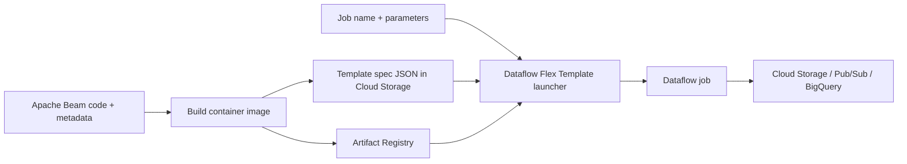

# Dataflow Templates, Flex Templates, and Parameterizing Jobs

## Objectives

After this lesson, you will be able to choose the right Dataflow template type; package an Apache Beam pipeline as a Flex Template; declare, pass, and validate parameters when launching jobs; and operate jobs safely with respect to permissions, data, and cost.

## 1. What Problem Do Templates Solve?

Google Cloud Dataflow runs data-processing pipelines built with Apache Beam—such as reading events from Cloud Storage, normalizing them, and writing to BigQuery. If you had to edit source code and deploy manually for every input file or environment, operations would be hard to repeat reliably.

**Templates** package a pipeline definition so operators or automated systems can launch **Dataflow jobs** with different input parameters. A template is a reusable definition; **each launch creates a separate job** with its own configuration and lifecycle. Google provides prebuilt templates for many scenarios, and development teams can also create custom templates.

For example, the same order-processing template can accept `input_path=gs://data-dev/orders/*.jsonl` during testing and `input_path=gs://data-prod/orders/2026-11-19/*.jsonl` in production, provided data schemas and permissions align.

## 2. Comparing Classic Templates and Flex Templates

| Criterion | Classic Template | Flex Template |
|---|---|---|
| Packaging | Pre-built job graph stored in Cloud Storage | Container image with pipeline code in Artifact Registry and a JSON spec file in Cloud Storage |
| Graph construction time | At template build time | At launch time, from code inside the container |
| Runtime parameters | Often requires `ValueProvider` for runtime values; connectors must support it | Receives parameters in the launcher and can decide how to build the graph at runtime |
| Changing logic/branches | Constrained by the pre-built graph | More flexible—for example, selecting the data source by parameter |
| Recommendation | Suitable when maintaining existing Classic pipelines | **Preferred for new custom templates** |

Do not confuse **Flex Template** with **FlexRS** (Flexible Resource Scheduling): one is a way to package and launch pipelines, while the other is a resource scheduling mode for certain batch jobs.

Flex Template deployment flow:



**Selection rule:** if only source paths, target tables, or pre-designed configurations change, pass parameters at runtime; if processing logic or dependencies change, build and release a new template version.

## 3. Designing Job Parameters

A well-designed parameter set clearly separates **business values** from **infrastructure configuration**:

| Category | Examples | How to manage |
|---|---|---|
| Pipeline parameters | `input_path`, `output_table`, `error_path` | Declare in metadata and read in Apache Beam code |
| Environment parameters | Region, staging/temp buckets, worker service account | Configure when invoking the job launch command |
| Operational settings | Labels, worker count, batch/streaming mode | Pass via supported Dataflow options |
| Sensitive data | Tokens, passwords, API keys | Use Secret Manager/IAM; never place secrets in visible job parameters |

Keep naming consistent across `metadata.json`, pipeline code, and `--parameters`; specify which parameters are required, valid formats, defaults (if any), and how invalid inputs are handled. Never override options managed by the Flex launcher such as `runner`, `project`, `region`, or `job_name` in code.

## 4. Hands-On: Building a Cloud Storage → BigQuery Flex Template

**Scenario:** each day, receive JSON Lines files (one JSON object per line) containing events and load them into a BigQuery table. Keep the ETL logic constant, changing only `input_path` and `output_table` per run.

Prepare a Google Cloud project with the required APIs enabled (Dataflow, Cloud Build, Artifact Registry, Cloud Storage, BigQuery), a bucket for artifacts/data, and a BigQuery dataset such as `analytics`. The build machine needs the Google Cloud CLI and build/push permissions; the service account running the job must read the source, write the BigQuery table, use staging/temp buckets, and start Dataflow workers. Choose compatible locations for the bucket, dataset, and region to avoid data-location issues.

**Sample data** in `gs://my-pipeline-bucket/input/events.jsonl`:

```json
{"event_id":"e-101","event_type":"view"}
{"event_id":"e-102","event_type":"purchase"}
```

Create three files in a release directory.

**`main.py`** — illustrative pipeline code assuming each line is valid JSON with both fields:

```python
import argparse
import json

import apache_beam as beam
from apache_beam.options.pipeline_options import PipelineOptions


def parse_event(line):
    item = json.loads(line)
    return {
        "event_id": str(item["event_id"]),
        "event_type": str(item["event_type"]),
    }


def main():
    parser = argparse.ArgumentParser()
    parser.add_argument("--input_path", required=True)
    parser.add_argument("--output_table", required=True)
    args, beam_args = parser.parse_known_args()

    pipeline = beam.Pipeline(options=PipelineOptions(beam_args))
    (
        pipeline
        | "Read JSONL" >> beam.io.ReadFromText(args.input_path)
        | "Parse events" >> beam.Map(parse_event)
        | "Write BigQuery" >> beam.io.WriteToBigQuery(
            table=args.output_table,
            schema="event_id:STRING,event_type:STRING",
            create_disposition=beam.io.BigQueryDisposition.CREATE_IF_NEEDED,
            write_disposition=beam.io.BigQueryDisposition.WRITE_APPEND,
        )
    )
    pipeline.run()


if __name__ == "__main__":
    main()
```

Calling `pipeline.run()` submits the pipeline to the runner and lets the launcher exit; **do not call** `wait_until_finish()` in a Flex Template program, because waiting for job completion can block the launch process. This example is intentionally minimal: malformed JSON lines will fail the parse step; the exercises add an error-handling branch.

**`requirements.txt`**:

```text
apache-beam[gcp]
```

In an actual release, pin and test the exact Apache Beam version and all dependencies so builds are reproducible.

**`metadata.json`** — parameter names must match those in `main.py`:

```json
{
  "name": "Events JSONL to BigQuery",
  "description": "Load JSONL events from Cloud Storage into BigQuery.",
  "parameters": [
    {
      "name": "input_path",
      "label": "Cloud Storage input",
      "helpText": "gs://... path to the JSONL file.",
      "isOptional": false,
      "regexes": ["^gs://.+"]
    },
    {
      "name": "output_table",
      "label": "BigQuery target",
      "helpText": "Table name in project:dataset.table format.",
      "isOptional": false,
      "regexes": ["^[^:]+:[^.]+\\..+$"]
    }
  ]
}
```

Metadata lets the UI and launcher display descriptions and validate parameters before running; your code must still enforce critical business constraints itself. The `\\` in the JSON above represents a literal `\` inside the regular expression.

### Build and Launch

The commands below illustrate running in **Cloud Shell/Bash**; substitute your own project, bucket, and repo. Assume the bucket and Artifact Registry Docker repository already exist, sample data has been uploaded, and the BigQuery dataset `analytics` has been created.

```bash
PROJECT_ID="my-project"
REGION="asia-southeast1"
BUCKET="my-pipeline-bucket"
REPO="dataflow-images"

gcloud dataflow flex-template build \
  "gs://$BUCKET/templates/events-v1.json" \
  --project="$PROJECT_ID" \
  --image-gcr-path="$REGION-docker.pkg.dev/$PROJECT_ID/$REPO/events:1.0.0" \
  --sdk-language="PYTHON" \
  --flex-template-base-image="PYTHON3" \
  --metadata-file="metadata.json" \
  --py-path="." \
  --env="FLEX_TEMPLATE_PYTHON_PY_FILE=main.py" \
  --env="FLEX_TEMPLATE_PYTHON_REQUIREMENTS_FILE=requirements.txt"
```

The build command creates the image in Artifact Registry and the template spec JSON in Cloud Storage; the `events-v1.json` path is used in the run step.

```bash
gcloud dataflow flex-template run "events-batch-20261119-01" \
  --project="$PROJECT_ID" \
  --region="$REGION" \
  --template-file-gcs-location="gs://$BUCKET/templates/events-v1.json" \
  --staging-location="gs://$BUCKET/staging" \
  --temp-location="gs://$BUCKET/temp" \
  --parameters="input_path=gs://$BUCKET/input/events.jsonl,output_table=$PROJECT_ID:analytics.events" \
  --additional-user-labels="team=data,environment=dev"
```

Once the job succeeds, `my-project:analytics.events` contains the two sample rows if the table started empty. Running the same template with a different `input_path` creates a **separate job**; provide a new job name and matching input data. Rebuilding is unnecessary when only those two parameters change.

To inspect jobs and runtime errors:

```bash
gcloud dataflow jobs list --project="$PROJECT_ID" --region="$REGION"
gcloud dataflow jobs describe JOB_ID --full \
  --project="$PROJECT_ID" --region="$REGION"
```

Also check Dataflow Job details, throughput charts, worker logs in Cloud Logging, and row counts in the destination BigQuery table. Exact command flags and permissions can vary by environment; verify permissions for the launcher identity, Dataflow service agent, and worker service account.

## 5. Operating Reliably and Avoiding Common Pitfalls

| Symptom | Cause to check | Remediation |
|---|---|---|
| Missing parameter or launch failure | `--parameters` names differ from `metadata.json`/`argparse`; value fails regex | Align names, test sample values, and inspect validation messages |
| Launcher fails to pull image | Wrong Artifact Registry path or missing image read permission | Verify image/tag and launcher/worker IAM |
| Job fails reading files or writing BigQuery | Wrong `gs://` path, missing table/dataset, permissions, or mismatched resource location | Verify paths, read/write permissions, and region |
| Job fails on a bad record | `json.loads` or required field check raises an exception | Separate valid and invalid records, route errors to dead-letter output, and monitor |
| Rising cost or duplicate data after rerun | Job spawns too many workers, or already-loaded data is appended again | Label/monitor resources; use staging + `MERGE` or an idempotent load strategy |

For production pipelines, pin image versions with immutable tags or digests, use a dedicated least-privilege service account, set resource bounds, and configure error alerts. Re-running a batch job with `WRITE_APPEND` can duplicate rows; **templates do not guarantee idempotency on their own**. Implement deduplication or load into staging and `MERGE` by business key (such as `event_id`). For streaming, updating a running job requires an explicit update/compatibility workflow; launching a new job does not automatically replace the old one.

## 6. Applied Exercises

**Exercise 1 — Choosing a deployment approach.** A team has a pipeline reading Cloud Storage and writing to BigQuery, changing the file path daily. They also want an option to switch to reading Pub/Sub via runtime configuration. Which template type should they choose, and when is a rebuild required?

**Exercise 2 — Parameterization.** Extending the example, add an `environment` parameter accepting only `dev` or `prod`. Reject any other value before launch, and set a matching `environment` label when creating the job. Test launching with two different input paths using the same template.

**Exercise 3 — Reliability.** A source file contains a non-JSON line and a duplicate `event_id`. Design a branch writing invalid records to Cloud Storage and a mechanism preventing duplicate rows in BigQuery when re-running the batch job. Describe how to measure read, valid, and error record counts.

**Suggested answers:** (1) Choose a Flex Template because it can construct the graph dynamically from parameters; changing only input paths requires no rebuild, while changing processing logic or connector selection in code requires releasing a new image. (2) Add `choices=["dev", "prod"]` in `argparse`, declare it in metadata, and pass `--additional-user-labels`; never use parameters to pass credentials. (3) Classify errors via `ParDo` with tagged outputs or a validation step and write errors with reasons; load to staging then `MERGE` on `event_id`, track Beam metrics, and verify destination row counts.

## Official Documentation

- [Dataflow templates — comparing Flex and Classic](https://cloud.google.com/dataflow/docs/concepts/dataflow-templates)
- [Build and run an example Flex Template](https://cloud.google.com/dataflow/docs/guides/templates/using-flex-templates)
- [Configure Flex Templates](https://cloud.google.com/dataflow/docs/guides/templates/configuring-flex-templates)
- [Run Flex Templates](https://cloud.google.com/dataflow/docs/guides/templates/run-flex-templates)
