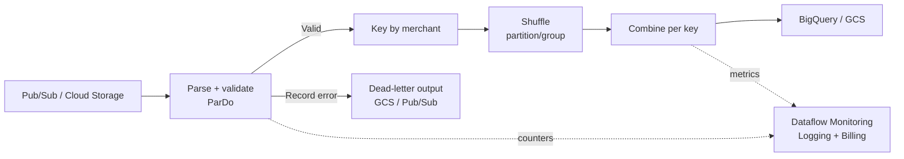
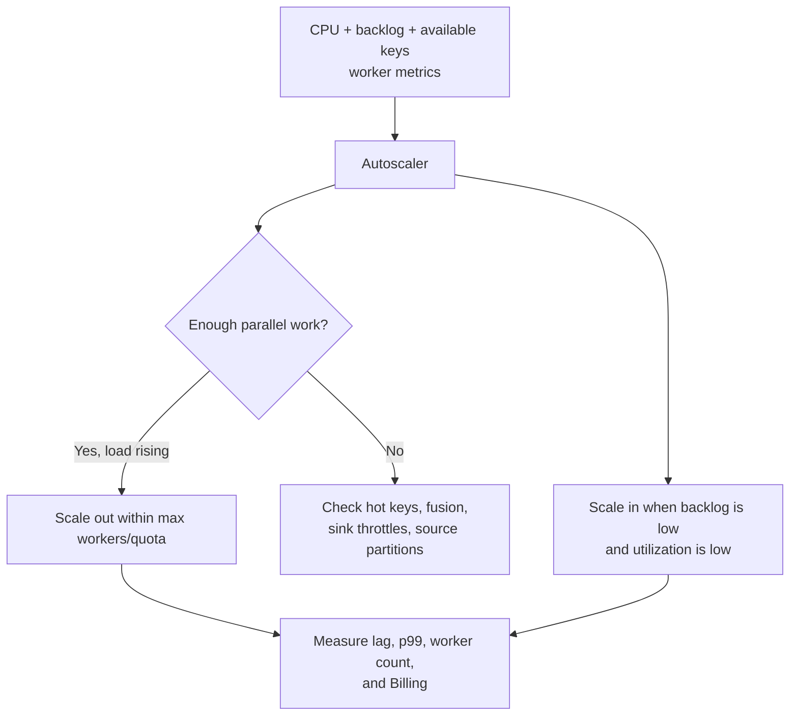
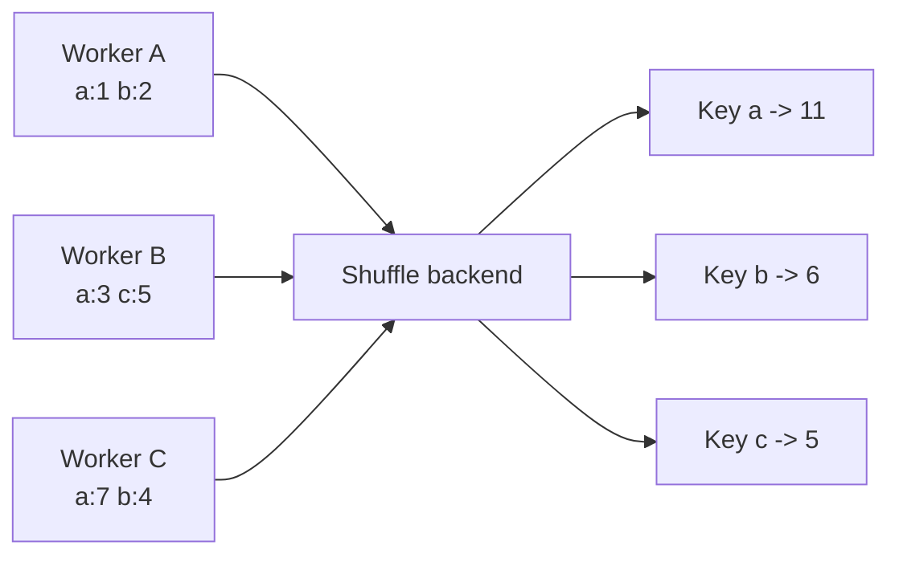
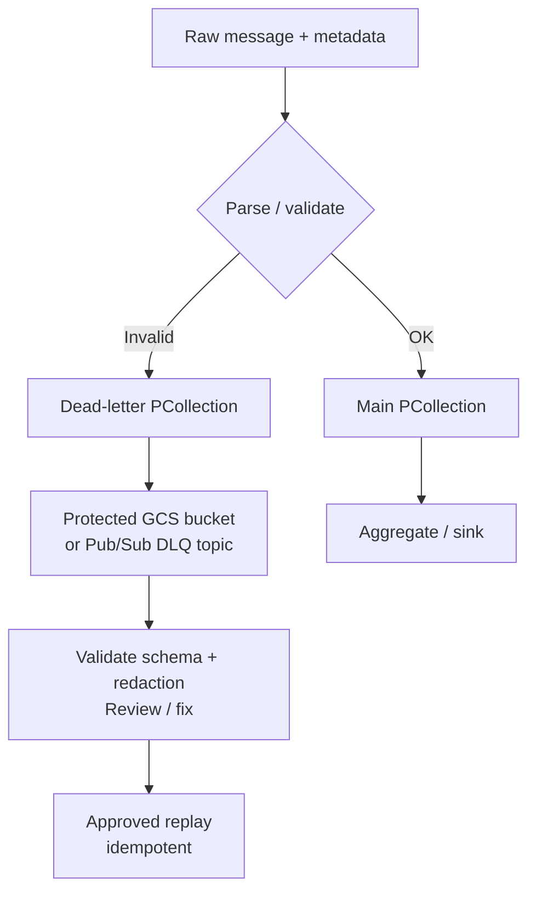

# Dataflow Autoscaling, Shuffle, and Data Error Handling

A pipeline consumes orders from Pub/Sub, cleanses records, and aggregates revenue into BigQuery. During a flash sale, message volume surges 10x: the **backlog** grows, Dataflow adds workers, yet p99 remains poor. Several messages contain invalid values that force a stage to retry repeatedly; one overly popular `merchantId` bottlenecks the `GroupByKey` step. This problem cannot be solved merely by raising `maxNumWorkers`.

This lesson belongs to the **Data Pipelines and Processing** chapter of the `CLOUD_PROVIDERS_GCP` module. It connects project/IAM/VPC, Pub/Sub, Cloud Storage, BigQuery, Compute Engine, and service operations: understanding how **Dataflow autoscaling** works, how **shuffle** affects parallelism, and how **routing bad data to dead-letter outputs** keeps pipelines moving and safely replayable. Examples use the **Apache Beam Python SDK**, running locally first; Cloud Dataflow steps are run only with an authorized project, bucket, and lab budget.

## 1. Learning Outcomes

After this lesson, you will be able to:

1. Explain `PCollection`, `PTransform`, `ParDo`, `GroupByKey`, `CombinePerKey`, and stages in Beam/Dataflow.
2. Distinguish **Horizontal Autoscaling** (changing worker count) from **Vertical Autoscaling** (changing worker memory via Dataflow Prime).
3. Tell the difference between **Dataflow Shuffle for batch** and **Streaming Engine for streaming**.
4. Explain why **hot keys, insufficient parallelism, or throttled sinks** can grow backlogs even as workers scale out.
5. Design **per-record validation**, separating valid outputs from **dead-letter records** without masking infrastructure failures.
6. Account for idempotency, replay, duplicates, windowing, watermarks, and late data.
7. Run a local Python batch pipeline to observe **3 invalid records** alongside successful aggregations over valid data.
8. Read job status, autoscaling decisions, backlog, data freshness, counters, and Cloud Logging.
9. Establish capacity/cost guardrails, runbooks, and security policies for bad records.

**Scope:** this lesson focuses on **Apache Beam + Dataflow**. Do not create projects, Pub/Sub subscriptions, BigQuery datasets, GCS buckets, or run production streaming jobs on your own. Commands using `DataflowRunner` provision billable resources and are **optional labs after approval**.

## 2. Pipeline Architecture and Potential Bottlenecks



**Beam** describes the logical data flow; the **Dataflow runner** executes it as stages and can **fuse** multiple transforms to cut serialization and network overhead. When data must be grouped by key, a shuffle creates a **distribution boundary** so workers receive their assigned keys. Not every line of code or `ParDo` maps to a separate VM.

| Concept | Meaning | Risk |
| --- | --- | --- |
| `PCollection` | Bounded or unbounded set of elements | No default global ordering |
| `ParDo` | Independent per-element processing | Unhandled user-code errors retry the bundle |
| `GroupByKey` | Collects all values for a key within a window | Can cause hot keys and high memory pressure |
| `CombinePerKey` | Aggregates per key, often with pre-combining | Effective when the operation is associative |
| **Fusion** | Combines transforms to reduce overhead | Can lengthen the critical path |
| **Shuffle** | Partitions/redistributes data by key | Network/storage cost and data skew |
| **Sink** | Writes outputs to BigQuery/GCS/databases | Quotas/throttling can stall the entire job |

**Three diagnostic questions:** which stage precedes the backlog, does that stage have parallelizable work remaining, and is the failure caused by **data** or by the **environment/destination**?

## 3. Batch vs. Streaming: Differing Autoscaling Goals

| Aspect | Batch | Streaming |
| --- | --- | --- |
| Input | Bounded, finite completion | Unbounded, runs continuously |
| Goal | Finish quickly at reasonable cost | Meet backlog, data freshness, and SLO targets |
| Horizontal Autoscaling | Enabled by default; estimates remaining stage work | Enabled by default with Streaming Engine; considers backlog/CPU/available keys |
| Shuffle/state | **Dataflow Shuffle** usually enabled by default on supported machines | **Streaming Engine** when enabled; runs shuffle/state/timers on backend |
| Single-element error | Bundle retries; exhausting retries can fail the job | May retry indefinitely, stalling the stage/pipeline |
| Completion condition | Job reaches `DONE` after processing all data | Job runs continuously; requires planned updates/drains |

In streaming, **source backlog** and **data watermark lag** are different metrics: backlog measures unprocessed work, whereas the watermark reflects progress in **event time**. A very old record or pending timer/window can hold the watermark back even while throughput stays high.

### 3.1. Scaling Does Not Replace Semantic Correctness

Dataflow provides internal exactly-once processing in its default streaming mode, yet it **does not automatically guarantee exactly-once business side effects** for external sinks. If an HTTP request times out after committing downstream, a retry can create duplicate records. Use **event IDs, idempotent sinks/merges, transactions, or destination deduplication** per your business contract.

## 4. How Does Horizontal Autoscaling Work?

Horizontal Autoscaling adjusts the **number of worker VMs** based on parallelizable work, throughput, CPU, and backlog.



**Batch:** Dataflow periodically estimates remaining work per stage and adjusts workers. Dataflow Shuffle decouples shuffle state from VMs, making scale-down easier.

**Streaming:** Dataflow evaluates backlog time, worker CPU, **available processing keys**, and Streaming Engine signals such as timer backlog. If a **single hot key** must be processed sequentially, adding ten more workers will usually not make that key run ten times faster.

### 4.1. Core Options

| Apache Beam | Python option | Meaning |
| --- | --- | --- |
| Initial worker count | `--num_workers=2` | Capacity when the job starts |
| Upper bound | `--max_num_workers=8` | Maximum workers the autoscaler may pick, not a guarantee it will use 8 |
| Mode | `--autoscaling_algorithm=THROUGHPUT_BASED` | Enables autoscaling |
| Disable autoscaling | `--autoscaling_algorithm=NONE` | Use only when fixed sizing is approved |
| Streaming CPU target | `--dataflow_service_options=worker_utilization_hint=0.7` | Target hint; may be overridden by backlog/key parallelism |

**The default streaming CPU target is 0.8**; hints can range from `0.1–0.9` per current documentation. Do not treat `0.7` as a strict promise that the autoscaler holds CPU at exactly 70%.

**If Streaming Engine is disabled**, streaming autoscaling has additional constraints and options; verify SDK, runner, and `max_num_workers` before deploying.

## 5. Worker Range, Backlog, and Latency/Cost Trade-Offs

Suppose a pipeline receives **10,000 events/s**, and each worker steadily handles **2,000 events/s** against production-like queries and sinks:

```text
Theoretical need = 10,000 / 2,000 = 5 workers
+ 30% headroom   = 6.5 ≈ 7 workers (recommended benchmark starting point)
If max workers = 4:
  theoretical capacity ≈ 8,000 events/s -> backlog grows
```

**This is a rough estimate:** per-worker throughput depends on key skew, machine type, networking, source/sink throttling, schema, and hot shards. Never adopt 7 as a production recommendation before load testing.

In streaming with Streaming Engine, Dataflow supports **latency tiers** to tune backlog targets:

| Latency tier | Target estimated backlog time | Trade-off |
| --- | --- | --- |
| `low_latency` | Under **15 seconds** | Prioritizes latency; may raise cost |
| `medium_latency` | Under **2 minutes** | Balanced |
| `high_latency` | Under **10 minutes** | Accepts larger lag to reduce compute |

These are **heuristics**, not guaranteed SLOs. Scaling decisions require backlog to exceed thresholds over a sustained period; the autoscaler does not react instantly to every 1-second spike.

### 5.1. Updating a Running Job

For **streaming jobs using Streaming Engine**, you can update the worker range or utilization hint **in-flight**, provided IAM and job state allow it:

```bash
# WRITE: only for a team-owned and approved streaming JOB_ID.
gcloud dataflow jobs update-options "$JOB_ID" \
  --project="$PROJECT_ID" \
  --region="$REGION" \
  --min-num-workers=2 \
  --max-num-workers=8 \
  --worker-utilization-hint=0.7
```

**Do not** assume this command works identically for all **batch jobs** or streaming jobs without Streaming Engine. Avoid changing bounds repeatedly in quick succession before letting the autoscaler stabilize and measuring the prior change's effect.

### 5.2. Reasons Scale-Up Does Not Happen

- Hit `max_num_workers` or **Compute Engine quota/IP capacity**.
- **Few keys/partitions**, with a hot key limiting parallelism.
- Source or sink is **throttled**, waiting on RPCs/network with low CPU despite a growing backlog.
- Short-lived spike where the autoscaler lacks enough sustained signal.
- Workers crashing/OOM, slow startup, or SDK harness restarting repeatedly.
- For streaming without Streaming Engine, **Persistent Disk allocation** can act as an extra constraint.

Diagnose using the **Autoscaling tab, backlog, available keys, CPU, worker logs, and sink metrics**—do not raise max workers blindly.

## 6. Horizontal vs. Vertical Autoscaling and Right Fitting

| Mechanism | What changes | Applies to |
| --- | --- | --- |
| **Horizontal Autoscaling** | Number of workers/VMs | Batch and streaming on Dataflow |
| **Vertical Autoscaling** | Memory per worker | **Dataflow Prime**, subject to batch/streaming eligibility |
| **Right fitting** | Assigns resource hints / splits worker pools across stages with different needs | Dependent on runner and feature support |
| **Streaming Engine** | Offloads state/shuffle/timer work to the backend | **Does not** scale individual worker RAM |
| **Dataflow Shuffle** | Offloads batch shuffle to the backend | **Does not** add extra workers |

**Vertical Autoscaling** on Dataflow Prime detects memory pressure and replaces workers with appropriately sized RAM shapes. On streaming Prime, this is enabled by default for eligible jobs; batch uses a separate flag and behaves differently (typically scaling up after repeated OOMs). It **does not add parallel CPU for a hot key** and should not replace memory optimization in user code.

During a vertical resize, horizontal scaling may pause temporarily, briefly increasing latency or backlog. In production, monitor worker replacements, OOM events, warm-up, and SLOs. Feature availability has constraints around machine families, GPUs, VPC Service Controls, and runners; do not enable unfamiliar experiments blindly.

## 7. What Is Shuffle and When Does It Occur?

Shuffle is the step that **redistributes elements by key**, potentially adding network, serialization, and storage overhead while shaping the execution graph.



Operations that typically trigger a shuffle:

- `GroupByKey`: collects values by key.
- `CoGroupByKey`: joins two keyed streams, potentially moving large data volumes.
- `CombinePerKey`: groups and aggregates, often **pre-combining** before the network shuffle.
- `Reshuffle`: introduces a distribution boundary / breaks fusion when genuinely needed; do not insert arbitrarily.

**Important:** element-wise `Map`/`ParDo` steps usually run in parallel and **need no shuffle**. Shuffle does not mean "all data goes to one worker": it distributes **by key**; it is **one key dominating the data** that creates a bottleneck.

## 8. Dataflow Shuffle for Batch and Streaming Engine for Streaming

| Criterion | Dataflow Shuffle (batch) | Streaming Engine (streaming) |
| --- | --- | --- |
| Data | Bounded stages | Unbounded streams/windows/state |
| Role | Offloads `GroupByKey`/`Combine` shuffles from worker VMs | Offloads eligible state/timer/shuffle work to the backend |
| Default | **Enabled by default** for supported batch jobs | Depends on SDK/language and pipeline options; verify on the actual job |
| Benefits | Reduces worker VM/Persistent Disk load; smoother scale-down | Reduces VM disk dependency; improves stateful execution |
| Cost | Per-unit/shuffle-volume billing component | Streaming Engine data processed or compute units per billing model |
| Limitations | Still vulnerable to shuffle skew/hot keys | Still vulnerable to hot keys and state/window limits |

**Dataflow Shuffle** is normally enabled by default for batch jobs. **Streaming Engine** is a separate mechanism for streaming; the Java SDK provides `--enableStreamingEngine`, while modern Python SDKs often enable it by default depending on conditions/version. **Never use batch shuffle flags to configure streaming**. When a pipeline runs, inspect **Job info/environment and metrics** to confirm which backend is active.

When a job does not use managed shuffle/state, shuffle/state relies heavily on worker disk and memory, restricting scale-in and requiring Persistent Disk sizing. Use **regional worker placement** (avoid pinning a zone) where compatible with Dataflow Shuffle/Streaming Engine to improve resource availability.

## 9. Why Does `GroupByKey` Easily Cause Trouble?

`GroupByKey` can produce a huge iterable for a single key:

```python
# Often problematic when key 'merchant-hot' has millions of records:
grouped = events | beam.GroupByKey()
# Later: list(values) loads all values into one worker's memory.
```

A job with 1 million records spread across 1,000 keys behaves **very differently** from one with 999,000 records on a single key. Adding workers **cannot split one key's processing across independent groups** if logic requires collecting the whole key.

When an aggregation is **associative** and **commutative** (sum/count/min/max):

```python
# (merchant_id, amount_cents) -> (merchant_id, sum_amount_cents)
totals = keyed_events | beam.CombinePerKey(sum)
```

Beam/Dataflow can **partially combine** before shuffling, cutting bytes transferred and avoiding materializing entire iterables in user code.

**Do not** use `CombinePerKey(sum)` for problems requiring **ordering across all events** or non-associative logic not proven safe. When joining multiple sources, check cardinality, skew, small side inputs, and partitioning strategies.

### 9.1. Hot Keys, Skew, and Fanout

If 80% of records carry the key `merchant-hot`:

- Measure key frequencies, per-stage CPU/lag, and bottleneck indicators.
- Consider two-step **fanout/key salting** when the aggregation permits.
- In Python Beam `CombinePerKey`, `with_hot_key_fanout` is available for hot keys; **verify SDK/runner support** and benchmark.
- Avoid logging **sensitive key values** directly: a key might be a `userId`, email, or account identifier.

```python
# Illustrates salting, ONLY for associative sums:
# Step 1: key (merchant, shard) -> partial sum
# Step 2: key merchant -> sum the partial sums
#
# Never use unstable random shards for operations requiring ordering.
```

## 10. Fusion, Reshuffle, and Excessive Key Counts

**Fusion** reduces overhead, but placing a slow transform and a fast transform in the same stage can hinder distribution. `Reshuffle` can break a fusion boundary or redistribute work, yet it **adds network/shuffle overhead**; it is not a default optimization.

Conversely, generating millions of tiny keys can create excessive bundles/tasks and scheduling overhead. For streaming/Streaming Engine, Dataflow provides guidance on tuning `Reshuffle.withNumBuckets` to balance work units and threads. **Never** assign a random key to every event arbitrarily assuming the pipeline will automatically scale better.

Checklist when diagnosing a shuffle bottleneck:

1. Inspect the execution graph to see which step runs shuffle/`GroupByKey` and records per key.
2. Check whether `CombinePerKey` can replace `GroupByKey + list + sum`.
3. If a hot key exists, evaluate fanout while verifying correctness.
4. If too few keys exist, see if the source can be partitioned along a valid business dimension.
5. Measure bytes shuffled, stage wall time, worker CPU, backlog, and cost before/after.

## 11. Streaming: Windowing, Watermarks, and Late Data

An unbounded `PCollection` **cannot group infinitely by key** and expect a "final" answer. You must define **windows/triggers/allowed lateness** before aggregating.

```python
import apache_beam as beam
from apache_beam import window

# Illustration: keyed_events is an unbounded KV(merchant, amount)
# already assigned appropriate event-time timestamps.
totals_per_minute = (
    keyed_events
    | "Windows1Min" >> beam.WindowInto(
        window.FixedWindows(60),
        allowed_lateness=120
    )
    | "TotalPerMerchant" >> beam.CombinePerKey(sum)
)
```

- **Window** bounds the record set to group; `FixedWindows(60)` is 60 seconds in event time.
- **Watermark** estimates event-time progress, governing when windows close and downstream data freshness.
- **Allowed lateness** defines how long late events can still update a window past the watermark; pair with triggers and accumulation modes to control whether multiple updates are emitted.
- **Timers/state** in streaming consume storage and cost; an oversized key/window can still become a bottleneck.

**Do not** assume `allowed_lateness=120` waits exactly 120 seconds before emitting results. With default triggers and event-time input, output timing depends on the **watermark and trigger**; if early or periodic updates are required, configure an explicit trigger.

## 12. Classifying Errors Before Deciding to Retry

| Error category | Example | Right action |
| --- | --- | --- |
| **Invalid data** | Malformed JSON, missing required field, negative amount | **Dead-letter output** with reason code |
| **Schema evolution** | Event v2 adds a field or changes a type | Compatibility policy, quarantine/migrate |
| **Permission error** | `403` on GCS/BigQuery/Pub/Sub | Stop/fix IAM; do not dump all records into the DLQ |
| **Transient infrastructure** | `429`, `503`, network timeout, quota pressure | Bounded retry + exponential backoff/jitter |
| **Logic/code bug** | Null pointer, serializer/coder bug, infinite loop | Fix code, test, redeploy |
| **Sink error** | BigQuery schema mismatch, full partition, constraint violation | Separate row-level rejections from systemic failures |
| **Duplicate risk** | Retry succeeded downstream after client timeout | Idempotent write/merge/deduplication |

**By default**, an uncaught user-code exception on a single element can cause the **entire bundle** to retry. Batch Dataflow normally retries a failing bundle **4 times** before failing the job; streaming can **retry indefinitely**, stalling the stage/job. Therefore, never write `except Exception: pass` just to "keep the job green": that silently drops data and hides software bugs.

**Rule:** catch only errors **identifiable as record-level failures** and route that record to the error branch. Systemic/transient failures need separate alerts and runbooks; never route millions of valid records to a DLQ simply because BigQuery returned `503`.

## 13. Dead-Letter Output and Error Record Contract



A practical dead-letter record should include:

| Field | Purpose |
| --- | --- |
| `source`/`subscription` | Source and pipeline/stage that raised the error |
| `event_id` | Idempotency/dedup, cross-reference with source |
| `reason_code` | `MISSING_FIELD`, `INVALID_AMOUNT`, `SCHEMA_UNSUPPORTED` |
| `event_time`, `failed_at` | Distinguish business time from detection time |
| `schema_version` | Identify the right parser |
| `payload_ref` or redacted payload | Investigate without exposing PII |
| `attempt_count` / `pipeline_version` | Distinguish poison records from retries |
| `owner`/`retention` | Data governance and compliance |

**Security:** raw messages may contain PII or secrets. Never dump raw payloads into Cloud Logging or a public DLQ topic. In production, prefer **a pointer to an encrypted, access-controlled object**, hashes/diagnostic metadata, TTL/retention, and audited access.

**Distinguishing two DLQs:** a Pub/Sub subscription dead-letter topic handles delivery attempts at the **Pub/Sub** layer, whereas an error `PCollection` branch in **Apache Beam/Dataflow** handles **code and schema** failures. They complement each other but do not automatically replace one another.

## 14. Managing Replays Without Causing a Second Outage

A DLQ is only useful with a processing workflow:

1. **Triage** by reason code, source/stage, error rate, and business impact.
2. Choose an action: fix the source, fix the parser, update the schema, or reprocess via backfill.
3. Validate **schema versions** and permissions; never blindly replay the entire DLQ.
4. Use event IDs and an **idempotent sink** so replays do not duplicate side effects.
5. Apply **rate limits / small batches**, monitoring backlog, errors, duplicates, and cost.
6. Log the ticket, operator, before/after record counts, retention, and when resolved DLQ items are deleted.

If the source is retrying automatically while you simultaneously replay the DLQ, the same event can be processed twice. Avoid "ACK/delete the Pub/Sub message right after writing to the DLQ" if the **DLQ sink is not yet durable**; design acknowledgements, transactions/outboxes, and reliability contracts per the actual connectors.

**Never assume every event in a DLQ is safe to push straight back into the main queue**. Rejected records may carry malicious payloads or invalid schemas and must be inspected first.

## 15. Local Lab: Apache Beam Python, No GCP Required

Use a **Python version compatible with the current Beam release**, `pip`, and Bash on your workstation. Pick a recent Beam SDK that still supports your Python version per the **Beam release compatibility matrix**. No service account, GCS, or BigQuery is required to run with `DirectRunner`.

Sample lab directory (on your local machine; **do not create extra files inside the lesson repository**):

```text
dataflow-quality-lab/
├── pipeline.py
└── out/                   # created after running
```

Set up the environment:

```bash
mkdir -p dataflow-quality-lab/out
cd dataflow-quality-lab

python3 -m venv .venv
source .venv/bin/activate

python -m pip install --upgrade pip
python -m pip install "apache-beam[gcp]"

python -c "import apache_beam as beam; print(beam.__version__)"
```

Using `apache-beam[gcp]` prepares for running `DataflowRunner` later; for local-only runs, plain `apache-beam` suffices. Pin the SDK version and audit dependencies/security in a **real project lockfile**; here we avoid pinning an arbitrary version that may be deprecated by the time a learner runs the lesson.

## 16. `pipeline.py`: Separating Valid Data from Bad Data

A **self-contained** example using `beam.Create` with 7 synthetic CSV lines: 4 valid, 3 invalid. The pipeline writes **two output branches** to local files and uses `CombinePerKey` to avoid buffering all records for a key into a list.

```python
import argparse
import json

import apache_beam as beam
from apache_beam.metrics import Metrics
from apache_beam.options.pipeline_options import PipelineOptions


class ParsePayment(beam.DoFn):
    def __init__(self):
        self.valid = Metrics.counter("quality", "valid_records")
        self.invalid = Metrics.counter("quality", "invalid_records")

    def process(self, line):
        try:
            fields = [part.strip() for part in line.split(",")]
            if len(fields) != 3:
                raise ValueError("FIELD_COUNT")

            event_id, merchant_id, amount_text = fields
            if not event_id or not merchant_id:
                raise ValueError("MISSING_ID")

            amount_cents = int(amount_text)
            if amount_cents <= 0:
                raise ValueError("NON_POSITIVE_AMOUNT")

            self.valid.inc()
            yield (merchant_id, amount_cents)
        except ValueError as exc:
            self.invalid.inc()
            # LAB ONLY with synthetic data. Never log raw production PII!
            yield beam.pvalue.TaggedOutput(
                "bad",
                json.dumps(
                    {"reason_code": "INVALID_RECORD",
                     "details": str(exc), "raw_line": line},
                    ensure_ascii=False
                )
            )


def as_csv(item):
    merchant_id, total = item
    return f"{merchant_id},{total}"


def run():
    parser = argparse.ArgumentParser()
    parser.add_argument("--output_prefix", required=True)
    args, beam_args = parser.parse_known_args()

    options = PipelineOptions(beam_args)
    sample = [
        "evt-1,merchant-a,100",
        "evt-2,merchant-a,250",
        "evt-3,merchant-b,40",
        "evt-4,merchant-a,-5",  # invalid
        "evt-5,merchant-c,abc",  # invalid
        "evt-6,,20",            # invalid
        "evt-7,merchant-b,60",
    ]

    with beam.Pipeline(options=options) as pipeline:
        parsed = (
            pipeline
            | "FakeInput" >> beam.Create(sample)
            | "Validate" >> beam.ParDo(ParsePayment())
                .with_outputs("bad", main="valid")
        )

        totals = (
            parsed.valid
            | "SumPerMerchant" >> beam.CombinePerKey(sum)
            | "AsCsv" >> beam.Map(as_csv)
        )

        totals | "WriteTotals" >> beam.io.WriteToText(
            args.output_prefix + "/totals", file_name_suffix=".txt"
        )

        parsed.bad | "WriteDeadLetter" >> beam.io.WriteToText(
            args.output_prefix + "/dead_letter", file_name_suffix=".jsonl"
        )


if __name__ == "__main__":
    run()
```

**Key technical points:**

- `try/except ValueError` catches only **schema/value errors**; it does not swallow unexpected runtime errors outside validation.
- `TaggedOutput("bad", ...)` separates errors into another `PCollection`. Without this branch, there is no way to audit the 3 bad records.
- `CombinePerKey(sum)` performs keyed aggregation and appropriate shuffling, enabling local pre-combining.
- `Metrics.counter` tracks valid/invalid counts; Cloud Monitoring and Dataflow job metrics expose user counters when running on Dataflow.
- Output in the lab includes **`raw_line`** because all records are synthetic. In production, replace this with redaction/payload pointers and a logging policy.
- The demo does not deduplicate event IDs; add **idempotency** when replaying or writing to business sinks.

## 17. Running Locally and Verifying Results

Inside `dataflow-quality-lab` after creating `pipeline.py`:

```bash
python pipeline.py \
  --runner=DirectRunner \
  --output_prefix=out

# Actual shard filenames may vary:
ls -lh out/
cat out/totals-*.txt
cat out/dead_letter-*.jsonl
```

Expected aggregated branch (order is not fixed):

```text
merchant-a,350
merchant-b,100
```

Expected error branch has **3 JSON lines**:

| Event | Reason |
| --- | --- |
| `evt-4` | Non-positive amount |
| `evt-5` | Cannot parse amount |
| `evt-6` | Missing merchant ID |

**Do not assume output order:** Beam and shuffle process in parallel, so shards can be written in any order. Assert totals **350 and 100** and **3 error records**—never assert "the first line must be `merchant-a`".

### 17.1. Testing Data Changes

- Add a valid line `evt-8,merchant-b,30` → `merchant-b` total becomes **130**.
- Add a line with a negative number → dead-letter record count increases by 1.
- Add many `merchant-hot` records to illustrate **key skew**. With tiny data, DirectRunner cannot demonstrate Dataflow autoscaler hot-key behavior—only logic correctness.
- Update the parser to accept schema v2 **after** writing tests and updating reason codes/versions.

This is a **logic lab**, not a cloud throughput, latency, or cost load test.

## 18. Optional: Running the Batch Lab with `DataflowRunner`

Run this only when you have an **authorized lab project, billing, Dataflow API, deployment region, dedicated GCS bucket, IAM permissions, and quota** prepared by an admin. Without authorization, **stop at DirectRunner**. The commands below **write files to Cloud Storage and launch a billable Dataflow job**.

### 18.1. Read-Only Preflight

```bash
PROJECT_ID="YOUR_AUTHORIZED_PROJECT"
REGION="YOUR_APPROVED_DATAFLOW_REGION"
BUCKET="YOUR_EXISTING_APPROVED_STAGING_BUCKET"

gcloud auth list
gcloud projects describe "$PROJECT_ID" \
  --format="yaml(projectId,lifecycleState)"

gcloud storage buckets describe "gs://$BUCKET"
gcloud dataflow jobs list \
  --project="$PROJECT_ID" \
  --region="$REGION" \
  --status=active
```

Confirm bucket/data location matches the Dataflow region, object management permissions on the bucket, the Dataflow Worker service account, job execution permissions, and VPC networking if using private workers. **Never disable VPC Service Controls, IAM, or org policies** just to make a lab run.

### 18.2. Launch a Bounded Batch Job

```bash
JOB_NAME="quality-lab-$(date +%Y%m%d-%H%M%S)"
OUTPUT_PREFIX="gs://$BUCKET/quality-lab/$JOB_NAME"

# INCURS COST / WRITES TO GCS: run only after lab approval.
python pipeline.py \
  --runner=DataflowRunner \
  --project="$PROJECT_ID" \
  --region="$REGION" \
  --job_name="$JOB_NAME" \
  --temp_location="gs://$BUCKET/temp/$JOB_NAME" \
  --staging_location="gs://$BUCKET/staging/$JOB_NAME" \
  --output_prefix="$OUTPUT_PREFIX" \
  --num_workers=1 \
  --max_num_workers=3 \
  --autoscaling_algorithm=THROUGHPUT_BASED
```

**Dataflow batch autoscaling** may pick 1 worker for 7 records and finish quickly; the sample is too small to observe multiple scaling events. Use an existing **pre-authorized** organization Dataflow job or approved staging workload to observe real autoscaling.

**Do not pass `--streaming` for the bounded `beam.Create` lab**. In real streaming pipelines using Pub/Sub or unbounded inputs, configure windows before `GroupByKey`/`CombinePerKey`, and verify Streaming Engine, security, and late-event policies.

### 18.3. Inspect the Job and Results

```bash
gcloud dataflow jobs list \
  --project="$PROJECT_ID" \
  --region="$REGION" \
  --filter="name=$JOB_NAME"

# Obtain JOB_ID from the jobs list output; the next command is READ-ONLY.
gcloud dataflow jobs describe "$JOB_ID" \
  --project="$PROJECT_ID" \
  --region="$REGION"

gcloud storage ls "$OUTPUT_PREFIX/"
gcloud storage cat "$OUTPUT_PREFIX/totals-*.txt"
gcloud storage cat "$OUTPUT_PREFIX/dead_letter-*.jsonl"
```

If `gcloud storage cat` does not expand wildcards in your CLI environment, run `gcloud storage ls` to obtain the **exact object names** and then `cat` those objects. **Never** run `rm -r gs://bucket` to clean up a lab.

## 19. Monitoring Autoscaling and Bottlenecks on Dataflow

In the Console: **Dataflow → Jobs → job → Job graph / Execution details / Job metrics / Autoscaling / Logs / Cost**.

| Metric / signal | Interpretation | When to act |
| --- | --- | --- |
| `current workers`/`max workers` | Actual scale vs. ceiling | Stuck at max while backlog rises |
| `job/aggregated_worker_utilization` | Aggregate worker CPU | Capacity remains but CPU is very high |
| `job/horizontal_worker_scaling` | Scale direction and rationale | Understand why autoscaler isn't scaling |
| `job/processing_parallelism_keys` | Parallelizable keys | Few keys make extra workers useless |
| `job/backlog_bytes` / `backlog_elements` | Queued pending work | Sustained increase |
| **System lag** | Data queued/processing inside pipeline | Latency rising, slow consumer |
| **Data freshness / watermark lag** | Event-time / late-data impact | Reports arriving late, stuck watermark |
| **Stage wall time** | Where CPU/wait/shuffle time is spent | Single-stage bottleneck |
| **Source/sink errors** | RPC 403/429/503, retries | Distinguish IAM, throttling, and data errors |
| **User counters valid/invalid** | Data quality | DLQ ratio exceeding SLO |

**Do not judge from CPU alone:** CPU can stay low because workers are waiting on BigQuery quotas or RPCs. A hot key can drive one worker to 100% CPU while all others sit idle.

### 19.1. Alerts Aligned to User Goals

- **Streaming backlog processing time**, system lag, and data freshness breaching SLOs.
- DLQ fraction exceeding the threshold over 5–15 minutes (e.g., >1%).
- Worker errors/OOMs, retries, and `JOB_STATE_FAILED`.
- Max workers hitting ceiling while backlog keeps rising.
- BigQuery/Pub/Sub/storage quota or rate-limit errors.
- Sudden spikes in worker hours, shuffle/Streaming Engine, and sink costs.

Use **Dataflow Turnkey Alerts** and Cloud Monitoring, and avoid spamming Cloud Logging with every invalid record; log reason codes, redacted samples, and aggregated counters.

## 20. Runbook: Backlog Growing While Workers Do Not Scale

**Scenario:** streaming traffic at 12,000 records/s; `max_num_workers=20`, currently stuck at 4 workers, average CPU 25%, backlog growing for 30 minutes.

**Do not rush to raise max to 100.** Diagnose:

1. **Autoscaling rationale:** does it report "insufficient key parallelism"?
2. **Per-worker CPU / stage wall time:** one hot worker and three idle workers → hot key.
3. **Source backlog and keys:** are there enough partitions/keys to parallelize?
4. **Sink:** are BigQuery/Cloud SQL 429/503 errors and retries stalling output batches?
5. **Worker errors:** OOMs, SDK harness restarts, or code blocked on RPCs?
6. **Quota/IPs:** if scaling is needed, does the project have enough Compute Engine quota and VPC IPs?
7. **Evaluation window:** did the backlog start seconds ago or exceed the sustained threshold?

| Finding | Remediation |
| --- | --- |
| Uniform high CPU, plenty of keys | Raise max / lower utilization hint carefully, then benchmark |
| Single hot key | Precombine/fanout/key salting, optimize algorithm |
| Sink returning 429 | Backoff/batching/quota review; don't just add workers |
| Worker OOM | Reduce state/list memory; consider right fitting / vertical memory autoscaling if eligible |
| Backlog caused by poison record | Route bad data to DLQ; stop infinite retries |
| Insufficient VPC IPs / quota | Fix capacity/network with admin first |
| Abnormal shuffle bytes | Use `CombinePerKey`, lower transferred cardinality, avoid overly wide joins |

**After changing:** wait for jobs to stabilize, then compare p95/p99, backlog age, worker count, CPU per worker, DLQ volume, and Billing under the same traffic mix. If metrics do not improve, revisit the root cause instead of adding more workers.

## 21. Security and Data Governance

- **Separated IAM roles:** deployer, Dataflow service agent, worker service account, staging bucket owner, Pub/Sub/BigQuery sinks.
- The worker service account gets only permissions to **read sources, write exact sinks, and access required temp/staging buckets**; never grant project-wide Editor.
- **Encryption and networking:** run Dataflow workers over VPC/Private Google Access when needed; verify region/data residency and CMEK if required by policy.
- **Never log raw PII** in parser errors. DLQs require ACLs/IAM, retention, encryption, auditing, and deletion workflows.
- Be cautious with **data sampling** in the UI, which can display sensitive payloads; follow data governance policies.
- **Schema contracts** and pipeline versions must be recorded in metadata/release records for accurate replays.
- **Idempotency:** failure retries and job updates can write duplicates to sinks without business keys or merges.
- **Data retention:** Pub/Sub subscriptions, GCS DLQs, BigQuery staging, and Dataflow temp storage have different lifecycles; never keep raw DLQ data indefinitely.

**Dataflow autoscaling does not grant extra permissions automatically.** If sources/sinks return `403`, fix the principal/role within scope; never disable auth "just to get it running quickly".

## 22. Cost: More Workers Does Not Always Mean Faster

Cost components:

| Component | Cost drivers |
| --- | --- |
| Worker VMs | vCPU, RAM, runtime duration, and machine type |
| Persistent Disk | Disk size and duration for jobs that do not offload all state |
| **Batch Dataflow Shuffle** | Shuffle data processed per pricing schedule |
| **Streaming Engine** | Data processed or resource compute units per billing model |
| Pub/Sub/GCS/BigQuery | Messages, storage, reads/writes/queries |
| Network/egress | Cross-region, VPC, or internet traffic |
| DLQ and replay | Storage, reprocessing, sink writes, and logs |

Quantitative example **for planning only, not listed pricing**:

```text
4 workers × 2 vCPU × 2 hours = 16 vCPU-hours
8 workers × 2 vCPU × 1 hour  = 16 vCPU-hours

Both options consume the same compute vCPU-hours,
but differ in RAM, disk, shuffle, sink, network, latency, and actual bill.
```

Adding workers can shorten batch runtime if **work is parallelizable**; if a hot key or slow sink bottlenecks the job, adding workers only increases cost without improving throughput.

**Controls:** budget alerts, max worker bounds, source/sink quotas, and data volume caps; for non-urgent batch jobs, evaluate **FlexRS** if it fits your SLA. Budget alerts **do not stop jobs automatically** when exceeded.

## 23. Case Study: 0.5% Bad Events Stalling a Streaming Pipeline

A job processes **100,000 events/minute**, with roughly **500 bad events/minute** whose `amount` field holds an unparseable string. The old parser called `int(amount)` directly and let the exception escape `DoFn`. Dataflow streaming retried the bundle continuously; backlog climbed even though CPU was unsaturated.

**Redesign:**

1. Place validation immediately after the source, attaching reason codes and pipeline versions.
2. Split `PCollection` into valid and invalid branches; valid data flows to `CombinePerKey`, and invalid data routes to a protected DLQ sink.
3. If the DLQ sink fails, **never drop silently**; retry and alert because data loss risk exists.
4. Compute `invalid_rate = invalid / (valid + invalid)` per window, alerting on sustained >1%.
5. Use idempotent `event_id` on replays and test schema migrations.
6. Check for hot keys once the pipeline clears; do not conflate record-error backlogs with shuffle backlogs.
7. Maintain runbooks and audits before switching from parser v1 to v2.

**Expected outcome:** the pipeline is no longer blocked by poison records, valid data completes on time, invalid data can be fixed and replayed, and SLOs can be measured separately for the **valid path** and **DLQ path**. Simply seeing `JOB_STATE_RUNNING` is never enough to declare a pipeline healthy.

## 24. Self-Practice Exercises

### Exercise 1 — Throughput and Worker Count

A source sends 15,000 events/s, and benchmarks show each worker processes 3,000 events/s. What is the ideal theoretical minimum worker count?

**Answer:** `15000/3000=5` workers. Add headroom for peaks/quotas and benchmark key skew and sinks; 5 is not guaranteed to suffice.

### Exercise 2 — Backlog Without Scaling

A streaming job's backlog grows, yet there are only 2 processing keys, 2 workers, and low CPU. Will raising `max_num_workers` from 2 to 20 immediately fix it?

**Answer:** No. Parallelism at the bottleneck stage is limited to roughly 2 keys; you must change the key distribution or transform design if valid.

### Exercise 3 — Dataflow Shuffle

A batch pipeline relies heavily on `GroupByKey`. What does default Dataflow Shuffle provide?

**Answer:** Shuffle state/operations are offloaded from worker VMs to a managed backend, which can reduce disk/memory usage and improve scale-down. It **does not eliminate hot keys**, and it still carries shuffle costs.

### Exercise 4 — `GroupByKey` vs. `CombinePerKey`

You need total revenue per merchant; the author currently calls `GroupByKey` and converts the entire iterable into a list to call `sum`.

**Answer:** Use `CombinePerKey(sum)` to enable pre-combining and reduce shuffled bytes/memory; results match when numbers and operations are associative.

### Exercise 5 — Single-Record Error

A streaming pipeline throws `ValueError` on a malformed payload and retries repeatedly. Should you add workers or add a DLQ?

**Answer:** Add validation + a dead-letter branch for **data errors** instead of adding workers to retry bad records forever. Handle infrastructure errors separately.

### Exercise 6 — IAM

Dataflow workers fail to write GCS staging with `403`. Should you route all input records to the DLQ?

**Answer:** No. This is a **system/permission error**; fix the service account/bucket IAM and verify networking/configuration.

### Exercise 7 — Computing DLQ Rate

In one minute there are 9,900 valid and 100 invalid events. What is the invalid rate?

**Answer:** `100/(9900+100)=1%`. Alert when the SLO threshold is breached over an appropriate measurement window.

### Exercise 8 — Streaming Windows

An unbounded Pub/Sub source runs `CombinePerKey(sum)` without selecting a window or trigger.

**Answer:** Windowing (plus triggers/allowed lateness as needed) is required; you cannot wait for "the entire stream to finish" before aggregating.

### Exercise 9 — Replay

A fixed DLQ holds 1,000 messages; the BigQuery sink may have already committed some records before a timeout. Is replaying all 1,000 safe?

**Answer:** Only if the sink uses idempotent keys/`MERGE`/deduplication or duplicate controls; verify, rate-limit, and audit.

### Exercise 10 — Cost Optimization

A batch job uses 4 workers for 2 hours, changed to 8 workers for 1 hour. Is the bill guaranteed to drop?

**Answer:** No. Theoretical vCPU-hours are equal, while RAM, disk, shuffle, GCS, network, quotas, and sink costs are billed separately; benchmark both runtime and actual billing.

## 25. Operations and Lab Cleanup Checklist

**Before deploy:**

- [ ] Pipeline distinguishes batch/streaming and bounded/unbounded sources.
- [ ] Backlog, data freshness, throughput, error-rate SLOs, and budgets are defined.
- [ ] Stages using `GroupByKey`/`CombinePerKey` and estimated shuffle bytes are reviewed.
- [ ] Skew/hot keys, fusion, sink quotas, and parallelism have been checked.
- [ ] Worker min/max and utilization hint / latency tier (if streaming) are set.
- [ ] Dataflow Shuffle or Streaming Engine is verified per job type/SDK.
- [ ] Schema validation, DLQ branch, counters, and reason codes are implemented.
- [ ] Source/sink retries, idempotency, duplicate handling, and replay policies are clear.
- [ ] IAM/VPC/CMEK/PII, retention, and monitoring are governed.
- [ ] Tested on DirectRunner and staging with synthetic data.

**After deploy:**

- [ ] Job ID/region/version are recorded, with no poison-record retry loops.
- [ ] Valid count + invalid count reconcile against input event counts (accounting for duplicates/filters).
- [ ] Source backlog, system lag/watermark, and autoscaling stay within SLO.
- [ ] DLQ sink works and stores no sensitive data outside policy.
- [ ] Cost dashboard shows no unexpected worker/shuffle/egress spikes.
- [ ] Runbooks exist for stuck jobs, backfill/replay, drain/update, and rollback.

**Lab cleanup:**

- **Local DirectRunner:** delete `out/` and the `dataflow-quality-lab` directory you created once finished; **no** GCP jobs exist.
- **DataflowRunner batch lab:** confirm the job is `DONE` and no outputs/metadata are needed; delete only the `quality-lab/$JOB_NAME`, `temp/$JOB_NAME`, and `staging/$JOB_NAME` **prefixes** inside your authorized dedicated bucket.
- **Never delete** shared buckets, Pub/Sub subscriptions, BigQuery datasets, service accounts, or production streaming jobs. For real streaming jobs, prefer **drain**/update over cancel when in-flight data must finish; drain behavior varies by pipeline and must follow an approved runbook.

**Never** clean up with `gcloud storage rm -r gs://BUCKET` or `gcloud dataflow jobs cancel` without verifying the exact `JOB_ID`.

## 26. Official Documentation

- [Dataflow Horizontal Autoscaling](https://cloud.google.com/dataflow/docs/horizontal-autoscaling): batch vs. streaming, throughput/CPU/parallelism, and runner options.
- [Tune streaming horizontal autoscaling](https://cloud.google.com/dataflow/docs/guides/tune-horizontal-autoscaling): worker range, utilization hints, latency tiers, update options.
- [Troubleshoot autoscaling](https://cloud.google.com/dataflow/docs/guides/troubleshoot-autoscaling): why jobs fail to scale.
- [Dataflow Vertical Autoscaling](https://cloud.google.com/dataflow/docs/vertical-autoscaling): Dataflow Prime, memory resizing, and limitations.
- [Dataflow shuffle for batch](https://cloud.google.com/dataflow/docs/shuffle-for-batch): `GroupByKey`/`Combine` and the managed shuffle backend.
- [Streaming Engine](https://cloud.google.com/dataflow/docs/streaming-engine): streaming state/shuffle/timers, SDKs, and billing.
- [Pipeline best practices](https://cloud.google.com/dataflow/docs/guides/pipeline-best-practices): DLQ, schema changes, side outputs, and joins.
- [Best practices for large batch jobs](https://cloud.google.com/dataflow/docs/guides/large-pipeline-best-practices): retries, resilience, and DLQ.
- [Troubleshoot Dataflow bottlenecks](https://cloud.google.com/dataflow/docs/guides/troubleshoot-bottlenecks): hot keys, CPU, and quotas.
- [Dataflow monitoring interface](https://cloud.google.com/dataflow/docs/guides/monitoring-overview): Job graph, metrics, logs, and Cost.
- [Cloud Monitoring for Dataflow](https://cloud.google.com/dataflow/docs/guides/using-cloud-monitoring): alerts for backlog, lag, and user counters.
- [Beam Programming Guide](https://beam.apache.org/documentation/programming-guide/): `ParDo`, side outputs, `CombinePerKey`, and windowing.
- [Beam Pipeline Options](https://cloud.google.com/dataflow/docs/reference/pipeline-options): batch/streaming SDK flags.
- [Dataflow pricing](https://cloud.google.com/dataflow/pricing): worker, shuffle, and Streaming Engine billing.
- [gcloud dataflow jobs update-options](https://cloud.google.com/sdk/gcloud/reference/dataflow/jobs/update-options): in-flight tuning for eligible jobs.

**Conclusion:** Dataflow autoscaling can add workers when **enough parallelizable work exists**, but it cannot cure **hot keys, shuffle skew, throttled sinks, or poison records**. A resilient pipeline design uses **`CombinePerKey` instead of unnecessary `GroupByKey`**, picks managed shuffle/Streaming Engine appropriately for batch vs. streaming, separates **dead-letter outputs** with replayable metadata, and tracks **backlog, data freshness, DLQ rate, and cost**. Run locally to verify data correctness before testing autoscaling in staging.
