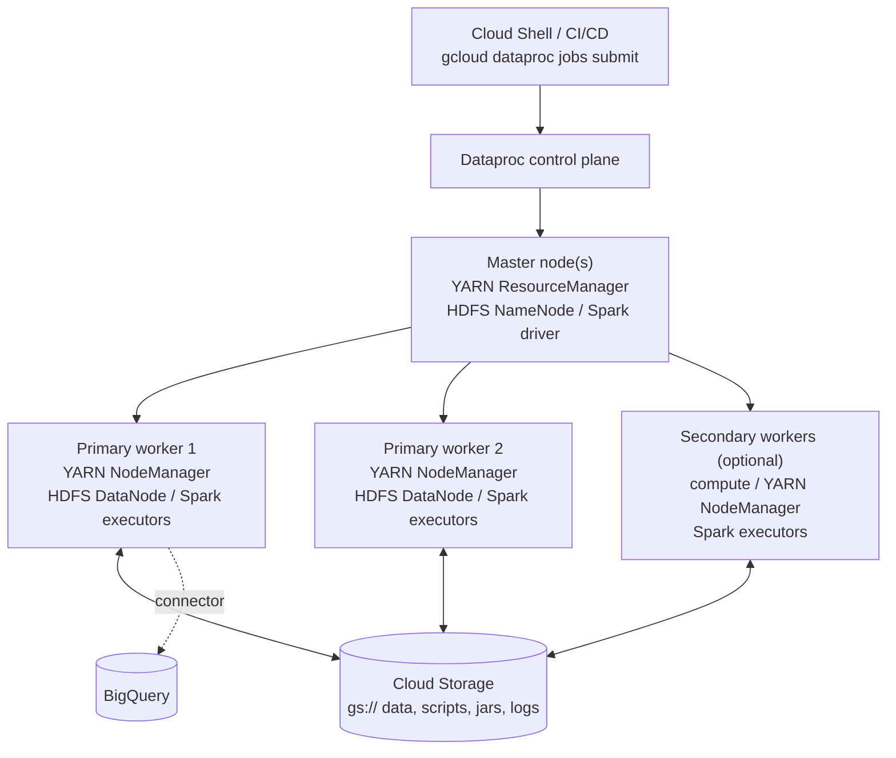
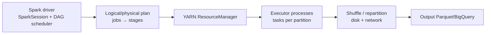
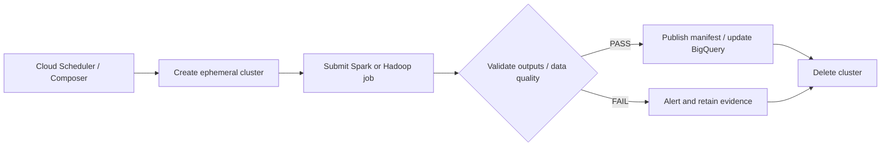

# Dataproc Clusters and Operating Spark and Hadoop

## 1. Problem Statement and Objectives

An enterprise stores terabytes of logs and order data in **Cloud Storage**. The data team uses **Apache Spark** to clean, join tables, and generate Parquet files for **BigQuery**; another team still runs legacy **Hadoop MapReduce** jobs. Manually provisioning VMs, installing Spark/Hadoop, scheduling resources, handling worker failures, monitoring, and deleting clusters after each job wastes time and money.

**Dataproc clusters on Compute Engine**, now part of **Managed Service for Apache Spark (formerly Dataproc)**, provide a managed cluster environment to run **Spark, Hadoop, and ecosystem components**. Google Cloud handles cluster provisioning, image installation, and service integrations; engineering teams remain responsible for **processing code, data models, IAM, networking, performance, reliability, and cost**.

This lesson belongs to the **Data Pipelines and Processing** chapter of the **CLOUD_PROVIDERS_GCP** module. Examples connect Cloud Storage, BigQuery, VPC/IAM, Compute Engine, and pipelines fed by Cloud Run/GKE/Pub/Sub.

**Learning outcomes:** After this lesson, you will be able to:

1. Distinguish **master, primary/secondary workers, Spark driver/executors, YARN, and HDFS**.
2. Choose between **persistent clusters, ephemeral clusters, and Serverless Spark** depending on the workload.
3. Configure region, machine types, image, disk, VPC, service account, and lifecycle policies.
4. Create a lab cluster, run **Spark/PySpark** and **Hadoop MapReduce**, and read results from Cloud Storage.
5. Understand Spark jobs/stages/tasks, shuffle, skew, caching, partitioning, and resource sizing.
6. Apply autoscaling, Spot/secondary workers, logging, monitoring, security, and resource cleanup.

> **Lab scope:** Project `acme-data-lab`, bucket `acme-data-lab-unique`, and cluster `spark-hadoop-lab` are **hypothetical**. Replace them with approved lab resources. A cluster incurs charges for VMs, persistent disks, and service fees **even when no jobs are running**. Never create production clusters or delete shared resources just to practice this lesson.

## 2. Choosing a Dataproc Cluster vs. Other Services

| Service | Best suited for | Trade-offs |
| --- | --- | --- |
| **Dataproc / Managed Spark clusters on Compute Engine** | Need control over VMs, Spark/Hadoop/YARN, legacy libraries, cluster config, interactive tooling | Must manage cluster lifecycle, IAM/networking/patching/cost |
| **Serverless for Apache Spark** | Spark batch/interactive without operating fixed VM clusters | Less control over VMs/Hadoop components; distinct runtime/integration constraints |
| **Dataflow** | Apache Beam streaming and batch, Pub/Sub/event-time/windowing | Not an environment for running traditional Spark/Hadoop apps unchanged |
| **BigQuery SQL** | Transforming/aggregating tabular data with SQL, BI/analytics | Not suited to replace all Spark ML or custom distributed code |
| **Cloud Run Jobs** | Finite containerized batch tasks, parallel tasks, custom app logic | Does not provide a managed YARN/Spark distributed runtime |
| **Self-managed Spark on GKE** | Kubernetes ecosystems with dedicated operators/platforms | Team must manage Spark on Kubernetes and version upgrades |

**Choose clusters** when you need Hadoop/YARN semantics, custom OS/image configuration, specialized libraries, or steady workloads that keep VMs well utilized. **Choose Serverless Spark** for sporadic batch jobs to eliminate cluster management overhead; the two models have different APIs, pricing, and lifecycles. The `gcloud dataproc jobs submit` commands below target **clusters**, not Serverless `gcloud dataproc batches submit`.

## 3. Components of a Dataproc Cluster



### Master, Primary, and Secondary Workers

| Role | What runs on it? | Operational notes |
| --- | --- | --- |
| **Master** | Coordinates YARN/HDFS and cluster services; Spark driver typically runs on master with managed Dataproc job submit | If a single master fails, jobs/cluster are disrupted; consider 3-master HA |
| **Primary workers** | YARN NodeManagers, **HDFS DataNodes**, Spark executors | Provide compute **and** HDFS storage; scale down carefully |
| **Secondary workers** | Compute-only, YARN NodeManagers/Spark executors | Good for autoscaling/Spot; **should not** store unique primary data |

Hadoop **YARN** manages CPU/memory containers and schedules resources for jobs; **HDFS** manages blocks on node disks; **Spark** executes parallel computation. A single Dataproc cluster can run Spark and Hadoop on shared YARN resources, so jobs contend for CPU, RAM, HDFS disk, and network even across different users.

A **Standard cluster** normally has a master and **at least two primary workers**; a **single-node cluster** is for labs or tiny workloads and **does not** represent production HA. Certain cluster types such as **zero-scale** or flexible configurations have specific version/region constraints; never treat them as the default for every cluster.

## 4. Cloud Storage, HDFS, and Where to Keep State

| Storage area | Purpose | Survives cluster deletion? |
| --- | --- | --- |
| `gs://...` (Cloud Storage) | Data lake, inputs/outputs, scripts, Spark JARs, history checkpoints, staging | **Yes**, unless the bucket/objects are explicitly deleted |
| `hdfs:///...` | Cluster HDFS used for Hadoop workflows/shuffles or legacy datasets | Usually **lost** when the cluster is deleted |
| Local disk / Spark shuffle | Scratch space, shuffle spill, and executor cache | **No**, lost when nodes/clusters are replaced |
| BigQuery tables | Analytics tables and downstream marts | **Yes**, per BigQuery dataset retention/IAM |
| External Metastore (if configured) | Shared Hive/Spark SQL metadata across multiple clusters | Follows metastore service lifecycle; should not live solely on an ephemeral master |

**Principle:** durable source data and outputs belong in **Cloud Storage or an appropriate database**, not solely in HDFS or local disks of a disposable cluster. The Cloud Storage connector lets Spark/Hadoop read `gs://` like a Hadoop filesystem, but GCS is **object storage**, not POSIX/HDFS with identical rename/atomicity guarantees. Design output commits, run-specific output directories, and post-job cleanup according to connector and format rules.

### Staging Bucket and Temp Bucket

Dataproc uses **cluster staging/temp buckets** for artifacts, drivers, and job intermediate data. The VM service account needs appropriate permissions on those buckets. **The staging bucket does not have to be the source/destination data bucket**; separate permissions and lifecycle policies by data sensitivity.

If you reuse `acme-data-lab-unique` for both data and staging in the lab, avoid storing credentials or real datasets there. In production, separate `raw`, `processed`, `temp`, and `job-artifacts`, and configure lifecycle rules to purge intermediates.

## 5. How Does Spark Execute a Job?



| Concept | Meaning | Example |
| --- | --- | --- |
| **Driver** | Runs application code and coordinates Spark execution | Creates `SparkSession`, submits tasks |
| **Executor** | Process on a worker running tasks and holding cache/shuffle data | Reads file partitions, aggregates |
| **Job / Stage / Task** | Actions create jobs; shuffle boundaries split stages; tasks process partitions | `groupBy().count()` triggered by `collect()/write` |
| **Lazy transformation** | Builds the execution plan without running immediately | `filter`, `select`, `join` |
| **Action** | Triggers execution | `count`, `show`, `write` |
| **Shuffle** | Exchanges data across nodes by key | `groupBy`, `join`, `repartition` |
| **Cache / persist** | Retains intermediate data reused across branches | Caching a DataFrame used by multiple branches |

**Spark executors are not the same as Dataproc worker VMs**: one worker can host multiple executors or task slots depending on YARN containers, CPU/RAM, and Spark settings. Raising `spark.executor.instances` does not automatically provision more Dataproc VMs.

### Three Common Performance Pitfalls

- **Data skew:** one customer accounts for 50% of orders, concentrating work in one partition and dragging out a stage while most executors sit idle.
- **Excessive shuffle:** running `join`/`groupBy` before filtering rows and projecting needed columns, causing heavy network and disk spill.
- **Too many small files:** thousands of tiny KB-sized files create huge task-scheduling and metadata overhead; apply proper partitioning, compaction, and file sizing.

Measure in **Spark UI → Jobs/Stages/SQL/Executors**, YARN UI, and Cloud Monitoring; never judge solely by cluster-wide average CPU.

## 6. How Do Hadoop MapReduce and Spark Differ?

**Hadoop** is an ecosystem: HDFS for distributed storage, YARN for resource management, and MapReduce for executing map → shuffle/sort → reduce jobs. **Spark** builds a DAG, optimizes transformations, and can cache data in memory while supporting SQL/DataFrames, MLlib, and streaming—though it still depends on disk, network, compute, and the scheduler.

| Workload | Hadoop MapReduce | Spark |
| --- | --- | --- |
| Simple word count | Map token→1, shuffle, reduce sum | `explode` + `groupBy().count()` |
| Multi-step ETL, joins, window analytics | Requires multiple jobs/phases | DataFrames/SQL optimizer and DAG |
| Legacy Java JAR jobs | Often run as-is | Requires porting or keeping Hadoop jobs |
| Data storage | HDFS or GCS connector | HDFS/GCS/BigQuery/Parquet |
| Iterative processing | Can incur heavy I/O between jobs | Can cache in memory, requiring RAM and spill strategy |

**Do not assume Spark is always faster than MapReduce**: workload shape, data layout, tuning, and skew determine performance. If you have a stable Hadoop JAR, a Dataproc cluster lets you run it without immediately rewriting everything in Spark.

## 7. Cluster Design: Image, Machine Type, Region, and Availability

### Choosing an Image and Version

- Dataproc clusters run an **image version** tied to an OS and specific Spark/Hadoop/Python/Java/connector releases.
- **Pin a tested subminor image version** in production so an alias like `2.3-debian12` does not shift unexpectedly; check the [release notes](https://cloud.google.com/dataproc/docs/release-notes).
- Review **security patches**, image support windows, Python/Conda/package changes, and Spark BigQuery connector compatibility before upgrading.
- As of **November 2, 2026**, the release notes list image families 2.1/2.2/2.3/3.0. Do not assume image **3.0** is compatible with every JAR, initialization action, or library built for 2.x; test and perform blue/green cutovers with a new cluster.

### Machine, Disk, Region, HDFS

| Decision | Question | Common choices |
| --- | --- | --- |
| Master/worker machine | Driver memory, executor count, CPU/RAM for shuffle? | E2/N2/N2D/C-series per region availability and benchmarks |
| Boot disk / local SSD | Shuffle spill or temporary HDFS data? | SSD/local SSD when I/O-bound; never treat as durable storage |
| Cluster region/zone | Where are GCS buckets, BigQuery datasets, and quotas? | Place near sources/sinks; consider egress and data residency |
| High availability | Can master loss interrupt workloads? | 3-master HA configuration per product support when required |
| Optional components | Need Jupyter, Hive/HBase/ZooKeeper, Component Gateway? | Enable only what is actively used |
| Initialization actions | Need custom packages or connectors? | Scripts from trusted buckets, version-pinned and idempotent |

**Region selection** is not just about proximity to users: Dataproc is where **data compute** happens, so data lake/warehouse regions, private networking, and VM/slot quotas directly impact latency and network charges.

## 8. Permissions and Networking Preflight Before Creating a Cluster

**Verify in Google Cloud Console / Cloud Shell:**

1. You have an authorized lab project/Billing with **Dataproc API**, Compute Engine API, and Cloud Storage API enabled, plus VM vCPU/PD/IP quotas in the target region.
2. The deployer's IAM allows creating clusters/submitting jobs and `iam.serviceAccounts.actAs` on the cluster VM service account.
3. The **VM service account** has `roles/dataproc.worker` and data permissions on buckets/BigQuery; separately, the **Dataproc Service Agent** handles the control plane and must not be used as the workload identity.
4. The subnet has sufficient IP space, firewall rules for intra-cluster communication, routes to Google APIs, DNS, and Shared VPC host-project permissions if applicable.
5. Staging/temp buckets and data buckets have proper IAM; never embed secrets in init scripts or Spark command lines.

**Current networking behavior:** for cluster images **2.2+**, cluster VMs default to **internal-IP-only**. Dataproc automatically enables **Private Google Access** on the corresponding subnet to reach Google APIs, but workloads accessing **external internet endpoints outside Google** still need **Cloud NAT, a proxy, or private connectivity**. Never delete the default route to the internet gateway just to appear "private": that route is used when reaching Google APIs via Private Google Access.

**Never expose SSH or YARN UIs directly to the internet.** Use **Dataproc Component Gateway** (IAM-protected) and identity-aware access, combined with OS Login, auditing, and firewall rules if controlled VM access is required.

## 9. Lab A — Creating a Cluster with a Bounded Lifecycle

Examples use **Cloud Shell Bash** in an authorized lab project. Project, bucket, and service account names are illustrative; never escalate your own permissions if a check returns `403`.

### 9.1. Preparing the Bucket and Permissions

```bash
PROJECT="acme-data-lab"
REGION="asia-southeast1"
CLUSTER="spark-hadoop-lab"
BUCKET="acme-data-lab-unique"   # Must be globally unique
VM_SA="dataproc-lab-sa@${PROJECT}.iam.gserviceaccount.com"

# READ-ONLY: verify project and resources
gcloud auth list
gcloud config get-value project
gcloud dataproc clusters list --project="$PROJECT" --region="$REGION"
gcloud storage buckets describe "gs://$BUCKET" --project="$PROJECT"
```

If the bucket does not yet exist, a lab administrator can create a dedicated bucket in the right location:

```bash
# MUTATING: creates a billable bucket; skip if the bucket already exists
gcloud storage buckets create "gs://$BUCKET" \
  --project="$PROJECT" --location="$REGION" \
  --uniform-bucket-level-access

# MUTATING IAM: only when approved for the LAB project
gcloud iam service-accounts create dataproc-lab-sa \
  --project="$PROJECT" --display-name="Dataproc lab VM identity"

gcloud projects add-iam-policy-binding "$PROJECT" \
  --member="serviceAccount:$VM_SA" \
  --role="roles/dataproc.worker"

gcloud storage buckets add-iam-policy-binding "gs://$BUCKET" \
  --member="serviceAccount:$VM_SA" \
  --role="roles/storage.objectAdmin" \
  --project="$PROJECT"
```

The **VM SA** needs `roles/dataproc.worker` and access to **staging/temp buckets and source/target data**. Granting `storage.objectAdmin` across the entire bucket is only to simplify the **lab**; in production, separate buckets and grant read-only on inputs, write on outputs, and minimal runtime roles. The deployer needs `iam.serviceAccounts.actAs` on the VM SA. The **Dataproc Service Agent** is a control-plane identity, **not** the VM SA running Spark jobs.

### 9.2. Creating a Standard Cluster

```bash
# MUTATING: provisions billable VMs/disks; run only in a LAB with quota and IAM
gcloud dataproc clusters create "$CLUSTER" \
  --project="$PROJECT" \
  --region="$REGION" \
  --image-version=2.3-debian12 \
  --num-workers=2 \
  --master-machine-type=e2-standard-4 \
  --worker-machine-type=e2-standard-4 \
  --service-account="$VM_SA" \
  --scopes=cloud-platform \
  --bucket="$BUCKET" \
  --enable-component-gateway \
  --delete-max-idle=30m \
  --delete-max-age=3h \
  --labels=env=lab,workload=spark,owner=training
```

**Explanation:** two primary workers form a small Standard cluster, Component Gateway provides IAM-authenticated Spark/YARN UIs, and auto-deletion after **30 minutes idle** or **3 hours cluster age** lowers the risk of forgetting to tear down. `2.3-debian12` is a **minor alias**; production should **pin a tested subminor version**. Do not pick image 3.x merely because it is newest when your apps/JARs still target 2.x.

**Networking:** image 2.3 defaults to internal-IP-only. If the project has no default VPC or uses Shared VPC, specify `--subnet=SUBNET_URI` and configure Private Google Access, firewall rules, routes, and Service Agent permissions **before creating**. Never open production firewalls or attach external IPs just to get a lab running.

### 9.3. Verifying the Cluster Is `RUNNING`

```bash
# READ-ONLY, does not modify the cluster
gcloud dataproc clusters describe "$CLUSTER" \
  --project="$PROJECT" --region="$REGION" \
  --format="yaml(clusterName,status,config.softwareConfig,config.masterConfig,config.workerConfig,config.gceClusterConfig,config.lifecycleConfig)"
```

Wait for the cluster status to become **RUNNING** before submitting jobs. If it stays in `ERROR`/`CREATING` for a long time, investigate IAM, quotas, VPC, image, and init actions rather than spinning up duplicate clusters blindly.

## 10. Lab B — Verifying the Runtime with SparkPi

```bash
# MUTATING: submits a Spark job without writing business data
gcloud dataproc jobs submit pyspark \
  file:///usr/lib/spark/examples/src/main/python/pi.py \
  --cluster="$CLUSTER" \
  --project="$PROJECT" \
  --region="$REGION" \
  -- 100
```

`file:///.../pi.py` is a path **on the Dataproc cluster image** per gcloud documentation, not a file on Cloud Shell. `100` is the SparkPi argument passed after `--`. Driver output prints an approximation near `3.14`; inspect job status in Dataproc and executor activity in Spark UI—do not treat a Monte Carlo estimate as a complete correctness test.

## 11. Lab C — PySpark ETL from GCS JSONL to Parquet

### 11.1. Creating Sample Data

```bash
# Cloud Shell Bash, synthetic input file
cat > orders.jsonl <<'EOF'
{"order_id":"O-1","customer_id":"C017","event_ts":"2026-11-16T08:00:00Z","status":"PAID","amount":100.50}
{"order_id":"O-2","customer_id":"C018","event_ts":"2026-11-16T09:00:00Z","status":"NEW","amount":40.00}
{"order_id":"O-3","customer_id":"C017","event_ts":"2026-11-17T11:30:00Z","status":"PAID","amount":250.00}
{"order_id":"O-4","customer_id":"C017","event_ts":"2026-11-17T12:00:00Z","status":"PAID","amount":120.00}
{"order_id":"O-5","customer_id":"C019","event_ts":"2026-11-17T13:00:00Z","status":"CANCELLED","amount":30.00}
EOF

# MUTATING: uploads LAB data to Cloud Storage
gcloud storage cp orders.jsonl \
  "gs://$BUCKET/input/orders.jsonl" --project="$PROJECT"
```

JSONL contains one JSON object per line. The sample data has no duplicate events, late arrivals, or partial payments; a production pipeline must handle all of those.

### 11.2. The `orders_etl.py` Script

```python
import sys
from pyspark.sql import SparkSession, functions as F, types as T

if len(sys.argv) != 3:
    raise ValueError("Usage: orders_etl.py gs://input gs://output")

input_path, output_path = sys.argv[1], sys.argv[2]
spark = SparkSession.builder.appName("orders-etl-lab").getOrCreate()

schema = T.StructType([
    T.StructField("order_id", T.StringType(), False),
    T.StructField("customer_id", T.StringType(), False),
    T.StructField("event_ts", T.StringType(), True),
    T.StructField("status", T.StringType(), True),
    T.StructField("amount", T.DecimalType(12, 2), True),
])

orders = (
    spark.read.schema(schema).json(input_path)
    .withColumn("event_date", F.to_date(F.to_timestamp("event_ts")))
)

paid = (
    orders.filter(
        (F.col("status") == "PAID")
        & F.col("customer_id").isNotNull()
        & F.col("event_date").isNotNull()
    )
    .select("customer_id", "event_date", "amount")
)
daily = (
    paid.groupBy("event_date", "customer_id")
    .agg(F.count(F.lit(1)).alias("paid_orders"),
         F.sum("amount").alias("revenue"))
)

daily.write.mode("overwrite").partitionBy("event_date").parquet(output_path)
spark.stop()
```

**Why:** declaring an explicit schema avoids expensive inference on large datasets, filtering before `groupBy` shrinks shuffle size, Parquet is a columnar format well suited for data lakes, and `partitionBy(event_date)` enables reading single days efficiently. **Do not confuse Parquet directory `partitionBy` with BigQuery table partitioning**; BigQuery requires its own partitioning configuration when loading or defining external tables.

**Limitations:** `overwrite` can wipe prior output at the **same path**. In production, use a **run-specific output prefix**, record data-quality metrics, handle duplicate `order_id`s and late events, and publish outputs via a manifest/commit marker so consumers never read partial outputs.

### 11.3. Submitting the PySpark Job

```bash
gcloud storage cp orders_etl.py \
  "gs://$BUCKET/scripts/orders_etl.py" --project="$PROJECT"

# MUTATING: both input and output live in the LAB bucket
gcloud dataproc jobs submit pyspark \
  "gs://$BUCKET/scripts/orders_etl.py" \
  --cluster="$CLUSTER" \
  --project="$PROJECT" \
  --region="$REGION" \
  --properties="spark.sql.shuffle.partitions=4" \
  -- \
  "gs://$BUCKET/input/orders.jsonl" \
  "gs://$BUCKET/output/orders-revenue-run1"

# READ-ONLY: confirm Parquet outputs
gcloud storage ls --recursive \
  "gs://$BUCKET/output/orders-revenue-run1/" --project="$PROJECT"
```

**Expected result:** partitions `event_date=2026-11-16` and `event_date=2026-11-17` appear; total `PAID` revenue for `C017` is **470.50**. `spark.sql.shuffle.partitions=4` is only for tiny labs; real workloads should size partitions by volume and worker cores while checking **Adaptive Query Execution** and data skew. `gcloud storage cat` cannot display Parquet directly because it is a **binary format**; inspect with Spark, BigQuery, or a Parquet reader.

## 12. Lab D — Hadoop MapReduce WordCount

```bash
cat > words.txt <<'EOF'
spark hadoop spark
dataproc spark google cloud
hadoop cloud
EOF
gcloud storage cp words.txt \
  "gs://$BUCKET/input/words.txt" --project="$PROJECT"

# MUTATING: Hadoop WordCount job on the LAB cluster
gcloud dataproc jobs submit hadoop \
  --cluster="$CLUSTER" \
  --project="$PROJECT" \
  --region="$REGION" \
  --jar=file:///usr/lib/hadoop-op/hadoop-op-examples.jar \
  -- wordcount \
  "gs://$BUCKET/input/words.txt" \
  "gs://$BUCKET/output/hadoop-wordcount-run1"

# READ-ONLY: inspect output files
gcloud storage ls --recursive \
  "gs://$BUCKET/output/hadoop-wordcount-run1/" --project="$PROJECT"
```

`--jar` points to the Hadoop examples JAR referenced in gcloud docs; **verify the exact path on your cluster image** when changing versions. `wordcount` is the application argument; input and output follow `--`. The Hadoop output directory **must not already exist**, so reruns require a fresh prefix or approved cleanup of the lab prefix. This exercises MapReduce, YARN, and the GCS connector without requiring source data to be staged in HDFS.

## 13. Inspecting Jobs and the Spark/YARN UIs

```bash
# READ-ONLY; substitute an actual JOB_ID from the list
gcloud dataproc jobs list --project="$PROJECT" --region="$REGION"
gcloud dataproc jobs describe JOB_ID \
  --project="$PROJECT" --region="$REGION"
```

In **Cloud Console → Dataproc/Managed Spark → Clusters → cluster → Web Interfaces** (when Component Gateway is enabled), open the Spark History Server and YARN ResourceManager per available components:

- **Spark Jobs/Stages:** failed tasks, shuffle read/write, spill, slow stages, and skew.
- **Spark Executors:** executor count, memory, garbage collection, and task distribution.
- **YARN UI:** pending/allocated resources and jobs competing for containers.
- **Driver output and Cloud Logging:** Python exceptions, GCS `403`s, missing dependencies, OOMs, `ClassNotFound`, and worker losses.

A **Persistent History Server** is a separate component that retains/serves Spark history after ephemeral clusters are deleted; do not assume UIs hosted on deleted VMs stay reachable. For long-term auditing, configure controlled event logs/Cloud Logging retention and avoid logging PII.

### Cleaning Up the Lab Cluster After Verifying Results

```bash
# READ-ONLY: confirm cluster name and region before deleting
gcloud dataproc clusters describe "$CLUSTER" \
  --project="$PROJECT" --region="$REGION"

# MUTATING: delete ONLY the cluster created for this lab after all jobs finish
gcloud dataproc clusters delete "$CLUSTER" \
  --project="$PROJECT" --region="$REGION"
```

Deleting a cluster wipes **local disks/HDFS**, but it **does not automatically delete** GCS inputs/outputs or IAM resources. Clean up only the prefixes, buckets, SAs, and autoscaling policies you created **after confirming they are not shared**. The `--delete-max-age` guardrail can **delete a cluster while a job is still running**, so production must set TTLs longer than worst-case runtimes and drive cleanup cleanly from orchestration.

## 14. Autoscaling: Scaling Compute Without Breaking HDFS

A Dataproc **autoscaling policy** adjusts the **number of worker VMs** based on **pending/available YARN resources**—it **does not** upgrade master RAM/vCPU or change machine types. Keep a stable set of **primary workers** because they host HDFS DataNodes, and scale **secondary workers** to add executor capacity.

### Example Policy for Another Lab Cluster

```yaml
# policy-spark.yaml — illustrative autoscaling policy YAML only
workerConfig:
  minInstances: 2
  maxInstances: 2
secondaryWorkerConfig:
  minInstances: 0
  maxInstances: 8
basicAlgorithm:
  cooldownPeriod: 4m
  yarnConfig:
    scaleUpFactor: 0.05
    scaleDownFactor: 1.0
    gracefulDecommissionTimeout: 1h
```

```bash
# MUTATING: create/update a POLICY in the lab project; never attach blindly to production clusters
gcloud dataproc autoscaling-policies import spark-lab-policy \
  --source=policy-spark.yaml \
  --project="$PROJECT" \
  --region="$REGION"

# READ-ONLY
gcloud dataproc autoscaling-policies describe spark-lab-policy \
  --project="$PROJECT" --region="$REGION"
```

**To use it:** create a **new cluster** with `--autoscaling-policy=spark-lab-policy`, 2 primary workers, and matching secondary worker config, or attach it via `gcloud dataproc clusters update ... --autoscaling-policy=...` after reviewing impact. **Never modify a cluster running sensitive jobs just to experiment**.

| Parameter | Operational meaning |
| --- | --- |
| `workerConfig min=max=2` | Keeps primary HDFS DataNodes untouched by autoscaling |
| `secondaryWorkerConfig 0..8` | Scales compute on pending YARN memory with a cost ceiling |
| `scaleUpFactor=0.05` | Scales up aggressively on YARN pending resources, helpful for Spark dynamic allocation |
| `scaleDownFactor=1.0` | Scales down workers promptly when idle, subject to cooldown |
| `gracefulDecommissionTimeout=1h` | Waits for running YARN jobs to finish before forcibly removing a worker |

**Limitations of graceful decommissioning:** hitting the timeout can force worker removal, losing executors/tasks/shuffle data and triggering retries. While decommissioning is in progress, the autoscaler does not perform new scale-ups per documented behavior. When using **Enhanced Flexibility Mode (EFM)**, the policy must **autoscale secondary workers only** and set **graceful timeout = 0s** per EFM documentation; do not combine the `1h` example above with EFM unchanged.

### Autoscaling and Spark Dynamic Allocation Are Two Layers

```text
Spark dynamic allocation:
  Adds/removes executors within existing YARN resources

Dataproc autoscaling:
  Adds/removes Compute Engine worker VMs when YARN needs more/less capacity
```

If Spark fixes `spark.executor.instances=4` on a 30-worker cluster, the autoscaler **will not** turn the app into 100 executors. Conversely, Spark requesting additional executors when no VMs are free creates **pending YARN resources**, signaling the autoscaler to add nodes.

## 15. Secondary Spot VMs, Lifecycle, and Job Resiliency

**Spot VMs** (or preemptible VMs) cost less than standard VMs but can be reclaimed; **use them only for retryable work that holds no unique primary data**. Secondary workers fit well because they are compute-focused rather than hosting HDFS DataNodes.

Example adding secondary Spot workers **when creating a new cluster** (not re-running on an existing cluster):

```bash
# REFERENCE SYNTAX: creates a separate billable cluster
gcloud dataproc clusters create spark-spot-lab \
  --project="$PROJECT" \
  --region="$REGION" \
  --image-version=2.3-debian12 \
  --num-workers=2 \
  --num-secondary-workers=2 \
  --secondary-worker-type=spot \
  --master-machine-type=e2-standard-4 \
  --worker-machine-type=e2-standard-4 \
  --service-account="$VM_SA" \
  --scopes=cloud-platform \
  --bucket="$BUCKET" \
  --delete-max-age=2h
```

**You do not need to launch this extra cluster to finish the lab.** If Spot quota is short, node provisioning can fail; that does not mean `gcloud dataproc jobs submit` or your Spark code is broken.

### Safeguards When a Worker Is Reclaimed

- Tasks must support **retries** and idempotent side effects; never double-append to BigQuery or fire duplicate events on job retry.
- Store durable inputs/outputs in GCS/BigQuery; scratch/shuffle data on secondary workers can be lost.
- Spark stages downstream of a shuffle may be recomputed; uncheckpointed local caches can lose progress.
- Set Spot ratio limits, graceful policies/EFM, and capacity fallbacks per SLO; never assume Spot availability matches standard VMs.

### Auto-Delete, Auto-Stop, and Ephemeral Clusters

| Mechanism | Behavior | When to use |
| --- | --- | --- |
| **`--delete-max-idle`** | Deletes cluster after idle period as defined by Dataproc | Labs or batch workloads that may finish early |
| **`--delete-max-age`** | Deletes cluster after maximum lifetime | Cost guardrail against forgotten teardown |
| **`--stop-max-idle`** | Stops VMs when idle per supported conditions | Reuse cluster while avoiding idle compute charges |
| **Job-scoped ephemeral cluster** | Create → submit → validate → delete via Workflows/Composer | Isolates resources and avoids idle cost |
| **Persistent cluster** | Shared long-term across many workloads | Requires sufficient utilization, governance, HA, and autoscaling |

**Stopping a cluster is not deleting a cluster**: a stopped cluster can still accrue disk/bucket charges and still requires cleanup. Deleting a cluster does not delete GCS or BigQuery data, though **HDFS/local disks and on-VM job histories** are typically gone. Export logs/metadata first if post-teardown history is needed.

## 16. Designing Job Orchestration, Idempotency, and Target Data

In production, never rely on an operator SSHing onto the master to type `spark-submit`. Use **Dataproc Workflow Templates**, **Cloud Composer (Airflow)**, **Workflows**, Cloud Scheduler, and CI/CD to create clusters, submit jobs, reconcile outputs, and clean up as needed.



### Pipelines That Can Retry Without Duplicating Data

1. Pick a stable **run ID** or **partition date**; never change business IDs across retries.
2. Read from immutable/versioned GCS prefixes or explicitly timestamped snapshots.
3. Write outputs to a **run-scoped prefix**, never overwriting live production partitions directly.
4. Validate schemas, row counts, checksums, business invariants, error records, and quality thresholds.
5. Only on success, **publish the manifest** or perform an atomic/controlled table swap or cutover appropriate to the sink.
6. On retries, clean up or isolate partial outputs conditionally; for BigQuery append / Storage Write API, use deduplication or merge keys.
7. Ensure both success and failure paths execute **cluster cleanup**, while preserving driver output, errors, and investigation evidence.

**Never equate a Spark job status of `DONE` with correct business output**: Spark does not verify that canceled orders were excluded from revenue, that currency conversions were valid, or that late-arriving data was reconciled.

### BigQuery Connector Integration

Dataproc 2.1+ images typically pre-install the **Spark BigQuery connector**. Illustrative table read:

```python
# Example only; requires BigQuery IAM, valid dataset, and connector on image
df = (
    spark.read.format("bigquery")
    .option("table", "acme-data-lab.analytics_lab.orders")
    .load()
)
df.select("customer_id", "amount").show(5)
```

The connector offers write modes:

- **DIRECT**: uses the BigQuery **Storage Write API**; account for retries/idempotency and connector version.
- **INDIRECT**: writes to a **Cloud Storage temporary bucket** and runs a BigQuery Load job; requires GCS/BigQuery permissions and cleanup.

**Do not pick `DIRECT` vs. `INDIRECT` by name alone**: append/upsert workloads, schemas, scale, latency requirements, and IAM permissions decide. The Spark connector does not turn a pipeline into a distributed transaction across GCS, BigQuery, and Pub/Sub.

## 17. IAM, VPC, and Cluster Hardening

### Three Identity Layers

| Principal | Role | Should NOT be granted |
| --- | --- | --- |
| **Deployer/CI** | Create/modify/delete Dataproc clusters, submit/cancel jobs; `iam.serviceAccounts.actAs` | `roles/owner` on the whole project |
| **Dataproc Service Agent** | Creates/updates VMs and control-plane networking | Used as Spark application credentials |
| **Dataproc VM service account** | Registers node agent, accesses staging/temp GCS and sources/sinks | Org-wide GCS/BigQuery Admin when only specific datasets are needed |
| **Job user** | Reads logs, submits jobs per policy | Uncontrolled access to every dataset via a shared VM SA |

**One shared cluster VM SA** means multiple Spark jobs on that cluster typically run under the same backend privileges. **Never treat a shared multi-user cluster as a tenant isolation boundary** without proper credential separation, FGAC, or personal cluster auth. For sensitive data, isolate clusters by team/data classification or use product-supported workload identity features.

### Networking and Secrets

1. **Internal-IP-only** with sufficient subnet IPs and Private Google Access; add Cloud NAT when external internet access is required for pip/apt/packages outside Google APIs.
2. Firewall rules for intra-cluster/YARN/HDFS ports, restricting public SSH; with Shared VPC, service agents need proper roles in the **host project**.
3. **Component Gateway** instead of exposing Spark/YARN UIs to the public internet; enforce IAM and audit controls.
4. **CMEK** for disks/buckets when compliance demands; verify Cloud KMS IAM/region before cluster initialization.
5. Pass secrets via **Secret Manager** and workload identity; never put passwords in `--properties`, init scripts, command arguments, or driver logs visible in the UI.
6. Pin packages/JARs, check signatures/CVEs, and avoid initialization actions pulling unverified scripts from public GCS buckets.

**Image upgrades** should follow **create new cluster + canary jobs + compare outputs + cutover**, especially when changing Spark/Hadoop/Java/Python/BigQuery connector versions. Never assume an entire running cluster can be upgraded **in-place** without disruption.

## 18. Monitoring: Tracking Cluster, Job, and Business Outputs

| Metric / log | Source | Warning sign |
| --- | --- | --- |
| **Cluster state / operations** | Dataproc API / Cloud Monitoring | Cluster stuck in `CREATING`, `ERROR`, jobs not entering scheduler |
| **YARN pending memory/vcores** | YARN UI / Dataproc metrics | Queue growing; autoscaling failing to keep pace |
| **Worker CPU/RAM/disk I/O** | Compute Engine / Cloud Monitoring | CPU saturation, disk spill, disk nearly full |
| **Spark stages / task skew** | Spark UI / Event logs | A few unusually long tasks, skew/shuffle blow-up |
| **Spark executor OOM/GC** | Driver/executor logs, Spark UI | Infinite retries or killed by YARN memory limits |
| **HDFS capacity** | NameNode UI / metrics | DataNodes low on disk or replication at risk |
| **GCS/BigQuery errors** | Connector logs / Cloud Logging | `403`s, timeouts, quota/API limits, or schema mismatches |
| **Job duration / success rate** | Dataproc Jobs API and scheduler | Batch SLA breaches or rising failure rates |
| **Data quality / lineage** | BigQuery, GCS manifests, checksums | Job `DONE` yet rows are missing/duplicated/wrong |
| **Billing** | Cloud Billing export / monitoring | Long-idle clusters, Spot retries, rising log volume |

### Illustrative SLOs

```text
99.5% of batch ETL runs complete and pass validation within 30 minutes
Output partition is published within 45 minutes of scheduler trigger
No job retry duplicates business rows in BigQuery
Ephemeral clusters are deleted after job completion or within 3 hours max
```

These are **hypothetical application targets**, not Dataproc SLAs. Alert on job queue depth, p95 runtime, worker OOMs, GCS I/O errors, missing output manifests, and VM spend; re-verify after changing images, Spot ratios, or autoscaling policies.

## 19. Estimating Cost by Cluster Lifecycle and Workload

Dataproc cluster costs typically include:

- **Managed Spark / Dataproc cluster service fee** based on vCPUs and uptime per current pricing.
- **Compute Engine VMs**: master, primary/secondary workers, machine types, and applicable Spot/CUD discounts.
- **Persistent disks/SSDs**, network egress, Cloud Storage staging/temp/data, and BigQuery loads/reads/writes.
- **Cloud Logging/Monitoring**, Cloud KMS, Metastore, Component Gateway dependencies, and optional components if enabled.
- **Retries, OOMs/shuffle spill, or failed jobs**: consume compute even when producing no usable output.

Per current pricing documentation, clusters are billed **for the duration they exist**, with a **one-minute minimum** per run, alongside VM and disk charges. **Do not assume clusters are billed only for minutes when Spark tasks are actively running**. Serverless jobs use a separate DCU/compute-seconds model and can be cheaper for sporadic workloads.

### Comparison Example (Not an Invoice)

```text
Hypothetical cluster:
  Master: 4 vCPUs
  Primary workers: 2 × 4 vCPUs = 8
  Total: 12 vCPUs (excluding secondary workers)

One 15-minute job, cluster left idle for 105 minutes before deletion:
  Uptime = 120 minutes = 2 hours
  Baseline vCPU-hours: 12 × 2 = 24 vCPU-hours

If creating an ephemeral cluster, running the job, and deleting after ~25 minutes:
  12 × (25/60) = 5 vCPU-hours
```

**This is only a baseline capacity calculation**, not a Dataproc bill or a guaranteed 79% cost reduction: master/worker VM rates, instance shapes, disks, minimum billing, networking, API/storage fees, cluster startup time, and Spot/discounts all affect actual spend. Analyze spend via **Cloud Billing exports, labels, and the pricing calculator**.

**Questions before running a 24/7 cluster:**

1. Do jobs run continuously enough to outweigh per-job create/delete overhead?
2. Can you keep primary workers minimal and autoscale secondary workers?
3. Are jobs resilient to Spot preemption and executor loss?
4. Do local/HDFS state or interactive sessions genuinely require keeping the cluster alive?
5. If a cluster sits idle until the next day, would **Serverless Spark** be cheaper and simpler to operate?

## 20. Troubleshooting Runbook

| Symptom | Possible cause | Verification / remediation |
| --- | --- | --- |
| Cluster creation fails with quota error | vCPU/PD/IP quota or zone VM capacity shortage | Check Compute Engine quotas/region or approved alternate VM/zone |
| Cluster stuck in `CREATING` | VM SA missing `dataproc.worker`, staging bucket `403`, broken image/init action | Inspect cluster operations, serial logs, IAM; remove unneeded init actions |
| No default VPC/subnet | Org policy / custom VPC / Shared VPC lacks permissions | Pass `--subnet`, verify `networkUser` IAM and routes |
| Private VMs cannot reach package registries | Missing NAT/proxy or private mirror path | PGA covers Google APIs; external internet requires NAT/proxy/mirror |
| Spark job stuck in `PENDING` | YARN out of resources/quotas, stopped cluster, or autoscaler not scaling | Check YARN pending memory/containers, worker count, capacity |
| `OutOfMemoryError` / executor lost | Insufficient executor memory, shuffle skew, `collect()` to driver | Inspect Spark Stages/Executors, memory overhead, repartitioning |
| SparkPi `ClassNotFound` / missing file | Image changed path/package or incompatible JAR | Check installed Spark examples, pinned image, logs |
| GCS `403 Permission denied` | VM SA lacks GCS permissions or wrong bucket | Verify VM identity, staging/data bucket IAM, audit logs |
| Hadoop WordCount reports output exists | Output directory remains from prior run | Use a new prefix or clean up approved lab prefix |
| Spark ETL `overwrite` wipes data | Output path accidentally pointed at production | Use run-scoped prefixes, data quality checks, manifests |
| Job succeeds yet BigQuery lacks rows | Connector/output bug, failed quality check, or duplicates | Compare source/sink counts, commit status, dedup IDs |
| Job slow while average CPU is low | Skew, spill, disk/network bottleneck | Check Spark Stage task durations and shuffle metrics |
| Autoscaling not adding nodes | Spark requesting few executors, no YARN pending demand, Spot quota/capacity | Inspect dynamic allocation, policy bounds, YARN pending resources |
| Prolonged scale-down | Graceful decommission waiting on jobs, HDFS/DataNode changes | Review job durations, autoscaling timeout, avoid shrinking primary workers |
| Cluster deleted before job finishes | `delete-max-age` / policy set too short | Check cluster lifecycle logs; raise guardrail after review |
| High bill with zero jobs | Persistent cluster left up, disks/staging/temp buckets, history logs | Check Cloud Billing + labels, auto-delete, cleanup |

### 7-Step Runbook When Production ETL Misses SLA

1. Record **project, region, cluster name, image version, job ID, owner**, and incident timestamp.
2. Check **cluster health** (`RUNNING`/`ERROR`), VM capacity, GCS network/IAM, and scheduler status.
3. Inspect **driver output**, Spark stage/task metrics, and YARN resources; separate app bugs from quota/network or resource contention.
4. Inspect **input snapshot**, schema, record counts, key distribution, output prefix, and data quality tests.
5. Apply the smallest safe fix: repair IAM/paths, perform idempotent retry, tune shuffle partitions, mitigate skew, or expand worker capacity deliberately.
6. Rerun to a **run-scoped prefix** or from checkpoint; validate totals and business invariants before publishing.
7. Clean up the cluster, preserve logs/metrics, write a postmortem, and record measured SLA and cost impact.

**Never** delete and recreate a cluster serving multiple jobs without first checking for lost HDFS data, running applications, and recovery cost.

## 21. Three Design Scenarios

### 21.1. Scheduled ETL from Cloud Storage to BigQuery

**Data:** hundreds of GiB of JSON/CSV ingested daily from Cloud Storage. **Flow:** Cloud Scheduler/Composer creates an ephemeral Dataproc cluster → Spark validates schema/normalizes/deduplicates → writes Parquet or BigQuery via connector → runs data quality assertions → publishes partition.

**Decision:** use an ephemeral cluster since the job runs once daily, with Spot secondary workers given safe retryability; isolate temp/output prefixes, pin the image, and set auto-delete. If transformations are pure SQL, compare **BigQuery native SQL cost** before maintaining Spark.

### 21.2. Migrating Legacy Hadoop JARs to GCP

**Data:** a legacy system using Java Hadoop MapReduce/Hive scripts migrating from on-premises HDFS to GCS. **Flow:** store JARs in a versioned bucket, create a Dataproc cluster with a compatible image, submit Hadoop jobs, reconcile outputs, and gradually replace simpler steps with Spark SQL.

**Decision:** verify Hadoop filesystem behavior over the GCS connector (renames, consistency, output committers), VM SA permissions, and external Hive metastore persistence; never store unique source data inside ephemeral HDFS.

### 21.3. Multi-Team Shared Processing Platform

**Data:** BI, data science, and ingestion jobs sharing one cluster for many hours daily. **Flow:** YARN queues/resource pools, autoscaling secondary workers, Component Gateway, Persistent History Server, and per-team cost dashboards.

**Decision:** job contention, data-access isolation, and billing attribution matter more than VM startup speed. When teams handle sensitive data with distinct access boundaries, consider separate clusters or appropriate personal cluster authentication rather than sharing an overly permissive VM SA.

## 22. Exercises and Verification Questions

1. **Service selection:** A Spark job runs 20 minutes a day with no custom YARN tuning needed. Why compare it with Serverless Spark? **Hint:** cluster uptime and operational overhead can exceed the job's compute time.
2. **Architecture:** How do primary workers differ from secondary workers? **Answer:** primary workers host HDFS DataNodes, while secondary workers are compute-focused.
3. **Data source:** If all order data resides in `hdfs:///tmp/orders` and an ephemeral cluster is deleted after the job, what is the risk? **Answer:** permanent loss of data not stored durably.
4. **YARN/Spark:** Raising Spark executors from 4 to 16—does that automatically create more worker VMs? **No**; Dataproc autoscaling or cluster resizing is needed if YARN capacity is insufficient.
5. **Shuffle:** `groupBy(customer_id)` runs slowly even though several workers are idle. Name two hypotheses. **Hint:** skew on a hot customer key, or shuffle spill/memory pressure.
6. **Cloud Storage:** Why does the demo write Parquet to a run-specific prefix? **Hint:** avoids overwriting another job's outputs and supports retries/reconciliation.
7. **IAM:** The deployer has `roles/dataproc.editor`, yet the cluster VM SA lacks `roles/dataproc.worker`. Will the cluster create and run normally? **Not guaranteed**; the VM identity needs its own worker role and bucket permissions.
8. **Networking:** A cluster on image 2.3 has internal IPs only; GCS reads work, yet `pip install` from PyPI fails. Why? **Hint:** Private Google Access does not automatically grant external internet access—you need NAT, a proxy, or a package mirror.
9. **Hadoop:** The WordCount output directory already exists from a previous run. How do you rerun safely? **Answer:** write to a new prefix; never delete production data.
10. **Spot:** A secondary Spot VM is reclaimed while Spark is shuffling. What can happen and what must be ready? **Hint:** task/stage retries, shuffle recomputation, and an idempotent sink.
11. **Autoscaling:** Policy fixes primary `min=max=2` and secondary `0–8`. When YARN pending demand rises, which node group scales? **Answer:** secondary workers.
12. **Cost:** A hypothetical 12-vCPU cluster runs for 2 hours; compute baseline vCPU-hours. **Answer:** 24 vCPU-hours (before actual pricing components).
13. **Observability:** A job finishes `DONE`, yet BigQuery row count is 10% lower than the source. Name three checks. **Hint:** input/data quality, filter logic, and sink/commit/retries.
14. **End-to-end design:** Build a Spark pipeline from GCS to BigQuery with a 30-minute SLA: diagram create → submit → validate → publish → delete, and specify IAM, cluster image, lifecycle, Spark metrics, rollback, and cost accounting.

## 23. Production Deployment Checklist

- [ ] Chose **Dataproc cluster** over Serverless/Dataflow/BigQuery based on concrete requirements.
- [ ] Image version and Spark/Hadoop/Java/Python/connector versions are **tested and pinned**.
- [ ] Region, zone, machine types, disks, HA, networking, quotas, and data residency align.
- [ ] Separated master/primary/secondary roles; no unique source data stored on HDFS/local disks.
- [ ] Cloud Storage source/output/staging/temp buckets have explicit IAM and lifecycle policies.
- [ ] Deployer, Dataproc Service Agent, and VM SA permissions are cleanly separated.
- [ ] VM SA has `roles/dataproc.worker` plus least-privilege data/BigQuery permissions.
- [ ] Private-only cluster networking (PGA/Cloud NAT/firewall/Shared VPC) is verified.
- [ ] Component Gateway/UI, secrets, images/init actions, and auditing are hardened.
- [ ] Spark jobs enforce explicit schemas, filter/projection pushdown, partitioning, skew handling, and data quality tests.
- [ ] Outputs are run-scoped; retries/replays do not duplicate or corrupt live data.
- [ ] Legacy Hadoop jobs/JARs are verified compatible; metastores and durable state live outside VMs.
- [ ] Autoscaling defines bounds, cooldowns, and graceful policies, scaling secondary workers first.
- [ ] Spot VMs are used only for retryable/idempotent workloads with quota/capacity fallbacks.
- [ ] Auto-delete/stop guardrails and cleanup run even on failures while preserving audit history.
- [ ] Dashboards monitor Spark/YARN/job/GCS/BigQuery metrics with alerts for SLA and business correctness.
- [ ] Benchmarked combined VM + Dataproc + disk + network + storage/BigQuery costs.
- [ ] Canary testing for image upgrades, incident runbooks, and rollback procedures are documented.

## 24. Official Google Cloud Documentation

1. [Managed Service for Apache Spark overview](https://cloud.google.com/products/managed-service-for-apache-spark).
2. [Dataproc cluster overview](https://cloud.google.com/dataproc/docs/concepts/overview).
3. [gcloud dataproc clusters create](https://cloud.google.com/sdk/gcloud/reference/dataproc/clusters/create).
4. [gcloud dataproc jobs submit](https://cloud.google.com/sdk/gcloud/reference/dataproc/jobs/submit).
5. [PySpark job submit reference](https://cloud.google.com/sdk/gcloud/reference/dataproc/jobs/submit/pyspark).
6. [Hadoop job submit reference](https://cloud.google.com/sdk/gcloud/reference/dataproc/jobs/submit/hadoop).
7. [Dataproc cluster image versions](https://cloud.google.com/dataproc/docs/concepts/versioning/dataproc-version-clusters).
8. [Dataproc release notes](https://cloud.google.com/dataproc/docs/release-notes).
9. [Dataproc worker service accounts](https://cloud.google.com/dataproc/docs/concepts/configuring-clusters/service-accounts).
10. [Dataproc cluster networking](https://cloud.google.com/dataproc/docs/concepts/configuring-clusters/network).
11. [Dataproc autoscaling](https://cloud.google.com/dataproc/docs/concepts/configuring-clusters/autoscaling).
12. [Dataproc secondary workers](https://cloud.google.com/dataproc/docs/concepts/configuring-clusters/secondary-vms).
13. [Dataproc Spot VMs](https://cloud.google.com/dataproc/docs/concepts/compute/secondary-vms).
14. [Dataproc scheduled deletion](https://cloud.google.com/dataproc/docs/concepts/configuring-clusters/scheduled-deletion).
15. [Dataproc Component Gateway](https://cloud.google.com/dataproc/docs/concepts/accessing/dataproc-gateways).
16. [Dataproc Spark BigQuery connector](https://cloud.google.com/dataproc/docs/tutorials/bigquery-connector-spark-example).
17. [Dataproc Workflows Templates](https://cloud.google.com/dataproc/docs/concepts/workflows/using-workflows).
18. [Dataproc monitoring](https://cloud.google.com/dataproc/docs/concepts/stackdriver-monitoring/monitoring-dataproc-clusters).
19. [Managed Spark pricing](https://cloud.google.com/products/managed-service-for-apache-spark/pricing).
20. [Cloud Storage connector for Hadoop](https://cloud.google.com/dataproc/docs/concepts/connectors/cloud-storage).

**Key takeaway:** Dataproc / Managed Spark clusters let you run **Spark and Hadoop/YARN** on managed VMs, yet engineering teams still must design **durable data paths, retry-safe Spark jobs, least-privilege IAM/VPC, secondary-worker autoscaling, correctness observability, and cluster lifecycle controls**. Cost optimization is not merely picking cheap VMs—it is **completing jobs accurately, losing no data, and deleting resources when work is done**.
