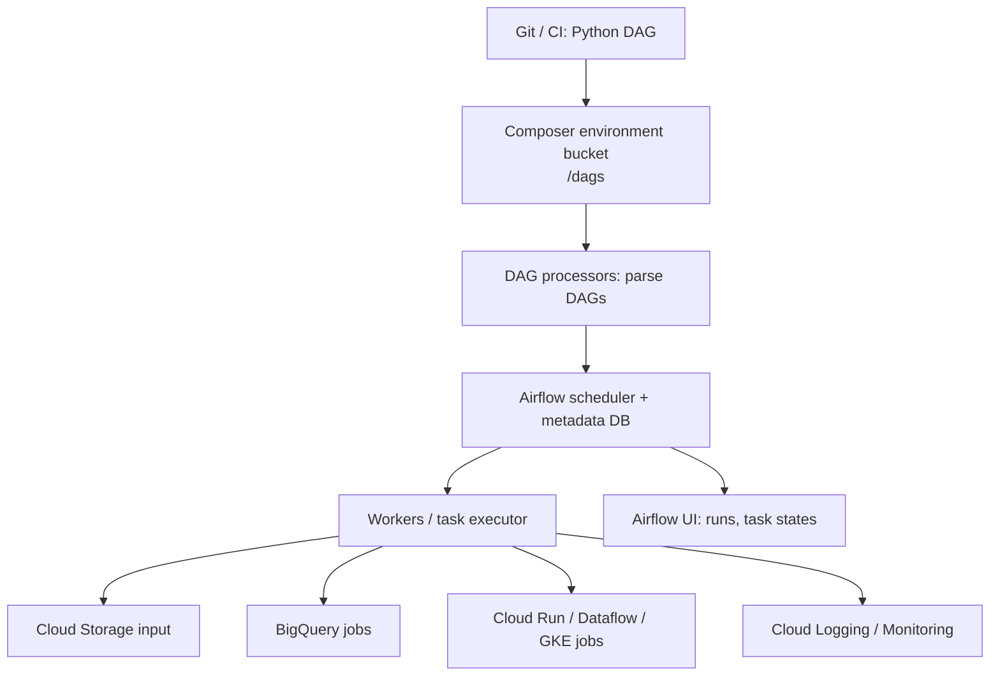
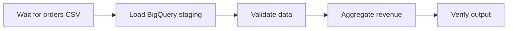

# Cloud Composer and Orchestrating DAGs with Airflow

Each day, an Orders system exports transaction files to Cloud Storage. The data team needs to **wait for the file to appear → load into BigQuery → run quality checks → compute revenue → verify results**, automatically on a schedule and restartable if any step fails. Stitching together loose cron scripts makes handling missing files, retries, or historical reruns error-prone. **Cloud Composer** (now called *Managed Service for Apache Airflow* by Google Cloud) provides a **managed Apache Airflow** environment to schedule, execute, and observe workflows as **DAGs**.

This lesson belongs to the **Data Pipelines and Processing** chapter of the `CLOUD_PROVIDERS_GCP` module. It connects Cloud Storage, BigQuery, Pub/Sub, Cloud Run, GKE, IAM/VPC, cost control, and reliability operations. The focus is on **orchestrating steps and data states**, not using Composer workers to process large data volumes directly.

> Project names, buckets, datasets, and CSVs are examples only. Creating a Composer environment **incurs continuous baseline charges**; uploading DAGs, triggering DAGs, or running BigQuery operations can modify data. Run only in an authorized sandbox. Python examples target **Composer Gen 3 + Airflow 2.11.1**; when using **Airflow 3**, verify imports/APIs and provider compatibility.

## 1. Objectives

After this lesson, you will be able to:

1. Distinguish **Composer environment**, **DAG**, **task**, **DAG run**, **task instance**, **operator**, **sensor**, and **XCom**.
2. Explain dependencies, `logical_date`, `data_interval`, `schedule`, `catchup`, retries, and backfills.
3. Create a Composer environment with an appropriate image and service account, upload DAGs, and monitor DAG runs.
4. Write an Airflow DAG orchestrating Cloud Storage → BigQuery using Google Cloud providers and data validation.
5. Design idempotency, concurrency, timeouts, and alerts when sources are missing or tasks fail.
6. Separate IAM, secrets, networking, SLOs, and Composer costs from downstream service costs.

## 2. What Does Composer Do and Not Do?

**Apache Airflow** orchestrates workflows structured as **Directed Acyclic Graphs (DAGs)**: each node is a task, and arrows define execution dependencies. Composer operates the Airflow infrastructure so teams can focus on DAG definitions, operators, security, and pipeline quality.



The **Scheduler** decides when a DAG run or task is ready; **workers** execute tasks or invoke Google Cloud services; the **metadata database** stores state history; the **DAG processor** parses Python definitions; and the **triggerer** runs *deferrable* operators/sensors. Exact component internals vary across Gen 2/Gen 3, Airflow versions, and resilience modes; focus on logical responsibilities rather than assuming direct management of GKE/metadata DB internals in Composer Gen 3.

| Component | Role | Notes |
| --- | --- | --- |
| Environment | Regional Composer resource hosting Airflow and config | Carries baseline cost and its own IAM/network |
| DAG | Workflow defined in Python, **not a dataset** | Never create dependency cycles |
| Task/Operator | Concrete step: call BigQuery, Cloud Run, Python… | Offload heavy compute to dedicated engines |
| Sensor | Waits for a condition: GCS object, job completion… | Prefer `reschedule`/deferrable to avoid holding workers |
| DAG run | One execution of a DAG for a specific **logical date / data interval** | A succeeded run does not prove data correctness without checks |
| Task instance | A task within a DAG run; may retry multiple times | Logs, retries, and progress are tracked per instance |
| XCom | Passes small metadata values between tasks | Never pass GB-scale CSV/JSON files through XCom |
| Pool/Concurrency | Caps parallel tasks by shared resource | Does not replace BigQuery/Cloud Run quotas |

### 2.1. Composer vs. Workflows, Dataflow, and Pub/Sub

| Need | Preferred service |
| --- | --- |
| Multi-step data DAGs, schedules, backfills, dependencies, Airflow operators | **Cloud Composer** |
| Request/event-driven API orchestration, serverless step sequences with minimal scheduler ops | **Google Cloud Workflows** |
| Large-scale distributed streaming/batch data processing | **Dataflow (Apache Beam)** |
| Distributing events to multiple independent consumers | **Pub/Sub** |
| Running a containerized job on schedule or condition | **Cloud Run Jobs**, optionally triggered by Scheduler/Workflows/Composer |
| A single SQL query transforming data | BigQuery Scheduled Query / Dataform may suffice |

Composer **does not replace Dataflow or BigQuery**: tasks should **submit jobs to processing services** and wait/monitor results. Installing heavy Pandas packages in workers and loading multi-GB tables into RAM can destabilize the Airflow environment and impact every DAG.

## 3. DAGs, Schedules, and Airflow's Time Model

A DAG is defined in Python, and Airflow **parses it repeatedly** to detect changes. When the scheduler triggers a DAG, it creates a **DAG run**; each task instance moves through states like `scheduled → queued → running → success/failed/up_for_retry/skipped`.

### 3.1. Dependency Example



Unrelated tasks can run concurrently. Arrows express **dependency order**, not direct data streaming through Airflow. In this example, data resides in **Cloud Storage and BigQuery**, while the DAG passes parameters and object names.

### 3.2. Logical Date, Data Interval, and Catchup

Suppose schedule is `0 3 * * *` in timezone `Asia/Ho_Chi_Minh`:

- **Data interval** is the logical period of data to process. Under standard scheduling, a run executes *after the interval ends*, not always right at `start_date`.
- **Logical date** typically represents the **start of the data interval**, not the wall-clock time when a worker starts running.
- `{{ ds }}` represents the `YYYY-MM-DD` logical date of the DAG run. Source files should follow the same convention; never use `datetime.now()` inside a task to guess the data date.
- `catchup=False` avoids automatically spawning all missed DAG runs since `start_date` upon deployment/activation, **without blocking manual backfills**.
- **Backfills** rerun historical intervals; they require retained source data and **idempotent** writes.

| DAG attribute | Example | Effect |
| --- | --- | --- |
| `start_date` | `2026-11-01 00:00 Asia/Ho_Chi_Minh` | Timetable anchor timestamp |
| `schedule` | `0 3 * * *` | Cron schedule in the DAG's timezone |
| `catchup` | `False` | Prevents automatically flooding old missed runs |
| `max_active_runs` | `1` | Reduces overlapping writes across runs/triggers |
| `retries` | `2` | Retries a failed task without restarting the whole DAG |
| `retry_delay` | 5 minutes | Avoids hammering a failing downstream service |

**A task retry still belongs to the same task instance, DAG run, and logical date.** If a task writes data and times out before Airflow records success, a retry can repeat the side effect—design idempotent writes rather than merely setting `retries=2`.

### 3.3. Trigger Rules, SLAs, and Timeouts

By default, a task runs only when all upstream tasks **succeed** (`all_success`). Other trigger rules suit cleanup or alerting steps, but never put `all_done` on a "confirm completion" step and accidentally report success after upstream failures. Distinguish task `execution_timeout`, DAG `dagrun_timeout`, sensor wait timeouts, and BigQuery/Dataflow job timeouts.

## 4. Airflow Versions and Composer Gen 3

Google Cloud offers multiple Composer / Managed Airflow generations; **Gen 3** is the modern deployment architecture supporting **Airflow 2** and **Airflow 3** builds. As of writing (November 19, 2026), published images include examples like `composer-3-airflow-2.11.1-build.25` and `composer-3-airflow-3.3.1-build.8`. **Image support and regional availability change**: always check the Console / [image version list](https://cloud.google.com/composer/docs/composer-versions) and avoid pinning an unsupported build.

| Option | Suitable for | What to verify |
| --- | --- | --- |
| **Composer Gen 3 + Airflow 2.11.1** | Python lab in Section 6 and teams using Airflow 2 DAG syntax/providers | Support window, security patches, migration plan |
| **Composer Gen 3 + Airflow 3.x** | Greenfield projects intentionally targeting Airflow 3 | API imports such as `airflow.sdk`, providers/operators, CLI, and plugin compatibility |
| **Existing Composer Gen 2** | Running environments needing an upgrade path | Image lifecycle, networking, migrations, and cost |

**Never copy Airflow 2 imports into Airflow 3 assuming they work unchanged.** Across major versions, review migration guides, check bundled `apache-airflow-providers-google` versions, and re-test parsing, scheduling, and task execution. Several components and CLI subcommands have changed.

## 5. Preparing a Composer Gen 3 Environment

Assume a sandbox with project `orders-lab`, region `asia-southeast1`, source bucket `gs://orders-lab-ingest`, and BigQuery dataset `analytics` in the same location. The source bucket and dataset must **already exist** per team policy; the lab commands below do not create them.

### 5.1. APIs, Service Account, and Baseline Permissions

```bash
PROJECT_ID="orders-lab"
REGION="asia-southeast1"
ENV="orders-composer"
COMPOSER_SA="composer-orders@$PROJECT_ID.iam.gserviceaccount.com"

# MUTATING / MAY INCUR CHARGES: run only in a sandbox project.
gcloud services enable \
  composer.googleapis.com \
  bigquery.googleapis.com \
  storage.googleapis.com \
  --project="$PROJECT_ID"

# MUTATING: user-managed service account for the Composer environment.
gcloud iam service-accounts create composer-orders \
  --project="$PROJECT_ID" \
  --display-name="Orders Composer environment"

# Composer environment SA requires the Composer Worker role.
gcloud projects add-iam-policy-binding "$PROJECT_ID" \
  --member="serviceAccount:$COMPOSER_SA" \
  --role="roles/composer.worker"
```

Beyond `roles/composer.worker`, the service account needs least-privilege downstream access:

| DAG activity | Typical role | Scope to grant |
| --- | --- | --- |
| Read CSV from source GCS | `roles/storage.objectViewer` | Source bucket |
| Create/run BigQuery jobs | `roles/bigquery.jobUser` | Job project |
| Read/write BigQuery tables | `roles/bigquery.dataEditor` or narrower | `analytics` dataset |
| Invoke private Cloud Run if used | `roles/run.invoker` | Target service |
| Read secrets if needed | `roles/secretmanager.secretAccessor` | Specific secret |

**Writing DAGs to the Composer bucket carries special risk:** anyone who can edit a Python DAG file can execute code under the **environment service account**, so write access to `/dags` must be restricted to trusted CI/operators. Access to the **Composer API/UI**, DAG bucket writes, task execution, and BigQuery/GCS data are distinct layers. Never grant Project Owner to the environment SA because of a permission error in one service.

### 5.2. Creating the Environment

```bash
# MUTATING AND STARTS BASELINE BILLING:
# Pick an Airflow 2 build currently supported in your actual REGION.
gcloud composer environments create "$ENV" \
  --project="$PROJECT_ID" \
  --location="$REGION" \
  --image-version=composer-3-airflow-2.11.1-build.25 \
  --service-account="$COMPOSER_SA"

# READ-ONLY: state, image, environment bucket, and /dags prefix.
gcloud composer environments describe "$ENV" \
  --project="$PROJECT_ID" \
  --location="$REGION" \
  --format="yaml(name,state,config.softwareConfig.imageVersion,config.dagGcsPrefix,config.nodeConfig.serviceAccount)"
```

An environment incurs **baseline charges** even when zero DAGs run; creation takes time and depends on quotas, region, API service agents, service accounts, and network permissions. For private IP/VPC requirements, configure Gen 3 network attachments and routing (NAT / Private Google Access / PSC) by design; **never open public internet access or embed credentials inside DAGs to work around connectivity errors**. For short experiments, evaluate **Gen 3 development mode** if applicable; never use development mode in production.

### 5.3. Watching Cost Boundaries

Composer manages **schedulers, workers, metadata database, storage, and logging**, incurring environment charges; BigQuery tasks incur analysis/slot charges; Cloud Storage incurs storage/read fees; Cloud Run/Dataflow bill separately. Deleting a DAG does not delete the environment or tables/jobs created in other services.

## 6. Complete Example: Orders DAG from GCS to BigQuery

**Data source:** early on November 19, 2026, a producer created `gs://orders-lab-ingest/orders/dt=2026-11-18/orders.csv` with header and rows:

```csv
order_id,order_date,amount
ord-001,2026-11-18,120000
ord-002,2026-11-18,90000
```

The Airflow schedule runs at **03:00 Asia/Ho_Chi_Minh** to process the previous logical date via `{{ ds }}`. When triggering or backfilling manually, **the logical date must match the object path**; a DAG run for another date will wait for the wrong file. Producers must ensure files are uploaded **atomically/completely**, or emit a `_SUCCESS` marker after finishing so the sensor checks the marker instead of reading a half-uploaded file.

### 6.1. File `orders_daily_pipeline.py`

This example targets Airflow 2.11.1 using `apache-airflow-providers-google` bundled in a compatible Composer image. Composer workers do not process CSV rows in Python: tasks submit BigQuery jobs. Before running, create the GCS bucket and BigQuery dataset in your sandbox and grant the permissions from Section 5.

```python
from datetime import timedelta

import pendulum
from airflow import DAG
from airflow.providers.google.cloud.operators.bigquery import (
    BigQueryCheckOperator,
    BigQueryInsertJobOperator,
)
from airflow.providers.google.cloud.sensors.gcs import GCSObjectExistenceSensor

PROJECT = "orders-lab"
LOCATION = "asia-southeast1"
BUCKET = "orders-lab-ingest"
DATASET = "analytics"

with DAG(
    dag_id="orders_daily_pipeline",
    start_date=pendulum.datetime(2026, 11, 1, tz="Asia/Ho_Chi_Minh"),
    schedule="0 3 * * *",
    catchup=False,
    max_active_runs=1,
    dagrun_timeout=timedelta(hours=2),
    default_args={
        "retries": 2,
        "retry_delay": timedelta(minutes=5),
    },
    tags=["orders", "training"],
) as dag:
    wait_for_file = GCSObjectExistenceSensor(
        task_id="wait_for_file",
        bucket=BUCKET,
        object="orders/dt={{ ds }}/orders.csv",
        poke_interval=120,
        timeout=1800,
        mode="reschedule",
    )

    create_target = BigQueryInsertJobOperator(
        task_id="create_target",
        location=LOCATION,
        configuration={
            "query": {
                "query": """
                  CREATE TABLE IF NOT EXISTS
                    `orders-lab.analytics.daily_revenue` (
                      order_date DATE NOT NULL,
                      order_count INT64,
                      total_revenue NUMERIC
                    )
                  PARTITION BY order_date
                """,
                "useLegacySql": False,
            }
        },
    )

    load_staging = BigQueryInsertJobOperator(
        task_id="load_staging",
        location=LOCATION,
        configuration={
            "load": {
                "sourceUris": [
                    "gs://orders-lab-ingest/orders/dt={{ ds }}/orders.csv"
                ],
                "destinationTable": {
                    "projectId": PROJECT,
                    "datasetId": DATASET,
                    "tableId": "stg_orders_{{ ds_nodash }}",
                },
                "sourceFormat": "CSV",
                "skipLeadingRows": 1,
                "schema": {
                    "fields": [
                        {"name": "order_id", "type": "STRING"},
                        {"name": "order_date", "type": "DATE"},
                        {"name": "amount", "type": "NUMERIC"},
                    ]
                },
                "createDisposition": "CREATE_IF_NEEDED",
                "writeDisposition": "WRITE_TRUNCATE",
            }
        },
    )

    validate_staging = BigQueryCheckOperator(
        task_id="validate_staging",
        location=LOCATION,
        use_legacy_sql=False,
        sql="""
          SELECT
            COUNT(*) > 0
            AND COUNT(DISTINCT order_id) = COUNT(*)
            AND COUNTIF(
              order_id IS NULL OR amount IS NULL OR amount < 0
              OR order_date IS NULL
              OR order_date != DATE('{{ ds }}')
            ) = 0
          FROM `orders-lab.analytics.stg_orders_{{ ds_nodash }}`
        """,
    )

    aggregate_revenue = BigQueryInsertJobOperator(
        task_id="aggregate_revenue",
        location=LOCATION,
        configuration={
            "query": {
                "query": """
                  MERGE `orders-lab.analytics.daily_revenue` T
                  USING (
                    SELECT order_date, COUNT(*) AS order_count,
                           SUM(amount) AS total_revenue
                    FROM `orders-lab.analytics.stg_orders_{{ ds_nodash }}`
                    WHERE order_date = DATE('{{ ds }}')
                    GROUP BY order_date
                  ) S
                  ON T.order_date = S.order_date
                  WHEN MATCHED THEN UPDATE SET
                    order_count = S.order_count,
                    total_revenue = S.total_revenue
                  WHEN NOT MATCHED THEN INSERT
                    (order_date, order_count, total_revenue)
                    VALUES
                    (S.order_date, S.order_count, S.total_revenue)
                """,
                "useLegacySql": False,
            }
        },
    )

    verify_target = BigQueryCheckOperator(
        task_id="verify_target",
        location=LOCATION,
        use_legacy_sql=False,
        sql="""
          SELECT COUNT(*) = 1
          FROM `orders-lab.analytics.daily_revenue`
          WHERE order_date = DATE('{{ ds }}')
        """,
    )

    (
        wait_for_file
        >> create_target
        >> load_staging
        >> validate_staging
        >> aggregate_revenue
        >> verify_target
    )
```

### 6.2. Why Are Reruns Relatively Safe?

| Task | Behavior on retry/backfill | What must be controlled |
| --- | --- | --- |
| `wait_for_file` | Waits for the object matching the **logical date** | Avoid reading half-uploaded files; consider a `_SUCCESS` marker |
| `create_target` | `CREATE TABLE IF NOT EXISTS` preserves existing table | Matching schema, location, and table-creation IAM |
| `load_staging` | `WRITE_TRUNCATE` on a **date-specific staging table** | Never truncate a single shared staging table holding all dates |
| `validate_staging` | Fails if empty, duplicate IDs, negative/null amounts, or wrong date | Expand schema/quality rules for real data |
| `aggregate_revenue` | `MERGE` updates only that date instead of adding on each retry | Prevent external jobs outside the DAG from writing the same partition concurrently |
| `verify_target` | Verifies exactly one row exists for the date | Also reconcile monetary totals against external sources |

In production apps, order volumes can reach millions; large CSV loads should use sharded files/manifests per process, handle nulls/currency/decimals, and deduplicate per data contract. Because the sample creates **one staging table per day**, set **TTL/cleanup** so tables do not accumulate indefinitely. This DAG does not send emails, capture payments, or write operational data directly back to OLTP stores.

### 6.3. Airflow Is an Orchestrator, Not a Payload Transport

In this example:

- **XCom** does not hold the CSV; Cloud Storage paths and table IDs act as references.
- **`BigQueryInsertJobOperator`** submits work to BigQuery; heavy compute and analysis charges stay in BigQuery, not on Airflow workers.
- **`GCSObjectExistenceSensor`** uses `mode="reschedule"`, releasing its worker slot between pokes—unlike `poke` mode, which holds a worker continuously. Where supported by the image/provider, consider **deferrable sensors/operators** using the triggerer.
- Keep DAG parsing lightweight: **never run BigQuery queries, read GCS, or call REST APIs at module top level**. The scheduler and DAG processor re-parse files constantly; import-time I/O can slow the entire environment.

For BigQuery operators in **deferrable mode**, Google Cloud documentation has noted issues in **non-US** locations in certain dependency versions. This sample uses `asia-southeast1` and **leaves deferrable disabled** for BigQuery operators; test your exact image, provider, and region in staging before enabling that optimization.

## 7. Importing the DAG, Testing, and Inspecting Airflow UI

Save the code from Section 6 as `orders_daily_pipeline.py` on your workstation or in an authorized CI pipeline. **Do not create files inside this lesson's source directory**; these instructions apply to a separate practice environment.

### 7.1. Uploading the DAG to the Environment Bucket

```bash
PROJECT_ID="orders-lab"
REGION="asia-southeast1"
ENV="orders-composer"
DAG_ID="orders_daily_pipeline"

# READ-ONLY: inspect the GCS path of the DAG folder.
gcloud composer environments describe "$ENV" \
  --project="$PROJECT_ID" --location="$REGION" \
  --format="value(config.dagGcsPrefix)"

# MUTATING: upload the DAG into Composer's bucket.
gcloud composer environments storage dags import \
  --project="$PROJECT_ID" \
  --environment="$ENV" \
  --location="$REGION" \
  --source="orders_daily_pipeline.py"
```

Composer automatically syncs `/dags` to schedulers and workers and parses definitions; sync latency is typically **1–2 minutes or more** under load. **A successful upload does not mean the scheduler has finished parsing or all workers have picked up the new version.** Check the DAG list, import errors, task logs, and sync timing before unpausing or retrying.

### 7.2. Checking the Parser and Triggering

```bash
# READ-ONLY: list DAGs and parse errors in Airflow 2.
gcloud composer environments run "$ENV" \
  --project="$PROJECT_ID" --location="$REGION" \
  dags list

gcloud composer environments run "$ENV" \
  --project="$PROJECT_ID" --location="$REGION" \
  dags list-import-errors

# MUTATING: Airflow 2 uses --exec-date to set logical date
# matching sample file orders/dt=2026-11-18/orders.csv.
gcloud composer environments run "$ENV" \
  --project="$PROJECT_ID" --location="$REGION" \
  dags trigger -- --exec-date="2026-11-18T03:00:00+07:00" "$DAG_ID"

# READ-ONLY: view run history in Airflow 2.
gcloud composer environments run "$ENV" \
  --project="$PROJECT_ID" --location="$REGION" \
  dags list-runs -- -d "$DAG_ID"
```

Airflow UI: **DAGs → `orders_daily_pipeline` → Grid/Graph → task instance → Logs** to see which task failed, retry attempts, DAG run logical date, data interval, and BigQuery job ID. In **Airflow 2**, `--exec-date` sets the logical date for manual runs (Airflow 3 uses a different CLI). Manual run data intervals also depend on the timetable and trigger path; if `{{ ds }}` does not match the CSV date, **do not hastily rename the file**—inspect the run context or trigger/backfill a DAG run for the intended date properly.

When parse errors happen, never delete the environment to fix them: inspect the Python traceback, installed imports/providers, task IDs, and Jinja templating. Once the DAG runs cleanly, unpause it for scheduled execution; never unpause immediately if production buckets contain incomplete data.

### 7.3. Updating DAGs Without Disruption

1. Open a pull request, lint, and import-test the DAG in an Airflow environment matching the **same major/provider versions**.
2. Test the DAG in staging with a logical date and isolated bucket/dataset.
3. Pause the DAG for major changes to tasks, schemas, or idempotency; never edit code mid-run on a critical execution without a runbook.
4. Import the updated file, wait for scheduler parsing and worker sync, and verify zero import errors.
5. Trigger a test date, inspect BigQuery outputs and logs, then unpause deliberately.

**Do not rely on deleting a task from a DAG to clear an old failure:** Airflow's metadata stores task instance history; mutating the DAG graph can cause unexpected retry, clear, or backfill semantics. For breaking changes, consider a new DAG ID with a parallel transition period.

## 8. Operations: Retries, Backfills, Dependencies, and Concurrency

### 8.1. Retries Do Not Guarantee Exactly-Once Execution

A task can complete a side effect and then crash before Airflow records success. With `retries=2`, Airflow re-runs the task; therefore:

- Use **business key + logical date** for deterministic outputs.
- Write using upserts or partition overwrites rather than unconditional `INSERT` appends.
- For external actions like payments or emails, use **idempotency keys** or an outbox instead of calling them directly inside a retryable `PythonOperator`.
- Enable retries for transient errors with bounded attempts/timeouts; classify permanent failures (schema mismatch, permission denied) so data or IAM gets fixed.

### 8.2. Backfilling the Right Intervals

Backfilling means running DAG runs for **historical logical dates / data intervals**, not calling `datetime.now()` and reprocessing every past day as today. Before backfilling:

1. Confirm each day's source files still exist, schemas/indexes are compatible, and permissions are intact.
2. Identify output partitions to rewrite; if streaming and CDC also touch the table, account for late data.
3. Cap `max_active_runs`, Airflow pools, and BigQuery job concurrency to avoid overloading systems.
4. Run one day first, reconcile the target, and only then expand the range.
5. Record the approver, DAG version, logical dates, and reconciliation results.

**Never abruptly set `catchup=True` on a years-old DAG in production**: thousands of runs could flood the scheduler and spawn massive BigQuery jobs. Manual backfills via version-appropriate Airflow CLI/UI are supported, though those operations can **overwrite data**.

### 8.3. Concurrency and Backpressure

| Control | Scope | When to use |
| --- | --- | --- |
| `max_active_runs` | DAG | Prevents multiple periods from overwriting the same dataset |
| `max_active_tasks` | DAG | Caps total concurrent task instances |
| Airflow **pool** | Group of tasks sharing a resource | Throttles jobs hitting BigQuery or Cloud SQL |
| Task `pool_slots` | Per task | Heavy tasks consume more slots from an Airflow pool |
| Celery/Kubernetes worker scaling | Environment | Ensures enough capacity to execute operators |
| BigQuery quotas/reservations | Downstream BigQuery | Protects query slots, concurrent jobs, and billing |

**Airflow pool slots are not BigQuery compute slots.** A pool of 5 only caps how many Airflow tasks run simultaneously—it does not grant 5 BigQuery slots to each query. To protect Cloud SQL or BigQuery, configure **both Airflow concurrency and downstream quotas/capacity**, alongside timeouts and circuit breakers where needed.

## 9. Security: IAM, Secrets, VPC, and DAG Code

### 9.1. Permission Boundaries

| Principal | Suggested least privilege | Scope |
| --- | --- | --- |
| Platform admin | Manage Composer environments, config, and IAM | Authorized sandbox/production projects |
| CI/CD DAG deployer | Write `/dags` in the environment bucket and view environment if needed | **Only target bucket/path**, backed by code review |
| Composer environment service account | `roles/composer.worker`; plus scoped BigQuery Job User, dataset Data Editor, GCS Object Viewer | Never project-wide Owner/Editor |
| Analyst viewing logs/DAG runs | Composer Viewer/Airflow roles and Logging Viewer as needed | No write access to upload code running under a privileged SA |
| BigQuery/Storage data owner | Manage datasets/buckets, IAM, retention, and policy tags | Independent from DAG edit permissions |

**Core principle:** a Python DAG file is **executable code**, not passive config. Anyone able to upload a malicious DAG into the bucket can act with every privilege held by the environment SA. Restrict write access, enforce CI code scanning and reviews, isolate dev/prod environments, and monitor Audit Logs for all changes.

### 9.2. Secrets and Connections

- Use **Application Default Credentials / Workload Identity** and appropriate Airflow Google Cloud connections; never commit service-account JSON keys in DAG source.
- Store external API credentials in **Secret Manager**, configuring an Airflow secrets backend where appropriate; never store passwords or refresh tokens in Airflow Variables or XCom.
- Use Airflow Connections for endpoints/properties; enable log masking for sensitive values and avoid `print(conn.password)` or logging request headers.
- Protect the Airflow webserver with IAM and Airflow RBAC; **UI access should not imply permission to read revenue data**.
- In private Composer networking, ensure workers reach GCS/BigQuery APIs and Cloud Run/private endpoints via VPC/PSC/NAT/DNS/firewalls; never open broad public ingress to fix connectivity issues.

### 9.3. Input Trust and Validation

CSV inputs may contain PII; never log full rows to Airflow logs/XCom or expose them in object names. Verify bucket ownership, object generations, checksums/manifests, and schemas before loading. Evaluate GCS/BigQuery data residency and dataset locations alongside the Composer environment and downstream transfers.

A DAG accepting user-supplied `dag_run.conf` must never pass arbitrary URLs, buckets, or tables under the environment SA's authority; validate project/dataset allowlists and business dates before executing. For multi-tenant pipelines, separate service accounts and environments by data boundary rather than letting every DAG share one org-wide identity.

## 10. Monitoring, SLOs, Cost, and Environment Operations

Cloud Composer integrates with **Cloud Logging** and **Cloud Monitoring**, while the Airflow UI surfaces DAG runs, task histories, and logs. A practical SLO measures **the percentage of data periods completed before the business deadline**, not merely scheduler uptime.

| Metric | Interpretation | Action when unhealthy |
| --- | --- | --- |
| `composer.googleapis.com/workflow/run_count` | Completed DAG runs by state | Alert if a scheduled period failed or is missing |
| `composer.googleapis.com/workflow/run_duration` | Time for a DAG run to finish | Compare against the 05:00 deadline |
| `composer.googleapis.com/workflow/task/run_count` | Task failures, retries, or successes | Filter by DAG/task |
| `composer.googleapis.com/workflow/task/run_duration` | Slowest task in the pipeline | Inspect BigQuery job IDs or sensor wait times |
| `composer.googleapis.com/environment/task_queue_length` | Tasks waiting for workers (Celery Executor) | Check resources, concurrency, and executors |
| DAG parse/import errors | Scheduler hasn't loaded updated code | Inspect DAG processor logs, imports, and providers |
| Data freshness / row counts / revenue control totals | Is business data actually complete? | Reconcile source vs. destination and check late arrivals |
| Environment worker/scheduler CPU, memory, DB health | Airflow control-plane bottleneck | Scale environment or optimize DAG parsing |

**Completion metrics for DAGs and tasks only emit once a run or task finishes**: missing points mid-run do not automatically mean a lost job. Combine heartbeats, task queue depth, run duration, scheduler health, and **business data freshness alerts**. For the Orders example, an SLO might be **99% of day D data ready in BigQuery before 05:00 on day D+1**, with total revenue matching the source within an agreed tolerance.

### 10.1. Composer Cost Goes Beyond Worker Task Execution

| Cost source | What to account for |
| --- | --- |
| Composer / Managed Airflow environment | Environment/control-plane/compute charges by Gen, scale, and region |
| Environment bucket + logs | GCS objects, sync, Cloud Logging ingestion/retention |
| BigQuery | Load/query jobs, storage, on-demand bytes or capacity slots |
| Dataflow/Cloud Run/GKE tasks | Compute per service, network/egress |
| Private networking | NAT/PSC/VPC and data transfer per topology |
| Idle/test environments | Environments continue billing even when DAGs are paused or idle |

Separate **orchestration cost** (Composer) from **data-processing cost** (BigQuery/Dataflow). If you only run a single daily SQL query, a BigQuery Scheduled Query or Cloud Scheduler + Cloud Run Job may be simpler and cheaper than running Composer. For complex multi-DAG workflows requiring backfills and observability, environment costs are justified.

### 10.2. Maintenance and Upgrade Runbook

1. Assign an environment owner, and track Composer/Airflow/provider versions and security upgrade schedules.
2. Test imports and tasks in staging matching the target Airflow major version before upgrading.
3. For major changes, **pause DAGs and wait for running tasks to complete** per upgrade guidance.
4. Back up/export required configuration (DAGs, Connections/Variables securely, snapshots if supported) and document recovery.
5. Upgrade the image during a maintenance window and inspect scheduler, UI, triggerer, and worker logs.
6. Run a canary DAG, verify BigQuery outputs, then unpause production DAGs.

Never assume upgrading Composer **automatically upgrades Airflow DAG code** in your repository. Python DAGs must be tested across Airflow 2 → 3 migrations, package updates, providers, CLI changes, and Python runtimes.

## 11. Case Study: Orders Revenue Pipeline

**Context:** at 03:00 daily, Composer checks for the previous day's CSV file; if the source is more than 30 minutes late, it must not report false success. The goal is a `daily_revenue` table with **one row per day** and financial reports that never double revenue when a task retries.

### 11.1. Normal Flow

1. Producer writes `orders/dt=D/orders.csv` and verifies upload completion.
2. GCS sensor waits for the file without pinning a worker during wait intervals thanks to `reschedule`.
3. BigQuery load populates `stg_orders_YYYYMMDD` from day D's file using `WRITE_TRUNCATE`.
4. Quality check enforces non-empty data, unique `order_id`s, valid `amount`s, and `order_date=D`.
5. `MERGE` upserts the single daily summary for day D into `daily_revenue`'s partition.
6. Output quality check confirms exactly one row; dashboards/alerts read reconciled figures.

### 11.2. Incident A: Late Source File

Each sensor try has `timeout=1800` (30 minutes), while the DAG sets `retries=2`, so **the run does not fail immediately at minute 30**: the task can retry while the overall DAG is bounded by `dagrun_timeout=2 hours`. On-call checks the producer, GCS object path, and logical date; the workflow must never emit a synthetic zero-revenue report. Once the file arrives, **clear/retry only the relevant task or rerun period D**, verifying staging and target—never enable catchup across unrelated dates.

### 11.3. Incident B: Load Succeeds but Transform Times Out

BigQuery `MERGE` may have committed just before the worker lost connection waiting for confirmation. Airflow retries the task: because `MERGE` **replaces day D's metrics**, revenue is not double-counted. Still inspect BigQuery job IDs/logs and source data to ensure two DAG versions never write the same partition concurrently.

### 11.4. Incident C: A CSV Contains Duplicate Order IDs

The quality task fails. Operators must never patch data inside XCom or disable checks just to "turn the job green". Investigate duplicates at the producer, classify whether it is a schema or idempotency bug, publish a **versioned/manifested** fixed source file, and rerun for the same logical date. If the pipeline supports late corrections, use business record versions or watermarks instead of unconditional overwrites.

**Case study takeaway:** Composer provides DAG lineage, retries, and backfills; **data correctness** still depends on the CSV contract, idempotent logic, quality gates, and BigQuery reconciliation.

## 12. Quick Troubleshooting

| Symptom | Common cause | Check or fix |
| --- | --- | --- |
| DAG missing after import | Still syncing, Python import error, wrong bucket/path | `dagGcsPrefix`, DAG processor logs, `dags list-import-errors` |
| Import `ModuleNotFoundError` | Missing provider/PyPI package or wrong Airflow major version | Image version, installed packages, imports |
| DAG not running on schedule | Paused, wrong `start_date`/timezone/data interval, `catchup=False` | DAG schedule, next run, and logical date |
| Manual trigger waits for wrong date's file | `{{ ds }}` differs from expected data date | Inspect run logical date / data interval and GCS object path |
| GCS sensor times out | Slow source, wrong bucket/object, missing Storage Viewer | Producer logs, object existence, permissions, `poke_interval` |
| Sensor ties up many workers | `mode="poke"` or missing triggerer for deferrable | Switch to `reschedule` or deferrable where supported |
| BigQuery load returns `403` | Environment SA lacks Job User or data permissions | Task principal and dataset/job project IAM |
| BigQuery load location error | Incompatible bucket, dataset, and job locations | Align regions and transfer policies |
| Staging has duplicate data | Producer emitted duplicates/retries | Quality task, business keys, source object generation |
| Revenue doubles on retry | Task uses additive `INSERT`, not idempotent | Use upsert/`MERGE` or partition overwrite |
| Worker out of RAM | Task loads huge CSV into Pandas or XCom | Push compute to BigQuery/Dataflow; keep XCom to metadata only |
| Tasks stuck in `queued` | Worker/DB pressure, pool/concurrency limits | Queue length, Airflow pools, scheduler/worker health |
| Tasks succeed with no output | Async external job wasn't awaited or checked | Job status operator, logs, BigQuery job history |
| No Cloud Monitoring data | Run/task hasn't finished yet, wrong resource filter | Airflow UI, metric semantics, Monitoring labels |
| Bill rises while DAGs are paused | Environment itself still bills; logging/storage persist | Billing SKUs, scale/hibernate dev, or delete unused envs |
| Import errors after upgrade | Airflow 2/3 API, Python, or provider changes | Staging compatibility, dependency pins, rollback plan |

**Investigation flow:** confirm DAG version and logical date → import errors → task/scheduler states → task logs → environment identity/permissions → BigQuery/GCS job/object evidence → verify business totals before retrying. Never "fix" issues by granting Project Owner, wiping the metadata database, or clearing all DAG runs without impact analysis.

## 13. Hands-On Exercises

### Exercise A — Choosing an Orchestration Service

For three needs—(1) multi-step daily revenue reporting with backfills, (2) streaming 50,000 events/s, (3) calling three APIs sequentially when a new order arrives—choose among Composer, Dataflow, Workflows, and Pub/Sub. Explain why **a DAG never replaces a compute engine**.

### Exercise B — Schedules and Logical Dates

A DAG has `start_date=2026-11-01`, `schedule="0 3 * * *"`, timezone `Asia/Ho_Chi_Minh`, and `catchup=False`. For the scheduled run starting after 03:00 on November 19, 2026, what `{{ ds }}` date is expected for the data? Why should you avoid `datetime.now()` for filenames, and how do you backfill a single past date properly?

### Exercise C — Creating and Deploying a DAG

In an authorized sandbox, pick a supported Composer Gen 3 Airflow 2.11.1 image, create a user-managed service account with `roles/composer.worker`, and grant least-privilege GCS/BigQuery access. Import the DAG from Section 6 via `gcloud composer environments storage dags import`, and verify the parser and Airflow UI before unpausing.

### Exercise D — Fault Injection: Missing GCS File

Leave one day's CSV missing and run the DAG, observing `reschedule`, `poke_interval=120`, and `timeout=1800`. When the sensor fails, do downstream tasks run? After the producer uploads a valid file, show how to retry/clear the task without accidentally loading another date.

### Exercise E — BigQuery Quality and Idempotency

Create two sandbox CSVs: one valid and one with duplicate `order_id`s / negative `amount`. Run the DAG and verify the quality task blocks `MERGE` for bad data. With valid data, rerun the same logical date twice: verify `daily_revenue` still contains **exactly one row for that date** with the accurate total.

### Exercise F — Controlled Backfill

A pipeline was disrupted for five days while source files remained intact. Design a 5-period backfill using `max_active_runs=1`, an Airflow pool protecting BigQuery, and reconciliation checks without exhausting job quotas. If one period lacks a CSV, how do you prevent writing zero revenue?

### Exercise G — Composer Security

Suppose a developer has permission to upload Python DAGs to the Composer bucket but lacks direct access to revenue tables. Why do they still pose a risk via the environment service account? Design CI reviews, bucket permissions, runtime IAM, Secret Manager, and Audit Logs to mitigate this risk.

### Exercise H — Monitoring and Cost

Design an eight-metric dashboard covering: DAG success rate, duration, queue length, import errors, task retries, worker resource pressure, business freshness, and reconciled revenue. Separate **Composer environment**, **BigQuery compute/storage**, and **GCS/logging** charges. If a pipeline shrinks to one daily SQL query, why evaluate Scheduled Queries instead of keeping Composer?

### Self-Check Questions

1. How does a DAG differ from a DAG run and a task instance?
2. Why shouldn't a large ETL job run directly inside a `PythonOperator` on a Composer worker?
3. Is `logical_date` the exact time a worker starts executing?
4. Does `catchup=False` prevent manual backfills?
5. Do Airflow retries guarantee a BigQuery DML statement runs only once?
6. Why is a `reschedule` sensor usually better than `poke` when waiting on GCS for long periods?
7. Do Airflow pool slots mean the same thing as BigQuery reservation slots?
8. Who can execute code with the permissions of the environment service account?
9. Does a successful DAG file upload guarantee all workers are running the new code?
10. Does an Airflow DAG succeeding guarantee the reported business data is accurate?

## 14. Checklist and Official References

- [ ] Chose Composer when DAG scheduling/backfills/dependencies are genuinely needed, rather than misusing it in place of Dataflow/Workflows.
- [ ] Composer Gen 3 image + Airflow major/provider versions verified by region and support window.
- [ ] Dedicated environment SA with `roles/composer.worker` and least-privilege downstream IAM; CI controls DAG bucket writes.
- [ ] DAG intentionally configures `logical_date`/`data_interval`, timezone, `catchup`, `max_active_runs`, and retries.
- [ ] Sensors do not idle-pin workers; heavy compute is delegated to BigQuery/Dataflow/Cloud Run Jobs.
- [ ] Input data has schemas/manifests, quality gates, and idempotent writes.
- [ ] Tested parsing and a full sample period in staging; backfill, rollback, and reconciliation workflows exist.
- [ ] Logs/metrics/SLOs, budget alerts, quotas, and retention cover both Composer and downstream services.

Google Cloud / Apache Airflow references to consult before deploying:

- [Managed Airflow/Cloud Composer overview](https://cloud.google.com/composer/docs/composer-3/composer-overview)
- [Create Composer Gen 3 environments](https://cloud.google.com/composer/docs/composer-3/create-environments)
- [Managed Airflow image versions](https://cloud.google.com/composer/docs/composer-versions)
- [Write Airflow DAGs](https://cloud.google.com/composer/docs/composer-3/write-dags)
- [Add and update DAGs](https://cloud.google.com/composer/docs/composer-3/manage-dags)
- [Schedule and trigger DAGs](https://cloud.google.com/composer/docs/composer-3/schedule-and-trigger-dags)
- [Test DAGs](https://cloud.google.com/composer/docs/composer-3/test-dags)
- [Troubleshoot DAGs](https://cloud.google.com/composer/docs/composer-3/troubleshooting-dags)
- [Access control with IAM](https://cloud.google.com/composer/docs/composer-3/access-control)
- [Monitor Composer environments](https://cloud.google.com/composer/docs/composer-3/monitor-environments)
- [Composer pricing](https://cloud.google.com/composer/pricing)
- [Airflow DAGs, scheduling and timetables](https://airflow.apache.org/docs/apache-airflow/2.11.0/core-concepts/dag-run.html)
- [Airflow Google Cloud BigQuery operators](https://airflow.apache.org/docs/apache-airflow-providers-google/stable/operators/cloud/bigquery.html)
- [Airflow GCS sensors](https://airflow.apache.org/docs/apache-airflow-providers-google/stable/operators/cloud/gcs.html)

**Key takeaway:** Composer manages **DAG orchestration**, not direct BigQuery/Dataflow-scale data processing. A reliable pipeline requires **accurate logical dates, clear dependencies, source readiness checks, validation, retry/backfill idempotency, narrow IAM, and business freshness monitoring**. Airflow task success is only a necessary condition—data outputs must still be reconciled.
