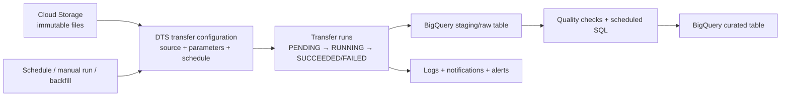
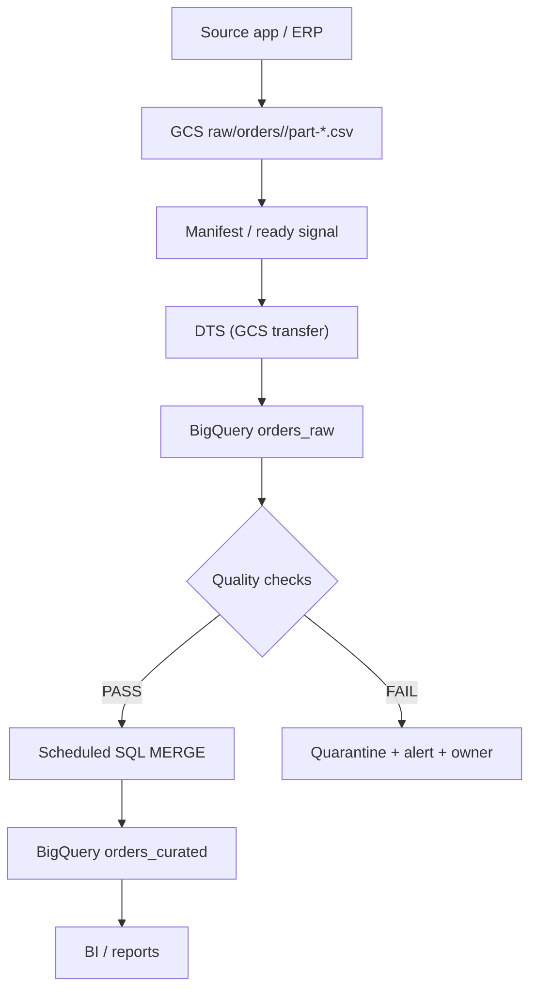

# BigQuery Data Transfer Service and Scheduled Data Ingestion

Suppose the sales team uploads `orders-YYYYMMDD.csv` files to Cloud Storage each night. The system must automatically load the data into BigQuery before 07:00, alert on failures, and support backfilling a missing day. One option is building a custom Cloud Run job triggered by Cloud Scheduler; a lower-ops option is **BigQuery Data Transfer Service (DTS)**, which manages **transfer configurations**, **schedules**, and **transfer runs** to ingest data from supported sources.

This lesson belongs to the **Data Pipelines and Processing** chapter in the `CLOUD_PROVIDERS_GCP` module. The focus is on picking the right ingestion mechanism, configuring DTS with Cloud Storage, distinguishing transfers from scheduled queries, applying IAM, tracking freshness/quality, handling backfills safely, and controlling total cost. Examples use hypothetical projects and buckets; commands that create transfers, write tables, or trigger reruns **can modify data and incur charges**.

## 1. Learning Objectives

After this lesson, you will be able to:

1. Explain **data source**, **transfer configuration**, **scheduled run**, **manual run**, and **backfill**.
2. Choose DTS versus **`bq load`**, Dataflow, Pub/Sub streaming, or a custom workflow.
3. Configure **Cloud Storage → BigQuery** with schemas, write preferences, file patterns, and schedules.
4. Understand **`APPEND`/`MIRROR`**, object modification timing, duplicate data, and source-file completeness constraints.
5. Use the `bq` CLI to create, list, and inspect transfer configs and runs while identifying mutating operations.
6. Write a **scheduled query** using `@run_date` and distinguish scheduled logical run time from actual execution time.
7. Design **staging → quality gate → `MERGE`/publish** and a safe replay workflow.
8. Monitor failures, late runs, IAM, and costs, and solve production scenarios.

## 2. What Is DTS and What Is It Not?

BigQuery DTS automates **ingesting data from supported sources into BigQuery**, **copying datasets** per source capabilities, and running **scheduled queries**. You define the configuration once, and the service manages schedules and launches runs. Supported sources vary by feature and region, including Cloud Storage, Amazon S3, Azure Blob Storage, Google Ads, Google Ad Manager, Google Play, select SaaS sources, and other connectors.

DTS is **not** a general-purpose programmable ETL engine: it has no per-record Beam windowing graphs, arbitrary joins across Pub/Sub streams, or business transactions. Nor is it meant for **exporting data out of BigQuery**; exports require `EXPORT DATA`, extract jobs, or dedicated pipelines.



| Concept | Role | Distinction |
| --- | --- | --- |
| **Data source** | Connector type: `google_cloud_storage`, `google_ads`, `scheduled_query`… | Each source has its own parameters, quotas, minimum intervals, and permissions. |
| **Transfer configuration** | Long-lived definition of source, destination, identity, parameters, and schedule. | **Not** a single data load. |
| **Transfer run** | One execution of a config at a scheduled/triggered run time. | One config can have hundreds of runs. |
| **Scheduled time / run time** | Logical timestamp for the ingestion period. | Not necessarily identical to when the job actually starts running. |
| **Manual run** | Explicitly triggering an out-of-schedule run. | Does not automatically mean loading every historical file. |
| **Backfill** | Requesting runs for historical dates/ranges supported by the source. | Data may no longer exist within source retention. |
| **Scheduled query** | A GoogleSQL query scheduled by DTS infrastructure. | A query job, not a GCS file-transfer connector. |

## 3. Choosing an Ingestion Tool by Requirements

| Problem | Appropriate starting point | Why |
| --- | --- | --- |
| Load hourly/daily exported files into BigQuery | **DTS Cloud Storage** | Managed schedules, transfer runs, and monitoring with minimal code. |
| One-off load of an existing file | **`bq load` / BigQuery load job** | Simple; no recurring configuration needed. |
| Google Ads / SaaS source with a supported connector | **Matching DTS connector** | Manages source extraction, schedules, and authentication. |
| Filter/normalize data daily with SQL | **Scheduled query** | Scheduled GoogleSQL DML/DDL without needing a Beam job. |
| Complex parse/enrich/joins; bad schemas need a dedicated DLQ | **Dataflow / Dataproc** | Custom per-record transformation logic and granular error routing. |
| Pub/Sub events queryable within seconds | **Pub/Sub → BigQuery subscription / Storage Write API / Dataflow streaming** | Periodic DTS runs typically cannot meet second-level freshness. |
| Multiple dependent API steps, approvals, rollback branches | **Workflows / Cloud Scheduler** orchestrating jobs | DTS is not a general business-workflow orchestrator. |

**Selection rule:** source is supported by DTS and only needs periodic loading → prefer DTS; need SQL transformations after loading → add a scheduled query; need complex ETL or stream processing → pick the right engine. Never stitch together Dataflow and Workflows just to replace a simple transfer config.

## 4. Scheduled File Ingestion Architecture

### 4.1. Recommended Data Flow



**DTS cannot tell that "yesterday's entire batch is complete" from a wildcard alone.** New files might land right before or after a scan, or a source could overwrite a file mid-transfer. Producers should write **immutable filenames**, finalize batches/manifests, and schedule runs only once data is ready; when strict manifest completeness is required, add an external readiness check or orchestrator outside DTS.

### 4.2. Sample Source and Destination Table

File `orders-20261119.csv` contains CSV data:

```csv
order_id,tenant_id,event_date,amount_cents,status
O-1001,t1,2026-11-19,2500,PAID
O-1002,t1,2026-11-19,1300,PENDING
O-1003,t2,2026-11-19,8100,PAID
```

For scheduled CSV ingestion, **the BigQuery dataset and destination table must already exist before creating the GCS transfer config**, with the schema declared upfront. This differs from ad-hoc load jobs that can auto-create tables.

| Column | BigQuery type | Notes |
| --- | --- | --- |
| `order_id` | STRING | Business key; BigQuery does not enforce uniqueness automatically. |
| `tenant_id` | STRING | Logical tenant isolation; must be authorized at query time. |
| `event_date` | DATE | Used for daily partitioning and filtering. |
| `amount_cents` | INT64 | Integer currency units to avoid floating-point rounding. |
| `status` | STRING | Snapshot status; not yet an event version. |

**A CSV file carries no unique constraint**: if the same order is sent multiple times, DTS can still load multiple rows; deduplication belongs to downstream pipelines.

## 5. Cloud Storage Transfers: `APPEND`, `MIRROR`, and File Changes

### 5.1. `APPEND` Is Incremental by File Metadata

With `write_disposition=APPEND` (the default for GCS), DTS looks for files whose `updated` / last-modified timestamp is **newer than the last successful transfer**, and loads new or modified files into the destination. The first run typically processes all files matching the URI pattern.

| Day | File in bucket | Impact with `APPEND` |
| --- | --- | --- |
| Day 1 | `day1.csv` appears. | First run loads `day1.csv`. |
| Day 2 | No new or modified files. | New run adds zero rows. |
| Day 3 | `day2.csv` appears. | Next run loads `day2.csv`. |
| Day 4 | `day1.csv` is edited/overwritten (`updated` changes). | **Can reload all of `day1`**, easily duplicating prior rows. |

**Do not infer exactly-once business delivery from `APPEND` mode.** Modified file metadata, multiple transfer configs targeting one table, or source mutations during a transfer can cause missing or duplicate rows. In production, use immutable object names, manifests, and validated `event_id`/business keys.

### 5.2. `MIRROR` Reloads the Entire Matching File Set

`write_disposition=MIRROR` replaces destination table contents with **a fresh load from every file currently matching the URI** on each run. When using a supported partition decorator on the destination, it replaces only the specified partition; verify the scope carefully.

| Strategy | When to use | Risk |
| --- | --- | --- |
| **`APPEND`** | New files add incremental history that must be retained. | Edited files get reloaded/duplicated. |
| **`MIRROR`** | Source is a complete snapshot and destination must match it. | If any input file is missing, the table can be replaced with an **incomplete** dataset. |
| **Staging + `MERGE`** | Need updates keyed by business key/version. | Requires extra SQL/quality gates and orchestration. |

**Before choosing `MIRROR`** on a large table: verify file completeness, downstream dependencies, and backup/snapshot plans. It is not an "automatically update only changed rows" command. When a path matches zero files, behavior can differ from partially missing files; never rely on that edge behavior as a data-safety guarantee.

### 5.3. File Patterns, Runtime Parameters, and Schedules

- `data_path_template` points to `gs://bucket/prefix/*.csv` or uses date-based **runtime parameters**.
- Wildcards match object names, not arbitrary directory traversal; verify subdirectory semantics.
- `{run_date}` formats as `YYYYMMDD` in **UTC logical run time**; `{run_time|"%Y-%m-%d"}` lets you format around the scheduled run time.
- If a batch carries **day D-1** data while scheduled on D+1, configure the right date offset/mapping; never let default `run_date` stamp the wrong business date unverified.
- Recurring Cloud Storage transfers have a **15-minute minimum schedule interval** (under current limits), defaulting to 24 hours. To trigger on events, DTS supports **event-driven transfers** for eligible sources, configured separately from standard schedules.
- BigQuery **dataset location** and GCS bucket location must be compatible; cross-location transfers may be restricted or billed under current rules.

For your first example, use a wildcard **without runtime tokens** over a prefix holding only fresh lab files and pick a 24-hour schedule; once you understand the behavior, switch to `run_date`-parameterized paths to narrow scan scope.

## 6. Lab 1 — Preparing Data, Tables, and Permissions

The lab below is strictly for a **sandbox project/bucket**. Never run create/write commands on production; recurring transfers keep running and can accrue charges until disabled or deleted.

### 6.1. Prerequisites

| Component | What to confirm |
| --- | --- |
| **Project** | BigQuery API, BigQuery Data Transfer API, and billing enabled. |
| **Dataset** | Supported region/location; permissions to create tables and run queries. |
| **Bucket** | Exists, compatible with BigQuery location, owner allows read/write. |
| **Transfer principal** | BigQuery DTS config permissions, BigQuery jobs/tables, `storage.objects.get`; wildcards require `storage.objects.list`. |
| **Service account** | Dedicated SA granted source/destination IAM; creator has permission to act as the SA per policy. |
| **Controls** | Budget, schedule, failure notifications, and cleanup ownership. |

Illustrative variables:

```bash
PROJECT_ID="orders-dts-lab"
LOCATION="asia-southeast1"
DATASET="pipeline_lab"
BUCKET="orders-dts-bucket-lab"
TABLE="orders_raw"
TRANSFER_SA="bq-dts-loader@$PROJECT_ID.iam.gserviceaccount.com"

# READ-ONLY: verify account and resources.
gcloud auth list
gcloud config get-value project
bq ls --project_id="$PROJECT_ID"
gcloud storage buckets describe "gs://$BUCKET" \
  --project="$PROJECT_ID"
```

Never assume sample-named buckets or service accounts already exist. If missing, an authorized person provisions them per platform process; **never grant project-wide Storage Admin or BigQuery Admin** just to run a lab.

### 6.2. Creating the Dataset and Destination Table

```bash
# CREATES A REAL DATASET: only if missing and authorized.
bq --location="$LOCATION" mk --dataset "$PROJECT_ID:$DATASET"
```

Create the raw table with a **fixed schema** in the BigQuery SQL editor or via `bq query`. Replace the example project ID with your sandbox ID:

```sql
-- MUTATES BIGQUERY: table must exist BEFORE creating the transfer.
CREATE TABLE IF NOT EXISTS `orders-dts-lab.pipeline_lab.orders_raw` (
  order_id STRING,
  tenant_id STRING,
  event_date DATE,
  amount_cents INT64,
  status STRING
)
PARTITION BY event_date
CLUSTER BY tenant_id
OPTIONS (
  description = 'Raw orders loaded by DTS Cloud Storage transfer'
);
```

**Important:** BigQuery DTS for Cloud Storage **does not auto-create tables** during recurring transfers. Changing schemas across runs or mixing files with mismatched schemas will fail runs.

### 6.3. Uploading the Source CSV

Create `orders-20261119.csv` in your separate lab folder using the content from Section 4.2, then run:

```bash
# READ-ONLY before uploading.
gcloud storage ls "gs://$BUCKET/landing/"

# WRITES TO CLOUD STORAGE: one file inside the lab prefix.
gcloud storage cp ./orders-20261119.csv \
  "gs://$BUCKET/landing/orders-20261119.csv"
```

Never re-upload under the same name after a transfer has loaded it: updating `updated` can make `APPEND` reload the data. Use **immutable names per batch** and keep separate checksums/manifests in production.

## 7. Lab 2 — Creating a Cloud Storage Transfer in the Console

Recommended walkthrough for beginners:

1. Open **BigQuery → Data transfers → Create transfer** in the Google Cloud Console.
2. Select source **Google Cloud Storage**; set a display name, e.g., `orders-csv-daily-lab`.
3. Choose the **destination dataset** `pipeline_lab` in the matching location.
4. Select destination table `orders_raw` **with its schema already created**.
5. Enter source URI `gs://orders-dts-bucket-lab/landing/orders-*.csv`; format **CSV**, skip **1 header row**, `max_bad_records=0`.
6. Choose write preference **`APPEND`**. For snapshot datasets meant to replace the destination, consider `MIRROR` **only after verifying impact**.
7. Pick a **repeat frequency** matching your SLO (e.g., daily after the producer finishes exporting); verify timezone and logical run time.
8. Select the **service account** authorized to read GCS and write BigQuery; depending on environment, token/consent confirmation may be required.
9. Enable **email notifications or Pub/Sub run notifications** on failures; choose the right topic and recipients.
10. **Review** source, destination, identity, and schedule, then create; inspect the transfer config ID, run history, and loaded data.

**Key distinction:** the schedule triggers a **transfer run**; it does not guarantee the producer finished writing all files. If files upload close to the schedule time, shift the schedule later or use event-driven transfers with explicit readiness/manifest gating.

### 7.1. Schedule Variants

| Schedule | Example | Risks / notes |
| --- | --- | --- |
| **Daily** | After the source finalizes end-of-day files. | Check timezone, data cutoff hour, and destination SLA. |
| **Hourly** | Source emits hourly files; dashboard tolerates delay. | Run counts, load-job quotas; never overwrite old objects. |
| **On-demand** | Runs only when triggered by an operator. | Does not run daily automatically; needs external automation if desired. |
| **Event-driven** | Triggered by a Pub/Sub subscription of file notifications. | Requires proper notification/readiness config; not per-record streaming transforms. |

The minimum recurring Cloud Storage transfer interval is **15 minutes** under current limits. If sub-second or few-second freshness is required, use the **Storage Write API or Dataflow streaming** rather than forcing frequent file schedules.

## 8. Lab 3 — Creating and Inspecting Transfers via `bq` CLI

### 8.1. Creating the Transfer Config

In Bash, after verifying all variables, create a Cloud Storage transfer config:

```bash
# CREATES A REAL TRANSFER CONFIG: scheduled runs can incur charges.
# TRANSFER_SA must exist with source read and destination write permissions.
bq mk \
  --transfer_config \
  --project_id="$PROJECT_ID" \
  --data_source=google_cloud_storage \
  --display_name="orders-csv-daily-lab" \
  --target_dataset="$DATASET" \
  --service_account_name="$TRANSFER_SA" \
  --params='{
    "data_path_template": "gs://orders-dts-bucket-lab/landing/orders-*.csv",
    "destination_table_name_template": "orders_raw",
    "write_disposition": "APPEND",
    "file_format": "CSV",
    "skip_leading_rows": "1",
    "max_bad_records": "0"
  }'
```

This JSON literal illustrates connector parameters. If you changed `BUCKET` or `TABLE` above, **you must also update the values inside `--params`**, because shell variables inside single quotes do not expand. Do not create a second config if one already exists.

**CLI limitation:** when **creating** a Cloud Storage transfer with `bq mk --transfer_config`, the default schedule is **every 24 hours**; custom schedules and notification settings are more convenient via the **Console or DTS API** per source docs. Do not assume `--schedule` works identically for GCS transfer creation as it does for scheduled queries.

### 8.2. Listing Transfer Configs and Inspecting Configuration

```bash
# READ-ONLY: get the real resource name of the config just created.
bq ls \
  --transfer_config \
  --transfer_location="$LOCATION" \
  --project_id="$PROJECT_ID"

# Substitute RESOURCE_NAME from output, formatted as:
# projects/PROJECT_ID/locations/LOCATION/transferConfigs/CONFIG_ID
TRANSFER_CONFIG="projects/$PROJECT_ID/locations/$LOCATION/transferConfigs/CONFIG_ID"

# READ-ONLY: inspect config (use a valid CONFIG_ID).
bq show \
  --format=prettyjson \
  --transfer_config "$TRANSFER_CONFIG"
```

Inspect `dataSourceId`, `destinationDatasetId`, `params`, `schedule`, `disabled`, `serviceAccountName`, and `nextRunTime` if present. **The resource name is the true identifier**, unlike display names which can collide.

### 8.3. Inspecting Transfer Runs and Logs

```bash
# READ-ONLY: recent runs.
bq ls \
  --transfer_run \
  --transfer_location="$LOCATION" \
  --project_id="$PROJECT_ID" \
  --max_results=20 \
  "$TRANSFER_CONFIG"

# Pick an actual RUN_NAME from the list above.
RUN_NAME="projects/$PROJECT_ID/locations/$LOCATION/transferConfigs/CONFIG_ID/runs/RUN_ID"

# READ-ONLY.
bq show --format=prettyjson --transfer_run "$RUN_NAME"

# READ-ONLY: log messages for the run.
bq ls --transfer_log --max_results=20 "$RUN_NAME"
```

Common run states include **`PENDING`, `RUNNING`, `SUCCEEDED`, `FAILED`, `CANCELLED`**. `SUCCEEDED` alone does not prove row counts are accurate: still check source manifests, row counts, null/duplicate checks, and watermark freshness.

### 8.4. Manual Runs and Backfills

In the Console, select the transfer → **Run transfer now** or **Schedule backfill** (depending on whether the config uses runtime parameters). Via CLI:

```bash
# MUTATES REAL DATA: requests a manual run at a logical run time.
# Do not run unless sure of APPEND/MIRROR behavior and that day's source files.
bq mk \
  --transfer_run \
  --run_time="2026-11-19T02:00:00Z" \
  "$TRANSFER_CONFIG"

# Multi-day backfill: syntax illustration; do not execute by default.
# bq mk --transfer_run \
#   --start_time="2026-11-17T00:00:00Z" \
#   --end_time="2026-11-19T00:00:00Z" \
#   "$TRANSFER_CONFIG"
```

The `run_time` above is a **logical time**, not a command to wait until 02:00 to execute. For **non-parameterized** configs, a manual run still picks files using `updated`/last-successful-run logic; **it does not automatically filter files to the passed date**. When using runtime path parameters, the date/range can govern which paths and partitions are processed.

DTS caps **backfill requests at 180 days maximum** and does not allow **concurrent backfill requests**; split ranges carefully and wait for the prior run to finish. Check source retention: if files are gone, re-running cannot backfill them.

## 9. Lab 4 — Scheduled Query for Daily Reporting

A **scheduled query** uses DTS's scheduling engine to execute a **GoogleSQL query job**, rather than a Cloud Storage transfer connector. This is ideal once `orders_raw` is loaded and Finance needs an aggregated `orders_daily` table.

### 9.1. Creating the Summary Table

```sql
-- CREATES A REAL TABLE: use sandbox dataset, update project ID.
CREATE TABLE IF NOT EXISTS `orders-dts-lab.pipeline_lab.orders_daily` (
  event_date DATE,
  tenant_id STRING,
  order_count INT64,
  total_cents INT64
)
PARTITION BY event_date
CLUSTER BY tenant_id;
```

### 9.2. A Re-Runnable `MERGE` Statement

```sql
-- SQL for a BigQuery SCHEDULED QUERY (with @run_time).
-- Intended to run each morning computing YESTERDAY's figures in Vietnam.
DECLARE target_date DATE DEFAULT DATE_SUB(
  DATE(@run_time, 'Asia/Ho_Chi_Minh'), INTERVAL 1 DAY
);

MERGE `orders-dts-lab.pipeline_lab.orders_daily` AS T
USING (
  SELECT
    event_date,
    tenant_id,
    COUNT(*) AS order_count,
    SUM(amount_cents) AS total_cents
  FROM `orders-dts-lab.pipeline_lab.orders_raw`
  WHERE event_date = target_date
  GROUP BY event_date, tenant_id
) AS S
ON T.event_date = S.event_date AND T.tenant_id = S.tenant_id
WHEN MATCHED THEN UPDATE SET
  order_count = S.order_count,
  total_cents = S.total_cents
WHEN NOT MATCHED THEN INSERT
  (event_date, tenant_id, order_count, total_cents)
  VALUES
  (S.event_date, S.tenant_id, S.order_count, S.total_cents);
```

**Why use `@run_time` instead of `CURRENT_DATE()`?** `@run_time` is the **logical time of the scheduled run**. If you backfill an old period today, the query still computes the original scheduled date. Using `CURRENT_DATE()` during a backfill resolves to today's wall-clock date and risks overwriting the wrong partition.

**Why convert timezones?** `@run_time` is in UTC, whereas business reporting may cut off on `Asia/Ho_Chi_Minh`. When configuring local-timezone schedules in the Console, run once and verify the computed `target_date`.

**Limitation of this example:** `MERGE` updates `(event_date, tenant_id)` pairs still present in the source, but **does not automatically delete** groups previously written to the destination if they disappear completely from the source. If source snapshots can remove groups, use a **partition replacement** strategy with a transaction/quality gate or full sync—do not treat this `MERGE` as a universal mirror.

### 9.3. Scheduling the SQL

In the **BigQuery SQL editor**, enter the GoogleSQL above → click **Schedule**:

1. Name it `orders-daily-report-lab`.
2. Schedule it daily **after the Cloud Storage transfer is guaranteed to finish**. If source arrival times vary, use orchestration/dependency triggers instead of a fixed clock time alone.
3. Select a **service account** with `bigquery.jobs.create`, `SELECT` on `orders_raw`, and `MERGE`/`UPDATE`/`INSERT` on `orders_daily`.
4. For DML scripts that manage their own target writes, **do not specify an additional query-result destination table**; let the SQL manage the table directly.
5. Enable failure notifications, save the transfer config, and test with **Run now** in the sandbox.

Scheduled queries provide `@run_time` (TIMESTAMP) and `@run_date` (DATE) in **UTC**. You can use `@run_date` for UTC-aligned tables; for business timezones, `DATE(@run_time, 'Asia/Ho_Chi_Minh')` is safer.

Per BigQuery documentation, schedules set at **minute `:00`** of the hour can occasionally experience duplicate triggers; choose an **off-the-hour offset** such as 07:05, and use idempotent operations (`MERGE`) rather than unconditional `INSERT`s.

**Scheduled queries consume BigQuery query job quotas and billing**, unlike Cloud Storage load transfers; they do not consume load-job quota just because DTS schedules them. Verify raw data completeness before running aggregations.

## 10. Ensuring Idempotency, Freshness, and Data Quality

### 10.1. Transfer `SUCCEEDED` Does Not Guarantee Correct Data

`SUCCEEDED` primarily confirms the connector finished running per configuration. It does not prove every batch file arrived, monetary totals match, duplicates are absent, or tenant authorization is enforced.

Design a minimum quality gate:

| Check | Method | Failure action |
| --- | --- | --- |
| **Completeness** | Compare file list/manifest with source, row counts, and dates. | Flag batch incomplete; block publishing final reports. |
| **Schema** | Required fields, data types, valid ranges, version. | Quarantine / fix contract; never silently skip bad rows. |
| **Uniqueness** | Check business/event IDs per policy. | Deduplicate in staging or reconcile with source. |
| **Freshness** | `MAX(event_date)` / `ingested_at` vs. expected date/time. | Alert on SLA breach; distinguish late files from failed transfer runs. |
| **Reconciliation** | Record counts and `SUM(amount_cents)` against source. | Hold financial sign-off until reconciled. |

### 10.2. Querying to Validate Loaded Data

```sql
-- READ-ONLY; may incur BigQuery query costs.
SELECT
  event_date,
  COUNT(*) AS row_count,
  COUNTIF(order_id IS NULL OR order_id = '') AS bad_order_ids,
  COUNT(*) - COUNT(DISTINCT order_id) AS repeated_order_ids,
  SUM(amount_cents) AS total_cents
FROM `orders-dts-lab.pipeline_lab.orders_raw`
WHERE event_date BETWEEN DATE '2026-11-17' AND DATE '2026-11-19'
GROUP BY event_date
ORDER BY event_date;
```

If an order has multiple valid lifecycle events, repeated `order_id`s are **not necessarily wrong**. When storing event streams, use `event_id`, `source_version`, or a composite key matching the business contract. For a daily one-row-per-order snapshot raw table, duplicate `order_id`s on the same day likely indicate a load duplicate.

### 10.3. Cases Requiring Active Duplicate Protection

- Producer **re-uploads the same filename** after a transfer ran; `updated` advances so `APPEND` reloads it.
- **Two transfer configurations** target the same dataset/table and source path.
- Backfilling a date range while another pipeline is actively loading that same date.
- SaaS/API sources return restated historical metrics; connectors have specific refresh-window rules.
- A scheduled query uses non-idempotent `INSERT` and gets rerun or triggered manually.

Preventive controls: immutable source files, one config owning each target, business keys / event IDs, staging + `MERGE`, IAM blocking unauthorized writes, and reconciliation. When the business requires an exact ledger, never let a write preference alone dictate business rules.

## 11. IAM, Security, and Schedule Governance

### 11.1. Identifying the Right Principals

| Principal | Required permissions | Notes |
| --- | --- | --- |
| **Transfer config creator** | `bigquery.transfers.update`/`get`, dataset/job permissions, and service account usage per policy. | `roles/bigquery.admin` is not strictly required if a custom role is scoped properly. |
| **Transfer service account** | Read GCS objects; wildcards need `storage.objects.list`; write BigQuery destination and create jobs. | Separate from developer user identities so staff offboarding doesn't break schedules. |
| **DTS service agent** | Service-level permissions per Google Cloud documentation. | Do not confuse with the service account you assign to run transfers. |
| **Scheduled query service account** | `bigquery.jobs.create`, read source, write destination table. | SQL execution identity; never use an Owner account. |
| **Dashboard viewer** | Query/view access on approved tables/datasets, with row/column policies if applicable. | Should not automatically grant access to raw PII. |

Choosing user credentials instead of a service account means staff departure or revoked permissions can trigger `INVALID_USER`, `UNAUTHENTICATED`, or `PERMISSION_DENIED`. For long-lived scheduled queries and automated transfers, use a **service account** and verify `iam.serviceAccounts.actAs`/`iam.serviceAccountUser` for whoever configures it.

### 11.2. Governance and Data Residency

- Verify **Cloud Storage bucket location, BigQuery dataset location, SaaS source region, and cross-region charges** before choosing targets.
- Protect external source credentials/tokens; never store SAS tokens or API secrets in Markdown, shell history, or Git.
- Sensitive data may require **CMEK, VPC Service Controls, policy tags / column-level security, row access policies, and audit logs** per supported capabilities.
- Separate **raw/staging** from **curated**, restricting who can trigger backfills, `MIRROR`, or config parameter edits.
- Enforce change governance: track who edits source URIs, write preferences, datasets, and service accounts, and review downstream BI impact.

## 12. Monitoring, Notifications, and Runbook

### 12.1. Minimum Dashboard / SLOs

| Metric | Where to observe | Target |
| --- | --- | --- |
| **Transfer run state** | Data transfers → Run history, `bq ls --transfer_run`. | Zero unresolved `FAILED` runs; detect stuck `RUNNING` runs. |
| **Freshness** | `MAX(event_date)` / `ingested_at` in BigQuery. | Data ready before daily deadline. |
| **Completeness** | Manifest/file counts, rows, totals. | Never publish reports with missing source batches. |
| **Bad records / schema drift** | Run logs, BigQuery job errors. | Alert on error rate or schema mismatch. |
| **Cost / quota** | Billing, BigQuery jobs, Cloud Storage operations. | Stay within budgets and job quotas. |
| **Scheduled query health** | Query jobs and run states; DML affected rows. | Zero data quality failures after SQL transforms. |

In the Console, configure **email or Pub/Sub notifications** per transfer type. Pub/Sub notifications require a topic, permissions, and an active subscriber/alert workflow—simply "enabling notifications" without an owner or escalation path is operationally incomplete.

### 12.2. Common Failure Matrix

| Symptom | Possible cause | Check |
| --- | --- | --- |
| `PERMISSION_DENIED` | Transfer SA lacks GCS read/list or BigQuery job/table permissions. | Actual identity, bucket IAM, dataset IAM, audit logs. |
| `NOT_FOUND` table | Table wasn't created before configuring GCS transfer; wrong dataset/location. | `bq show` table/schema, transfer params. |
| `invalid schema` or CSV parse error | Header not skipped, schema drift, confusing JSON array with ndJSON. | Sample file, `skip_leading_rows`, schema version. |
| Run `SUCCEEDED` with 0 rows | No new matching files, different runtime date, already loaded. | URI, object `updated`, last successful run, run time. |
| Rows doubled | Object overwritten, multiple configs, overlapping manual backfill. | File generations/`updated`, manifest, transfer ownership. |
| `MIRROR` drops historical data | Incomplete source snapshot or overly broad/narrow URI wildcard. | Reconcile full source file set before running. |
| Schedule misses business date | UTC vs. local timezone, `run_date`, date offset. | Run details, `@run_time`, and business date logic. |
| Scheduled query fails | SA lacks DML permissions, SQL schema drift, query quota. | BigQuery job error, run config, IAM. |
| Rising costs | Excessive runs/files, large BigQuery scans, cross-region copies. | Billing SKUs, file compaction, partition pruning. |

### 12.3. Runbook When Daily Reports Are Delayed

1. **Identify the data period**: affected business date, UTC run time, deadline, and source files.
2. **Inspect transfer config/run state**: `FAILED`, `PENDING`, run timestamp, error messages, and service account.
3. **Inspect GCS source**: did all files arrive; are filenames, prefixes, schemas, and locations right; was any file re-uploaded?
4. **Inspect the raw table**: row counts, max business date, duplicate keys, and value totals.
5. **Remediate**: fix IAM/schema/source, run manual run or targeted backfill (if source data exists), avoiding destructive `MIRROR` data loss.
6. **Rerun transforms**: scheduled SQL `MERGE` / quality gates on the target partition—never blind appends.
7. **Confirm recovery**: freshness/row counts, BI dashboard, job costs, and audit trail; update alerts and runbooks.

## 13. Costs, Quotas, and Design Choices

### 13.1. DTS Does Not Make the Whole Pipeline Free

Costs can arise from **BigQuery load jobs / reads / writes / storage**, **scheduled queries**, **Cloud Storage storage/operations**, **cross-region transfers**, **source connector fees** where applicable, Pub/Sub notifications, Logging, and other compute. Some Cloud Storage loads may carry no separate DTS connector surcharge, yet **BigQuery storage/queries and networking still bill per pricing**. Read pricing by connector type and region; never assume all SaaS sources share the same rates.

### 13.2. Quotas and Limits to Plan Around

- DTS **Cloud Storage transfers execute BigQuery load jobs**, so BigQuery load-job limits apply.
- Per current Cloud Storage transfer documentation: **up to 15 TB of data and 10,000 files per transfer run**. If exceeded, split/compact files and schedule accordingly.
- Recurring schedules generally have a **15-minute** minimum and **24-hour** default; other sources set their own minimums.
- Backfills are capped at **180 days per request**, and concurrent backfill requests are disallowed.
- For scheduled queries, billing and quotas follow **query jobs**, not load-job limits.

**A thousand tiny files** can generate disproportionate listing, transfer, and BigQuery job overhead. Compact batches upstream if possible, partition properly, and measure rows/bytes before increasing schedule frequency.

## 14. Applied Exercises (With Answers)

**Exercise 1 — Choosing a tool.** An ERP writes one CSV file daily; next-morning reports need to query it in BigQuery. Use Dataflow streaming or DTS?

*Answer:* **DTS Cloud Storage** is the simplest starting point. Pair it with an explicit schema, staging/quality gates, an owner, and a schedule after source completion.

**Exercise 2 — Table missing.** You create a GCS transfer, yet runs fail saying the destination table was not found.

*Answer:* GCS **recurring transfers require the destination table to exist beforehand**; create the table with matching schema and location, and verify IAM.

**Exercise 3 — `APPEND` duplicates.** `day1.csv` was already loaded; the producer overwrites the same filename the next day, duplicating rows.

*Answer:* `APPEND` tracks **last-modified metadata**; modifying an object triggers a reload. Use immutable filenames and stage/deduplicate by event or business ID.

**Exercise 4 — `MIRROR`.** A dataset holds 30 days of history; the new source path only holds 1 day. Is selecting `MIRROR` safe?

*Answer:* Not if the destination must keep all 30 days. `MIRROR` replaces the table with **currently matching files**, wiping the other 29 days. Use it only when the source is truly a full snapshot or partition scope is explicitly controlled.

**Exercise 5 — Run now.** A manual run specifies run time `2026-11-19`, but the config uses no runtime path parameter. Does it automatically load only day 19's file?

*Answer:* **No.** It still checks file matching, `updated` timestamps, and last successful run; run time is not an automatic file-date filter unless the path uses runtime parameters.

**Exercise 6 — Timezone-aware date.** A scheduled query runs after 07:00 Vietnam time and needs to aggregate **yesterday**. Which expression should you use?

*Answer:* `DATE_SUB(DATE(@run_time, 'Asia/Ho_Chi_Minh'), INTERVAL 1 DAY)`. Never use `CURRENT_DATE()`, because backfills will target the wrong date.

**Exercise 7 — Data completeness.** The transfer reports `SUCCEEDED`, yet the source was missing the final file of the batch. Can you announce "the report is complete"?

*Answer:* No. Check manifests/source ledgers and validate counts/totals; `SUCCEEDED` only means the run finished processing the files it saw.

**Exercise 8 — Permissions.** The transfer SA can read one specific GCS file but fails on a wildcard path.

*Answer:* Verify `storage.objects.list` on the bucket/prefix in addition to `storage.objects.get`; confirm the exact execution SA rather than granting project-wide Storage Admin.

**Exercise 9 — Backfill.** You want to reload 400 days of history in a single request.

*Answer:* DTS caps backfills at **180 days per request**; split into sequential ranges, wait for each request to finish, verify source retention, and guard against duplicates.

**Exercise 10 — Latency.** An event must appear on a dashboard within 2 seconds; is a 15-minute GCS transfer suitable?

*Answer:* No. Evaluate **Storage Write API, Pub/Sub BigQuery subscription, or Dataflow streaming** depending on transform, consistency, and cost needs.

**Exercise 11 — Duplicate SQL writes.** A scheduled `INSERT` query runs twice, doubling totals in the summary table.

*Answer:* Use `MERGE` or controlled partition replacement anchored on `@run_time` and business keys alongside quality gates; avoid unconditional appends.

**Exercise 12 — Cost.** The Cloud Storage connector is described as "free"; does that mean the system incurs zero bill?

*Answer:* False. You still pay for BigQuery managed storage/query jobs, Cloud Storage/networking, notifications/logs, and any source-specific fees; audit total pipeline cost by region and SKU.

## 15. Pre-Production Checklist

- [ ] Freshness SLO, business timezone, and data cutoff hour are defined.
- [ ] Source/connector is supported by DTS without adding unnecessary streaming/ETL engines.
- [ ] GCS destination dataset, table, and schema are created before configuring recurring transfers.
- [ ] URI wildcards / runtime parameters match the exact files; immutable sources are never overwritten post-transfer.
- [ ] `APPEND` vs. `MIRROR` matches snapshot vs. incremental needs with plans to prevent duplicates or data loss.
- [ ] Service account has least-privilege IAM across source, transfer config, destination, and jobs.
- [ ] Scheduled run alerts, Pub/Sub/email notifications, and an owner are configured.
- [ ] Quality gates validate schemas, row counts, nulls, duplicate keys, totals, and watermarks.
- [ ] Scheduled queries use `@run_time`/business timezone and idempotent SQL.
- [ ] Manual runs and backfills are controlled, fit retention/quotas, and never overlap other writers.
- [ ] BigQuery partitioning/clustering, quotas, location/egress, and total costs have been measured.
- [ ] Sensitive data enforces retention, IAM, auditing, and encryption as required.
- [ ] Tested against failed runs, missing files, modified files, expired tokens, schema drift, and backfills.
- [ ] Rollback, backup/checkpoint, runbook, and lab disable/cleanup procedures exist.

## 16. Lab Cleanup and Summary

Before deleting any resource, verify **owner, project, data retention, and dependencies**:

```bash
# READ-ONLY: inventory.
bq ls --transfer_config \
  --transfer_location="$LOCATION" \
  --project_id="$PROJECT_ID"
bq ls "$PROJECT_ID:$DATASET"
gcloud storage ls "gs://$BUCKET/landing/"

# MUTATING/DESTRUCTIVE: do not execute by default.
# Open BigQuery → Data transfers, select lab config → Disable/Delete.
# Delete tables/datasets/buckets ONLY if lab-owned, approved,
# and after backup/retention checks. Deleting a config does NOT delete
# data already loaded into BigQuery or source GCS files.
```

**BigQuery DTS** is ideal when your source has a matching connector and you want **managed recurring loads and backfills with minimal code**. For Cloud Storage, never mistake **`APPEND` by last-modified** for an exactly-once guarantee; never confuse **`MIRROR`** with row-level updates; and never treat **transfer `SUCCEEDED`** as proof of data quality. Combine **immutable sources, staging, scheduled SQL, least-privilege IAM, metrics, reconciliation, and runbooks** to build a truly reliable GCP pipeline.

### Google Cloud References

- [BigQuery Data Transfer Service overview](https://cloud.google.com/bigquery/docs/dts-introduction)
- [Cloud Storage transfers and ingestion semantics](https://cloud.google.com/bigquery/docs/cloud-storage-transfer-overview)
- [Create a Cloud Storage transfer](https://cloud.google.com/bigquery/docs/cloud-storage-transfer)
- [Runtime parameters for GCS/S3/Blob transfers](https://cloud.google.com/bigquery/docs/blob-storage-transfer-parameters)
- [Manage transfer configurations, runs, and logs](https://cloud.google.com/bigquery/docs/working-with-transfers)
- [Scheduled queries](https://cloud.google.com/bigquery/docs/scheduling-queries)
- [Use service accounts with DTS](https://cloud.google.com/bigquery/docs/use-service-accounts)
- [`bq` CLI reference](https://cloud.google.com/bigquery/docs/reference/bq-cli-reference)
- [BigQuery quotas and limits](https://cloud.google.com/bigquery/quotas)
- [BigQuery pricing](https://cloud.google.com/bigquery/pricing)
