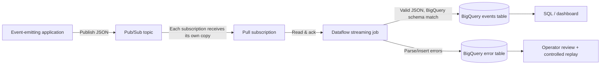

# Hands-On Pub/Sub, Dataflow, and BigQuery Pipeline

> **Chapter:** Data Pipelines and Processing  
> **Module:** CLOUD_PROVIDERS_GCP  
> **Module scope:** Explore Google Cloud from project organization, IAM, and VPCs to Compute Engine, GKE, Cloud Run, storage services, and databases. Through real deployment scenarios, learners select services, protect resources, automate releases, and monitor reliability alongside cost.

A website emits an `order_created` event as soon as a customer places an order. The analytics team wants near-real-time order counts and revenue in BigQuery without making the HTTP API wait for analytical writes. A **Pub/Sub → Dataflow → BigQuery** pipeline decouples producers from downstream consumers, processes continuous streams, and provides per-stage visibility. However, the pipeline is trustworthy only when designed properly for **schemas, permissions, retries, bad data, latency, duplicate events, and 24/7 running costs**.

This lesson uses the official **Pub/Sub Subscription to BigQuery** template (Dataflow classic template): it reads **JSON** from a **Pub/Sub pull subscription**, converts messages into BigQuery rows, and writes to a pre-created table. The scenario uses a **sandbox project**, synthetic non-sensitive data, a dedicated Cloud Storage staging bucket, and a least-privilege service account. Resource creation commands are **optional and run only with project-owner approval**; no GCP resource-creation or modification APIs were executed while authoring this material.

## Learning Objectives

After this lesson, you will be able to:

1. Describe the data flow and roles of **topic, subscription, Dataflow job, BigQuery table, and error table**.
2. Prepare an **event contract** and matching JSON schema, avoiding type mismatches and missing fields.
3. Configure IAM for the operator, Dataflow worker, Pub/Sub subscription, BigQuery dataset, and Cloud Storage staging.
4. Launch a **Google-provided Dataflow classic template** via `gcloud`, publish test messages, and query rows in BigQuery.
5. Investigate **backlog, system lag, watermarks, retries, duplicate events, dead-letter tables**, and safe replays.
6. **Drain** a streaming job before cleanup, estimate costs, and choose a Pub/Sub BigQuery subscription when Dataflow isn't needed.

## 1. End-to-End Architecture



| Component | Responsibility | Misconceptions to avoid |
|---|---|---|
| **Producer** | Emits events after business state is safely committed | A successful `publish` does not mean a BigQuery row exists yet |
| **Pub/Sub topic** | Receives and fans out messages | Does not parse or enforce BigQuery schemas |
| **Pull subscription** | Buffers backlog and manages ACKs/redelivery deadlines | Dataflow should use its own dedicated subscription, not share with other consumers |
| **Dataflow job** | Reads subscription, converts JSON to `TableRow`, writes BigQuery, routes errors | A streaming job **does not auto-stop** when zero messages arrive |
| **BigQuery table** | Stores analytics events per schema | Does not replace the source transactional database |
| **Error table** | Stores records that failed parsing or BigQuery insertion | This is the **template's BigQuery dead-letter table**, not a Pub/Sub dead-letter topic |

### 1.1. Why Use Dataflow Instead of Direct Ingestion?

| Requirement | Typical choice |
|---|---|
| Standard JSON/Avro mapping fields straight to a table | **Pub/Sub BigQuery subscription**: simpler, no dedicated Dataflow job |
| Custom field mapping, UDFs, data validation, PII masking | **Dataflow** (template UDF or Apache Beam depending on logic) |
| Windowed aggregation, stateful processing, late data, multi-stream enrich/joins | **Custom Apache Beam running on Dataflow** |
| Large batch files in Cloud Storage → warehouse | Load jobs or batch Dataflow fit better than 24/7 streaming |

A Pub/Sub BigQuery subscription can apply a **Single Message Transform** for light edits, whereas Dataflow fits complex transforms and windowing. Avoid running a streaming VM fleet just to copy 5 fields verbatim when a VM-less option already meets your SLO.

## 2. Designing the Event Contract Before Deployment

The lab uses JSON messages shaped like:

```json
{
  "event_id": "evt-101",
  "event_type": "order_created",
  "amount_cents": 159900,
  "event_time": "2026-11-19T08:30:00Z",
  "source": "checkout"
}
```

**BigQuery schema** for table `events_lab`:

| Field | BigQuery type | Meaning |
|---|---|---|
| `event_id` | `STRING` | Business idempotency key; never use Pub/Sub message ID as an order ID |
| `event_type` | `STRING` | Event category |
| `amount_cents` | `INTEGER` / `INT64` | Monetary amount as integer cents to avoid float rounding errors |
| `event_time` | `STRING` | RFC 3339 timestamp from producer; the lab uses `STRING` to reduce mapping failures |
| `source` | `STRING` | Event producer source |

This is a **learning schema**, not optimal for every production system. Clean production pipelines usually store timestamps as `TIMESTAMP`, validating and normalizing inconsistent inputs beforehand. The lab keeps `event_time STRING` and uses `SAFE_CAST(event_time AS TIMESTAMP)` at query time; changing schemas requires updating both the contract and the pipeline.

### 2.1. Non-Negotiable Schema Rules

- The template reads **`PubsubMessage.data` payloads** as JSON; it **does not** automatically copy Pub/Sub attributes or message IDs into table columns.
- The destination table **must exist** with a matching schema **before launching the template**.
- Extra fields absent from the BigQuery schema, type mismatches, or malformed JSON can be routed to the **error table**.
- Producer `event_id`s must remain identical across publish retries; otherwise two messages with different IDs represent the same transaction.
- Never publish credit card numbers, tokens, emails, or real PII into lab topics, BigQuery, or Dataflow worker logs.

### 2.2. Event Time vs. Processing Time

- **Event time:** when the action occurred at the producer (here `event_time`).
- **Publish time:** when Pub/Sub received the message.
- **Processing/ingestion time:** when Dataflow processed it or BigQuery wrote the row.

When running **windowed aggregations** like order counts per 5 minutes, decide whether to group by event time or processing time and configure **late events and watermarks**. This template only **forwards individual rows** and does not implement business windowing or aggregation itself.

## 3. IAM, Region, and Minimum Resources

### 3.1. Five Distinct Permission Sets

| Principal | Scope and required permissions |
|---|---|
| **Operator/deployer** | Create/run Dataflow jobs (`roles/dataflow.developer` or equivalent), `iam.serviceAccounts.actAs` on worker SA; Pub/Sub/BQ creation only in sandbox |
| **Producer** | `roles/pubsub.publisher` on the lab **topic** |
| **Dataflow worker SA** | `roles/dataflow.worker`; `roles/pubsub.subscriber` on the subscription; BigQuery **Data Editor** on the target dataset; read/write on staging bucket objects |
| **Dataflow service agent** | `roles/dataflow.serviceAgent` on the Google-managed identity; usually granted when enabling the Dataflow API |
| **BigQuery query identity** | `bigquery.jobs.create` to run queries and `bigquery.tables.getData` on target tables |

The Dataflow worker SA **does not automatically inherit IAM from the user running the CLI**. For an **auto-created error table**, the worker needs `bigquery.tables.create` on the target dataset; write-only access to the main table is **insufficient**. In production, scope permissions to specific **datasets, buckets, and subscriptions** rather than project-wide Editor/Owner.

### 3.2. Region and Networking

Co-locate the **Dataflow region, BigQuery dataset location, and Cloud Storage staging bucket** in the same supported region (illustrated with `asia-southeast1`). Check data residency, quotas, API availability, and network egress. While Pub/Sub resource names are global, publishing and subscribing follow endpoint and message-storage policies; data flows into the Dataflow region based on job settings.

**Dataflow workers are VM / Streaming Engine resources.** Projects without a default VPC, blocking external IPs, or requiring private workers need `--network`/`--subnetwork`, Private Google Access, NAT, or DNS/egress rules to reach Pub/Sub, BigQuery, GCS, and logging. **Never enable public IPs casually** to bypass firewall errors in production.

### 3.3. Checking Costs Before Clicking Run

A streaming job incurs charges for **Dataflow worker VMs / Streaming Engine**, Pub/Sub message storage/throughput, **BigQuery writes, storage, and queries**, GCS staging, and Cloud Logging **even at low throughput**. Set budget alerts, labels, and sensible worker caps. Because streaming jobs **run continuously**, assign an owner responsible for **draining/canceling and cleanup**.

## 4. Lab A — Read-Only Preflight (Mandatory)

> **Never create new GCP resources without a sandbox project, billing/budget owner, and authorization.** Without an environment, complete only the design, SQL, and exercises; this document never assumes a real topic, bucket, or Dataflow job already exists.

In Cloud Shell / Bash, pick **dedicated** names isolated from production:

```bash
PROJECT_ID="my-streaming-sandbox"
REGION="asia-southeast1"
TOPIC="orders-topic-lab"
SUBSCRIPTION="orders-sub-lab"
DATASET="streaming_lab"
TABLE="events_lab"
ERROR_TABLE="events_lab_errors"
BUCKET="my-streaming-staging-bucket"  # EXISTING bucket dedicated to sandbox
WORKER_SA="dataflow-worker-lab@$PROJECT_ID.iam.gserviceaccount.com"
JOB_NAME="pubsub-bq-lab-$(date -u +%Y%m%d-%H%M%S)"

gcloud auth list --filter="status:ACTIVE"
gcloud projects describe "$PROJECT_ID" \
  --format="table(projectId,name,lifecycleState)"
gcloud services list --enabled --project="$PROJECT_ID" \
  --format="value(config.name)" \
  | grep -E '^(dataflow|pubsub|bigquery|compute|storage)\.googleapis\.com$'

gcloud pubsub topics list --project="$PROJECT_ID"
gcloud pubsub subscriptions list --project="$PROJECT_ID"
bq ls --project_id="$PROJECT_ID"
gcloud dataflow jobs list --project="$PROJECT_ID" --region="$REGION"
gcloud iam service-accounts list --project="$PROJECT_ID"
gcloud storage buckets describe "gs://$BUCKET"
```

**Stop** if any name already exists with an unknown owner; never overwrite someone else's topic, subscription, table, or bucket. Verify bucket/dataset locations match, confirm the worker SA exists with least-privilege roles per Section 3, and run preflight with metadata-read access—**never** inspect or download secrets.

### 4.1. If Permissions or APIs Are Missing

An authorized operator must prepare **Dataflow, Pub/Sub, BigQuery, Compute Engine, and Cloud Storage APIs**, service agents, VPC, IAM, and a staging bucket. Reference syntax for enabling APIs on a **lab-only** project:

```bash
# MUTATING PROJECT OPERATION: sandbox admins only.
# gcloud services enable \
#   dataflow.googleapis.com pubsub.googleapis.com \
#   bigquery.googleapis.com compute.googleapis.com storage.googleapis.com \
#   --project="$PROJECT_ID"
```

Never grant project-wide `roles/editor` "to get it running quickly". Verify `iam.serviceAccounts.actAs` for the deployer and Cloud Storage object permissions for the **worker SA**; the Dataflow launcher/service agent also requires environment-appropriate roles.

## 5. Lab B — Preparing Pub/Sub and BigQuery in the Sandbox

### 5.1. Creating a Dedicated Topic and Subscription

**Run only after preflight confirms no name collisions and the owner approves:**

```bash
gcloud pubsub topics create "$TOPIC" --project="$PROJECT_ID"

gcloud pubsub subscriptions create "$SUBSCRIPTION" \
  --project="$PROJECT_ID" \
  --topic="$TOPIC" \
  --ack-deadline=60

gcloud pubsub subscriptions describe "$SUBSCRIPTION" \
  --project="$PROJECT_ID" \
  --format="yaml(name,topic,ackDeadlineSeconds,messageRetentionDuration,expirationPolicy)"
```

Create the subscription **before publishing** so test messages are retained; Pub/Sub does not automatically replay messages published prior to subscription creation unless topic retention/seek is explicitly configured. **Multiple consumers on one pull subscription load-balance messages** rather than each receiving a full copy: give Dataflow its own subscription instead of sharing with another application.

### 5.2. Creating the BigQuery Dataset and Table

Only if this dataset/table name does not already exist; the output table **must exist before starting the job**:

```bash
# DDL ONLY on an approved sandbox project.
bq --project_id="$PROJECT_ID" mk --dataset \
  --location="$REGION" "$PROJECT_ID:$DATASET"

# Ingestion-time partitioning to control scan scope and lifecycle.
# event_time STRING is parsed in queries; amount_cents is INT64.
bq --project_id="$PROJECT_ID" mk --table \
  --time_partitioning_type=DAY \
  "$PROJECT_ID:$DATASET.$TABLE" \
  "event_id:STRING,event_type:STRING,amount_cents:INTEGER,event_time:STRING,source:STRING"

bq show --format=prettyjson "$PROJECT_ID:$DATASET.$TABLE"
```

If the **dataset already exists** (and the owner authorized its use), **skip** `bq mk --dataset`; never duplicate or change locations. In production, set data-owner-approved partition expiration/retention instead of storing events forever.

### 5.3. Approving Permissions for the Dataflow Worker

When using an existing `WORKER_SA`, the owner verifies:

```text
roles/dataflow.worker             on the project running Dataflow
roles/pubsub.subscriber           on subscription orders-sub-lab
roles/bigquery.dataEditor         on dataset streaming_lab
roles/storage.objectAdmin         on the sandbox staging bucket (or custom least privilege)

Deployer: job run permission + iam.serviceAccounts.actAs on WORKER_SA
Pub/Sub publisher: roles/pubsub.publisher on orders-topic-lab
Dataflow service agent: roles/dataflow.serviceAgent, Google-provisioned and managed
```

**Never alter production IAM** just for a lab. If no worker SA exists, an admin creates a **new lab SA** with scoped roles; never use long-lived SA JSON keys. Grant dataset IAM directly on the dataset rather than project-wide BigQuery Data Editor.

## 6. Lab C — Running the Dataflow Template from a Pub/Sub Subscription

### 6.1. Choosing the Exact Template and Parameters

Official **classic** template:

```text
gs://dataflow-templates/latest/PubSub_Subscription_to_BigQuery
```

| Parameter | Example value | Required |
|---|---|---|
| `inputSubscription` | `projects/PROJECT_ID/subscriptions/orders-sub-lab` | Yes |
| `outputTableSpec` | `PROJECT_ID:streaming_lab.events_lab` | Yes |
| `outputDeadletterTable` | `PROJECT_ID:streaming_lab.events_lab_errors` | Optional, strongly recommended |

The `latest` path fits **sandboxes**, as its version can change without notice. In production, **pin a dated template version** and test before upgrading. **Do not confuse this classic template** with `PubSub_to_BigQuery_Flex`: the Flex Template uses `gcloud dataflow flex-template run` and a different URI.

### 6.2. Launching (Creates a Billable Streaming Job)

```bash
# Run ONLY after budget/IAM/VPC approval.
# JOB_NAME must be unused, valid, and traceable.
gcloud dataflow jobs run "$JOB_NAME" \
  --project="$PROJECT_ID" \
  --region="$REGION" \
  --gcs-location="gs://dataflow-templates/latest/PubSub_Subscription_to_BigQuery" \
  --staging-location="gs://$BUCKET/dataflow/staging" \
  --service-account-email="$WORKER_SA" \
  --max-workers=2 \
  --parameters="inputSubscription=projects/$PROJECT_ID/subscriptions/$SUBSCRIPTION,outputTableSpec=$PROJECT_ID:$DATASET.$TABLE,outputDeadletterTable=$PROJECT_ID:$DATASET.$ERROR_TABLE"
```

**Consider the job ready only once state reaches `JOB_STATE_RUNNING`** and metrics confirm connections to source and sink. A successful `gcloud` launch return **does not** mean BigQuery already has data; worker startup, IAM checks, subscription pulls, and BigQuery inserts still happen asynchronously afterward.

If the project **has no default VPC**, the operator adds `--network` and `--subnetwork` per network policy; when running **private workers without public IPs**, Private Google Access / NAT and Google API access are required. Never modify shared network settings for a lab.

### 6.3. Inspecting the Job and Obtaining the Real Job ID

```bash
gcloud dataflow jobs list \
  --project="$PROJECT_ID" --region="$REGION" \
  --format="table(id,name,state,createTime)"

# Copy JOB_ID from real output (DO NOT guess from JOB_NAME).
JOB_ID="JOB_ID_FROM_LIST"
gcloud dataflow jobs describe "$JOB_ID" \
  --project="$PROJECT_ID" --region="$REGION" \
  --format="yaml(id,name,currentState,createTime)"
```

In Console **Dataflow → Jobs**, inspect topology, job logs, and **data freshness / system lag**. If a job enters `JOB_STATE_FAILED`, inspect logs before publishing; never launch multiple jobs reading the same subscription to "try your luck".

## 7. Lab D — Publishing JSON and Querying BigQuery

### 7.1. Publishing a Valid Event

```bash
EVENT_ID="evt-$(date -u +%Y%m%d%H%M%S)"
EVENT_TIME="$(date -u +%Y-%m-%dT%H:%M:%SZ)"

# Unquoted JSON integer; UTC event_time in RFC 3339 format.
MESSAGE="$(printf '{"event_id":"%s","event_type":"order_created","amount_cents":159900,"event_time":"%s","source":"checkout"}' "$EVENT_ID" "$EVENT_TIME")"

gcloud pubsub topics publish "$TOPIC" \
  --project="$PROJECT_ID" \
  --message="$MESSAGE"
```

This is **synthetic** data with no PII. On a successful publish, Pub/Sub returns a **publish message ID**, which differs from the business `event_id`. Republishing the same JSON to test retries yields two distinct Pub/Sub message IDs carrying the same `event_id`.

### 7.2. Querying BigQuery with a Scan Cap

```bash
bq query --project_id="$PROJECT_ID" \
  --use_legacy_sql=false --location="$REGION" \
  --maximum_bytes_billed=1000000000 \
  "SELECT event_id, event_type, amount_cents,
          SAFE_CAST(event_time AS TIMESTAMP) AS event_timestamp,
          source
   FROM \`${PROJECT_ID}.${DATASET}.${TABLE}\`
   WHERE (_PARTITIONTIME >= TIMESTAMP_SUB(CURRENT_TIMESTAMP(), INTERVAL 1 DAY)
          OR _PARTITIONTIME IS NULL)
   ORDER BY event_id DESC
   LIMIT 20"
```

**Expected outcome:** after startup/ingest completes, the new event appears. BigQuery can temporarily hold streaming rows in `__UNPARTITIONED__` with **`_PARTITIONTIME IS NULL`**; omitting `OR _PARTITIONTIME IS NULL` can **hide freshly streamed rows** even though the job wrote them successfully. Exact second-level latency is not guaranteed. `LIMIT 20` alone does not make a query cheap—always pair **partition filters with `--maximum_bytes_billed`**.

### 7.3. Business Aggregation from the Events Table

```sql
-- Example for the lab table with INT64 amount_cents and STRING event_time.
SELECT
  event_type,
  COUNT(*) AS received_rows,
  SUM(amount_cents) AS amount_cents_sum,
  COUNTIF(SAFE_CAST(event_time AS TIMESTAMP) IS NULL)
    AS invalid_timestamp_rows
FROM `my-streaming-sandbox.streaming_lab.events_lab`
WHERE (_PARTITIONTIME >= TIMESTAMP_SUB(CURRENT_TIMESTAMP(), INTERVAL 1 DAY)
       OR _PARTITIONTIME IS NULL)
GROUP BY event_type
ORDER BY received_rows DESC;
```

**Do not treat this sum as a financial ledger**: events can be duplicated by producers, arrive late, or fail validation. The deduplication and quality controls in Sections 10–11 determine when data is fit for business decisions.

## 8. Lab E — Controlled Error Table Testing

The template accepts `outputDeadletterTable` to record events that fail JSON parsing, transforms, or BigQuery inserts. By default when omitted, the template uses `OUTPUT_TABLE_SPEC_error_records`. **The error table is auto-created by the template** when needed, so the worker needs `bigquery.tables.create` on the dataset.

### 8.1. Publishing a Malformed Message

Run **only on the sandbox topic**, after confirming a job is `RUNNING` and the main table receives valid data:

```bash
# Intentionally non-JSON data. Never publish to a production topic.
gcloud pubsub topics publish "$TOPIC" \
  --project="$PROJECT_ID" \
  --message='not-a-json-document'
```

With this template, unparseable messages route to the error table. If the error table does not appear immediately, wait for metrics/logs to flush and check worker permissions and job state; **never conclude a message vanished simply because a BigQuery `SELECT` hasn't shown it yet**.

### 8.2. Inspecting the Error Table (Read-Only)

```bash
# Error table may NOT exist yet if the pipeline has recorded zero errors.
bq show --format=prettyjson \
  "$PROJECT_ID:$DATASET.$ERROR_TABLE"

# Run ONLY once bq show confirms the error table exists.
bq query --project_id="$PROJECT_ID" \
  --use_legacy_sql=false --location="$REGION" \
  --maximum_bytes_billed=1000000000 \
  "SELECT *
   FROM \`${PROJECT_ID}.${DATASET}.${ERROR_TABLE}\`
   LIMIT 10"
```

**Never guess the error-table schema**: check `bq show` and inspect the error payload, error message, timestamp, and error type generated by your template version. The error table is **evidence and an operational triage queue**—it does not repair JSON or replay Pub/Sub automatically.

### 8.3. Error Recovery Workflow

1. Separate **transient errors** (BigQuery quotas/availability) from **poison messages** (malformed JSON/schema).
2. Fix the root cause; never configure infinite retries for poison messages.
3. Log/audit the `event_id` (if present) and error-row location.
4. With owner approval, publish the **fixed message** via a dedicated replay topic/path, preserving the **original business `event_id`** to avoid creating two transactions.
5. Verify both the main table **and error table** after replay, and mark the error resolved in your operational tracking system.

**Never run `gcloud pubsub subscriptions pull --auto-ack` on a subscription read by Dataflow** to inspect messages: it steals messages from the pipeline and ACKs them before BigQuery ever receives them.

## 9. Monitoring: From Pub/Sub Backlog to BigQuery Records

Use **Dataflow → Jobs → job → Execution details / Metrics / Logs**, **Pub/Sub → Subscriptions → Metrics**, **BigQuery → Job history / Table**, and Cloud Monitoring:

| Source | Metric / signal | Operational question |
|---|---|---|
| **Pub/Sub** | `subscription/num_undelivered_messages` | Is backlog growing steadily? |
| **Pub/Sub** | `subscription/oldest_unacked_message_age` | How long has the oldest event waited? |
| **Dataflow** | `JOB_STATE_RUNNING`, workers, CPU/memory | Is the job up with adequate compute? |
| **Dataflow** | System lag, data freshness, watermark | Which stage is lagging, and is it stuck? |
| **Dataflow** | Element counts, failed transforms, worker exceptions | Are messages flowing through read/parse/write stages? |
| **BigQuery** | New rows, schema/type errors, insert latency | Is valid data landing at the destination? |
| **BigQuery error table** | Error counts by type, replay backlog | Are poison records caught and triaged? |
| **Billing** | Dataflow worker hours/Streaming Engine, BQ writes, GCS | Is the job still billing heavily while idle? |

### 9.1. Latency Is More Than One Number

```text
Producer event time
      → publish latency
      → Pub/Sub subscription backlog
      → Dataflow pull + parse/transform
      → BigQuery write/visibility
      → SQL/report refresh
```

A stale dashboard might stem from Dataflow falling behind, **or** from a BI report refreshing only every 15 minutes. Measure each hop instead of blindly raising `--max-workers`. Watermarks reflect the pipeline's **event-time** progress, not wall-clock time or the latest row committed in BigQuery.

### 9.2. Recommended Alert Signals

- `oldest_unacked_message_age` climbing steadily past your test SLO threshold.
- Rising Dataflow system lag, or unexpected transition from `RUNNING` to `FAILED`/`CANCELLED`.
- **Zero input/output elements** during hours when traffic should be present.
- Error-table spikes immediately after a deployment or schema change.
- Increasing BigQuery write errors/quota failures, with row counts lagging publish rates.
- Elevated Dataflow spend during low-traffic windows due to over-provisioned workers or Streaming Engine.

Derive thresholds from real baseline throughput. Metrics and BigQuery rows experience **reporting delays**, so avoid alerting on a single failed query check.

## 10. Delivery Semantics, Retries, and Duplicate Data

### 10.1. Pub/Sub At-Least-Once Is Not "One Business Event"

- Pub/Sub can **redeliver** messages on ACK deadline expiration or network errors at the source.
- Dataflow's **default exactly-once streaming mode** deduplicates intra-pipeline by **Pub/Sub message ID** and coordinates sink writes, reducing duplicates from redeliveries.
- Producers can publish **the same order twice** with **two distinct Pub/Sub message IDs**; Dataflow cannot automatically tell they share one business `event_id`.
- Choosing **at-least-once Dataflow mode** for lower cost/latency requires downstream consumers to tolerate duplicate processing/rows; never promise business exactly-once.
- Do not enable **Pub/Sub exactly-once subscription delivery** just to "help" Dataflow; Dataflow has its own deduplication/ACK mechanics, and Google docs advise against combining them by default.

**Bottom line:** to avoid double-counting orders, producers must emit a stable `event_id` and downstream must enforce **deduplication/upserts**—never rely on subscription type alone.

### 10.2. Deduplicating Queries by Business Key

Example for the lab's append-only `events_lab` table (using `SAFE_CAST` to handle invalid timestamps):

```sql
-- SELECT only; does not modify the table. Business rules must define
-- tie-breaking order when one event_id has conflicting payloads.
WITH ranked AS (
  SELECT
    event_id, event_type, amount_cents, source,
    SAFE_CAST(event_time AS TIMESTAMP) AS event_ts,
    ROW_NUMBER() OVER (
      PARTITION BY event_id
      ORDER BY SAFE_CAST(event_time AS TIMESTAMP) DESC, amount_cents DESC
    ) AS rn
  FROM `my-streaming-sandbox.streaming_lab.events_lab`
  WHERE (_PARTITIONTIME >= TIMESTAMP_SUB(CURRENT_TIMESTAMP(), INTERVAL 7 DAY)
         OR _PARTITIONTIME IS NULL)
)
SELECT event_id, event_type, amount_cents, event_ts, source
FROM ranked
WHERE rn = 1;
```

**Important:** this query is an **analytical example only**. If a producer emits two messages sharing an `event_id` with conflicting payloads, `ORDER BY` encodes a business rule requiring validation (never blindly assume the newest value wins). Financial systems require reconciliation against the **transactional database / ledger** and full lineage.

### 10.3. Replay and Change Control

When restarting or updating Dataflow:

- Never run **two jobs concurrently reading the same pull subscription** expecting both to receive all messages; they act as **competing consumers**.
- To fan out to another pipeline, create a **separate subscription** on the topic within retention/quota limits.
- To replay history, use Pub/Sub topic/subscription retention and **pre-designed, approved snapshots/seeks**; never assume messages are retained forever.
- Replays typically produce duplicates in BigQuery; rely on `event_id` and monitor jobs/billing accordingly.

## 11. Extending: UDFs or Custom Apache Beam

### 11.1. JavaScript UDF on the Template

If producers don't emit the exact schema, the template supports `javascriptTextTransformGcsPath` and `javascriptTextTransformFunctionName`. Example normalizing `event_type` and validating amounts (**sample code for the learner's own directory**—do not create extra files in the lesson repository):

**`normalize.js`**

```javascript
function normalizeEvent(inJson) {
  const event = JSON.parse(inJson);
  if (typeof event.event_id !== "string" || !event.event_id) {
    throw new Error("Missing event_id");
  }
  if (!Number.isSafeInteger(event.amount_cents) || event.amount_cents < 0) {
    throw new Error("amount_cents must be a non-negative integer");
  }
  return JSON.stringify({
    event_id: event.event_id,
    event_type: String(event.event_type || "").toLowerCase(),
    amount_cents: event.amount_cents,
    event_time: String(event.event_time || ""),
    source: String(event.source || "")
  });
}
```

Once the owner authorizes the sandbox staging bucket:

```bash
# Run ONLY if you have normalize.js in your personal directory.
# gcloud storage cp normalize.js "gs://$BUCKET/dataflow/udf/normalize.js"

# When launching a NEW JOB, add these two parameters (never run concurrently
# on the same subscription as the old job):
# javascriptTextTransformGcsPath=gs://$BUCKET/dataflow/udf/normalize.js
# javascriptTextTransformFunctionName=normalizeEvent
```

The UDF **must return a JSON string** matching the BigQuery schema. Validation exceptions thrown by the UDF can be routed by the template to the error table. **Never put API keys, network calls, PII, or critical transaction state** inside a UDF; it is a stateless per-message transform, not a multi-step transaction engine.

### 11.2. When Custom Beam Is Needed

Templates suit independent per-message transforms. When you need **stream-to-lookup joins, 5-minute windows, allowed lateness, event-time triggers, aggregations, or state/timers**, write Apache Beam code and package a Flex Template—tested with DirectRunner/staging and dedicated CI/CD.

```text
ReadFromPubSub(subscription)
  → Decode + validate + bad-record side output
  → Assign event timestamps / choose watermark policy
  → WindowInto(FixedWindows(5m), allowed lateness, triggers)
  → GroupByKey / CombinePerKey
  → Format BigQuery rows
  → BigQueryIO write

bad-record output → error sink + alert + replay workflow
```

This is a **logical Beam flow**, not runnable Python. With windowed aggregations, **late events, triggers, and duplicate panes** affect outputs; outputs need window keys and matching write semantics. Never replace a template with custom Beam just to forward raw JSON without a clear benefit.

## 12. Performance, Scaling, and Capacity

### 12.1. Throughput Sizing Example

Suppose the producer emits **2,000 messages/s**, each **1 KiB**:

- Input rate is **2,000 KiB/s ≈ 1.95 MiB/s**, roughly **6.87 GiB/hour** before framing overhead, retries, and compression.
- BigQuery storing 5 small fields may occupy less space than JSON on the wire; actual billing depends on write mode and volume.
- If Dataflow processes **1,500 messages/s**, the backlog grows by roughly **500 messages/s** under steady load assuming no other bottlenecks.

Proper response: **watch backlog + system lag**, inspect networking, BigQuery quotas, schemas, and slow transforms, and only then tune workers/autoscaling. Never scale workers indefinitely, because extra VMs will not fix BigQuery API quotas or poison messages.

### 12.2. Workers, Streaming Engine, and Networking

- `--max-workers=2` in the lab **does not cap total spend**; other components still bill.
- For high-volume streams, review Dataflow autoscaling, Streaming Engine, and worker machine types; run load tests and inspect worker CPU/memory.
- Workers in private subnets need routes to **Pub/Sub, BigQuery, GCS, and Monitoring/Logging**; `--disable-public-ips` works only when egress is properly designed.
- Align regional resources, network egress billing, and sensitive data residency per policy. Never put staging GCS buckets in arbitrary cross-region locations.
- Dataflow retries and BigQuery backpressure increase latency; check sink-specific errors before assuming the source is slow.

## 13. Security and Cost Controls

| Layer | Required controls |
|---|---|
| **Pub/Sub publisher** | Producer SA has `Publisher` only on the target topic |
| **Dataflow worker** | Dedicated SA with Pub/Sub Subscriber, dataset-scoped BQ write, and GCS staging permissions |
| **Data** | Schema contract, PII redaction/validation, retention, and dataset access policies |
| **Encryption** | Google-managed encryption by default or CMEK with proper key/project IAM; TLS for all APIs |
| **VPC** | Approved network/subnet and firewall/egress/API endpoints when private |
| **Logs** | Never print raw messages, auth tokens, or PII; retain Cloud Audit Logs |
| **BigQuery** | Dataset location, column policy tags / row-level controls for sensitive data |
| **Staging bucket** | Private IAM, lifecycle/expiration, no public objects, compliant residency |
| **Cost** | BQ storage/writes/queries, Pub/Sub throughput, workers & Streaming Engine, GCS/logging |
| **Lifecycle** | Owner, job labels, budget alerts, on-call, and **drain before cleanup** |

This is a **data pipeline**, not a distributed transaction. If the producer must never lose business events between DB commit and Pub/Sub publish, use the **transactional outbox / CDC** pattern; never treat HTTP 200 on `Publish` as atomic with Cloud SQL commits.

## 14. Layer-by-Layer Troubleshooting

| Symptom | First check | Remediation |
|---|---|---|
| `PERMISSION_DENIED` launching Dataflow | Deployer job creation, `iam.serviceAccounts.actAs`, service agent | Grant scoped IAM on project/SA; never use Owner |
| Workers fail immediately on startup | Staging bucket, VPC/Subnet, service account, image/template | Check job/worker logs, API connectivity, quotas |
| Job `RUNNING` yet BigQuery has no rows | `inputSubscription`, backlog, parse failures, BigQuery sink | Inspect source element counts, DLQ, table schema |
| Pub/Sub backlog growing | Low worker throughput, quotas, slow sink | Inspect Dataflow system lag, autoscaling, BQ errors |
| BigQuery `Not found: Table` | Missing `PROJECT:DATASET.TABLE` or wrong location | Create table/schema before job launch; check permissions |
| BigQuery insert `invalid value` | Wrong JSON field type, extra field, invalid null | Fix contract/UDF; inspect error table |
| Error table absent | No errors occurred yet or missing table-create permission | Check `bq show`, worker dataset IAM, and job logs |
| Duplicate rows in BigQuery | Publisher retries or at-least-once mode | Deduplicate/reconcile by business `event_id` |
| Two jobs on same subscription miss events | Competing pull consumers | Create separate subscriptions for fan-out |
| Rows appear late | Pub/Sub `oldest_unacked_age`, Dataflow lag, sink/quotas | Measure each stage; clear bottlenecks before scaling |
| Wrong hour in queries | Event time differs from ingestion time / UTC | Use parsed `TIMESTAMP`; verify timezone and partitions |
| Billing grows while idle | Streaming job still `RUNNING`; GCS/logs retained | Drain job properly; audit active resources & costs |
| Job stuck `DRAINING` | In-flight work/sink errors, watermarks/timers | Read logs; fix or cancel per approved runbook |

### 14.1. Decision Tree

```text
Publish succeeded but no row appears?
  ├─ Does the Pub/Sub subscription have a backlog?
  │    ├─ Yes → Is the Dataflow job RUNNING? → Check IAM, workers, quotas, lag
  │    └─ No → Is any pipeline reading? Are rows in the error table?
  ├─ Are Dataflow source element counts rising?
  │    ├─ No → Check inputSubscription and competing consumers
  │    └─ Yes → Check BigQuery sink errors + DLQ + schema
  └─ Row exists in BigQuery, yet missing on dashboard?
       → Check ingestion/partition/event_time filters, IAM, report refresh
```

**Never run `gcloud pubsub subscriptions pull --auto-ack` or delete a subscription "to see if the backlog clears"** on a live pipeline; doing so destroys events and replayability.

## 15. Stopping the Job, Inventory, and Cleanup

### 15.1. Stop Producers Before Draining

For an isolated lab, **stop all publishers** (ensuring no more messages arrive) and fetch the actual Dataflow job ID:

```bash
gcloud dataflow jobs list \
  --project="$PROJECT_ID" --region="$REGION" \
  --format="table(id,name,state)"

# Copy JOB_ID carefully from the row matching your lab JOB_NAME.
JOB_ID="JOB_ID_FROM_LIST"
gcloud dataflow jobs describe "$JOB_ID" \
  --project="$PROJECT_ID" --region="$REGION" \
  --format="yaml(id,name,currentState)"
```

### 15.2. Draining the Streaming Job (Preferred)

```bash
# Drain ONLY the job CREATED BY THIS LAB; never touch shared pipelines.
gcloud dataflow jobs drain "$JOB_ID" \
  --project="$PROJECT_ID" --region="$REGION"

# Recheck status and logs:
gcloud dataflow jobs describe "$JOB_ID" \
  --project="$PROJECT_ID" --region="$REGION" \
  --format="yaml(id,name,currentState)"
```

**Draining** stops ingesting new input and attempts to finish processing already-received elements. Proceed to cleanup only once the job reaches **`DRAINED`** (or an owner-handled terminal state) and you have verified the main table, error table, and backlog. If `DRAINING` hangs, investigate before running `cancel`: **canceling can discard in-flight work**. After draining, unpulled messages may remain in the subscription; decide whether to keep, replay, or purge them before deleting.

### 15.3. Cleaning Up Lab Resources After Confirming Ownership

The deletion commands below are **illustrative only** and commented out to prevent accidents; uncomment only once resource owners confirm no active consumers, data, or retention requirements remain.

```bash
# Do not delete if topic/subscription is used by another app.
# gcloud pubsub subscriptions delete "$SUBSCRIPTION" --project="$PROJECT_ID"
# gcloud pubsub topics delete "$TOPIC" --project="$PROJECT_ID"

# Main and error tables hold data; delete ONLY if lab-dedicated:
# bq rm --table --force "$PROJECT_ID:$DATASET.$TABLE"
# bq rm --table --force "$PROJECT_ID:$DATASET.$ERROR_TABLE"

# Delete ONLY the lab staging prefix after checking logs/retention:
# gcloud storage ls "gs://$BUCKET/dataflow/staging/"
# Never delete shared buckets, datasets, worker SAs, or IAM roles.
```

**Never delete an entire dataset, project, or bucket just to wrap up a lesson**, especially pre-existing ones. Worker jobs may hold resources/logs briefly after draining; reconcile Cloud Billing Reports since charges post with delay. If you ran only the read-only preflight, no new resources were created and no cleanup is needed.

## 16. Exercises and Suggested Answers

### Exercise 1 — Dataflow vs. BigQuery Subscription?

A JSON topic already matches the BigQuery table schema and needs no enrichment or windowing. Must you run Dataflow?

**Answer:** no. A **Pub/Sub BigQuery subscription** is usually simpler with less operational overhead; Dataflow makes sense when custom transforms, aggregations, or pipeline-level guarantees are needed.

### Exercise 2 — Shared Subscription

Two Dataflow jobs read from the same `orders-sub-lab` subscription, and the team expects both to receive **100%** of events.

**Answer:** incorrect. One pull subscription creates **competing consumers**; you need **two separate subscriptions** on the topic for independent fan-out.

### Exercise 3 — Schema Mismatch

BigQuery expects `amount_cents INT64`, while a producer publishes `"amount_cents":"abc"`. Where should you inspect?

**Answer:** Dataflow transform / BigQuery sink logs and the **error table**; fix the producer contract or UDF validation, then run a controlled replay. Never weaken BigQuery types to accept malformed data.

### Exercise 4 — Does Exactly-Once Eliminate Two Orders?

A producer publishes two messages with different Pub/Sub IDs but the same `event_id=evt-42`. Dataflow runs in default exactly-once mode. Is only one row guaranteed?

**Answer:** no. The pipeline deduplicates **redeliveries sharing the same Pub/Sub message ID**, whereas two independent publishes count as two distinct messages. Deduplicate by `event_id` and validate against the operational source.

### Exercise 5 — Backlog and Throughput

Publisher sends 2,000 events/s while the pipeline steadily processes 1,500 events/s. After 10 minutes, roughly how many messages does the backlog grow by (ignoring retries)?

**Answer:** `(2,000 - 1,500) × 600 = 300,000 messages`. Investigate bottlenecks, lag, and quotas before scaling workers.

### Exercise 6 — Timestamps

In the lab schema, `event_time` is `STRING` and `_PARTITIONTIME` is ingestion time (potentially `NULL` while freshly streaming). If a report needs order counts by order-placement hour, which field should you group by?

**Answer:** `SAFE_CAST(event_time AS TIMESTAMP)` after validating timezone/format; `_PARTITIONTIME` filters ingestion partitions and does not equal business time. When querying newly arrived events, remember to include `_PARTITIONTIME IS NULL`.

### Exercise 7 — Stopping the Job

You published three test messages; the Dataflow job stays `RUNNING` even after the producer stops. Does billing drop to zero automatically when traffic stops?

**Answer:** no. A streaming job remains active and can continue billing. Identify the exact `JOB_ID`, **drain** it, and verify a terminal state before cleanup.

### Exercise 8 — Replaying Poison Messages

A schema-invalid payload landed in `events_lab_errors`. After fixing the producer, the team replays the event with a new random `event_id`. What is the risk?

**Answer:** it can create a duplicate business event that deduplication cannot recognize. Preserve the original **business `event_id`**, keep audit records, and verify the main table, error table, and processing state before replaying.

### Exercise 9 — Service Account Permissions

The operator has `roles/dataflow.developer` and launches the job, yet workers fail to read the subscription. Which role should be granted, and where?

**Answer:** the worker runtime SA needs `roles/pubsub.subscriber` on the subscription, alongside `roles/dataflow.worker`, BigQuery dataset write permissions, and GCS staging access. The operator's IAM roles **do not transfer** to workers.

### Exercise 10 — 24/7 Cost

A job handles low traffic; should you still optimize schemas and pin a fixed template version?

**Answer:** yes. GCS/BigQuery storage, Pub/Sub volume, and Dataflow workers/Streaming Engine still accrue charges; pin a **dated template version** in production, benchmark throughput/cost, and switch to a BigQuery subscription if Dataflow transforms aren't needed.

## 17. Production Checklist

| Category | Acceptance criteria |
|---|---|
| **Architecture** | Evaluated Dataflow against Pub/Sub BigQuery subscriptions |
| **Contract** | JSON fields, schema, nullability, `event_id`, and `event_time` are versioned |
| **Pub/Sub** | Dedicated topic/subscription, backlog/ACK/retention, producer retry policy |
| **IAM** | Dedicated worker SA; scoped Subscriber, BQ dataset, GCS staging, and `actAs` |
| **BigQuery** | Table exists before launch; partitioning, retention, and query costs managed |
| **Dataflow** | Region, network, pinned version, runtime mode, worker caps, and logs configured |
| **Error handling** | Error table, validation, alerts, replay workflow, and ownership |
| **Correctness** | Pipeline dedup ≠ business dedup; `event_id` reconciliation in place |
| **Observability** | Oldest unacked age, lag, rows/sec, write errors, and DLQ monitored |
| **Security** | Non-sensitive data in labs; VPC/IAM/CMEK/retention enforced per policy |
| **Cost** | Budget, Streaming Engine/VMs, BQ writes/storage/queries, and GCS tracked |
| **Lifecycle** | Drain/cancel runbook; cleanup scoped strictly to lab resources |

## Key Takeaways

A successful **Pub/Sub → Dataflow → BigQuery** pipeline takes more than seeing rows land in a table: you must manage **schemas, IAM, backlogs, error tables, duplicate messages, event time, and cost**. The `PubSub_Subscription_to_BigQuery` template works well for an out-of-the-box streaming lab; for complex transforms use UDFs or custom Beam, and for plain JSON ingestion consider a Pub/Sub BigQuery subscription. Streaming jobs **do not stop on their own**—after testing, **drain the exact job**, verify outputs, and clean up only your sandbox resources.

## Official References

- [Dataflow — Stream from Pub/Sub to BigQuery](https://cloud.google.com/dataflow/docs/tutorials/dataflow-stream-to-bigquery)
- [Dataflow — Pub/Sub Subscription to BigQuery template](https://cloud.google.com/dataflow/docs/guides/templates/provided/pubsub-subscription-to-bigquery)
- [Dataflow — Pub/Sub to BigQuery Flex Template](https://cloud.google.com/dataflow/docs/guides/templates/provided/pubsub-to-bigquery)
- [Dataflow — Run classic templates](https://cloud.google.com/dataflow/docs/guides/templates/running-templates)
- [Dataflow — Monitor jobs](https://cloud.google.com/dataflow/docs/guides/monitoring-overview)
- [Dataflow — Read from Pub/Sub](https://cloud.google.com/dataflow/docs/concepts/streaming-with-cloud-pubsub)
- [Dataflow — Streaming modes and exactly-once processing](https://cloud.google.com/dataflow/docs/guides/streaming-modes)
- [Dataflow — IAM and security](https://cloud.google.com/dataflow/docs/concepts/security-and-permissions)
- [Pub/Sub — BigQuery subscriptions](https://cloud.google.com/pubsub/docs/bigquery)
- [Pub/Sub — Subscription message retention and replay](https://cloud.google.com/pubsub/docs/replay-overview)
- [Pub/Sub — Pull subscription troubleshooting](https://cloud.google.com/pubsub/docs/pull-troubleshooting)
- [BigQuery — Streaming data and Storage Write API](https://cloud.google.com/bigquery/docs/write-api)
- [BigQuery — Partitioned tables](https://cloud.google.com/bigquery/docs/partitioned-tables)
- [BigQuery — Query streaming buffer in ingestion-time partitions](https://cloud.google.com/bigquery/docs/querying-partitioned-tables)
- [gcloud — Run Dataflow classic template](https://cloud.google.com/sdk/gcloud/reference/dataflow/jobs/run)
- [gcloud — Drain Dataflow job](https://cloud.google.com/sdk/gcloud/reference/dataflow/jobs/drain)
