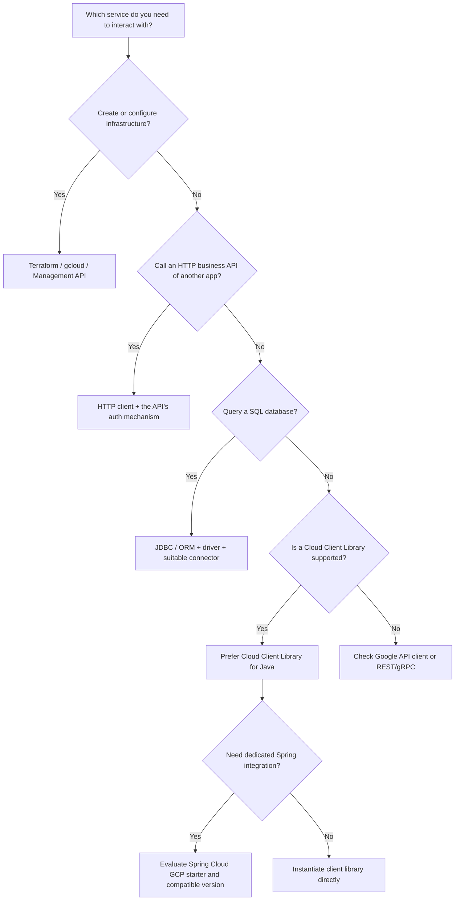
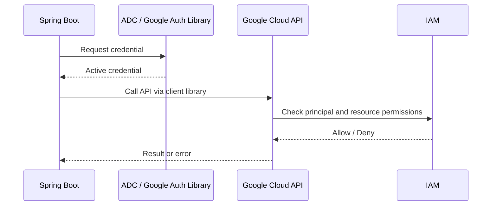
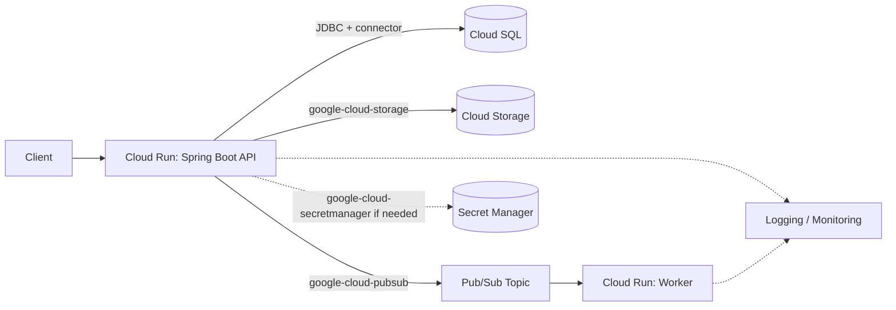

# Cloud Client Libraries and Choosing an SDK

## 1. The Problem: How Does a Java Application Communicate with Google Cloud?

A Spring Boot application running on Cloud Run may need to upload files to **Cloud Storage**, save orders in **Cloud SQL**, publish events to **Pub/Sub**, read secrets from **Secret Manager**, and send telemetry to an observability system. Each service has its own API, authentication mechanism, quotas, pagination, and error handling. Manually assembling HTTP requests for every service forces the team to maintain extensive infrastructure glue code and risk missing details like retries or deadlines.

**Google Cloud Client Libraries** provide language-specific libraries, including for **Java**, to call Google Cloud APIs using idiomatic classes and methods. However, "use the SDK" is not the answer to every problem: querying PostgreSQL should still use JDBC, calling a business REST API on another Cloud Run service is still HTTP, and provisioning resources in bulk usually fits Terraform or a deployment tool.

In the **GCP Tools and Development Environment** chapter, this lesson focuses on how to **choose the right service communication library for a Java application**, configure dependencies and authentication securely, manage client lifecycles, and handle errors. Examples sit within the context of developing Java applications on GCP across projects, IAM, and VPCs to Cloud Run/GKE/Compute Engine, storage, releases, and operations.

### Learning Objectives

After studying this lesson, you will be able to:

1. Distinguish Cloud Client Libraries, Spring integration libraries, auth libraries, Google API Client Libraries, direct REST/gRPC, and the Google Cloud CLI.
2. Choose the right Java client for Cloud Storage, Pub/Sub, Firestore, BigQuery, and Secret Manager, and recognize cases where a Cloud Client Library is **not** needed.
3. Install consistent dependencies using the **Google Cloud Libraries BOM** and configure **Application Default Credentials (ADC)**.
4. Write a Spring Boot service using Cloud Storage, explaining IAM permissions, bucket configuration, and error behavior.
5. Design connections with appropriate timeouts, retries, idempotency, resource limits, logging, and testing.

## 2. "SDK" Is a Broad Term: Distinguish Tool Categories

In documentation and technical discussions, "Google Cloud SDK" is sometimes used to refer to the command-line toolset, while "Java SDK" typically refers to the set of libraries embedded in an application. Identify **who uses the tool and when** before choosing.

| Category | Primary Purpose | Examples | How It Is Used |
| --- | --- | --- | --- |
| **Google Cloud Client Libraries for Java** | Java applications calling Google Cloud APIs | `google-cloud-storage`, `google-cloud-pubsub`, `google-cloud-secretmanager` | Maven/Gradle dependency in source code |
| **Google Auth Library** | Issue, obtain, refresh, and manage appropriate credentials | `google-auth-library-oauth2-http` and ADC | Usually used by client libraries; can be used directly when needed |
| **Google API Client Libraries** | Call various Google APIs using the traditional API client model | APIs with clients generated from Discovery documents | Consider when an API does not yet have a suitable Cloud Client Library |
| **Spring Framework / Spring Cloud GCP** | Integrate GCP services with Spring configuration and abstractions | Starters for Cloud Storage, Pub/Sub, Secret Manager depending on project | Useful when needing beans, auto-configuration, and messaging abstractions |
| **Firebase Admin SDK** | Server-side Firebase administrative tasks | Verifying Firebase ID tokens, managing users | Use when business logic belongs to Firebase; does not replace all Cloud Client Libraries |
| **Direct REST/gRPC** | Call endpoints over network protocols | HTTP client, gRPC stub | When an API requires custom behavior or lacks an appropriate client |
| **Google Cloud CLI (`gcloud`)** | Administrative operations from the terminal | Creating project resources, deploying Cloud Run, inspecting configs | Tool for developers/CI, not a library for calling APIs inside business code |
| **Terraform / Infrastructure as Code (IaC)** | Declaring and managing infrastructure lifecycles | Projects, IAM, buckets, Cloud Run, VPCs | Used for reproducible infrastructure configuration |

Note: Artifact names, capabilities, and versions of **Spring Cloud GCP** depend on the Spring Boot/Spring Framework version; check the **compatibility matrix** before adding a starter. Not all GCP services have identical client experience, transport, or Spring support.

### Data Plane and Control Plane

Two APIs mentioning the same service may serve different purposes:

- **Data plane:** an application uploads an object to Cloud Storage, reads a Firestore document, or publishes a Pub/Sub message. This is the regular business flow.
- **Control plane:** an administrator creates a bucket, grants IAM, configures a Cloud Run service, or reads cluster metadata. These operations usually belong to deployment/operations environments.

For example, calling the **business API** `GET /orders` on a Cloud Run service is an HTTP request to the application's URL; a Cloud Run management library does not automatically serve as a client for that business endpoint. This distinction prevents adding management dependencies to an application when it only needs HTTP communication.

## 3. Selection Principles by Service

### 3.1. Guidance Table for Java Developers

| Problem | Java Solution to Consider | Rationale and Limitations |
| --- | --- | --- |
| Upload/download objects, list objects in a bucket | `com.google.cloud:google-cloud-storage` | Java API for Cloud Storage; IAM on bucket/object, watch memory when handling large files |
| Publish/consume Pub/Sub messages | `com.google.cloud:google-cloud-pubsub` | Supports publisher/subscriber and receive flow control; still must design retry/idempotency |
| CRUD documents in Firestore | `com.google.cloud:google-cloud-firestore` | Document, collection, and transaction operations; data model differs from SQL |
| Query/analyze BigQuery data | `com.google.cloud:google-cloud-bigquery` | Submits query jobs, reads results; must control scanned data and costs |
| Read secrets in Secret Manager | `com.google.cloud:google-cloud-secretmanager` | Read-only secret permissions via IAM; avoid logging secret values |
| Interact with Cloud Spanner | `com.google.cloud:google-cloud-spanner` | Spanner-specific API; do not substitute arbitrarily for JDBC |
| Connect to Cloud SQL PostgreSQL/MySQL | **JDBC driver + connection pool**, paired with **Cloud SQL Java Connector** when appropriate | Cloud SQL is a managed DB service; business queries still go over SQL/JDBC |
| Call a Spring Boot REST service running on Cloud Run | `WebClient`/`RestClient`/HTTP client, adding an **ID token** when the service requires IAM auth | Calls the application's API; do not use the Cloud Run admin client |
| Emit application logs when running on Cloud Run | **Structured logging** to stdout/stderr collected by the platform | No need to call the Logging API directly for every log line |
| Record traces/metrics from Spring Boot | **Micrometer/OpenTelemetry** with an appropriate exporter | Instrumentation is generally better suited than manual Monitoring admin API calls |
| Create buckets, service accounts, GKE clusters in a new environment | **Terraform** or an equivalent management tool | Infrastructure lifecycle differs from business request processing lifecycle |

For example: "Store profile photos on GCP" fits the Cloud Storage client; "store relational user profiles" fits Spring Data JPA/JDBC connecting to Cloud SQL. Even though both live on GCP, **do not force both onto a single shared SDK abstraction**.

### 3.2. Decision Flow



Before finalizing a choice, check **required API features**, Java version, transport support, authentication requirements, how the client is maintained, testing against an emulator or real environment, and version upgrade strategy. A convenient library missing a critical feature for your problem can make the entire design harder.

## 4. Managing Dependencies in Maven and Gradle

Google Cloud Java libraries include many artifacts and shared dependencies. Manually declaring many individual versions can cause conflicts among gRPC, protobuf, Guava, or other foundational libraries. The **Google Cloud Libraries BOM (Bill of Materials)** helps select a managed, compatible set of versions within the same client library family.

### 4.1. Maven

Example adding Cloud Storage and Pub/Sub to `pom.xml`:

```xml
<properties>
    <!-- Choose a current BOM version already tested with the project -->
    <google.cloud.bom.version>YOUR_TESTED_BOM_VERSION</google.cloud.bom.version>
</properties>

<dependencyManagement>
    <dependencies>
        <dependency>
            <groupId>com.google.cloud</groupId>
            <artifactId>libraries-bom</artifactId>
            <version>${google.cloud.bom.version}</version>
            <type>pom</type>
            <scope>import</scope>
        </dependency>
    </dependencies>
</dependencyManagement>

<dependencies>
    <dependency>
        <groupId>com.google.cloud</groupId>
        <artifactId>google-cloud-storage</artifactId>
    </dependency>
    <dependency>
        <groupId>com.google.cloud</groupId>
        <artifactId>google-cloud-pubsub</artifactId>
    </dependency>
</dependencies>
```

`YOUR_TESTED_BOM_VERSION` is a **placeholder value** that must be replaced with a real version published in official documentation or Maven Central, followed by running dependency resolution/tests. Do not guess the latest version number. With Spring Boot applications, the Spring Boot BOM and Google Cloud BOM may both manage certain shared dependencies: after adding them, inspect the dependency tree and run integration tests to detect conflicts.

### 4.2. Gradle (Groovy DSL)

Equivalent example in `build.gradle`:

```groovy
dependencies {
    implementation platform("com.google.cloud:libraries-bom:YOUR_TESTED_BOM_VERSION")
    implementation "com.google.cloud:google-cloud-storage"
    implementation "com.google.cloud:google-cloud-pubsub"
}
```

For libraries outside the BOM or a Spring Cloud GCP starter, check their specific artifact coordinates and version management rules. Do not assume the Google Cloud BOM governs every dependency in the application.

### 4.3. What to Check When Upgrading

1. **Java runtime:** does the library support the JDK version in use? If the app runs Java 17/21, are build and runtime consistent?
2. **API compatibility:** have method signatures, endpoint configuration, transport, exception classes, or client closing changed?
3. **Overlapping dependencies:** are protobuf/gRPC/Guava versions compatible with Spring Boot and current frameworks?
4. **Behavior and risks:** are there default changes in deadlines, retries, authentication, pagination, or data reading?
5. **Testing:** run unit tests, integration tests against test resources, and verify error paths; record the BOM used to keep builds reproducible.

## 5. Authentication with ADC and Authorization with IAM

A key strength of Cloud Client Libraries is **Application Default Credentials (ADC)** integration: libraries can locate credentials through the environment's standard mechanism without hardcoding static access tokens in source code.

### 5.1. Where Does ADC Work?

| Environment | Typical Way Identity Is Provided | Things to Remember |
| --- | --- | --- |
| Development machine | `gcloud auth application-default login` or appropriate federation/impersonation config | The account for ADC is **separate from** the `gcloud auth login` session used by the CLI |
| Cloud Run | Assign a **runtime service account** to the service/job | Google Auth Library retrieves credentials from the runtime environment |
| GKE | **Workload Identity Federation for GKE** | Maps workload identity to GCP permissions per cluster configuration |
| Compute Engine | Attach a service account to the VM and configure appropriate access scopes | Avoid static keys |
| CI/CD outside GCP | **Workload Identity Federation** when supported by the provider | Avoid storing long-lived private keys in CI secrets |

When running locally, the typical steps are:

```shell
gcloud auth application-default login
# If prompted regarding a quota project, verify config and permissions:
gcloud auth application-default set-quota-project YOUR_PROJECT_ID
```

Do not run these commands **inside** Cloud Run or embed them in a Dockerfile. Avoid committing service account JSON key files to Git; if an environment genuinely requires a credential file, prefer federation configurations and your organization's credential management workflow.

### 5.2. IAM Ultimately Decides What the App May Do

ADC identifies **which identity the application is using**; **IAM** decides whether that identity has permission. For example, an API that only uploads files to a bucket needs object-creation permission on that bucket; it does not need Project Owner. A runtime service account reading a secret must be granted appropriate permissions on that specific secret.

Path of a call:



In practice, tokens may be refreshed and cached by the library; the diagram illustrates responsibility boundaries rather than every exchange on every request.

**Distinguishing errors:**

- **Credential not found:** authentication issue at the client or service side; check ADC/runtime identity.
- **`PERMISSION_DENIED` / HTTP 403:** usually missing IAM permissions, policy restrictions, or unmet permission conditions; not solved by changing an application password.
- **`NOT_FOUND` / HTTP 404:** check project ID, resource name, region, bucket/topic/secret name, and visibility permissions.
- **Timeout/unavailable:** inspect network egress, endpoints, DNS, firewall/VPC, quotas, and service status; do not equate with an IAM error.

## 6. Hands-On Example: Using Cloud Storage Client Library in Spring Boot

Goal: Spring Boot uploads text content to Cloud Storage using a **runtime service account**, with no tokens in source code. The example uses `google-cloud-storage` declared in the Maven/Gradle section.

### 6.1. Application Configuration

In `application.yml`:

```yaml
app:
  storage:
    bucket: ${APP_GCS_BUCKET}
```

The `APP_GCS_BUCKET` environment variable must be configured in the runtime environment. Use a pre-created bucket name with appropriate permissions; do not have the application create a bucket on every startup. In development environments, use a separate project/bucket to avoid overwriting real data.

### 6.2. Creating a Reusable Client Bean and Service

```java
package dev.example.gcp.storage;

import com.google.cloud.storage.BlobId;
import com.google.cloud.storage.BlobInfo;
import com.google.cloud.storage.Storage;
import com.google.cloud.storage.StorageOptions;
import org.springframework.beans.factory.annotation.Value;
import org.springframework.context.annotation.Bean;
import org.springframework.context.annotation.Configuration;
import org.springframework.stereotype.Service;

@Configuration
class GoogleStorageConfiguration {
    @Bean
    Storage googleCloudStorage() {
        // Use local dev machine ADC or the workload's service account.
        return StorageOptions.getDefaultInstance().getService();
    }
}

@Service
public class ObjectStorageService {
    private final Storage storage;
    private final String bucketName;

    public ObjectStorageService(
            Storage storage,
            @Value("${app.storage.bucket}") String bucketName) {
        this.storage = storage;
        this.bucketName = bucketName;
    }

    public String uploadText(String objectName, String content) {
        BlobInfo metadata = BlobInfo.newBuilder(
                BlobId.of(bucketName, objectName))
                .setContentType("text/plain; charset=UTF-8")
                .build();

        storage.create(
                metadata,
                content.getBytes(java.nio.charset.StandardCharsets.UTF_8),
                Storage.BlobTargetOption.doesNotExist());
        return objectName;
    }
}
```

The method above is an integration example and does **not** yet include an HTTP endpoint. The `doesNotExist()` option sets a precondition to create the object only if that name does not already exist; on a name collision, the operation fails rather than silently overwriting. If you add an endpoint accepting user input, validate `objectName`, enforce size limits, decide object overwrite policies, and control API authorization. For large files, use streaming/resumable uploads instead of holding the entire content in a `byte[]` or `String`.

### 6.3. Verifying Permissions and Output

1. Create a test bucket, configure `APP_GCS_BUCKET`, and grant the runtime identity the minimum permissions required on the bucket (for example, a role allowing object **creation** if the lab only uploads).
2. When running on a personal machine, verify `gcloud auth application-default login` succeeded and that the active identity is also granted permissions.
3. Call `uploadText("demo/hello.txt", "Hello Google Cloud")` from a test harness; verify the object appears via Console/CLI or API.
4. Try revoking object creation permission and calling with a **new object name** to verify the app handles permission errors cleanly. Then restore permissions as needed.
5. Delete the test object and bucket when finished to avoid leftover resources.

**Key characteristic to remember:** `Storage` is injected into Spring as a reusable bean; avoid instantiating a new client per HTTP request. In other libraries, some clients hold background resources such as channels/threads and provide `close()` or `shutdown()`, so manage lifecycles according to each API's guidance.

## 7. Comparison Example: Pub/Sub Publisher and Asynchronous Tasks

If the business requirement is "after creating an order, publish an event for another system to process," the call pattern differs completely from file uploads. Google Cloud Pub/Sub provides `Publisher` and `Subscriber` with asynchronous dispatch, retries, and flow control.

The Java example **only illustrates how to publish a single message**; in production deployments, use a long-lived publisher and manage shutdown with the application lifecycle:

```java
import com.google.api.core.ApiFuture;
import com.google.cloud.pubsub.v1.Publisher;
import com.google.protobuf.ByteString;
import com.google.pubsub.v1.PubsubMessage;
import com.google.pubsub.v1.TopicName;
import java.util.concurrent.TimeUnit;

public class EventPublisher {
    public static String publishOnce(
            String projectId, String topicId, String payload) throws Exception {
        TopicName topic = TopicName.of(projectId, topicId);
        Publisher publisher = Publisher.newBuilder(topic).build();
        try {
            PubsubMessage message = PubsubMessage.newBuilder()
                    .setData(ByteString.copyFromUtf8(payload))
                    .putAttributes("eventType", "order.created")
                    .build();

            ApiFuture<String> messageId = publisher.publish(message);
            return messageId.get();  // Wait for server publish confirmation.
        } finally {
            publisher.shutdown();
            publisher.awaitTermination(1, TimeUnit.MINUTES);
        }
    }
}
```

The library requires the `google-cloud-pubsub` dependency, and the principal must have publish permissions on the topic. `messageId.get()` only confirms that Pub/Sub accepted the message; **it does not guarantee a subscriber has finished business processing**. In production code, set deadlines on wait operations, handle exceptions, monitor backlogs, and configure bounded retries.

Subscribers normally process with **at-least-once** delivery semantics, so events may be redelivered. Design **idempotent** consumers, consider a dead-letter topic, message ordering only when truly required, and the **transactional outbox** pattern if you must avoid gaps between SQL data commits and event publishing.

## 8. Retries, Timeouts, Pagination, and Performance

Client libraries standardize API calls, but default settings do not replace an application's operational policy. For each operation group, determine whether it can be retried safely, how long is too long, and maximum connection counts.

### 8.1. Classifying Errors Before Retrying

| Status / Situation | Initial Mental Model |
| --- | --- |
| `UNAVAILABLE`, transient network errors | Can retry with exponential backoff and jitter within the time budget |
| `DEADLINE_EXCEEDED` | Verify whether the request was already executed; retry only when business-safe |
| `RESOURCE_EXHAUSTED` / quota | Throttle down, inspect quotas and concurrency limits; avoid aggressive retry storms |
| `PERMISSION_DENIED` | Fix IAM/policy/identity; continuous automatic retries rarely help |
| `INVALID_ARGUMENT` | Fix input data or resource name |
| New write / overwrite without precondition | Retrying may cause unintended side effects; add an idempotency key, precondition, or reconciliation |

Some clients retry specific methods under specific conditions; **do not assume every method retries identically**. When the application also uses Spring Retry or a circuit breaker, watch out for nested retries multiplying total call volume.

### 8.2. Deadlines and Call Counts

Suppose an HTTP API has a 3-second deadline, while a Cloud Storage client is allowed to wait 60 seconds: the application may keep consuming resources after the caller has already canceled the request. Design an end-to-end time budget across the request and choose appropriate deadlines/retries per operation, especially in a Cloud Run → Cloud SQL → Pub/Sub chain.

When reading thousands of records from Firestore, BigQuery, or listing Cloud Storage objects, the client may support **pagination** or iterators. Avoid loading an entire large dataset into an in-memory list. For large uploads/downloads, look for streaming or chunked APIs and monitor throughput and heap usage.

### 8.3. Client Lifecycle

Initializing a client often involves fetching configuration, credentials, connections, or channels. Therefore:

- Share the client at application/service scope when permitted by the library.
- For clients with `close()`, `shutdown()`, or `awaitTermination()`, tie them into the appropriate Spring application lifecycle hooks.
- Do not cache credentials or secrets in a custom singleton when the library already handles safe refreshing.
- Set concurrency limits, DB connection counts, and thread pool sizes based on actual load.
- Record latency, error counts, retry rates, and wait times per service without logging sensitive payloads.

## 9. Testing and Local Development

### 9.1. Testing Layers

| Layer | Purpose | Suggested Approach |
| --- | --- | --- |
| Unit test | Verify business logic and exception handling | Wrap Cloud Client Library behind a small application interface; mock the adapter |
| Local integration test | Verify serializers, publishers/subscribers, transactions, or queries | Use **Pub/Sub emulator**, **Firestore emulator** where supported; DB can use a PostgreSQL container |
| GCP integration test | Verify IAM, ADC, VPC, quotas, real endpoints | Provision test project/bucket/topic/DB, run tests, and clean up afterward |
| End-to-end | Verify full business flow | Create order → emit message → process → persist state, including retry scenarios |

Emulators can differ from real services in IAM, quotas, latency, and supported features. Therefore, emulator tests **do not replace** permission and connectivity testing against a test GCP project. Do not assume every service has an official emulator; Cloud Storage often requires mocks or a test environment depending on the problem.

### 9.2. Decoupling Business Logic from the SDK

Instead of letting controllers call `StorageOptions` or `Publisher.newBuilder` directly, create a simple port interface:

```java
public interface DocumentObjectStore {
    String save(String objectName, byte[] content, String contentType);
}
```

A GCP adapter implements that interface using the Cloud Storage library; business tests only need a fake implementation. When switching environments or changing communication methods, business logic sees minimal impact. However, avoid over-abstracting every API into an overly generic layer: important concepts like preconditions, transactions, and deadlines must still remain explicit.

### 9.3. Observing Errors in Real Environments

When running on Cloud Run/GKE/Compute Engine, emit structured logs and attach a **correlation ID** to request flows. Monitor failed requests, 429/quota errors, p95/p99 latency, and retry duration. Client libraries perform real network calls: successful bean creation at startup **does not prove** that the runtime service account has permission to access every resource.

## 10. Real-World Scenario: Spring Boot Order Management App

Suppose a system exposes an API to receive orders, persists transactions to Cloud SQL, writes confirmation files to Cloud Storage, publishes `order.created` via Pub/Sub, and reads sensitive configuration from Secret Manager.



**Choices by responsibility:**

1. **Cloud SQL:** Spring Data JPA or JDBC with PostgreSQL driver, connection pool, and suitable connector. Do not replace the SQL driver with a Cloud SQL Admin SDK.
2. **Cloud Storage:** `google-cloud-storage` to create/read objects, with write permissions granted on the specific bucket.
3. **Pub/Sub:** `google-cloud-pubsub` to publish/consume, with idempotency in the event handler.
4. **Secret Manager:** `google-cloud-secretmanager` if the app calls the Secret Manager API itself; in many cases you can **inject secrets via runtime configuration** using platform mechanisms instead of calling the Secret Manager API on every request.
5. **Telemetry:** Spring/Micrometer/OpenTelemetry and structured logs for operations; avoid relying on Admin APIs just to emit application logs.
6. **Delivery:** Cloud Build/Artifact Registry/Cloud Run or your existing pipeline with Terraform, granting separate permissions for build identity, deploy identity, and runtime service account.

**Sample authorization:** the API runtime identity is allowed to connect to the DB, create objects in the bucket, publish to the topic, and read only the needed secrets. The Worker has its own identity with permissions to pull from the subscription, access processing resources, and write results; avoid granting project-wide permissions when only a single resource is needed.

**Failure scenarios to test:** nonexistent bucket, missing IAM permission, throttled Pub/Sub quota, database connection exhaustion, invalid token, duplicate event delivery, and Cloud Run instance replacement. Observe how each failure behaves before declaring the system production-ready.

## 11. Common Misconceptions

**"Running `gcloud auth login` guarantees Java can access GCP."** Not necessarily. Google Cloud CLI and ADC are two related but separate credential configuration paths. Check the credential source used by the Java library and the corresponding IAM permissions.

**"Everything on Google Cloud must be called using a Cloud Client Library."** False. SQL uses JDBC/ORM, HTTP apps use HTTP clients, and IaC has its own tools. A service management client is not necessarily a client for a business API.

**"The SDK retries automatically, so every write command is safe."** False. Retries are safe only when the operation is idempotent or uses preconditions/duplicate-write protection. You must also bound total duration and attempt count.

**"Adding the dependency is enough to run on Cloud Run."** Not enough. You also need a runtime identity, IAM permissions, enabled APIs, accurate resource names, network configuration, and adequate quotas.

**"Instantiate a new client per HTTP request to avoid errors."** This usually wastes connection overhead, leaks resources, and complicates shutdown management. Understand reuse and lifecycle rules for each specific client.

**"Passing on the emulator means the real environment will work."** Not guaranteed: emulators typically do not fully simulate IAM, networking, and quotas. Add integration testing on GCP within controlled budget and scope.

## 12. Hands-On Practice and Completion Criteria

**Exercise A — Cloud Storage (Basic).** Configure the BOM and `google-cloud-storage`, set up ADC, create a Spring bean and a text upload method. Record the project/bucket used, verify the file appears; test the missing-permission case, then clean up data.

**Exercise B — API Comparison (Intermediate).** Draw a tool selection table for: creating a VM, calling `GET /orders` from another Cloud Run service, querying PostgreSQL in Cloud SQL, reading an object from Cloud Storage, and publishing a Pub/Sub message. Explain why the choices do not all belong to the same type of "SDK."

**Exercise C — Pub/Sub (Advanced).** Build a Java publisher and a small consumer, send the same event twice, and prove the consumer processes idempotently; simulate timeouts and transient errors, monitoring dead-letter/backlog if configured.

**Exercise D — Integration and Security.** Deploy the sample app to Cloud Run with a dedicated runtime service account, grant least-privilege permissions, and test resource access. Use logging to distinguish 403 errors, missing resources, and timeouts; build an estimated cost table for the services used.

### Checklist

- [ ] I can distinguish Cloud Client Libraries, Google Auth Library, Google API client, Spring Cloud GCP, CLI, and IaC.
- [ ] I know when to use a Java Cloud Client Library, JDBC, or an HTTP client.
- [ ] I install dependencies via the BOM and check JDK/Spring Boot compatibility.
- [ ] I configure ADC for the right environment and understand why resource-level IAM is required.
- [ ] I can write a Java service that calls Cloud Storage without embedding keys.
- [ ] I understand the difference between publishing successfully and processing an event successfully.
- [ ] I configure appropriate timeouts/retries, handle idempotency, and manage client lifecycles.
- [ ] I have unit tests, integration tests, and error/cost observability.

The desired outcome is a Java application with **concise service-calling code, secure authentication, consistently managed dependencies, and verified failure handling**. Choosing a Cloud Client Library tailored to the specific API and business flow keeps the application maintainable as you scale across Compute Engine, GKE, or Cloud Run and as GCP services continue to evolve.

### Official References for Version and API Verification

- [Google Cloud Client Libraries](https://cloud.google.com/apis/docs/cloud-client-libraries)
- [Google Cloud Java](https://cloud.google.com/java/docs)
- [Application Default Credentials](https://cloud.google.com/docs/authentication/application-default-credentials)
- [Google Cloud Libraries BOM](https://github.com/googleapis/java-cloud-bom)
- [Google Cloud CLI](https://cloud.google.com/sdk/gcloud)
