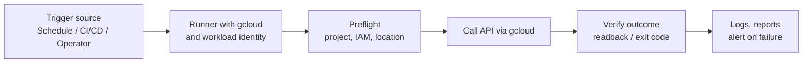

# Hands-On Automation of Administrative Operations with gcloud

Administering Google Cloud is not just about opening Console and clicking through resources one by one. When managing multiple projects, multiple environments, or daily repetitive tasks, manual work is slow, hard to audit, and error-prone. **`gcloud`**, the command-line interface of the Google Cloud CLI, lets you turn administrative operations into commands that can be saved, reviewed, re-run, and integrated into automation workflows.

This lesson belongs to the **GCP Tools and Development Environment** chapter of the `CLOUD_PROVIDERS_GCP` module. Building on project organization, IAM, and VPC fundamentals, learners will practice inventorying Compute Engine resources, performing controlled configuration updates, and developing an automation mindset for services such as GKE, Cloud Run, storage, and databases. The ultimate goal is operating resources reproducibly, safely, observably, and cost-effectively.

## 1. Objectives of the Lab

Upon completing this lesson, you will be able to:

1. Identify `gcloud` command structure and the limitations of default configurations.
2. Verify project, CLI identity, region, and zone before running tasks.
3. Use `--project`, `--region`, `--zone`, `--filter`, and `--format` to produce script-friendly results.
4. Write a Bash script to read resource details and save inventory data without clicking in Console.
5. Write a script to update a VM's label with **preflight checks, no redundant writes, and dry-run by default**.
6. Handle errors, IAM permissions, sensitive information, and re-run safety when integrating scripts into CI/CD or scheduled runs.

**Scope:** examples use **Bash** in Cloud Shell or a machine with Google Cloud CLI installed; Windows environments using PowerShell must adapt variable syntax, line continuation, and loops. Code blocks capable of modifying resources are explicitly marked. You do not need to create a new VM for the labeling exercise; pick an existing test VM you are authorized to administer.

## 2. What Can `gcloud` Automate?

A typical command follows this structure:

```text
gcloud <service-group> <resource-group> <action> [arguments] [flags]
```

Examples:

```bash
# Read the list of VMs
gcloud compute instances list --project="my-lab-project"

# Read details of a specific VM in the right zone
gcloud compute instances describe "demo-vm" \
  --project="my-lab-project" \
  --zone="asia-southeast1-a"

# List Cloud Run services in a region
gcloud run services list \
  --project="my-lab-project" \
  --region="asia-southeast1"
```

A script can invoke multiple `gcloud` commands, inspect results at each step, and proceed only when conditions allow. Common use cases include:

| Administrative Need | CLI Approach | Notes |
| --- | --- | --- |
| Resource inventory and report export | `list`, `describe`, `--format=json` or `csv` | Requires read permissions; protect output files if they contain internal data |
| Labeling to track environment, owner, or cost | `add-labels`/`update` per resource type | Check existing labels before editing |
| Pre-/post-deployment service health checks | `describe` and `list` | Interpret status fields per product |
| Multi-project administration | Loops with explicit `--project` | IAM permissions may vary across projects |
| CI/CD integration | Install or prepare CLI; use a least-privilege workload identity | Avoid long-lived service account keys |
| Standard infrastructure provisioning | `gcloud` scripts or Infrastructure as Code tools like Terraform | Declarative tools are usually better suited for managing lifecycles across many resources |

`gcloud` is a tool for calling management APIs; **it does not inherently maintain desired state** like an Infrastructure as Code system. If a script runs daily, you must decide what should be skipped, updated, or reported as an error.

## 3. Preparing the Environment and Access Permissions

### 3.1. Choosing Where to Run

You can use **Google Cloud Shell** for practice since the environment already includes Google Cloud CLI and connectivity to Google Cloud. If running on a personal machine or CI runner, install Google Cloud CLI per official documentation and check the version:

```bash
gcloud --version
gcloud help
gcloud compute instances --help
```

Some command groups require CLI components, enabled project APIs, or appropriate IAM permissions. Features and flag sets can vary by version; when unsure of a command group's syntax, use `--help` for that exact group.

### 3.2. Checking Account and Default Project

In an interactive practice environment:

```bash
# User identity signed in to Google Cloud CLI
gcloud auth list

# Default project in current CLI configuration
gcloud config get-value project

# Default region and zone, if configured
gcloud config get-value compute/region
gcloud config get-value compute/zone
```

If working on an unauthenticated personal machine, run `gcloud auth login` for interactive sign-in. In Cloud Shell, normal sessions already have environment authentication integrated.

You can set defaults:

```bash
gcloud config set project "my-lab-project"
gcloud config set compute/region "asia-southeast1"
gcloud config set compute/zone "asia-southeast1-a"
```

**`config set` commands modify the CLI configuration in the active environment.** Default settings are convenient while learning, but can cause scripts to target the wrong project when operators switch environments. In the scripts below, `--project` and `--zone` are passed explicitly to every critical command.

### 3.3. Understanding Two Types of Authentication

| Authentication Method | Best Suited For | Things to Remember |
| --- | --- | --- |
| `gcloud auth login` | Users running CLI interactively | Authenticates the Google Cloud CLI |
| `gcloud auth application-default login` | Developing apps using **Application Default Credentials (ADC)** on a personal machine | ADC credentials for application libraries; not a full substitute for `gcloud auth login` |
| Service account attached to GCP runtime | Cloud Build, VMs, Cloud Run, or supported runtimes | Uses workload identity with just-enough IAM |
| Service account impersonation | Users/runners granted permission to impersonate a service account | Can pass `--impersonate-service-account`; avoids exporting JSON keys |
| Workload Identity Federation | CI/CD outside Google Cloud | Exchanges external identity for short-lived credentials without storing long-lived keys |

A service account can perform an operation only when granted permissions on the **target resource**; permission for a user to impersonate that service account is a separate requirement. For production environments, prefer short-lived credentials, workload identities, and least privilege. Avoid putting passwords, access tokens, JSON keys, or secret contents into scripts and logs.

### 3.4. IAM Permissions for This Lesson

For Compute Engine inventory, the identity typically needs project view permissions and read permissions such as `compute.instances.list` and `compute.subnetworks.list`. For VM labeling, it also needs instance read/write permissions such as `compute.instances.get` and `compute.instances.setLabels`. Choose IAM roles matching your organization's policy; **do not default to requesting Owner/Editor** for a resource-reading script.

The practice project must have the Compute Engine API enabled to call Compute Engine commands. Enabling APIs, granting IAM roles, and creating VMs lie outside this inventory reading step and may require additional permissions.

## 4. Important Flags When Writing Scripts

When driving `gcloud` programmatically, you need machine-friendly output and unambiguous scope.

| Flag or Syntax | Role | Example |
| --- | --- | --- |
| `--project=ID` | Explicitly specify target project | `--project=my-lab-project` |
| `--region=REGION` | Explicitly specify region for supported commands/services | `--region=asia-southeast1` |
| `--zone=ZONE` | Explicitly specify zone for zonal resources | `--zone=asia-southeast1-a` |
| `--filter=EXPRESSION` | Filter results of supported commands | `--filter="status=RUNNING"` |
| `--format=FORMAT` | Control output formatting | `--format="json"` or `--format="value(name)"` |
| `--quiet` | Suppress interactive prompts where supported | **Not** a dry-run, confirmation, or safety check mode |
| `--impersonate-service-account=EMAIL` | Run command as an authorized service account | Used where separated permissions are required |
| `--verbosity=LEVEL` | Adjust logging verbosity when troubleshooting | Avoid leaking sensitive info in logs |

For output:

- `--format="table(name,zone,status)"`: quick presentation for human readers.
- `--format="value(name)"`: extracts the `name` field value, convenient for simple loops.
- `--format="csv(name,zone,status)"`: exports a table for importing into other tools.
- `--format=json`: used when full data structure is needed; pairs well with `jq` if installed.

Example listing only running VMs:

```bash
gcloud compute instances list \
  --project="my-lab-project" \
  --filter="status=RUNNING" \
  --format="table(name,zone.basename(),status)"
```

**Do not parse `table` output by splitting on whitespace:** column headers and human-oriented layout may not be stable. For data with commas, newlines, or nested structures, prefer JSON and a format-aware parser. Field and filter syntax vary by command; use `gcloud ... --help` to confirm supported fields.

## 5. Practice 1: Inventorying Resources with gcloud

**Problem:** the operations team wants to export the list of VMs and subnets in a project to JSON files for configuration auditing or later cost analysis. This task is **read-only** on GCP resources, though it writes two output files on the machine running the script.

### 5.1. Run Each Command Individually First

Store your practice project in an environment variable in the Bash session:

```bash
PROJECT_ID="my-lab-project"

# Verify whether the project exists and the account has view permissions
gcloud projects describe "$PROJECT_ID" \
  --format="value(projectId)"

# List virtual machines across all zones in the project
gcloud compute instances list \
  --project="$PROJECT_ID" \
  --format="table(name,zone.basename(),status)"

# List subnets across regions in the project
gcloud compute networks subnets list \
  --project="$PROJECT_ID" \
  --format="table(name,region.basename(),ipCidrRange)"
```

If the project has no VMs, the result may be an empty list, which does not mean the command failed. Conversely, `PERMISSION_DENIED`, disabled APIs, or a wrong project must be resolved before using the output in reports.

### 5.2. Write a Complete Inventory Script

Save the following content as `inventory.sh` **in your learning environment** (this is a practice script example, not a file to create in the lesson repository):

```bash
#!/usr/bin/env bash
set -euo pipefail

if [[ "$#" -ne 2 ]]; then
  echo "Usage: ./inventory.sh PROJECT_ID OUTPUT_DIR" >&2
  exit 2
fi

project_id="$1"
output_dir="$2"

if ! command -v gcloud >/dev/null 2>&1; then
  echo "gcloud not found in PATH." >&2
  exit 1
fi

mkdir -p -- "$output_dir"

# Use temporary filenames to avoid leaving partial JSON files behind.
vm_tmp="$output_dir/vm-instances.json.tmp.$$"
subnet_tmp="$output_dir/vpc-subnets.json.tmp.$$"
trap 'rm -f -- "$vm_tmp" "$subnet_tmp"' EXIT

echo "Checking project: $project_id"
gcloud projects describe "$project_id" \
  --format="value(projectId)" >/dev/null

echo "Fetching VM list..."
gcloud compute instances list \
  --project="$project_id" \
  --format=json > "$vm_tmp"

echo "Fetching subnet list..."
gcloud compute networks subnets list \
  --project="$project_id" \
  --format=json > "$subnet_tmp"

# Publish final outputs only after both read commands succeed.
mv -- "$vm_tmp" "$output_dir/vm-instances.json"
mv -- "$subnet_tmp" "$output_dir/vpc-subnets.json"

echo "Inventory saved to: $output_dir"
```

Run it:

```bash
chmod +x inventory.sh
./inventory.sh "my-lab-project" "./output-gcp"

# Check created files
ls -lh "./output-gcp"
```

Expected output includes:

```text
output-gcp/
  vm-instances.json
  vpc-subnets.json
```

**Explanation of key points in the script:**

1. `set -euo pipefail` helps the script stop when a command fails in applicable Bash contexts, an unset variable is referenced, or part of a pipeline fails. This aids error handling, not a replacement for checking results.
2. The script requires **project ID** and output directory, avoiding implicit reliance on the machine's default project.
3. `command -v gcloud` catches early if the CLI is missing or absent from `PATH`.
4. Results are written to temp files; if an API read fails, `trap` deletes the temp files on script exit.
5. `--format=json` preserves data structure for downstream aggregation.
6. Final files are written once both `gcloud` commands succeed; however, two `mv` operations do not form an atomic transaction across **both** files. If high cross-file consistency is needed, write to a versioned directory and publish that directory after verification.

Replace the placeholder project name with an authorized project. Output may contain resource names, IP addresses, and internal metadata; store it only in locations with appropriate access controls. This exercise does not enforce point-in-time consistency between the two resource types: resources may change while the script runs.

### 5.3. Reading and Aggregating JSON

If `jq` is installed, you can filter and summarize:

```bash
# Number of VMs appearing in the inventory
jq 'length' "./output-gcp/vm-instances.json"

# Export VM name, zone, and status as TSV
jq -r '.[] | [.name, .zone, .status] | @tsv' \
  "./output-gcp/vm-instances.json"

# Count only RUNNING VMs in the snapshot
jq '[.[] | select(.status == "RUNNING")] | length' \
  "./output-gcp/vm-instances.json"
```

A running VM does not guarantee the application on it is healthy. Evaluating reliability also requires monitoring, health checks, application logs, and error/latency metrics. Likewise, you cannot calculate exact costs from VM count alone; machine type, usage hours, disks, networking, and other settings matter too.

## 6. Practice 2: Controlled VM Label Updates

**Problem:** the operations team wants to standardize the `training=enabled` label on an existing lab VM to make resource classification easier. The script must avoid redundant update calls and by default only show what **would** be done.

### 6.1. Read Current State

Suppose there is a VM `demo-vm` in `asia-southeast1-a`:

```bash
PROJECT_ID="my-lab-project"
ZONE="asia-southeast1-a"
VM_NAME="demo-vm"

gcloud compute instances describe "$VM_NAME" \
  --project="$PROJECT_ID" \
  --zone="$ZONE" \
  --format="yaml(name,zone,labels,status)"
```

If the VM does not exist, the project/zone is wrong, or IAM is missing, the command errors. Treat this as an error to resolve rather than creating an unrequested resource.

### 6.2. Script with Dry-Run Mode

Create `label-vm.sh`:

```bash
#!/usr/bin/env bash
set -euo pipefail

if [[ "$#" -ne 3 ]]; then
  echo "Usage: ./label-vm.sh PROJECT_ID ZONE VM_NAME" >&2
  exit 2
fi

project_id="$1"
zone="$2"
vm_name="$3"

# PREVIEW ONLY by default. Modify only when DRY_RUN=false.
dry_run="${DRY_RUN:-true}"

case "$dry_run" in
  true|false) ;;
  *)
    echo "DRY_RUN must be true or false." >&2
    exit 2
    ;;
esac

echo "Checking VM=$vm_name, project=$project_id, zone=$zone"

# Stop with error if the VM does not exist or lacks permissions.
current_label="$(gcloud compute instances describe "$vm_name" \
  --project="$project_id" \
  --zone="$zone" \
  --format='value(labels.training)')"

if [[ "$current_label" == "enabled" ]]; then
  echo "Label training=enabled already present. No update needed."
  exit 0
fi

if [[ "$dry_run" == "true" ]]; then
  echo "[DRY RUN] Would add/update label: training=enabled"
  echo "[DRY RUN] Not calling any resource-modifying API."
  exit 0
fi

gcloud compute instances add-labels "$vm_name" \
  --project="$project_id" \
  --zone="$zone" \
  --labels="training=enabled"

# Verify state AFTER the modifying command.
new_label="$(gcloud compute instances describe "$vm_name" \
  --project="$project_id" \
  --zone="$zone" \
  --format='value(labels.training)')"

if [[ "$new_label" != "enabled" ]]; then
  echo "Update not confirmed; please inspect the VM." >&2
  exit 1
fi

echo "Confirmed label training=enabled."
```

Run commands:

```bash
chmod +x label-vm.sh

# Step 1: preview without modifying resources
./label-vm.sh "my-lab-project" "asia-southeast1-a" "demo-vm"

# Step 2: execute only after verifying the right VM and authorization to edit
DRY_RUN=false ./label-vm.sh \
  "my-lab-project" "asia-southeast1-a" "demo-vm"

# Step 3: re-run to confirm the script skips already-completed work
DRY_RUN=false ./label-vm.sh \
  "my-lab-project" "asia-southeast1-a" "demo-vm"
```

**Principles applied:**

- **Explicit scope:** every operation takes `project_id`, `zone`, and `vm_name` as arguments rather than guessing from personal configuration.
- **Preflight:** `describe` confirms the resource is readable and inspects labels before changing anything.
- **Target-state idempotency:** re-running when the label is already correct skips the update.
- **Self-implemented dry run:** the `dry_run` branch prevents executing the write command; this is not `--quiet` or a universal `gcloud` dry-run feature.
- **Readback:** after the write operation, re-fetch the label from the API before reporting success.

**Limitations to understand:** check-then-update does not lock the VM. If multiple actors edit labels concurrently, concurrent updates or conflicts can occur; concurrent change management needs coordination/conditional retries. This lab also does not roll back automatically if the update succeeds yet verification fails. In production, prepare a rollback plan and log intended changes.

### 6.3. Notes on Real Changes

`add-labels` updates VM metadata. Labels can be used for filtering, governance, and cost-reporting support depending on the service; they **are not an IAM authorization system** and do not guarantee every billing tool aggregates data identically. In the lab, use a dedicated authorized VM and project, and check impact before running `DRY_RUN=false`.

Do not blindly add `--quiet` to every write command just to "make the script run." That flag suppresses interactive prompts where supported, but does not verify on your behalf that the action is safe or targets the right project.

## 7. Extension: Inventorying Multiple Projects

An organization often separates projects by `dev`, `staging`, and `prod` environments. With pre-granted permissions, you can create a `projects.txt` file containing one project ID per line and loop over it:

```text
my-dev-project
my-staging-project
my-prod-project
```

Reference script:

```bash
#!/usr/bin/env bash
set -euo pipefail

input_file="projects.txt"
output_dir="./project-reports"
mkdir -p -- "$output_dir"

while IFS= read -r project_id || [[ -n "$project_id" ]]; do
  # Skip blank lines and comments
  if [[ -z "$project_id" || "$project_id" == \#* ]]; then
    continue
  fi

  echo "Inventorying project: $project_id"
  if gcloud compute instances list \
      --project="$project_id" \
      --format=json > "$output_dir/$project_id.json"; then
    echo "PASS: $project_id"
  else
    echo "FAIL: $project_id" >&2
    rm -f -- "$output_dir/$project_id.json"
    # Depending on purpose, you may abort immediately instead of continuing.
  fi
done < "$input_file"
```

This example continues inventorying other projects when one project fails; therefore **reporting PASS/FAIL per project is mandatory when aggregating reports**. In real use, add a summary output file and exit non-zero if any project failed so monitoring systems detect incomplete reports.

The `projects.txt` input must come from a **trusted** source and be validated as a valid project ID before being used in output filenames. In multi-tenant systems or with untrusted input, never use unvalidated strings in file paths or resource names. If projects contain many resources, account for API quotas, timeouts, and retry logic for transient errors.

## 8. Error Handling and Script Observability

### 8.1. Command Exit Codes

By CLI convention, a successful command usually returns exit code `0`, while failure returns a non-zero exit code. Bash can use `if` to branch on the outcome:

```bash
if gcloud projects describe "my-lab-project" \
    --format="value(projectId)" >/dev/null; then
  echo "Project info readable."
else
  echo "Unable to read project; check ID, IAM, or API." >&2
  exit 1
fi
```

Do not rely solely on empty output to conclude an error occurred: a resource having zero records and an API call failure are two distinct situations. Keep error messages on `stderr` and use `stdout` only for machine-readable data when designing scripts.

### 8.2. Common Errors

| Symptom | Possible Cause | How to Check |
| --- | --- | --- |
| `gcloud: command not found` | CLI not installed or missing from `PATH` | `gcloud --version`, inspect environment setup |
| `PERMISSION_DENIED` | Identity lacks IAM; possibly missing impersonation permission | Check active account, target project, and corresponding roles/permissions |
| `NOT_FOUND` | Wrong project, zone, region, or resource name; sometimes resource does not exist | Verify full resource name and scope |
| API not enabled | Project has not enabled the service API | Check API status and approved API enablement workflow |
| `RESOURCE_EXHAUSTED` / quota | Calling APIs too frequently or too fast | Check quotas, pagination, throttle request rate, retry with backoff |
| Works interactively yet fails in CI | Different identity or default configuration | Pass project/location explicitly; inspect runner IAM |
| Inventory file empty/missing | Command failed midway or permissions only expose partial resources | Check exit code, stderr, and per-project logs |

### 8.3. Bounded Retries

Not every error should be retried. Permission, naming, and configuration errors require fixing the root cause. Retry only transient errors known to be retryable (such as network errors or certain rate-limited service responses), using **exponential backoff**, a maximum attempt limit, and optionally jitter to avoid synchronized runner storms.

For **resource-modifying** commands, know whether the operation is idempotent before retrying. A command that succeeded server-side but dropped the connection before returning a response can cause side effects if re-run. Common safeguards: re-check resource state after ambiguous errors, use request ID mechanisms if supported by the API, and continue only after confirming actual state.

### 8.4. Useful Logging Without Exposing Secrets

Record:

- Timestamp, script version, and CLI version when reproducing bugs.
- Project, region/zone, operation type, and non-sensitive resource names.
- Per-step results, execution duration, exit codes, and sanitized error messages.
- Change reference or CI/CD job ID for traceability.

Never log access tokens, private keys, secrets, password variables, or API responses containing sensitive info to public logs. Avoid enabling shell trace mode `set -x` when scripts handle credentials. Some HTTP debug modes can print sensitive data to output; use them only in protected environments.

## 9. From Cloud Shell to Scheduled Automation or CI/CD

Cloud Shell is well-suited for development and interactive testing, **but it is not an always-on background environment** for running a production scheduler. When deploying automation, choose a reliable execution platform such as Cloud Build, Cloud Run Jobs, or your organization's CI runner (depending on how scripts run and permitted infrastructure).



For regularly scheduled pipelines, ensure:

1. **Dedicated workload identity:** use a runtime-attached service account, or Workload Identity Federation / impersonation when appropriate. Grant least-privilege permissions on the exact project/resources.
2. **Controlled CLI version:** reduce drift between developer laptops and runners. Verify command syntax and behavior before upgrading versions.
3. **Input parameters and change approvals:** distinguish `dev` and `prod`, separate read-only stages from write stages, and enforce governance approvals if required by the organization.
4. **Concurrency safety:** avoid multiple jobs modifying the same resource simultaneously; use state checks and conflict handling.
5. **Monitoring:** store logs, outcome metrics, emit alerts, and save reports in access-controlled locations.

You can use `gcloud` to execute individual actions during Cloud Run/GKE deployments or bucket management, but for long-lived infrastructure spanning VPCs, subnets, firewalls, IAM, and multiple environments, evaluate **declarative** tools like Terraform because they support drift detection, change review, and explicit state management.

## 10. Capstone Scenario: Resource Reporting and Label Standardization

A team has three environments:

| Environment | Goal | Appropriate Automation |
| --- | --- | --- |
| `dev` | Test changes | Daily inventory; run labeling script in dry-run mode first |
| `staging` | Pre-production testing | Inventory and compare against `dev`; verify state after changes |
| `prod` | Stability and traceability | Scheduled read-only; changes require approval workflow, restricted rights, and recovery plan |

Proposed workflow:

1. The team runs `inventory.sh` for the lab project and inspects the JSON counts.
2. The team checks the test VM and runs `label-vm.sh` in dry-run mode.
3. After confirming the exact project, zone, VM, and target label, the team executes with `DRY_RUN=false`.
4. The team re-runs `describe` to confirm the label, then runs the script again to demonstrate redundant updates are skipped.
5. The team stores the inventory snapshot and session logs, cross-checking against governance or cost reports.
6. When scaling to multi-project environments, the team adds input validation, per-project success/failure reporting, retries, and runner authentication.

This is an example of **verifiable single-operation automation**. It does not yet constitute a complete governance platform. For critical resources, add backups, rollback plans, tightened IAM scope, and real failure testing before running on an automated schedule.

## 11. Self-Practice Exercises

### Exercise 1 – Explaining Scope

Given the command:

```bash
gcloud compute instances list \
  --project="project-a" \
  --filter="status=RUNNING" \
  --format="value(name)"
```

**Questions:** Does this command modify VMs? Does it read all running VMs across every project in the account? Is the output suited for human readers or scripts?

*Guided answer:* This is a read-only command, returning results only within `project-a` matching the `RUNNING` filter. `value(name)` targets scripts needing names only; to uniquely identify VMs across multiple zones, you may also need zone information.

### Exercise 2 – Identifying Risks

A script contains:

```bash
gcloud compute instances delete "demo-vm" --quiet
```

**Questions:** List at least three risks and propose required changes before considering execution.

*Guided answer:* Missing explicit `--project` and `--zone`; the command deletes a resource; `--quiet` may bypass confirmation prompts. Verify project/zone/VM, permissions, and task scope; prepare a recovery plan; add preview and appropriate approval steps. Do not run that command while solving the exercise.

### Exercise 3 – Fixing Inaccurate Reporting

An inventory script runs across three projects; the second project returns `PERMISSION_DENIED`, while the other two succeed. The summary report still says "100% complete."

*Guided answer:* Preserve per-project failure status, distinguish having no resources from lacking permissions, make the job exit with a failure code or partial-completion status, and avoid marking the report complete until permissions are fixed or approved scope is adjusted.

### Exercise 4 – Choosing an Authentication Method

A runner outside GCP needs to read the VM list every night, yet the team does not want to store a JSON service account key.

*Guided answer:* Evaluate Workload Identity Federation for the external runner or an appropriate impersonation mechanism, grant least-privilege read permissions to the service account, govern runner trust, and monitor access logs. Do not use a long-lived personal account as production authentication.

### Exercise 5 – Why Is Idempotency Needed?

A job "applies label `training=enabled`" repeatedly every hour. Contrast a script that always sends the write command against one that checks the existing value first.

*Guided answer:* Checking first skips operations whose target state is already met, reducing API requests and unnecessary mutations. However, it still needs to handle concurrent updates and cases where a write API succeeds yet the response is lost.

## 12. Pre-Automation Checklist for gcloud

- [ ] Confirmed whether the command is **read-only** or **writes/deletes** resources.
- [ ] Project, region, and zone are passed explicitly when required by the command.
- [ ] User/runner identity is verified; IAM satisfies **least privilege**.
- [ ] Relevant APIs are enabled and resources exist in the right scope.
- [ ] Script validates inputs and uses `--format` suited to downstream parsing.
- [ ] Handles exit codes, stderr, and distinguishes empty data from errors.
- [ ] Write commands have preview/dry-run, current-state checks, and post-change readback.
- [ ] Avoids blind retries on non-idempotent commands; handles race conditions and duplicate runs.
- [ ] Never writes credentials, tokens, or sensitive info to logs/reports.
- [ ] Inventory output, file storage permissions, and failure notifications are verified.
- [ ] Before scheduled/CI execution, owner, schedule, alerts, and how to halt the job are defined.

## 13. Official Documentation for Reference

- [Google Cloud CLI overview](https://cloud.google.com/sdk/gcloud): introduction to `gcloud` and command catalog.
- [gcloud scripting](https://cloud.google.com/sdk/docs/scripting-gcloud): how to use `gcloud` in scripts.
- [gcloud topic formats](https://cloud.google.com/sdk/gcloud/reference/topic/formats): output formats, projections, and transformations.
- [gcloud topic filters](https://cloud.google.com/sdk/gcloud/reference/topic/filters): filter syntax.
- [Authorizing Google Cloud CLI](https://cloud.google.com/sdk/docs/authorizing): user authentication and sign-in types.
- [Service account impersonation](https://cloud.google.com/iam/docs/impersonating-service-accounts): using a service account identity with granted permissions.
- [Google Cloud IAM](https://cloud.google.com/iam/docs/overview): understanding permissions and roles when automating.

When creating scripts for other services such as GKE, Cloud Run, Cloud Storage, or Cloud SQL, keep the same mental workflow: **choose identity → specify project/location → read state → decide action → execute conditionally → read back to confirm → record output**. This is how repetitive administrative tasks become operable and verifiable workflows.
