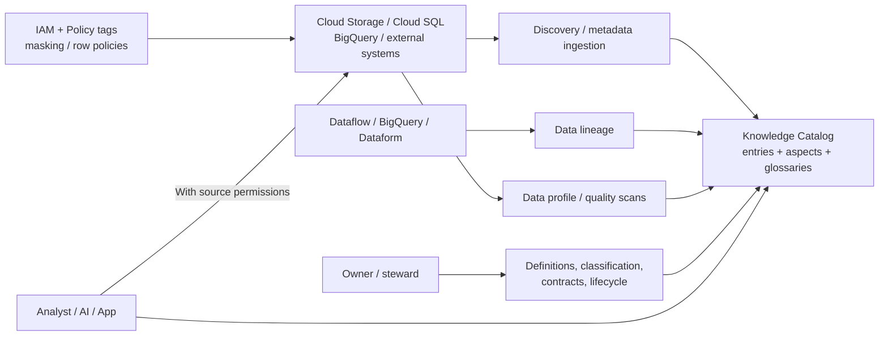
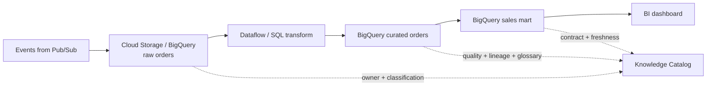
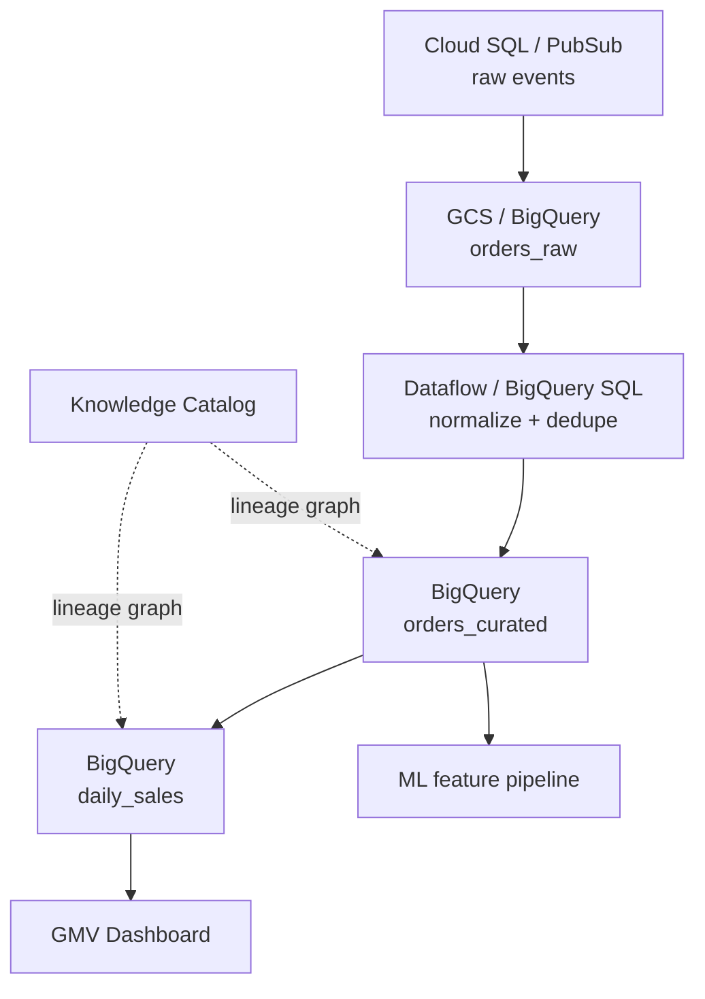

# Dataplex and Data Asset Governance

An enterprise holds data across **Cloud Storage, BigQuery, Cloud SQL, and Dataflow pipelines**. The analytics team finds multiple tables named `orders`, yet does not know which one has passed quality checks, who owns it, whether `customer_email` contains personal data, or which table feeds the revenue dashboard. Focusing solely on storage and querying leaves data available yet **hard to find, hard to understand, and hard to trust**.

This lesson belongs to the **Data Governance and Analytics** chapter of the `CLOUD_PROVIDERS_GCP` module. It connects project/IAM organization, VPC, Cloud Storage, BigQuery, Dataflow, and reliability/cost operations to explain how to organize **metadata, ownership, classification, quality, lineage, and access** in Dataplex. Examples focus on **data asset governance** rather than replacing lessons on building a data warehouse or lakehouse.

> **Product name to know (2026):** **Dataplex Universal Catalog has been renamed to Knowledge Catalog.** In some earlier documentation or UI views, you may also see *BigQuery universal catalog*. Catalog entries, aspects, glossaries, data quality scans, and lineage continue to operate; many `gcloud dataplex ...` commands, the `dataplex.googleapis.com` endpoint, and `roles/dataplex.*` IAM roles **retain their legacy technical names**. When reading documentation, treat **Knowledge Catalog (formerly Dataplex Universal Catalog)** as the same system rather than two separate products.

## 1. Learning Objectives

After this lesson, you will be able to:

1. Explain **data asset, catalog entry, entry group, entry type, aspect type, aspect, glossary, and lineage**.
2. Distinguish the **lake → zone → asset** organizational model from the **catalog entries** model used for metadata search.
3. Design a **raw → curated → consumption** flow with data owners/stewards, sensitivity classification, and data contracts.
4. Locate tables and buckets in Knowledge Catalog and distinguish auto-discovered metadata from metadata stewards must add.
5. Understand why **viewing catalog metadata does not automatically grant read access to underlying data**.
6. Use **data profiling/data quality scans** to measure completeness, validity, and uniqueness, and configure alerts.
7. Inspect **data lineage** from pipelines and queries and perform impact analysis before changing schemas.
8. Perform a **mostly read-only lab** via `gcloud dataplex` and `bq`; create a data quality scan on a lab BigQuery table only with approval.
9. Design operations, IAM, cost controls, retention, and complete data asset governance exercises.

**Boundaries:** this lesson does not create lakes, zones, datasets, buckets, or DataScans, or modify IAM in a real environment without an approved lab project. Even reading metadata can reveal asset names and owners; never post raw organizational outputs in public spaces.

## 2. Why Is a Data Catalog More Than a List of Tables?

A good data catalog answers both **where the data is** and **whether it is safe and trustworthy to use**.

| Question | Required Metadata / Controls |
| --- | --- |
| Which table holds standard orders? | Name, definition, source, dataset, business term |
| Who is accountable? | Data owner, steward, contact/on-call |
| Can it be accessed? | Source IAM, policy tags/data policies, approval workflow |
| Does it contain PII? | Sensitivity classification, masking, retention, Sensitive Data Protection |
| How fresh is the data? | Freshness SLA, last update, pipeline health |
| Is it clean? | Data quality rules/results, profile, score, and exceptions |
| Where did it come from? | Lineage: source → transform → output |
| What breaks if a column is removed? | Downstream dependencies and consumer contracts |
| How much does governance cost? | Catalog metadata, scans, lineage processing/storage, BigQuery reads |

**Metadata is descriptive information**, not a full copy of the table. Creating an entry or attaching an aspect **does not move data**; the source remains in Cloud Storage/BigQuery/Cloud SQL and retains its own ACL/IAM, encryption, lifecycle, and costs.

## 3. Overall Model: Source Systems and the Governance Layer



**Distinguish three planes:**

- **Data plane:** applications/analysts read rows/objects in the source using real data permissions.
- **Metadata plane:** the catalog enables discovery and describes assets, glossaries, relationships, and quality.
- **Governance plane:** policies, approvals, classification, owners, and audits guide **how** access is granted, data is retained, and changes are handled.

Catalog metadata helps discovery and self-service, but **it is not an automatic data firewall**. To block `SELECT customer_email`, enforce it with **BigQuery column-level access / data masking, IAM, or appropriate source policies**.

## 4. Data Assets and Lifecycle

For example, an `orders_raw` table receives data from Pub/Sub via Dataflow, gets cleaned into `orders_curated`, and feeds a revenue dashboard.



An **asset lifecycle** should include:

1. **Registration/discovery:** asset ID, source system, location, schema.
2. **Classification:** public/internal/confidential/restricted; personal data, contractual obligations, residency.
3. **Owner/steward assignment:** an accountable person/team for business correctness and metadata.
4. **Standardization:** glossary terms, descriptions, schema version, data contract.
5. **Validation:** profiling and quality scans with clear failure thresholds.
6. **Publication:** dataset/table/view or data product ready for consumers to discover and request access.
7. **Monitoring:** freshness, quality score, lineage breaks, usage/cost.
8. **Deprecation/deletion:** evaluate downstream consumers, retention/legal hold, backups, and approvals.

**Do not automatically delete an asset just because no one queried it for 7 days:** usage can be seasonal, driven by downstream schedulers, or subject to retention rules. Combine usage metadata with owner review and lineage.

## 5. Dataplex Lakes, Zones, and Assets

The familiar Dataplex lake architecture consists of **lake → zone → asset → discovered entities**. These resources can still appear via `gcloud dataplex lakes/zones/assets` and in organizations using lake-based organization.

| Resource | Role | Example |
| --- | --- | --- |
| **Lake** | Groups data assets by governance domain/region | `retail-lake` |
| **Zone** | Subdivides data by stage/quality | `raw`, `curated` |
| **Asset** | Reference to an attached source within a zone | Cloud Storage bucket or BigQuery dataset |
| **Entity** | Discovered entity within an asset | Table/file-backed entity |
| **Catalog entry** | Searchable/indexed metadata describing an asset | Entry for a BigQuery table |
| **Aspect** | Structured metadata attached to an entry | Data steward, sensitivity, SLA |

**Do not equate a lake asset with a catalog entry.** A BigQuery table can appear in the catalog **without manually creating a lake or zone** thanks to automatic catalog ingestion. Meanwhile, attaching a BigQuery dataset or Cloud Storage bucket to a lake lets you govern datasets by zone and use discovery/scan features within that model.

### 5.1. Raw and Curated Zones

- **Raw zone:** data close to the source, not fully standardized, likely containing missing values or schema errors. Do not grant broad analyst access.
- **Curated zone:** data cleaned and standardized per contract, ready for downstream consumption.
- **Consumption/mart:** views/tables/data products for end users, typically residing in BigQuery or another sharing layer—**not a mandatory Dataplex zone type**.

The zone model is a **governance grouping**; it does not automatically build a cleaning pipeline or move data from raw to curated. You must configure Dataflow, BigQuery SQL, Dataform, or another processing tool.

## 6. Knowledge Catalog: Entries, Entry Types, and Entry Groups

The current metadata model uses an **entry** to represent an asset, inside a corresponding **entry group**, with an **entry type** describing how metadata is categorized and formatted.

| Term | Role |
| --- | --- |
| **Entry** | Metadata object representing a table, view, bucket, external dataset, or custom asset |
| **Entry group** | Groups entries by source system or management scope |
| **Entry type** | Kind of entry, with corresponding required aspects/schema |
| **System entry** | Entry managed by Google Cloud for supported sources, such as BigQuery |
| **Custom entry** | Metadata you create for external/custom systems per supported API/schema |
| **Aspect type** | Reusable template defining metadata fields |
| **Aspect** | Metadata value attached to an entry, column, or entry link |
| **Entry link** | Relationship between entries or terms, supporting graph/context |
| **Business glossary** | System of business terms with categories, synonyms, and links |

For **BigQuery tables**, the catalog typically uses the `@bigquery` system entry group. Technical metadata such as schemas may be Google Cloud–managed; avoid overwriting restricted system-managed aspects. For custom systems, owners must define entry types/aspect types and an update lifecycle.

**Scope and data residency:** aspect types, entries, and glossaries have region/project/organization constraints. Never replicate aspect schemas or PII-related metadata to another location without reviewing policies and regional availability.

## 7. Aspects: Adding Context to a Table

A catalog entry `sales.orders_curated` has default technical metadata like field names and data types, but lacks business context. You can design a **custom aspect type** with fields such as:

```yaml
# Illustrative metadata model, NOT an API payload for deployment.
asset_context:
  domain: "sales"
  data_owner: "data-platform-team"
  data_steward: "finance-analytics"
  sensitivity: "confidential"
  source_of_truth: true
  freshness_slo_minutes: 60
  retention_days: 365
  business_term: "Gross Merchandise Value"
  review_date: "2026-11-19"
```

Key distinctions:

- **Aspect type** defines the field schema and data types.
- **Aspect** is the concrete value attached to an entry/table or column (if supported by the type).
- **Contacts/overview** offer **reusable system aspects**; not every piece of metadata requires a custom type.
- **Column-level classification** identifies that `customer_email` needs control, but must be paired with BigQuery enforcement to actually restrict reads.
- **Owner metadata** differs from the **IAM owner role**: adding `finance-analytics` to an aspect grants no administrative privileges to that team.

**Maintenance rule:** automatically populate information derivable from the source (schemas, timestamps), while business fields require owner confirmation. If ownership is not updated after a reorganization, metadata becomes inaccurate.

## 8. Business Glossary and a Shared Source of Definitions

One dashboard reports **GMV = net revenue**, while another reports **GMV = order value before refunds**. Both read the same table yet compute different numbers. A business glossary aligns definitions before changing schemas.

Example **Retail Metrics** glossary:

| Term | Proposed Definition | Link |
| --- | --- | --- |
| **GMV** | Total value of valid orders before refunds/discounts, per approved policy | `sales.orders_curated.gmv_amount` |
| **Net Revenue** | Revenue after refunds/adjustments, per accounting rules | `finance.daily_revenue.net_revenue` |
| **Active Customer** | At least one valid transaction within the measurement window | `mart.customer_activity.customer_id` |
| **Order Created At** | Timestamp when the event was recorded at the source, UTC | `orders_raw.order_created_at` |

Sample definitions must be **approved by the business owner**; do not impose an arbitrary GMV formula as a company standard. A term can link to a **table or column**, include synonyms/related terms, and name a clear steward. Users can search by business semantics rather than memorizing field names.

**A glossary does not rewrite SQL on its own.** Once terms are finalized, update documentation, data contracts, semantic layers, BI metrics, and validation tests so all systems stay aligned.

## 9. Data Profiling and Data Quality Serve Different Goals

| Tool | Answers | Example |
| --- | --- | --- |
| **Data profiling** | What does the data look like? | Null rates, distinct values, distributions, outliers |
| **Data quality scan** | Does the data pass business rules? | `order_id` non-null, amount ≥ 0, status in allowed set |
| **Lineage** | Where did data come from and go? | Raw orders → curated → sales mart |
| **Sensitive Data Protection** | Is there PII/sensitive info and what is the risk? | Emails, phone numbers, sensitive identifiers |
| **IAM/data policies** | Who is allowed to access it? | Analysts read views; finance reads restricted columns |

**Profiling only produces observations**; it does not determine business correctness by itself. For instance, 0% nulls in `order_id` is good, yet does not guarantee one row per order; you must add uniqueness/logic rules per contract.

### 9.1. Quality Dimensions to Measure

| Dimension | Rule | Example Threshold |
| --- | --- | --- |
| **Completeness** | `order_id IS NOT NULL` | 100% |
| **Validity** | `amount >= 0` | ≥ 99.9% or 100% depending on business rule |
| **Uniqueness** | No duplicate `order_id` at table grain | 100% |
| **Consistency** | `currency` matches reference table | ≥ 99.9% |
| **Freshness** | Data lag relative to `event_time` | ≤ 60 minutes |
| **Integrity** | `customer_id` maps to a valid customer | ≥ 99.9% |

An aggregate **quality score** does not replace individual P0 rules. If 99% of records are good but 1% contain critical duplicate transactions, you still need to **fail the gate** before publishing the data product.

## 10. Data Lineage and Impact Analysis



**Lineage** shows sources, targets, and transformations. If you plan to drop `discount_code` from `orders_curated`, which downstream assets must be tested?

1. Locate the `orders_curated` entry.
2. Inspect **Lineage** and downstream tables/views/pipelines.
3. Review related SQL/transforms and owners; do not rely solely on the graph if any connector lacks lineage support.
4. Notify affected consumers and schedule migrations/schema contract updates.
5. Use canary runs, reconcile data quality, and compare metrics before/after release.
6. Update glossaries, aspects, and lineage/usage metadata post-deployment.

**Not every pipeline generates complete lineage automatically.** The Data Lineage API provides automatic ingestion from supported Google Cloud sources; other integrations may require custom lineage (such as OpenLineage). Enabling the Data Lineage API on a project can activate capture across **multiple supported services**, not just a single table. Review IAM, billing, and data residency before enabling it.

## 11. Data Classification and Access Permissions

Suppose a table contains `order_id`, `amount`, `customer_email`, and `customer_phone`.

| Field | Classification | Suggested Enforcement |
| --- | --- | --- |
| `order_id` | Internal | Dataset/table IAM |
| `amount` | Confidential | BigQuery dataset/view access, row policies if needed |
| `customer_email` | Restricted / PII | Policy tags/column-level security, masking, or tokenization |
| `customer_phone` | Restricted / PII | Data policies, retention, auditing |
| Aggregated anonymous statistics | Internal/Public upon verification | Check re-identification risk before sharing |

**Important:** marking `sensitivity=restricted` in the catalog **does not automatically lock the column**. Policy tags, BigQuery data policies/masking, row-level access policies, source IAM, and Cloud Storage objects must be configured separately. If a user has BigQuery Data Viewer on a table without permission to read a protected column, queries may be denied or return masked data depending on the policy.

Never place **real PII** in aspects, glossaries, DLQ metadata, or logs: the catalog describes **data types** and policies rather than storing raw records.

## 12. Roles Involved in Data Governance

| Business Role | Responsibility | Not Equivalent to IAM Role |
| --- | --- | --- |
| **Data owner** | Accountable for sharing decisions, retention, quality | Not necessarily project `roles/owner` |
| **Data steward** | Manages descriptions, glossaries, quality rules, metadata | Does not automatically hold `bigquery.dataOwner` |
| **Data producer** | Emits data matching contract/version | Does not approve read access |
| **Data consumer** | Uses data per intended purpose, honors license/SLA | Does not modify classifications |
| **Platform/IAM admin** | Grants roles across project/source/catalog | Does not define business terms for owners |
| **Security/privacy** | Classifies PII, masking, retention, and audits | Does not necessarily operate pipelines |

**Practical authorization** must separate catalog metadata scope from source data scope. Example IAM roles:

- `roles/dataplex.catalogViewer` to view catalog metadata within the granted scope.
- `roles/dataplex.catalogEditor` and `roles/dataplex.entryOwner` to manage catalog entries/aspects as permitted.
- `roles/dataplex.dataScanViewer` / `roles/dataplex.dataScanEditor` for scan configurations and results within scope.
- `roles/datalineage.viewer` to view lineage recorded in a project.
- `roles/bigquery.metadataViewer` to view schema metadata, and `roles/bigquery.dataViewer` or narrower permissions to read data.
- `roles/bigquery.jobUser` to run queries/jobs in an appropriate project.

Never grant `roles/dataplex.catalogAdmin` or `roles/bigquery.dataOwner` just so learners can browse asset lists. For catalog search, exact roles/permissions also depend on **search scope, entry group, and source**; grant only sufficient permissions per current documentation.

## 13. Lab A — Inventorying Metadata on an Existing Project

Assume you have an **approved lab project** with an existing BigQuery dataset/table and **metadata read permissions**. This lab requires creating no new resources.

### 13.1. Variables and Permission Check

```bash
PROJECT_ID="YOUR_AUTHORIZED_PROJECT"
LOCATION="YOUR_RESOURCE_REGION"
DATASET_ID="YOUR_EXISTING_DATASET"
TABLE_ID="YOUR_EXISTING_TABLE"

gcloud --version
gcloud auth list

# Read-only project info:
gcloud projects describe "$PROJECT_ID" \
  --format="yaml(projectId,lifecycleState)"

# List existing datasets (metadata only).
bq --project_id="$PROJECT_ID" ls

# Read schema/metadata of a permitted table.
bq --project_id="$PROJECT_ID" show \
  --format=prettyjson "$PROJECT_ID:$DATASET_ID.$TABLE_ID"
```

**Never print sensitive metadata to public CI logs.** If you hit `403`, request the scoped viewer role; do not open an entire dataset just for learners to browse.

### 13.2. Searching Catalog Entries

```bash
# Search metadata, does not query data rows.
gcloud dataplex entries search "$TABLE_ID" \
  --project="$PROJECT_ID" \
  --scope="projects/$PROJECT_ID" \
  --limit=20

# If semantic search is needed and enabled for the scope:
gcloud dataplex entries search "orders" \
  --project="$PROJECT_ID" \
  --scope="projects/$PROJECT_ID" \
  --semantic-search \
  --limit=20
```

**Expected:** find one or more entries matching indexed tables/assets; inspect system, resource path, description, owner/contact, schema, aspects, and glossary links. The search index can take time to reflect changes; do not assume a table does not exist merely because search returns nothing yet.

**If search is empty:** verify that APIs are enabled, check search/scope permissions, confirm the source type supports ingestion, and check region and indexing status. Do not manually create a BigQuery entry duplicating a system entry.

## 14. Lab B — Inspecting Lakes, Zones, and Assets If Used

If the project actually uses the Dataplex lake model:

```bash
# Read-only: lake resources in the region.
gcloud dataplex lakes list \
  --project="$PROJECT_ID" \
  --location="$LOCATION"

LAKE="YOUR_EXISTING_LAKE"
ZONE="YOUR_EXISTING_ZONE"

# Read-only: zones belonging to the lake.
gcloud dataplex zones list \
  --project="$PROJECT_ID" \
  --location="$LOCATION" \
  --lake="$LAKE"

# Read-only: assets belonging to the zone.
gcloud dataplex assets list \
  --project="$PROJECT_ID" \
  --location="$LOCATION" \
  --lake="$LAKE" \
  --zone="$ZONE"
```

Record the structure:

```text
retail-lake
  raw-zone
    asset: cloud-storage-ingest-bucket
  curated-zone
    asset: bigquery-retail-dataset
```

Do not assume every project must have a lake; **catalog entries do not require a lake for each BigQuery table**. If no lake/zone exists, practice only the Catalog and BigQuery metadata sections. Do not create a zone merely to "see data in the list command."

### 14.1. Mapping Physical Assets to Metadata

| Physical | Catalog / Governance |
| --- | --- |
| `gs://retail-raw` | Storage bucket metadata/asset, classification, owner |
| `project:retail_curated.orders` | BigQuery entry, columns, aspects, glossary |
| `orders_raw → orders_curated` | Data lineage, pipeline owner |
| `orders_curated` managed by DQ scan | Quality scorecard/aspect, SLA |
| `sales_mart.daily_revenue` | Consumer-facing data product/entry |

Key lesson: **lake/zone names do not automatically describe table semantics.** You must add business metadata and operational contracts.

## 15. Lab C — Querying Sample Data with Read-Only SQL

If you have a real **lab table** with schema `order_id STRING, amount NUMERIC, status STRING`, you can use BigQuery SQL to check **several quality rules before using DataScan**. If you do not have a table yet, run the CTE with mock data below; **it creates/writes no tables**.

```sql
WITH sample AS (
  SELECT 'o-001' AS order_id, 120 AS amount, 'PAID' AS status
  UNION ALL SELECT 'o-002', 0, 'PENDING'
  UNION ALL SELECT 'o-003', -5, 'PAID'
  UNION ALL SELECT NULL, 50, 'PAID'
  UNION ALL SELECT 'o-001', 30, 'OTHER'
)
SELECT
  COUNT(*) AS total_rows,
  COUNTIF(order_id IS NULL) AS missing_order_ids,
  COUNTIF(amount < 0) AS negative_amounts,
  COUNTIF(status NOT IN ('PAID','PENDING','CANCELLED'))
    AS invalid_status,
  COUNT(*) - COUNT(DISTINCT order_id) AS non_unique_or_null_ids
FROM sample;
```

Expected:

```text
total_rows:             5
missing_order_ids:      1
negative_amounts:       1
invalid_status:         1
non_unique_or_null_ids: 2
```

**Explanation:** `COUNT(DISTINCT order_id)` ignores NULLs, so `COUNT(*) - COUNT(DISTINCT)` includes both duplicated IDs **and** NULLs. In these 5 rows there is 1 NULL + 1 duplicate `o-001` → value 2. To count duplicates separately, use `GROUP BY order_id HAVING COUNT(*) > 1` and filter out NULLs separately.

Run the CTE in BigQuery Studio on the lab project. Because the query creates a **query job**, `bigquery.jobs.create` is required; literal data is tiny, yet still subject to organizational query/billing policies. Run a `dry run` first before moving to large tables.

## 16. Lab D — Describing Data Quality in YAML

**Write files only in your personal lab directory.** The sample `dq_rules.yaml` file below uses the lab BigQuery schema `order_id STRING, amount NUMERIC, status STRING`:

```yaml
rules:
  - name: order-id-required
    column: order_id
    dimension: COMPLETENESS
    nonNullExpectation: {}
    threshold: 1.0
  - name: order-id-unique
    column: order_id
    dimension: UNIQUENESS
    uniquenessExpectation: {}
  - name: nonnegative-amount
    column: amount
    dimension: VALIDITY
    rowConditionExpectation:
      sqlExpression: "amount >= 0"
    threshold: 1.0
  - name: supported-status
    column: status
    dimension: VALIDITY
    setExpectation:
      values: ["PAID", "PENDING", "CANCELLED"]
    threshold: 1.0

samplingPercent: 100
catalogPublishingEnabled: false
```

**How to interpret accurately:**

- `nonNullExpectation`/`rowConditionExpectation` evaluate per row; `threshold=1.0` means 100% of rows must pass.
- `uniquenessExpectation` is an **aggregate rule**; do not apply a row-level ratio threshold.
- `samplingPercent: 100` scans the full scope on each run, which can be expensive on large tables.
- `catalogPublishingEnabled: false` prevents the lab from accidentally publishing scorecard metadata to a shared catalog.
- Nullable columns require explicit rules: `amount >= 0` when `amount` is NULL follows specific null semantics; if `amount` is required, add `nonNullExpectation` for `amount`.
- For tables with **required partition filters**, you must configure `rowFilter` or an appropriate timestamp/incremental scope when creating the scan.

**Do not treat a DQ scan as a cleaning/rewriting mechanism.** It **measures and reports violations**; fixing data requires separate pipeline/owner workflows.

## 17. Lab E — Optional Creation and Execution of a Billable DataScan

**Apply only** if you have a **dedicated lab** project and BigQuery table, DataScan and source permissions, and budget/approval. Otherwise, **stop at the sample YAML and SQL CTE**.

```bash
SCAN_ID="orders-quality-lab"
RESOURCE="//bigquery.googleapis.com/projects/$PROJECT_ID/datasets/$DATASET_ID/tables/$TABLE_ID"

# WRITE: create DataScan, an administrative operation incurring cost when run.
gcloud dataplex datascans create data-quality "$SCAN_ID" \
  --project="$PROJECT_ID" \
  --location="$LOCATION" \
  --data-quality-spec-file=dq_rules.yaml \
  --data-source-resource="$RESOURCE"

# Read-only: inspect the created resource.
gcloud dataplex datascans describe "$SCAN_ID" \
  --project="$PROJECT_ID" \
  --location="$LOCATION"

# WRITE: execute the scan and read data from BigQuery.
# Call only when scan config supports on-demand runs and budget is approved.
gcloud dataplex datascans run "$SCAN_ID" \
  --project="$PROJECT_ID" \
  --location="$LOCATION"
```

**Before running:** the scan creator needs a role such as `roles/dataplex.dataScanEditor`, while the execution identity (service agent or custom SA) needs sufficient permissions to **read the table/columns**, create dry-run validation jobs, and extra permissions if exporting/publishing results. If using a **custom execution identity**, scan compute/storage charges may route to the BigQuery project instead of the Dataplex Premium SKU.

If the table contains PII, do not enable debug query/sampling outputs that could write personal data into logs or results without policy approval. Never use a production table just because its name resembles the example.

### 17.1. Reading Scan Results

```bash
# Read-only: list DataScans in the region.
gcloud dataplex datascans list \
  --project="$PROJECT_ID" \
  --location="$LOCATION"

# List jobs for the scan.
gcloud dataplex datascans jobs list \
  --project="$PROJECT_ID" \
  --location="$LOCATION" \
  --datascan="$SCAN_ID"

# JOB_ID is a real ID obtained from the command above.
gcloud dataplex datascans jobs describe "$JOB_ID" \
  --project="$PROJECT_ID" \
  --location="$LOCATION" \
  --datascan="$SCAN_ID" \
  --view=FULL
```

Compare **rule-level results, pass/fail, rows evaluated, score, and execution time**. A `SUCCEEDED` scan job only proves the **scan finished running**, **not that every quality rule PASSED**.

When publishing results is enabled, the Catalog/BigQuery Data quality tab can display a **scorecard**; this is evaluative metadata, not an automatic mechanism that blocks users from querying bad tables.

## 18. Lab F — Glossary, Aspects, and Lineage in the Console

To avoid altering shared organizational environments, prioritize **viewing** or mocking on paper in this step; only create metadata if permitted by the steward/owner.

### 18.1. Viewing a Catalog Entry

1. Open **Knowledge Catalog → Search**.
2. Search for `orders` or an authorized table name; filter by **project, location, type**.
3. Open the entry and inspect **overview, technical schema, aspects, owner/contact**.
4. If a glossary term is linked to a column, read its definition and verify with the business owner.
5. Review classifications and note any missing fields.

### 18.2. Checking the Business Glossary

Go to **Knowledge Catalog → Glossaries**, and search for `Net Revenue` or an existing internal term. Record the **term definition, synonyms, steward, and linked entries/columns**.

If no term exists, write a **proposal** containing name/definition/owner/mapping in a review document; do not unilaterally define production financial terms.

### 18.3. Viewing Lineage

Open a BigQuery table or Knowledge Catalog entry that has lineage and inspect the **Lineage tab**, identifying:

- Sources (GCS/BigQuery/SQL) and pipelines/procedures generating the table.
- Related downstream tables/views/consumers.
- Run timestamps and current granularity of lineage.
- Gaps where lineage is absent due to unsupported integrations or insufficient permissions.

**Never conclude "the table has no consumers" simply because the lineage graph is empty.** An external BI tool might not emit lineage to the API; supplement with usage audits, data contracts, and owner interviews.

## 19. Organizing Data Products and Access Contracts

A **data product** groups trustworthy assets for a use case, paired with metadata and a **contract** telling consumers how to use it.

Example `Sales Daily Metrics`:

```yaml
# SAMPLE data contract for review, not a Knowledge Catalog API payload.
product: sales-daily-metrics
owner: finance-analytics
assets:
  - bigquery://example-project/sales_mart/daily_sales
description: "Sales KPIs by UTC business day"
grain: "one row per business_date + merchant_id"
freshness_slo_minutes: 90
quality:
  order_id_completeness: "100% at curated stage"
  currency_validity: "100%"
access:
  classification: confidential
  request_process: owner-approval
retention_days: 365
version: 1
```

**Do not treat this YAML as granted access.** Data products/portals aid discovery, documentation, and access request workflows; actual BigQuery/Cloud Storage read access still requires IAM/data policies.

To reduce contract-breaking changes, define **version, SLA, schema compatibility, deprecation date, and owner**. The catalog holds context, while CI/CD, Dataform, and BigQuery tests enforce the contract inside pipelines.

## 20. Monitoring Quality and Schema Changes

Data governance needs alerts tied to operational decisions, not just a single quality score:

| Signal | Meaning | Owner / Action |
| --- | --- | --- |
| % of tables with owner and description | Catalog coverage | Steward fills in metadata |
| % of sensitive columns classified | Risk reduction | Security review |
| Quality score by dimension | DQ trend | Producer fixes rules/data |
| Scan job errors vs. rule failures | Execution failure vs. data failing rules | Platform vs. data owner |
| Freshness lag | Slow pipeline / missing new data | Pipeline owner |
| Lineage coverage | Dependency visibility | Integrate more sources / add custom lineage |
| Data access requests / approval time | Consumer experience | IAM / steward |
| Unused/stale assets | Deprecation candidate | Owner verifies retention/consumers |
| DCU / metadata GiB-month | Governance cost | FinOps tunes scan frequency |

**Distinguish:** a data scan that succeeds with `Completeness=95%` is a data quality issue; a scan that fails with `403` is an IAM/system issue—**do not score the data as 0% quality**.

### 20.1. Safe Change Workflow

1. Schema owner proposes adding, removing, or changing a field's type.
2. Check catalog entries, glossary links, lineage, and usage to find consumers.
3. Evaluate sensitivity, row/column policies, and retention.
4. Run profiling/quality rules on staging/backfill.
5. Use versioned schemas, dual-reads, or compatibility windows for breaking changes.
6. Update metadata/aspects/docs and publish the data product upon approval.
7. Monitor DQ, freshness, access errors, and query costs post-rollout.

## 21. Dataplex/Knowledge Catalog Costs and Optimization

**There is no single formula like "per asset = X USD."** Costs depend on **metadata storage and premium features**, in addition to BigQuery/Cloud Storage/processing charges for underlying sources.

| Category | Cost Drivers / Optimization |
| --- | --- |
| Catalog metadata | Metadata GiB-month, retention of entries/aspects/lineage |
| Auto data quality | Processing DCUs, row/column counts, sampling/filters, scan frequency |
| Data profiling | Similar to DQ; avoid hourly full profiling on large tables |
| Automatic lineage | Extraction processing DCUs and lineage metadata storage |
| Custom lineage | May avoid premium processing, though storing metadata still incurs charges |
| BigQuery | Query jobs, storage, data policies, exported scan results |
| Cloud Storage | Storage/operations/egress, source data |
| Sensitive Data Protection | Discovery/inspection/masking charges per product |
| Data transfer/network | Especially if pipelines or consumers cross regions |

### 21.1. Frequency Control Example

Scanning an entire 3 TB table **hourly** runs 24 times/day; switching to an **incremental daily scan** with appropriate sampling significantly cuts processing, though you must evaluate anomaly/drift detection latency. Never drop P0 scans solely to save money.

**Controls:** budget alerts; project/scan labels; lab/prod separation; scan concurrency/frequency limits; exporting Billing to BigQuery to analyze `goog-dataplex-workload-type`. Budget alerts **do not automatically cap spending**, so change processes still need owners and real quotas.

## 22. Dangerous Misconceptions

| Misconception | Reality |
| --- | --- |
| "Once a PII tag is attached, the table is automatically locked." | **Aspects/classifications are only metadata**; source IAM/data policies are required |
| "Catalog Viewer lets me read everything in BigQuery." | **No**; metadata permissions ≠ data permissions |
| "Raw zone automatically moves data to curated." | **No**; requires ETL/Dataflow/BigQuery/Dataform |
| "Creating a new lake is required to search BigQuery." | **Not necessarily**; system entries auto-ingest for supported sources |
| "Finding the table means the data is accurate." | No; verify owner, glossary, quality scans, and freshness |
| "A 99% quality score is good enough for every use case." | Not if P0 rules like uniqueness or PII fail |
| "Scan job SUCCEEDED means all rules passed." | No; inspect rule-level results |
| "Empty lineage graph = no downstream users." | No; permissions or unsupported integrations may hide consumers |
| "Lineage can be turned on for just one table." | The Data Lineage API is enabled per project and can capture from multiple supported sources |
| "Catalog data is free since raw data isn't stored." | Metadata storage, scans, and lineage can incur charges |
| "Docs say Dataplex so the Console must say Dataplex." | The catalog UI is now named **Knowledge Catalog**, while CLI/IAM retain `dataplex` |

## 23. Case Study: Standardizing Revenue Reporting

**Scenario:** Three departments use three different revenue tables:

| Table | Problem |
| --- | --- |
| `raw.orders` | Contains test orders; refunds not netted out |
| `curated.orders` | Test orders removed, but timezone and refunds remain inconsistent |
| `sales.daily_gmv` | Trusted by dashboards, but owner and lineage are unclear |

**Governance plan:**

1. **Inventory:** catalog entries and metadata for all three tables; confirm locations and permissions.
2. **Glossary:** align `GMV`, `Net Revenue`, and `Refund` definitions with the finance owner.
3. **Ownership:** assign data owner and steward; attach contacts/aspects.
4. **Classification:** restrict email/phone columns in raw; use masking/authorized views in curated where needed.
5. **Quality:** `order_id` non-null/unique, valid currency, amount policies, and freshness checks.
6. **Lineage:** raw → curated → daily_gmv → dashboard; check for missing integrations.
7. **Publish:** publish the `Sales Metrics` data product with a data contract and access request process.
8. **Operate:** alert on DQ scores, scan failures, pipeline freshness, schema drift, and cost.
9. **Deprecate:** schedule retirement of legacy reports after owner signoff and impact assessment.

**Success criteria:** users locate the right table in a few steps; know the owner, business definition, freshness, and quality status; query only authorized data; and schema changes never break reports unannounced.

## 24. Self-Practice Exercises

### Exercise 1 — Catalog or Data Source?

An analyst sees the `orders_curated` entry in Knowledge Catalog, but BigQuery `SELECT` returns 403. Is the catalog broken?

**Answer:** Not necessarily. Catalog metadata search/view and row read permissions are separate layers. Check BigQuery IAM/data policies and row/column-level permissions.

### Exercise 2 — Lake/Zone/Asset

Raw Parquet lives in GCS and cleaned tables live in BigQuery. How should this be modeled?

**Answer:** You can attach the bucket to the **raw zone** and the BigQuery dataset to the **curated zone** of a lake, alongside catalog entries for assets; ETL between the two layers is a separate pipeline.

### Exercise 3 — Metadata Does Not Auto-Enforce

A steward attaches `sensitivity=restricted` to `customer_email`. Every analyst can still read it.

**Answer:** An aspect is not an access policy; apply BigQuery policy tags/data masking/column-level permissions and audit source IAM.

### Exercise 4 — Profiling vs. Quality

Profiling shows 8% null `order_id`. Is that enough to fail the business contract?

**Answer:** You need the contract threshold; if 100% completeness is required, it fails. Profiling observes current state; quality scans evaluate against rules.

### Exercise 5 — SQL CTE

In the 5-row sample, there is 1 NULL `order_id` and two rows with `o-001`. What is `COUNT(*) - COUNT(DISTINCT order_id)`?

**Answer:** `5 - 3 = 2`, comprising 1 NULL and 1 duplicate occurrence. Do not call both of them duplicates.

### Exercise 6 — Scan Succeeded but Quality Failed

A DataScan job `SUCCEEDED`, yet `nonNullExpectation(order_id)` failed.

**Answer:** The job succeeded infrastructurally, but the data violated the rule; the owner needs triage/correction, not an IAM change.

### Exercise 7 — Impact Analysis

You want to remove `discount_code` from the curated table; lineage shows downstream `daily_sales`.

**Answer:** Review downstream code/queries, business glossary, contracts, and owners; version the schema, run staging tests, and manage migration/deprecation before deletion.

### Exercise 8 — Roles

A data steward is named in the owner aspect—do they automatically gain dataset admin permissions?

**Answer:** No. Metadata owner/contact fields grant no IAM; admins grant appropriate least-privilege roles after approval.

### Exercise 9 — Enabling Lineage

Platform enables the Data Lineage API in a project to track a single table. Can lineage appear from other services?

**Answer:** Yes; automatic capture can operate across multiple supported Google Cloud sources in the project. Review IAM, ingestion controls, and billing.

### Exercise 10 — Scan Cost

Hourly full DQ scans on a large table drive up costs. Is the answer to disable all scans?

**Answer:** Not by default. Try incremental/sampling scans, row filters, and schedules aligned to freshness/quality SLOs; keep critical P0 rules and monitor scores and costs.

## 25. Deployment and Lab Cleanup Checklist

- [ ] Asset inventory includes owner, source, location, and classification.
- [ ] Lake/zone/asset model distinguished from catalog entries/aspects.
- [ ] Confirmed **Knowledge Catalog** naming and `dataplex` CLI/APIs.
- [ ] Standardized business term definitions linked to columns.
- [ ] Metadata contains no raw PII/secrets; catalog permissions separated from data permissions.
- [ ] Data quality rules defined per domain and owner, with clear thresholds/SLOs.
- [ ] Scan schedules, sampling/incrementals, and costs reviewed.
- [ ] Scan results read at the **rule level**; job success not equated with quality success.
- [ ] Lineage/usage impact analysis performed prior to breaking schema changes.
- [ ] Least-privilege IAM roles, access audits, policy tags/masking/retention configured.
- [ ] Dashboards track owner coverage, quality trends, freshness, lineage coverage, and cost.
- [ ] Data products/contracts include schema versions, owners, approvals, and deprecation plans.

**Safe lab cleanup:**

- If you only ran `describe/list/search` and the literal SQL CTE, **no cloud resources were created**.
- If you created `orders-quality-lab` with approval, verify the exact **scan ID/project/region** and ownership before deleting. Stop any schedule and delete **only the lab scan** per procedure; never delete source tables or another team's metadata.
- If you exported quality results/metadata separately, check retention/costs and delete per policy; **never delete real BigQuery tables** just because a scan finished.
- Never delete production lakes, zones, buckets, datasets, data policies, catalog entries, or the Data Lineage API as "cleanup."

## 26. Official Google Cloud Documentation

- [Knowledge Catalog overview / metadata model](https://docs.cloud.google.com/knowledge-catalog/docs/metadata-overview): entries, aspects, glossaries, and metadata ingestion.
- [Transition from Dataplex Universal Catalog](https://docs.cloud.google.com/knowledge-catalog/docs/transition-dataplex-universal-catalog): product rename while preserving APIs/gcloud/IAM.
- [Search data assets](https://docs.cloud.google.com/knowledge-catalog/docs/search-assets): Console and `gcloud dataplex entries search`.
- [Manage aspects](https://docs.cloud.google.com/knowledge-catalog/docs/enrich-entries-metadata): system/custom aspects and access.
- [About aspect types](https://docs.cloud.google.com/knowledge-catalog/docs/about-aspects): templates, schemas, and scope.
- [Create/use business glossary](https://docs.cloud.google.com/knowledge-catalog/docs/quickstart-business-glossary): term/column links.
- [Manage business glossaries](https://docs.cloud.google.com/knowledge-catalog/docs/manage-glossaries): owners and metadata workflows.
- [Auto data quality overview](https://docs.cloud.google.com/knowledge-catalog/docs/auto-data-quality-overview): rules, dimensions, and scan lifecycle.
- [Data quality rules via YAML](https://docs.cloud.google.com/knowledge-catalog/docs/use-auto-data-quality): specs, scans, and publishing.
- [BigQuery data quality scan](https://docs.cloud.google.com/bigquery/docs/data-quality-scan): permissions, CLI, and results.
- [Data lineage overview](https://docs.cloud.google.com/knowledge-catalog/docs/use-lineage): capturing and viewing lineage.
- [Knowledge Catalog pricing](https://cloud.google.com/products/knowledge-catalog/pricing): metadata, premium scans, and lineage.
- [gcloud dataplex lakes list](https://docs.cloud.google.com/sdk/gcloud/reference/dataplex/lakes/list).
- [gcloud dataplex zones list](https://docs.cloud.google.com/sdk/gcloud/reference/dataplex/zones/list).
- [gcloud dataplex assets list](https://docs.cloud.google.com/sdk/gcloud/reference/dataplex/assets/list).
- [gcloud dataplex datascans list](https://docs.cloud.google.com/sdk/gcloud/reference/dataplex/datascans/list).
- [BigQuery data security](https://docs.cloud.google.com/bigquery/docs/column-level-security-intro): policy tags/column access.

**Conclusion:** Dataplex/Knowledge Catalog helps organizations **discover data assets, attach business context, measure quality, and trace lineage**. Real value comes from maintaining **owners, glossaries, classifications, quality thresholds, lineage, and access lifecycles**; metadata is valuable yet **never replaces** source IAM/data policies or data processing. Start with a **read-only inventory**, verify business contracts and quality, and expand governance with clear SLOs, security, and cost controls.
