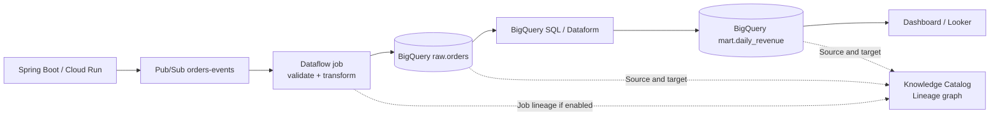
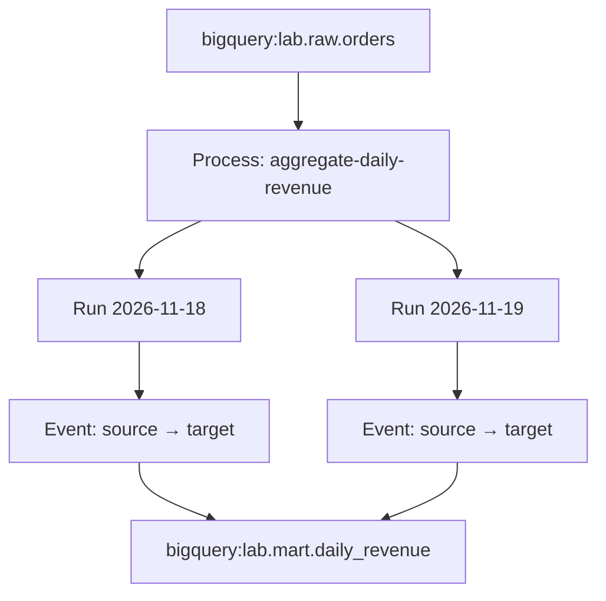
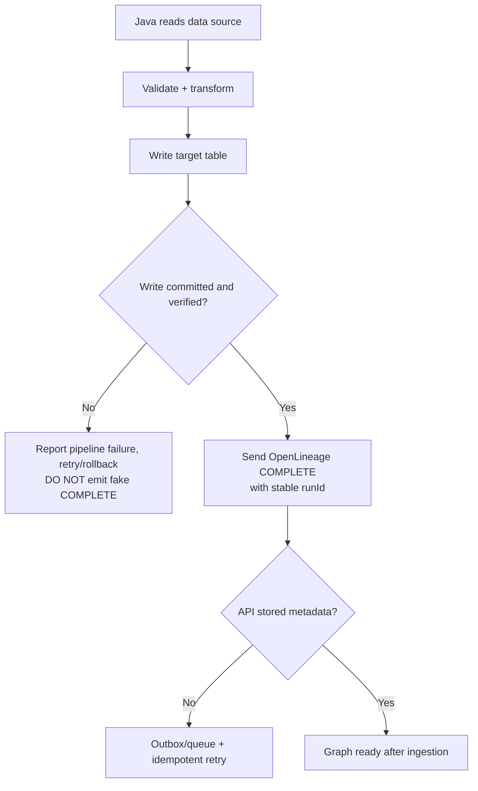
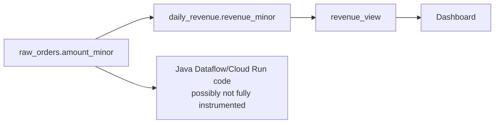
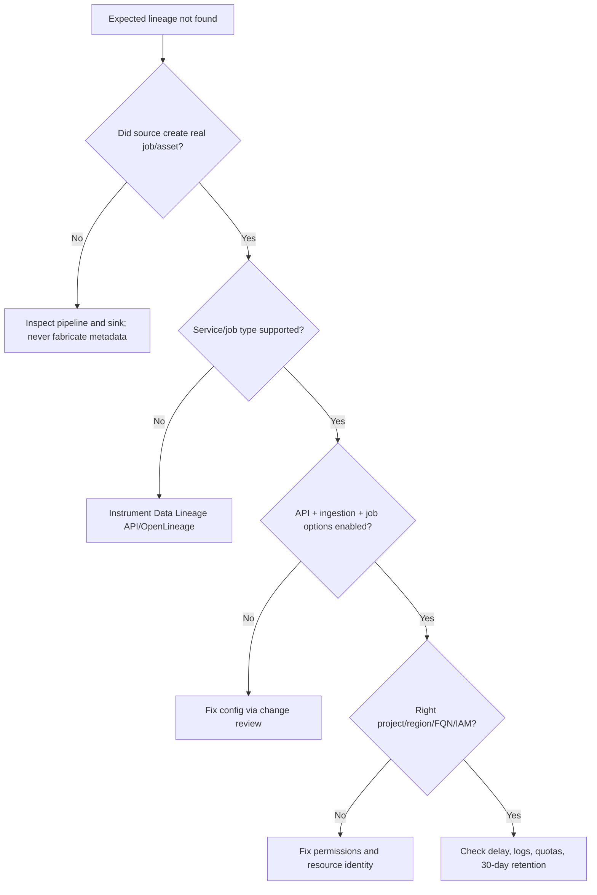

# Data Lineage and Data Provenance Tracking

## 1. Why Does a Number on a Dashboard Need a "History"?

A **Java/Spring Boot** application on **Cloud Run** receives orders; events are published via **Pub/Sub**, processed by **Dataflow**, stored in **BigQuery**, and transformed into an aggregated revenue table for reporting. One day, the dashboard shows an anomalous revenue spike. Beyond knowing which table holds the wrong value, the data team must answer: where did the data come from, which job transformed it, when did it run, and are other reports affected?

**Data lineage** describes **source → transformation → target** relationships. It supports **root-cause tracing (upstream)** when bad data is discovered and **impact analysis (downstream)** before changing a schema, deleting a table, or modifying a pipeline. On Google Cloud, this capability is provided through **Knowledge Catalog (formerly Dataplex Universal Catalog)** and the **Data Lineage API**.

This lesson belongs to the **Data Governance and Analytics** chapter of the **CLOUD_PROVIDERS_GCP** module: learners connect data governance with BigQuery, Pub/Sub, Dataflow, IAM, reliability operations, and cost controls. Lineage is **metadata about data flows**; it does not copy order payloads into the catalog and **does not automatically prove that data is accurate or legally compliant**.

**Learning objectives:**

1. Explain **upstream/downstream, table-level/column-level, process/run/event**.
2. Identify which sources support **automatic lineage** and when to use the **Data Lineage API or OpenLineage**.
3. Create a **BigQuery SQL** flow using mock data to inspect lineage; enable lineage for **Dataflow Java** when needed.
4. Trace lineage via **Knowledge Catalog, BigQuery, and APIs**; use standard FQNs and proper IAM roles across projects.
5. Understand limitations around **column lineage, latency, storage regions, retention, security, and cost**.
6. Build runbooks for schema changes, pipeline incidents, and verification exercises.

> **Safety:** This document provides commands and code **for learning only** and creates no real resources while authoring. Enabling `datalineage.googleapis.com` in a project can collect lineage from **multiple integrated services**, incurring **Knowledge Catalog processing/metadata storage charges**. Enable it only in an **approved lab project**, without altering organizational ingestion policies or running SQL that modifies production.

## 2. How Does Lineage Differ from Catalogs, Logs, and Audits?



| Information | Question Answered | Typical Tools |
| --- | --- | --- |
| **Catalog metadata** | What is this table named, who owns it, what are its schema/labels? | Knowledge Catalog |
| **Data lineage** | Where did this table/column come from, and what depends on it? | Data Lineage API, Knowledge Catalog graph |
| **Job execution logs** | Did a specific job succeed or fail, and how long did it run? | BigQuery Job History, Dataflow logs |
| **Cloud Audit Logs** | Who called an API or administered a resource, and when? | Cloud Logging/Audit Logs |
| **Data quality results** | Does the data follow rules, completeness, and validity? | Data quality checks, SQL assertions |
| **Business provenance** | Which payment event led to a specific value? | Event IDs, outbox, business logic, and event store |

Lineage provides a **dependency map**, not a replacement for **backups, audit trails, row-level change history, or data quality**. A graph can show that `daily_revenue` reads from `orders`, yet cannot verify that `SUM` uses the right currency, no events were dropped, or no transactions were duplicated.

## 3. Model: Assets, Processes, Runs, Events, and Links

Knowledge Catalog uses a hierarchical model in the **Data Lineage API**:

| Object | Meaning | Example |
| --- | --- | --- |
| **Asset / EntityReference** | Data asset identified by its **FQN** | `bigquery:lab-project.raw.orders` |
| **Process** | Definition of a transformation | "Aggregate daily revenue" |
| **Run** | A single execution of a process | Job at 10:00 UTC, run UUID |
| **Lineage event** | Evidence of data movement recorded for a run | Read `raw.orders` and produced `mart.daily_revenue` |
| **Link** | Directed source → target edge generated from an event | `raw.orders → mart.daily_revenue` |



**One process has many runs**; metadata from each execution can generate lineage events. The graph typically aggregates links for readability—it does not mean every record gets its own lineage event. In BigQuery, supported SQL jobs generate lineage for source/target tables. Do not infer from an edge `A → B` that every row in B originated in A or that **row-by-row lineage** exists.

**Upstream** of `mart.daily_revenue` are the data sources and jobs that produce it; **downstream** of `raw.orders` are the tables, pipelines, and reports that consume it. Direction matters: investigating wrong numbers usually walks **upstream**, whereas assessing schema changes walks **downstream**.

## 4. Table-Level and Column-Level Lineage

### 4.1. Table Level

```text
raw.orders ─┐
            ├──[SQL JOIN / AGGREGATE]──> mart.daily_revenue
raw.refunds ┘
```

Shows **which tables depend on which tables**. This is the level typically emitted by **Dataflow, Dataform, Cloud Data Fusion, custom ETL tools**, and OpenLineage events you submit.

### 4.2. Column Level

```text
raw.orders.paid_at      ── DATE(...) ──────> mart.daily_revenue.order_day
raw.orders.amount_minor ── SUM(...) ───────> mart.daily_revenue.revenue_minor
raw.orders.status       ── WHERE PAID ─────> data filter condition
```

Column lineage helps assess the impact of **changing the type of `amount_minor`**, though **not every attribute in a WHERE, JOIN, or UDF is mapped completely as expected**. In BigQuery, the graph distinguishes dependency types such as **exact copy** and **other**; inspect actual links rather than guessing from SQL alone.

**Current scope:** column-level lineage is supported for **BigQuery SQL transformations** and **Managed Service for Apache Spark** per supported versions/features. **Custom OpenLineage events via `ProcessOpenLineageRunEvent` only display table-level lineage**, even if the payload includes column facets. BigQuery column lineage has notable limits: it is not captured for **load jobs, routines, or certain multi-statement scripts**, does not support **nested STRUCT/JSON fields**, does not trace fully through external tables, and drops column details beyond **1,500 links**. **An empty lineage graph does not mean data is unused.**

## 5. Automatic Ecosystem Support and Activation Conditions

| Source | Lineage Capture | Key Limitations |
| --- | --- | --- |
| **BigQuery** | Automatic after enabling Data Lineage API/ingestion, for **query/copy/load** and supported statements | Recorded only for supported job types; BigQuery loads from GCS and CTAS have specific rules; not instantaneous |
| **Dataform / BigQuery pipelines** | Typically captures table-level lineage per workflow actions | Certain declarations, unit tests, and operations do not emit links |
| **Dataflow** | Must enable **`enable_lineage` per job** in addition to enabling the API | Supported sources/sinks only; lineage is at job/asset level, not every `ParDo` |
| **Cloud Data Fusion** | Integrated lineage per product configuration | Not all transformations/plug-ins emit identical metadata |
| **Managed Service for Apache Airflow/Spark** | OpenLineage integration/producer per feature and version | Verify environment/job configuration and supported connectors |
| **Looker (Google Cloud core) / Vertex AI** | Certain assets/relationships supported | Depends on resource type and product configuration |
| **Custom Java ETL / on-prem systems** | **Not automatic simply by running on GCP** | Send **Data Lineage API/OpenLineage** events or use supported integrated tools |

For example, in BigQuery: `CREATE TABLE AS SELECT`, `CREATE VIEW`, `INSERT ... SELECT`, `MERGE`, and certain DML/DDL statements can generate lineage; a **`SELECT` query returning results directly to the browser does not always create a target table**. Automatic BigQuery lineage appears **within up to ~24 hours**, often sooner for many jobs. Do not enable the Data Lineage API expecting the system to **backfill all historical jobs**.

**Important:** enabling the API takes effect at the **project level**, which may cause **multiple integrated services** to begin emitting lineage. Services support **ingestion controls** at project/folder/organization levels, though not every connector shares an identical toggle. Review capture scope and billing before enabling.

## 6. FQN: Naming Assets Properly to Connect the Graph

A **Fully Qualified Name (FQN)** is a unique, **case-sensitive** identifier for an asset; it differs from API resource paths like `projects/.../datasets/...`. Examples:

| Asset | FQN |
| --- | --- |
| BigQuery table | `bigquery:LAB_PROJECT_ID.lineage_lab.raw_orders` |
| BigQuery view | `bigquery:LAB_PROJECT_ID.lineage_lab.revenue_view` |
| Bigtable table | `bigtable:LAB_PROJECT_ID.INSTANCE_ID.TABLE_ID` |
| Pub/Sub topic | `pubsub:topic:LAB_PROJECT_ID.events-lab` |
| Cloud Storage object | `gcs:bucket-name.path.to.object` |
| Custom catalog entry | `custom:team.pipeline.asset` (after registering an appropriate entry) |

**If two producers use different names for the same table, the graph splits**, e.g., one uses `project.dataset.table` and another uses `bigquery:project.dataset.table` without mapping to the standard FQN. With **OpenLineage**, setting `namespace="bigquery"` and `name="PROJECT.DATASET.TABLE"` maps to `bigquery:PROJECT.DATASET.TABLE`. For Pub/Sub, naming and namespace rules differ from BigQuery; consult the **OpenLineage mapping** reference instead of concatenating strings arbitrarily.

If an on-prem asset does not yet exist in Knowledge Catalog, **register a custom entry/FQN properly** so the graph links to the catalog asset; sending an arbitrary string via the API may create a metadata link without creating rich Catalog entry details.

### Multiple Projects and Regions

A pipeline may read tables in a **storage project**, run jobs in a **compute project**, and write results to an **analytics project**. **Lineage processes/runs/events** are typically recorded in the **job-execution project** (e.g., the compute project), not necessarily the project containing the table. APIs and IAM must be configured across the relevant writer/viewer projects; permission to view table names does not automatically grant permission to view **SQL text or job details**.

Lineage metadata is stored **in the region where the transformation runs**. The UI can explore across regions, while querying the API manually requires specifying `parent=projects/.../locations/...`; for multi-level cross-region traversal, use **SearchLineageStreaming** (Preview) where appropriate.

## 7. BigQuery Lab: Creating a Lineage Flow from Mock Data

**Objective:** use SQL to create a `raw_orders` table, an aggregate table, and a view, then observe the **raw → aggregate → view** edges in Knowledge Catalog. No PII, no reading customer tables. This is an **optional billable lab** creating jobs/datasets, so run it only in an authorized project.

### 7.1. Preparing APIs, Region, and Permissions

In **Cloud Shell/Bash**, replace `LAB_PROJECT_ID` with a test project that has Billing enabled:

```bash
gcloud config set project LAB_PROJECT_ID

# Configuration-modifying action; authorized lab project only:
gcloud services enable \
  datalineage.googleapis.com dataplex.googleapis.com \
  bigquery.googleapis.com --project=LAB_PROJECT_ID

# Dedicated US multi-region dataset for the lab.
bq --location=US mk --dataset LAB_PROJECT_ID:lineage_lab
```

The user running SQL needs `bigquery.jobs.create` on the compute project and `bigquery.tables.create/updateData` on the lab dataset. Viewing the graph requires `roles/datalineage.viewer`; viewing table metadata and job details may additionally require `roles/bigquery.metadataViewer` and `roles/bigquery.resourceViewer` on the respective projects. Never grant `Owner` to all students just to bypass IAM.

### 7.2. SQL Creating the Source Table with Literals

In the BigQuery SQL Editor, select **location US**, replace the project placeholder:

```sql
-- Mock aggregated data only; contains no personal information:
CREATE TABLE `LAB_PROJECT_ID.lineage_lab.raw_orders` AS
SELECT 1001 AS order_id, DATE '2026-11-17' AS order_day,
       120000 AS amount_minor, 'VND' AS currency, 'PAID' AS status
UNION ALL
SELECT 1002, DATE '2026-11-17', 250000, 'VND', 'PAID'
UNION ALL
SELECT 1003, DATE '2026-11-18', 98000, 'VND', 'CREATED';
```

**Note:** this step creates data from **literals**, so there is no upstream BigQuery "source table." That is expected behavior; lineage does not invent fictional source tables.

### 7.3. SQL Creating the Target Table from the Source Table

```sql
CREATE TABLE `LAB_PROJECT_ID.lineage_lab.daily_revenue` AS
SELECT order_day, currency,
       SUM(amount_minor) AS revenue_minor,
       COUNT(*) AS paid_orders
FROM `LAB_PROJECT_ID.lineage_lab.raw_orders`
WHERE status = 'PAID'
GROUP BY order_day, currency;

-- Expected result for 2026-11-17/VND:
-- revenue_minor = 370000, paid_orders = 2.
```

Table-level lineage: **`raw_orders → daily_revenue`**. Where column lineage is supported, `amount_minor` feeds `revenue_minor`, while `order_day` and `currency` define grouping. Verifying exact monetary totals requires **SQL assertions or reconciliation**—never infer correctness from the graph alone.

### 7.4. Creating a View for Dashboards

```sql
CREATE VIEW `LAB_PROJECT_ID.lineage_lab.revenue_view` AS
SELECT order_day, revenue_minor
FROM `LAB_PROJECT_ID.lineage_lab.daily_revenue`
WHERE currency = 'VND';
```

**Expected:** a lineage relationship appears between `daily_revenue` and `revenue_view` per supported BigQuery capabilities. Display can take time; do not repeatedly re-run `CREATE TABLE` if the graph has not appeared yet (the second run will fail with "already exists").

### 7.5. Viewing and Verifying the Graph

1. Open **Google Cloud Console → BigQuery → lineage_lab → daily_revenue** and select the **Lineage** tab; or search for the asset in **Knowledge Catalog → Search** and open **Lineage**.
2. Choose **Graph** to view upstream/downstream. Click an edge or process icon to inspect transformation details; open **List** to filter tables/columns and links.
3. Select **column** level if supported by the asset/job. Trace the source of `revenue_minor`. Do not mistake missing display fields for "column has no dependencies."
4. Cross-reference **BigQuery Job history**: record the job ID, user/SA, SQL/DDL, UTC timestamp, and verification query on `daily_revenue`.
5. If the graph is empty, check **APIs, IAM, job-execution project, region, SQL statement type, and ingestion controls**, then allow processing time (potentially **up to 24 hours**).

**Do not use lineage to determine data freshness:** a graph can remain visible after a source table is deleted, and failed jobs or uninstrumented pipelines may emit no links. To verify records were loaded properly, query **table metrics and actual data** within granted permissions.

## 8. Enabling Lineage in Dataflow Java Within Scope

In **Apache Beam Java → DataflowRunner** pipelines from the data processing chapter, **Dataflow** lineage does not depend solely on `datalineage.googleapis.com`: it must be **enabled per job** and use a supported Beam SDK/IO. Per documentation, Dataflow supports lineage from **Beam SDK 2.63.0 and later** across sources/sinks such as **Pub/Sub, BigQuery, Bigtable, Cloud Storage, JDBC, Kafka, and Spanner** with specific limitations (for example, **Spanner Change Streams are not supported**).

### 8.1. Options When Submitting a Java Pipeline

These are **additional flags**, applicable only when you already have a valid configured project, bucket, and job:

```bash
# Append to the Beam DataflowRunner command of your Java pipeline:
--runner=DataflowRunner
--project=LAB_PROJECT_ID
--region=us-central1
--dataflowServiceOptions=enable_lineage=true

# For gcloud dataflow flex-template run:
# --additional-experiments=enable_lineage=true
```

The `--...` lines above are **options for a pipeline launch command**, not standalone Bash commands. Flex Template users pass `--additional-experiments=enable_lineage=true` to a verified `gcloud dataflow flex-template run ...` command. If you do not already have a pipeline, **do not spin up a Dataflow job just for a graph screenshot**; the BigQuery lab suffices to learn core lineage concepts.

**When enabling the API in a Dataflow project**, other integrated services in that project may also emit lineage. Dataflow reports **asset-level relationships across supported sources/sinks**, not a detailed trace of every internal `ParDo` or individual record.

### 8.2. Avoiding Misconceptions Around "Lineage Enabled"

| Condition | Consequence |
| --- | --- |
| `datalineage.googleapis.com` is disabled | No receiver exists for Dataflow lineage events |
| API enabled, but Dataflow job **lacks** `enable_lineage` | No automatic job-level Dataflow lineage |
| Option set, but source/sink is unsupported | Expected links may be missing |
| Job runs in project A, tables reside in project B | Check permissions on both the **job-execution project** and **table project** |
| Pub/Sub job produces output, graph not visible yet | Allow ingestion delay; check logs, FQN, permissions, and Lineage API |
| Multiple jobs share the same name | Use deliberate **process ID/name** to distinguish runs |

To disable lineage on an already-running streaming job, Dataflow guidance requires **stopping/replacing the job with a version lacking the option**; do not assume toggling a project setting erases previously recorded metadata.

## 9. Custom Pipelines: Reporting Lineage via OpenLineage

If a **custom Java service** moves tables from a non-GCP system into BigQuery, the Data Lineage API does not automatically know the origin just because Java holds database credentials. You can emit an **OpenLineage RunEvent** once a data transfer has genuinely completed.

**OpenLineage** is an event specification comprising `job`, `run`, `inputs`, `outputs`, `eventType`, `eventTime`, and optional facets. Knowledge Catalog acts as a **consumer** via `processOpenLineageRunEvent`. The API currently supports OpenLineage **major versions 1 and 2**; **DatasetEvent/JobEvent** are not supported by this endpoint, and **custom column facets do not render column-level lineage**.

### 9.1. Illustrative JSON

Suppose a hypothetical transformation `java-orders-etl` **has created** `java_curated_orders` from `raw_orders`:

```json
{
  "eventTime": "2026-11-19T08:30:00Z",
  "eventType": "COMPLETE",
  "producer": "https://example.org/orders-etl/1.0",
  "schemaURL": "https://openlineage.io/spec/1-0-5/OpenLineage.json#/$defs/RunEvent",
  "job": {
    "namespace": "java-orders-lab",
    "name": "copy-orders-into-curated"
  },
  "run": {
    "runId": "e9c1cebe-5ca6-40c0-b180-cfb9726d47bd"
  },
  "inputs": [
    {"namespace": "bigquery", "name": "LAB_PROJECT_ID.lineage_lab.raw_orders"}
  ],
  "outputs": [
    {"namespace": "bigquery", "name": "LAB_PROJECT_ID.lineage_lab.java_curated_orders"}
  ]
}
```

**This is a hypothetical event, not proof that `java_curated_orders` was created in lab `7`.** Emit a `COMPLETE` event **only after the pipeline successfully writes to the target and verifies the outcome**. Emitting metadata for an operation that never happened produces **false lineage even if the API returns HTTP 200**.

**Standard mapping:** OpenLineage `namespace="bigquery"` + `name="PROJECT.DATASET.TABLE"` maps to Knowledge Catalog FQN `bigquery:PROJECT.DATASET.TABLE`. `job.namespace` identifies the **job-execution system**, not the BigQuery dataset.

### 9.2. REST API to Ingest Events (Optional Lab)

Only when a real transformation exists **in a test environment**, save the JSON to `openlineage-event.json` **in a dedicated lab project**, then call:

```bash
curl --fail-with-body -X POST \
  -H "Authorization: Bearer $(gcloud auth print-access-token)" \
  -H "Content-Type: application/json; charset=utf-8" \
  --data-binary @openlineage-event.json \
  "https://datalineage.googleapis.com/v1/projects/LAB_PROJECT_ID/locations/us-central1:processOpenLineageRunEvent?requestId=e9c1cebe-5ca6-40c0-b180-cfb9726d47bd"
```

`requestId` is the **API request idempotency key** (up to 36 ASCII characters); keep the **exact same `requestId`** when retrying the same event. `runId` identifies the **business run** and does not replace `requestId` in the API mechanism. The caller identity needs `datalineage.locations.processOpenLineageMessage`, e.g., `roles/datalineage.producer` on the project storing lineage.

**Key distinctions:**

- `eventType: COMPLETE` means the source system **claims** completion, not that the Data Lineage API verified the data.
- `producer` is a URL identifying the component emitting metadata, **not** a Google Cloud endpoint or API call location.
- The API records processes/runs/events **under the specified project/location**; choose the location per organizational policy rather than assuming every source belongs in `us-central1`.
- Each message has a max size around **5 MB**, with limits on FQN length and links per event. Design producers not to send thousands of sensitive facets or emit one event per record unnecessarily.

### 9.3. Where to Emit Metadata in a Java Workflow?



Lineage reporting **must never block the business pipeline indefinitely** if the metadata API is slow or down. Write an **outbox record** or enqueue the event into a reliable queue, retry with backoff and a stable `requestId`, and monitor unsent event counts. Likewise, never **emit COMPLETE before committing data** just to shave latency.

## 10. Java 21: Emitting an OpenLineage Event with the Client Library

The snippet below is a **standalone CLI class** to integrate into a *post-write-success* step. It neither connects to nor copies BigQuery data; **it only publishes lineage metadata**, requiring **Application Default Credentials (ADC)** and Producer permissions on the target project. To prevent JSON injection from inputs, the example constructs protobuf `Struct` fields individually.

### 10.1. Maven Dependency

In the `pom.xml` of a **dedicated Java lab project** (with Java 21 and Maven Compiler Plugin), add:

```xml
<dependency>
  <groupId>com.google.cloud</groupId>
  <artifactId>google-cloud-datalineage</artifactId>
  <version>0.91.0</version>
</dependency>
```

`0.91.0` is an illustrative version per the Java client reference; before production, manage dependencies via an appropriate BOM/version and check API compatibility and library security. Java class names still live under the historical package `com.google.cloud.datacatalog.lineage.v1` even though the product now belongs to Knowledge Catalog.

### 10.2. `LineageEventPublisher.java`

```java
package dev.example.lineage;

import com.google.cloud.datacatalog.lineage.v1.LineageClient;
import com.google.cloud.datacatalog.lineage.v1.ProcessOpenLineageRunEventRequest;
import com.google.protobuf.ListValue;
import com.google.protobuf.Struct;
import com.google.protobuf.Value;
import java.time.Instant;
import java.util.UUID;

public final class LineageEventPublisher {
    private static Value string(String s) {
        return Value.newBuilder().setStringValue(s).build();
    }

    private static Value object(Struct s) {
        return Value.newBuilder().setStructValue(s).build();
    }

    private static Value list(Struct item) {
        return Value.newBuilder().setListValue(
            ListValue.newBuilder().addValues(object(item)).build()
        ).build();
    }

    private static Struct dataset(String tableFqnWithoutPrefix) {
        return Struct.newBuilder()
            .putFields("namespace", string("bigquery"))
            .putFields("name", string(tableFqnWithoutPrefix))
            .build();
    }

    public static void main(String[] args) throws Exception {
        if (args.length != 5) {
            throw new IllegalArgumentException(
                "Usage: PROJECT_ID LOCATION INPUT_TABLE OUTPUT_TABLE RUN_UUID");
        }
        String project = args[0];
        String location = args[1];
        String source = args[2]; // PROJECT.DATASET.TABLE
        String target = args[3]; // PROJECT.DATASET.TABLE
        String runId = UUID.fromString(args[4]).toString();

        // Call ONLY AFTER the transformation has completed and been verified.
        Struct event = Struct.newBuilder()
            .putFields("eventTime", string(Instant.now().toString()))
            .putFields("eventType", string("COMPLETE"))
            .putFields("producer",
                string("https://example.org/orders-etl/1.0"))
            .putFields("schemaURL", string(
                "https://openlineage.io/spec/1-0-5/OpenLineage.json"
                + "#/$defs/RunEvent"))
            .putFields("job", object(Struct.newBuilder()
                .putFields("namespace", string("java-orders-lab"))
                .putFields("name", string("copy-orders-into-curated"))
                .build()))
            .putFields("run", object(Struct.newBuilder()
                .putFields("runId", string(runId)).build()))
            .putFields("inputs", list(dataset(source)))
            .putFields("outputs", list(dataset(target)))
            .build();

        var request = ProcessOpenLineageRunEventRequest.newBuilder()
            .setParent("projects/" + project + "/locations/" + location)
            .setOpenLineage(event)
            .setRequestId(runId) // Keep identical when retrying the same event.
            .build();

        try (LineageClient client = LineageClient.create()) {
            var response = client.processOpenLineageRunEvent(request);
            System.out.println("process=" + response.getProcess());
            System.out.println("run=" + response.getRun());
            System.out.println("events=" + response.getLineageEventsCount());
        }
    }
}
```

**Run only for jobs that actually produced output:** this code can publish **factually false metadata** if given a nonexistent table name. Production producers should receive the **run ID** from the orchestrator or outbox rather than generating a new UUID on every retry; changing `runId` creates duplicate graph runs or complicates reconciliation. Never log payloads or sensitive column names; this code prints only resource IDs returned by the API.

### 10.3. Running as a Java Service on Cloud Run/GKE

In Spring Boot, place lineage emission inside a **post-commit / async outbox consumer**: emit events only once the ETL job completes, persisting `runId` and business version for retries. On Cloud Run use the runtime service account; on GKE use **Workload Identity Federation for GKE**. **Never create service account JSON keys** and never grant `roles/datalineage.admin` to a Java producer that only needs to emit events.

## 11. Querying Lineage via API: Direct and Multi-Hop

### 11.1. `SearchLinks`: Finding One Hop Upstream/Downstream

`SearchLinks` queries **direct links** adjacent to an asset by FQN. Setting `target` returns **upstream** links; setting `source` returns **downstream** links.

**Read-only** example, after submitting an event **in location `us-central1`** of the **lab project**:

```bash
# Find upstream links directly feeding the target table.
curl --fail-with-body -X POST \
  -H "Authorization: Bearer $(gcloud auth print-access-token)" \
  -H "Content-Type: application/json" \
  --data '{
    "target": {
      "fullyQualifiedName": "bigquery:LAB_PROJECT_ID.lineage_lab.java_curated_orders"
    },
    "pageSize": 50
  }' \
  "https://datalineage.googleapis.com/v1/projects/LAB_PROJECT_ID/locations/us-central1:searchLinks"
```

**The location must match where the lineage event is stored.** This example matches the **custom OpenLineage event** written to `us-central1` in Section 9, and does **not** automatically return all lineage from BigQuery jobs in the US multi-region; BigQuery may store metadata in the **physical region** where the job executed. If unsure of the location, inspect in Console or query across candidate regions.

The response contains `links[]` and potentially a `nextPageToken`; paginate thoroughly so upstream/downstream assets are not missed. Required permissions include `datalineage.locations.searchLinks`, typically included in `roles/datalineage.viewer`.

### 11.2. `SearchLineageStreaming`: Multi-Level Graphs

When you need to know **which reports will be affected** if `raw.orders.amount_minor` changes, you must traverse **multiple hops**, including across transformations, projects, and regions.

| API | Purpose | Limits / Recommendations |
| --- | --- | --- |
| `SearchLinks` | One hop of direct relationships from a clear starting point | Must traverse iteratively yourself to build a full graph |
| `SearchLineageStreaming` | Streams links via **breadth-first search**, `UPSTREAM` or `DOWNSTREAM` | Recommended for multi-hop/multi-region, **Preview**; verify limits/quotas |
| `BatchSearchLinkProcesses` | Looks up processes associated with a set of links | Used to inspect which transformations created edges |
| `GetProcess/ListRuns/ListLineageEvents` | Investigates history of a specific process/run/event | Does not replace job logs or separate query retention |

**Do not blindly mix table-level and column-level hops:** searching by `field` only traverses existing **column-to-column** links and does not infer all columns from table-level links. In complex BigQuery pipelines with multiple sources and calculations, column-level lineage may represent **partial dependencies**, not an absolute compliance guarantee.

### 11.3. When Long-Term Lineage Audit Reports Are Required

Knowledge Catalog currently **retains lineage information for 30 days**. If compliance requires **1–7 years** of auditability, you cannot rely solely on the UI: build a **periodic extraction job** using supported APIs to store metadata snapshots (FQNs, links, process/run IDs, event times, source systems, extraction timestamps) in **Cloud Storage/BigQuery** under a dedicated retention policy. Apply encryption, IAM, and restricted access just as you would for sensitive data.

## 12. Applying Lineage to Governance and Schema Changes

### 12.1. Root-Cause Tracing for Data Bugs

Suppose `mart.daily_revenue.revenue_minor` suddenly doubles:

1. Confirm via **SQL/data quality** that the number is genuinely wrong, identifying the affected **date, currency, and schema version**.
2. Inspect **upstream column lineage** of `revenue_minor` to locate `raw_orders.amount_minor`, filters, and related transforms.
3. Open process/job details and **BigQuery Job History** to inspect SQL versions, user/SA, and run timestamps.
4. Reconcile against real sources from Dataflow/Pub/Sub, event IDs, replay/dedup logic, and Java application logs.
5. Fix the **source transformation or deduplication** and perform a controlled backfill; run data quality assertions and compare post-fix results.

Lineage **narrows the investigation scope**; it does not replace checking `COUNT DISTINCT eventId`, JOIN conditions, or transaction semantics when diagnosing root cause.

### 12.2. Impact Analysis Before Schema Changes

Suppose the team plans to change `raw_orders.amount_minor INT64` to `NUMERIC`:



Review workflow:

1. Walk the **downstream graph** at table and column levels to find all affected datasets, queries, reports, and owners.
2. Supplement with **code search, Dataform manifests, API contracts, and runbooks**, since lineage may miss uninstrumented jobs/consumers.
3. Test the contract: **scale/precision, JSON serialization, rounding, and currency handling** in both Java and BigQuery.
4. Use an **expand → backfill → switch → contract** migration to avoid breaking live consumers.
5. Verify SLOs, query costs, data quality, and lineage after release; record **change approval**.

### 12.3. Sensitive Data Classification

Lineage reveals where columns labeled sensitive **might** flow, yet **it does not apply masking/DLP or access controls automatically**. Combine **policy tags/column-level security, BigQuery row access policies, Knowledge Catalog aspects, DLP/Sensitive Data Protection, and IAM**. If lineage reveals an edge leaving an authorized zone, treat it as a **signal to investigate**, not proof that data has already leaked.

## 13. IAM, Project Governance, and Protecting Metadata

| Persona | Suggested Role / Permission | Scope |
| --- | --- | --- |
| **Lineage viewer** | `roles/datalineage.viewer` | Project **recording** and project **viewing** lineage |
| **BigQuery table viewer** | `roles/bigquery.metadataViewer` | Project/dataset containing the table |
| **BigQuery job/SQL viewer** | `roles/bigquery.resourceViewer` | **Compute project** executing the job |
| **Catalog entry viewer** | `roles/dataplex.catalogViewer` | Project containing Knowledge Catalog entries |
| **Java/OpenLineage producer** | `roles/datalineage.producer` | Only the project/location recording metadata |
| **Lineage platform admin** | `roles/datalineage.admin` | Managing configuration, deletion/ingestion controls with review |

**Automatic identities:** BigQuery, Dataflow, Managed Airflow, and Managed Spark report lineage via their service integration mechanisms and do not always require granting **Producer** to application service accounts. Custom Java producers do require the emit role. Enabling the API requires `serviceusage.services.enable` (typically via Service Usage Admin) and Billing/IAM change governance.

**Separating compute and data projects:** Data Lineage Viewer on project A does not grant `bigquery.jobs.get` on project B or `bigquery.tables.get` on project C. "Nodes appear in the graph, but the details panel is blank" is usually caused by missing **metadata/job viewer** permissions in the right project, not a job that failed to run.

**Metadata safety:**

- Although lineage **contains no actual table rows**, metadata can expose **table names, column names, Cloud Storage paths, SQL text, operator identities, and job/run IDs**.
- Never put **emails, access tokens, PII, or secrets** into FQNs, SQL comments, OpenLineage facets, or process attributes. Captured `sql` fields may be displayed verbatim.
- Evaluate **VPC Service Controls** and API permissions per organizational boundaries; lineage currently **does not support separate CMEK for collected metadata**, so verify compliance requirements before enabling.
- When running service accounts from Cloud Run/GKE, prefer **ADC/Workload Identity Federation**; avoid baking JSON keys into images.
- Delete process/run/event metadata only with **change approval**; deleting metadata neither deletes nor restores underlying data tables.

## 14. Retention, Latency, and Cost

### 14.1. Data Lineage Has Separate Costs

Knowledge Catalog bills lineage via a **Premium Processing SKU** (measured in **Data Compute Units — DCU-hours**) and a **metadata storage SKU** (volume of metadata stored during the retention window). These are **separate charges** from BigQuery query/storage, Dataflow workers, and Cloud Logging.

| Component | Why It Grows | How to Control |
| --- | --- | --- |
| **Lineage premium processing** | Many jobs creating asset-to-asset links and many entity references | Capture only valuable workloads; tune ingestion policies |
| **Lineage metadata storage** | Processes, runs, events, and links retained for **30 days** | Align to policy; avoid emitting unnecessary events |
| **BigQuery/Dataflow processing** | Running real SQL/jobs to build or verify pipelines | Use small labs, dry runs, and budgets |
| **API requests** | High volumes of custom events/search calls | Batch within limits, retry with `requestId`, respect quotas |
| **Long-term audit reports** | Periodic graph exports to GCS/BigQuery | Lifecycle, storage class/partitioning, read permissions |

**Hypothetical load example (not an invoice):**

```text
500 ETL runs/day × 30 days = 15,000 runs/month.
If each run emits 1 event with 3 asset references,
the system records numerous links and metadata items for billing.

Do not extrapolate USD from 15,000 runs:
metering depends on entity references, data lineage processing,
region, retention duration, and current pricing.
```

Consult **Knowledge Catalog pricing** and Billing Reports by SKU—do not apply BigQuery query/TiB rates to lineage. **Cloud Billing budget alerts do not automatically disable the Data Lineage API or stop ETL jobs.**

### 14.2. Completeness Over Time

- Metadata is retained for **30 days**, not as a permanent audit archive. Lineage links can **remain visible after a table is deleted** until retention expires.
- Lineage is **not real-time**: BigQuery can take up to **24 hours**; Dataflow often appears within minutes, subject to load/ingestion delays.
- Enabling the API today **does not automatically capture history from last year's jobs**. If a service was not previously instrumented, historical lineage will generally be absent.
- Disabling ingestion **stops new processing charges within policy scope**, while existing metadata can continue incurring storage fees until expiration or valid deletion.
- **Multi-region BigQuery** may emit DCU SKUs in the **physical execution region**, not solely the `US`/`EU` string shown on the dataset. Check actual processing locations during billing reconciliation.

### 14.3. Metrics and Graph Quality Criteria

Track more than link counts alone:

- **Coverage:** percentage of critical pipelines with verified upstream/downstream lineage.
- **Completeness:** percentage of asset FQNs matching catalog entries; count of links with missing/unknown endpoints.
- **Freshness:** latency from job completion to lineage visibility.
- **Producer reliability:** failed event counts, retries/DLQs, API 403/429 errors, duplicate events.
- **Governance impact:** time to root cause or dependency verification ahead of schema changes.

Never attach ultra-high-cardinality `runId`/`eventId` values as time-series metric labels. Record IDs in logs with appropriate retention and access controls.

## 15. Runbook for Empty Graphs, Missing Columns, or Wrong Sources

| Symptom | Possible Cause | Check First |
| --- | --- | --- |
| No Lineage tab/graph | API disabled, missing viewer permission, or viewing wrong project | `datalineage.googleapis.com`, Catalog/BigQuery IAM |
| BigQuery job succeeded, no link appears | Unsupported job type, ingestion policy off, or ingest delay | BigQuery Job History/DDL, ingestion control, wait up to 24h |
| Dataflow job produced output, graph empty | Missing `enable_lineage` or unsupported IO/Beam SDK | Job options, SDK version, sources/sinks |
| Node named, but SQL/details invisible | Missing BigQuery resource/metadata viewer in compute/storage project | IAM `bigquery.jobs.get` and `bigquery.tables.get` |
| Table-level present, column-level empty | Custom OpenLineage, load job, nested fields, >1,500 links | Supported sources/levels and column lineage limits |
| Graph fails to connect same-named assets | Wrong FQN / case / project / namespace mismatch | Standard FQN `bigquery:PROJECT.DATASET.TABLE` |
| API `403` when Java publishes | Service account lacks Producer/permission or API disabled | `datalineage.locations.processOpenLineageMessage`, ADC |
| API `429`/`RESOURCE_EXHAUSTED` | Quota exceeded, events sent too rapidly | Exponential backoff retries, avoid per-record events |
| `searchLinks` returns no edges | Wrong location or `source`/`target` direction | Event storage region, FQN filter, page token |
| Graph links to deleted table | 30-day metadata retention | Check actual table/job state |
| Catalog bill rises after enabling API | Other integrated systems began reporting lineage | Billing SKUs, ingestion/project scope |
| Graph claims transform ran, table data wrong | Custom producer emitted false `COMPLETE` | Pipeline logs, commit status, business assertions |

**Short investigation flow:**



**Never retry by creating duplicate tables or emitting fake `COMPLETE` events.** Identify the real pipeline, timestamp, and metadata source; replay only events that actually occurred using the **same business run ID and `requestId`**.

## 16. Exercises and Checklist

### Exercise A — Sketching Upstream/Downstream

Given the flow `Cloud Run Java → Pub/Sub → Dataflow → BigQuery raw.orders → Dataform → BigQuery daily_revenue → dashboard`, draw the **asset-level** lineage graph, list upstream of `daily_revenue` and downstream of `raw.orders`, and identify which segments **are not automatically captured** without instrumentation.

### Exercise B — BigQuery Lab

In a **test project**, run the three SQL statements in Section 7 sequentially. Confirm **370,000 minor currency units** for VND, inspect the graph/list, and record the job ID that created `daily_revenue`. Why does `raw_orders` created from literals have no upstream table? If lineage does not appear after 5 minutes, what should you check?

### Exercise C — Impact of Changing a Column

You want to change `raw_orders.amount_minor` to `NUMERIC`. Inspect downstream table/column lineage, check uninstrumented Java Dataflow/BI code, and propose an **expand–backfill–switch–contract** plan. Why can't the graph replace regression tests?

### Exercise D — Dataflow Java

For a Beam Java 2.77 pipeline reading Pub/Sub and writing BigQuery, explain enabling `datalineage.googleapis.com` and adding `--dataflowServiceOptions=enable_lineage=true`. Why does enabling the Data Lineage API **without the job-level option** fail to guarantee Dataflow lineage?

### Exercise E — Custom OpenLineage and Java

Suppose Java ETL genuinely copied `raw_orders` to `java_curated_orders`. Construct the OpenLineage JSON with a consistent `runId` across retries, and write how to call `processOpenLineageRunEvent` via REST or `LineageClient`. Pick the right FQN/namespace. Why is emitting **`COMPLETE` before writing the sink** false lineage?

### Exercise F — IAM Across Projects

A BigQuery job runs in **compute-A**, reads tables in **storage-B**, and feeds a dashboard in **analytics-C**. An admin opens the graph yet cannot view the SQL. List the **Data Lineage Viewer, BigQuery Metadata Viewer, and BigQuery Resource Viewer** roles to check per project; do not use Owner to work around errors.

### Exercise G — Lineage Cost and Retention

An enterprise runs 500 jobs/day and wants to retain lineage evidence for 12 months. Why is **30-day retention** insufficient? Design a periodic export with appropriate permissions and encryption, budgeting **premium processing, metadata storage, BigQuery/Dataflow processing, and audit storage**. Explain why budget alerts do not automatically stop charges.

### Pre-Production Checklist

- [ ] I distinguish **lineage, catalog metadata, execution logs, audits, and data quality**.
- [ ] I understand **process → run → event → link**, asset FQNs, and upstream/downstream direction.
- [ ] I know BigQuery/Managed Spark can emit **column lineage**, whereas custom OpenLineage is **table-level only**.
- [ ] I verified supported services/job types and **ingestion controls** scope.
- [ ] I verified **APIs, Dataflow job-level options**, and cross-project IAM.
- [ ] I use standard FQNs, stable `runId`, and `requestId` when retrying metadata calls.
- [ ] I never emit `COMPLETE` if the data job has not committed/succeeded.
- [ ] I account for graph latency and **30-day metadata retention**.
- [ ] I protect SQL text, resource names, PII, and process attributes from over-permissive access.
- [ ] I have **impact reviews**, lineage coverage metrics, runbooks, and a Knowledge Catalog budget.

**Conclusion:** Data lineage traces provenance and reveals dependencies before modifying pipelines, schemas, and reports. On Google Cloud, the practical approach combines **automatic BigQuery/Dataform capture, per-job Dataflow flags, and OpenLineage for custom Java ETL**, using standard FQNs while governing **coverage, IAM, latency, retention, and cost**. Lineage is one pillar of trustworthy data governance and never replaces quality testing or business history.

## 17. Official Google Cloud References

- [Knowledge Catalog: About data lineage](https://cloud.google.com/knowledge-catalog/docs/about-data-lineage)
- [Knowledge Catalog: View data lineage](https://cloud.google.com/knowledge-catalog/docs/use-lineage)
- [Knowledge Catalog: Graph/list and column lineage](https://cloud.google.com/knowledge-catalog/docs/lineage-views)
- [Knowledge Catalog: BigQuery lineage quickstart](https://cloud.google.com/knowledge-catalog/docs/track-lineage-quickstart)
- [Knowledge Catalog: Fully qualified names](https://cloud.google.com/knowledge-catalog/docs/fully-qualified-names)
- [Dataflow: Enable data lineage](https://cloud.google.com/dataflow/docs/guides/lineage)
- [Knowledge Catalog: Integrate with OpenLineage](https://cloud.google.com/knowledge-catalog/docs/open-lineage)
- [Knowledge Catalog: OpenLineage FQN mapping](https://cloud.google.com/knowledge-catalog/docs/openlineage-mapping)
- [Data Lineage API: processOpenLineageRunEvent](https://cloud.google.com/knowledge-catalog/docs/reference/data-lineage/rest/v1/projects.locations/processOpenLineageRunEvent)
- [Data Lineage API: searchLinks](https://cloud.google.com/knowledge-catalog/docs/reference/data-lineage/rest/v1/projects.locations/searchLinks)
- [Data Lineage API: SearchLineageStreaming and methods](https://cloud.google.com/knowledge-catalog/docs/reference/data-lineage/rest)
- [Java client: google-cloud-datalineage](https://cloud.google.com/knowledge-catalog/docs/reference/libraries)
- [Data Lineage IAM roles](https://cloud.google.com/iam/docs/roles-permissions/datalineage)
- [Configure data lineage ingestion](https://cloud.google.com/knowledge-catalog/docs/configure-lineage-ingestion)
- [Troubleshoot data lineage](https://cloud.google.com/knowledge-catalog/docs/troubleshooting-lineage)
- [Knowledge Catalog pricing](https://cloud.google.com/products/knowledge-catalog/pricing)
