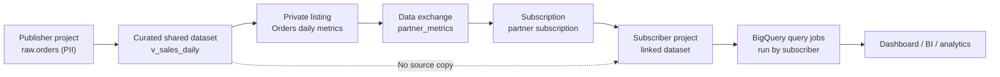
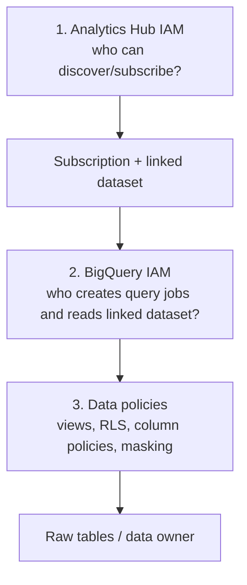

# BigQuery Sharing and Governed Data Sharing

The Data Platform team manages order data in BigQuery. Marketing and an external market-analytics partner want to read **aggregated daily revenue by region**, without seeing emails, customer IDs, or individual transactions. Copying a table into the partner's project not only increases storage cost, but also makes updates, access revocation, and auditing hard to control.

**BigQuery sharing** (formerly **Analytics Hub**) lets publishers expose data via **data exchanges** and **listings**. Subscribers subscribe to a listing to get a **read-only linked dataset** in their own project, querying shared data without creating copies. This lesson belongs to the **Data Governance and Analytics** chapter of the `CLOUD_PROVIDERS_GCP` module, integrating IAM, BigQuery, VPC Service Controls, Cloud Storage, reliability, and cost controls.

> Project names, emails, tables, and scales in this lesson are sandbox examples. Actions such as creating datasets/listings, modifying IAM, subscribing, revoking access, or deleting listings are **real resource and access-control changes**. Perform them only in approved environments. Illustrations use BigQuery GoogleSQL; wherever `asia-southeast1` is used, verify BigQuery sharing supports that location and that the actual dataset is in a compatible region.

## 1. Learning Objectives

After this lesson, you will be able to:

1. Distinguish **data exchange**, **listing**, **shared dataset**, **subscription**, and **linked dataset**.
2. Design a data-sharing contract covering schema, owner, SLA, sensitivity classification, usage scope, and revocation workflow.
3. Publish a **private listing** containing only aggregated or filtered data via an **authorized view**.
4. Configure publisher/subscriber authorization using Analytics Hub IAM roles and BigQuery job/dataset permissions.
5. Subscribe, query a linked dataset, and understand the limits of **zero-copy** data sharing.
6. Select appropriate **data egress controls**, row/column security, data masking, and monitoring mechanisms.
7. Analyze logs/`SHARED_DATASET_USAGE`, troubleshoot errors, manage costs, and govern the grant/revoke lifecycle.

## 2. BigQuery Sharing Architecture: Publisher and Subscriber



| Component | Managed By | Role |
| --- | --- | --- |
| **Shared dataset** | Publisher | Source dataset referenced by the listing; contains approved tables/views/routines |
| **Data exchange** | BigQuery sharing administrator | Space grouping private or public listings |
| **Listing** | Publisher | Describes the data product, source dataset, usage info, and access policies |
| **Subscription** | Subscriber (revocable by publisher) | Subscription relationship to a listing; resource lives in the subscriber's project |
| **Linked dataset** | Created/named by subscriber | Read-only dataset pointing to shared resources without copying rows |
| **Query job** | Caller in subscriber project | Executes SQL using caller's BigQuery permissions, incurring compute billing per config |

**Difference from direct dataset IAM:** BigQuery sharing creates a **discovery → subscription approval → linked dataset → subscription & usage management** workflow. It does not automatically make source data cleaner: if a listing points directly to a dataset with PII, subscribers gain access per existing policies. Always prepare a **dedicated publishing dataset** rather than using an OLTP/raw dataset as a shared dataset when only aggregates are needed.

The source project and dataset names can appear in the linked dataset's metadata visible to subscribers; avoid putting secrets or sensitive details in resource names, descriptions, and listing documentation.

### 2.1. Zero-Copy Does Not Mean Uncopyable

A subscription creates a **logical reference** to the shared dataset that stays live with source updates, while the publisher retains control over the source. However, if policies permit **query results to be saved, copied, or exported**, a subscriber can create derived data outside the linked dataset. Revoking a subscription **does not automatically delete copies legitimately created earlier**. For sensitive data, usage contracts, IAM, egress options, observability, and platform controls must work together.

## 3. Choosing the Right Sharing Mechanism

| Use Case | Usually Best-Fit Solution | Limitations / Conditions |
| --- | --- | --- |
| Sharing tables/views across multiple teams/partners with subscription management | **BigQuery sharing** private exchange/listing | Manage publisher/subscriber roles and resource locations |
| Granting one dataset to a single internal group | BigQuery dataset IAM | Simpler, fewer catalog/subscription lifecycle features |
| Hiding PII while exposing approved SELECT outputs | **Authorized view** in publishing dataset | Must authorize the view properly; review view SQL and sources |
| Same table, different groups see only certain rows | Row-level access policy (RLS) | Rules can become complex when sharing cross-org |
| Sensitive columns needing selective access/obfuscation | Column-level access control / data masking | Needs policy tags/data policies and identity testing |
| Joint two-party analysis without exposing full data | **Data clean rooms** when requirements match | Dedicated config, privacy limits, and usage model |
| Fixed monthly snapshot | Controlled copy/export | Creates a physical copy requiring separate retention/erasure |
| Real-time event distribution | Pub/Sub topic listing via BigQuery sharing | Creates a linked Pub/Sub subscription, distinct from a linked BigQuery dataset |

A **private exchange** is not listed publicly in the catalog; even granting `allAuthenticatedUsers` on a listing inside a private exchange does not turn it into a publicly searchable listing. On a public exchange, listings are subject to inherited permissions; never use a public exchange to distribute partner-only data.

## 4. IAM Roles and Least Privilege

BigQuery sharing uses roles prefixed with **`roles/analyticshub.*`** despite the product rename. Permissions to **discover**, **subscribe**, **query**, and **administer source datasets** are distinct.

| Principal | Typical IAM Role | Where Granted | Do Not Assume |
| --- | --- | --- | --- |
| Exchange admin | `roles/analyticshub.admin` | Publisher project/exchange | Does not need full BigQuery data access to all sources |
| Listing publisher | `roles/analyticshub.publisher` | Exchange or publisher project | Still needs appropriate permissions on the **shared dataset** |
| Listing metadata viewer | `roles/analyticshub.viewer` | Scoped to exchange/listing/project | Viewing a listing **does not allow subscribing/querying** |
| Subscriber operator | `roles/analyticshub.subscriber` | **Publisher listing/exchange** | Does not automatically grant linked dataset creation in destination project |
| Subscriber project principal | `roles/bigquery.user` | Subscriber project | Must hold `bigquery.datasets.create`/`bigquery.jobs.create` |
| Linked dataset query user | `roles/bigquery.dataViewer` + job creation | Subscriber project/dataset and job project as scoped | Cannot write into the linked dataset |
| Subscription manager | `roles/analyticshub.subscriptionOwner` when needed | Subscriber project per current mechanism | Not a Data Owner of the source |
| Publisher data steward | `roles/bigquery.dataOwner` or narrower `bigquery.datasets.get/update` | Source shared dataset | No need to grant project-wide Owner |

**Important:** the publisher grants `roles/analyticshub.subscriber` to the subscriber identity on the listing/exchange, while the subscriber needs permissions to create linked datasets and query jobs in **their own project**. One role does not substitute for the others. If automated via a service account or Workload Identity instead of a human user, grant to the exact execution principal and check inherited policies.

**Revocation** steps must clearly distinguish revoking listing visibility, subscribe permissions, an active subscription, or linked dataset reads. Merely removing the Subscriber IAM role **does not necessarily terminate existing subscriptions**; use subscription management/revocation to cut off active access.

## 5. Designing the Data Product Before Publishing

Example data-separation layout:

```text
orders-publisher-lab/
  raw/
    orders              # order_id, customer_email, order_date, region, net_amount
  partner_metrics/
    v_sales_daily       # only order_date, region, order_count, net_revenue
  sharing exchange:
    partner_metrics_ex
      listing: sales_daily_listing -> partner_metrics dataset

orders-subscriber-lab/
  orders_partner_link   # read-only linked dataset created by subscription
```

A data product requires:

| Metadata / Contract | Example |
| --- | --- |
| Name and purpose | `sales_daily_v1` – daily revenue reconciliation by region |
| Owner / point of contact | Data Platform / Analytics owner, support channel |
| Sensitivity level | Aggregates only; never expose emails, customer IDs, or order-level rows |
| Schema and version | `order_date DATE, region STRING, order_count INT64, net_revenue NUMERIC` |
| Updates / freshness | D+1 before 06:00 in specified timezone |
| Data rules | How cancellations/refunds are handled; how duplicate orders are resolved |
| Usage rights / retention | Permitted groups, intended purpose, redistribution prohibitions if needed |
| Changes / revocation | Schema change notice, transition window, revocation timeline |
| Observability & cost | Jobs/usage views, budgets, each owner bearing storage vs. query billing |

**Aggregated data can still leak information** if a group has only one customer or a subscriber joins multiple sources to infer individuals. For small groups, enforce minimum cell-count thresholds, limit dimensions, and assess **differencing attack** risks; `HAVING COUNT(*) >= 10` is one risk-reduction layer, **not an absolute anonymity guarantee**.

## 6. Publisher Lab: Creating a View-Only Shared Dataset

Assume two sandbox Google Cloud projects with Billing and BigQuery APIs enabled:

```text
PUBLISHER_PROJECT = orders-publisher-lab
SUBSCRIBER_PROJECT = orders-subscriber-lab
LOCATION          = asia-southeast1
EXCHANGE_ID       = partner_metrics_ex
LISTING_ID        = sales_daily_listing
SOURCE_DATASET    = raw
SHARED_DATASET    = partner_metrics
LINKED_DATASET    = orders_partner_link
```

The steps below use **BigQuery GoogleSQL**. Run DDL and INSERT only in a sandbox; production data requires masking, data classification, data contracts, and formal approval before publishing.

### 6.1. Create Both Datasets in the Right Location

```sql
-- RESOURCE CHANGE: publisher sandbox only.
CREATE SCHEMA IF NOT EXISTS `orders-publisher-lab.raw`
OPTIONS (location = 'asia-southeast1');

CREATE SCHEMA IF NOT EXISTS `orders-publisher-lab.partner_metrics`
OPTIONS (location = 'asia-southeast1');
```

**Never create a listing directly on `raw`.** A listing publishes the entire shared dataset; if sensitive tables are later added to raw, sharing raw introduces unpredictable exposure risks. To control the published surface area, place only **curated views/tables** approved for partners inside `partner_metrics`.

### 6.2. Create a Mock Raw Table

```sql
-- SCHEMA/DATA CHANGE: mock values, never use real PII.
CREATE TABLE IF NOT EXISTS `orders-publisher-lab.raw.orders` (
  order_id STRING NOT NULL,
  customer_email STRING,
  order_date DATE NOT NULL,
  region STRING NOT NULL,
  net_amount NUMERIC NOT NULL
)
PARTITION BY order_date;

-- Demo table must be empty to avoid duplicate IDs on re-runs.
INSERT INTO `orders-publisher-lab.raw.orders`
  (order_id, customer_email, order_date, region, net_amount)
SELECT
  FORMAT('demo-ord-%03d', n),
  FORMAT('synthetic%03d@example.test', n),
  DATE '2026-11-18',
  'VN',
  CAST(100000 + n * 1000 AS NUMERIC)
FROM UNNEST(GENERATE_ARRAY(1, 12)) AS n;
```

In production, the source may be a Dataflow/BigQuery pipeline from Cloud Storage/Pub/Sub; the publisher manages quality checks, permissions, and retention on the raw dataset. **Do not re-run `INSERT` once demo data exists**; `CREATE TABLE IF NOT EXISTS` does not make `INSERT` idempotent.

### 6.3. Create an Aggregate-Only View

```sql
-- VIEW CHANGE: includes only approved attributes.
CREATE OR REPLACE VIEW
  `orders-publisher-lab.partner_metrics.v_sales_daily`
OPTIONS (
  description = 'Aggregated daily revenue by region, version v1; no PII'
) AS
SELECT
  order_date,
  region,
  COUNT(*) AS order_count,
  SUM(net_amount) AS net_revenue
FROM `orders-publisher-lab.raw.orders`
GROUP BY order_date, region
HAVING COUNT(DISTINCT order_id) >= 10;
```

The view omits `customer_email` and `order_id` and publishes only groups with at least 10 distinct orders. In the mock data, `2026-11-18` has 12 VN orders, so the view returns one row. **Inspect grouping and dimensions:** if real data has duplicate IDs or tiny cohorts, the current `HAVING` clause **does not deduplicate transactions** and may not sufficiently protect privacy. Implement upstream dedup/aggregation and privacy reviews.

### 6.4. Authorize the View to Read Source Data

The view lives in `partner_metrics` yet queries a table in `raw`. So subscribers who **only have view permissions** can query the view without receiving direct read access to the raw table:

1. Go to BigQuery Data Explorer → dataset `orders-publisher-lab.raw` → **Sharing → Authorize views**.
2. Select the **exact view** `orders-publisher-lab.partner_metrics.v_sales_daily` and add it to `raw`'s **authorized views**.
3. Verify `raw` does not grant `roles/bigquery.dataViewer` directly to subscribers.
4. Test querying the view using an identity with permissions **on the view/shared dataset** and no direct permissions on `raw`.

An **authorized view** lets callers query through the view within its defined scope without granting read access to the entire raw dataset. If someone later edits the view to `SELECT * FROM raw.orders`, the authorized view becomes a data-leak path; therefore, **every view SQL change must be reviewed**, versioned, and tested. Verify how row/column policy tags, data masking, and authorized views interact under your actual configuration rather than assuming one layer replaces another.

## 7. Publisher Lab: Private Exchange and Listing

### 7.1. Enable the Analytics Hub API and Check IAM

```bash
PUBLISHER_PROJECT="orders-publisher-lab"
LOCATION="asia-southeast1"
EXCHANGE_ID="partner_metrics_ex"
LISTING_ID="sales_daily_listing"

# API CONFIG CHANGE: run only in an approved sandbox.
gcloud services enable analyticshub.googleapis.com \
  --project="$PUBLISHER_PROJECT"

# READ-ONLY: verify current account and project.
gcloud auth list
gcloud config get-value project
```

The exchange creator needs BigQuery sharing admin permissions; the listing creator needs the publisher role on the exchange plus appropriate permissions on the shared dataset (typically `bigquery.datasets.get/update`). **Never use Project Owner to work around 403 errors.**

### 7.2. Create a Private Exchange

In Google Cloud console → **BigQuery → Sharing (Analytics Hub)**:

1. Select **Create exchange**, project `orders-publisher-lab`, and location `asia-southeast1`.
2. Set exchange ID `partner_metrics_ex` and display name "Partner metrics — sandbox".
3. Keep it **private**; do not enable public discoverability.
4. Assign publisher/admin/viewer/subscriber roles to approved principals/groups.
5. Verify the exchange is visible to the publisher but hidden from unauthorized users.

You can also create the exchange via REST API instead of Console (this is a **mutating** command):

```bash
# Run only if the exchange does not exist and the principal is authorized.
ACCESS_TOKEN="$(gcloud auth print-access-token)"
curl -sS -X POST \
  "https://analyticshub.googleapis.com/v1/projects/$PUBLISHER_PROJECT/locations/$LOCATION/dataExchanges?dataExchangeId=$EXCHANGE_ID" \
  -H "Authorization: Bearer $ACCESS_TOKEN" \
  -H "Content-Type: application/json" \
  -d '{"displayName":"Partner metrics sandbox","description":"Private governed metrics exchange"}'
```

### 7.3. Publish a Listing for the Prepared Dataset

Open exchange `partner_metrics_ex` → **Create listing**:

1. Resource type: **BigQuery dataset**.
2. Shared dataset: `orders-publisher-lab.partner_metrics`, which must share the exchange's region.
3. Listing ID: `sales_daily_listing`; display name "Orders daily sales v1".
4. Document columns, metric definitions, refresh cadence, owner, and query guidance. Mark sensitivity/no-PII per review results.
5. Select **private listing**; do not grant `allAuthenticatedUsers` and do not enable public discoverability.
6. Choose **data egress options** per usage policy in Section 10; consider enabling **Subscriber Email Logging** if permitted and user attribution is required.
7. **Grant `roles/analyticshub.subscriber`** on the listing to the approved partner principal/group.

A publisher **cannot arbitrarily swap the shared dataset of an existing listing**. If product structure changes materially, create a new versioned dataset/listing and give subscribers a migration window. **Once enabled and saved, Subscriber Email Logging cannot simply be toggled off directly**; align privacy and log policies before enabling it.

### 7.4. Verify the Listing Is Not Accidentally Public

Test that users outside the approved group **cannot discover or subscribe to** the private exchange/listing. Do not rely solely on "doesn't appear on the search page" as proof of security: inspect the **IAM policy on the exchange/listing** and inherited bindings. Watch out for `allUsers` and `allAuthenticatedUsers`, especially if the organization previously used public listings for experiments.

## 8. Subscriber Lab: Creating a Linked Dataset and Querying

The **subscriber project** is where users/applications run BigQuery jobs and place the linked dataset. The subscriber needs:

- `roles/analyticshub.subscriber` on the publisher listing/exchange to **subscribe**.
- Permissions to create datasets and query jobs in `orders-subscriber-lab` (e.g., `roles/bigquery.user`).
- Permissions to read the linked dataset/metadata when querying (e.g., `roles/bigquery.dataViewer` within appropriate scope).

**There is no need to grant direct read access on `raw.orders` to the subscriber** once the authorized view is configured properly. Holding `roles/analyticshub.subscriber` does not automatically grant BigQuery query job creation or access to arbitrary tables in the publisher project.

### 8.1. Subscribe via Console

1. Sign in as an identity granted Subscribe; open BigQuery → **Sharing (Analytics Hub)**.
2. Open the private listing link `sales_daily_listing` from the publisher or locate it in an authorized exchange.
3. Review metadata: publisher, shared tables/views, terms of use, data regions, restrictions, and permissions; click **Subscribe**.
4. Destination project: `orders-subscriber-lab`; linked dataset ID: `orders_partner_link`; primary region: `asia-southeast1`.
5. Confirm. The linked dataset appears in BigQuery Data Explorer with a linked-dataset icon.

For a dataset shared in **one region**, pick the compatible region published by the listing. The **primary region of a linked dataset may differ from the provider primary region** when the listing enables appropriate replica regions; cross-region dataset replication/replicas must be ready per policy—not just any region can be chosen.

### 8.2. Or Subscribe via REST API

Sample executed from the terminal of a signed-in subscriber with sufficient IAM; **modifies resources**, so run only when the listing exists and subscription is permitted:

```bash
PUBLISHER_PROJECT="orders-publisher-lab"
SUBSCRIBER_PROJECT="orders-subscriber-lab"
LOCATION="asia-southeast1"
EXCHANGE_ID="partner_metrics_ex"
LISTING_ID="sales_daily_listing"
LINKED_DATASET_ID="orders_partner_link"
ACCESS_TOKEN="$(gcloud auth print-access-token)"

curl -sS -X POST \
  "https://analyticshub.googleapis.com/v1/projects/$PUBLISHER_PROJECT/locations/$LOCATION/dataExchanges/$EXCHANGE_ID/listings/$LISTING_ID:subscribe" \
  -H "Authorization: Bearer $ACCESS_TOKEN" \
  -H "Content-Type: application/json" \
  -d "{\"destinationDataset\":{\"datasetReference\":{\"projectId\":\"$SUBSCRIBER_PROJECT\",\"datasetId\":\"$LINKED_DATASET_ID\"},\"location\":\"$LOCATION\"}}"
```

Do not re-run if the linked dataset already exists without checking the response: name conflicts will occur. **Never create a linked dataset via `CREATE SCHEMA` expecting it to link automatically**; you must subscribe so BigQuery sharing creates a linked dataset.

### 8.3. Reading Tables/Views via the Linked Dataset

In the subscriber project, use the Console SQL workspace or `bq query`:

```bash
# READ-ONLY, though it can incur BigQuery analysis charges.
bq query \
  --project_id="orders-subscriber-lab" \
  --location="asia-southeast1" \
  --use_legacy_sql=false \
  --maximum_bytes_billed=1073741824 \
  'SELECT order_date, region, order_count, net_revenue
   FROM `orders-subscriber-lab.orders_partner_link.v_sales_daily`
   WHERE order_date = DATE("2026-11-18")'
```

If the authorized view and data permissions are configured properly, the query on mock data returns **one VN row with 12 orders**, with no emails or order IDs. `maximum_bytes_billed` sets an ~**1 GiB** ceiling for on-demand jobs; under capacity reservations, slot-based billing follows separate rules. **A successful query does not prove anonymity:** verify across multiple cohorts/filters, history, and linkage risks with external datasets.

### 8.4. What a Linked Dataset Can and Cannot Do

| Operation | Typical Outcome |
| --- | --- |
| `SELECT` shared table/view | Yes, if caller has IAM and all constraints are satisfied |
| JOIN linked view with internal table in same location | Yes, if supported by BigQuery and caller can read both |
| `INSERT/UPDATE/DELETE` into linked dataset | **No**: linked datasets are read-only |
| Create/modify tables/views **inside** linked dataset | **No** |
| Grant separate IAM on a table inside linked dataset | Does not alter source resource permissions via the linked dataset |
| Edit description/labels of linked dataset | Supported metadata updates only; does not affect source |
| Copy/export/save query results elsewhere | **Depends on listing egress controls, IAM, and policies** |
| Unsubscribe/delete linked dataset | Terminates the link; **does not delete publisher's shared dataset** |

**"Read-only" does not mean data cannot leave the project.** If export rules allow it, a user permitted to run SQL can read and persist results externally. Evaluate controls across the listing, subscriber project, policies, and usage agreements.

## 9. Source Data IAM and View Authorization Mechanics

Governed sharing requires at least three layers:



### 9.1. Authorized Views Protect the Raw Dataset

An authorized view acts as the **SQL whitelist** of a data product: the publisher decides which columns, groupings, filters, and formulas may execute. Subscribers only need permissions on the published view and gain no rights to write arbitrary SQL against raw tables. **Never use views with `SELECT *`** or place raw tables directly in the shared dataset as a "shortcut."

If the view SQL changes, data seen by subscribers changes immediately. Version view names such as `v_sales_daily_v1`/`v_sales_daily_v2`, enforce data owner reviews and schema compatibility tests, and give deprecation notices. Never drop v1 before subscriber downstream jobs migrate.

### 9.2. Row-Level and Column-Level Security Are Not Just Column Hiding

| Mechanism | What It Controls | Example |
| --- | --- | --- |
| Authorized view | SQL output visible to users | Only daily revenue by region |
| Row-level access policy | Which rows a caller can access | Only assigned region/sales channel |
| Column-level access control | Who can read policy-tagged columns | Only Finance reads granular revenue fields |
| Dynamic data masking | Returns masked values per data policy | Email masked according to role |
| Listing data egress restrictions | BigQuery copy/export and query result saving per mode | Restricts creating copies outside linked dataset |
| VPC Service Controls | Perimeters and cross-project/service flows | Does not replace IAM or content classification |

Controls have specific **evaluation order and combination limits** in BigQuery; test using **real subscriber principals**, not a publisher admin account. If a view allows inferring sensitive values through tiny cohorts or repeated queries, policy tags and masking do not eliminate that risk on their own. When stronger privacy is needed, consider **data clean rooms** and properly designed aggregation/threshold mechanisms.

### 9.3. Data Across Borders

The data exchange and shared dataset must live in compatible locations. To share a listing across multiple regions, the publisher configures **cross-region dataset replication** and selects only replicas in the **Ready to use** state. Subscribers select from the regions exposed by the listing. This can incur storage/replication/network costs and impact sync latency and residency compliance. **A linked dataset does not automatically replicate data globally or bypass BigQuery location rules.**

## 10. Data Egress Controls: Restricting Intentional Copying

When creating a BigQuery dataset listing, publishers can choose data egress restriction levels, such as:

| Option in BigQuery Sharing | Primary Effect | Remaining Risk |
| --- | --- | --- |
| No egress restriction | Subscribers can run IAM-permitted copy/export operations | Data can easily be duplicated |
| **Disable copy and export of shared data** | Blocks direct copy/export of the shared dataset | **Query results** may still be exportable unless separately restricted |
| **Disable copy and export of query results** | Blocks both shared data copy/export and supported query result saving/exporting | Authorized users still see query results on screen via `SELECT` |
| **Disable copy and export of tables through APIs** | Further restricts corresponding BigQuery API paths | Check interactions with other restrictions |

Depending on the option, **copy, clone, export, snapshot, CTAS, destination table/view writes**, and related APIs can be blocked. **Never claim "not a single bit can leak":** authorized readers can still view output, memorize it, take screenshots, or use out-of-band channels depending on setup. Treat egress controls as a layer **reducing data movement inside BigQuery**, paired with usage policies, anomaly detection, and leak audits.

**Testing workflow:** from a sandbox subscriber identity, run an allowed `SELECT`, then attempt `CREATE TABLE AS SELECT` or exporting results to a controlled destination. Behavior must match the chosen policy; **never use real production data to test egress prevention**. If dashboarding requires materializing results, agree on an appropriate egress mode before granting the subscription.

## 11. Query Observability, Subscriber Usage, and Auditing

BigQuery sharing helps publishers see who consumes shared resources. Observability sources include the **Sharing usage dashboard**, `INFORMATION_SCHEMA.SHARED_DATASET_USAGE`, Cloud Audit Logs (`analyticshub.googleapis.com`), and BigQuery jobs/Cloud Billing. Correlate signals by listing, subscriber project, dataset, timestamp, and business owner.

### 11.1. Using Publisher's `SHARED_DATASET_USAGE`

The publisher needs `bigquery.datasets.listSharedDatasetUsage` on the source project (e.g., Data Owner or an appropriate custom role). The metadata view is **regional** and retains roughly **180 days** of job history; the query location must match the metadata region.

```sql
-- READ-ONLY: run in location asia-southeast1,
-- using a principal with usage metadata permissions on the source project.
SELECT
  job_start_time,
  listing_id,
  linked_project_number,
  linked_dataset_id,
  job_id,
  shared_resource_id,
  shared_resource_type,
  total_bytes_processed
FROM
  `orders-publisher-lab.region-asia-southeast1.INFORMATION_SCHEMA.SHARED_DATASET_USAGE`
WHERE dataset_id = 'partner_metrics'
  AND job_start_time >= TIMESTAMP_SUB(CURRENT_TIMESTAMP(), INTERVAL 7 DAY)
ORDER BY job_start_time DESC
LIMIT 100;
```

Results show which subscriber projects are querying which resources and their consumption volume. `total_bytes_processed` here is **not automatically the publisher's bill**; subscribers pay for their own query compute under their on-demand or reservation model. If a job accesses multiple shared resources, multiple usage rows may appear; do not sum every row blindly as exact per-job billing.

### 11.2. Aggregating Demand by Subscriber

```sql
-- READ-ONLY: estimate 7-day activity across linked datasets.
SELECT
  linked_project_number,
  linked_dataset_id,
  COUNT(DISTINCT job_id) AS query_jobs,
  SUM(total_bytes_processed) AS referenced_bytes_processed
FROM
  `orders-publisher-lab.region-asia-southeast1.INFORMATION_SCHEMA.SHARED_DATASET_USAGE`
WHERE dataset_id = 'partner_metrics'
  AND job_start_time >= TIMESTAMP_SUB(CURRENT_TIMESTAMP(), INTERVAL 7 DAY)
GROUP BY linked_project_number, linked_dataset_id
ORDER BY query_jobs DESC;
```

`query_jobs` counts distinct job IDs in the result set, while `referenced_bytes_processed` measures **per referenced source resource** and may overlap across multiple resources/queries. For subscriber cost reconciliation, use the **subscriber's Cloud Billing export** and `INFORMATION_SCHEMA.JOBS_BY_PROJECT` in the job project (if authorized), rather than attributing all charges to the publisher.

### 11.3. Subscriber Email Logging and Privacy

When **Subscriber Email Logging** is enabled on a listing, queries from subscriptions **created after enabling it** can record `job_principal_subject` in usage metadata. Because this identifies individual callers, define monitoring purpose, log access controls, and retention before enabling it. **Do not assume existing pre-existing subscriptions automatically expose caller identities in the usage view.**

Also note that IAM edits, listing creation/deletion, and subscribe/revoke actions can be captured in **Cloud Audit Logs**; verify Data Access logging and retention per organizational settings. Dashboards can lag or omit data if permissions or regions are wrong; combine job statistics and audit logs when investigating rather than trusting an empty chart.

### 11.4. SLOs for Shared Data Products

| Illustrative SLI/SLO | Definition | Monitoring |
| --- | --- | --- |
| Data freshness | Day D data ready before 06:00 D+1 | Publisher pipeline timestamp + query health |
| Schema compatibility | No unannounced column drops/renames in v1 | Contract tests and CI reviews |
| Availability | Success rate of sample queries via linked dataset | Synthetic monitoring using a test subscriber identity |
| Privacy | No user/small-cohort exposure outside approved scope | Automated SQL checks and periodic access audits |
| Adoption | Active subscribers/jobs using the listing | `SHARED_DATASET_USAGE` and Sharing metrics |
| Revocation | Post-revocation, revoked identity can no longer query | Runbook + negative access test |

A view query succeeding with 0 rows does not prove data is fresh; inspect publisher pipeline **watermarks/freshness** and period control totals.

## 12. Subscription Lifecycle, Schema Changes, and Revocation

### 12.1. Distinguishing Actions

| Action | Impact | What to Verify Afterward |
| --- | --- | --- |
| Remove `roles/analyticshub.subscriber` | Blocks new subscriptions within IAM scope | **Does not replace revoking existing subscriptions** |
| Publisher **revokes** a specific subscription | Terminates sharing access for that subscriber | Linked dataset may remain **unlinked**; verify `SELECT` fails |
| Subscriber deletes linked dataset | Unsubscribes from subscriber side | Does not delete publisher's shared dataset/tables |
| Publisher deletes listing | Unpublishes listing, impacting all subscribers | High disruption risk; inspect active subscriptions and sandbox first |
| Publisher changes view SQL/schema | Can immediately alter query results for all subscribers | Versioning, contract tests, migration notices |
| Publisher deletes source dataset | Can break multiple listings/views/jobs | Never do while active consumers depend on it |

**Revoking in Console:** BigQuery → Sharing → data exchange → listing → Manage subscriptions, identify the target subscription/project, and revoke after ticket/approval. Per documentation, **publisher-initiated revocation can leave the linked dataset in an unlinked state in the subscriber project**, and the subscriber should delete unused datasets. **Never delete an entire listing or source dataset just to revoke one partner.**

**Verification:** re-run the same query as the previously permitted subscriber identity; it must fail with access denied. Check BigQuery audits/usage and dependent dashboards/pipelines; if data was previously exported/copied, coordinate contractual deletion or cessation—revocation cannot retroactively delete copies across external systems.

### 12.2. Safely Evolving a Data Product

Recommended v1 → v2 path:

1. Create `v_sales_daily_v2` with updated columns/definitions in an approved dataset; test privacy rules.
2. Publish clear metadata and schema contracts; if permissions or audiences differ, create a v2 listing instead of changing sources abruptly.
3. Announce start date for new data, regions, costs, and v1 deprecation timeline.
4. Let subscribers test using properly scoped identities; monitor query failures and view usage.
5. After the migration window, revoke or retire v1 through a controlled process rather than dropping abruptly.

A linked dataset references **live changing source data**, so it does not automatically keep version history or fixed per-partner snapshots. When periodic reconciliation requires an **immutable** dataset, design governed snapshot/versioned tables with separate retention (if policies permit).

## 13. Costs, Quotas, Regions, and Responsibility Boundaries

Under the BigQuery sharing model, managing **data exchanges/listings** itself carries **no extra service fee**. However, data and compute charges still apply:

| Responsible Party | Typical Costs | Control Suggestions |
| --- | --- | --- |
| Publisher | BigQuery source/curated table storage, data pipelines, snapshots, backups per service | Storage lifecycle, scheduled query cost, quality checks |
| Subscriber | BigQuery query compute (on-demand bytes billed or capacity slots), job logs | Dry runs, `maximum_bytes_billed` for on-demand, budgets |
| Publisher/Subscriber per config | Cross-region replication, network/egress, extra Dataflow/BigQuery processing | Choose aligned regions; measure data transfer |
| Consuming parties | Cloud Logging, Monitoring, audit retention, and security tooling | Retention/visibility and budget owners |

**Zero-copy** via a linked dataset avoids maintaining a duplicate storage copy on the subscriber side, yet it does not make queries free or prevent intentional copies elsewhere. A subscriber running `SELECT *` across TB of data can rack up substantial compute bills; listing IAM alone does not control the subscriber's budget.

### 13.1. Availability and Policy Responsibilities

The publisher owns freshness, schema contracts, and source quality; the subscriber owns query patterns, destination workloads, and downstream dashboard access controls. If a source table/view is deleted, changes schema, or fails data quality, the linked dataset **does not keep a fallback backup copy when the publisher breaks**. Both organizations need owners and incident-notification/rollback workflows.

### 13.2. VPC Service Controls and Compliance

When source/subscriber projects sit inside VPC Service Controls perimeters, BigQuery sharing may require **ingress/egress rules** for background operations and cross-perimeter queries to work. **Never open an entire perimeter just to make a subscription succeed.** For data subject to residency rules, document provider primary location, published replica regions, query execution location, and where data processing is permitted.

## 14. Case Study: Sharing Revenue with an Analytics Partner

**Context:** A commerce platform wants to provide daily aggregated revenue to a Marketing partner without exposing customer emails or order details. Source data is updated by BigQuery/Cloud Composer pipelines; the partner uses its own BigQuery project to join against market datasets.

### 14.1. Design Choices

| Concern | Decision | Rationale |
| --- | --- | --- |
| Permitted data | `partner_metrics.v_sales_daily` | Only date, region, count, revenue; raw never shared |
| Privacy | Authorized view + cohort threshold + inference testing | Reduces PII exposure risk without claiming absolute anonymity |
| Publish/discover | Private exchange `partner_metrics_ex` | Only approved principals/groups gain access |
| Consumption | Linked dataset in subscriber project | Avoids duplicating source tables just for queries |
| Data location | Single supported/approved region | Simplifies compliance and controls latency |
| Export rights | Egress option aligned to purpose and policy | Prevents full-table copies when unnecessary |
| Schema | Versioned view and D+1 contract | Avoids breaking partner dashboards |
| Audit | Usage views, audit logs, owner, and tickets | Evidence for access, permission changes, and revocations |
| Cost | Publisher pays storage/pipelines; subscriber pays queries | Budgets, job locations, and dry runs in place |

### 14.2. Provisioning and Acceptance Flow

1. Data Steward approves field list and data classification; Security approves export policy.
2. Data Engineer builds the view, grants authorized-view access, and runs negative tests verifying raw cannot be read.
3. Publisher creates private exchange/listing, documents the contract, and grants Subscriber role to the partner group.
4. Partner subscribes into their own project, verifies the linked dataset appears in BigQuery, and queries target dates.
5. Verify **no sensitive columns** are exposed, tables cannot be created inside the linked dataset, and copy/export is blocked per egress selection.
6. Platform sets freshness/failure alerts and monitors per-subscriber usage; both sides agree on incident and revocation runbooks.

**Never use a publisher admin account to run acceptance tests on behalf of a subscriber:** admin privileges can mask IAM gaps or hide restrictions real users face.

### 14.3. Incident A — View Edited to Expose Emails

A pull request accidentally changes the view SQL to `SELECT *` from the raw table. Because the authorized view was already authorized, the SQL edit exposes sensitive fields in the shared view. Response:

1. Block the new view deployment, or revert to the approved view SQL.
2. If already published: verify exposure scope via **controlled audit queries** and usage logs, scoping affected subscribers and time windows.
3. Determine whether data was exported/copied per available telemetry and trigger data-incident response.
4. Add CI checks validating view schemas, forbidding PII fields, requiring data owner reviews, and running negative access tests.
5. Re-enable the subscription only after Security confirms the risk window is contained.

Egress restrictions limit certain export paths yet **do not replace column-level schema tests**. Never paste raw PII records into incident tickets or emails.

### 14.4. Incident B — Partner Reports Linked Dataset "Lost Data"

Before recreating the subscription or escalating permissions, verify: did the source pipeline update, does the view still exist, was the authorized view grant removed, is the query location right, and are the subscriber project/identity and subscription still active? Source data is not automatically "cached as a backup copy" for errors; if the source is missing, the linked dataset offers no fallback snapshot.

### 14.5. Incident C — Ending the Partnership

Once the contract expires, the publisher uses **Manage subscriptions → revoke** for that subscriber, verifies queries fail, and logs the ticket/timestamp. The subscriber deletes the unlinked dataset and retires dashboards. Both parties handle previously stored derived data per retention policies and legal obligations. **Do not delete the shared source dataset** while other subscribers still depend on it.

## 15. Symptom-Based Troubleshooting

| Symptom | Likely Cause | Check and Fix |
| --- | --- | --- |
| Exchange/listing not visible | Private, missing Viewer role, wrong project/location | Direct link, exchange/listing IAM, catalog filters |
| Can view listing but cannot Subscribe | Has Viewer, lacks Subscriber role on listing/exchange | Grant on exact principal and scope |
| Subscribe returns 403 | Missing `bigquery.datasets.create`/`bigquery.jobs.create` on subscriber side | `roles/bigquery.user` or custom permissions |
| Subscribe fails: dataset already exists | Colliding `orders_partner_link` | Pick another ID or inspect existing subscription |
| Querying linked view returns 403 | Missing Data Viewer/Job User or view not authorized on raw | Check IAM on linked dataset, raw authorized view, BigQuery job |
| Query reports table not found | Wrong dataset ID, publisher altered view, or listing revoked | BigQuery Explorer, metadata, and schema contract |
| Cannot INSERT into linked dataset | **Read-only by design** | Write into subscriber's own dataset if policy permits |
| CTAS/export blocked | Listing egress restrictions | Verify chosen option; never relax policies unconditionally |
| Query fails to run in expected location | Incompatible shared dataset/replica/location | Listing regions, job location, dataset replication |
| Unexpected RLS/masking behavior | Principal interaction with policy tags/roles | Test with subscriber identity and source policies |
| `SHARED_DATASET_USAGE` returns no rows | Wrong project/region, missing permission, time window mismatch | `region-...` qualifier, data owner permissions, timestamps |
| `job_principal_subject` missing | Subscriber email logging off or pre-existing subscription | Check listing setting and subscription creation time |
| Removed Subscriber role, still queries | Active subscription not yet revoked | Revoke subscription; run negative access test |
| Publisher revoked, dataset still visible | Linked dataset became **unlinked** in subscriber project | Subscriber deletes the unlinked dataset |
| BigQuery bill spikes | Subscriber running heavy scans or cross-region replication | Dry runs, billed bytes/slots, Cloud Billing |
| Listing accidentally public | `allAuthenticatedUsers` IAM / public exchange inheritance | Audit policy, disable discoverability, incident review |
| VPC-SC blocks subscribe/query | Missing ingress/egress rules for authorized flows | Adjust perimeter deliberately; never open everything |

## 16. Hands-On Exercises

### Exercise A — Sketch Sharing Boundaries

Draw two projects (Publisher/Subscriber) showing `raw.orders`, `partner_metrics.v_sales_daily`, private exchange, listing, subscription, linked dataset, and query job. Identify **where data is stored**, **where jobs execute**, and **who pays compute costs**.

### Exercise B — PII-Free Authorized View

In a sandbox, create a mock raw table containing emails and revenue, then create a view exposing only `order_date`, `region`, `order_count`, and `net_revenue`. Authorize the view on the raw dataset; verify with an identity holding only shared-view read access that `SELECT` succeeds while querying the raw table fails.

### Exercise C — View Permission vs. Subscribe Permission

One user has `roles/analyticshub.viewer` and cannot subscribe; another has `roles/analyticshub.subscriber` on the listing yet cannot create a dataset in the destination project. State the expected errors/symptoms and exact grants needed without granting project-wide Editor.

### Exercise D — Hands-On Subscription

Use a private listing in a sandbox to create `orders_partner_link` via Console or REST API and run a revenue `SELECT`. Try `INSERT` into the linked dataset and explain why it fails. Does the view update when the publisher updates the source? When is a separate snapshot needed?

### Exercise E — Data Egress

Design three policy tiers for (1) public marketing data, (2) internal-only aggregates, and (3) analysis-only without copies. Test `SELECT` and `CREATE TABLE AS SELECT` from a subscriber matching the policy. Why must you never claim restrictions block every possible leak?

### Exercise F — Privacy and Small Cohorts

A view aggregates revenue by date, region, and postal code. Some groups have only 1–2 orders. Explain the individual inference risk, propose reducing dimensions / raising thresholds / using a data clean room as appropriate, and explain why `HAVING COUNT(DISTINCT order_id) >= 10` alone does not guarantee anonymity.

### Exercise G — Usage and Cost Observability

Write SQL querying `SHARED_DATASET_USAGE` by `listing_id` and `linked_project_number` over seven days. Compute job counts and bytes processed; explain why this is not a complete publisher invoice, and list what costs each side (publisher vs. subscriber) bears.

### Exercise H — Revocation and Schema Changes

Partner A's contract ends while Partner B remains active. Write a runbook to revoke only A's subscription, test access, and handle unlinked datasets and exported copies. Next, design v2 of the view without breaking Partner B's dashboards.

### Self-Check Questions

1. How does BigQuery sharing differ from granting `roles/bigquery.dataViewer` directly on a dataset?
2. Does a linked dataset copy source rows into the subscriber project?
3. Why is the **Subscriber role** alone insufficient to run BigQuery queries?
4. Should a shared dataset contain raw PII or reviewed curated views?
5. What does an authorized view allow a user to read, and why must view SQL undergo code review?
6. Can you `INSERT` directly into a linked dataset?
7. Does removing `roles/analyticshub.subscriber` automatically revoke existing subscriptions?
8. Does restricting copy/export of shared data necessarily prevent exporting query results?
9. When a publisher revokes a subscription, does data the subscriber legitimately saved earlier disappear automatically?
10. What costs do publishers and subscribers typically pay when using BigQuery sharing?

## 17. Checklist and Official Documentation

- [ ] Data contract includes owner, schema/version, freshness, classification, and terms of use.
- [ ] Dedicated shared dataset; publishes only curated views/tables tested not to expose restricted data.
- [ ] Authorized views granted cleanly with CI schema checks and negative access tests.
- [ ] Private exchange/listing uses narrow IAM; audited against `allUsers` and `allAuthenticatedUsers`.
- [ ] Subscribers hold permissions to subscribe, create linked datasets, run jobs, and read authorized assets.
- [ ] Data egress, row/column policies, masking, VPC-SC, and regions tested with real principals.
- [ ] Usage/audit/Cloud Billing monitored by listing, linked project, job, and timestamp.
- [ ] Notifications, schema v2/migration, revocation, and derived-data handling workflows defined.
- [ ] Validated with sandbox data; no sensitive DDL/IAM/revoke commands run against production.

Official documentation:

- [Introduction to BigQuery sharing](https://cloud.google.com/bigquery/docs/analytics-hub-introduction)
- [Manage data exchanges](https://cloud.google.com/bigquery/docs/analytics-hub-manage-exchanges)
- [Manage listings](https://cloud.google.com/bigquery/docs/analytics-hub-manage-listings)
- [View and subscribe to listings](https://cloud.google.com/bigquery/docs/analytics-hub-view-subscribe-listings)
- [Manage subscriptions](https://cloud.google.com/bigquery/docs/analytics-hub-manage-subscriptions)
- [Configure BigQuery sharing roles](https://cloud.google.com/bigquery/docs/analytics-hub-grant-roles)
- [Shared dataset usage INFORMATION_SCHEMA](https://cloud.google.com/bigquery/docs/information-schema-shared-dataset-usage)
- [BigQuery sharing audit logs](https://cloud.google.com/bigquery/docs/analytics-hub-audit-logging)
- [Authorized views](https://cloud.google.com/bigquery/docs/authorized-views)
- [Row-level security](https://cloud.google.com/bigquery/docs/row-level-security-intro)
- [Column-level access control](https://cloud.google.com/bigquery/docs/column-level-security-intro)
- [BigQuery data masking](https://cloud.google.com/bigquery/docs/column-data-masking-intro)
- [Data clean rooms](https://cloud.google.com/bigquery/docs/data-clean-rooms)
- [Cross-region dataset replication](https://cloud.google.com/bigquery/docs/data-replication)
- [BigQuery pricing](https://cloud.google.com/bigquery/pricing)

**Remember:** BigQuery sharing provides **catalog → listing → subscription → linked dataset** so multiple parties can analyze data without duplicating the source by default. Governance starts with **what data may be published**, followed by authorized views, IAM, data egress/region policies, monitoring, and revocation workflows. Valid read access does not automatically make data safe to share for every purpose; test with real subscriber identities and govern the full data product lifecycle.
