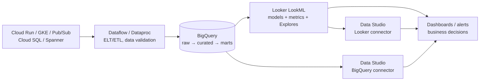
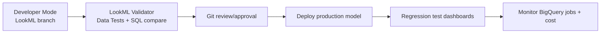

# Looker, Looker Studio, and the Data Consumption Layer

## 1. The Problem: One Metric, Three Different Reports

Sales reports **paid revenue** of 1.2 billion VND, Finance reports 1.1 billion, and Marketing reports 1.3 billion, even though all three read from **BigQuery**. The culprit is often each dashboard filtering order statuses, timezones, refunds, taxes, and JOINs differently. Letting everyone build charts freely cannot solve inconsistencies without **metric definitions, trusted data sources, and access governance**.

A BI architecture on Google Cloud typically has three layers:

1. **Standardized data:** Cloud Storage, Pub/Sub, Dataflow, or Dataproc ingest and transform data into verified tables in BigQuery.
2. **Semantic layer:** defines concepts of orders, revenue, time, JOIN relationships, access permissions, and aggregations. **Looker with LookML** is the dedicated choice for this layer; KPIs can also be governed in BigQuery marts/views when not using Looker.
3. **Consumption layer:** Looker **Explores/Looks/dashboards**, or **Looker Studio (renamed: Data Studio)** to build and share interactive charts.

This lesson belongs to the **Data Governance and Analytics** chapter of the **CLOUD_PROVIDERS_GCP** module, connecting project governance, IAM, VPC, Cloud Run/GKE, databases, automated releases, reliability monitoring, and cost controls.

**Objective:** accurately distinguish the two products; build verifiable metric contracts; read/write basic LookML; connect BigQuery to dashboards; spot JOIN, credential, and cost bugs; and deploy self-service BI with authorization, testing, and runbooks.

> **Lab scope:** All project names, datasets, connection names, and user attributes are illustrative. Create BigQuery objects only in an authorized test project; never deploy LookML to production Looker or share reports containing real data without approval. A Looker instance may require a separate license/permissions; this lesson remains self-contained if you practice only the BigQuery and Data Studio sections.

## 2. Distinguishing Looker, Looker Studio, and the 2026 Data Studio Name

**Product naming update:** Google renamed **Looker Studio to Data Studio in April 2026**; `datastudio.google.com` is the new address and `lookerstudio.google.com` redirects. The lesson title follows the curriculum, while the UI steps below refer to **Data Studio** for the reporting product formerly named Looker Studio. **Looker** (including Looker Google Cloud core) is a separate product, not a new name for Data Studio.

| Criterion | **Looker** | **Data Studio (formerly Looker Studio)** |
| --- | --- | --- |
| Focus | Enterprise BI, **LookML** semantic modeling, Explores, and governed metrics | Builder for **reports/charts** and sharing insights, wide connector ecosystem |
| Data model | Models, Views, Dimensions, Measures, Explores, Access Filters | Data source fields, calculated fields, blends, report filters |
| Who defines metrics | Data team governs LookML with Git and deployment controls | Report/data source editors; can **reuse Looker Explores** via connector |
| Common sources | BigQuery, Cloud SQL, supported SQL databases | BigQuery, Google Sheets, Looker Explores, and many other connectors |
| Access control | Looker roles/model sets, user attributes, and database permissions | Report/data source sharing + **data credentials**; underlying IAM depends on credential type |
| Deployment | Git, Development/Production Mode, validation, deploy | Report/data source sharing, reusable sources, workspace governance by edition |
| Cost | License/instance plus backend query charges | Free/paid features by edition; **backend BigQuery jobs still incur charges** |

**Never say:** "Data Studio automatically enforces the LookML semantic layer." When connecting **directly to BigQuery**, metrics calculated in Data Studio do not automatically follow LookML. To reuse LookML-defined metrics, select the **Looker connector → Explore** where eligible; the connector has feature, permission, and query-timeout limits.

## 3. Architecture: Data → Semantic Layer → Dashboard



| Layer | Contract / Output | Critical Controls |
| --- | --- | --- |
| **Ingestion/raw** | Events, files, transactional changes | Idempotency, schema evolution, data residency, PII |
| **Curated/mart** | `fact_orders`, `dim_customers`, standardized tables | Keys, grain, deduplication, timezone, quality |
| **Semantic** | `paid_revenue`, `paid_orders`, customer/tenant dimensions | Metric definitions, join cardinality, access conditions |
| **Consumption** | Looker Explores and Data Studio reports | Sharing, filters, credentials, refresh cadence, cost |

**The semantic layer does not necessarily copy data:** LookML generally **describes SQL and generates queries** executed against the database; it is not a default row store. Mechanisms like Looker cache, **persistent derived tables (PDTs)**, or aggregate tables can materialize auxiliary data and require separate management.

### What Does the Semantic Layer Solve?

If Marketing filters `status IN ('PAID','SHIPPED')` while Finance uses `status = 'PAID'`, both charts run "valid SQL" yet violate KPI standards. The semantic layer defines a metric's **name, description, formula, grain, filters, units, timezone, owner, security rules, and refresh schedule**. Users then pick analytical dimensions rather than reinventing calculations.

## 4. Designing a Metric Contract Before Building Dashboards

Assume **one row equals one order** in `fact_orders`, and `amount_vnd` is the payment-time amount, not post-refund net. Illustrative definitions:

| Metric | Formula / Definition | Constraints to Align |
| --- | --- | --- |
| **Paid orders** | `COUNT(DISTINCT order_id)` where `payment_status='PAID'` | Unique key; event duplicates removed |
| **Gross paid amount** | `SUM(amount_vnd)` for paid orders | Before refunds; excludes `NEW/CANCELLED` |
| **Net revenue** | Gross paid − refunds − adjustments per finance policy | Requires refund data and tax/fee definitions |
| **Average paid order value** | Gross paid / paid orders | Define zero-denominator handling |
| **Daily revenue** | By `DATE(paid_at, 'Asia/Ho_Chi_Minh')` or chosen standard timezone | Never mix UTC dates and business dates |
| **Data freshness** | Age of latest successful data watermark | Distinguish ingestion lag from BI cache |

**Do not relabel Gross as Net** if refunds have not been subtracted. Never sum `order amount` after a 1-to-many JOIN with order items without controlling **fanout**, or the same order gets multiplied.

### Minimal Metric Contract

```yaml
# Business reference specification, NOT LookML
metric: gross_paid_amount_vnd
owner: finance_analytics
source: acme-bi-lab.sales_mart.fact_orders
grain: order_id
aggregation: SUM(amount_vnd)
filter: payment_status = 'PAID'
timezone: Asia/Ho_Chi_Minh
currency: VND
refund_policy: excluded
freshness_slo: 2h
validation: compare to settlement ledger
```

This is a **business contract document**, not an auto-executed config. When translating into LookML or a BigQuery view, pair it with correctness tests and business owner sign-off.

## 5. Lab A — Creating a Mock BigQuery Mart as a Shared Source

This lab **does not require a Looker license**. Use the BigQuery Console or `bq` in an approved **lab project** with Billing enabled; dataset in `asia-southeast1`.

### 5.1. Create the Dataset (Run Once)

```bash
# MUTATING: creates dataset incurring storage/job charges if absent
bq --project_id=acme-bi-lab mk \
  --dataset --location=asia-southeast1 \
  acme-bi-lab:sales_mart

# READ-ONLY: verify dataset/location
bq show --format=prettyjson acme-bi-lab:sales_mart
```

### 5.2. Create the Orders Table with Sample Data

```sql
-- GoogleSQL. MUTATING: run only if no table with the same name exists in the LAB.
CREATE TABLE `acme-bi-lab.sales_mart.fact_orders` (
  order_id STRING NOT NULL,
  tenant_id STRING NOT NULL,
  customer_id STRING NOT NULL,
  paid_at TIMESTAMP,
  payment_status STRING NOT NULL,
  amount_vnd NUMERIC NOT NULL
)
PARTITION BY DATE(paid_at)
CLUSTER BY tenant_id, customer_id;

INSERT INTO `acme-bi-lab.sales_mart.fact_orders`
  (order_id, tenant_id, customer_id, paid_at, payment_status, amount_vnd)
VALUES
  ('O1','TENANT_A','C01',TIMESTAMP '2026-11-17 01:00:00+00','PAID',100000),
  ('O2','TENANT_A','C01',TIMESTAMP '2026-11-17 04:00:00+00','PAID',200000),
  ('O3','TENANT_A','C02',NULL,'NEW',50000),
  ('O4','TENANT_B','C03',TIMESTAMP '2026-11-18 10:00:00+00','PAID',300000),
  ('O5','TENANT_B','C04',NULL,'CANCELLED',80000);
```

The lab has three paid orders totaling **600,000 VND** (Tenant A 300,000; Tenant B 300,000). Query to verify:

```sql
-- READ-ONLY; do not use this sample SQL to infer Net revenue
SELECT tenant_id,
       COUNTIF(payment_status = 'PAID') AS paid_orders,
       SUM(IF(payment_status = 'PAID', amount_vnd, 0)) AS gross_paid_amount_vnd
FROM `acme-bi-lab.sales_mart.fact_orders`
GROUP BY tenant_id
ORDER BY tenant_id;
```

When a real source table has **multiple payment events per order**, `COUNTIF` is insufficient; build a **one-row-per-order** table or use proper `COUNT(DISTINCT ...)` and deduplication. **Never blindly apply the lab's one-row-per-order assumption to raw transactional/event tables.**

### 5.3. Create a Curated View Reused Across Tools

```sql
-- MUTATING: creates view; does not move money or alter source data
CREATE VIEW `acme-bi-lab.sales_mart.v_paid_orders` AS
SELECT
  order_id, tenant_id, customer_id, paid_at, amount_vnd,
  DATE(paid_at, 'Asia/Ho_Chi_Minh') AS paid_date_vn
FROM `acme-bi-lab.sales_mart.fact_orders`
WHERE payment_status = 'PAID';

-- READ-ONLY: expected 3 rows, total 600,000
SELECT tenant_id, COUNT(*) AS orders, SUM(amount_vnd) AS gross_paid_amount_vnd
FROM `acme-bi-lab.sales_mart.v_paid_orders`
GROUP BY tenant_id;
```

**Strength:** one BigQuery view can be shared by both Looker and Data Studio to standardize baseline filters. **Limitation:** a view does not guarantee consistent downstream formulas, does not solve join fanout, and **does not replace Looker LookML** with access filters and model tests. When using views for security, configure **authorized views or proper IAM**—never assume view permissions imply raw table permissions.

## 6. Data Quality Before BI: Keys, Grain, and Consistency

**Grain** defines what one row represents. For `fact_orders` at **order** grain, `order_id` must be **unique and non-null**; for `order_items` at **line item** grain, the same `order_id` can appear on multiple rows.

```sql
-- READ-ONLY: detect duplicate orders; must return 0 rows
SELECT order_id, COUNT(*) AS n
FROM `acme-bi-lab.sales_mart.fact_orders`
GROUP BY order_id
HAVING COUNT(*) > 1;

-- READ-ONLY: detect business-rule violations
SELECT *
FROM `acme-bi-lab.sales_mart.fact_orders`
WHERE order_id IS NULL
   OR amount_vnd < 0
   OR payment_status NOT IN ('NEW','PAID','CANCELLED');
```

BigQuery supports declaring **PRIMARY KEY/FOREIGN KEY** in some models, yet these constraints are **not enforced like an OLTP database**; pipelines must validate and enforce data integrity themselves. LookML `primary_key: yes` is also a **declaration for Looker calculations**, not something that makes duplicate data vanish.

### Acceptance Tests Before Opening Dashboards

1. Reconcile row counts and gross amounts against the source-of-truth/payment ledger.
2. Test UTC dates that differ from `Asia/Ho_Chi_Minh` dates (e.g., 20:00 UTC is the next day in Vietnam).
3. Verify `NEW/CANCELLED` orders are excluded from paid revenue.
4. Test refund arrivals: Gross stays unchanged while Net subtracts refunds per policy.
5. Compare metrics across **SQL, Looker Explore, and Data Studio** for the **exact same time range, tenant, and filters**.

## 7. LookML: Views, Models, Explores, Dimensions, and Measures

Looker **LookML** defines models that generate SQL based on user-selected fields, enabling business analysts to explore data without writing SQL per chart.

| Component | Equivalent | Purpose |
| --- | --- | --- |
| **Project** | LookML repository (Git) | Version control and deployment |
| **Model** `*.model.lkml` | Connection, set of Explores, caching/permissions | Entry point of the semantic layer |
| **View** `*.view.lkml` | Table or derived table | Field definitions |
| **Dimension** | Group/filter by row attribute | Tenant, order ID, date |
| **Measure** | Aggregate across rows | Count, sum, average |
| **Dimension group** | Splits a time column into day/week/month | Time-series analysis |
| **Explore** | Business dataset users query | Selects dimensions/measures/filters, JOINs |
| **Access filter / grant** | Restricts by user attributes/permissions | Controls data visibility/querying |
| **Datagroup / PDT** | Cache trigger / persistent derived table | Performance and ETL sync |

**Looker generates SQL:** when a user selects `paid_date` and `gross_paid_amount`, Looker pushes filters and aggregations down to BigQuery. You need a **managed Looker instance and database connection**. LookML does not run via `bq query`; the sample code below lives in a Git-backed Looker IDE/project.

## 8. Lab B — Defining Reusable LookML

### 8.1. View File: `views/orders.view.lkml`

```lookml
view: orders {
  sql_table_name: `acme-bi-lab.sales_mart.fact_orders` ;;

  dimension: order_id {
    primary_key: yes
    type: string
    sql: ${TABLE}.order_id ;;
  }

  dimension: tenant_id {
    type: string
    sql: ${TABLE}.tenant_id ;;
  }

  dimension: customer_id {
    type: string
    sql: ${TABLE}.customer_id ;;
  }

  dimension: payment_status {
    type: string
    sql: ${TABLE}.payment_status ;;
  }

  dimension_group: paid {
    type: time
    timeframes: [raw, date, week, month]
    sql: ${TABLE}.paid_at ;;
  }

  dimension: amount_vnd {
    type: number
    sql: ${TABLE}.amount_vnd ;;
    hidden: yes
  }

  measure: order_count {
    type: count
    drill_fields: [order_id, tenant_id]
  }

  measure: paid_orders {
    type: count
    filters: [payment_status: "PAID"]
    description: "Paid order count, unique per order_id"
  }

  measure: gross_paid_amount_vnd {
    type: sum
    sql: ${amount_vnd} ;;
    filters: [payment_status: "PAID"]
    description: "Gross VND; excludes refunds and fees"
  }
}
```

**Conditions for accurate results:** `order_id` must genuinely be unique and non-null; each row represents one order; `amount_vnd` contains no uncastable strings; and no refund logic leaks into the definition. LookML is **modeling code** and does not clean raw source data by itself.

### 8.2. Model File: `commerce.model.lkml`

```lookml
connection: "bq_commerce_lab"
include: "/views/*.view.lkml"

datagroup: orders_refresh {
  max_cache_age: "2 hours"
}

explore: orders {
  label: "Orders"
  description: "One row per order; gross paid before refunds"
  persist_with: orders_refresh
}
```

`bq_commerce_lab` must be a **database connection configured by a Looker admin** (with BigQuery connection, billing project, region, and permissions)—not a dataset name or service account. `persist_with` sets the Explore's cache policy; `max_cache_age` does not make upstream data real-time or guarantee every dashboard refreshes simultaneously. You can sync with ETL using a **datagroup SQL trigger** when needed, accounting for permissions, costs, and the connection's PDT policy.

### 8.3. Exploring in Looker

1. Enter **Development Mode** in an authorized Looker instance and open the LookML project on the right repository/branch.
2. Create `views/orders.view.lkml` and `commerce.model.lkml`, select the verified connection, and run **Validate LookML**.
3. Open **Explore → Orders**: select `orders.paid_date`, `orders.paid_orders`, and `orders.gross_paid_amount_vnd`; add a date range and tenant filter.
4. Open the **SQL** tab to inspect the generated BigQuery SQL, confirming `payment_status='PAID'` sits inside the aggregation and date filters are right.
5. Verify the table total of **600,000 VND**, then test per tenant; optionally save a Look/dashboard **in a test folder**.
6. Use Git commits, reviews, and tests before production deployment; never modify a metric used in live dashboards without notifying its owner.

**Watch out for timezones:** `paid_at` in SQL is a `TIMESTAMP` (UTC), whereas Looker timeframes can be affected by **query timezone / user timezone**. To match `paid_date_vn` from the SQL lab, align timezone/business calendar settings or add a dimension computing the Vietnam date, then test day boundaries.

## 9. JOIN Cardinality and Fanout: Where Metrics Commonly Break

Suppose `fact_orders` has one row for `O1`, while `order_items` has **three rows** for `O1`. When running:

```sql
-- READ-ONLY: conceptual example (order_items table does not exist in the lab)
SELECT SUM(o.amount_vnd) AS revenue
FROM `acme-bi-lab.sales_mart.fact_orders` AS o
JOIN `acme-bi-lab.sales_mart.order_items` AS i USING (order_id)
WHERE o.payment_status = 'PAID';
```

`O1`'s `amount_vnd` gets multiplied **threefold**, making `SUM` wrong. Looker uses **join relationships** and, for supported dialects, **symmetric aggregates** to mitigate fanout errors. Yet if the relationship or primary key is declared wrong, numbers will still be wrong or Looker will throw a non-unique key error.

| Relationship | Example | LookML Declaration from Base Explore |
| --- | --- | --- |
| **Many-to-one** | Many orders belong to one customer | `relationship: many_to_one` |
| **One-to-many** | One order has many order items | `relationship: one_to_many` |
| **One-to-one** | One order has one payment summary | `relationship: one_to_one` (must verify uniqueness) |
| **Many-to-many** | Users and multiple groups | Be careful with bridge tables, grain, and aggregation |

**Example `dim_customers` with unique `customer_id`:**

```lookml
# Snippet added inside commerce.model.lkml
explore: orders {
  join: customers {
    type: left_outer
    sql_on: ${orders.customer_id} = ${customers.customer_id} ;;
    relationship: many_to_one
  }
}
```

This snippet **illustrates a JOIN declaration**; in a real model, **merge `join` inside the existing `explore: orders` block** rather than creating two blocks with the same name in one model. Create `view: customers` with `customer_id primary_key: yes` and verify uniqueness in BigQuery.

### Checks to Prevent Fanout

1. Define the **grain** of each table prior to joining (e.g., one row per order vs. one row per item).
2. Compare `COUNT(*)` and `COUNT(DISTINCT order_id)` before and after joining.
3. If `order_amount` lives on the order-level table, never sum it directly after a 1-to-many join without aggregating at the right grain.
4. Set `primary_key: yes` on a **genuinely unique, non-null** key across all views participating in aggregation.
5. Compare Looker Measure outputs against an independent baseline SQL query, testing orders with **0, 1, and many items**.

**When in doubt**, materialize a BigQuery mart at the **right grain** first before enabling business self-service. The semantic layer governs definitions, not source data quality.

## 10. Looker Governance: Roles, User Attributes, and Access Filters

Looker separates **application permissions** (roles, permissions, model sets) from the connection's **database permissions**. A user permitted to enter an Explore **does not automatically hold direct BigQuery IAM**, especially if the connection uses a shared service account.

### Tenant-Based Row-Level Filtering

Suppose every Looker user is assigned a `tenant_id` user attribute by an admin from the identity provider; add to the Explore:

```lookml
# Added inside the already-declared explore: orders
access_filter: {
  field: orders.tenant_id
  user_attribute: tenant_id
}
```

Effect: Looker injects a `WHERE` clause restricting `orders.tenant_id` to the user attribute. Admins must configure the attribute as **non-user-editable**. If users can edit their own `tenant_id`, the rule cannot be trusted. Inspect generated SQL while logged in as **test users for TENANT_A and TENANT_B** on test data to prove zero cross-tenant leakage.

**Critical boundary:** `access_filter` protects **queries going through the configured Explore**; it does not prevent users from **calling BigQuery directly**, using another Explore lacking the filter, accessing another view/connection, or downloading previously exported reports. For sensitive data, pair with **BigQuery row-level security/authorized views/column policy tags**, IAM, and end-to-end access testing across all entry points. Never treat LookML as GCP-wide IAM.

### OAuth vs. Service Account: Who Does BigQuery Actually See?

| Looker BigQuery Connection | Identity Seen by BigQuery | Consequence |
| --- | --- | --- |
| **Shared service account / ADC** | Looker connection SA | BigQuery row policies/column masking apply to the **SA**, not individual Looker users; LookML user attributes must be tightly governed |
| **Per-user OAuth** | Individual BigQuery-authorized user | BigQuery enforces **per-user IAM/row/column policies**; each viewer needs appropriate permissions |

With **Looker (Google Cloud core)**, Looker's service agent is governed with progressively tighter permissions; grant explicit BigQuery roles per connection type rather than assuming a legacy Service Agent role covers everything. **PDTs** may require dedicated write-capable accounts/datasets, especially when the connection uses OAuth.

**Principle:** who can view a dashboard metric, who can build Explores, who can download raw data, who can edit LookML, and who can change credentials are **distinct permissions**. Enforce least privilege, isolate dev/test/prod, and monitor audit/query logs.

## 11. Looker Self-Service: Explores, Looks, Dashboards, and Schedules

### Role of Each Component

| Component | Function | Practice Rule |
| --- | --- | --- |
| **Explore** | Pick dimensions/measures/filters/pivots; generates SQL from LookML | Use for ad hoc analysis within data limits |
| **Look** | Saved reusable query and visualization | Attach owner, description, and folder permissions |
| **Dashboard** | Shared collection of tiles/KPIs | Align date range/timezone/tenant; never mix conflicting KPIs |
| **Schedule/alert** | Delivers results on schedule or condition | Check recipient permissions, data freshness, and cache |
| **Explore SQL tab** | Shows SQL generated from LookML | Debug filters, joins, pruning, and cost |

### Dashboard Exercise in Looker (If Instance Available)

1. Open `Explore: orders`, select `paid_date`, `paid_orders`, and `gross_paid_amount_vnd`.
2. Choose a **time range** on `paid_at`, noting the user/connection timezone.
3. Save a **Look** named "Gross Paid VND by Day" and add it to a dashboard "Commerce Overview – LAB".
4. Build two tiles: total paid revenue and a daily chart; avoid redundant chart-level calculations.
5. Switch test tenants, verifying `access_filter` works and charts never show unauthorized rows.
6. Inspect **SQL/History** when investigating why a tile is slow or differs from BigQuery.

**A visually clean dashboard does not prove the metric is right.** Run the acceptance tests in Section 6 and check whether a tile served a **cached result** or executed a fresh query.

## 12. Lab C — Data Studio Connecting Directly to BigQuery

Web UI exercise at **[Data Studio](https://datastudio.google.com/)**—no Looker instance required. Prerequisites: user permitted to use Data Studio; access to `acme-bi-lab.sales_mart.v_paid_orders` or an authorized data source; and BigQuery billing/quota on the query project.

### 12.1. Build the Report

1. Open Data Studio → **Create → Report** → **Add data → BigQuery**.
2. Select **Project → Dataset `sales_mart` → View `v_paid_orders`**, verifying region, source/connection, and credential type.
3. Add a **scorecard** with metric `SUM(amount_vnd)`, labeled **Gross Paid (VND)**.
4. Add a **time series** with dimension `paid_date_vn` and metric `SUM(amount_vnd)`.
5. Add a table with dimension `tenant_id` and metrics `COUNT_DISTINCT(order_id)` and `SUM(amount_vnd)`.
6. Add a **date range control** on `paid_date_vn`; display **timezone: Asia/Ho_Chi_Minh**, currency, and "Gross, refunds excluded" on the report.
7. Filter across all test data: scorecard totals **600,000**, with **300,000** per tenant.

**Check in the editor:** when connecting to a BigQuery view, Data Studio may infer unexpected field types; change `paid_date_vn` to a proper Date if needed. When writing calculated fields, verify aggregation and chart scope so an already-aggregated field is not summed twice.

### 12.2. Do Not Reinvent Metrics in Every Chart

If a chart author writes `SUM(amount_vnd)` directly on `fact_orders` **without the PAID filter**, totals diverge from `v_paid_orders`. To prevent KPI drift, prefer **reusable data sources pointing to curated views** or the **Looker Explore connector**. If a Data Studio report still needs a custom calculated field, document its description, owner, and SQL-tested definition.

### 12.3. Inspect Generated Queries

For BigQuery queries executed by Data Studio, admins/owners can inspect BigQuery **Job history**, query plans, `total_bytes_processed`, `total_bytes_billed`, and the executing principal. Data Studio charts can fire **multiple queries** on refresh or filter change—just because a report loads smoothly does not mean queries are free.

## 13. Data Studio Data Credentials: Sharing ≠ Granting Data Permissions

**This is the single most critical security topic in Data Studio.** A report can be shared with users **who hold no BigQuery permissions**, depending on data source credentials:

| Credential Mode | Who Executes Queries | Does Viewer Need BigQuery Permissions? | Risk / Trade-off |
| --- | --- | --- | --- |
| **Owner's Credentials** | Designated credential owner | Usually **no** | Report recipients see data using the owner's permissions; restrict sharing tightly |
| **Viewer's Credentials** | Each individual viewer | **Yes**: `bigquery.jobUser` on billing project plus data read access | Enforces per-user IAM cleanly, but viewers lacking IAM see errors |
| **Service Account Credentials** | Service account configured on data source | Usually **no** | Restricted to eligible BigQuery data sources and orgs/admins; manage SA/IAM separately |

**Owner's Credentials is a sharing feature, not a valid security bypass.** If the owner can read PII or all tenants, the report can expose those fields/rows to anyone viewing or editing the report—even if they hold **no** BigQuery IAM. For multi-tenant reports, share only sources **server-side restricted to the proper scope**, and audit editable filters and exports.

**Minimum BigQuery IAM** under Viewer/Owner/SA credentials: `roles/bigquery.jobUser` on the **billing project** to run jobs and `roles/bigquery.dataViewer` (or equivalent) on the target dataset/table/view. If the view is an **authorized view**, an admin must configure authorized access to its underlying source. Never grant `roles/bigquery.admin` or project Owner to fix a 403.

### Authorization Scenario

```text
Data source = BigQuery v_paid_orders
Credential mode = Owner's Credentials
Owner can read TENANT_A + TENANT_B
Report shared with a TENANT_A employee
                         ↓
If the report allows viewing all tenants without
underlying row-level security, TENANT_A can see TENANT_B.
```

**Solution:** use BigQuery row policies/authorized views scoped by authenticated recipient, or separate data sources/datasets/reports cleanly. Data Studio offers **filter by viewer email** on certain data sources, yet you must verify permissions, email identity reliability, and configuration carefully—never rely on it alone for strict regulatory requirements.

## 14. Lab D — Data Studio Using a Looker Explore as a Governed Source

If your organization has an **eligible Looker instance**, only a **Looker admin** can enable the **Looker connector** for Data Studio. Steps:

1. Admin enables the connector in Looker and verifies instance compatibility, edition, and OAuth/permissions.
2. In Data Studio → **Add data → Looker**, sign in and authorize against the permitted Looker instance.
3. Select **model `commerce` → Explore `orders`**, which was reviewed and contains `gross_paid_amount_vnd`.
4. Build scorecards/time series from **Looker measures/dimensions** without rewriting `SUM` or PAID filters in Data Studio.
5. Verify tenant access filters with two test accounts, timezones, field compatibility, data freshness, and query counts.

**Connector limits to know:** not all Looker instances/deployment types are supported; queries face roughly a **5-minute** timeout, a **5,000-row** chart limit, and permission-governed exports. Data Studio does not inherit every Looker Explore feature—check **requirements, limits, and feature support** before standardizing on it architecturally. For large datasets or slow queries, optimize LookML/BigQuery first rather than piling on charts.

**Benefit:** updating `gross_paid_amount_vnd` in LookML through governance updates all connected dashboards consistently. **What does not happen automatically:** Data Studio reports connected directly to BigQuery or using copied calculated fields **will not auto-update** when LookML changes.

## 15. Caching, Data Freshness, and Query Acceleration

A fast-loading dashboard is sometimes serving **stale cached data**. Distinguish:

| Layer | Mechanism | Risk to Monitor |
| --- | --- | --- |
| **Ingestion/ELT** | BigQuery marts updated after batch/streaming | Source is stale even if the dashboard refreshed recently |
| **Looker query cache** | Serves precomputed SQL results controlled via `persist_with`/datagroups | Cache not expired or misconfigured invalidation post-ETL |
| **Looker PDT / aggregate table** | Intermediate/aggregated tables persisted in the DB | Slow materialization, missing write rights, queries hitting stale table |
| **Data Studio data freshness** | Temporarily caches query results per data source/config | Viewers don't see new data right away; new filters trigger new queries |
| **BigQuery BI Engine** | In-memory acceleration for supported queries | Reservation/coverage/BI Engine SQL compatibility and cost |
| **BigQuery partitioning/clustering** | Prunes scanned partitions/blocks | Dashboard omits date filters or runs `SELECT *` |

### Tying a Looker Datagroup to ETL

The `orders_refresh` example in Section 8 uses `max_cache_age: "2 hours"` to bound Looker cache age. In production, add a `sql_trigger` returning a value that changes upon pipeline completion, such as `MAX(batch_id)` from an ETL watermark table. Looker refreshes caches and rebuilds PDTs per trigger/connection schedule.

**Never poll continuously just to "check for new data."** Trigger queries and PDT builds also consume BigQuery resources, and OAuth connections require explicit permissions for PDT builds. When data updates once daily, a 10-second cache rarely improves real freshness while multiplying load.

### Data Studio Freshness ≠ BigQuery Table Freshness

For BigQuery sources, Data Studio lets you configure data freshness at supported intervals (e.g., minutes/hours), commonly defaulting to **12 hours**. When a new filter/query misses cache, Data Studio **can still query BigQuery** before freshness expires. **Owner's Credentials** shares a cache per credential owner; **Viewer's Credentials** isolates cache state per viewer.

**Reading the SLO accurately:** "dashboard updates hourly" only holds when **the source has updated**, caches/connectors do not delay beyond target, and users are viewing the right date range. Surface **`last_successful_etl_at`** on dashboards so viewers know actual data freshness.

### When to Use BI Engine, PDTs, or Aggregate Tables?

- **BI Engine:** fits BigQuery workloads with many repetitive queries, an active reservation, and supported query shapes. Not all SQL is accelerated; verify via job statistics.
- **Looker PDT:** useful for complex joins/transforms needing materialization; requires dataset write permissions and lifecycle management.
- **Looker aggregate awareness:** routes compatible aggregate queries to persisted aggregate tables; requires exact grain and filter alignment to avoid wrong numbers.
- **BigQuery materialized views / curated marts:** consider if you prefer not tying performance optimization exclusively to Looker.

Never stack every caching layer blindly for speed: each layer makes verifying **freshness, correctness, and cost attribution** harder.

## 16. Managing BigQuery Costs Under Self-Service BI

Every dashboard open can trigger **multiple SQL queries**; changing a date range, filter, refresh, or drill-down fires even more jobs. If Data Studio uses **Owner's Credentials**, those jobs can bill to the owner/SA's billing project per source config.

### Query Sizing Example

```text
10 reports × 8 charts/report × 30 refreshes/day
    = up to ~2,400 chart evaluations/day
```

This is **not exactly 2,400 BigQuery jobs**: Data Studio/Looker caches, chart query sharing, controls, and connectors behave differently, and a single chart can trigger multiple jobs. Measure actual query history and Cloud Billing rather than guessing from chart counts.

**Primary controls:**

1. Build **curated marts** at the right grain, drop unused fields, and standardize currencies.
2. **Partition** `fact_orders` by an appropriate business date and **cluster** by `tenant_id/customer_id` when real queries filter on them.
3. Set sensible **default date ranges** (30 or 90 days instead of all history), using required filters in Looker or tested controls in Data Studio.
4. Use BigQuery **dry runs** to estimate bytes on representative SQL; clustering **block pruning** may only show accurate savings on actual execution.
5. Align freshness/caching to **ETL SLAs**; never auto-refresh every minute for daily data.
6. Adopt BI Engine/aggregate awareness/PDTs only with **evidence** of repeated queries and net savings.
7. Monitor **BigQuery Editions/reservations** under capacity pricing instead of assuming "fewer bytes = proportionally lower bill" as in on-demand.
8. Enforce budgets/alerts, dashboard owners, export/download restrictions, and query quotas per policy.

### Query Job Observability with SQL

```sql
-- READ-ONLY: run in asia-southeast1; requires jobs metadata permissions
SELECT
  creation_time,
  user_email,
  job_id,
  cache_hit,
  total_bytes_processed,
  total_bytes_billed,
  total_slot_ms,
  state,
  error_result.message AS error_message
FROM `acme-bi-lab.region-asia-southeast1.INFORMATION_SCHEMA.JOBS_BY_PROJECT`
WHERE creation_time >= TIMESTAMP_SUB(CURRENT_TIMESTAMP(), INTERVAL 1 DAY)
  AND job_type = 'QUERY'
ORDER BY creation_time DESC
LIMIT 100;
```

**Note:** job history permissions differ from data read permissions, and under service account/owner credentials `user_email` shows the **actual executing principal**, not necessarily the person viewing the chart. In multi-region setups, `region-asia-southeast1` must match the **job processing location**.

## 17. Dashboard Controls, Blends, and Accuracy Pitfalls

Data Studio offers chart-level filters, calculated fields, parameters, and **data blending**. These are handy for exploration, yet never replace semantic modeling for critical metrics.

### Example Fanout from Blending

```text
Source A: orders by order_id (1 row/order)
Source B: campaign touches by order_id (3 rows/order)
Blending A ↔ B on order_id
               ↓
SUM(order_amount) can be multiplied 3x if grains mismatch
```

The fix is usually pre-aggregating campaign touches to **one row per order** before joining, or defining the metric at the exact grain in BigQuery/Looker. Multi-source blends are also sensitive to **date ranges, filter evaluation order, null joins, differing data credentials, and caching**.

### Rules for Designing Useful Dashboards

- Every chart shows **metric name and unit**, clarifying Gross/Net, currency, and timezone.
- Clear date range, always displaying **Last updated** sourced from pipeline state when near-real-time matters.
- Display only needed dimensions; strip PII via curated views/authorized access.
- Use **reusable data sources** rather than duplicating calculated formulas across reports.
- Assign **owner, audience, SLA, dashboard version**, and a feedback path.
- For sensitive reports, check **sharing, embedding, exports, scheduled emails, and link access**, and test with a user outside the intended group.

**A plausible-looking chart is not a data quality test.** Build test cases with deliberate duplicates, nulls, out-of-order arrivals, and refunds to verify outputs in both Looker and Data Studio.

## 18. Dev → Review → Production: Governing LookML and Reports

### Looker LookML (Git-Centric)



1. Store **LookML models/views** in Git; develop in **Development Mode** on personal branches.
2. Run **LookML Validator**, configured data tests, inspect generated SQL, and compare against baseline SQL.
3. Have both business and technical owners review changes to **measures/filters/joins/primary keys**—don't stop at syntax linting.
4. Merge through Git/CI and **Deploy to Production** via authorized `deploy` users or automation.
5. Run **Content Validator** to catch Looks/dashboards broken by renamed fields/models, comparing metrics before/after.
6. Monitor data freshness, BigQuery jobs, and numeric variance post-release; keep a commit/revision rollback plan.

**LookML Validator checks structure, not KPI correctness.** A syntactically valid `measure: gross_paid_amount_vnd` missing its PAID filter still passes validation. Use **data tests and independent SQL reconciliation** to verify.

### Data Studio Report Lifecycle

Data Studio **does not auto-sync versions with LookML Git** when connected directly to BigQuery. Govern **reusable data sources**, editor/viewer permissions, staging report copies, version naming, changelogs, and source links. Before swapping a source, inspect impacted reports/charts, credentials, and recipient permissions.

For advanced workspace governance features, consult current **Data Studio Pro** policies; do not assume every account holds identical entitlements or deployment buttons.

### Minimum Regression Test Matrix

| Change | Mandatory Check |
| --- | --- |
| Rename LookML field | Dashboards/Looks referencing old field; Content Validator |
| Change PAID filter | Total revenue by tenant and period before/after |
| Add `order_items` JOIN | Fanout: distinct counts, sums, and primary key uniqueness |
| Change BigQuery view schema | Data Studio calculated fields and chart field mappings |
| Change credential mode | Two users with differing IAM; report sharing/export |
| Change refresh/cache | Last updated, ETL completion, cost/concurrency |
| Change timezone | Orders near day/month boundaries |

## 19. Monitoring and Troubleshooting Runbook

| Symptom | Common Cause | Diagnose the Right Layer |
| --- | --- | --- |
| Looker dashboard shows no data | Connection/auth/Explore permissions, bad SQL | Looker History, SQL tab, BigQuery job errors |
| Data Studio chart says **Permission denied** | Viewer credentials lack IAM or source owner/SA lost access | Data source credential mode, `bigquery.jobUser` and `dataViewer` |
| One tenant sees another tenant's data | Over-broad Owner credentials, missing Explore access filter, unrestricted shared view | Cross-user tests, audits, row policies, and sharing settings |
| Looker KPI differs from Data Studio | PAID/Net filter, timezone, cache, joins, calculated fields | Metric contract and SQL comparison at matching grain |
| Metric doubles after JOIN | One-to-many fanout, non-unique primary key | Compare row/distinct counts, `relationship`, symmetric aggregates |
| Slow dashboard | Large BigQuery scans, many tiles, JOINs, cache misses, or Looker resources | SQL plan, bytes/slot ms, Looker System Activity |
| Report stays stale post-ETL | Looker/Data Studio cache or PDT didn't rebuild | Last ETL watermark, datagroup, freshness settings |
| Costs spike | Auto-refresh, heavy user filtering, full-history scans, shared owner credentials | BigQuery jobs by principal, dashboard/view filters, Billing |
| LookML deploy breaks Looks | Renamed fields/Explores, altered filters | Git revision, LookML/Content Validator, revert |
| Data Studio Looker connector times out | Query exceeds 5 minutes, unsupported Explore, or missing permissions | Connector limits, generated SQL, region/permissions |

### Runbook When Revenue Dashboards Disagree

1. **Scope the KPI:** metric code/version, dashboard/report ID, tenant, date range, timezone, currency, and observation time.
2. Identify the **actual source**: BigQuery table/view or Looker Explore; save SQL/LookML and credential mode (never export tokens/PII).
3. Run an **independent baseline SQL query** on the curated table with identical filters and reconcile against the owner/payment ledger.
4. Check **grain, JOIN fanout, duplicates, refunds, and NULLs** before touching charts.
5. Check caches: ETL watermark, Looker datagroups/PDTs, Data Studio freshness, BigQuery `cache_hit`.
6. If data exposure risk exists, **revoke report/data source sharing cleanly**, audit access, then fix IAM/row policies/user attributes.
7. Fix at the **single shared source of definition**, run regression tests, release, monitor BigQuery jobs, and notify business owners of metric changes.

**Never "fix" numbers by hiding ad hoc filters inside individual charts** before diagnosing the root discrepancy. That masks symptoms and worsens semantic drift.

## 20. Three Practical Design Scenarios

### 20.1. Cross-Department Revenue Executive Dashboard

**Context:** Finance, Marketing, and Operations all track revenue using conflicting definitions.

**Design:** standardize `fact_orders` and a refund ledger in BigQuery; define LookML `gross_paid_amount`, `refund_amount`, and `net_revenue` with descriptions, timezone, and data tests; let business teams build reports from **Looker Explores**. Where Data Studio is needed, prefer the **Looker connector** to reuse reviewed metrics.

**Success criteria:** identical tenant/date ranges return identical numbers, dashboards clearly label Gross vs. Net and last ETL time, and all KPI changes require owner approval.

### 20.2. Multi-Tenant Reporting for a SaaS Application

**Context:** Customers TENANT_A and TENANT_B use a self-service portal and must never see each other's orders.

**Design:** BigQuery `tenant_id` is mandatory in the curated mart; Looker `access_filter` pairs with **admin-managed** user attributes; combine with row-level security/authorized views or OAuth where per-principal BigQuery enforcement is needed. In Data Studio, never share a single report via unrestricted Owner's Credentials without server-side isolation.

**Success criteria:** two test accounts cannot view cross-tenant data through reports, filters, direct connectors, exports, or alternate data sources. Monitor audit logs and sharing settings.

### 20.3. Near-Real-Time Operational Dashboard

**Context:** Order data flows Pub/Sub → Dataflow → BigQuery, and dashboards need updates within minutes.

**Design:** pipeline emits ETL watermarks and data-quality statuses; Looker datagroups track ETL cadence or Data Studio freshness is tuned appropriately; BigQuery marts are partitioned/clustered to query patterns; BI Engine/aggregate tables are added only after benchmarking.

**Success criteria:** end-to-end freshness SLO measured from **event time to chart**, not just query runtime; alerts fire on pipeline lag or source/published KPI drift, blocking display of incomplete data.

## 21. Exercises and Suggested Solutions

1. **Product distinction:** In 2026, what is Looker Studio called, and how does Looker differ? **Answer:** Data Studio (renamed April 2026); Looker provides the LookML semantic layer/Explores, while Data Studio specializes in reports and connectors.
2. **Metric contract:** Why does `SUM(amount_vnd)` across all statuses differ from `gross_paid_amount`? **Hint:** `NEW/CANCELLED` statuses are not successful payments.
3. **Calculation:** Lab has O1=100,000, O2=200,000, O4=300,000 all PAID. What is total gross paid and per tenant? **Answer:** 600,000; TENANT_A=300,000, TENANT_B=300,000 VND.
4. **Net revenue:** There is a 50,000 VND refund in TENANT_A. Are Gross and Net still equal? **No**; assuming net = gross − refunds, TENANT_A net=250,000.
5. **Grain/JOIN:** One order has 3 items and an order amount of 200,000. Why can `SUM(order.amount)` after joining items yield 600,000? Give two fixes. **Hint:** fanout; aggregate at the right grain or configure LookML `relationship`/`primary_key` with symmetric aggregates.
6. **LookML:** Distinguish `dimension: tenant_id` from `measure: gross_paid_amount_vnd`. **Answer:** dimensions group/filter per row; measures aggregate across row sets.
7. **Access filter:** A user can edit their own `tenant_id` user attribute. Should you rely on it for tenant isolation? **No**; attributes must come from admins/identity providers and be non-editable.
8. **Credential mode:** Can a Data Studio report using Owner's Credentials show BigQuery data to a user lacking `bigquery.dataViewer`? **Yes**, if source/owner credentials permit it; strictly govern sharing and data security.
9. **Viewer's Credentials:** A viewer hits a BigQuery 403 opening a report. Which two permissions should you check? **Hint:** `bigquery.jobUser` on the billing project and read permissions on tables/views in the dataset.
10. **BigQuery principal:** A Looker connection uses one shared service account. Can a per-employee BigQuery row-level policy distinguish two users through this connection? **No**; BigQuery only sees the service account principal—use OAuth when per-user IAM is required.
11. **Caching:** Dataflow just finished, yet a Data Studio report still shows old numbers. Name three layers to check. **Hint:** whether the BigQuery mart updated, Data Studio data freshness/cache, and date filters/timezones.
12. **Data Studio Looker connector:** Can any user with Data Studio access connect to any Looker Explore? **No**; admin connector enablement, instance support, permissions, and limits must all be satisfied.
13. **Cost:** 10 reports × 8 charts × 30 refreshes/day equals how many theoretical chart evaluations? **Answer:** 2,400—which does not necessarily equal 2,400 BigQuery jobs.
14. **Incident simulation:** TENANT_A sees TENANT_B's figures in a report shared via Owner's Credentials. Write 5 steps to contain, stop data exposure, audit permissions, fix policies, and verify non-recurrence.
15. **Capstone lab:** Create `fact_orders` and `v_paid_orders`, reconciling revenue with SQL. If Looker is available, define `gross_paid_amount_vnd` and compare in Explore; if only Data Studio is available, build the report from the curated view. Document **how metrics, sharing permissions, and data freshness are governed**.

## 22. Pre-Production BI Checklist

- [ ] Selected **Looker**, **Data Studio**, or both based on enterprise semantic modeling vs. reporting needs.
- [ ] Noted current naming **Data Studio (formerly Looker Studio)** and verified corresponding permissions/docs.
- [ ] Source data passes raw → curated → mart with owners, data quality checks, and lineage.
- [ ] Metric contract defined: **grain, formula, filters, currency, timezone, refund/tax policy, owner, SLA**.
- [ ] Tested unique/non-null keys, duplicate transactions, refunds, and date boundaries.
- [ ] LookML `dimension/measure/Explore` have accurate SQL, clear names, and descriptions.
- [ ] JOIN cardinality/relationships and primary keys verified; fanout tested.
- [ ] Users can build self-service Explores/charts **without** altering governed metrics unreviewed.
- [ ] Looker roles/model sets, access filters/user attributes, and BigQuery IAM cleanly layered.
- [ ] Owner's, Viewer's, and Service Account Credentials clearly understood when sharing Data Studio reports.
- [ ] Multi-tenant/PII security tested across all paths: Looker, Data Studio, BigQuery, exports.
- [ ] When using the Looker connector in Data Studio, verified admin enablement, limits, permissions, and unsupported features.
- [ ] BigQuery partitions, clusters, curated views/marts, and SQL tuned to real query patterns.
- [ ] Cache/datagroups/PDTs/freshness aligned to ETL SLOs with last-updated timestamps displayed.
- [ ] Monitoring covers BigQuery job history, bytes billed, slot ms, errors, and dashboard latency.
- [ ] Limits set on sharing, downloads/exports/scheduled deliveries, audits, and data retention.
- [ ] LookML uses Git dev/review/validation/tests/deploy with regression and rollback plans.
- [ ] Dashboards display KPI definitions, units, date ranges, owners, and escalation contacts.
- [ ] Tested stale data, missing IAM, query timeouts, duplicate orders, and model schema changes.
- [ ] Defined **metric disagreement** investigation runbook anchored to standard SQL and business ledgers.

## 23. Official Google Cloud Documentation

1. [Google Cloud: Looker](https://cloud.google.com/looker).
2. [LookML introduction](https://cloud.google.com/looker/docs/what-is-lookml).
3. [LookML terms: model, view, dimension, measure, Explore](https://cloud.google.com/looker/docs/lookml-terms-and-concepts).
4. [Quickstart: model data in LookML](https://cloud.google.com/looker/docs/looker-core-qs-model-data).
5. [Working with joins in LookML](https://cloud.google.com/looker/docs/working-with-joins).
6. [LookML relationship parameter](https://cloud.google.com/looker/docs/reference/param-explore-join-relationship).
7. [Looker user attributes and access filters](https://cloud.google.com/looker/docs/admin-panel-users-user-attributes).
8. [Connecting Looker to BigQuery](https://cloud.google.com/looker/docs/db-config-google-bigquery).
9. [Looker caching and datagroups](https://cloud.google.com/looker/docs/caching-and-datagroups).
10. [Looker aggregate awareness](https://cloud.google.com/looker/docs/aggregate_awareness).
11. [Looker Git/version control and deployment](https://cloud.google.com/looker/docs/version-control-and-deploying-changes).
12. [Looker Data Tests](https://cloud.google.com/looker/docs/reference/param-model-test).
13. [Data Studio: formerly Looker Studio (April 2026)](https://docs.cloud.google.com/data-studio/welcome).
14. [Data Studio: BigQuery connector](https://docs.cloud.google.com/data-studio/connect-to-google-bigquery).
15. [Data Studio: credentials and sharing](https://docs.cloud.google.com/data-studio/data-credentials-article).
16. [Data Studio: manage data freshness](https://docs.cloud.google.com/data-studio/manage-data-freshness).
17. [Data Studio: Looker Explore connector](https://docs.cloud.google.com/data-studio/connect-to-looker).
18. [Looker connector limits](https://docs.cloud.google.com/data-studio/limits-of-the-looker-connector).
19. [BigQuery IAM](https://cloud.google.com/bigquery/docs/access-control).
20. [BigQuery row-level security](https://cloud.google.com/bigquery/docs/row-level-security-intro).
21. [BigQuery INFORMATION_SCHEMA.JOBS](https://cloud.google.com/bigquery/docs/information-schema-jobs).
22. [BigQuery BI Engine](https://cloud.google.com/bigquery/docs/bi-engine-intro).
23. [BigQuery pricing](https://cloud.google.com/bigquery/pricing).

**Remember:** **Looker** solves sharing a **trusted semantic model and metrics** through LookML and governance; **Data Studio (formerly Looker Studio)** builds and shares reports quickly using either BigQuery directly or a Looker Explore as the source. A solid data consumption layer guarantees **accurate metrics, authorized viewers, sufficient freshness, explainable queries, and controlled costs**—not just attractive charts.
