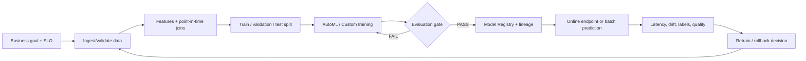
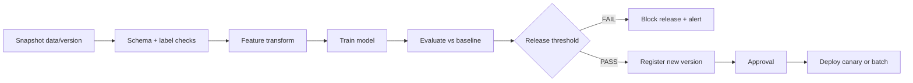
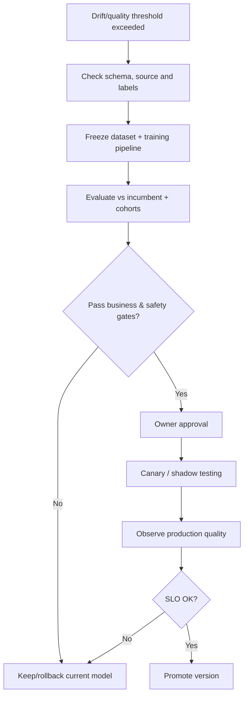

# Vertex AI and the Machine Learning System Lifecycle on GCP

An ordering application wants to predict the **risk of an order being cancelled** as soon as a customer places an order. The data team has order history in BigQuery, the application team runs APIs on Cloud Run, and the operations team needs to know when model quality degrades. **Training a model file** solves only part of the problem: to bring ML into production, you must manage **data, features, experiments, evaluation, model versions, inference, monitoring, and retraining**.

**Vertex AI** is the familiar name of the MLOps platform on Google Cloud. **As of April 22, 2026, Google Cloud moved and renamed Vertex AI capabilities under Gemini Enterprise Agent Platform (Agent Platform)**: for example, Vertex AI Pipelines became Agent Platform Pipelines, and Vertex AI Model Registry became Model Registry on Agent Platform. The API name `aiplatform.googleapis.com`, SDK `google-cloud-aiplatform`, and many `gcloud ai` commands still appear in tooling/documentation. This lesson retains the **Vertex AI** name to match the syllabus, while noting the current name where helpful; check the Console/documentation for the version you are using.

This lesson belongs to the `CLOUD_PROVIDERS_GCP` module, connecting project organization and IAM/VPC with Cloud Storage, BigQuery, Cloud Run/GKE, CI/CD, reliability monitoring, and cost. The primary example is **supervised predictive ML on tabular data**; generative models (Gemini, Model Garden) are distinguished separately so that not every LLM call is treated as a problem requiring training a model from scratch.

> **Lab scope:** The data and model in this lab are **simulated** and must not be used to automatically reject real orders. Local training steps do not require GCP; creating a training job, registry model, endpoint, pipeline, or monitoring on Google Cloud **may incur charges**, especially endpoints that remain deployed. Only use an authorized sandbox project.

## 1. Learning Objectives

After this lesson, you can:

1. Name the steps in the **ML lifecycle** from business requirements to monitoring and retraining.
2. Map **BigQuery, Cloud Storage, Dataflow, Feature Store, Workbench, AutoML/custom training, Experiments, Pipelines, Model Registry, Endpoints, and Model Monitoring** to each step.
3. Distinguish **training/validation/test**, leakage, and training-serving skew.
4. Choose **AutoML**, **custom training**, **BigQuery ML**, or **pre-trained models** depending on requirements.
5. Run a local lab building a classification model with **scikit-learn**, saving artifacts, and checking metrics.
6. Understand how to bring a model to the cloud, evaluate before deployment, and choose **online vs batch inference**, canary, and rollback.
7. Design reproducible **data/ML pipelines** with artifact lineage, least-privilege IAM, and cost control.
8. Diagnose drift, inference quality degradation, and common failure modes in production.

## 2. Start from the Business Problem, Not the Algorithm

Suppose the team wants to reduce cancelled orders while avoiding falsely flagging good orders. They can define:

| Component | Practical Example |
| --- | --- |
| **Unit of prediction** | An order at creation time. |
| **Target/label** | `cancelled_within_7_days` = 0 or 1. |
| **Valid features** | Customer's historical order count, cart value, account age **as of order placement time**. |
| **Must not be used** | Cancellation reason, actual delivery date, or information generated **after** prediction time. |
| **Baseline** | Simple rule or linear model; also compare against "no ML". |
| **Offline metrics** | Precision, recall, PR-AUC, calibration; measured per cohort with sufficient data. |
| **Business metrics** | Cancellation rate, false positive cost, review cost, A/B impact. |
| **Serving SLO** | For example, p95 prediction ≤ 150 ms, availability matching the API's SLO. |
| **Safety rule** | The model only assists with prioritizing checks, with human review/fallback. |

**Accuracy is not a good default metric.** If only 1% of orders are cancelled, a model that always predicts "not cancelled" achieves 99% accuracy yet provides no help in detecting risk. Choose precision/recall and threshold according to false positive/false negative costs, measured on a **test set not used to select the model or threshold**.

**ML might not be necessary.** If simple business rules meet the SLO and risk tolerance, do not build an expensive MLOps pipeline just because GPUs/Vertex AI are available.

## 3. End-to-End ML Lifecycle



| Stage | Input/Output | Common GCP Services |
| --- | --- | --- |
| **Data ingestion** | Files/events/rows → validated dataset. | Cloud Storage, BigQuery, Pub/Sub, Dataflow. |
| **Exploration/feature engineering** | Clean dataset → feature tables, statistics. | BigQuery SQL, Workbench/Colab Enterprise, Feature Store. |
| **Experimentation** | Features, code/params → metrics, artifacts. | Experiments, custom training, AutoML, BigQuery ML. |
| **Large-scale training** | Training code + immutable data version → model artifact. | Serverless custom jobs, training clusters/Ray when needed. |
| **MLOps pipeline** | DAG with data/model artifacts, evaluation conditions. | Agent Platform Pipelines (Kubeflow Pipelines/TFX), ML Metadata. |
| **Version management** | Model + metrics + lineage → approved version. | Model Registry. |
| **Prediction serving** | Model version → online endpoint/batch job. | Agent Platform Endpoints, batch prediction, Cloud Run if self-served. |
| **Monitoring** | Requests/predictions/ground truth → alerts/retrain request. | Model Monitoring, Cloud Monitoring/Logging, BigQuery. |

These services support the **technical steps**; they do not automatically decide whether a model is ethically or business-wise appropriate. Owners must set quality standards, access permissions, evaluation schedules, and replacement/retirement procedures.

## 4. Data, Labels, and Feature Engineering

### 4.1. BigQuery/Cloud Storage and Managed Datasets

- **BigQuery:** suitable for large tabular data, SQL joins/aggregations, data quality checks, temporal splits; can train directly with **BigQuery ML** when the algorithm is supported.
- **Cloud Storage:** stores CSV/Parquet/image files, **model artifacts**, manifests, and immutable dataset versions.
- **Managed datasets:** metadata and data import serving supported AutoML flows; **not mandatory for every custom training job**.
- **Dataflow:** standardizes, cleans, or transforms distributed data before training; not an orchestration engine for the entire ML workflow.
- **Feature Store:** manages feature sources/registry and feature serving (depending on version); feature data can originate from BigQuery. Feature Store does not mean it automatically fixes leakage or synchronizes in real time in every case.

### 4.2. Avoiding Data Leakage and Training-Serving Skew

**Data leakage** occurs when training data contains information not actually available at prediction time, or information from the test set accidentally leaks into preprocessing/feature selection.

```text
Wrong:
  customer_total_orders_today
  → trained for prediction at 08:00, but total already counted up to 23:59.

Right:
  customer_total_orders_before_order_created_at
  → counts only data existing before the order was created.
```

For time-ordered events, use **time-based splits** and **point-in-time joins** instead of random splits if random splitting lets you see into the future. If rows from the same customer are strongly correlated, consider a **group split** so the same entity does not appear in both train/test in a way that produces overly optimistic evaluations.

**Training-serving skew** is the discrepancy between data/transforms used during training and during inference. For example, training uses amounts in cents while the API passes dollars/VND; or training computes account age in UTC while serving uses local time. Ways to reduce risk:

1. Use shared **feature definitions and preprocessing code** across train/infer.
2. Package transformers together with the model (for example `sklearn.pipeline.Pipeline`).
3. Version schemas, feature tables, source snapshots, model artifacts, and container digests.
4. Run validation for types, missing values, feature ranges, class distribution, and label balance.
5. Do not log raw PII or payment tokens just to debug a model.

### 4.3. Splitting Train, Validation, and Test

| Split | What is it used for? | What to avoid |
| --- | --- | --- |
| **Train** | Fit the model, learn parameters and preprocessing. | Fitting scalers on data that includes test. |
| **Validation** | Tune hyperparameters, threshold, early stopping. | Adjusting based on test after viewing test metrics. |
| **Test/holdout** | Final report before release decision. | Reusing test multiple times to select a model. |
| **Production outcomes** | Track real-world effectiveness, generate new labels after delay. | Treating predicted labels as ground truth. |

If an order cancellation label takes **7 days** to determine, do not evaluate today's model recall using events created an hour ago: that is **label delay**, not model quality degradation.

## 5. Choosing a Training and Prediction Approach

### 5.1. AutoML, Custom Training, BigQuery ML, and GenAI

| Approach | When Suitable | Trade-offs |
| --- | --- | --- |
| **AutoML (Agent Platform)** | Supported tabular/image tasks, minimal desire to write algorithms/training code. | Scope of objectives/configuration depends on service; not fully customizable. |
| **Serverless custom training** | TensorFlow, PyTorch, scikit-learn, XGBoost, or custom code/containers. | You own preprocessing, code, packages, metrics, and artifacts. |
| **Training clusters/Ray** | Multi-node/GPU, reservations needed, or distributed frameworks. | Overhead of sizing, quota, checkpointing, and accelerator costs. |
| **BigQuery ML** | Data is in BigQuery, task fits SQL `CREATE MODEL`/`ML.PREDICT`. | Algorithm/pipeline scope differs from Vertex custom training. |
| **Model Garden / Gemini API** | NLP/vision/content generation with available foundation models. | Prompt/evaluation/safety/token costs; does not necessarily require custom model training. |

**Generative models** have their own lifecycle: prompt versioning, eval datasets, grounding/RAG, safety filters, hallucination tests, and token latency/cost. Do not confuse **fine-tuning a foundation model** with training a scikit-learn tabular classifier from scratch; they use different tools and carry different risks.

### 5.2. Job Types to Distinguish

- **CustomJob:** runs a training application, producing artifacts per your code; does not automatically mean a registered `Model` resource exists.
- **CustomTrainingJob / training pipeline:** combines custom training and (depending on configuration) model registration, not an entire MLOps DAG.
- **HyperparameterTuningJob:** runs multiple trials with a target metric and budget limit.
- **PipelineJob:** a multi-step DAG with artifact/parameter lineage, caching, and deployment conditions; commonly used to orchestrate preprocessing → train → evaluate → register.

Training uses temporary compute resources that can be released after the job finishes, **but artifacts, buckets, metadata, registry versions, and endpoints are not automatically deleted** with the training job.

## 6. Local Lab — Training, Evaluating, and Saving Artifacts

This lab uses **synthetic data** with scikit-learn and does not require Google Cloud. The goal is to practice the proper cycle **split → preprocess → fit → select threshold on validation → evaluate on test → save artifact**, before moving to managed infrastructure.

### 6.1. Preparation

In your own lab directory (outside the course material repository), run:

```bash
mkdir -p vertex-ml-lab
cd vertex-ml-lab
python3 -m venv .venv
source .venv/bin/activate
python -m pip install --upgrade pip
python -m pip install "scikit-learn>=1.5,<2" "joblib>=1.4,<2" "numpy>=1.26,<3"
```

**Production:** lock exact versions with a lockfile/container digest for reproducibility. Do not assume a `model.joblib` file trained with an arbitrary Python/scikit-learn version will always run on a model-serving container of a different version.

### 6.2. Complete Python Code

Create `train.py`:

```python
import json
from pathlib import Path

import joblib
import numpy as np
from sklearn.datasets import make_classification
from sklearn.linear_model import LogisticRegression
from sklearn.metrics import average_precision_score, precision_score, recall_score
from sklearn.model_selection import train_test_split
from sklearn.pipeline import Pipeline
from sklearn.preprocessing import StandardScaler


SEED = 42
FEATURES = [f"feature_{i}" for i in range(6)]

# Synthetic data, does not represent real orders.
X, y = make_classification(
    n_samples=5000,
    n_features=6,
    n_informative=4,
    n_redundant=0,
    weights=[0.9, 0.1],
    random_state=SEED,
)

# 60% train, 20% validation, 20% test. Stratify preserves label proportions.
X_train, X_rest, y_train, y_rest = train_test_split(
    X, y, test_size=0.4, stratify=y, random_state=SEED
)
X_val, X_test, y_val, y_test = train_test_split(
    X_rest, y_rest, test_size=0.5,
    stratify=y_rest, random_state=SEED
)

# Scaler is fit ONLY on TRAIN thanks to sklearn Pipeline.
model = Pipeline([
    ("scale", StandardScaler()),
    ("classifier", LogisticRegression(max_iter=1000, random_state=SEED)),
])
model.fit(X_train, y_train)

p_val = model.predict_proba(X_val)[:, 1]
p_test = model.predict_proba(X_test)[:, 1]

# Select threshold from validation. Precision condition is illustrative only.
threshold = 0.5
best_recall = -1.0
for candidate in np.linspace(0.1, 0.9, 17):
    predictions = p_val >= candidate
    precision = precision_score(y_val, predictions, zero_division=0)
    recall = recall_score(y_val, predictions, zero_division=0)
    if precision >= 0.75 and recall > best_recall:
        threshold = float(candidate)
        best_recall = float(recall)

# TEST is used only after model/threshold have been selected.
test_predictions = p_test >= threshold
metrics = {
    "threshold": threshold,
    "test_precision": float(precision_score(
        y_test, test_predictions, zero_division=0
    )),
    "test_recall": float(recall_score(
        y_test, test_predictions, zero_division=0
    )),
    "test_average_precision": float(average_precision_score(y_test, p_test)),
    "train_rows": len(y_train),
    "validation_rows": len(y_val),
    "test_rows": len(y_test),
    "schema_version": 1,
    "feature_names": FEATURES,
}

Path("artifacts").mkdir(exist_ok=True)
joblib.dump(model, "artifacts/model.joblib")
Path("artifacts/evaluation.json").write_text(
    json.dumps(metrics, indent=2), encoding="utf-8"
)
print(json.dumps(metrics, indent=2))
```

Run and inspect the results:

```bash
python train.py
cat artifacts/evaluation.json
```

Expected output: **`artifacts/model.joblib`** contains the model along with the scaler, and **`evaluation.json`** contains the threshold, metrics, and simulated schema. Do not assume an imagined metric value: read the actual output when running. The minority class ratio of around 10% illustrates why accuracy alone can be misleading.

**Security risk:** `joblib` uses pickle-style serialization; **do not load untrusted artifacts** because deserialization can execute arbitrary code. Only pull approved models from buckets/registries with provenance and checksums.

### 6.3. Testing Local Prediction

```python
import joblib
import numpy as np

model = joblib.load("artifacts/model.joblib")  # Only the file created by this lab.
sample = np.array([[0.1, 0.2, -0.3, 0.4, 1.0, -0.1]])
probability = float(model.predict_proba(sample)[0, 1])
print({"risk_score": probability})
```

The `risk_score` value is the model's estimated probability, **not a calibrated probability by default**. For real applications, check calibration, fairness, threshold, explainability, and automation limits before applying decisions that affect users.

## 7. From Local Lab to Managed Custom Training

### 7.1. Prerequisites on Google Cloud

| Component | What to Prepare |
| --- | --- |
| **Project / API** | Billing, `aiplatform.googleapis.com` enabled, region supporting machine/model types. |
| **Dataset** | BigQuery/GCS snapshot with verified schema, label quality, locality. |
| **Bucket** | GCS bucket **owned by the project/team**, in the right location, storing artifacts and pipeline root. |
| **Image** | Training container with Python/dependencies from a lockfile or custom image from Artifact Registry. |
| **Identity** | Runtime training service account separate from deployer, least-privilege IAM on GCS/BigQuery/Registry. |
| **Compute/quota** | Machine/GPU/TPU matching budget, concurrency, and GPU quota permissions. |
| **Release gate** | Baseline metrics, target metrics, approval, rollback/cleanup method. |

**Do not run cloud training just to test the same simple synthetic model if the goal is merely learning Python.** The local lab already proves the algorithm; cloud training demonstrates infrastructure management and pipeline reproducibility.

### 7.2. Inspect Resources Before Creating

The commands below are **read-only**, with an assumed project/region:

```bash
PROJECT_ID="orders-ml-lab"
REGION="asia-southeast1"
ARTIFACT_BUCKET="gs://orders-ml-artifacts-lab"

gcloud auth list
gcloud config get-value project
gcloud services list --enabled \
  --project="$PROJECT_ID" \
  --filter="name:aiplatform.googleapis.com"

gcloud ai custom-jobs list \
  --project="$PROJECT_ID" --region="$REGION"
gcloud ai models list \
  --project="$PROJECT_ID" --region="$REGION"
gcloud ai endpoints list \
  --project="$PROJECT_ID" --region="$REGION"
```

**Renaming note:** The Console may display **Agent Platform** instead of Vertex AI, while REST resource paths still commonly look like `projects/.../locations/.../models` or `endpoints`; `gcloud ai` does not turn into `gcloud agent-platform` merely due to the product label change.

### 7.3. Packaging Training Code and Saving Output

When converting `train.py` into a training container:

1. Use a reproducible **base image/lockfile**; do not install uncontrolled packages from the Internet between runs.
2. Read data from **GCS/BigQuery** via a service account; do not generate random data in production training.
3. Accept `data_snapshot_uri`, `schema_version`, `seed`, and `model_params` as parameters; do not hardcode production values.
4. Write models and metrics to the output directory; for custom training, you can use the `AIP_MODEL_DIR` environment variable if the workflow/training container applies this contract.
5. Save metadata: Git commit, image digest, data version/checksum, feature definitions, seed, metrics, owner, and timestamp.
6. Execute a **CustomJob/training pipeline** with right-sized machines; only after training succeeds should you inspect artifacts and consider registering in Model Registry.

**Guideline template** for output paths in training code, not a replacement for job config:

```python
import os
from pathlib import Path

# For custom training/prebuilt containers with AIP_MODEL_DIR, this is usually a GCS URI.
artifact_uri = os.environ.get("AIP_MODEL_DIR")
if not artifact_uri:
    raise RuntimeError("Missing AIP_MODEL_DIR from managed training job")
print("Configured model output:", artifact_uri)

# Do not use Path(artifact_uri).mkdir() when artifact_uri is a gs:// URI.
# Use gcsfs / google-cloud-storage or the appropriate framework uploader.
```

A locally trained `model.joblib` file **is not automatically a model-serving service**. To deploy, you need an artifact in the exact format expected by a **prebuilt serving container** (for example named `model.joblib` and with a compatible scikit-learn version), or build a **custom inference container** implementing request/response/health contracts.

## 8. ML Pipelines and Experiment Management

### 8.1. From Notebook to Reproducible Pipeline

A notebook may run successfully on a developer's machine and still not be reproducible: data changed, cells ran out of order, dependencies drifted, and there is no trace of which model is currently serving.

**Agent Platform Pipelines** (formerly Vertex AI Pipelines) supports defining **DAGs** using Kubeflow Pipelines (KFP) or TFX, composed of components with explicit inputs/outputs. For example:



Components should declare **artifact inputs/outputs** instead of passing an arbitrary path without recording metadata. **ML Metadata** records lineage across datasets, jobs, models, metrics, and executions. **Experiments** help compare runs/hyperparameters/metrics. **Pipeline caching** is safe only when inputs/params/code dependencies are versioned; changing data behind the same URI while reusing cache can produce wrong results.

### 8.2. KFP v2: Simple DAG Skeleton

This example **only illustrates compile syntax and dependency order**, without performing real training. Create `pipeline_demo.py` in your own lab after installing `kfp>=2`:

```python
from kfp import compiler, dsl


@dsl.component(base_image="python:3.11")
def validate_input(row_count: int) -> str:
    if row_count < 100:
        raise ValueError("Not enough training rows")
    return "validated"


@dsl.component(base_image="python:3.11")
def train_placeholder(validation_state: str) -> str:
    if validation_state != "validated":
        raise ValueError("Quality gate failed")
    # Production: submit custom training, publish model artifact + metrics.
    return "replace-with-model-artifact-uri"


@dsl.pipeline(name="order-risk-pipeline-demo")
def pipeline(row_count: int = 500):
    validated = validate_input(row_count=row_count)
    train_placeholder(validation_state=validated.output)


compiler.Compiler().compile(
    pipeline_func=pipeline,
    package_path="pipeline.json",
)
```

Run **local compile**:

```bash
python -m pip install "kfp>=2,<3"
python pipeline_demo.py
```

The `pipeline.json` file is a **pipeline specification**, not a trained model. If submitted to the cloud, components will create billable compute/resources. To turn it into a real MLOps pipeline, replace the placeholder component with preprocess/train/evaluate/register steps, add artifact lineage, and include a metric-based gate.

### 8.3. Submitting a PipelineJob (Only When Authorized)

Python SDK example using a **verified** pipeline JSON config with a dedicated bucket (do not run by default):

```python
from google.cloud import aiplatform

PROJECT_ID = "orders-ml-lab"
LOCATION = "asia-southeast1"
ROOT = "gs://orders-ml-artifacts-lab/pipeline-root"
WORKER_SA = "ml-pipeline@orders-ml-lab.iam.gserviceaccount.com"

job = aiplatform.PipelineJob(
    display_name="order-risk-pipeline-demo",
    template_path="pipeline.json",
    pipeline_root=ROOT,
    parameter_values={"row_count": 500},
    project=PROJECT_ID,
    location=LOCATION,
    enable_caching=False,  # Lab avoids mistaking cached results for a new run.
)

# CLOUD MODIFICATION/BILLABLE: call only after reviewing permissions and cost.
# job.submit(service_account=WORKER_SA)
```

**Key distinction:** `PipelineJob` orchestrates multiple steps; it is **not** a synonym for a single-step training `CustomJob`. In a real pipeline, a model should only be **registered/released when the evaluation gate passes**; a training failure must preserve the currently serving model.

## 9. Experiments, Model Registry, and Version Release

### 9.1. What Needs to Be Saved for Reproducibility?

| Metadata | Examples |
| --- | --- |
| Data snapshot | BigQuery table snapshot, GCS object versions/checksums, label window. |
| Code/environment | Git commit, Docker image digest, Python/sklearn version. |
| Parameters | Seed, training iterations, regularization, feature list. |
| Evaluation | PR-AUC, precision/recall at threshold, risk cohorts, and calibration. |
| Artifacts | `model.joblib`, preprocessing, schema, metrics JSON. |
| Governance | Model owner, approval, risk tier, training time, retention. |

**Experiments** store and compare training results; **Model Registry** manages model resources and **versions/aliases**, allowing you to select an approved model for inference. **Display names/aliases** are organizational tools and do not replace resource ID/version and artifact digest in audits.

### 9.2. Uploading Artifacts to Cloud Storage and Registering a Model

If approved to test on the cloud, upload the **lab artifact** to an existing bucket:

```bash
# WRITES REAL OBJECTS, may incur storage/network charges.
gcloud storage buckets describe "$ARTIFACT_BUCKET" \
  --project="$PROJECT_ID"
gcloud storage cp ./artifacts/model.joblib \
  "$ARTIFACT_BUCKET/models/order-risk-v1/model.joblib"
gcloud storage cp ./artifacts/evaluation.json \
  "$ARTIFACT_BUCKET/models/order-risk-v1/evaluation.json"
```

**Limitation:** Model Registry can deploy an artifact only if the **serving container** knows how to load and handle the inputs/outputs of that artifact. For scikit-learn, you must choose a **compatible version of a prebuilt prediction container** or a custom inference container; check requirements in the Import models documentation. The `evaluation.json` file supports auditing but does not make the serving container automatically choose a threshold: if a threshold is needed, implement it consistently in the serving/business layer.

Console workflow:

1. Go to **Agent Platform (formerly Vertex AI) → Model Registry → Import model**.
2. Choose to import the artifact at `gs://.../models/order-risk-v1/`, attach a name, version, and labels.
3. Choose a serving container matching the **framework/artifact version**, and verify the region and artifact IAM.
4. Record evaluation results, lineage, and approval in ML metadata/registry/organizational process.
5. Before deploying, test the inference contract: **feature order, types, count, and preprocessing**.

**Do not assume the newest model is the best model.** Only move the `approved` alias or shift traffic after passing baseline/validation gates and receiving owner sign-off.

## 10. Online Prediction and Batch Prediction

### 10.1. Choosing Serving Mode by Latency

| Mode | When to Use | Cost/Technical Characteristics |
| --- | --- | --- |
| **Online prediction** | API needs a result within a request (e.g., prioritizing order review). | Requires **Model deployment on an Endpoint**, provisioned serving compute, autoscaling, p95/p99 latency, IAM. |
| **Batch prediction** | Scoring a list of orders nightly, immediate response not needed. | Creates a **batch prediction job** from a Model resource; GCS/BigQuery input/output, **does not necessarily need an online endpoint**. |
| **Self-hosted Cloud Run** | Small model, custom application logic, and full inference control. | You manage scaling, model loading, metrics, auth, rollout, and drift monitoring. |

For online prediction, multiple model versions can be deployed to one endpoint with traffic splitting when supported by the model/endpoint type. Canary workflow: **deploy new model with small traffic percentage → monitor errors/latency/quality → gradually increase → rollback** if thresholds are breached. Do not use online A/B testing to try models that have not passed security/user-impact verification.

### 10.2. Sending Requests to a Created Endpoint

Only when a model is **registered and deployed** to an input-compatible endpoint, for example testing with six numeric features in the lab's order:

```json
{
  "instances": [
    [0.1, 0.2, -0.3, 0.4, 1.0, -0.1]
  ]
}
```

Save as `request.json` in the lab directory. To call the API with a principal granted `aiplatform.endpoints.predict` on the endpoint:

```bash
ENDPOINT_ID="REPLACE_WITH_ACTUAL_ENDPOINT_ID"

# REAL ONLINE PREDICTION CALL: may incur request and serving charges.
curl -sS -X POST \
  -H "Authorization: Bearer $(gcloud auth print-access-token)" \
  -H "Content-Type: application/json" \
  -d @request.json \
  "https://$REGION-aiplatform.googleapis.com/v1/projects/$PROJECT_ID/locations/$REGION/endpoints/$ENDPOINT_ID:predict"
```

The response typically contains `predictions`; output shape **depends on the serving container/model schema**. A prebuilt sklearn container may return probabilities or labels depending on implementation. Do not hardcode "the first value is the risk score" without confirming the serving contract and feature list mapping.

**Java/Cloud Run applications:** keep API authentication on the backend service account, validate JSON schema/input types, enforce timeout/concurrency limits, and log correlation IDs in a controlled manner. Do not expose Google Cloud access tokens directly in browser/mobile clients; do not let clients pick arbitrary endpoints.

### 10.3. Batch Inference and Output Verification

For batch jobs, inputs are typically GCS/BigQuery and outputs are GCS/BigQuery in a location compatible with the model; the task does not require sub-100 ms per-request latency. After the job finishes, verify `failedPredictionCount`/errors, output row count, `entity_id` mapping, and model version. Batch jobs can be re-run, so downstream consumers must have an **idempotent merge/partition policy** to prevent duplicate prediction scores.

**Do not keep an online endpoint running 24/7 just to score one batch per day if a batch job meets the SLO.** Serving compute and endpoint operational costs can be significant even with zero requests.

## 11. Model Monitoring, Data Monitoring, and Retraining

### 11.1. Three Different Types of Signals

| Signal | Examples | Action |
| --- | --- | --- |
| **Serving health** | p95 latency spikes, 5xx, model container OOM, endpoint unavailable. | Fix infrastructure, scale, or rollback. |
| **Data/feature drift and skew** | Surge in new customers, feature distribution differs from training. | Check upstream/schema, drift baseline, consider re-evaluating the model. |
| **Model quality/concept drift** | Precision/recall on **mature ground-truth labels** drops. | Reconcile labels, run offline evaluation, retrain/rollback per gate. |

**Drift does not prove the model is wrong**, and **absence of drift does not prove the model is still good**. When the relationship between features and labels changes (concept drift), watching input distributions alone is insufficient; ground-truth labels and business outcomes are required.

For tabular models, **Model Monitoring v1** (GA per current documentation) tracks skew/drift for supported endpoints. **Model Monitoring v2** (Preview at the time documentation was referenced) ties monitoring to model versions, supports scheduled/on-demand jobs, and can extend to serving use cases outside the platform. **Do not assume Preview has the same SLA/stability as GA**; verify product status before production use.

### 11.2. Dashboards and Alerts

| Category | Metrics/Criteria |
| --- | --- |
| **Online serving** | Requests/s, 4xx/5xx, p50/p95/p99 latency, replicas, CPU/GPU, timeouts. |
| **Prediction quality** | Precision, recall, PR-AUC/calibration on finalized labels, by cohort/tenant. |
| **Data quality** | Missing rate, type/range/schema changes, feature drift/skew, data freshness. |
| **Business safety** | False positives, human overrides, customer complaints, and fairness indicators. |
| **MLOps health** | Pipeline/job failures, training duration, model age, data label delay, approval state. |
| **Cost** | Cost per training run, per 1,000 predictions, idle endpoint/accelerator usage. |

**Do not log raw PII, payment cards, tokens, or full feature vectors containing sensitive data** merely to obtain drift metrics. Sampling and anonymization must comply with policy. When measuring model accuracy/recall, store `model_version` and `inference_id` to join with ground truth when it arrives; never use model predictions themselves as labels.

### 11.3. Retraining Loop with Approval



Do not enable **auto-retrain → auto-replace the entire endpoint** based solely on a single drift threshold. Include an evaluation gate and, for user-impacting decisions, manual approval/canary. Cohort evaluations with insufficient sample sizes must clearly state uncertainty rather than drawing absolute conclusions.

## 12. IAM, Networking, and Securing the ML Supply Chain

### 12.1. Separating Principals by Responsibility

| Principal | Permissions to Check | Recommendation |
| --- | --- | --- |
| **Deployer/CI** | Permissions to create training/pipeline/model/endpoint, `iam.serviceAccounts.actAs` when specifying a runtime SA. | Do not use unrestricted Project Owner. |
| **Training runtime SA** | `bigquery.dataViewer`/`jobUser` on sources, Storage Object Viewer/Creator on artifacts, logging as needed. | Separate from permissions to deploy production endpoints. |
| **Pipeline runtime SA** | Permissions for components to call corresponding services, storage pipeline root. | Use a dedicated service account and appropriate network/region. |
| **Serving runtime SA** | Only resources needed for model inference, no read access to training labels if unnecessary. | Least privilege; do not embed service account keys in images. |
| **Prediction caller** | `aiplatform.endpoints.predict` on the endpoint or appropriate role. | Cloud Run backend calls on behalf of web/mobile clients. |
| **Service agents** | Infrastructure permissions managed by Google Cloud services. | Do not confuse service agents with workload SAs when troubleshooting errors. |

Specific roles vary by product and use case; check **IAM permissions** for the exact resource before assigning. `roles/aiplatform.user` can be handy for labs, but production should narrow down to an appropriate minimal permission set. To read models from GCS or BigQuery, the **Vertex AI/Agent Platform service agent** may need permissions in addition to the runtime SA depending on the workflow; inspect the identity appearing in audit logs rather than granting overly broad permissions.

### 12.2. Data and Networking

- Choose compatible regions for **data, training, model artifacts, endpoint**, and BigQuery/GCS; cross-region access can cause egress charges, residency violations, or job failures.
- Choose VPC/private endpoints/Private Service Connect, CMEK, and VPC Service Controls when policy requires; specific capabilities depend on job type/region.
- Use **Artifact Registry image digests, dependency pinning, vulnerability scanning, and SBOMs when needed**; do not run custom inference images from untrusted registries.
- Anonymize or minimize PII in training, logs/prediction payloads; define retention and data/model deletion rights as required.
- Test against **model inversion/membership inference, data leakage, and prompt injection** when the model/application type is at risk; for GenAI, add safety evaluations and output validation.
- Do not use a model score as a final decision significantly impacting customers without validation, monitoring, explainability processes, and human oversight.

## 13. Cost and Sizing

| Component | Potential Cost Drivers | Optimization |
| --- | --- | --- |
| **Data preparation** | BigQuery bytes scanned/slots, Dataflow, GCS storage/operations. | Partitioning, avoid overly broad queries, planned caching/snapshots. |
| **Workbench/Notebook** | VM, disk, GPU even when notebooks are not executing code depending on state. | Stop/shutdown/delete resources when no longer needed. |
| **AutoML / custom training** | CPU/GPU/TPU, distributed workers, tuning trials, training time. | Small baseline first, max trials/worker caps, early stopping. |
| **Pipelines** | Compute for tasks, pipeline/metadata resources, and downstream services. | **Version-aware** caching, remove redundant tasks, control concurrency. |
| **Online inference** | Deployed model serving replicas, machine/accelerator, traffic. | Appropriate autoscaling and min replicas; **undeploy** models when unused. |
| **Batch inference** | Per-job compute, GCS/BigQuery input/output, and network. | Batch sensibly, keep region near data, avoid 24/7 idle endpoints. |
| **Monitoring/Logging** | Logging/BigQuery sampling, storage, monitoring jobs by tier. | Reasonable sampling/retention, actionable alerts. |
| **GenAI/Model Garden** | Tokens, provisioned throughput, tuning, context caching depending on model. | Prompt size, latency/cost budgets, choose a sufficient model. |

Measure **cost per correct business outcome**, not just training job cost. A model that increases recall by 0.5% but requires a large GPU endpoint and doubles review volume may worsen total cost and customer experience.

**Control process:** set budgets/alerts, label training/pipeline resources, track Billing SKUs by region, cap machine sizes and tuning trials. **Stopping a notebook does not necessarily delete its disk; deleting a training job does not automatically undeploy an endpoint**. Review all running resources after completing the lab.

## 14. Quick Troubleshooting

| Symptom | Common Causes | What to Check |
| --- | --- | --- |
| Training job reports `PERMISSION_DENIED` | Runtime SA lacks BQ/GCS read permissions; service agent missing IAM; KMS error. | Job logs, audit principal, bucket/dataset policies. |
| Job does not create a model in Registry | Ran `CustomJob` which only writes artifacts; missing register/upload step. | Artifact URI, Model Registry workflow, training pipeline config. |
| Model upload fails | `model.joblib`/serving image wrong format or version mismatch, different bucket region. | Artifact manifest, framework/container compatibility, location. |
| Endpoint `predict` returns 401/403 | Caller lacks predict permission/token or wrong project/region/endpoint. | Principal, `gcloud ai endpoints list`, endpoint IAM. |
| Endpoint returns 400 | Wrong feature order/dimensions/types, request JSON violates serving contract. | Schema version and preprocessing transform. |
| High p95 latency/5xx | Heavy model load, insufficient memory/CPU/GPU, startup/replicas/network issues. | Endpoint metrics, container logs, autoscaling limits. |
| Good offline test, low production precision | Leakage, skew, concept drift, selection bias, delayed labels. | Time-based split, online feature semantics, ground truth join. |
| Pipeline rerun yields different metrics | Mutable dataset URI, seed, package version, incorrect caching. | Artifacts/lineage, source snapshot, and image digest. |
| New model causes issues | Rollout lacked canary/monitoring/approval. | Reduce traffic or rollback registry version per runbook. |
| Bill increases with no predictions | Endpoint replicas/GPU or notebook VM still running. | List endpoints/deployed models, notebook state, Billing. |

## 15. Practical Exercises (With Answers)

**Exercise 1 — Problem framing.** A team wants to predict whether an order will cancel within 7 days, but trains using the `cancel_reason` column recorded after cancellation. What is wrong?

*Answer:* **Target leakage**. The field does not exist at prediction time; it must be removed from features and re-evaluated with point-in-time accurate data.

**Exercise 2 — Metric selection.** Only 1% of orders cancel, and a model predicting none cancel reaches 99% accuracy. Is this good?

*Answer:* No. Recall for the cancellation class is 0. You need precision/recall, PR-AUC, confusion matrix, and FP/FN costs.

**Exercise 3 — Validation vs test.** A team adjusts the threshold 20 times based on test results. What is the issue?

*Answer:* The test set has been used as validation, producing optimistic measurements. Select the threshold on validation, and measure on test only at the end.

**Exercise 4 — Tool selection.** Data is in BigQuery, a simple regression model is needed, and the team knows SQL. Is writing PyTorch custom training mandatory?

*Answer:* No. Try **BigQuery ML** or AutoML first if they meet the objectives/SLO.

**Exercise 5 — Registry.** A CustomJob succeeded, yet Model Registry is empty. Why?

*Answer:* CustomJob only executes training code and produces artifacts. You need an upload/register Model resource step or a training pipeline configured to register.

**Exercise 6 — Online vs batch.** Scoring 2 million customers nightly with no real-time API. Do you need an endpoint running all day?

*Answer:* No. A **batch prediction job** is usually better suited, needs no online endpoint, uses GCS/BigQuery input/output, and controls cost.

**Exercise 7 — Skew.** A model trains with `amount_cents` while the API sends amounts in dollars/VND. What happens?

*Answer:* **Training-serving skew**; results can be severely distorted even though the endpoint returns HTTP 200. Unify feature transforms/schemas and test the request contract.

**Exercise 8 — Drift.** Input drift exceeds the threshold, but ground-truth labels are not ready yet. Should a new model be auto-deployed?

*Answer:* Do not deploy automatically. Investigate sources/schemas, wait for labels past the delay window, evaluate against baseline/quality, and pass the approval gate before rollout.

**Exercise 9 — Pipeline caching.** A team replaces GCS file contents while keeping the same URI and uses caching. What is the risk?

*Answer:* Caching may reuse old outputs even though the actual input changed. Use immutable object versions/checksums and version params/dependencies.

**Exercise 10 — IAM.** The training SA needs to read a BigQuery table. Should it be granted Project Editor?

*Answer:* No. Grant BigQuery Job User/Data Viewer at the appropriate scope plus necessary GCS permissions; separate it from deployer and serving SAs.

**Exercise 11 — Production cost.** There are zero requests, yet the endpoint is still billed.

*Answer:* The deployed model has provisioned **serving replicas/accelerators**. Review min replicas, undeploy the model, or use batch inference for intermittent needs.

**Exercise 12 — CI/CD.** A new model has slightly better PR-AUC, but new customers suffer 3x more false positives. Should 100% of traffic be shifted?

*Answer:* **No.** You need cohort-level evaluation, fairness/business guardrails, human approval, canary rollout, and rollback capability; an aggregate metric is not enough.

## 16. Production Checklist

- [ ] Business use case, baseline, target label, prediction time, and FP/FN costs agreed upon.
- [ ] Data has schema, provenance, immutable version, label availability, and retention.
- [ ] No leakage; train/validation/test split properly by time/entity where appropriate.
- [ ] Features/preprocessing consistent between training and serving; schema contract tests in place.
- [ ] Code/containers/dependencies pinned, with image digests and security scans.
- [ ] Model metrics logged with experiment run, dataset version, and code commit.
- [ ] Pipeline has quality/evaluation gates, ML Metadata/lineage, and safe retries.
- [ ] Model Registry version/alias has approval and rollback procedures.
- [ ] Online/batch inference chosen based on latency SLO and cost.
- [ ] Endpoint has IAM, p95/p99 latency, error rate, autoscaling, and canary configured.
- [ ] Model Monitoring matches GA/Preview status and model type limitations.
- [ ] Monitoring uses ground-truth labels, tracks cohorts, and handles label delay/drift.
- [ ] Training/serving/pipeline SAs have separated permissions; PII and networking controlled.
- [ ] Budgets, labels, and a plan to stop notebooks/undeploy endpoints after testing exist.
- [ ] Tested data schema drift, endpoint 400/403, model rollback, stale features, and backfill.

## 17. Summary

**The ML lifecycle on GCP** does not end at `fit()`. A reliable system must go through **clear objectives → point-in-time accurate data/features → reproducible training/evaluation → model registry → online/batch serving → real quality monitoring → retrain or rollback decisions**.

**Vertex AI, now part of Gemini Enterprise Agent Platform**, provides managed components for most of that lifecycle. However, **correct data, label definitions, leakage mitigation strategies, cohort evaluation, IAM, budgets, and release decisions** remain the responsibility of the product and engineering teams. Start with a simple model/baseline, prove value, and only then increase infrastructure complexity.

### Google Cloud Reference Documentation

- [Vertex AI → Gemini Enterprise Agent Platform naming changes (April 22, 2026)](https://docs.cloud.google.com/gemini-enterprise-agent-platform/vertex-ai-name-changes)
- [Introduction to ML on Agent Platform](https://docs.cloud.google.com/gemini-enterprise-agent-platform/machine-learning)
- [Choose a training method](https://docs.cloud.google.com/gemini-enterprise-agent-platform/machine-learning/start/training-methods)
- [Serverless custom training](https://docs.cloud.google.com/gemini-enterprise-agent-platform/machine-learning/training/overview)
- [Agent Platform Pipelines](https://docs.cloud.google.com/gemini-enterprise-agent-platform/machine-learning/pipelines/introduction)
- [Run a PipelineJob](https://docs.cloud.google.com/gemini-enterprise-agent-platform/machine-learning/pipelines/run-pipeline)
- [Model Registry](https://docs.cloud.google.com/gemini-enterprise-agent-platform/machine-learning/model-registry/introduction)
- [Import model artifacts and serving containers](https://docs.cloud.google.com/gemini-enterprise-agent-platform/machine-learning/model-registry/import-model)
- [Feature Store](https://docs.cloud.google.com/gemini-enterprise-agent-platform/machine-learning/featurestore/latest/overview)
- [Online predictions](https://docs.cloud.google.com/gemini-enterprise-agent-platform/machine-learning/predictions/get-online-predictions)
- [Batch predictions](https://docs.cloud.google.com/gemini-enterprise-agent-platform/machine-learning/predictions/get-batch-predictions)
- [Model Monitoring v1 and v2](https://docs.cloud.google.com/gemini-enterprise-agent-platform/machine-learning/model-monitoring/overview)
- [ML Metadata and lineage](https://docs.cloud.google.com/gemini-enterprise-agent-platform/machine-learning/ml-metadata/introduction)
- [Vertex AI / Agent Platform pricing](https://cloud.google.com/vertex-ai/pricing)
