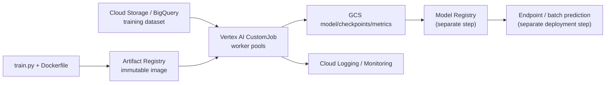
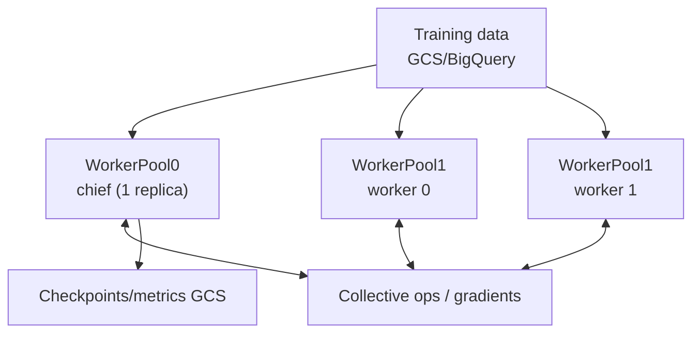

# Training Jobs, Custom Containers, and Accelerator Resources

A data team prototyped a demand forecasting model on a laptop. As data grows, the team wants to run scheduled training on Google Cloud, package their own libraries, and occasionally use **GPUs/TPUs**. The challenge is not merely "picking the strongest GPU": they must build **reproducible training jobs**, grant proper permissions to read data and write models, pick regions with accelerators/quota, monitor progress, and **stop resources when no longer needed**.

This lesson belongs to the **Vertex AI and Machine Learning** chapter of module `CLOUD_PROVIDERS_GCP`, building on projects, IAM, VPC, Artifact Registry, Cloud Storage, Cloud Run/GKE, monitoring, reliability, and cost. The focus is **custom training on Vertex AI**, not Gemini API fine-tuning or inference. In current Google Cloud documentation, some custom training pages appear under **Gemini Enterprise Agent Platform**; the `aiplatform.googleapis.com` API, `CustomJob`, and `gcloud ai custom-jobs` commands remain key identifiers to recognize.

## 1. Learning Objectives

After this lesson, you can:

1. Distinguish **CustomJob**, **TrainingPipeline**, **HyperparameterTuningJob**, **Vertex AI Pipelines**, and **Endpoint**.
2. Package an ML program in a **custom container** with controlled entrypoints and dependencies.
3. Define a `WorkerPoolSpec` for a CPU job, understanding `replicaCount`, `machineSpec`, `containerSpec`, and disk.
4. Distinguish when to use **CPU, GPU, and TPU**; check regions, hardware pairings, quotas, and compatible code.
5. Run a regression training example locally, inspect artifacts, and **optionally** submit a Vertex AI CustomJob in an approved lab project.
6. Use **dedicated service accounts, Artifact Registry, ADC, and Cloud Storage** following least-privilege principles.
7. Understand distributed training, `CLUSTER_SPEC`/`TF_CONFIG`, checkpoints, and the limits of merely increasing replicas.
8. Read job status/logs/metrics, and handle OOM, quotas, permissions, and costs.
9. Complete exercises calculating resource-hours, choosing accelerators, debugging IAM errors, and managing operations.

**Safety rule:** the first part of this lesson runs **locally and on CPU only**, requiring no GCP resources. Commands like `gcloud builds submit` and `gcloud ai custom-jobs create` **incur charges** and must only be run with an **owned lab project, registry, bucket, quota, and budget**. This lesson does not create GPU/TPU jobs by default.

## 2. Training Lifecycle Diagram



**Training code** processes data and learns parameters. The **custom container** defines the runtime environment. **CustomJob** schedules the container on training compute and exits when finished. **Model Registry/Endpoint** manages and deploys models after training; **a succeeded CustomJob does not mean the model was uploaded to Registry or an inference API exists**.

| Component | Responsibility | Output |
| --- | --- | --- |
| **Training script** | Read data, train, evaluate, save artifacts | Model files + metrics |
| **Custom container** | OS/runtime, Python/CUDA/framework, code | Docker/OCI image in registry |
| **Worker pool** | Machine type, GPU/TPU, replica count, image, disk | Compute running the script |
| **CustomJob** | Schedule/launch/monitor training | Job state, logs, outputs |
| **TrainingPipeline** | CustomJob + integrated dataset/model upload steps | Can create a `Model` if artifacts match |
| **HyperparameterTuningJob** | Run multiple trials optimizing hyperparameters | Best trial + cost of multiple runs |
| **Vertex AI Pipelines** | Orchestrate multi-step container/ML workflows | Pipeline DAG, optional caching/metadata |

**Distinguishing orchestration:** a `TrainingPipeline` is an integrated training resource; **Vertex AI Pipelines** provides multi-step pipeline orchestration. The two concepts are related but are **not the same API**.

## 3. Choosing Custom Container or Prebuilt Container?

| Option | When Suitable | Trade-offs |
| --- | --- | --- |
| **Prebuilt training container + Python package** | Framework/version already supported, minimal Docker management desired | Constrained to image runtime/libraries |
| **Custom container** | Need custom OS libs, CUDA, framework versions, runtime, or code | Own image builds, CVEs, dependency pinning |
| **Autopackaging** | Want CLI to package local script/package onto a prebuilt base automatically | Verify output image, build permissions, reproducibility |
| **Self-managed GKE/Compute Engine** | Need custom scheduling/drivers/topology unsuitable for serverless | Higher operational overhead |

In this lesson we choose **custom container** to make the Dockerfile, entrypoint, and output artifacts explicit. Starting on CPU avoids GPU costs and separates code bugs from hardware issues.

**Do not confuse:** a training image typically **runs until completion**, rather than acting as a web server listening on `PORT` like Cloud Run. You do not need `EXPOSE 8080` or an HTTP health endpoint just for Vertex AI to run a training script.

## 4. WorkerPoolSpec Architecture

Logical specification example:

```yaml
workerPoolSpecs:
  - machineSpec:
      machineType: n1-standard-4
    replicaCount: 1
    containerSpec:
      imageUri: REGISTRY_IMAGE_URI
```

Meaning of each section:

- `machineSpec.machineType`: base vCPU/RAM; must be supported by the training service in the region.
- `machineSpec.acceleratorType` / `acceleratorCount`: attach supported GPUs per machine pairing, or `tpuTopology` on applicable TPU families.
- `replicaCount`: number of machines running the **same worker-pool specification**, not the number of epochs.
- `containerSpec.imageUri`: image pulled and run by workers.
- `containerSpec.command` / `args`: can override Docker `ENTRYPOINT`/`CMD` per API semantics.
- `diskSpec`: **boot disk** type/size if differing from default; not GPU memory capacity.
- `serviceAccount` and `baseOutputDirectory`: belong to **CustomJobSpec**, not placed inside each `machineSpec`.

**One 4-vCPU worker ≠ four replicas.** One replica uses a single VM of the chosen spec. A distributed multi-replica job needs **coordination code/framework and data sharding**; merely raising replica count in YAML runs independent copies of the script repeatedly if distributed training is not implemented.

## 5. CPU, GPU, and TPU Resources

| Resource | Suitable Workloads | Things to Verify |
| --- | --- | --- |
| **CPU** | Small tabular ML, data preprocessing, sklearn/XGBoost, baselines | Cores, RAM, disk, batch size, and throughput |
| **GPU** | Neural nets with tensor ops, medium/VRAM-fitting training | GPU model/VRAM, CUDA framework image, machine pairing, quota |
| **TPU** | Large-scale tensor workloads supported by XLA/JAX/TF/PyTorch-XLA | TPU generation, topology, compiler/runtime, region/quota |
| **Distributed GPU/TPU** | Models/datasets exceeding one device or needing shorter wall time | Data/model parallelism, network, checkpoints, all-reduce |

**A GPU does not automatically make a script faster.** If the container only runs Python loops or CPU models, provisioning an NVIDIA T4/A100/H100 can produce **0% accelerator utilization while still billing accelerator costs**. You need a framework built for the right CUDA/runtime and explicit placement of tensors/models onto the accelerator.

**A TPU is not an NVIDIA GPU by another name:** image builds, topologies, XLA compilation, checkpoints, and code have distinct requirements. Do not swap `acceleratorType=NVIDIA_TESLA_T4` for a TPU name and expect PyTorch CUDA code to run.

### 5.1. Three Layers of Conditions to Provision GPUs

1. **Service and region:** Vertex AI custom training supports that GPU type in the target location.
2. **Machine pairing/topology:** the selected machine allows attaching that GPU count/type (GPU-integrated machines follow different rules than N1 + T4).
3. **Capacity/quota/budget:** training quota on `aiplatform.googleapis.com` per project/region/GPU type plus actual stock availability; **do not** check only Compute Engine VM GPU quota.

GPU availability in a region **does not mean your project has quota > 0** or guaranteed capacity at submission time. For production budgets, verify reservations and scheduling windows before committing to deadlines.

## 6. A Sample Model Without a GPU

Simple linear training lab on synthetic data:

\[
y \approx 1.8x + 0.5 + \varepsilon
\]

- Generate 200 points from a fixed seed, containing no real data.
- Use 160 points for training, 40 points for evaluation.
- Optimize **mean squared error (MSE)** with gradient descent.
- Save `model.json` (weight/intercept) and `metrics.json`.
- Runs with **Python 3.11** and the standard library; add the Google Cloud Storage client only to write output to `gs://` in cloud jobs.

This is a **workflow-teaching model**, not a GPU benchmark or production model. The JSON output is solely for inspecting training artifacts and is not pre-compatible with every Vertex AI prebuilt serving container.

## 7. Preparing the Local Lab

Environment: Python 3.11+, Docker Engine (if running containers), Bash, optional `gcloud`. Create a separate demo folder; **do not write auxiliary files into the course material repository**:

```text
vertex-training-lab/
├── train.py
├── Dockerfile
└── output/          # generated after training
```

When running locally, no service account, billing, or Artifact Registry is required. Testing order:

1. Run `python3 train.py` and open `output/metrics.json`.
2. Build the image and re-run the script inside Docker to verify the entrypoint.
3. **Optionally** use a lab project to build/push the image, run a CPU CustomJob, and read the model in GCS.
4. Only after completing the CPU path should you consider writing **a** separate GPU-aware/TPU-aware variant.

## 8. train.py — Training and Exporting Artifacts

Create `train.py` in the demo directory:

```python
import argparse
import json
import logging
import os
import posixpath
import random
from pathlib import Path


def make_data(seed):
    rng = random.Random(seed)
    rows = []
    for _ in range(200):
        x = rng.uniform(-1.0, 1.0)
        y = 1.8 * x + 0.5 + rng.gauss(0.0, 0.05)
        rows.append((x, y))
    rng.shuffle(rows)
    return rows[:160], rows[160:]


def mse(rows, weight, bias):
    return sum(
        ((weight * x + bias) - y) ** 2 for x, y in rows
    ) / len(rows)


def train(train_rows, epochs, learning_rate):
    weight, bias = 0.0, 0.0
    n = len(train_rows)
    for epoch in range(epochs):
        grad_w = 2.0 * sum(
            (weight * x + bias - y) * x for x, y in train_rows
        ) / n
        grad_b = 2.0 * sum(
            (weight * x + bias - y) for _, y in train_rows
        ) / n
        weight -= learning_rate * grad_w
        bias -= learning_rate * grad_b
        if epoch % 100 == 0 or epoch == epochs - 1:
            logging.info("epoch=%d train_mse=%.6f",
                         epoch, mse(train_rows, weight, bias))
    return weight, bias


def write_json(directory, filename, payload):
    content = json.dumps(
        payload, ensure_ascii=False, indent=2, sort_keys=True
    )
    if directory.startswith("gs://"):
        # Import needed only when the job outputs to Cloud Storage.
        from google.cloud import storage

        relative = directory[len("gs://"):]
        bucket, separator, prefix = relative.partition("/")
        if not bucket:
            raise ValueError("AIP_MODEL_DIR must have a valid bucket")
        blob_name = posixpath.join(prefix.strip("/"), filename)
        storage.Client().bucket(bucket).blob(blob_name).upload_from_string(
            content, content_type="application/json"
        )
        logging.info("Saved gs://%s/%s", bucket, blob_name)
    else:
        path = Path(directory)
        path.mkdir(parents=True, exist_ok=True)
        (path / filename).write_text(content + "\n", encoding="utf-8")
        logging.info("Saved %s", path / filename)


def main():
    parser = argparse.ArgumentParser()
    parser.add_argument("--seed", type=int, default=42)
    parser.add_argument("--epochs", type=int, default=300)
    parser.add_argument("--learning-rate", type=float, default=0.1)
    parser.add_argument("--output-dir", default="./output")
    args = parser.parse_args()
    if args.epochs <= 0 or not 0 < args.learning_rate < 1:
        parser.error("epochs > 0 and learning-rate in (0, 1)")

    logging.basicConfig(level=logging.INFO)
    train_rows, eval_rows = make_data(args.seed)
    weight, bias = train(
        train_rows, args.epochs, args.learning_rate
    )
    evaluation_mse = mse(eval_rows, weight, bias)

    # AIP_MODEL_DIR is set only when the job configures baseOutputDirectory.
    model_dir = os.environ.get("AIP_MODEL_DIR") or args.output_dir
    write_json(model_dir, "model.json", {
        "model_type": "linear_regression",
        "weight": weight,
        "bias": bias,
        "seed": args.seed,
        "epochs": args.epochs
    })
    write_json(model_dir, "metrics.json", {
        "eval_mse": evaluation_mse,
        "eval_rows": len(eval_rows),
        "train_rows": len(train_rows)
    })
    logging.info("eval_mse=%.6f", evaluation_mse)


if __name__ == "__main__":
    main()
```

**Why separate `write_json`?** `AIP_MODEL_DIR` can be a **GCS URI**, not a POSIX path; calling `open("gs://...")` directly will fail. We use the Cloud Storage client with **Application Default Credentials (ADC)** already available in the training runtime. Never embed service account JSON keys inside the image.

### 8.1. Local Python Testing

```bash
cd vertex-training-lab
python3 train.py --epochs=300 --seed=42 --output-dir=./output
cat output/model.json
cat output/metrics.json
```

Expected: `weight` roughly **1.8**, `bias` roughly **0.5**, `eval_mse` small (since the synthetic data has low noise). If metrics look abnormal, confirm seed, learning rate, and epoch count before troubleshooting on the cloud.

**Do not draw conclusions about production generalization** from this randomly generated data. Real ML requires proper time/user splits, data leakage prevention, bias/drift evaluation, and governance of PII sources.

## 9. Dockerfile for Custom Training Container

Create `Dockerfile`:

```dockerfile
FROM python:3.11-slim

ENV PYTHONDONTWRITEBYTECODE=1 \
    PYTHONUNBUFFERED=1

WORKDIR /app

# Lab: major version constrained; production pins digest/lock.
RUN pip install --no-cache-dir "google-cloud-storage>=3,<4"

RUN useradd --create-home --uid 10001 trainer
COPY --chown=trainer:trainer train.py /app/train.py
USER trainer

ENTRYPOINT ["python", "/app/train.py"]
```

**Explanation:**

- Base `python:3.11-slim` uses **CPU**; no CUDA/cuDNN is included.
- `ENTRYPOINT` runs the program and returns **exit code 0** on completion. An unhandled exception produces a non-zero exit code, causing the job to fail.
- `google-cloud-storage` writes to `gs://`; local output uses the standard library.
- Runs as non-root and packages no credentials or PII.
- Production must **pin base image digests**, lock dependencies, scan for vulnerabilities, and record image digests/SBOMs and provenance; version ranges here are only for easy demo reuse.

**Do not turn this image into GPU training** by adding one `acceleratorType` line. The code does not use GPUs; with PyTorch/TensorFlow you must build from a base with compatible CUDA/runtime and test `torch.cuda.is_available()` or the equivalent device check.

### 9.1. Local Docker Build and Test

```bash
docker build -t vertex-train-demo:local .

# Test entrypoint, no GCP credentials required.
docker run --rm vertex-train-demo:local --epochs=300 --seed=42

# On Linux/macOS or Cloud Shell with a Docker daemon:
mkdir -p output
docker run --rm \
  --user "$(id -u):$(id -g)" \
  --mount "type=bind,source=$PWD/output,target=/output" \
  vertex-train-demo:local --output-dir=/output
cat output/metrics.json
```

The second Docker command passes the host user ID to avoid writing files with mismatched ownership; this mount/`id` syntax targets POSIX shells and may need adjustment on Windows Docker Desktop. **Cloud Shell is not guaranteed to have a suitably configured Docker daemon**; if unavailable, run `python3 train.py` locally.

## 10. Artifact Registry and Image Immutability

Cloud flow:

```text
train.py + Dockerfile
   -> docker build / Cloud Build
   -> Artifact Registry image:tag
   -> check image digest / scan
   -> Vertex AI CustomJob containerSpec.imageUri
```

A **tag** like `:v1` can point to a different image after a rebuild, whereas an **OCI digest `@sha256:...`** identifies an exact artifact. To audit/reproduce training, record **source commit + image digest + input snapshot + hyperparameters + job ID**.

CustomJob's `imageUri` references the container; if the image is in **Artifact Registry in the same project**, extra pull permissions are usually not needed. For a **cross-project registry**, **image pull permission belongs to the Vertex AI/Agent Platform service agent**, not automatically to the custom **runtime service account**.

**Do not default to legacy `gcr.io` for new projects** when Artifact Registry is standardized. The repository should be a Docker repo in the right region with retention/scanning policies and an owner.

## 11. Read-Only Cloud Preflight

Use this section only if you have an approved lab project. **Do not create projects/buckets/repositories or raise quotas on your own just to run this lesson.**

```bash
PROJECT_ID="YOUR_AUTHORIZED_LAB_PROJECT"
REGION="YOUR_APPROVED_REGION"
REPO="YOUR_EXISTING_DOCKER_REPO"
BUCKET="YOUR_EXISTING_LAB_BUCKET"
TRAIN_SA="YOUR_EXISTING_TRAINING_SERVICE_ACCOUNT_EMAIL"

gcloud --version
gcloud auth list
gcloud projects describe "$PROJECT_ID" \
  --format="yaml(projectId,lifecycleState)"

# READ: prepared Artifact Registry repo.
gcloud artifacts repositories describe "$REPO" \
  --project="$PROJECT_ID" \
  --location="$REGION"

# READ: bucket used for output/staging.
gcloud storage buckets describe "gs://$BUCKET"

# READ: existing custom training jobs and service identity.
gcloud ai custom-jobs list \
  --project="$PROJECT_ID" \
  --region="$REGION"

# READ: inspect service account IAM policy if allowed.
gcloud iam service-accounts describe "$TRAIN_SA" \
  --project="$PROJECT_ID"
```

**Additional checks in Console/Quotas:**

- `aiplatform.googleapis.com` and Cloud Build/Artifact Registry APIs are enabled per policy.
- **Training quota** for machine/region and CPU/GPU/TPU type; GPUs/TPUs may have quota equal to **0**.
- Budget, labels, expected runtime, concurrency limits, data residency, and log retention.
- `TRAIN_SA` has permission to **read inputs**, **write to the exact output bucket/prefix**, and access required services.
- The submitter has permission to run custom jobs and `iam.serviceAccounts.actAs` on `TRAIN_SA`.
- The Cloud Build principal has build permissions and **`roles/artifactregistry.writer`** on the target repository.

If any prerequisite is missing, **stop at the local lab** or ask an administrator to provision the right scope. Do not grant Project Owner/Editor just to complete an exercise.

## 12. Build and Push Image with Cloud Build (Optional, Billable)

Keep `REGION` aligned with the Artifact Registry repo and an eligible training location. Create a unique image tag:

```bash
RUN_ID="$(date +%Y%m%d%H%M%S)"
IMAGE_URI="$REGION-docker.pkg.dev/$PROJECT_ID/$REPO/vertex-train:$RUN_ID"

# WRITE: uploads source to Cloud Build and pushes image (billable).
gcloud builds submit . \
  --project="$PROJECT_ID" \
  --tag="$IMAGE_URI"

# Read-only: verify image exists in repository.
gcloud artifacts docker images list \
  "$REGION-docker.pkg.dev/$PROJECT_ID/$REPO" \
  --project="$PROJECT_ID" \
  --include-tags
```

**Do not use `latest` to record training runs.** In production, capture the **pushed digest** and pass an immutable image URI to CustomJob. Record the digest in the run manifest/artifact metadata. Building via Cloud Build uses a **build identity** distinct from the runtime training service account and the Vertex AI service agent.

This step is optional: you can complete the module without pushing images or incurring GCP charges.

## 13. CPU CustomJobSpec: First Safe Configuration

Create `job.yaml` **in the demo directory** via Bash (with variables from Sections 11–12 set):

```bash
JOB_NAME="vertex-train-cpu-$RUN_ID"

cat > job.yaml <<EOF
workerPoolSpecs:
  - machineSpec:
      machineType: n1-standard-4
    replicaCount: 1
    containerSpec:
      imageUri: "$IMAGE_URI"
      args:
        - "--epochs=300"
        - "--seed=42"
baseOutputDirectory:
  outputUriPrefix: "gs://$BUCKET/vertex-training/$RUN_ID"
serviceAccount: "$TRAIN_SA"
scheduling:
  timeout: "3600s"
EOF

# READ-ONLY check of local YAML file before submitting.
cat job.yaml
```

- `workerPoolSpecs` is an **array**; the demo uses **one pool, one CPU replica**.
- `baseOutputDirectory.outputUriPrefix` causes the job to set `AIP_MODEL_DIR`, `AIP_CHECKPOINT_DIR`, and `AIP_TENSORBOARD_LOG_DIR`.
- `AIP_MODEL_DIR` points to `gs://.../model/` under the prefix; training code writes `model.json` and `metrics.json` there.
- `serviceAccount` is the identity **inside the container**. It needs GCS write permissions; image pulling uses the platform's corresponding service identity.
- `timeout` caps job duration; it does not replace budget/quota monitoring.

**Unverified prerequisites:** `n1-standard-4` must be supported by Vertex AI custom training in the region; the output bucket needs appropriate policies and permissions; the image must contain the right entrypoint. If your org requires CMEK/VPC-SC or private networking, this minimal YAML needs the corresponding valid fields before running.

## 14. Creating, Monitoring, and Reading CustomJob Results

After owner approval of costs:

```bash
# WRITE, BILLABLE: creates job and provisions workers.
gcloud ai custom-jobs create \
  --project="$PROJECT_ID" \
  --region="$REGION" \
  --display-name="$JOB_NAME" \
  --config=job.yaml

# READ: locate the created job ID.
gcloud ai custom-jobs list \
  --project="$PROJECT_ID" \
  --region="$REGION" \
  --filter="displayName:$JOB_NAME"
```

Use the **actual JOB_ID** from the list output—do not guess from timestamps:

```bash
JOB_ID="YOUR_ACTUAL_CUSTOM_JOB_ID"

gcloud ai custom-jobs describe "$JOB_ID" \
  --project="$PROJECT_ID" \
  --region="$REGION"

gcloud ai custom-jobs stream-logs "$JOB_ID" \
  --project="$PROJECT_ID" \
  --region="$REGION"
```

**Expected flow:** from `JOB_STATE_PENDING`/`QUEUED` or `RUNNING` to `JOB_STATE_SUCCEEDED`. If training code raises an exception, the job may end in `FAILED`; if cancelled, the state becomes `CANCELLED`. Do not assume training is done merely because "the submit command succeeded."

Read model outputs **after the job succeeds**:

```bash
gcloud storage ls "gs://$BUCKET/vertex-training/$RUN_ID/model/"

gcloud storage cat \
  "gs://$BUCKET/vertex-training/$RUN_ID/model/model.json"

gcloud storage cat \
  "gs://$BUCKET/vertex-training/$RUN_ID/model/metrics.json"
```

If the output prefix is empty, check `AIP_MODEL_DIR`, logs, service account bucket write permissions, code exit status, and `gs://` parsing. Do not rush to grant project-wide `roles/storage.admin` when you only need to write artifacts into a lab bucket.

## 15. AIP Environment Variables and Checkpoint Storage

When `baseOutputDirectory` is supplied, Vertex AI populates environment variables:

| Variable | Purpose |
| --- | --- |
| `AIP_MODEL_DIR` | Model artifact location so upload/registration steps can find it |
| `AIP_CHECKPOINT_DIR` | Checkpoints saved periodically during training |
| `AIP_TENSORBOARD_LOG_DIR` | Events/logs for TensorBoard |

**The custom container must write files itself.** Vertex AI does not automatically serialize a Python object into `model.json`/`model.pt`.

For long jobs:

- Save checkpoints periodically including step/epoch, optimizer state, and schema/version.
- Have only the chief/primary replica write **one primary model** to avoid object collisions.
- On worker restarts/Spot interruptions, resume from a compatible checkpoint.
- Record training seed, data snapshot/version, hyperparameters, and image digest.
- Delete old artifacts according to retention/approval instead of keeping GCS checkpoints forever.

A checkpoint **does not replace metric evaluation**: an existing file could be a partially trained model that fails the quality gate.

## 16. GPU Jobs: When Are They Actually Needed?

An ML workload using **PyTorch** on large image datasets often benefits from GPUs, but before provisioning hardware you must prove both the CPU path and GPU-aware code work.

Reference config example for **1 NVIDIA T4** (only when region/machine/quota permit):

```yaml
# ILLUSTRATIVE ONLY, DO NOT SUBMIT with the CPU-only image in this lesson.
workerPoolSpecs:
  - machineSpec:
      machineType: n1-standard-4
      acceleratorType: NVIDIA_TESLA_T4
      acceleratorCount: 1
    replicaCount: 1
    containerSpec:
      imageUri: CUDA_AWARE_PYTORCH_IMAGE_URI
```

Requirements **beyond the CPU lab**:

1. Docker base includes CUDA runtime/cuDNN + a PyTorch build compatible with the training environment's **GPU driver**.
2. Code explicitly moves models/tensors to `cuda`, uses reasonable batch sizes, and verifies `torch.cuda.is_available()`.
3. VRAM fits the model, activations, gradients, optimizer states, and batch; use mixed precision/gradient accumulation when helpful.
4. Sufficient **training accelerator quota**, actual capacity, image pull permissions, and budget.
5. Compare **examples/s, epoch time, validation metric, accelerator utilization, and cost/epoch** against CPU.

```python
# Run inside a tested CUDA-enabled PyTorch image.
import torch

if not torch.cuda.is_available():
    raise RuntimeError("No CUDA GPU detected: check image/driver/quota")
device = torch.device("cuda")
model = model.to(device)   # model already initialized in a real program
```

This snippet illustrates **device placement**, not a complete training program; do not run it standalone where `model` is undefined. **The lab's CPU-only `train.py` does not use T4**: never submit a GPU job with that image or you will pay for hardware without benefit.

## 17. TPU: Topology and Differences from GPU

TPU VMs have distinct **machine types/topologies**; some TPU families use fields like `tpuTopology` instead of GPU-style `acceleratorCount`. Valid pairings depend on **TPU generation and region**.

Reading example (not a complete YAML to submit):

```yaml
machineSpec:
  machineType: YOUR_SUPPORTED_TPU_MACHINE_TYPE
  tpuTopology: YOUR_SUPPORTED_TOPOLOGY
```

**Do not guess** that `tpuTopology` is `2x2` or `4x4` to "get 4 TPUs." Check the compatibility matrix for topology, chip count, quota, and runtime of the chosen TPU generation. TPUs fit frameworks with optimized XLA/JAX/TensorFlow/PyTorch-XLA code and compatible static shapes/batch compilation.

If the model is small or the input pipeline is CPU/I/O-bound, a costlier TPU may not be faster. Use **profiling** to prove the bottleneck before upgrading.

## 18. Distributed Training: Adding Replicas Is Not Enough

Example where a framework needs **one primary replica** and **two worker replicas**:



Defining worker pools only provisions **VMs/containers**; to actually train in distributed mode:

- TensorFlow can use `TF_CONFIG` to configure cluster roles and `tf.distribute`.
- Vertex AI injects `CLUSTER_SPEC` (and `TF_CONFIG` for distributed jobs); PyTorch Distributed requires mapping rank/world size/master address/ports properly.
- Data must be **sharded properly**, avoiding having every worker read the entire dataset and train identically.
- Pick appropriate **gradient synchronization**, global/per-replica batch sizes, and learning-rate schedules.
- The chief writes checkpoints/final model; workers must not overwrite the same object simultaneously.
- Inter-worker networking and retries/restarts add significant overhead; **speedup is not linear**.

**Important:** the demo `train.py` does not currently read `CLUSTER_SPEC`. Setting `replicaCount=3` without modifying the code makes three VMs train three separate models and race to write into the same `AIP_MODEL_DIR`. **Never deploy distributed training by editing YAML alone.**

## 19. Performance: Pick Accelerators Based on Bottlenecks

| Symptom | Suspect | Remediation |
| --- | --- | --- |
| CPU pegged at 100%, GPU idle | Slow data loader/preprocessing, tensors not moved to GPU | Profile CPU workers, optimize input pipeline |
| GPU VRAM OOM | Batch/model/optimizer state too large | Reduce batch size, mixed precision, gradient checkpointing |
| Low GPU utilization, high I/O | Cloud Storage reading many small/scattered files | Shard/batch/cache dataset properly, enforce locality |
| Multi-GPU training not faster | Communication overhead/all-reduce bottleneck | Profile synchronization, batch size, interconnect |
| Job stuck in `QUEUED` | Lack of accelerator capacity/quota or scheduling delay | Check region/quota/availability; consider reservations |
| Fast training, poor metrics | Data leakage, distribution shift, bad hyperparams | Check validation/test, metrics, and data contracts |
| Lost progress on worker restart | No checkpointing | Write periodically to `AIP_CHECKPOINT_DIR` |
| CPU job cheap but too slow | Workload suits GPU/TPU | Benchmark cost on the **exact same** data/quality target |

**Right metric:** **cost per converged run**, not just samples/s. A costlier GPU than CPU can pay off if it slashes hours and hits the same quality; conversely, a small model can be faster/cheaper on CPU once data loading and startup are counted.

## 20. IAM and Custom Training Security

There are **three critical identities**:

| Identity | Typical Minimum Permissions |
| --- | --- |
| **Submitter (CI/CD/user)** | `roles/aiplatform.user` scoped to jobs, `iam.serviceAccounts.actAs` on runtime SA; build permissions when needed |
| **Build principal (Cloud Build)** | Write images to target Artifact Registry repo, read build source; does not need DB admin |
| **Training runtime SA** | Read exact input bucket/BigQuery tables; write output bucket, use ADC; does not need `roles/editor` |

**One additional distinct identity:** the Vertex AI/Agent Platform **service agent** pulls the custom container image; for a **cross-project Artifact Registry**, the repository hosting the image must grant `roles/artifactregistry.reader` to the appropriate **service agent**. **Do not** mistakenly grant image pull permission only to the runtime SA and expect it to work.

Recommendations:

- Use a **user-managed service account** per workload/team; never bake service account JSON keys into images.
- Store secrets and credentials in Secret Manager with versioning/rotation; **never log tokens, credentials, or PII**.
- Datasets containing PII must follow Cloud Storage/BigQuery IAM, retention, residency, and Sensitive Data Protection policies.
- Place Artifact Registry and output buckets in the same valid region when possible to cut latency/egress.
- With **VPC Service Controls, CMEK, private access/peering**, verify networking and service agents; never disable security perimeters just to make a training job run.
- Grant deploy/read permissions to service accounts using least privilege; audit who-submitted/which-image/which-data.

**IAM alone does not guarantee a safe model**: training data can be wrong or contain PII; control provenance, quality evaluation, privacy, and access to model outputs.

## 21. Observing Training Jobs and Handling Errors

In the **Vertex AI / training jobs Console (UI name may vary)** or Cloud Logging:

- **Job state:** `PENDING`, `QUEUED`, `RUNNING`, `SUCCEEDED`, `FAILED`, `CANCELLED`.
- **Container logs:** stdout/stderr, epoch/step, loss, evaluation metrics, exception stack traces.
- **Resource utilization:** CPU/GPU memory/utilization, disk, network, input loading.
- **Metadata:** image digest, training code commit, dataset snapshot, seed, hyperparameters, job ID, machine/region, and wall time.
- **Artifacts:** models/checkpoints in GCS, completed upload status.
- **Billing:** compute/accelerator-hours, GCS/registry/storage, logging/egress.

### 21.1. A Short Diagnostic Runbook

1. `JOB_STATE_FAILED`? Inspect job describe and the **first exception** in container logs.
2. `403 GCS`? Verify the **runtime SA** and bucket IAM; never make the bucket public.
3. `Image pull denied`? Verify the image URI and ensure the **service agent** has reader on cross-project registries.
4. `Quota exceeded`? Check **Vertex AI training quota**, region, and hardware combination.
5. `GPU not detected`? Check Docker CUDA/framework drivers, accelerator type, device visibility.
6. `CUDA out of memory`? Reduce batch/model size or upgrade to a valid larger device.
7. `AIP_MODEL_DIR` has no output? Check `baseOutputDirectory`, GCS client, logs, and code paths.
8. `Job SUCCEEDED` yet poor model metrics? That is a **quality failure**, not an infrastructure failure; apply a separate quality gate.

### 21.2. When Training Hangs Too Long

If a job exceeds expected duration/cost, verify job ID/owner and **proactively cancel**:

```bash
# IMPACTFUL: use only on a lab JOB_ID you own.
gcloud ai custom-jobs cancel "$JOB_ID" \
  --project="$PROJECT_ID" \
  --region="$REGION"
```

**Cancelling does not delete artifacts** already written to buckets or images in Artifact Registry. Verify terminal state, accrued charges, leftover checkpoints, and investigation logs before cleanup.

## 22. Managing Costs and Quotas

Pre-launch estimation formula:

\[
\text{Training compute cost}
\approx \sum_{\text{pools}}\left(
\text{replicas}\times\text{time}\times
(\text{VM rate}+\text{accelerator rate})
\right)
\]

Add **boot disks, staging/output GCS, image/registry, data transfer, logging/monitoring, checkpoints**, and other called services. The formula is for **relative comparison only** and does not replace actual regional/edition pricing, reservations/Spot rates, or billing increments.

Example:

```text
1 CPU worker × 2 hours     = 2 VM-hours
2 GPU workers × 1.5 hours  = 3 VM-hours + 3 GPU-hours (1 GPU/VM)

Even if a GPU job finishes earlier, GPU-hours,
disk/GCS/network, and possible quota/capacity wait still apply.
```

**Quotas differ from budgets:** quotas cap resource provisioning, whereas **budget alerts only notify** and do not stop running jobs automatically. Guardrails should include:

- CPU-first smoke tests, data samples, and job timeouts.
- Labels such as `team=ml`, `env=lab`, `owner=training`.
- Never launch many concurrent hyperparameter trials without estimating cost first.
- Checkpointing to avoid restarting from scratch on failure; lifecycle rules to purge old checkpoints.
- Capping concurrency, quota/request permissions, and reviewing run schedules.
- Measuring **quality targets alongside cost per successful run** before scaling GPU counts.

## 23. Design Scenario: From CPU Baseline to GPU

A team has an inventory forecasting model with a 10-million-record dataset. The CPU job runs in **5 hours**, a GPU job is projected at **1 hour**, but the region's GPU quota is currently **0**.

**Controlled plan:**

1. Confirm whether the model uses GPU-accelerated operations; benchmark on a representative sample rather than guessing from row counts.
2. Build a custom image with a compatible **CUDA framework** runtime; test locally or on a GPU VM if available.
3. Measure the CPU baseline run: wall time, peak RAM, validation metric, output size/cost.
4. Verify regions supporting the GPU type and machine pairing; request **Vertex AI training quota** beforehand and assess actual capacity.
5. Run a **single-replica** GPU test with the same dataset, seed/splits, and equivalent hyperparameters.
6. Measure cost/converged run: GPU-hours, CPU data loader, I/O, p95 batch time, metrics.
7. Only if GPU genuinely wins and the SLO requires it, evaluate distributed/Spot/reservations.
8. Save the run manifest with image digest, data version, hyperparameters, artifact URI, and owner.

**Decision:** if quota/capacity wait times and accelerator costs outweigh the benefits, **the CPU baseline may be the right choice**. What matters most is a reliable training pipeline, not the highest GPU count.

## 24. Self-Practice Exercises

### Exercise 1 — Resource Selection

A linear model on 200 rows trains in seconds on CPU; the team wants to provision 4 T4 GPUs.

**Answer:** No GPU needed. Run local/CPU CustomJob first; GPUs incur cost while the current code will not even use them.

### Exercise 2 — WorkerPoolSpec

Does `replicaCount=4` with `machineType=n1-standard-4` mean 16 vCPUs inside a single machine?

**Answer:** No. It provisions **4 replicas/VMs**, each with 4 vCPUs (16 total allocated vCPUs theoretically), requiring distributed code to work together on one job.

### Exercise 3 — Model Output

A job sets `baseOutputDirectory=gs://bucket/run-1`, yet the script calls `open("gs://...")` and fails.

**Answer:** `gs://` is a URI, not a standard local filesystem. Use a Cloud Storage client or supported mount; write to `AIP_MODEL_DIR` with proper IAM permissions.

### Exercise 4 — Image Pull

The runtime SA has `roles/artifactregistry.reader`, yet CustomJob pulling an image from **another project** fails with 403.

**Answer:** Image pulling is performed by the **Vertex AI service agent**, which needs reader permissions on the cross-project repository; runtime SA permissions do not resolve this.

### Exercise 5 — GPU Quota

Compute Engine console shows available GPU quota, yet the Vertex AI training job reports quota exceeded.

**Answer:** **Vertex AI training** quotas are tracked separately from Compute Engine quotas; check project/region/GPU type limits and capacity.

### Exercise 6 — CUDA Runtime

A job is provisioned with 1 T4, yet `torch.cuda.is_available()` returns `False`.

**Answer:** Check that the image has CUDA-enabled PyTorch, compatible driver/runtime, supported accelerator type, logs, and device placement; do not simply increase GPU count.

### Exercise 7 — Distributed Training

Changing the sample `train.py` job to `replicaCount=3` without editing code. Will it train 3x faster?

**Answer:** No. Three replicas will run independently and race writing outputs; you need `CLUSTER_SPEC`/`TF_CONFIG`, a distributed framework, data sharding, and chief-only checkpointing.

### Exercise 8 — Resource-Hours

Two GPU workers, 1 GPU each, running for 90 minutes. Total GPU-hours?

**Answer:** 2 × 1 × 1.5 = **3 GPU-hours**, in addition to VM/disk/network/Cloud Storage charges.

### Exercise 9 — Job State

CustomJob `SUCCEEDED`, but evaluation MSE is double the product threshold.

**Answer:** The job **succeeded at the infrastructure level**, while the model **failed the quality gate**. Do not register/deploy; investigate data, hyperparameters, and leakage.

### Exercise 10 — Checkpointing

A 12-hour training job has no checkpoints, and the worker is preempted/restarted near the end. Solution?

**Answer:** Save optimizer/model checkpoints periodically to `AIP_CHECKPOINT_DIR`, test resume/idempotent writes, and choose scheduling/Spot based on RTO and cost.

## 25. Deployment and Lab Cleanup Checklist

**Before submitting:**

- [ ] Tested Python/Docker locally, verified script exit code and model/metrics output.
- [ ] Image has tag/digest, source commit, and controlled dependencies.
- [ ] Selected CPU/GPU/TPU from profiling; verified region, machine pairing, and training quota.
- [ ] Dataset snapshot/version, train/validation split, and quality metrics/SLOs defined.
- [ ] `WorkerPoolSpec` has exact replicas, image, disk, and accelerator.
- [ ] Distributed code tested for sharding/rank/collectives if using multiple replicas.
- [ ] Runtime SA granted **read input/write output** permissions; submitter has `actAs`.
- [ ] Image pull role granted to **service agent** if registry is cross-project.
- [ ] GCS output `AIP_MODEL_DIR`/checkpoints and retention clearly defined.
- [ ] Timeout, budgets, labels, quotas, logging, and owner configured.
- [ ] Runbook ready for cancellation/failure/OOM and metric evaluation before deployment.

**Lab cleanup:**

- **Local:** delete demo/output directories and local Docker images you created when no longer needed.
- **Cloud:** once the job reaches a terminal state, verify whether artifacts must be kept for audit/reproduction; delete only the lab prefix `gs://$BUCKET/vertex-training/$RUN_ID` and lab image tag/digest with approval.
- **Do not delete** shared buckets, registry repositories, service accounts, project/IAM policies, GPU reservations, or other people's models.
- When CustomJob completes, temporary VMs are released, but **GCS outputs, Artifact Registry images, Cloud Logging, and metadata** may continue incurring storage/retention charges.

**Never** run `gcloud storage rm --recursive gs://$BUCKET` or delete an entire Artifact Registry just to clean up one exercise.

## 26. Official Google Cloud Documentation

- [Serverless custom training overview](https://docs.cloud.google.com/gemini-enterprise-agent-platform/machine-learning/training/overview): choosing prebuilt/custom containers and training jobs.
- [Create a CustomJob](https://docs.cloud.google.com/gemini-enterprise-agent-platform/machine-learning/training/create-custom-job): CLI/REST and distributed training.
- [Container settings](https://docs.cloud.google.com/gemini-enterprise-agent-platform/machine-learning/training/configure-container-settings): `WorkerPoolSpec`, `containerSpec`/`pythonPackageSpec`.
- [Compute and accelerators](https://docs.cloud.google.com/gemini-enterprise-agent-platform/machine-learning/training/configure-compute): machines, GPU/TPU, and boot disks.
- [Training code requirements](https://docs.cloud.google.com/gemini-enterprise-agent-platform/machine-learning/training/code-requirements): entrypoints, artifacts, and distributed env.
- [Custom training containers](https://docs.cloud.google.com/gemini-enterprise-agent-platform/machine-learning/training/create-custom-container): Dockerfiles/Artifact Registry and cross-project permissions.
- [Distributed training](https://docs.cloud.google.com/gemini-enterprise-agent-platform/machine-learning/training/distributed-training): `CLUSTER_SPEC`/`TF_CONFIG`.
- [Use a custom service account](https://docs.cloud.google.com/gemini-enterprise-agent-platform/machine-learning/general/custom-service-account): IAM, ADC, image pulls.
- [Training quotas and limits](https://docs.cloud.google.com/gemini-enterprise-agent-platform/machine-learning/quotas): project/region/accelerator quotas.
- [Cloud Storage mount in training](https://docs.cloud.google.com/gemini-enterprise-agent-platform/machine-learning/training/cloud-storage-file-system): `/gcs` access and file I/O limits.
- [TrainingPipeline](https://docs.cloud.google.com/gemini-enterprise-agent-platform/machine-learning/training/create-training-pipeline): custom training integrated with Model Registry.
- [gcloud ai custom-jobs create](https://docs.cloud.google.com/sdk/gcloud/reference/ai/custom-jobs/create): `--config`, worker pools, service account.
- [gcloud ai custom-jobs list/describe/cancel](https://docs.cloud.google.com/sdk/gcloud/reference/ai/custom-jobs): job management.
- [Vertex AI pricing](https://cloud.google.com/vertex-ai/pricing): VM/accelerator, disks, and training costs.
- [Artifact Registry security](https://cloud.google.com/artifact-registry/docs/access-control): per-repository reader/writer.
- [GPU availability](https://docs.cloud.google.com/compute/docs/regions-zones/gpu-regions-zones): Compute Engine GPU regions/zones (does not replace checking Vertex AI quota).

**Conclusion:** **CustomJob** is the unit that executes training code on managed compute; **custom containers** make the runtime reproducible, and `WorkerPoolSpec` determines CPU/GPU/TPU and replica count. A solid workflow **runs locally, saves models/metrics properly to `AIP_MODEL_DIR`, uses least-privilege IAM, includes checkpointing/monitoring and quality gates**, and only accelerates with GPUs/TPUs after benchmarking **cost per successful training run**.
