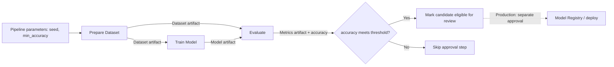

# Vertex AI Pipelines and Automating ML Workflows

> **Chapter:** Vertex AI and Machine Learning  
> **Module:** CLOUD_PROVIDERS_GCP  
> **Module scope:** Explore Google Cloud from project organization, IAM, and VPC to Compute Engine, GKE, Cloud Run, storage services, and databases. Through deployment scenarios, learners select services, secure resources, automate releases, and monitor reliability alongside cost.

An ML team repeatedly fetches data, trains, evaluates, and decides whether to advance a new model to approval. If steps run manually in notebooks, results are hard to reproduce, lack provenance metadata, and risk pushing an unqualified model into production. **Vertex AI Pipelines** structures workflows into **components** with explicit inputs/outputs, tracks state, and records metadata/artifacts for controlled, automated re-execution.

This lesson uses the **Kubeflow Pipelines SDK (KFP v2)** to describe pipelines in Python, **compile to a pipeline spec**, and—when authorized—run on Vertex AI with **`google.cloud.aiplatform.PipelineJob`**. Examples use **synthetic data and a small classifier** with a **quality gate**, without automatically deploying models to an endpoint. No Python is executed, no cloud resources are created, and no real training is run while authoring this document.

## Learning Objectives

After this lesson, you can:

1. Explain the differences between **pipeline definition**, **PipelineJob run**, **component**, **task**, **artifact**, and **pipeline parameter**.
2. Author a KFP v2 pipeline with **DAG** dependencies, `Dataset`/`Model`/`Metrics` typed outputs, and a **quality evaluation condition**.
3. Compile and inspect the spec locally before submitting a run in a **sandbox project**.
4. Identify IAM, service account, Cloud Storage `pipeline_root`, network, region, and per-run cost requirements.
5. Understand **execution caching**, versioning, **Vertex ML Metadata/lineage**, monitoring, retries, and idempotency.
6. Schedule retraining with run limits, handle errors, and clean up resources within scope.

## 1. What Is Vertex AI Pipelines?

A **Pipeline** is a directed acyclic graph (**DAG**) of tasks. Each **component** defines a reusable step; invoking a component inside a pipeline creates a **task**. A **Pipeline run** is one execution of the pipeline with specific parameters, images, artifacts, and identity.



**Important:** the `approval` step in this lab **only records the check result**. There is no Model Registry upload, deployment, endpoint, or traffic shift; real systems require separate human sign-off, security testing, release processes, and rollback.

### 1.1. Components and Objects

| Object | Function | Example in Lesson |
|---|---|---|
| **Pipeline definition/spec** | DAG compiled from KFP DSL to YAML/JSON | `pipeline.json` |
| **Component** | Contract of inputs/outputs and execution logic | `prepare_dataset`, `train_model` |
| **Task** | One step instantiated in a run's DAG | `train_model(dataset=data.outputs["dataset"])` |
| **Parameter** | Small typed value tuning behavior | `seed=42`, `min_accuracy=0.80` |
| **Artifact** | Data/model/file with URI and metadata | `Dataset`, `Model`, `Metrics` |
| **Pipeline root** | Cloud Storage location holding output artifacts | `gs://.../pipelines/` |
| **PipelineJob** | Resource executing a pipeline on Vertex AI | One run with status and history |
| **Vertex ML Metadata** | Metadata, parameters, artifacts, executions, and lineage | Trace which model came from which dataset/run |

### 1.2. Pipelines Compared to Other Services

| Choice | When to Use |
|---|---|
| **Vertex AI Pipelines** | Multi-step ML lifecycles, artifact lineage, reusable training/evaluation components, retraining |
| **Vertex AI Custom Training Job** | Standalone training job; can be invoked **inside** a pipeline |
| **Cloud Workflows** | Orchestrating multiple service APIs, non-ML workflows, minimal ML artifact lineage needs |
| **Cloud Composer (Airflow)** | Broad enterprise/data DAG orchestration, complex dependency schedules; can trigger Vertex jobs |
| **Cloud Run Jobs** | Running a single batch container without built-in ML graph/lineage tracking |

Do not adopt Pipelines for a one-off notebook script. The more independent steps, versioned artifacts, checkpoints, and audit requirements exist, the clearer the orchestration benefit becomes.

## 2. Lifecycle from Code to Pipeline Run

```text
Python source + KFP DSL / Google Cloud Pipeline Components
       │
       ├─ Compile (NO cloud jobs executed)
       ▼
pipeline.json / pipeline.yaml  (pipeline spec)
       │
       ├─ Submit Vertex AI PipelineJob (MAY incur charges)
       ▼
Vertex AI Pipeline orchestrator
       │
       ├─ Run component containers/managed jobs along the DAG
       ├─ Read/write artifacts in Cloud Storage pipeline_root
       ├─ Record executions, parameters, lineage in Vertex ML Metadata
       └─ Record state, logs, metrics, failure details
```

**Compiling does not execute model training code.** `@dsl.pipeline` describes dependencies and parameters; the compiler generates a spec for Vertex AI to orchestrate. Inside lightweight components, Python libraries and data are only used **when the task executes**, not at compile time.

### 2.1. Use KFP v2, Do Not Mix Legacy Syntax

- KFP v2 uses `@dsl.component`, `@dsl.pipeline`, `dsl.Input`, `dsl.Output`, and `compiler.Compiler().compile(...)`.
- Older KFP v1 guides using `ContainerOp`/`kfp.Client().create_run_from_pipeline_func` differ substantially; never copy v1 code and just swap one import name.
- **Google Cloud Pipeline Components (GCPC)** provide prebuilt components for Vertex services like training, model upload, and batch prediction; use matching package versions and check input/output artifact types in current docs.
- **Lightweight Python components** fit demos and simple tasks; production workloads need built **container images** with pinned dependencies/digests hosted in Artifact Registry and scanned for vulnerabilities.

## 3. Designing a Safe ML Pipeline

A trustworthy ML pipeline does more than output a model file—it governs data, training, quality, and reusability.

| Stage | Input/Output Contract | Required Controls |
|---|---|---|
| **Prepare** | Source version → `Dataset` artifact | Schema, permissions, PII, train/validation/test split, leakage |
| **Train** | Dataset + config → `Model` artifact | Reproducible seed, image/dependency versions, resource limits |
| **Evaluate** | Model + validation data → `Metrics` + score | Never evaluate on train set; add fairness/slices where appropriate |
| **Quality gate** | Score + threshold → go/no-go | Measurable threshold, baseline comparison; no auto-deploy |
| **Separate release** | Approved model → Model Registry/Endpoint | Human approval, security, latency, canary/rollback |
| **Monitor/retrain** | Production telemetry + data drift → new run | Controlled schedule, freshness, cost, and model ownership |

**Prevent data leakage:** do not clean or compute statistics across the full dataset if it leaks validation/test info; fit preprocessors on the train split and apply transforms to validation/test. Aggregate metrics like accuracy mislead under heavy class imbalance; production typically adds precision/recall, threshold tuning, fairness, calibration, and business KPIs.

## 4. Lab A — Project and Permissions Preflight (Read-Only)

> **Prerequisites:** a sandbox project with billing enabled and owner permission to use Vertex AI; an **existing dedicated Cloud Storage bucket** in an appropriate location; a runtime service account with scoped permissions. If any prerequisite is missing, complete only **local compilation** and the exercises—never create billable resources yourself.

In Cloud Shell/Bash or a personal terminal, set variables:

```bash
PROJECT_ID="ml-pipelines-sandbox"
REGION="us-central1"  # Example only: replace with company-approved region
ARTIFACT_BUCKET="ml-pipelines-artifacts-sandbox" # ALREADY existing bucket
PIPELINE_ROOT="gs://$ARTIFACT_BUCKET/vertex-pipelines"
PIPELINE_SA="pipeline-runtime@$PROJECT_ID.iam.gserviceaccount.com"

gcloud auth list --filter="status:ACTIVE"
gcloud projects describe "$PROJECT_ID" \
  --format="table(projectId,name,lifecycleState)"
gcloud services list --enabled --project="$PROJECT_ID" \
  --format="value(config.name)"

# Inspect metadata only, do not create resources:
gcloud storage buckets describe "gs://$ARTIFACT_BUCKET"
gcloud iam service-accounts describe "$PIPELINE_SA" \
  --project="$PROJECT_ID"
```

**Preflight PASSES** when the region supports Vertex AI Pipelines, the bucket/dataset complies with data residency, the billing/budget owner approves, required APIs are enabled, and the runtime SA holds permissions. If a bucket/SA exists with an **unknown owner**, stop and verify rather than reusing another team's resources.

### 4.1. IAM: Deployer vs Runtime Service Account

| Principal | Permission Scope |
|---|---|
| **Deployer (run submitter)** | `aiplatform.pipelineJobs.create` or equivalent `roles/aiplatform.user` in the execution project; **`iam.serviceAccounts.actAs`** on the runtime SA |
| **Pipeline runtime SA** | Permissions to use Vertex Pipelines/Metadata, access `pipeline_root` Cloud Storage, and APIs each task genuinely needs |
| **Vertex AI service agent** | Google-managed identity granted service roles per lifecycle; not used as an application service account |
| **Component reading real data** | Minimal permissions on BigQuery/GCS/Vertex Model Registry per task, **not** inheriting the deployer's IAM |

Per Google Cloud guidance, common roles for the runtime SA are `roles/aiplatform.user` and bucket-scoped permissions to **read/write objects**. You can use a **custom role** with minimal permissions (`aiplatform.metadataStores.get`, `storage.buckets.get`, `storage.objects.create/get`, plus needed task permissions); first-time project runs may also need `aiplatform.metadataStores.create`. **Never grant `roles/editor` or pass JSON SA keys** for the entire pipeline.

**Note:** the Cloud Storage metadata store may be auto-created on first run; IAM/KMS and quotas must suffice. Use **Workload Identity Federation/ADC** for external environments per policy, never committing credentials.

### 4.2. Networking, Regions, and Cost

- **`pipeline_root`** is a Cloud Storage URI, not a local directory; the bucket must exist and the runtime SA must have access.
- Container components may pull images from Docker Hub/Artifact Registry and install dependencies from PyPI; a **private VPC** needs an approved route to registries/APIs or pre-baked images.
- If tasks call BigQuery/GCS/Vertex managed training/Prediction, verify regions, VPC peering/PSC, CMEK, data residency, and service agents.
- Pipeline runs can incur orchestration fees, component/container workloads, storage artifacts, metadata, logs, networking, and downstream managed jobs. **Local compilation needs only the dev machine**, creating zero cloud compute.

## 5. Lab B — KFP v2 Pipeline with Dataset → Model → Metrics

**Goal:** generate seeded synthetic data, train Logistic Regression, evaluate on a validation split, and mark a candidate only when **accuracy ≥ min_accuracy**. Uses no real data and creates no model serving endpoint.

### 5.1. Preparing the Local Environment

These commands are for **learners** in their own lab directory, **not commands run inside workers**:

```bash
python3 -m venv .venv
source .venv/bin/activate
python -m pip install "kfp>=2,<3" "google-cloud-aiplatform>=1,<4"

# Record versions after testing and pin versions in CI/prod.
python -m pip show kfp google-cloud-aiplatform
```

On Windows PowerShell, activation differs (`.venv\Scripts\Activate.ps1`); you may also use company-approved Cloud Shell/Colab/Jupyter. KFP/compiler is a **build environment** dependency; packages in `@dsl.component(packages_to_install=...)` are installed **inside the container when the task runs**. Production should pin versions/digests instead of using `:latest`.

### 5.2. Create `ml_pipeline.py` in Your Personal Lab Directory

```python
import json
from kfp import compiler, dsl
from kfp.dsl import Dataset, Input, Metrics, Model, Output


@dsl.component(base_image="python:3.11-slim")
def prepare_dataset(seed: int, dataset: Output[Dataset]):
    """Synthetic binary classification data, deterministic by seed."""
    import json
    import random

    rng = random.Random(seed)
    records = []
    for _ in range(400):
        x1 = rng.uniform(-2.0, 2.0)
        x2 = rng.uniform(-2.0, 2.0)
        label = int(1.3 * x1 + 0.8 * x2 > 0.2)
        records.append({"x": [x1, x2], "y": label})
    rng.shuffle(records)

    with open(dataset.path, "w", encoding="utf-8") as f:
        json.dump({"train": records[:320], "valid": records[320:]}, f)
    dataset.metadata["rows"] = len(records)
    dataset.metadata["seed"] = seed


@dsl.component(
    base_image="python:3.11-slim",
    packages_to_install=["scikit-learn==1.5.2"],
)
def train_model(dataset: Input[Dataset], model: Output[Model]):
    import json
    from sklearn.linear_model import LogisticRegression

    with open(dataset.path, "r", encoding="utf-8") as f:
        data = json.load(f)

    train = data["train"]
    clf = LogisticRegression(random_state=0, max_iter=200)
    clf.fit([r["x"] for r in train], [r["y"] for r in train])

    # Simple JSON for demo; avoid untrusted pickle files.
    with open(model.path, "w", encoding="utf-8") as f:
        json.dump({
            "weights": clf.coef_[0].tolist(),
            "bias": float(clf.intercept_[0]),
            "features": ["x1", "x2"],
        }, f)
    model.metadata["framework"] = "scikit-learn"
    model.metadata["type"] = "logistic-regression-demo"


@dsl.component(base_image="python:3.11-slim")
def evaluate_model(
    dataset: Input[Dataset],
    model: Input[Model],
    metrics: Output[Metrics],
) -> float:
    import json
    import math

    with open(dataset.path, "r", encoding="utf-8") as f:
        data = json.load(f)
    with open(model.path, "r", encoding="utf-8") as f:
        params = json.load(f)

    weights, bias = params["weights"], params["bias"]
    valid = data["valid"]
    correct = 0
    for row in valid:
        z = sum(w * x for w, x in zip(weights, row["x"])) + bias
        # With small demo data, z does not overflow.
        probability = 1.0 / (1.0 + math.exp(-z))
        predicted = int(probability >= 0.5)
        correct += int(predicted == row["y"])

    accuracy = correct / len(valid)
    metrics.log_metric("validation_accuracy", accuracy)
    metrics.log_metric("validation_rows", len(valid))
    return accuracy


@dsl.component(base_image="python:3.11-slim")
def mark_candidate(accuracy: float):
    # Only logs candidate passing threshold; DOES NOT upload/deploy.
    print(f"Candidate passed quality gate: accuracy={accuracy:.3f}")


@dsl.pipeline(name="vertex-ml-workflow-demo")
def ml_pipeline(seed: int = 42, min_accuracy: float = 0.80):
    data_task = prepare_dataset(seed=seed)
    train_task = train_model(dataset=data_task.outputs["dataset"])
    eval_task = evaluate_model(
        dataset=data_task.outputs["dataset"],
        model=train_task.outputs["model"],
    )

    with dsl.If(eval_task.output >= min_accuracy, name="quality-gate"):
        mark_candidate(accuracy=eval_task.output)


if __name__ == "__main__":
    # Local compile: creates no PipelineJob, incurs no GCP charges.
    compiler.Compiler().compile(
        pipeline_func=ml_pipeline,
        package_path="pipeline.json",
    )
    print("Wrote pipeline.json")
```

**Key points:**

- `prepare_dataset` creates a `Dataset` artifact with a data file and metadata. Seeded data ensures reproducibility; train/validation are split prior to training.
- `train_model` reads the dataset and writes model parameters to a `Model` artifact. This is a **KFP artifact**, **not a Vertex AI Model Registry model**.
- `evaluate_model` uses the validation split, logs metrics visible in lineage, and returns an **accuracy parameter** for the conditional gate.
- `dsl.If` creates the `mark_candidate` task only when the score meets the threshold. It **does not auto-deploy**, and this threshold is not a production quality standard.
- KFP passes artifact URIs/paths automatically via its runtime. **Never hardcode a `/tmp` path for multiple tasks to share**; tasks run in independent containers.

**Limitations of this example:** the data is linear, balanced, and synthetic; high accuracy only proves pipeline orchestration works, not that the model suits real users. Validation scores are not certifications of fairness, data privacy, robustness, or drift resistance.

### 5.3. Compile and Inspect the Spec

```bash
# Command learners run locally in the folder containing ml_pipeline.py.
python ml_pipeline.py

# Read-only check of the spec generated on your dev machine:
ls -lh pipeline.json
python -m json.tool pipeline.json > /dev/null
```

**Expected:** a valid `pipeline.json` containing component definitions, DAG, input parameters, and artifact types. Zero Vertex AI remote logs appear from compilation alone. If imports or compilation fail, check the KFP version and component definitions; **never call `PipelineJob.submit()` just to debug a compile error**.

## 6. Lab C — Submitting a Vertex PipelineJob in Sandbox (Optional, Billable)

Proceed only when **preflight PASSES**, `pipeline.json` exists, and the owner approves running **billable Vertex workloads**. With the code above, container components may need Internet/API access to pull `python:3.11-slim` and install `scikit-learn==1.5.2`.

### 6.1. File `submit_pipeline.py`

```python
import os
from google.cloud import aiplatform

project_id = os.environ["PROJECT_ID"]
region = os.environ["REGION"]
pipeline_root = os.environ["PIPELINE_ROOT"]  # gs://existing-bucket/prefix
runtime_sa = os.environ["PIPELINE_SA"]

aiplatform.init(project=project_id, location=region)

job = aiplatform.PipelineJob(
    display_name="vertex-ml-workflow-demo-sandbox",
    template_path="pipeline.json",
    pipeline_root=pipeline_root,
    parameter_values={"seed": 42, "min_accuracy": 0.80},
    enable_caching=True,
    labels={"env": "sandbox", "purpose": "learning"},
)

# WRITES CLOUD RESOURCES AND INCURS CHARGES: only when approved.
job.submit(service_account=runtime_sa)
print("PipelineJob:", job.resource_name)

# To wait synchronously instead of async submit, use:
# job.run(service_account=runtime_sa, sync=True)  # INSTEAD of submit
```

`job.submit` creates a pipeline run and returns, whereas `job.run(..., sync=True)` blocks until completion. **Call only one of them**—calling both creates duplicate runs and costs. If your team's workflow requires network peering/CMEK, specify the approved network/key per policy and docs; never bypass project egress or IAM controls.

### 6.2. Parameters and Environment

```bash
# Inherit PROJECT_ID, REGION, PIPELINE_ROOT, PIPELINE_SA from Lab A.
export PROJECT_ID REGION PIPELINE_ROOT PIPELINE_SA

# Run only after owner approves the run and budget.
python submit_pipeline.py
```

**Expected:** the SDK prints a resource name like:

```text
projects/PROJECT_ID/locations/REGION/pipelineJobs/PIPELINE_JOB_ID
```

Record the **actual ID** and owner in the run log; never fabricate an ID from display names. In Console, open **Vertex AI → Pipelines → Runs** (newer UIs may display *Gemini Enterprise Agent Platform Pipelines*) to inspect the DAG, individual tasks, logs, artifacts, and metrics. A SUBMITTED run **does not prove SUCCESS**: wait for terminal status and inspect task outputs.

### 6.3. Lab Completion Criteria

| Step | Evidence |
|---|---|
| `prepare_dataset` | SUCCEEDED, `Dataset` artifact shows 400 rows/seed metadata |
| `train_model` | SUCCEEDED, `Model` artifact contains parameter file |
| `evaluate_model` | SUCCEEDED, `validation_accuracy` and `validation_rows` logged |
| `quality-gate` | Runs `mark_candidate` only when score ≥ threshold |
| PipelineJob | `PIPELINE_STATE_SUCCEEDED` when all required tasks succeed; verify actual state in SDK/Console |

**No Vertex AI model is deployed** and no Vertex endpoint is created by this lab. If accuracy falls short, the pipeline may still end in **SUCCEEDED** because the `mark_candidate` branch was intentionally skipped—if policy requires *quality failures* to fail the pipeline, add an explicit validation task that raises an error or build dedicated gate governance.

## 7. Execution Caching, Versioning, and Reproducibility

### 7.1. How Does Execution Caching Work?

When caching is enabled, Vertex AI can **skip a task** if it finds a prior execution in Vertex ML Metadata matching the **pipeline name, component spec, input parameters/artifact IDs, and output definitions**. Artifacts from the previous task are reused, saving cost and time.

```text
Run 1: seed=42, code/image version A
  prepare → train → evaluate → gate

Run 2: seed=42, code/image version A
  prepare [CACHED] → train [CACHED] → evaluate [CACHED] → gate [?]

Run 3: seed=99 or different component spec
  cache key may change → affected steps rerun
```

**Do not treat cache as "always fresh data."** Caching has no automatic TTL; if a component reads a GCS object at a **fixed path whose contents change** without a version/checksum in the interface, caching may reuse **stale** results. Choices:

- Pass **immutable data versions** (URIs with version/hash/date) as input parameters or artifacts.
- Update `seed`/image digest/code version whenever results genuinely change.
- For tasks fetching daily fresh data, call `task.set_caching_options(False)` or set `enable_caching=False` on submit.
- Caching **does not** replace correctness, drift, or lineage checks.

### 7.2. Pinning Dependencies and Model Lineage

For production:

1. Pin **KFP SDK, Vertex AI SDK, GCPC versions**, container image **digests**, and Python dependencies; avoid `:latest`.
2. Record **commit SHA**, source dataset version, feature schema, training config/seed, and validation metrics in metadata.
3. Pass datasets/models via **artifact URIs**, rather than uploading files from developer laptops and relying on temporary paths.
4. Separate immutable training sets from holdout tests; maintain auditable reruns.
5. Keep sensitive data out of component logs, parameter strings, artifact names, and labels.

Vertex ML Metadata helps trace **which execution and input dataset produced a model artifact**. However, a `dsl.Model` artifact in this lab does not automatically register into **Model Registry**; ModelUpload/Deploy requires a separate step and permissions.

## 8. Automating Schedules and Retraining

Vertex AI Pipelines supports **PipelineJob schedules** for one-off or recurring runs. Using `PipelineJob.create_schedule(...)` with an explicit timezone cron expression and run/concurrency caps is safer than unbounded "run every hour."

### 8.1. Illustrative Schedule Example

```python
from google.cloud import aiplatform

# Assumes job from Lab C is validly configured.
# CREATES A CLOUD SCHEDULE: do not run without approval.
# schedule = job.create_schedule(
#     cron="TZ=Asia/Ho_Chi_Minh 0 2 * * 1",  # 02:00 Monday
#     display_name="weekly-ml-retrain-sandbox",
#     max_concurrent_run_count=1,
#     max_run_count=4,
#     service_account=runtime_sa,
# )
```

**Impact:** each trigger can launch a **billable run**; without `max_run_count`/end time, it keeps firing until paused/deleted. `max_concurrent_run_count=1` prevents overlapping retrain runs, but **does not** automatically pause external writers/data pipelines.

### 8.2. Idempotency and Incidents

Scheduled workflows need:

- Dataset snapshots/versions **tied to execution schedule**, not a silently shifting "latest."
- **Run ID, event/schedule time, source version** as deduplication keys.
- Tasks with side effects (writing BigQuery, uploading to Model Registry, deploying) equipped with **idempotency guards**; timeout retries may re-execute earlier operations.
- Publish models only when evaluation passes **and** approval is granted; never wire a scheduled automation straight to a production Endpoint without a release gate.
- To pause costs, **pause the schedule first**, then inspect any RUNNING pipeline runs to decide separately whether to cancel or let finish. Pausing a schedule **does not stop already-created runs**.

## 9. Observability, Lineage, and Operational Failures

### 9.1. Where to Look When a Pipeline Fails

| Where to Look | What to Check |
|---|---|
| **Vertex AI Pipelines → Runs** | DAG state, failed/skipped/cached tasks, parameters, runtime SA |
| **Task logs / Cloud Logging** | Stack traces, dependency installs, permission denied, I/O/network errors |
| **Artifacts / Vertex ML Metadata** | Dataset/Model/Metrics URIs, lineage, cache hits, and metadata |
| **Cloud Storage** | `pipeline_root`, object creation, retention, permissions, and CMEK |
| **Cloud Monitoring** | Resource utilization, failure rate, run duration, SLO alerts |
| **Cloud Billing** | Pipeline orchestration, container/managed tasks, GCS, logs/network |

### 9.2. Common Case: Compiles Locally, Fails at Runtime

| Symptom | Typical Cause | Remediation |
|---|---|---|
| `ModuleNotFoundError` at task runtime | Import placed outside component function; dependency missing from image | Put required imports **inside the function**, declare `packages_to_install` or bake image |
| `PERMISSION_DENIED` on submit | Missing `aiplatform.pipelineJobs.create`/`actAs` | Verify separated deployer and runtime SA permissions |
| Task cannot write `pipeline_root` | SA lacks Storage object permissions/bucket location mismatch | Check bucket IAM + exact GCS URL |
| Component image/PyPI pull timeout | Private workers lack route/proxy/registry access | Ensure network egress or use private Artifact Registry images |
| Metrics empty though task SUCCEEDED | Forgot `metrics.log_metric` or wrong artifact write | Check `Output[Metrics]` usage and task logs |
| Empty model artifact | Code forgot to write to `model.path` | Check artifact path and file serialization/close |
| Task `CACHED` despite changed source data | Unversioned input URI, unchanged cache key | Hash/version inputs or disable caching for task |
| Quality gate skipped | Score below threshold, condition false | Inspect metrics/threshold; not every skipped task is an error |
| Schedule keeps creating jobs | Schedule still ACTIVE | Pause/delete exact schedule and check in-flight runs |
| Pipeline fails on quota | Region/quota/compute capacity limits | Lower parallelism, request valid quota, bound retries |
| Run cancelled yet child resources remain | Some managed tasks create external resources | Inventory Models/Endpoints/CustomJobs/GCS by owner |

### 9.3. Retries, Caching, and Failure Policies

**Do not retry everything with one blanket setting.** Transient API/network errors can retry with exponential backoff; data validation errors should fail fast; side-effect tasks need idempotency checks. KFP allows per-task retry configuration, for example:

```python
# Example inside @dsl.pipeline when creating train_task:
# train_task.set_retry(num_retries=2, backoff_duration="30s",
#                      backoff_factor=2.0)
```

**Failure policy:** `slow` mode (default) lets independent tasks continue after a failure; `fast` restricts scheduling new tasks after a failure. Choose based on cost and pipeline requirements. Never confuse **task retry** with **rerunning the entire pipeline**, and never assume `CACHED` means data checks actually re-executed.

## 10. Security and Governance for ML Workflows

- **IAM and identity:** dedicated runtime SA for pipelines, granting dataset/bucket/Vertex permissions as needed; deployer holds `actAs` only on approved SAs.
- **Data privacy:** identify PII, consent/retention, and check data schemas before writing to Cloud Storage and logs. Never place raw PII in metadata/metrics where it leaks in the UI.
- **Supply chain:** pin images/dependencies, scan vulnerabilities, prefer private Artifact Registry for production; record source commit digests.
- **Encryption:** Google-managed encryption by default; if using CMEK, check key location/IAM and configure the Metadata Store **from the start**, as initial store creation has specific key rules.
- **Networking:** verify regions, VPC peering/PSC, and egress for GCS/Vertex APIs and package registries. Never open 0.0.0.0/0 inbound to work around task errors.
- **Model quality:** thresholds, baseline comparisons, fairness/slice metrics, reproducibility; production deployment requires **review and a rollback plan**.
- **Audit/cost:** run labels, ML Metadata, Cloud Audit Logs, ownership, budgets, GCS artifact lifecycles, and recovery drills.

## 11. Exercises and Suggested Answers

### Exercise 1 — DAG or One-Off Script?

A notebook trains and immediately evaluates without recording data versions or metrics, reading `latest.csv` every run. How does Vertex AI Pipelines help?

**Answer:** turns steps into tasks with typed inputs/outputs, tracks artifacts/lineage, orchestrates, and monitors runs. However, **if it still reads a silently changing `latest.csv`, runs remain irreproducible**; you must also version data, seeds, and dependencies.

### Exercise 2 — Compile vs Submit

`python ml_pipeline.py` generated `pipeline.json`. Have any Vertex AI training jobs or charges occurred yet?

**Answer:** No. That is **local compilation**; running in the cloud requires creating/submitting a `PipelineJob` (or running from Console/registry) with IAM and budget.

### Exercise 3 — Component Imports

A component uses `sklearn`, yet the import is at the top level of the Python file, and the runtime image `python:3.11-slim` lacks `sklearn`. What happens after compiling and submitting?

**Answer:** runtime fails with `ModuleNotFoundError`; imports must sit inside the component function and libraries must be listed in `packages_to_install` or baked into the image. Never treat your local dev environment as proof a container has a dependency.

### Exercise 4 — Caching Stale Data

Monday's run reads `gs://data/latest.csv`; Tuesday the file changes, while URI, parameters, and component spec stay unchanged with caching enabled. What is the risk?

**Answer:** caching may return **stale** artifacts. Pin versioned/checksummed URIs in inputs or disable caching on the ingestion step; there is no automatic cache TTL.

### Exercise 5 — Should 0.93 Accuracy Auto-Deploy?

Validation accuracy exceeds 0.8. Can `dsl.If` deploy the model directly to production?

**Answer:** Never based on a single score. You need baselines, representative tests, data leakage/fairness/security checks, release approval, canary, and rollback. The lab gate only **marks a candidate**, creating no endpoint.

### Exercise 6 — PipelineJob and Model Registry

`train_model` writes a `dsl.Model` artifact to pipeline root. Does that model automatically appear as a deployable Vertex AI Model Registry resource?

**Answer:** No. A KFP/ML Metadata artifact only describes the output; you need a **`ModelUploadOp`/SDK upload** step with a compatible serving container/requirements and separate permissions.

### Exercise 7 — Submission Identity

A deployer has Vertex AI User, yet submitting with `PIPELINE_SA` fails with `actAs denied`. Is granting Editor to the deployer a good fix?

**Answer:** No. Grant **`iam.serviceAccounts.actAs`** scoped to that exact runtime SA per policy (typically via `roles/iam.serviceAccountUser` on the SA resource), plus PipelineJob creation permission. The runtime SA also needs storage/metadata permissions to execute.

### Exercise 8 — Scheduled Pipeline Without a Budget

A team sets a daily retrain schedule with no `max_run_count`, and every run costs money. What needs fixing?

**Answer:** budget owner/alerts, cadence matching actual need, `max_run_count` or end time, `max_concurrent_run_count=1`, schedule owner, and a **pause** kill switch; also check in-flight runs after pausing.

### Exercise 9 — Skipped Quality Gate

`evaluate_model` returns 0.72 with `min_accuracy=0.80`. `mark_candidate` is skipped, yet the pipeline reports SUCCEEDED. Is that contradictory?

**Answer:** No. When a conditional branch evaluates false, skipping that step is intentional; the run succeeded at **orchestration** even though the model missed the threshold. If policy requires failing the pipeline on quality failure, add an explicit failing validation step.

### Exercise 10 — Concurrency and Cost

An hourly schedule launches a training job taking 90 minutes. If unlimited concurrency is allowed, what happens?

**Answer:** runs pile up concurrently, exhausting quota/compute and risking contention over model/data outputs. Cap `max_concurrent_run_count`, use versioned output paths, and prefer data-readiness triggers over rigid cron schedules.

## 12. Checklist and Cleanup

### 12.1. Before Moving to Production

| Area | Pass Criteria |
|---|---|
| **Workflow** | Acyclic DAG; dependencies/artifacts/parameters reviewed |
| **Data** | Dataset versioned, train/validation/test split, PII and data leakage checked |
| **Components** | KFP v2/GCPC pinned, image digests fixed, imports/dependencies complete |
| **IAM** | Dedicated runtime SA, deployer `actAs`, least-privilege bucket/API permissions |
| **Pipeline root** | Dedicated GCS bucket, matching region/retention/CMEK/quota |
| **ML Metadata** | Artifacts/metrics/lineage/commit SHA sufficient for audit |
| **Cache** | Versioned inputs or caching disabled on mutable sources |
| **Quality** | Thresholds/baselines/slice metrics verified; no auto-deploy from demo gate |
| **Schedule** | Cron timezone, max concurrency, max run count/end time, pause runbook |
| **Monitoring** | Task errors, duration, retries, pipeline states, drift/quality tracked |
| **Cost** | Per-run budget, managed component costs, GCS/Logging/metadata retention |
| **Recovery** | Idempotent side effects, cancellation/cleanup, and incident owner defined |

### 12.2. Ownership-Based Lab Cleanup

**Lab A is read-only, Lab B compiles locally:** neither creates cloud resources. **Lab C submission** (if performed by the learner) may create a PipelineJob, GCS artifacts, and metadata records.

1. Record the **PipelineJob resource name**, owner, and terminal status from Console/SDK; if an unwanted run is still RUNNING, use authorized permissions to **Cancel** that specific run. Cancellation is best-effort and asynchronous; re-verify final state rather than assuming clicking Cancel finished it.
2. If you created a schedule, **pause/delete your specific schedule** so no new jobs spawn; pausing does not cancel already-running jobs.
3. Inspect artifacts/logs/metadata and retention; clean up **only your lab's GCS prefix** per policy. Never delete shared buckets, Vertex AI Metadata Stores, Model Registry models, or projects.
4. Check Dataflow/CustomJobs/Endpoints if other production pipelines use managed components; some cloud resources persist independently after a job ends.
5. Reconcile Cloud Billing Reports: compute, artifact storage, and logging charges may update with delay. Never put unbounded recursive delete commands in runbooks.

**Do not create or delete any real Google Cloud resources while authoring this lesson**; `submit`, `create_schedule`, and `cancel` snippets are executed only by learners with an authorized sandbox after reviewing impact and cost.

## Takeaways

**Vertex AI Pipelines** turns the ML lifecycle into a reproducible DAG: **KFP components → compile spec → PipelineJob run → artifacts/ML Metadata → evaluation and gates**. Technical pipeline success **does not mean** a model is ready to deploy. Caching saves money yet easily reuses stale data if inputs are unversioned; schedules need limits, permissions, and budgets. Start with local compilation, and submit to a **sandbox** only when IAM, `pipeline_root`, region, and ownership are clear.

## Official Reference Documentation

- [Google Cloud — Introduction to Vertex AI Pipelines](https://cloud.google.com/vertex-ai/docs/pipelines/introduction)
- [Google Cloud — Configure project for pipelines](https://cloud.google.com/vertex-ai/docs/pipelines/configure-project)
- [Google Cloud — Build pipelines with KFP](https://cloud.google.com/vertex-ai/docs/pipelines/build-pipeline)
- [Google Cloud — Run a pipeline](https://cloud.google.com/vertex-ai/docs/pipelines/run-pipeline)
- [Google Cloud — Pipeline Components](https://cloud.google.com/vertex-ai/docs/pipelines/components-introduction)
- [Google Cloud — Configure execution caching](https://cloud.google.com/vertex-ai/docs/pipelines/configure-caching)
- [Google Cloud — Schedule a pipeline run](https://cloud.google.com/vertex-ai/docs/pipelines/schedule-pipeline-run)
- [Google Cloud — Track artifact lineage](https://cloud.google.com/vertex-ai/docs/pipelines/lineage)
- [Google Cloud — Monitor pipeline runs](https://cloud.google.com/vertex-ai/docs/pipelines/monitor-pipelines)
- [Google Cloud — Cancel pipeline runs](https://cloud.google.com/vertex-ai/docs/pipelines/cancel-pipeline-runs)
- [Google Cloud — Pipeline pricing](https://cloud.google.com/vertex-ai/pricing#pipelines)
- [Python SDK — PipelineJob](https://cloud.google.com/python/docs/reference/aiplatform/latest/google.cloud.aiplatform.PipelineJob)
- [Kubeflow Pipelines SDK — DSL reference](https://kubeflow-pipelines.readthedocs.io/en/stable/source/dsl.html)
