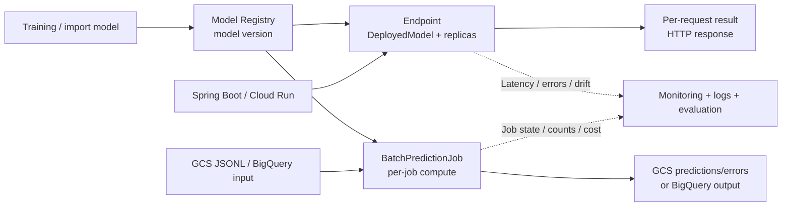
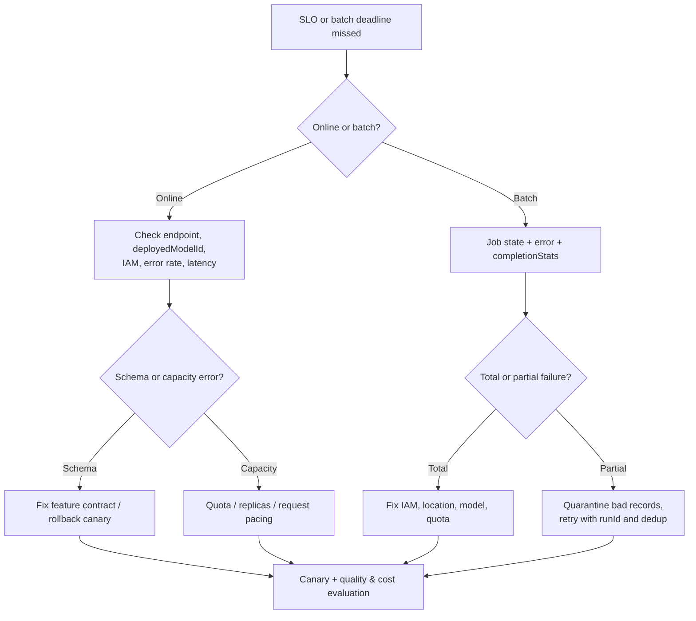

# Online Endpoints, Batch Prediction, and Deployment Choices

## 1. Context: The Model Is Trained—How Should We Deploy It?

A **Java/Spring Boot** system on **Cloud Run** uses an ML model to score transaction risk. When a customer submits an order, the API needs a result within a few hundred milliseconds. Every night, the operations team also needs to score **millions of historical orders** for analytics in **BigQuery**. Using one serving path for both can waste money or miss SLOs.

**Online prediction** calls a model through a **Vertex AI Endpoint** to receive per-request results (low latency, continuous or bursty traffic). **Batch prediction** is a **BatchPredictionJob** that reads an existing dataset, executes asynchronously, and writes outputs to **Cloud Storage/BigQuery**. Both can use the **same model version in Model Registry**, yet they have different billing lifecycles, compute resources, latencies, and failure modes.

This lesson belongs to the **Vertex AI and Machine Learning** chapter of the **CLOUD_PROVIDERS_GCP** module. The goal is to pick the right deployment pattern, protect resources with IAM/VPC, operate reliably, and estimate costs for Java workloads on Google Cloud. Newer documentation pages may carry the **Gemini Enterprise Agent Platform** name, while custom-model APIs/CLIs still use `aiplatform.googleapis.com` and `gcloud ai`; distinguish **custom trained models** from **Gemini managed generative models**.

**Learning objectives:**

1. Distinguish **Model**, **Model version**, **Endpoint**, **DeployedModel**, and **BatchPredictionJob**.
2. Choose online, batch, or hybrid architectures based on **latency/SLO, data, scale, freshness, and cost**.
3. Create a test endpoint, deploy/canary a model, and call `:predict` via CLI/REST/Java 21.
4. Run a batch job from **GCS JSON Lines** or **BigQuery** and inspect **predictions/errors**.
5. Design **schema/feature parity**, model version pinning, IAM, observability, drift detection, and rollback.
6. Clean up resources in the proper order to avoid stray replica charges and unintended jobs.

> **Safety:** this guide is intended strictly for a **lab project with valid Billing and permissions**. Creating an Endpoint and deploying a DeployedModel can **bill for replicas even with zero traffic**. Batch jobs, GCS/BigQuery, GPUs, networking, and logging also incur charges. **Never deploy to production endpoints, never use customer data, and never delete models/versions used by other teams.** If no valid trained/imported model exists, perform only the inventory and design steps rather than fabricating a fake model to invoke.

## 2. Architecture and Objects to Distinguish



| Object | Meaning | Lifecycle |
| --- | --- | --- |
| **Model** | Imported/registered artifact and serving schema | Stored in **Model Registry** in a location |
| **Model version** | Specific version of a model | Pin version for comparisons, rollback, batch reproducibility |
| **Endpoint** | Resource receiving online requests via `:predict` or `:rawPredict` | Can host multiple deployed models and a traffic split |
| **DeployedModel** | A deployed version with machine/GPU, min/max replicas, logging | Holds serving compute and incurs corresponding fees |
| **BatchPredictionJob** | Async task with input/output, model, compute, state | Created → running → succeeded/failed/cancelled |
| **Prediction instance** | One feature row or object to predict | Formatted **per model signature**, not arbitrary JSON |

**Common pitfall:** uploading a model to Model Registry **does not create an online server**; calling `:predict` requires deploying to an Endpoint (except certain managed/publisher model APIs with separate serving mechanisms). Conversely, a **custom-model batch job does not require** an online endpoint; the job provisions its own execution compute and **does not alter an endpoint's traffic split**.

## 3. Choosing Online, Batch, or Another Option

| Criterion | **Online Endpoint** | **BatchPredictionJob** |
| --- | --- | --- |
| Expected latency | Milliseconds/seconds depending on model and network; near real-time | Minutes/hours, including queueing and resource startup |
| Source | JSON requests from Java/API | GCS JSONL/CSV/TFRecord/file list or BigQuery depending on model |
| Output | Returns `predictions[]` directly | Writes files/tables to specified destination |
| Resources | Provisioned & autoscaled replicas; min replicas usually ≥1 | Compute provisioned per job; no continuous endpoint needed |
| Scaling | By QPS, CPU/GPU, and replica limits | By input volume, batch size, and job replicas |
| Error handling | HTTP timeouts/429/5xx, request retries | Job state, `partialFailures`, per-instance errors |
| Release | Traffic split/canary across deployed model IDs | Pin model version per job, reconcile outputs |
| Dominant costs | Replica-hours even when idle, accelerators, logging | Batch runtime compute + I/O, storage, BigQuery |
| Best suited for | Blocking fraud during checkout, instant recommendations | Nightly scoring, backfills, data warehouse classification |

**Additional options:**

- **Gemini/managed publisher models:** use the inference/batch APIs supported by the model, with **separate pricing, quotas, and payloads**; **never copy** custom-model CPU/GPU endpoint deploy commands blindly for Gemini.
- **Cloud Run custom inference:** suitable for very lightweight serving logic, teams preferring self-managed containers, or custom flows; in return you own concurrency, scaling, serving health, and observability.
- **BigQuery ML `ML.PREDICT`:** suitable when data already lives in BigQuery and the model/algorithm is supported; avoids exporting rows to GCS, with its own limitations and billing.
- **Dataflow + model inference:** suitable for continuous streaming pipelines combining feature engineering and sinks; account for online service calls, batching, retries, and QPS limits.

**Decision rule:** if a **user request must wait for the score**, favor online with clear SLOs and budgets. If data **accumulates and SLAs are measured in hours**, favor batch. When you need both real-time and bulk scoring, share the **same contract + managed version**, but **separate online and batch compute** so they never contend for capacity.

## 4. Data Schemas and Feature Parity Control

Suppose a **custom scikit-learn classifier** was trained expecting **two numeric features** in a fixed order:

```text
features[0] = cartValueNormalized  (e.g., 0.2)
features[1] = priorOrderRate       (e.g., 1.3)
output      = class or score, depending on model signature
```

An online `:predict` request for a model **with a numeric-array input signature** looks like:

```json
{
  "instances": [
    [0.2, 1.3],
    [0.8, 0.4]
  ]
}
```

For batch JSON Lines, **each line is one instance**, without the `instances` wrapper:

```jsonl
[0.2, 1.3]
[0.8, 0.4]
```

**This format is valid only if the Model/prediction container expects a two-number vector.** TensorFlow, PyTorch, AutoML, or custom handlers may require **objects with named tensors/features, different shapes, and parameters**; models also declare `supportedInputStorageFormats`/`supportedOutputStorageFormats`. **Always read the schema and test a single input before sending millions of records.**

**Feature parity:** the online Java service and batch SQL/ETL must share **exact feature ordering, units, normalization, missing-value rules, categorical mappings, timezones, and feature versions**. For example, normalized VND amounts must never accidentally pass as USD in one path. Build **golden test cases** (identical input → expected approximate score/label) across both online and batch, recording **model version, feature schema version, and data snapshot ID** for reconciliation.

To correlate outputs back to inputs, keep the **business key outside the feature tensor** (e.g., ID in the source table or custom `instanceConfig`). Never assume batch output shards preserve **input row order** or that the model echoes input IDs unless the container explicitly implements that behavior.

## 5. Preflight: IAM, Region, Model, and Quotas

**Before creating any resources**, verify carefully:

1. **Lab project** with Billing, `aiplatform.googleapis.com` enabled, and a supported location (e.g., `us-central1`).
2. Model already imported/trained successfully in the **same location** planned for deployment/batch, with a valid version and **container/prediction schema**.
3. Resource sizing: CPU/GPU, machine type, accelerator quota, disk, replica counts, and data residency region.
4. **Runtime identity:** Java service uses ADC with predict permission; batch service agent and custom container SA (if specified) have read/write access on the right GCS/BigQuery resources.
5. **Data rules:** test inputs are synthetic; never put PII, secrets, or restricted data into features or logs.

### 5.1. Read-Only Inventory

```bash
gcloud config set project LAB_PROJECT_ID

gcloud ai models list \
  --project=LAB_PROJECT_ID --region=us-central1

gcloud ai endpoints list \
  --project=LAB_PROJECT_ID --region=us-central1

# Once a MODEL_ID exists in the lab:
gcloud ai models describe MODEL_ID \
  --project=LAB_PROJECT_ID --region=us-central1
```

**Note:** `gcloud config set project` changes local CLI context. Before any create/delete command, always pass `--project` explicitly and verify identity/region so you never touch production by mistake.

### 5.2. Least-Privilege IAM

| Identity | Roles/Permissions to Consider | Note |
| --- | --- | --- |
| Endpoint/model manager | `roles/aiplatform.user` or custom role with `aiplatform.endpoints.create/deploy` | Never grant Owner just to deploy |
| Java online invoker | `aiplatform.endpoints.predict` via appropriate role (e.g., `roles/aiplatform.user` or narrow custom role) | Only needs to invoke endpoints, not admin deploy |
| Batch submitter | `aiplatform.batchPredictionJobs.create`, model read permission, `iam.serviceAccounts.actAs` if using a custom SA | Never put JSON keys in jobs |
| Vertex AI service agent | Service-managed permissions for GCS/BQ input/output per resource | Distinct from the Spring Boot application SA |
| Model server custom SA | Minimal permissions for model container if loading artifacts/dependencies | Avoid unrelated BigQuery/Cloud SQL access |

In multi-project architectures, the **model project**, **endpoint project**, **input data project**, and **output project** may differ depending on supported features; verify **IAM on each resource** rather than assuming "Vertex AI User in project A lets you read GCS in project B."

## 6. Online Lab: Creating an Endpoint and Deploying an Existing Model

This lab section **applies only if a compatible custom-trained MODEL_ID already exists** in your test project. Without a model, stop at the inventory step; **this guide does not create or fake a model**.

### 6.1. Enable API and Create Endpoint

```bash
# APPROVED LAB PROJECT ONLY:
gcloud services enable aiplatform.googleapis.com \
  --project=LAB_PROJECT_ID

gcloud ai endpoints create \
  --project=LAB_PROJECT_ID \
  --region=us-central1 \
  --display-name=lab-scorer-endpoint

# Record the created Endpoint ID from list output:
gcloud ai endpoints list \
  --project=LAB_PROJECT_ID --region=us-central1
```

**An empty Endpoint does not serve inference yet.** The Endpoint API resource is distinct from the DeployedModel resource; copy the exact `ENDPOINT_ID` from CLI output rather than confusing it with the Model ID.

### 6.2. Deploy Model on a Small Budget

```bash
# ONLY when MODEL_ID belongs to LAB and supports CPU serving:
gcloud ai endpoints deploy-model ENDPOINT_ID \
  --project=LAB_PROJECT_ID \
  --region=us-central1 \
  --model=MODEL_ID \
  --display-name=lab-scorer-v1 \
  --machine-type=n1-standard-2 \
  --min-replica-count=1 \
  --max-replica-count=2 \
  --traffic-split=0=100

gcloud ai endpoints describe ENDPOINT_ID \
  --project=LAB_PROJECT_ID --region=us-central1
```

`0=100` assigns **100% traffic to the newly deployed model** (temporary ID `0` in this command only); the Endpoint response returns the **real `deployedModelId`**, which you must record for canary/cleanup. **Never pick a CPU machine type for a GPU-required model**, or cram a large model onto a memory-starved machine. `minReplicaCount=1` means **at least one replica is billed continuously** even at 0 QPS. Any **scale-to-zero** features have specific conditions and are not universal defaults for all endpoints/custom models.

### 6.3. Predict via CLI

Create `request.json` in your lab directory (matching the model's exact schema):

```json
{"instances":[[0.2,1.3],[0.8,0.4]]}
```

```bash
gcloud ai endpoints predict ENDPOINT_ID \
  --project=LAB_PROJECT_ID \
  --region=us-central1 \
  --json-request=request.json
```

If the request is valid, the response returns `predictions[]` and `deployedModelId`. **Do not hardcode classes/scores or a 0.5 threshold** unless defined by the model; interpret outputs strictly via tested **schemas, labels, and calibration**.

### 6.4. REST Predict and gRPC/Dedicated Endpoints

```bash
curl --fail-with-body -X POST \
  -H "Authorization: Bearer $(gcloud auth print-access-token)" \
  -H "Content-Type: application/json" \
  --data @request.json \
  "https://us-central1-aiplatform.googleapis.com/v1/projects/LAB_PROJECT_ID/locations/us-central1/endpoints/ENDPOINT_ID:predict"
```

REST here targets the **shared public service endpoint**; **dedicated endpoints** use different URLs/DNS and protocols. `:rawPredict` forwards custom payloads to the container without requiring the standard `instances` envelope of `:predict`; **do not swap `:rawPredict` in indiscriminately** when the model already has a structured predict pipeline.

**Distinguish access tokens from ID tokens:** Vertex AI `aiplatform.googleapis.com` is a Google API expecting an **OAuth access token/ADC**; calling private Cloud Run with an OIDC ID token is a separate authentication flow.

## 7. Online Canary: Traffic Split and Rollback

Once `lab-scorer-v1` is live and a tested **MODEL_V2_ID** exists, deploy v2 to the **same endpoint** and shift a slice of traffic:

```bash
# Obtain OLD_DEPLOYED_MODEL_ID from endpoints describe; LAB project only:
gcloud ai endpoints deploy-model ENDPOINT_ID \
  --project=LAB_PROJECT_ID \
  --region=us-central1 \
  --model=MODEL_V2_ID \
  --display-name=lab-scorer-v2 \
  --machine-type=n1-standard-2 \
  --min-replica-count=1 \
  --max-replica-count=2 \
  --traffic-split=0=10,OLD_DEPLOYED_MODEL_ID=90
```

`0` is the **temporary ID of the new model** in CLI syntax; afterward the endpoint traffic map uses **real `deployedModelId`s**. Weights must sum to **100%**. Both deployed models may maintain billable replicas during the canary window. Never deploy v2 without proving **input/output schema compatibility** with the Java caller.

**A sound release flow:** 0% shadow/offline compare (if run via a separate pipeline) → 10% → 50% → 100%, guarded by health checks, p95/error rate SLOs, response distribution, fairness/drift, and owner approval. **Rollback** typically shifts traffic back to the known-good v1 before undeploying v2; never delete a model version while other batch jobs or endpoints still reference it.

## 8. Java 21: Calling Online Prediction with ADC

In Spring Boot/Cloud Run, use the **runtime service account + Application Default Credentials (ADC)**. The code below is a **standalone Java CLI program** demonstrating HTTP transport with a synthetic two-feature input; it is not a full Spring Boot controller. The `:predict` API expects an **OAuth access token**, not a Cloud Run OIDC ID token.

### 8.1. Minimal Maven `pom.xml`

```xml
<?xml version="1.0" encoding="UTF-8"?>
<project xmlns="http://maven.apache.org/POM/4.0.0"
         xmlns:xsi="http://www.w3.org/2001/XMLSchema-instance"
         xsi:schemaLocation="http://maven.apache.org/POM/4.0.0 https://maven.apache.org/xsd/maven-4.0.0.xsd">
  <modelVersion>4.0.0</modelVersion>
  <groupId>dev.example</groupId>
  <artifactId>vertex-inference-lab</artifactId>
  <version>1.0.0</version>
  <properties>
    <maven.compiler.release>21</maven.compiler.release>
    <project.build.sourceEncoding>UTF-8</project.build.sourceEncoding>
  </properties>
  <dependencies>
    <dependency>
      <groupId>com.google.auth</groupId>
      <artifactId>google-auth-library-oauth2-http</artifactId>
      <version>1.58.0</version>
    </dependency>
  </dependencies>
  <build>
    <plugins>
      <plugin>
        <groupId>org.apache.maven.plugins</groupId>
        <artifactId>maven-compiler-plugin</artifactId>
        <version>3.14.1</version>
      </plugin>
      <plugin>
        <groupId>org.codehaus.mojo</groupId>
        <artifactId>exec-maven-plugin</artifactId>
        <version>3.5.1</version>
      </plugin>
    </plugins>
  </build>
</project>
```

Dependency versions are pin examples; production requires BOMs/lockfiles, dependency update reviews, and security advisory checks.

### 8.2. `VertexOnlinePredict.java`

```java
package dev.example.vertex;

import com.google.auth.oauth2.GoogleCredentials;
import java.net.URI;
import java.net.http.HttpClient;
import java.net.http.HttpRequest;
import java.net.http.HttpResponse;
import java.nio.charset.StandardCharsets;
import java.time.Duration;
import java.util.List;

public final class VertexOnlinePredict {
    private static final HttpClient HTTP = HttpClient.newBuilder()
        .connectTimeout(Duration.ofSeconds(10))
        .build();

    public static void main(String[] args) throws Exception {
        if (args.length != 3) {
            throw new IllegalArgumentException(
                "Usage: PROJECT_ID LOCATION ENDPOINT_ID");
        }
        String project = args[0];
        String region = args[1];
        String endpoint = args[2];
        if (!region.matches("[a-z0-9-]+")
                || !endpoint.matches("[0-9]+")
                || !project.matches("[a-z0-9-]+")) {
            throw new IllegalArgumentException("Invalid resource argument");
        }

        GoogleCredentials credentials = GoogleCredentials
            .getApplicationDefault()
            .createScoped(List.of(
                "https://www.googleapis.com/auth/cloud-platform"));
        credentials.refreshIfExpired();

        String url = String.format(
            "https://%s-aiplatform.googleapis.com/v1/" +
            "projects/%s/locations/%s/endpoints/%s:predict",
            region, project, region, endpoint);

        // Must match model signature; never pass real user data.
        String body = "{\"instances\":[[0.2,1.3]]}";
        HttpRequest request = HttpRequest.newBuilder(URI.create(url))
            .timeout(Duration.ofSeconds(30))
            .header("Authorization",
                "Bearer " + credentials.getAccessToken().getTokenValue())
            .header("Content-Type", "application/json")
            .POST(HttpRequest.BodyPublishers.ofString(
                body, StandardCharsets.UTF_8))
            .build();

        HttpResponse<String> response = HTTP.send(
            request, HttpResponse.BodyHandlers.ofString());
        if (response.statusCode() / 100 != 2) {
            // Avoid logging response payload if it may contain PII / model internals.
            throw new IllegalStateException(
                "Prediction HTTP status: " + response.statusCode());
        }
        // Print only in lab with synthetic model and data.
        System.out.println(response.body());
    }
}
```

In your Maven lab directory (not the course repo):

```bash
gcloud auth application-default login
mvn -q clean compile
mvn -q exec:java \
  -Dexec.mainClass=dev.example.vertex.VertexOnlinePredict \
  -Dexec.args="LAB_PROJECT_ID us-central1 ENDPOINT_ID"
```

**Never configure ADC using JSON keys inside production images.** Cloud Run/GKE should use runtime workload identity and IAM. This demo omits automatic retries; production needs **timeouts, circuit breakers, concurrency caps, budgeted retry backoff on 429/503**, and p95/p99 metrics. Never retry infinitely if the endpoint lacks capacity, and never log raw features containing PII.

### 8.3. Integrating into a Java REST API

A Spring Boot `POST /score` handler typically accepts a business request, looks up approved features (Spanner/Cloud SQL/feature store), normalizes the input, and calls Vertex AI. Never allow clients to inject arbitrary features that violate the feature contract. On endpoint timeout, define an explicit fallback policy: **return "pending/manual review"** when predictions affect transactions or compliance, rather than blindly assuming the customer is "safe." Model scores are **estimates**, not unexplainable final decisions for high-risk actions.

## 9. Batch Lab: GCS JSON Lines → BatchPredictionJob → GCS Output

Batch jobs run **asynchronously**, fitting workloads scoring thousands to millions of records without immediate HTTP responses. **Never hammer an online endpoint with millions of sequential requests** when batch is appropriate: it creates QPS/cost contention with real-time traffic and complicates partial failure handling.

### 9.1. Preparing Input, Output, and Permissions

Prerequisites: **Model ID in `us-central1`**, supporting **`jsonl`** input/output, with a container accepting **one two-number vector per line** as in Section 4. The lab bucket must be in a compatible location; here also `us-central1`.

Create `input.jsonl`:

```jsonl
[0.2,1.3]
[0.8,0.4]
```

```bash
# Test bucket only with read/write permissions and matching location.
gcloud storage cp input.jsonl \
  gs://UNIQUE_LAB_BUCKET/vertex-batch/input.jsonl

gcloud storage ls gs://UNIQUE_LAB_BUCKET/vertex-batch/
```

The **batch service agent** performs most GCS/BigQuery reads and writes; if specifying a **custom service account for the inference container**, grant its permissions separately. Confirm the service agent can **read inputs and write outputs** (especially when buckets live in another project)—do not assume the submitter's Vertex AI User role covers it.

### 9.2. Defining the Batch Job in JSON

In `batch-job.json` inside the lab project directory:

```json
{
  "displayName": "lab-score-20261119",
  "model": "projects/LAB_PROJECT_ID/locations/us-central1/models/MODEL_ID",
  "inputConfig": {
    "instancesFormat": "jsonl",
    "gcsSource": {
      "uris": ["gs://UNIQUE_LAB_BUCKET/vertex-batch/input.jsonl"]
    }
  },
  "outputConfig": {
    "predictionsFormat": "jsonl",
    "gcsDestination": {
      "outputUriPrefix": "gs://UNIQUE_LAB_BUCKET/vertex-batch/output/"
    }
  },
  "dedicatedResources": {
    "machineSpec": {
      "machineType": "n1-standard-2"
    },
    "startingReplicaCount": 1,
    "maxReplicaCount": 2
  },
  "manualBatchTuningParameters": {
    "batchSize": 16
  },
  "labels": {
    "env": "lab",
    "service": "score-orders"
  }
}
```

**Machine and batch size are illustrative for a lightweight CPU model.** Overly large batch sizes cause out-of-memory errors or model-server timeouts; adding replicas speeds up large jobs but raises resource costs, quota usage, and I/O. Pin a specific `Model` version when reproducibility matters; leaving it default means future jobs change if `default` moves.

### 9.3. Creating the Job via REST

```bash
# POTENTIALLY BILLABLE ACTION — LAB ONLY:
curl --fail-with-body -X POST \
  -H "Authorization: Bearer $(gcloud auth print-access-token)" \
  -H "Content-Type: application/json" \
  --data @batch-job.json \
  "https://us-central1-aiplatform.googleapis.com/v1/projects/LAB_PROJECT_ID/locations/us-central1/batchPredictionJobs"
```

The response returns the **full job name**, e.g., `projects/PROJECT_NUMBER/locations/us-central1/batchPredictionJobs/BATCH_JOB_ID`. Receiving `JOB_STATE_PENDING` means only that the job was **created**, **not** that results exist yet. Do not keep submitting duplicate batch jobs just because the first is pending.

### 9.4. Checking State, Partial Failures, and Results

```bash
# Read-only: substitute BATCH_JOB_ID from real response:
curl --fail-with-body \
  -H "Authorization: Bearer $(gcloud auth print-access-token)" \
  "https://us-central1-aiplatform.googleapis.com/v1/projects/LAB_PROJECT_ID/locations/us-central1/batchPredictionJobs/BATCH_JOB_ID"

# Inspect output only after the job finishes:
gcloud storage ls gs://UNIQUE_LAB_BUCKET/vertex-batch/output/
```

Inspect **`state`, `error`, `partialFailures[]`, `completionStats.successfulCount/failedCount/incompleteCount`, `outputInfo.gcsOutputDirectory`, and `resourcesConsumed.replicaHours`**. `JOB_STATE_SUCCEEDED` must not be treated as "every input scored cleanly" if `failedCount > 0` or error files exist.

**Output** may produce multiple `predictions_*.jsonl` and `errors_*.jsonl` files inside a **service-generated subdirectory**; **never hardcode filenames** or assume output order matches input order. Each successful output line typically holds `instance` and `prediction`; error lines include `error` details. Reconcile **`inputCount = successful + failed + incomplete`** per job semantics, rather than counting only `predictions`.

**Do not expect the model to handle business retries:** when `partialFailures` occur, separate schema/invalid-input errors from transient failures; create a **new batch containing only verified failed inputs** tagged with `runId`/input snapshot to prevent duplicate rows in target tables.

## 10. Batch with BigQuery: Large Datasets and Queryable Results

If the source already lives in BigQuery, replace GCS with `bq://PROJECT.DATASET.TABLE` URIs and BigQuery output:

```json
{
  "displayName": "lab-score-bq",
  "model": "projects/LAB_PROJECT_ID/locations/us-central1/models/MODEL_ID",
  "inputConfig": {
    "instancesFormat": "bigquery",
    "bigquerySource": {
      "inputUri": "bq://LAB_PROJECT_ID.features_lab.scoring_input"
    }
  },
  "outputConfig": {
    "predictionsFormat": "bigquery",
    "bigqueryDestination": {
      "outputUri": "bq://LAB_PROJECT_ID.predictions_lab"
    }
  }
}
```

**This is an alternative config; do not run simultaneously with the GCS job.** Custom model documentation requires **BigQuery input and output to use matching formats** and compatible model locations; some scenarios **do not support CMEK for BigQuery input/output**. With BigQuery, outputs may be a **dataset and job-created `predictions`/`errors` tables**; read the actual **`outputInfo`** after completion rather than assuming user-supplied table names are preserved literally.

**BigQuery input schema:** the model may require feature columns with exact names/types or arrays; `instanceConfig` can use `includedFields`/`excludedFields` and `instanceType` to strip business keys before passing data to the model. Never guess field names—verify `PredictSchemata` and smoke-test 10 records first. For certain models/features, BigQuery inputs may have edition/region/encryption restrictions.

**Reconciliation:** include `scoring_run_id`, `model_version`, `input_snapshot_time`, and `record_key` in the pipeline/output table when supported, then `MERGE` into analytics tables using a stable key. **Never overwrite an unversioned production table** without validating record counts, schemas, and prediction quality.

## 11. Distinguishing Custom-Model Batch from Gemini Batch

**Never use the same payload or endpoint pattern across all model types.**

| Aspect | Custom/AutoML Model in Model Registry | Gemini/Managed Publisher Model |
| --- | --- | --- |
| Online | Deploy Model to an Endpoint (for custom/AutoML models needing serving) | Call managed model API per model/version/quota |
| Batch | `BatchPredictionJob` with `Model`, GCS/BQ input, and dedicated compute | Batch API/model-specific job, e.g., via Generative AI SDK |
| Payload | Feature tensors matching PredictSchemata | Prompts/content/metadata matching model API |
| Pricing | Replica/accelerator compute, job runtime/I/O | Per-token/request/batch-discount pricing per model |
| Security | Inference container/worker service accounts | Managed model safety controls and request data policies |

Never send `{"instances":[[0.2,1.3]]}` to a Gemini prompt or pass `--machine-type=n1-standard-2` to "deploy Gemini." When new models or rules arrive, check the **exact documentation for that model version**, quotas, batch request schemas, and regional availability before comparing costs.

## 12. Monitoring: Performance ≠ Model Quality

An Endpoint with **low latency and 0% HTTP errors** can still return **inaccurate predictions** if current data diverges from training data. Monitor two distinct layers:

| Layer | Metrics | Purpose |
| --- | --- | --- |
| **Online system** | QPS, HTTP error %, p50/p95/p99 latency, overhead latency, model latency | Meet request SLOs |
| **Serving resources** | Replica count, CPU/GPU/memory, autoscaling, quotas, container restarts | Sufficient capacity? |
| **Batch job** | `state`, duration, successful/failed/incomplete counts, replica-hours, output size | Was all data processed cleanly? |
| **Features** | Schema validation, null rate, range/outliers, training-serving skew, drift | Inputs still compatible with model? |
| **ML quality** | Precision/recall, calibration, fairness across valid cohorts, delayed ground truth | Is the model useful and fair? |
| **FinOps** | Replica-hours, batch machine-hours, GPUs, GCS/BQ, Logging, egress | Cost per 1,000 valid predictions |

**Cloud Monitoring** provides predictions/sec, error counts, and model vs overhead latency metrics; exact metric names vary by model/endpoint and region. Configure **alerts tied to error budgets and baselines**; avoid paging on tiny fluctuations at low QPS.

**Logging has multiple layers:** container `stdout/stderr`, access logs (timestamp/status/latency), and **request-response logging** sampled into BigQuery when enabled. On the `v1` API, container logging is usually on by default while **access logging defaults to off**. Request-response logging can capture **all features and predictions**, requiring PII review, dataset IAM, retention, and budget checks—never enable 100% sampling blindly in production.

**Model Monitoring** for tabular/custom models tracks **drift** and **training-serving skew** as supported; feature sets and support differ between **online and batch**. Drift is a **signal to re-evaluate/retrain**, not automatic proof that individual predictions are wrong. When ground-truth labels arrive days late, build a **delayed evaluation** pipeline joining prediction IDs to ground truth; infrastructure monitoring cannot replace this.

## 13. Autoscaling, Latency Budgets, and Cost Estimation

### 13.1. Online Capacity

If one replica averages 50 ms per request, a **simple theoretical upper bound** is:

```text
1 replica, assuming sequential processing:
  1 / 0.05 s = 20 requests/s (theoretical upper bound)

To keep p95 low under bursty arrivals,
never design for 100% theoretical utilization.
Measure real throughput by batch size, CPU/GPU, model size,
concurrency, and payload shape.
```

Autoscaling depends on **min/max replicas**, warm-up time, quotas, and **traffic distribution**. On a typical dedicated endpoint, **min replicas ≥1**, creating a **baseline resource cost** even during quiet periods. Any **scale-to-zero** capabilities are conditional mechanisms carrying cold-start latency risk; never assume they are available or suitable for a 100 ms SLO.

### 13.2. Batch Capacity

Batch jobs configure **starting/max replica counts** and `manualBatchTuningParameters.batchSize`. Larger batch sizes often boost throughput when models benefit from vectorization, yet oversized batches trigger **OOM/timeouts**. A few malformed records can cause **partial failures**; always inspect **completionStats**.

Batch jobs also incur **startup/scheduling overhead**, so never spawn a new batch job per synchronous user request. To hit a 02:00–04:00 UTC deadline, budget **queue time + model load + execution + output validation**.

### 13.3. Cost Example — Not a Price Sheet

```text
Online: minReplicaCount=1, running 24 hours/day × 30 days
  = 720 replica-hours/month for the minimum replica alone.

Batch: scoring 1 million instances in 2 hours using 2 replicas
  = roughly 4 replica-hours (+ job/setup/I/O),
  assuming actual throughput and resources permit.

If the system needs instant predictions every minute,
a nightly batch cannot replace a real-time endpoint.
```

**Do not divide 720/4 = 180 and claim batch is always 180x cheaper.** The two workloads differ in latency, throughput, GPU/CPU profiles, setup overhead, data egress, BigQuery/GCS I/O, logging, and complexity; an online replica can serve huge volumes over a month, while batch may burst across many machines. Estimate using **regional machine/accelerator rates, realistic autoscaling, operating hours, storage, egress, and retry/failure rates**.

**Cost labels:** attach `env=lab, service=score-orders, model_version=...` with bounded cardinality; combine Billing Reports and Monitoring to track **cost per valid prediction**, not raw submitted requests when batches suffer failures. **Budget alerts do not automatically undeploy endpoints** or stop batch jobs.

## 14. Security, Networking, Data Protection, and Reliability

### 14.1. Roles and Permissions

The model deployer, endpoint caller, and batch service agent are **three distinct identities**. Java Spring Boot should hold only `aiplatform.endpoints.predict`; never grant Model Admin, endpoint deletion, or broad GCS/BQ read access. Submitting batch jobs requires `batchPredictionJobs.create`, model read permissions, source/destination IAM, and `iam.serviceAccounts.actAs` if attaching a custom service account. The **service agent** executes service-managed operations and does not replace user roles.

**Networking:** `aiplatform.googleapis.com` exposes regional endpoints; use **private connectivity/Private Service Connect, VPC Service Controls, and egress/firewall controls** when required by policy and supported by the serving endpoint type. Never expose endpoints or database IPs publicly just to work around a `403`; troubleshoot **IAM** errors and **network** errors separately. Batch jobs must have a valid path to **GCS/BQ URIs** matching region and policy.

### 14.2. Preventing Data Leaks

- Never include unnecessary PII (email, card numbers, street addresses) in feature vectors or request-response logs.
- Log only **correlation ID, endpoint/deployedModelId, model version, HTTP status, latency**, and error codes; never log OAuth tokens or raw sensitive features.
- For sensitive data, verify **CMEK availability and restrictions by model/data source**, especially **BigQuery batch inputs/outputs** which carry specific constraints.
- Verify **model usage rights**, regional availability, provider data retention, and fitness for the intended prediction purpose.
- Build a **manual review/fallback** path when the model is unavailable or confidence is low; never trigger high-impact automated decisions solely from a score.

### 14.3. Retries and Idempotency

An online `:predict` call is normally read-like, yet the **Java application** may subsequently write orders or trigger payments. **Never retry an entire business transaction** solely on an inference timeout: isolate the model call from business mutations and enforce **idempotency keys** at the transaction layer. Batch replays need `runId + inputSnapshot + modelVersion + recordKey` to avoid duplicate output rows. Never assume cancelling a batch job deletes already-written output shards.

## 15. Deployment, Troubleshooting, and Cleanup Runbook

### 15.1. Diagnostic Matrix

| Symptom | Common Causes | What to Check |
| --- | --- | --- |
| `gcloud ai models list` misses model | Wrong project/region or not imported | Model Registry, full resource name |
| Endpoint exists, yet `:predict` fails | No DeployedModel or 0% traffic | `endpoints describe`, traffic split |
| HTTP 403 | Java caller lacks `aiplatform.endpoints.predict` or bad ADC | Runtime SA/IAM, OAuth access token |
| HTTP 400/422 | Input shape/types violate model signature | `PredictSchemata`, sample request, preprocessing |
| HTTP 429/503 | QPS quota/capacity/replicas insufficient, startup/warm-up | Endpoint metrics, quotas, replicas, backoff |
| Online p95 climbs with traffic | Slow model, CPU/GPU saturation, autoscale lag | Model vs overhead latency, replicas, inputs |
| Batch stuck in `JOB_STATE_PENDING` | Quota/location/machine availability | Job details, quotas, service agent |
| Batch `FAILED` or partial failures | GCS permissions, schema, malformed lines, OOM | `error`, `partialFailures`, `errors_*.jsonl` |
| Missing GCS output | Job incomplete or output prefix differs | `outputInfo.gcsOutputDirectory` |
| Batch BQ fails | Dataset location/encryption/schema or IAM | `bq://` URI, job/error details |
| Canary gives different scores | Feature drift/version mismatch or model schema change | Golden cases, deployedModelId, dataset |
| Bill rises with zero requests | Min replicas still running, logging/storage | Endpoint deployments, Billing SKUs |

### 15.2. Runbook



**Production change process:** preserve artifact/model version and source schemas; canary at 10% comparing accuracy/latency/fairness; shift traffic incrementally; roll back via traffic split on SLO breaches; never undeploy v1 until v2 clears acceptance gates. For batch, submit a **new job per input snapshot**, validate output schema, and **never rely solely on `SUCCEEDED` status as an audit**.

### 15.3. Ownership-Checked Lab Cleanup

```bash
# Read-only commands before cleaning up:
gcloud ai endpoints list \
  --project=LAB_PROJECT_ID --region=us-central1

gcloud ai endpoints describe ENDPOINT_ID \
  --project=LAB_PROJECT_ID --region=us-central1

gcloud storage ls gs://UNIQUE_LAB_BUCKET/vertex-batch/

# Only after owner confirms DeployedModel was created by this lab:
# gcloud ai endpoints undeploy-model ENDPOINT_ID \
#   --project=LAB_PROJECT_ID --region=us-central1 \
#   --deployed-model-id=DEPLOYED_MODEL_ID

# Endpoint must have zero deployed models before deleting:
# gcloud ai endpoints delete ENDPOINT_ID \
#   --project=LAB_PROJECT_ID --region=us-central1
```

**Undeploying** is the critical step to stop serving replica charges; **deleting an empty Endpoint** is a separate step. **Never delete a Model Registry version** while another team's batch jobs or endpoints still depend on it. For a running batch job, call **`batchPredictionJobs.cancel`** with proper permissions and approval; cancellation does not necessarily delete already-written output. Delete only lab GCS/BQ data whose ownership you verified, keeping required evaluation logs per retention.

## 16. Exercises and Self-Assessment Checklist

### Exercise A — Choosing Serving Mode

A payment API requires scores within **300 ms p95**; a nightly report needs to score **2 million records within 4 hours**. Choose online, batch, or hybrid. Explain impacts on SLOs, datasets, compute, traffic contention, and budget.

### Exercise B — Online Endpoint

Using an existing custom model in a test project, run `gcloud ai models list/describe`, create an Endpoint, deploy with `minReplicaCount=1/maxReplicaCount=2`, and send a request matching `PredictSchemata`. Record `ENDPOINT_ID`, `deployedModelId`, HTTP status, and latency. Why does creating an Endpoint **not mean the model is ready to serve**?

### Exercise C — Canary and Rollback

With model v1 running, the team routes 10% traffic to v2. State criteria to advance to 50%/100% and the rollback procedure if p95 spikes or calibration degrades. Why does a canary raise baseline replica costs?

### Exercise D — Java ADC

Run `VertexOnlinePredict` against the lab model: verify `aiplatform.endpoints.predict` permission, region, endpoint, and input tensor. Explain the difference between an **OAuth access token** and an ID token; what happens if Java hits an HTTP timeout after the API already processed the request?

### Exercise E — GCS Batch and Partial Failures

Create a synthetic 10-record JSONL file containing 1 schema-invalid record. Run a batch job outputting to GCS, inspect `state`, `partialFailures`, `successfulCount/failedCount/incompleteCount`, and output/error files. Design how to rerun **only the failed records** without duplicates.

### Exercise F — BigQuery Batch and Feature Parity

Describe a `features_lab.scoring_input` table with `record_key` + feature columns; use `instanceConfig` to strip the key from the tensor. Design an output containing `modelVersion`, `runId`, and `recordKey`, and verify input/output BQ locations. Why does a subtle feature-order mismatch corrupt predictions even when HTTP returns 200?

### Exercise G — Cost and Operations

Suppose online keeps **1 replica for 30 days**: compute **720 replica-hours**. A batch job uses **2 replicas for 2 hours**: compute **4 replica-hours**. List the costs/constraints explaining why you cannot simply conclude batch is 180x cheaper. Set alerts for p95, error rate, batch deadline, and prediction data drift.

### Pre-Production Checklist

- [ ] I understand **Model, version, Endpoint, DeployedModel, and BatchPredictionJob**.
- [ ] I chose online/batch based on **latency SLO, freshness, throughput, data volume, and cost**.
- [ ] I verified model location, signature, input/output formats, and machine/GPU quotas.
- [ ] I use **runtime SA/ADC with least-privilege invoke permissions**, with zero JSON keys in repos.
- [ ] I pin versions and maintain **feature parity** between online Java and batch SQL/ETL.
- [ ] I have golden datasets, canary traffic splits, rollback plans, and quality monitoring.
- [ ] I inspect batch **`state`, `partialFailures`, `completionStats`, and `outputInfo`**.
- [ ] I manage idempotency/retries, business keys, PII, and model logging.
- [ ] I track **replica-hours, GPUs, I/O, Logging, Billing, and cost per prediction**.
- [ ] I have runbooks, endpoint deployment cleanup, and data retention governance.

**Conclusion:** **online endpoints** fit Java request paths needing immediate responses; **batch prediction** fits scheduled bulk scoring writing results to GCS/BigQuery. Right decisions look beyond raw speed: you need **model contracts, IAM, quotas, model versions, recovery mechanisms, prediction quality, data protection, and replica/job cost control**.

## 17. Official Reference Documentation

- [Get online inferences from a custom trained model](https://docs.cloud.google.com/gemini-enterprise-agent-platform/machine-learning/predictions/get-online-predictions)
- [Deploy a model to an endpoint](https://docs.cloud.google.com/gemini-enterprise-agent-platform/machine-learning/predictions/deploy-model-api)
- [Configure compute resources for inference](https://docs.cloud.google.com/gemini-enterprise-agent-platform/machine-learning/predictions/configure-compute)
- [Get batch inferences from a custom trained model](https://docs.cloud.google.com/gemini-enterprise-agent-platform/machine-learning/predictions/get-batch-predictions)
- [BatchPredictionJob REST fields and completionStats](https://docs.cloud.google.com/gemini-enterprise-agent-platform/reference/rest/v1/projects.locations.batchPredictionJobs)
- [Predict API and Endpoint REST reference](https://docs.cloud.google.com/gemini-enterprise-agent-platform/reference/rest/v1/projects.locations.endpoints/predict)
- [Model Registry and model versions](https://docs.cloud.google.com/vertex-ai/docs/model-registry/introduction)
- [Online inference logs](https://docs.cloud.google.com/gemini-enterprise-agent-platform/machine-learning/predictions/online-prediction-logging)
- [Cloud Monitoring metrics for endpoints](https://docs.cloud.google.com/gemini-enterprise-agent-platform/machine-learning/general/monitoring-metrics)
- [Model Monitoring overview](https://docs.cloud.google.com/gemini-enterprise-agent-platform/machine-learning/model-monitoring/overview)
- [Batch model monitoring](https://docs.cloud.google.com/gemini-enterprise-agent-platform/machine-learning/model-monitoring/model-monitoring-batch-predictions)
- [Google Cloud SDK: create Endpoint](https://docs.cloud.google.com/sdk/gcloud/reference/ai/endpoints/create)
- [Google Cloud SDK: deploy Model](https://docs.cloud.google.com/sdk/gcloud/reference/ai/endpoints/deploy-model)
- [Google Cloud SDK: undeploy Model](https://docs.cloud.google.com/sdk/gcloud/reference/ai/endpoints/undeploy-model)
- [Vertex AI IAM roles](https://cloud.google.com/vertex-ai/docs/general/access-control)
- [Vertex AI pricing](https://cloud.google.com/vertex-ai/pricing)
- [Cloud Billing reports and budgets](https://cloud.google.com/billing/docs/how-to/reports)
