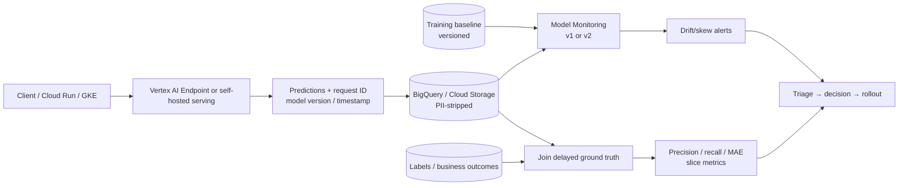
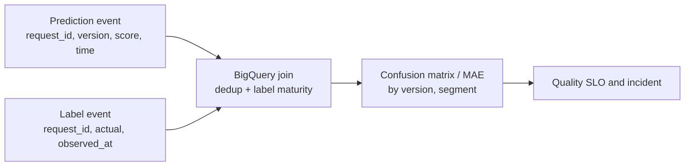
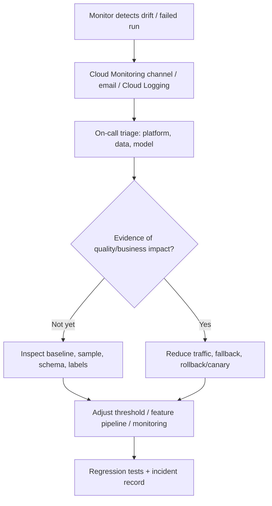

# Model Monitoring and Prediction Quality Tracking

## 1. Why Can a Model That Performed Well in Testing Still Fail After Deployment?

A customer churn prediction model was trained on data from six months ago and deployed via a **Vertex AI Endpoint**. After an app redesign, the share of mobile users surges while pricing policies change at the same time. The endpoint still returns HTTP 200 in 120 ms, yet the rate of wrong predictions rises because **the production data distribution has shifted** and the relationship between inputs and business outcomes has changed.

Three independent dimensions must be observed:

- **Service health:** is the endpoint accepting requests, responding fast enough, and free of errors or overload?
- **Model/data health:** do inputs, outputs, or feature contributions exhibit **skew/drift**, missing values, outliers, or schema errors?
- **Prediction quality:** once **ground-truth labels** arrive, do precision/recall/F1, MAE/RMSE, calibration, and business metrics meet targets?

This lesson belongs to the **Vertex AI and Machine Learning** chapter of module **CLOUD_PROVIDERS_GCP**, connecting IAM, VPC, Cloud Run, GKE, BigQuery, storage, automated releases, and reliability/cost monitoring of AI systems.

**After this lesson, you can** distinguish drift, skew, and quality degradation; choose between Model Monitoring v1/v2; configure monitoring for tabular data; verify quality when ground truth arrives late using BigQuery SQL; design alert thresholds, incident workflows, IAM, and budgets; and organize safe rollouts/canaries/rollbacks.

> **Safety:** Project `acme-ml-lab`, models, endpoints, and datasets are all examples. Never send real PII into logs or use a learning-lab model for high-risk decisions. Enabling prediction logging, running monitors, creating BigQuery tables, and keeping endpoints running can incur charges. Mutating commands apply only to an authorized lab project.

## 2. Observability Map for an ML Service



**Every prediction must be traceable** via `request_id`/`entity_id`, `model_id/version`, `prediction_at`, input feature schema/version, and key outputs. Ground-truth labels may only appear hours or weeks later, so never write `actual_label` into the inference log as if it existed at prediction time.

| Layer | Typical Signals | What It Catches |
| --- | --- | --- |
| **Endpoint/infra** | QPS, 4xx/5xx, p95/p99 latency, CPU/GPU, replica capacity | Infrastructure incidents or serving capacity limits |
| **Input** | Null rate, cardinality, numeric ranges, categorical distributions | Broken feature pipelines, skew/drift, schema mismatch |
| **Output** | Positive prediction rate, score quantiles, entropy, refusals if any | Shifted prediction distributions, model collapse |
| **Ground truth** | Precision, recall, F1, accuracy, calibration, MAE/RMSE per version/cohort | Measured prediction quality |
| **Business/safety** | Churn prevention lift, loss, complaint rate, fairness, policy violations | Whether the model produces the right, acceptable impact |

**Monitoring does not fix models automatically**: alerts are signals to investigate root causes and evaluate data/feature pipelines, recalibration, threshold tuning, retraining, or rollback.

## 3. Distinguishing Skew, Drift, Data Quality, and Concept Drift

| Phenomenon | Compared Against What? | Example | Needs Ground Truth? |
| --- | --- | --- | --- |
| **Training-serving skew** | Training data vs serving data | Training had 20% mobile; serving has 70% | **No** |
| **Feature/data drift** | Current serving vs prior serving window | Average customer age rises sharply this week | **No** |
| **Prediction/output drift** | Current prediction distribution vs baseline | Predicted `churn=1` rate jumps 12% → 40% | **No** |
| **Data quality failure** | Schema/business constraints | `monthly_spend < 0`, 35% null rate | **No** |
| **Concept drift** | Relationship `P(y|X)` changes | Churn behavior shifts after pricing tier change | **Usually needs labels to confirm** |
| **Performance degradation** | Current metrics vs baseline/SLO | Recall drops from 0.86 to 0.68 | **Yes**, except weak proxies |

**Core insight:** **data drift does not prove the model is wrong**. Distributions can shift from a valid marketing campaign while accuracy remains strong; conversely, recall can drop even when feature distributions stay stable due to **concept drift**. Watching drift alerts while ignoring ground truth is insufficient.

### An Example

```text
Training:    mobile 25% | desktop 75%
Serving:     mobile 70% | desktop 30%
Distance L∞ = max(|0.70−0.25|, |0.30−0.75|) = 0.45
```

With an illustrative threshold of `0.30`, the `device_type` feature alerts. **`0.30` is a statistical threshold that must be calibrated to data**, not "30% drop in accuracy." Check sample size, seasonality, distribution by tenant/region, and actual error rates before intervening.

## 4. Model Monitoring v1 and v2: Picking the Right Generation

Current Google Cloud documentation distinguishes **Model Monitoring v1 (GA)** and **Model Monitoring v2 (Preview)**. UI labels may appear under **Vertex AI / Agent Platform**; follow official Google Cloud docs rather than applying v1 commands to v2 resources.

| Criterion | **v1 — endpoint monitoring** | **v2 — model/version monitoring** |
| --- | --- | --- |
| Availability | **Generally Available** | **Preview/Pre-GA**, subject to change |
| Attachment target | **Vertex AI endpoint** and its deployed models | **Model Registry version** and dedicated model monitor |
| Data sources | Prediction inputs sampled from endpoint; training reference if configured | BigQuery, Cloud Storage CSV/JSONL, batch predictions, endpoint request-response logs; can monitor models on GKE/Cloud Run via source tables |
| Statistics tracked | **Feature skew/drift**; attribution monitoring if explainability enabled | **Input feature drift**, **prediction output drift**, **feature attribution drift** |
| Execution schedule | Scheduled endpoint monitoring | On-demand or scheduled **batch jobs** |
| When to choose | Need GA production support on a Vertex AI Endpoint | Need per-version separation, offline/batch/external monitoring, and accept Preview |

**v1 is not automatically replaced**: systems on v1 can stay on v1; if migrating gradually to v2, run both in parallel carefully so monitoring coverage is never lost. For models outside Vertex AI like GKE/Cloud Run, v2 **does not automatically collect prediction logs** from your workload: you must write schema-compliant inputs/outputs to **BigQuery/Cloud Storage** or a supported source.

**Key limitation:** v2 Preview focuses on **tabular models**. Tracking LLM/Generative AI request latency/token usage, safety/grounding, and response quality requires **generative AI observability/evaluation tooling**—do not assume v1/v2 tabular drift monitors cover all multimodal workloads.

## 5. Reference Data, Target Data, Schemas, and Comparison Windows

The **baseline/reference dataset** is the benchmark distribution; the **target dataset** is recent data to inspect. Key design questions:

| Choice | Meaning | Common Pitfall |
| --- | --- | --- |
| **Training baseline** | Detects training-serving skew | Using mutable training data without recording a version |
| **Historical serving baseline** | Detects drift over time | Comparing holiday traffic to weekdays and flagging every difference as a fault |
| **Target window** | E.g., latest 24 hours | Window too short, small sample, noisy |
| **Segment/slice** | Region, platform, tenant tier, cohort | Aggregate metrics look fine while one cohort is harmed |
| **Feature schema** | Numeric/categorical types, missing values, nested fields | Mixing strings with numbers, unflattened nested JSON |
| **Model version** | Version that produced the prediction | Mixing v1 and v2 scores into one muddled baseline |

Model Monitoring v2 supports **BigQuery tables/queries**, **Cloud Storage CSV/JSONL**, **batch prediction jobs**, and endpoint logging where supported. For **scheduled time-window monitoring**, BigQuery/endpoint log sources need a **timestamp field**; **partition BigQuery tables by timestamp** to control bytes scanned. Nested features typically must be flattened into columns before monitoring.

### Normalized Serving Record Schema for Monitoring

```json
{
  "request_id": "p-1001",
  "model_version": "churn-v3",
  "prediction_at": "2026-11-19T03:00:00Z",
  "region": "north",
  "device_type": "mobile",
  "age": 31,
  "monthly_spend": 120000,
  "churn_probability": 0.83,
  "predicted_label": 1
}
```

This is an **illustrative normalized schema**, not a mandatory `predict` API payload. **Never log email, phone, raw IP, or payment identifiers** unnecessarily; `request_id` should be a PII-free UUID. Ground-truth labels are joined separately later.

## 6. Distribution Distance Metrics: Reading Scores Correctly

Google uses statistics such as **L-infinity distance** for categorical features and **Jensen–Shannon divergence (JSD)** for numeric features (v1) or configurable metrics in v2. They are **not accuracy/F1**.

**Categorical L∞:**

```text
D∞(P,Q) = max over categories c of |P(c) − Q(c)|

P(mobile)=0.25; Q(mobile)=0.70
P(desktop)=0.75; Q(desktop)=0.30
D∞ = 0.45
```

**Jensen–Shannon divergence:** measures distance between **two normalized probability distributions** via KL divergence to their midpoint distribution. Numeric features are typically binned; **binning strategy, missing values, and sample size** affect results. Never interpret a `0.2` score as "20% of users were misclassified" or compare thresholds directly across different metrics.

**PSI (Population Stability Index)** is sometimes computed by teams in BigQuery/Python, yet it is **not the default metric selected by v1/v2 across all configurations**. If running PSI alongside, document bins, smoothing/epsilon, thresholds, and owner.

### Calibrating Thresholds Empirically

1. Collect multiple serving windows **where the model is known to be stable**, covering weekdays, week starts, and weekends.
2. Measure distribution metrics per feature and segment, setting thresholds from acceptable natural variance.
3. Add **minimum sample sizes** and **N consecutive windows** rules if your alerting architecture permits.
4. Prioritize alert severity by business impact, not statistics alone: shifts in `fraud_score` matter more than low-impact fields.
5. Track alert precision and recalibrate after campaigns/seasonality; version thresholds.

A threshold of `0.3` is a common **v1** default per feature—**not a "one-size-fits-all" rule**. Never copy it blindly across credit or healthcare models without validation.

## 7. Distribution Monitoring Is Not Enough: Ground Truth and Delayed Labels

To measure precision/recall, you need **predicted label** and **actual outcome** for the **same entity and decision timestamp**.



| Pitfall | Example | How to Prevent |
| --- | --- | --- |
| **Delayed labels** | Churn is known only after 30 days | Evaluate mature cohorts; never treat missing labels as negative |
| **Selection bias** | Only customers who received support calls have outcomes | Report label coverage by segment and assess bias |
| **Data leakage** | Features updated after prediction used retroactively | Point-in-time feature joins matching `prediction_at` |
| **Duplicates/retries** | One request replayed 3 times | Idempotent request IDs, versioned prediction events |
| **Feedback loops** | Model decides who receives retention offers, altering outcomes | Use experiment/control groups and causal evaluation where needed |
| **Model version mix** | 90/10 rollout between v2/v3 | Report separately by `model_version` and traffic slice |

**Binary classification formulas** (`TP`, `FP`, `TN`, `FN`):

```text
Precision = TP / (TP + FP)
Recall    = TP / (TP + FN)
Accuracy  = (TP + TN) / (TP + TN + FP + FN)
F1        = 2 × Precision × Recall / (Precision + Recall)
```

**Never rely on accuracy alone** for imbalanced tasks like fraud detection. Inspect confusion matrices across thresholds, precision-recall trade-offs, calibration, and error-cost metrics (false positives/negatives). For regression use MAE/RMSE and residual distributions; ranking and generative AI need specialized evaluation.

## 8. Lab A — Creating Baseline and Prediction Events in BigQuery

This lab **requires no Vertex AI model deployment**, helping distinguish drift statistics from labeled evaluation. All data is completely synthetic:

```text
Project:          acme-ml-lab
BigQuery dataset: monitoring_lab
Location:         asia-southeast1
Model version:    churn-v3
Baseline:         8 training-reference rows
Serving:          10 predictions, only 8 with ground-truth labels
```

**Preflight:** BigQuery API/Billing enabled; you have permissions to create datasets/tables and run queries in the **lab project** (never a production dataset). If the dataset/table already exists, **do not** overwrite with CREATE; use another authorized dataset. Run in Cloud Shell:

```bash
# MUTATES: create LAB dataset once
bq --project_id=acme-ml-lab mk \
  --dataset --location=asia-southeast1 \
  acme-ml-lab:monitoring_lab

# READ-ONLY
bq show --format=prettyjson acme-ml-lab:monitoring_lab
```

### 8.1. Training Reference Table

Run GoogleSQL in BigQuery Studio or `bq query --location=asia-southeast1 --use_legacy_sql=false`:

```sql
-- MUTATES: creates a synthetic table only inside the LAB dataset.
CREATE TABLE `acme-ml-lab.monitoring_lab.training_reference` AS
SELECT * FROM UNNEST([
  STRUCT('north' AS region, 'web' AS device_type, 24 AS age),
  STRUCT('north', 'web', 35),
  STRUCT('north', 'web', 31),
  STRUCT('north', 'web', 46),
  STRUCT('north', 'web', 42),
  STRUCT('north', 'mobile', 54),
  STRUCT('south', 'web', 36),
  STRUCT('south', 'mobile', 47)
]);
```

Baseline has **north 6/8 = 75%**, **south 2/8 = 25%**. This is an illustrative baseline, not representative of real demographics or customer counts.

### 8.2. Serving Predictions Table (Only 10 Synthetic Events)

```sql
CREATE TABLE `acme-ml-lab.monitoring_lab.prediction_events`
PARTITION BY DATE(prediction_at)
CLUSTER BY model_version, region AS
SELECT * FROM UNNEST([
  STRUCT('p1' AS request_id, TIMESTAMP '2026-11-19 02:00:00+00' AS prediction_at,
         'churn-v3' AS model_version, 'north' AS region,
         'mobile' AS device_type, 25 AS age, 0.90 AS score, 1 AS predicted_label),
  STRUCT('p2', TIMESTAMP '2026-11-19 02:01:00+00', 'churn-v3', 'south', 'mobile', 46, 0.80, 1),
  STRUCT('p3', TIMESTAMP '2026-11-19 02:02:00+00', 'churn-v3', 'north', 'web',    35, 0.70, 1),
  STRUCT('p4', TIMESTAMP '2026-11-19 02:03:00+00', 'churn-v3', 'south', 'web',    22, 0.55, 1),
  STRUCT('p5', TIMESTAMP '2026-11-19 02:04:00+00', 'churn-v3', 'north', 'mobile', 31, 0.45, 0),
  STRUCT('p6', TIMESTAMP '2026-11-19 02:05:00+00', 'churn-v3', 'south', 'mobile', 67, 0.20, 0),
  STRUCT('p7', TIMESTAMP '2026-11-19 02:06:00+00', 'churn-v3', 'north', 'web',    54, 0.10, 0),
  STRUCT('p8', TIMESTAMP '2026-11-19 02:07:00+00', 'churn-v3', 'south', 'web',    42, 0.30, 0),
  STRUCT('p9', TIMESTAMP '2026-11-19 02:08:00+00', 'churn-v3', 'south', 'mobile', 60, 0.75, 1),
  STRUCT('p10', TIMESTAMP '2026-11-19 02:09:00+00','churn-v3', 'south', 'mobile', 30, 0.40, 0)
]);
```

In serving, **north 4/10 = 40%**, **south 6/10 = 60%**. Rows `p9/p10` have no ground-truth labels yet in this lab; they are **unlabeled**, not negative.

### 8.3. Labels Arriving After Prediction

```sql
CREATE TABLE `acme-ml-lab.monitoring_lab.observed_labels` AS
SELECT * FROM UNNEST([
  STRUCT('p1' AS request_id, 1 AS actual_label,
         TIMESTAMP '2026-11-19 08:00:00+00' AS observed_at),
  STRUCT('p2', 0, TIMESTAMP '2026-11-19 08:00:00+00'),
  STRUCT('p3', 1, TIMESTAMP '2026-11-19 08:00:00+00'),
  STRUCT('p4', 1, TIMESTAMP '2026-11-19 08:00:00+00'),
  STRUCT('p5', 0, TIMESTAMP '2026-11-19 08:00:00+00'),
  STRUCT('p6', 1, TIMESTAMP '2026-11-19 08:00:00+00'),
  STRUCT('p7', 0, TIMESTAMP '2026-11-19 08:00:00+00'),
  STRUCT('p8', 0, TIMESTAMP '2026-11-19 08:00:00+00')
]);
```

**In practice:** use stable IDs and label observation timestamps from CRM, transactions, or telemetry. Requests can be retried; production must deduplicate on `request_id` and business outcome/version rather than loosely joining on customer ID alone.

## 9. Lab B — Computing Feature Drift with BigQuery SQL

Count category shares in baseline/serving, then compute **L∞**:

```sql
WITH baseline AS (
  SELECT region, COUNT(*) AS n
  FROM `acme-ml-lab.monitoring_lab.training_reference`
  GROUP BY region
), serving AS (
  SELECT region, COUNT(*) AS n
  FROM `acme-ml-lab.monitoring_lab.prediction_events`
  WHERE prediction_at >= TIMESTAMP '2026-11-19 00:00:00+00'
    AND prediction_at < TIMESTAMP '2026-11-20 00:00:00+00'
    AND model_version = 'churn-v3'
  GROUP BY region
), aligned AS (
  SELECT
    COALESCE(b.region, s.region) AS region,
    IFNULL(b.n, 0) AS baseline_n,
    IFNULL(s.n, 0) AS serving_n
  FROM baseline AS b FULL OUTER JOIN serving AS s USING (region)
)
SELECT region,
  SAFE_DIVIDE(baseline_n, (SELECT COUNT(*) FROM `acme-ml-lab.monitoring_lab.training_reference`))
    AS baseline_share,
  SAFE_DIVIDE(serving_n, (SELECT COUNT(*) FROM `acme-ml-lab.monitoring_lab.prediction_events`))
    AS serving_share,
  ABS(
    SAFE_DIVIDE(baseline_n, (SELECT COUNT(*) FROM `acme-ml-lab.monitoring_lab.training_reference`))
    - SAFE_DIVIDE(serving_n, (SELECT COUNT(*) FROM `acme-ml-lab.monitoring_lab.prediction_events`))
  ) AS absolute_share_diff
FROM aligned
ORDER BY region;
```

**Expected:** `north`: baseline 0.75 vs serving 0.40, difference 0.35; `south`: 0.25 vs 0.60, difference 0.35; thus **L∞ = 0.35**. With a lab threshold of 0.30, both categories exceed the threshold and the `region` feature is flagged for review.

**Intentional lab simplification:** the serving table holds only 10 rows from a single day, so counting the full serving table works in this example. In production, apply the **same time filter and model version** in both numerator and denominator; using `COUNT(*)` over a multi-month table as denominator skews shares. Never set production thresholds from 10 records.

## 10. Lab C — Confusion Matrix and Precision/Recall/F1

```sql
WITH confusion AS (
  SELECT
    COUNTIF(p.predicted_label = 1 AND l.actual_label = 1) AS tp,
    COUNTIF(p.predicted_label = 1 AND l.actual_label = 0) AS fp,
    COUNTIF(p.predicted_label = 0 AND l.actual_label = 1) AS fn,
    COUNTIF(p.predicted_label = 0 AND l.actual_label = 0) AS tn
  FROM `acme-ml-lab.monitoring_lab.prediction_events` AS p
  JOIN `acme-ml-lab.monitoring_lab.observed_labels` AS l
    USING (request_id)
  WHERE p.model_version = 'churn-v3'
    AND p.prediction_at >= TIMESTAMP '2026-11-19 00:00:00+00'
    AND p.prediction_at <  TIMESTAMP '2026-11-20 00:00:00+00'
    AND l.observed_at <= TIMESTAMP '2026-11-19 09:00:00+00'
)
SELECT tp, fp, fn, tn,
  SAFE_DIVIDE(tp + tn, tp + fp + fn + tn) AS accuracy,
  SAFE_DIVIDE(tp, tp + fp) AS precision,
  SAFE_DIVIDE(tp, tp + fn) AS recall,
  SAFE_DIVIDE(2 * tp, 2 * tp + fp + fn) AS f1
FROM confusion;
```

**Expected:** TP=3, FP=1, FN=1, TN=3; accuracy=0.75, precision=0.75, recall=0.75, F1=0.75. **Only 8/10 predictions have labels**: report **label coverage=80%** as well and watch for selection bias. Metrics over those eight labels do not represent all 10 predictions if the two missing labels follow a different distribution.

### Comparing Quality by Segment

```sql
WITH joined AS (
  SELECT p.region, p.model_version, p.predicted_label, l.actual_label
  FROM `acme-ml-lab.monitoring_lab.prediction_events` AS p
  JOIN `acme-ml-lab.monitoring_lab.observed_labels` AS l
    USING (request_id)
  WHERE p.prediction_at >= TIMESTAMP '2026-11-19 00:00:00+00'
    AND p.prediction_at < TIMESTAMP '2026-11-20 00:00:00+00'
)
SELECT region, model_version, COUNT(*) AS labeled_n,
  SAFE_DIVIDE(COUNTIF(predicted_label = actual_label), COUNT(*)) AS accuracy
FROM joined
GROUP BY region, model_version
ORDER BY region;
```

**Note:** small groups are noisy and can expose personal identities if sliced too finely. Enforce a **minimum cohort size** and proper statistical/ethical checks before interpreting fairness or triggering retraining.

### Checking Coverage Before Trusting Metrics

```sql
SELECT
  COUNT(*) AS total_predictions,
  COUNTIF(l.request_id IS NOT NULL) AS labeled_predictions,
  SAFE_DIVIDE(COUNTIF(l.request_id IS NOT NULL), COUNT(*)) AS label_coverage
FROM `acme-ml-lab.monitoring_lab.prediction_events` AS p
LEFT JOIN `acme-ml-lab.monitoring_lab.observed_labels` AS l
  USING (request_id)
WHERE p.model_version = 'churn-v3';
```

In real systems, deduplicate the labels table so one `request_id` cannot multiply rows during a JOIN. You can use `ROW_NUMBER() OVER (PARTITION BY request_id ORDER BY observed_at DESC) = 1` to take the latest valid label, only when business rules permit label updates.

## 11. Lab D — Configuring v2 Model Monitor via UI (Preview)

**Prerequisites:** a **tabular** model registered in **Model Registry** with a **version**, regardless of whether inference runs on a Vertex AI Endpoint, Cloud Run/GKE, or batch. If serving outside Vertex AI, registering a **reference model** per docs suffices; uploading model artifacts is not strictly required, provided you log inference data to BigQuery/Cloud Storage matching the schema.

1. Open Google Cloud Console → **Model Monitoring / Agent Platform** in your authorized project/region; select **Configure monitoring**.
2. Choose **model + model version**; declare the schema matching fields `region`, `device_type`, `age`, `score`, `predicted_label` (assigning numeric/categorical types properly).
3. Select **BigQuery baseline** `training_reference` and **BigQuery target** `prediction_events` or curated queries picking only exact feature columns. Set `prediction_at` as the **timestamp field** for scheduled windows.
4. Enable **Input feature drift**, choose `L-infinity` for categorical and `Jensen–Shannon divergence` for numeric, and set thresholds matching lab data (e.g., 0.30 for `region`).
5. If output schema is provided, add **Prediction output drift**; enable feature attribution only when the model/explanation method supports it and explanation data exists. **Never enable attribution expecting SHAP on a reference model** if unsupported.
6. Set an email or Cloud Monitoring notification channel for **approved real recipients**, choose an output bucket if needed, and click **Run now**.
7. Inspect run status, metric distributions, anomaly alerts, source time range, and output storage; record the model version and monitoring job ID.
8. If the lab requires periodic tracking, use **Schedule a recurring run** with cron/timezone and time-window; **cancel the schedule after the lab** to avoid charges.

**Do not confuse continuous monitoring with per-request stream processing**: v2 **runs scheduled batch monitoring jobs**. BigQuery tables feeding time-windows need a timestamp field and settled data; a job finishing now does not guarantee every inference from that exact second was ingested yet.

### Declaring Schema via SDK (Reading Sample, Do Not Run Standalone)

```python
# Python SDK v2 Preview; use only when your org verified SDK version.
# This is the schema structure, NOT a complete monitor creation script.
from vertexai.resources.preview import ml_monitoring

monitor_schema = ml_monitoring.spec.ModelMonitoringSchema(
    feature_fields=[
        ml_monitoring.spec.FieldSchema(name="region", data_type="string"),
        ml_monitoring.spec.FieldSchema(name="device_type", data_type="string"),
        ml_monitoring.spec.FieldSchema(name="age", data_type="integer"),
    ],
    prediction_fields=[
        ml_monitoring.spec.FieldSchema(name="score", data_type="float"),
        ml_monitoring.spec.FieldSchema(name="predicted_label", data_type="integer"),
    ],
)
```

This snippet **only illustrates `ModelMonitoringSchema`**; creating a model monitor and running jobs require resource IDs, datasets, IAM/output specs, objectives, and matching SDK calls—consult **official v2 notebook docs** rather than guessing changing Preview APIs.

## 12. Lab E — Model Monitoring v1 on a Vertex AI Endpoint (GA)

**Prerequisites:** an existing **Vertex AI Endpoint** hosting a deployed **tabular** model, sufficient request traffic, monitor admin permissions, and authorization to enable sampling/logging. The SQL lab above **does not create an Endpoint automatically**. Use the commands below only if your lab project already deployed a test endpoint per a model deployment guide.

### 12.1. Inspect Model and Endpoint First (Read-Only)

```bash
PROJECT="acme-ml-lab"
REGION="asia-southeast1"
ENDPOINT_ID="REPLACE_WITH_TEST_ENDPOINT_ID"

gcloud ai endpoints list \
  --project="$PROJECT" --region="$REGION"

gcloud ai endpoints describe "$ENDPOINT_ID" \
  --project="$PROJECT" --region="$REGION"

gcloud ai model-monitoring-jobs list \
  --project="$PROJECT" --region="$REGION"
```

**Never grab a production endpoint ID** just because it appears in the list. Inspect deployed models, traffic splits, network/access conditions, and cost implications before enabling logging. **v1 applies shared monitoring settings at the endpoint level** for sampling/schedule/detection type, while certain thresholds can be configured per model/feature.

### 12.2. Creating an Illustrative Monitoring Job

```bash
# MUTATES: creates a Model Monitoring v1 job tracking prediction inputs.
# Run ONLY against a TABULAR LAB endpoint after replacing email with an authorized recipient.
gcloud ai model-monitoring-jobs create \
  --project="$PROJECT" \
  --region="$REGION" \
  --display-name="churn-v1-drift-lab" \
  --endpoint="$ENDPOINT_ID" \
  --emails="ml-oncall@example.org" \
  --prediction-sampling-rate=0.2 \
  --monitoring-frequency=24 \
  --feature-thresholds="region=0.3,age=0.3"
```

In v1, **when no training reference is provided**, the matching objective is **prediction feature drift**; to monitor **training-serving skew**, you must supply the training source (BigQuery/GCS/managed dataset), target/label field, and schema matching the model type. **Never supply a baseline table missing the target field and enable skew**: the API may reject it or miscompute results. Check `gcloud ai model-monitoring-jobs create --help` and [monitor feature skew and drift](https://docs.cloud.google.com/gemini-enterprise-agent-platform/machine-learning/model-monitoring/using-model-monitoring) for model-specific configuration.

**This example is optional** for completing the lesson. Real monitors need prediction traffic to infer/check input schemas and distributions; results do not appear instantly merely because the resource state is `ACTIVE`. `--monitoring-frequency=24` sets an hourly evaluation interval in v1 commands—it does not evaluate after every single request.

### 12.3. Viewing Status and Pausing the Lab

```bash
# READ-ONLY: get real JOB_ID from list
gcloud ai model-monitoring-jobs list \
  --project="$PROJECT" --region="$REGION"

gcloud ai model-monitoring-jobs describe JOB_ID \
  --project="$PROJECT" --region="$REGION"

# MUTATES: pause ONLY the monitoring job created by the lab
gcloud ai model-monitoring-jobs pause JOB_ID \
  --project="$PROJECT" --region="$REGION"
```

To save costs after the lab, **delete test monitors or test endpoints only after confirming no users still depend on them**, following approval procedures. Never delete production BigQuery baselines, production endpoints, or model service accounts just to "clean up a demo."

## 13. Collecting Prediction Logs and Storing Data Safely

To observe the data **actually seen by the model**, inference logging needs complete fields, exact schema, and version tags:

| Field | Why Needed? | Protection |
| --- | --- | --- |
| `request_id` | Join predictions with ground truth; deduplicate retries | Random UUID, zero PII |
| `model_version`, `endpoint_id` | Compare rollout/canary/rollback | Immutable version; traffic split |
| `prediction_at` | Time windows and data freshness | Standard UTC timestamp |
| `feature_fields` | Input drift/skew | Mask/hash/minimize PII; never store secrets |
| `score`/`predicted_label` | Output drift, calibration, quality once labels arrive | Restrict unauthorized exports |
| `logging_time` | Distinguish event time from ingestion delay | Lag alerts |
| `ground_truth`/`observed_at` | Supervised evaluation when labels arrive | Separate store; audit, lineage, restricted access |

Vertex AI Endpoints offer **independent** logging types:

- **Container logging:** inference container stdout/stderr for debugging.
- **Access logging:** request metadata like status/latency; not full model features.
- **Request-response logging:** samples inputs/outputs into **BigQuery** per endpoint settings; requires explicit opt-in and privacy/cost review.

For **Model Monitoring v2** using endpoint logging, **request-response logging must be enabled**. Private endpoints do not support this logging source per v2 documentation; substitute self-managed **BigQuery/Cloud Storage inputs** where appropriate. For **self-hosted Cloud Run/GKE serving**, instrument logging inside the application—for example, Pub/Sub → Dataflow → BigQuery—with idempotency.

### Sample Production Schema

```text
ml_observability.predictions
  request_id            STRING
  event_at              TIMESTAMP
  ingestion_at          TIMESTAMP
  model_version         STRING
  source_service        STRING
  segment               STRING
  feature_age           INT64
  feature_device_type   STRING
  score                 FLOAT64
  predicted_label       INT64

ml_observability.labels
  request_id            STRING
  observed_at           TIMESTAMP
  actual_label          INT64
  label_source          STRING
```

**Production:** partition on `event_at`/`observed_at` and cluster on `model_version, segment` if queries filter on them. Separate **feature logging** from **business personal data**; enforce retention lifecycles, access policies, CMEK/VPC Service Controls where required, and audit exports. Never set `allow all` on buckets storing prediction logs.

## 14. Alerting: Combining Model/Data Health with Service Health

Model Monitoring outputs **windowed statistics**; Cloud Monitoring and Cloud Logging track **endpoints/workloads**. Use both to separate model issues from infrastructure issues.

| Category | Suggested Signals | Example Window/SLO (Team-Defined) |
| --- | --- | --- |
| **Availability** | Inference 5xx, request failures | 5xx under 0.5% over 5 minutes |
| **Latency** | p95/p99 inference latency | p95 under 300 ms |
| **Data drift** | L∞ of `region`, JSD of `age` | Exceeds threshold for 2 consecutive batch runs |
| **Input quality** | Missing/invalid feature rate | `age` null rate under 1% |
| **Output drift** | Positive prediction rate / score distribution | Investigate significant deviation from baseline |
| **Label quality** | Label coverage/maturity | Coverage > 90% after 14 days |
| **Supervised quality** | Recall/precision/calibration by cohort | Mature cohort recall > 0.80 |
| **Business** | Cost per save, churn reduction, customer complaints | Per business owner/holdout |
| **Ops** | Monitor run failures, sampling gaps, ETL lag | No more than two missed scheduled runs |

**All thresholds in this table are illustrative**, not Google Cloud SLAs or universal recommendations. Under class imbalance, inspect sample counts/confidence intervals before firing high-severity incidents.

### Alerting Flow



In v1, email notifications for job/run failures and skew/drift alerts are not always identical notification types; **test actual alert types, Cloud Logging events, notification channels, and webhook routing** before going live. Configuring email alone does not prove on-call will receive and respond to overnight incidents.

## 15. Model Explainability and Attribution Drift

**Feature attribution** quantifies each feature's contribution to predictions under the chosen explainability method (e.g., SHAP). A shift in how heavily a feature drives predictions can be an important signal **even when raw feature distributions barely move**.

For example, the old model predicted churn mainly from `monthly_spend`, while the new model leans heavily on `device_type`. Ask:

- Did training data leak or did the feature pipeline change?
- Did the attribution shift come from the **new model version** or **user data**?
- Has the model started using a proxy for a sensitive group, violating fairness policies?
- Did supervised slice metrics and calibration degrade?

**Attributions are not causality** and do not prove changing a feature will proportionally change outcomes. For **reference models** in v2, feature-attribution monitoring is not supported per docs; configure it only when the serving/explanation setup provides full explanation data and outputs are verified.

## 16. Root Cause Analysis and Retrain vs Rollback vs Threshold Decisions

| Observation | Hypothesis | Appropriate Action |
| --- | --- | --- |
| Drift rises, quality stable | New campaign, legitimate shift | Record approved new baseline; keep monitoring |
| Null spike right after feature pipeline deploy | Schema/parsing/ETL bug | **Fix pipeline**, backfill, consider ingestion rollback |
| Recall drops on mature labels | Concept drift, threshold, label bias | Analyze slices; test recalibration/retraining/canary |
| Endpoint 5xx/p95 rises, quality unchanged | Infra/quotas/model serving | Fix capacity/routing; do not reflexively retrain |
| New model v4 worse than v3 | Data leakage/training bug or regression | Shift traffic back to v3 per rollback plan |
| Frequent alerts with little impact | Bad threshold, small sample, seasonality | Re-estimate baseline/threshold; never turn off monitoring completely |

**Retraining is not an automatic knee-jerk response to every drift alert.** For decisions affecting users' finances, health, or opportunities, require approval, authorized data, fairness evaluation, and independent testing before rollout. If labels take 30 days to mature, never declare "the new model is better" based on a one-day trial and unverified click proxies.

## 17. Canaries, Traffic Splitting, and Model Versioning

Model Registry can store multiple model versions. When deploying a new version to an endpoint, operations can use **traffic splitting** and roll back as supported by the endpoint. However, **monitoring must tie metrics to the exact version**:

```text
Vertex AI Endpoint
  ├── deployed model churn-v3: 90% traffic
  └── deployed model churn-v4: 10% traffic

Prediction logs: request_id + deployed_model_id/version + model_config
                 ↓
Quality dashboard by version + segment + time window
                 ↓
Decision: ramp traffic, hold canary, or roll back to v3
```

**When comparing v3 and v4**, 10% traffic may hit an uneven user slice if routing is not properly randomized; never compare overall v4 accuracy directly against v3 from another time window and declare v4 superior. Consider **A/B testing with control groups**, confidence intervals, label maturity, and business metrics.

### Release Gates

1. **Offline evaluation** on a separate dataset, checking baselines, fairness, leakage, and calibration.
2. **Shadow testing** where possible, preventing new predictions from affecting users; verify logs and cost.
3. **Canary rollout** at low traffic, monitoring p95/5xx, drift, output distributions, and downstream business failures.
4. **Delayed-label evaluation** on mature cohorts, reconciled against the incumbent version.
5. **Ramp traffic/rollback** per SLO conditions and approval; record runbook/decision owner.
6. When retiring a model version, preserve **lineage and metrics** for auditability; do not delete logs/labels immediately.

**Never call a model "better" just because the new endpoint has lower p95**; latency is a service metric, not a prediction quality metric.

## 18. Security, IAM, Data Protection, and Operational Responsibilities

| Principal | Responsibility | Scoped Permissions |
| --- | --- | --- |
| **ML platform admin** | Create/configure Model Registry, endpoints, and monitors | Required Vertex AI permissions, restricted production deploy rights |
| **Monitoring service agent** | Read input data, write v2 results to bucket | **Source BigQuery/GCS** read rights, **output bucket** write rights |
| **Prediction service account** | Serve model and fetch features | Separated from admin/deployer; never Project Owner |
| **ETL/feature pipeline SA** | Write inference logs/labels, fix pipelines | Scoped only to authorized datasets/buckets and Pub/Sub topics |
| **Analyst/incident responder** | View dashboards, drift scores, quality, and logs | Read-only on PII-stripped data |

The **v2 service agent** follows `service-PROJECT_NUMBER@gcp-sa-vertex-mm.iam.gserviceaccount.com`; if using a custom Cloud Storage bucket for monitoring output, grant it appropriate **write permissions**. Never grant `storage.admin` org-wide. Vertex AI endpoint/service agents, BigQuery execution identities, and Cloud Console users are not always the same principal.

### Sensitive Data

- Log only features needed for monitoring; **never send raw names, emails, phone numbers, access tokens, or sensitive content** to Logs/BigQuery unnecessarily.
- Define **retention/lifecycle** policies for prediction logs, label datasets, model metadata, and monitoring outputs; apply CMEK and VPC Service Controls where supported and appropriate.
- Restrict BigQuery/Cloud Storage export rights; audit jobs reading training, inference, and ground-truth data.
- Tables sliced by **demographic segments/tiny groups** risk re-identifying individuals; enforce minimum cohort sizes, aggregation thresholds, and legal/ethical reviews.
- For **private serving/GKE/Cloud Run**, verify routing to Google APIs, BigQuery/GCS IAM, Private Google Access/NAT/Private Service Connect, and VPC SC matching actual topology; never open a public endpoint just so a monitor can read data.

**Securing model monitoring means securing production data.** Distribution checks in v1/v2 do not automatically anonymize records or enforce permissions on custom dashboards.

## 19. Cost, Frequency, and Sampling Trade-Offs

**Per current documentation, v2 Preview does not charge directly for Model Monitoring v2**, yet companion services **still incur costs**: BigQuery reads/storage, Cloud Storage, request-response logging, Explainable AI, batch inference, Cloud Logging/Monitoring, and endpoints. Preview pricing may change at GA—check pricing pages before every deployment. **v1** bills monitoring and infra/logging under corresponding SKUs.

| Lever | Benefit | Trade-off |
| --- | --- | --- |
| **Prediction sample rate** | Cuts logs, BigQuery/storage, and monitoring workload | May miss rare faults in small segments; sampling bias |
| **Monitoring frequency** | Fewer batch jobs and data scans | Slower drift detection |
| **Window size** | Greater statistical stability on low volume | Can mask brief spikes |
| **BigQuery partition pruning** | Cuts bytes scanned per time window | Requires explicit filters and proper partitioning |
| **Selected features** | Reduces PII exposure and overhead | Might miss drift on an excluded feature |
| **Attribution monitoring** | Catches feature contribution shifts | High explanation cost; supported only on certain models |

### Sample Log Budget (Rough Estimate)

```text
Endpoint traffic:       500,000 predictions/day
Sampling rate:          20% = 100,000 samples/day
PII-stripped payload:   1.5 KiB/sample (assumed)
Raw bytes/day:          150,000 KiB ≈ 146.5 MiB
Raw bytes/30 days:      roughly 4.29 GiB
```

This is **not a bill**: payload schemas, compression, metadata/replication, BigQuery storage, query bytes, logging fees, explanations/feature attributions, and endpoints dominate actual costs. For high-volume models, **random sampling** should be stratified by tenant/region or paired with targeted alerts so small critical segments are not drowned out.

**Do not slash sampling too low just to save money** when quality cannot be observed yet: losing early signals increases business losses. Use budget alerts, quotas, and error-impact costs to set rational levels.

## 20. Troubleshooting and Runbook for Model Alerts

| Symptom | Most Likely Cause | What to Check |
| --- | --- | --- |
| New monitoring job has no charts | Too few prediction requests; scheduled run hasn't executed | Job state, sample count, inference traffic |
| v2 monitor fails on source | Wrong BigQuery table/query, schema mismatch, missing read rights | Dataset location, IAM, timestamp field, nested columns |
| v2 endpoint source has no data | Request-response logging disabled or private endpoint unsupported | Endpoint logging settings, BigQuery log table |
| Huge training-serving skew on day 1 | Wrong training baseline; train/serve preprocessing differs | Feature transformations, schema, training artifact version |
| All features drift simultaneously | Ingestion/feature pipeline bug, schema cast, missing values | Raw vs curated, NULL/error rates, recent deployments |
| Model quality drops without drift | Concept drift, label shift, bad threshold, or bias | Mature labels, slices, calibration, threshold policy |
| v1 fails to email as expected | Wrong job emails/notification channel; log alerts unconfigured | Job config, Cloud Logging, channel test |
| Recall is 0 after one day | Delayed labels, immature cohort, or real outage | Label coverage/maturity, confusion matrix |
| BigQuery queries too expensive | Full log history scans without partition pruning | Event timestamp filters, clustered columns, query plan |
| Two versions deployed, metrics mixed | Inference logs missing `model_version` | Deployed model mapping, traffic split, event lineage |
| Hourly alerts ignored by everyone | Overly sensitive threshold, tiny window, or wrong on-call routing | Alert frequency, low-count guardrail, owner/runbook |
| Endpoint 503/latency spike | Replicas/capacity/quotas/network—not data drift | Cloud Monitoring p95/5xx, deployed model health |

### 8-Step Runbook

1. **Define scope:** project, region, endpoint, model/version, monitoring job ID, data source, and alert window.
2. **Assess service health:** QPS, p95/p99, 5xx, resource saturation, network errors, and endpoint traffic split.
3. **Inspect data sources:** schema, sample count, ingestion lag, missing values, duplicates, timestamps, and IAM.
4. **Compare baseline/target:** which feature shifted, which metric, which threshold, enough samples, valid seasonality/campaign?
5. **Reconcile ground truth:** are labels mature? Is coverage even across segments? What is the confusion matrix for that **exact version**?
6. **Assess impact:** if data or supervised quality truly degraded, confirm business/safety impact; engage controlled fallback/rollback if severe.
7. **Remediate root cause:** fix pipeline, feature mapping, threshold/calibration, or retrain with offline validation; canary before ramping traffic.
8. **Preserve evidence:** logs/trends/data versions, incident timeline, rollback path, costs, owner, and alert tuning improvements.

**Never delete monitors or disable logging during an incident**—you will destroy evidence. If sensitive data leaked into logs, isolate access and fix logging configs per your security incident process.

## 21. Three Deployment Scenarios

### 21.1. Churn Prediction from Cloud Run to a Vertex AI Endpoint

**Context:** Cloud Run calls Vertex AI Endpoint `churn-v3`; an influx of new mobile users raises `device_type` drift.

**Design:** v1 endpoint monitoring (GA) with sampling; log request ID/version; BigQuery churn labels arrive only after 30 days. Drift alerts trigger checks on both product campaigns and recall on **mature** cohorts; never retrain on 24 hours of unlabeled data.

**Acceptance criteria:** accurate drift detection, zero PII logged, tracked data freshness, and recall reported by platform/version.

### 21.2. Batch Fraud Model Running on GKE/Dataproc

**Context:** A fraud model scores transaction batches nightly without serving live on a Vertex AI Endpoint.

**Design:** write features/predictions to BigQuery partitioned by `prediction_at`, register the model version in Model Registry, evaluate **v2 Preview** with a BigQuery baseline and scheduled jobs; where GA support is mandatory, pair with custom BigQuery/Cloud Monitoring checks. Fraud labels arrive late and are heavily imbalanced, so monitor **recall and false-positive impact** on mature cohorts.

**Acceptance criteria:** separate monitoring of data drift and actual fraud outcomes, fallback when model or monitor fails, and compliance with financial security policies.

### 21.3. New Model Canary After Feature Pipeline Migration

**Context:** migrating feature source from Cloud SQL to BigQuery, running v4 on 10% traffic while v3 holds 90%.

**Design:** track null rates, numeric ranges, and skew pre/post migration; log model and feature pipeline versions; measure supervised quality over matching windows/cohorts. If `monthly_spend` is mis-scaled, roll back the feature pipeline before giving v4 more traffic.

**Acceptance criteria:** canary gates have an owner, per-version queries work, zero log loss, and v3/v4 are compared fairly.

## 22. Exercises and Self-Check Questions

1. **Three monitoring layers:** Endpoint has p95=100 ms, 5xx=0, yet churn recall drops. Does service health replace prediction quality? **No**, they measure two distinct dimensions.
2. **Skew vs drift:** What is comparing training vs serving features? **Skew**; comparing this week's serving against last week's is **drift**.
3. **Concept drift:** Input `age` and `device_type` keep the same distribution, yet their relationship to churn shifts. Will a drift monitor reliably catch it? **No**; ground-truth labels are needed to detect quality decay.
4. **L∞:** Baseline mobile=25%, serving=70%, desktop makes up the rest. Calculate L∞. **Answer:** 0.45.
5. **Threshold:** L∞=0.35 and threshold=0.30. What is certain? **A statistical threshold was breached**, not that accuracy dropped.
6. **v1/v2:** Why might an organization requiring GA support on an endpoint pick v1? **Answer:** v1 is GA; v2 is Preview in current documentation.
7. **Models outside Vertex AI:** Can a Cloud Run custom model use v2? **Yes, if registered as a reference model with a supported data source**, though it does not collect request logs automatically.
8. **v2 scheduling:** Does an hourly scheduled monitor check every prediction instantaneously? **No**; it runs windowed batch monitoring jobs.
9. **Label delay:** After 2 hours you do not yet know if a customer churned. Can you assign `actual_label=0` to all of them? **No**; wait for mature labels.
10. **Confusion matrix:** Given TP=3, FP=1, FN=1, TN=3, calculate precision/recall/F1. **Answer:** all equal 0.75.
11. **Label coverage:** 10 predictions, 8 labels. What is coverage, and is it enough to trust overall accuracy? **80%; not if missing labels are non-random**.
12. **Duplicate labels:** `observed_labels` has 2 rows for request `p1`. Why does JOIN distort metrics? **Hint:** it multiplies rows; deduplicate per policy.
13. **Sampling:** A model gets 500,000 requests/day at 20% sampling. How many samples? **100,000/day** if sampling follows target rate.
14. **Canary:** v4 gets 10% traffic and its positive rate rises. Should you roll back solely because output distribution differs? **Not necessarily**; check cohorts, quality, business cost, and defined gates.
15. **Security:** Why is request-response logging containing email/raw IP risky? Propose a mitigation. **Hint:** data minimization/hashing, restricted IAM/retention, export audits.
16. **Capstone lab:** In `acme-ml-lab.monitoring_lab`, build all three tables and run the drift/quality SQL; build a table of `model_version, feature_distance, label_coverage, precision, recall, decision`. Explain when to fix the feature pipeline, tune thresholds, or run a canary retrain.

## 23. Production Checklist

- [ ] Distinguish **service health, feature/input drift, and supervised quality**; never collapse them into one number.
- [ ] Pick v1 (GA/endpoint) or v2 (Preview/model version) matching deployment and support requirements.
- [ ] Prediction/baseline sources have **schema, owner, version, timestamp, IAM**, and data retention.
- [ ] External v2 serving (GKE/Cloud Run) has proper BigQuery/GCS logging built, without expecting auto-instrumentation.
- [ ] Training baseline excludes serving data or label leakage; reproducible dataset version recorded.
- [ ] Target windows have sufficient samples, accounting for seasonality and small segments; BigQuery time partitions prune cleanly.
- [ ] L∞/JSD thresholds are calibrated and versioned, never interpreted as accuracy.
- [ ] Check missingness/nulls/outliers/schema/data freshness before concluding concept drift.
- [ ] Capture `request_id`/`model_version`/`prediction_at` plus label maturity/coverage for supervised metrics.
- [ ] Deduplicate predictions/ground truth and prevent point-in-time leakage in evaluations.
- [ ] Measure precision/recall/F1 or MAE/RMSE, calibration, and business outcomes across slices.
- [ ] Pair Cloud Monitoring endpoint latency/5xx with model drift and monitor job failures.
- [ ] Test notification channels, on-call ownership, escalation, and incident runbooks.
- [ ] Separate IAM for endpoints, model monitor service agents, and BigQuery/GCS.
- [ ] Sensitive data minimized, masked, export-restricted, with lifecycle and audit controls.
- [ ] BigQuery/logging/Explainable AI/monitoring costs and sampling trade-offs controlled.
- [ ] Model rollouts include offline tests, canaries, version-specific metrics, safe fallbacks, and rollback.
- [ ] Run recovery drills for missing logs, delayed labels, failed monitors, and failing endpoints.

## 24. Official Google Cloud Documentation

1. [Model Monitoring introduction — v1 vs v2](https://docs.cloud.google.com/gemini-enterprise-agent-platform/machine-learning/model-monitoring/overview).
2. [Set up Model Monitoring v2](https://docs.cloud.google.com/gemini-enterprise-agent-platform/machine-learning/model-monitoring/set-up-model-monitoring).
3. [Run v2 monitoring jobs on demand or schedule](https://docs.cloud.google.com/gemini-enterprise-agent-platform/machine-learning/model-monitoring/run-monitoring-job).
4. [Monitor skew and drift with v1](https://docs.cloud.google.com/gemini-enterprise-agent-platform/machine-learning/model-monitoring/using-model-monitoring).
5. [v1 feature attribution skew/drift](https://docs.cloud.google.com/gemini-enterprise-agent-platform/machine-learning/model-monitoring/monitor-explainable-ai).
6. [gcloud ai model-monitoring-jobs create](https://docs.cloud.google.com/sdk/gcloud/reference/ai/model-monitoring-jobs/create).
7. [gcloud ai model-monitoring-jobs command group](https://docs.cloud.google.com/sdk/gcloud/reference/ai/model-monitoring-jobs).
8. [Online inference logging](https://docs.cloud.google.com/gemini-enterprise-agent-platform/machine-learning/predictions/online-prediction-logging).
9. [Model Registry and version management](https://cloud.google.com/vertex-ai/docs/model-registry/introduction).
10. [Monitoring infrastructure for Vertex AI resources](https://cloud.google.com/vertex-ai/docs/general/monitoring).
11. [Model evaluation overview](https://cloud.google.com/vertex-ai/docs/evaluation/introduction).
12. [Explainable AI overview](https://cloud.google.com/vertex-ai/docs/explainable-ai/overview).
13. [BigQuery ML model monitoring](https://docs.cloud.google.com/bigquery/docs/model-monitoring-overview).
14. [BigQuery partitioned tables](https://cloud.google.com/bigquery/docs/partitioned-tables).
15. [BigQuery INFORMATION_SCHEMA.JOBS](https://cloud.google.com/bigquery/docs/information-schema-jobs).
16. [Vertex AI IAM](https://cloud.google.com/vertex-ai/docs/general/access-control).
17. [Vertex AI pricing](https://cloud.google.com/vertex-ai/pricing).
18. [Cloud Logging pricing](https://cloud.google.com/stackdriver/pricing).
19. [BigQuery pricing](https://cloud.google.com/bigquery/pricing).

**Takeaway:** **Model Monitoring detects statistical shifts**—it does not decide on its own whether predictions are right or wrong. Production quality is verified through **mature ground-truth labels**, metrics broken down by **model version/segment**, healthy serving infrastructure, and business impact. The proper loop is **observe → investigate → evaluate → canary/rollback or retrain**, governed by security, cost, and approval controls.
