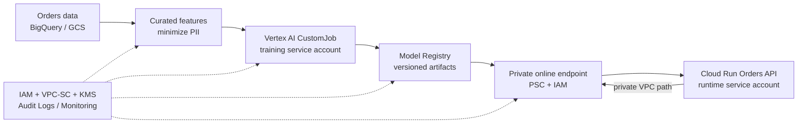
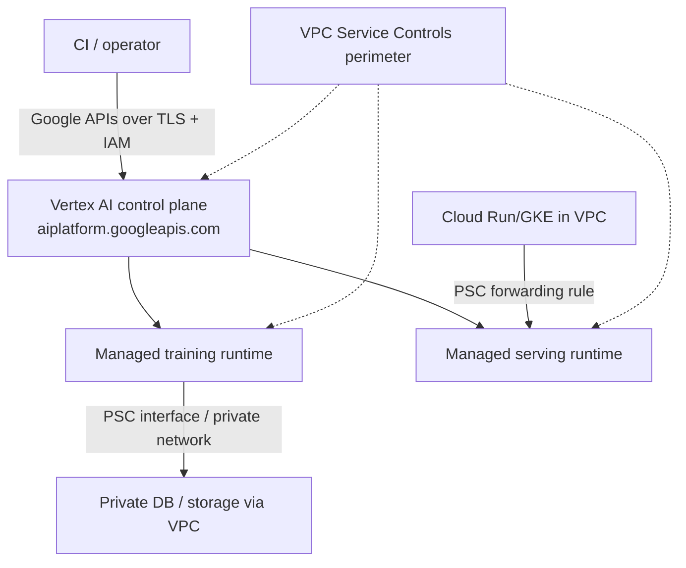
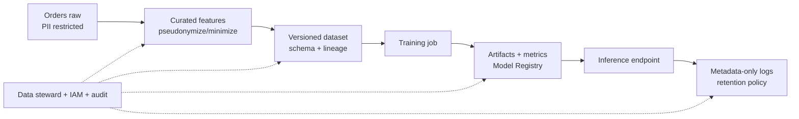

# IAM, Private Networking, and ML Data Protection

An enterprise uses **Vertex AI** to train an order forecasting model from BigQuery/Cloud Storage data and serve predictions to a Cloud Run application. The data includes transaction history containing customer information; if training runs under an overly broad identity, exposes a public endpoint, or logs every full request/response, the model may function accurately yet still trigger a security incident. This lesson designs an end-to-end **data → training → model registry → inference** path with controlled permissions, networking, and data lifecycles.

This lesson belongs to the **Vertex AI and Machine Learning** chapter, module `CLOUD_PROVIDERS_GCP`. Concepts of IAM, project organization, VPC, Cloud Run/GKE, Cloud Storage, BigQuery, reliability monitoring, and cost come together into a practical ML architecture. In newer Google Cloud documentation, many Vertex AI pages appear under **Gemini Enterprise Agent Platform**; the `aiplatform.googleapis.com` APIs and many `aiplatform.*` roles remain essential technical concepts.

> Projects, endpoints, KMS keys, buckets, and datasets below are all **examples**. Granting IAM, creating jobs/endpoints, altering VPC-SC, or enabling logging or CMEK can change access permissions, incur fees, or disrupt systems. Execute only in an approved sandbox. Never use real customer data to test security policies.

## 1. Learning Outcomes

After this lesson, you can:

1. Distinguish **deployer**, **runtime service account**, **Vertex AI service agent**, and **inference caller application**.
2. Grant least-privilege IAM for training data, model artifacts, and endpoints; recognize the risks of custom job creation permissions.
3. Distinguish **Private Google Access**, **Private Service Connect (PSC) interface for training**, **PSC private endpoints for online prediction**, and VPC Service Controls.
4. Design ML data sources with PII classification, encryption/CMEK, residency, secrets handling, and retention.
5. Inspect permissions with `gcloud`, configure CustomJobs with dedicated service accounts, draft private endpoint setups, and audit activity.
6. Monitor access/errors, run negative access tests, and write data-leakage incident runbooks.

## 2. Threat Model and Defense-in-Depth Architecture



| Asset to Protect | Risk | Primary Defense Layers |
| --- | --- | --- |
| Training data / labels | Unauthorized access, PII exfiltration | Dataset/bucket IAM, curated data, VPC-SC, retention |
| Training code/container | Malicious code reading data and exfiltrating outbound | Trusted images, Artifact Registry, review, restricted egress |
| Model weights/artifacts | Model theft or unauthorized version tampering | Model Registry IAM, GCS IAM, provenance, and process signing |
| Online prediction endpoint | External callers invoking model, DoS, request exposure | Endpoint IAM, PSC/private networking, quotas, auth |
| Prompts, features, and predictions | PII leakage via request logs or responses | Data minimization, redaction, log controls, policy |
| IAM / service agents / KMS keys | Privilege escalation, inability to decrypt data | Least privilege, separation of duties, Audit Logs |

**Distinguish four questions:** *Who* may call the service (IAM)? *From which network* can it connect (VPC/PSC)? *Where* can data move (VPC-SC/egress policy)? *Who* can decrypt or read payloads (KMS + data permissions)? **No single tool answers all four.**

## 3. IAM: Which Identity Actually Performs the Action?

In Vertex AI, there are at least **three distinct principal types**:

- **Caller/deployer**: person or CI creating training jobs, models, and endpoints; needs Vertex AI API permissions plus `iam.serviceAccounts.actAs` on the attached runtime service account.
- **Runtime service account**: identity assumed by **training code** or the Cloud Run app; should read only exact GCS buckets/BigQuery datasets and write only to exact output destinations.
- **Google-managed service agent**: identity used by Vertex AI to manage resources on your behalf; typically `service-PROJECT_NUMBER@gcp-sa-aiplatform.iam.gserviceaccount.com`, usually holding `roles/aiplatform.serviceAgent` on the project.

**Service agent roles are not for users or application service accounts.** Arbitrarily removing the default agent role can break the service; conversely, granting `roles/aiplatform.serviceAgent` to a developer violates the security model.

### 3.1. Least-Privilege Matrix Across the Workflow

| Identity | Typical Permissions | Scope |
| --- | --- | --- |
| CI creating CustomJob | `aiplatform.customJobs.create` (e.g., `roles/aiplatform.user` if appropriate), `roles/iam.serviceAccountUser` on the training SA | Vertex AI project + exact SA |
| Training SA | `roles/storage.objectViewer`, `roles/bigquery.dataViewer`, `roles/bigquery.jobUser`, Object Creator on output bucket if needed | **Specific bucket/dataset/job project** |
| Model deployer | Required model upload/deploy and endpoint permissions | Model/endpoint/project per API limits |
| Cloud Run inference caller | Prediction permission on endpoint (matching role/custom role with `aiplatform.endpoints.predict`) | Endpoint/model project |
| Vertex AI service agent | Google-assigned service-agent role; Cloud KMS key access if CMEK enabled | Specific service and resources |
| Security reviewer | IAM Policy Viewer, Audit Logs Viewer/Logging Viewer scoped appropriately | Read-only config and evidence |

**Permission to create custom training jobs is sensitive**: depending on configuration, a job creator can run container code and access data under the execution identity; Google Cloud warns that `aiplatform.customJobs.create` can grant indirect access to other services if a broad default service agent is used. Therefore, enforce `actAs` controls, specify a dedicated runtime SA, review images/commands, and prevent users from attaching privileged service accounts arbitrarily.

### 3.2. IAM Layer Does Not Replace Database/Bucket Security

If CI can create a CustomJob, that **does not** mean it can read `gs://orders-ml-private` or arbitrary BigQuery tables. Vertex AI jobs can read only what their runtime SA and service agent are permitted to read. Use bucket IAM on GCS; on BigQuery, separate **job execution permission** in the job project from **table/view read permission** in the dataset; row-level security, column-level policy tags, and masking remain essential.

### 3.3. Service Accounts Across Projects

When an ML platform project is separated from a data project, check **IAM on both sides**: the Vertex AI project allows job creation, the training SA holds data permissions in the data project, org policies permit cross-project service account usage if needed, and service agents hold documented permissions. **Never delete an org policy protecting cross-project SAs just to bypass a 403**; request security approval and follow the runbook.

## 4. Separating Control Plane and Data Plane Paths



**API calls to the control plane** (creating jobs, declaring endpoints, listing models) and **traffic inside training/serving runtimes** do not share the same network path in every configuration. Having a VPC for Cloud Run does not automatically place Vertex AI runtimes inside that subnet. Identify the **exact flow**, source/destination, and API type before choosing PSC, private services access, or firewall rules.

### 4.1. Private Google Access / restricted.googleapis.com

VMs/GKE nodes without external IPs can reach **Google APIs** via Private Google Access with matching DNS/routes/firewalls. Inside VPC-SC, `restricted.googleapis.com` for supported APIs is a common choice to keep Google API traffic inside the perimeter. This **does not automatically create a private Vertex AI prediction endpoint** and does not replace IAM. Where Cloud Run uses Direct VPC egress or Serverless VPC Access, verify routing to private Google APIs for your exact deployment.

### 4.2. PSC Interface for **Training Egress**

When a Vertex AI CustomJob needs to read Cloud SQL/private Redis or internal hosts, you can configure a **Private Service Connect interface**:

1. The network team creates a VPC, subnet, and **network attachment** in the VPC project.
2. Allow producers to connect through the network attachment via accept/auto-accept settings.
3. Pass the full network attachment resource name via `jobSpec.pscInterfaceConfig.networkAttachment` when creating the CustomJob.
4. Add Cloud DNS peering if training code must resolve private names inside the VPC.
5. Test connectivity to the private destination and restrict outbound paths via VPC/firewall/egress policies.

**PSC interface is an egress path from the Vertex AI training runtime into your VPC**, not a public REST endpoint for apps to call predict. Google Cloud currently recommends PSC interface over legacy VPC Network Peering for several training workloads because it avoids IP exhaustion and supports flexible networking. **It does not apply automatically to every model/tuning/pipeline type**; check the supported feature list.

### 4.3. PSC Private Endpoint for **Online Prediction Ingress**

For **custom-trained/AutoML models** served on a dedicated endpoint, you can create a **Private Service Connect endpoint** and expose connectivity to one or more consumer VPCs via forwarding rules/PSC automation; the endpoint maintains a **project allowlist**. Only hosts on configured networks with prediction IAM can invoke predictions.

| Characteristic | PSC Training Interface | PSC Private Online Endpoint |
| --- | --- | --- |
| Traffic direction | Training runtime **outbound** to VPC/data sources | Application **inbound** to model serving |
| Key network resources | Network attachment, subnet, DNS | Service attachment + forwarding rule/PSC automation |
| Identity | Training runtime SA | Prediction caller SA/IAM + network |
| Applicability | CustomJob/persistent resources as supported | Custom-trained/AutoML online inference as supported |
| Purpose | Read private sources/write artifacts | Shrink online model attack surface |

**Do not choose a PSC endpoint if your goal is having the model query a private database from inside the serving container**: PSC online inference has a documented limitation **not supporting private egress from the container through that endpoint**. Tuned Gemini models and certain Model Garden/Generative AI workflows have **distinct endpoints and requirements**; never assume every Gemini model deploys onto the custom-model PSC endpoint type.

## 5. VPC Service Controls: Preventing Unauthorized Data Exfiltration

**VPC Service Controls (VPC-SC)** place a **service perimeter** around protected projects/services, adding **context and boundary data-flow controls** alongside IAM. For example, a training job allowed to read a PII bucket can be blocked from exporting data to an unauthorized Cloud Storage bucket outside the perimeter.

| Control | Goal | Does Not Solve |
| --- | --- | --- |
| IAM | Which principal can invoke which resource/API | Data exfiltration through an over-privileged principal |
| Private networking | Which network path is allowed without public endpoints | Access from a compromised account already on an allowed network |
| VPC-SC | Block unapproved API/service-to-service boundary crossings | Training code printing sensitive data to logs or leaks through an allowed channel |
| Cloud KMS / CMEK | Control encryption keys for data at rest | Plaintext exposure once an authorized identity decrypts data |
| DLP/column policies | Minimize/mask sensitive data at source | Completely preventing inference leakage from allowed features |

### 5.1. Onboarding Vertex AI into a Perimeter

1. Inventory **projects** hosting Vertex AI, Cloud Storage, BigQuery, Artifact Registry, KMS, and related ML services; separate control plane vs data plane.
2. Check the **list of VPC-SC supported APIs** and exceptions for actual features (custom training, pipelines, GenAI, vector search…).
3. Create the perimeter in **dry-run mode**, adding restricted services and projects per security design.
4. Test legitimate flows: CI submits jobs, training reads inputs, writes artifacts, Cloud Run calls inference; test invalid flows leaving the perimeter.
5. Review **VPC-SC violation audit logs**, add **minimal ingress/egress rules** for required boundary crossings, and switch to enforcement only with evidence.

**VPC-SC does not create private networking by itself.** With PSC interfaces, some Vertex AI workloads inside a perimeter need extra configuration: network attachments, DNS, restricted Google APIs, and/or egress rules. Widening rules indiscriminately just to fix one failing training command defeats exfiltration protection.

### 5.2. An Exfiltration Prevention Test

Set up a sandbox bucket **inside** the perimeter and a bucket **outside** the perimeter within your test organization. Use an SA with full IAM to copy objects, but **without a VPC-SC egress exception**. Expected result: the copy is denied by VPC-SC with a violation recorded in audit logs. Contrast that with reads/writes **within the same perimeter**, which still succeed.

This is a **controlled test**: never run it on real data; if an operation is denied, inspect rules and identities rather than granting `allUsers`, `roles/owner`, or disabling the perimeter.

## 6. Governing the Training and Prediction Data Lifecycle

An ML pipeline manages more than "a training file":



| Stage | Required Controls | Evidence |
| --- | --- | --- |
| Ingest & classification | Classify PII/financial/sensitive fields; define purpose | Catalog, owner, policy tags, DLP results |
| Feature engineering | Minimize, mask/pseudonymize, prevent label leakage | SQL/pipeline code review, schema assertions |
| Training snapshot | Dataset version, hash/manifest, permissions/retention | GCS generation/BigQuery snapshot reference, run metadata |
| Training code | Image digest, vulnerability scanning, dependency policy | Artifact Registry scanning, build provenance |
| Model Registry | Version, evaluation, approver, training-data lineage | Model metadata, approval ticket |
| Serving | Request validation, caller IAM, endpoint exposure policy | Endpoint config, tests, traffic metrics |
| Monitoring & cleanup | Zero PII in logs, retention, and deletion workflows | Logging settings, TTL/lifecycle, deletion audit |

**Pseudonymization is not anonymization.** Hashing an email with a standard algorithm can still be reversed via rainbow tables; use salted/keyed tokenization where appropriate and store keys separately. Small aggregated datasets can still permit privacy inference; assess privacy risks of both feature sets and model outputs.

### 6.1. Never Let a Model Train on Unauthorized Data

Data owners must approve sources, label accuracy, and intended use. In BigQuery, have the training SA read **curated** views/datasets with filtered columns and row policies/policy tags where needed—never grant BigQuery Data Owner/Viewer across the entire raw project. On GCS, separate `raw/`, `training/`, and `artifacts/` into distinct **buckets** or properly designed IAM boundaries; prefixes inside a single bucket **do not automatically create independent IAM boundaries** unless prefix-scoped IAM mechanisms are explicitly configured.

Never put raw data in Docker images, notebook outputs, TensorBoard metrics, Git repositories, or model metadata. For debugging, use approved synthetic samples. Audit feature stores, vector indexes, embeddings, and RAG documents as well: **embeddings/weights must never be assumed free of sensitive information**.

### 6.2. Training Data and GenAI Inference Content Are Distinct Layers

For Generative AI/Model Garden platforms, review **Service Specific Terms and security controls for the exact model, location, API, and GA/Preview feature**. Never assume every model, version, and third-party publisher shares identical prompt logging/retention or data-usage policies. Features like deferred jobs, stored responses, context caching, or request-response logging may **persist state/content**; prompt-free metadata monitoring can be configured separately.

Never pass secrets, JWTs, payment cards, or unnecessary PII into prompts or feature requests. If apps invoke external tools/agents, scope tool permissions separately, restrict data retrieval, and test against prompt injection; private endpoints and IAM only authenticate the caller—**they do not verify that input content is safe**.

## 7. Encrypting ML Data with CMEK and Cloud KMS

Google Cloud encrypts data at rest by default. **CMEK** lets organizations manage keys in Cloud KMS (rotation, IAM, audit, disablement), though **support varies across Vertex AI resource types**.

| Resource | Questions to Verify |
| --- | --- |
| GCS training bucket | Does the bucket have default CMEK or per-object keys? Right location? |
| BigQuery dataset/table | Dataset/table CMEK and BigQuery service agent permissions on the key? |
| Vertex AI CustomJob / Model | Does the feature support CMEK for VM boot disks, training outputs, uploaded models? |
| Online endpoint / generative service | Does the exact resource/model support CMEK, and which parts are encrypted? |
| Logging/metadata | Is any data **not** covered by the same CMEK key? |

**Never say "CMEK is enabled for Vertex AI so the entire ML lifecycle uses that key."** During training, a key may protect VM boot disks holding temporary code/data; GCS and BigQuery use **separate** KMS configurations. Certain endpoints, batch prediction/tuning/GenAI features have limits or lack CMEK support. Consult the [Vertex AI CMEK support matrix](https://cloud.google.com/vertex-ai/docs/general/cmek) for your exact version and resource type.

### 7.1. Service Agents Need Permissions on the KMS Key

Example (only when key `ml-key` and key ring `ml-ring` already exist):

```bash
# MODIFIES IAM ON KMS KEY. Run only with security approval.
PROJECT_ID="orders-ml-sandbox"
KMS_PROJECT="orders-ml-keys"
KMS_LOCATION="asia-southeast1"
KEY_RING="ml-ring"
KEY_NAME="ml-key"
PROJECT_NUMBER="$(gcloud projects describe "$PROJECT_ID" \
  --format='value(projectNumber)')"
VERTEX_AGENT="service-$PROJECT_NUMBER@gcp-sa-aiplatform.iam.gserviceaccount.com"

gcloud kms keys add-iam-policy-binding "$KEY_NAME" \
  --project="$KMS_PROJECT" \
  --location="$KMS_LOCATION" \
  --keyring="$KEY_RING" \
  --member="serviceAccount:$VERTEX_AGENT" \
  --role="roles/cloudkms.cryptoKeyEncrypterDecrypter"
```

Grant this **only to the exact Google-managed service agent** on the approved key, never to all training developers. Depending on resources, **other service agents** (GCS, BigQuery, Compute Engine) may also need access to corresponding keys; verify per product docs. Key location must match resource location. Never share a single KMS crypto key across dev and prod just for convenience.

**Disabling a KMS key or revoking permissions** can render resources unreadable/unwritable or fail jobs with `FAILED_PRECONDITION`. Rotate/revoke via tested runbooks with rollback—never disable a production key to test "nobody can read it" without accounting for availability impact.

## 8. Lab: Dedicated Service Account for a Training Job

Assume the sandbox already has project `orders-ml-sandbox`, input bucket `gs://orders-ml-training` with **synthetic data**, a curated BigQuery dataset, and a CI-scanned container image in Artifact Registry. The lab uses `asia-southeast1` as an example; **verify CustomJob and machine type availability in your region** before running.

### 8.1. Inspect Existing Identities and Resources

```bash
PROJECT_ID="orders-ml-sandbox"
REGION="asia-southeast1"
TRAINING_SA="ml-trainer@$PROJECT_ID.iam.gserviceaccount.com"
TRAINING_BUCKET="gs://orders-ml-training"

# READ-ONLY; these commands neither launch jobs nor grant permissions.
gcloud config get-value project
gcloud services list --enabled --project="$PROJECT_ID" \
  --filter="config.name:aiplatform.googleapis.com"
gcloud iam service-accounts list --project="$PROJECT_ID"
gcloud storage buckets get-iam-policy "$TRAINING_BUCKET"
gcloud ai custom-jobs list --project="$PROJECT_ID" --region="$REGION"
gcloud ai endpoints list --project="$PROJECT_ID" --region="$REGION"
```

If training data sits in BigQuery, verify **dataset-level permissions and row/column policies** for the execution identity; holding BigQuery Job User on the project alone is insufficient to SELECT data.

### 8.2. Grant Least-Privilege Permissions to Training SA

```bash
# MUTATES: run only if the SA does not exist yet, in an approved sandbox.
gcloud iam service-accounts create ml-trainer \
  --project="$PROJECT_ID" \
  --display-name="Scoped Orders model training"

# MUTATES: grant read access ONLY to the data-owner-approved bucket.
gcloud storage buckets add-iam-policy-binding "$TRAINING_BUCKET" \
  --member="serviceAccount:$TRAINING_SA" \
  --role="roles/storage.objectViewer"

# READ-ONLY: confirm policy includes the newly granted principal.
gcloud storage buckets get-iam-policy "$TRAINING_BUCKET"
```

If the job uses BigQuery, grant `roles/bigquery.jobUser` on the **job project** and `roles/bigquery.dataViewer` or narrower access on the **curated dataset** via approved IAM/SQL governance. If the model writes artifacts to another bucket, grant object creation scoped to that bucket/prefix—**never grant project-wide Storage Admin**. The person/CI launching the job needs `iam.serviceAccounts.actAs`, usually via `roles/iam.serviceAccountUser` **on that exact `ml-trainer` SA**, plus CustomJob creation permissions.

### 8.3. Create a CustomJob with Attached Runtime Identity

```bash
# TEMPLATE ONLY: image must be built, scanned, and exist via your CI.
TRAINING_IMAGE="asia-southeast1-docker.pkg.dev/orders-ml-sandbox/ml-images/train-orders:v1"

# MUTATES / BILLABLE COMPUTE: run only when image, IAM, and budget are ready.
gcloud ai custom-jobs create \
  --project="$PROJECT_ID" \
  --region="$REGION" \
  --display-name="orders-train-synthetic" \
  --service-account="$TRAINING_SA" \
  --worker-pool-spec="replica-count=1,machine-type=n2-standard-4,container-image-uri=$TRAINING_IMAGE"
```

This command **launches the job immediately on creation**, rather than just validating config. `:v1` is a placeholder image tag and does not pre-exist in Google Cloud; **do not run without a real image**. In production, pin images by **digest** rather than mutable tags. Training code must read data via ADC; never pass service-account JSON keys or OAuth tokens in `--args`/env vars where they can leak into logs.

If the container needs a Private Service Connect interface, standard `gcloud ai custom-jobs create` flags **do not cover** PSC interface configuration. Use REST/SDK with `pscInterfaceConfig` in `CustomJobSpec`, a prepared network attachment, and matching permissions as shown in Section 9.

## 9. Lab: Private Training Egress and Private Online Inference

### 9.1. PSC Interface in CustomJob

This is a **REST `CustomJobSpec` payload excerpt**, not a YAML file for `gcloud ai custom-jobs create --config`. The network attachment must already be created by the Network team in the same region per supported docs:

```json
{
  "displayName": "orders-private-training",
  "jobSpec": {
    "serviceAccount": "ml-trainer@orders-ml-sandbox.iam.gserviceaccount.com",
    "workerPoolSpecs": [
      {
        "machineSpec": {"machineType": "n2-standard-4"},
        "replicaCount": "1",
        "containerSpec": {
          "imageUri": "asia-southeast1-docker.pkg.dev/orders-ml-sandbox/ml-images/train-orders:v1"
        }
      }
    ],
    "pscInterfaceConfig": {
      "networkAttachment": "projects/orders-network-sandbox/regions/asia-southeast1/networkAttachments/ml-training"
    }
  }
}
```

This body uses camelCase per protobuf JSON REST; **if training code needs private DNS zones**, add `dnsPeeringConfigs` matching your network setup. In some deployments, VPC-SC also requires routing to restricted Google APIs. Never pass a static IP in place of a network attachment or confuse it with the legacy VPC peering `network` field.

Inspect the network attachment in Console → Network Connectivity → Private Service Connect; verify accept lists, subnets/routing/DNS, and firewalls. **Never declare private networking secure just because a ping succeeds**: test both an allowed destination and a disallowed destination, and verify VPC Flow Logs/firewall audits where available.

### 9.2. Creating a PSC Endpoint for Custom Model Online Serving

REST sample creating a **Vertex AI Endpoint resource** with PSC enabled and a project allowlist. **No model is deployed yet**, so the endpoint existing does not prove inference works:

```bash
# MUTATES: creates a Vertex AI endpoint; deploying a model afterward incurs serving fees.
PROJECT_ID="orders-ml-sandbox"
REGION="asia-southeast1"
ACCESS_TOKEN="$(gcloud auth print-access-token)"

curl -sS -X POST \
  "https://$REGION-aiplatform.googleapis.com/v1/projects/$PROJECT_ID/locations/$REGION/endpoints" \
  -H "Authorization: Bearer $ACCESS_TOKEN" \
  -H "Content-Type: application/json" \
  -d '{
    "displayName": "orders-private-predict",
    "privateServiceConnectConfig": {
      "enablePrivateServiceConnect": true,
      "projectAllowlist": ["orders-ml-sandbox", "orders-api-sandbox"]
    }
  }'
```

Google Cloud supports two ways to configure PSC forwarding rules: **automatically via a service connection policy** where supported, or **manually using the service attachment URI** after endpoint creation. VPC forwarding rules, reserved internal IPs, target service attachments, and DNS must match across provider/consumer projects. **Never send inference requests to the control-plane URL `.../v1/projects/.../endpoints` as though it were the PSC data-plane IP.**

**Note:** `projectAllowlist` on a PSC endpoint has restrictions on modification after creation per current documentation; finalize project lists upfront. Certain custom model serving features or tuned Gemini models do not support this PSC endpoint type. Unless explicitly required, treat this sample as an architectural reference; deploying a private endpoint **requires dedicated network, prediction IAM, and operational testing**.

### 9.3. Testing Three Independent Dimensions

| Test | Condition | Expected Result |
| --- | --- | --- |
| Training SA reads `training/` | Valid IAM and network | Succeeds |
| Training SA reads `restricted-raw/` | No bucket/data grant | `PERMISSION_DENIED` |
| Client in allowlisted VPC + prediction IAM | Working PSC forwarding rule | Prediction succeeds, p95 measurable |
| Client outside allowlisted VPC | No PSC attachment/route | Cannot reach private endpoint |
| Client has network access without prediction IAM | Connectivity only, no permission | 403/permission denied |
| Principal has IAM, yet API call crosses VPC-SC perimeter | No ingress/egress exception | Violation/denied and audit record |

When testing networking, use non-sensitive synthetic data. **A 403 is not always an IAM bug**; VPC-SC can block a request even when the principal holds valid IAM. Read the exact failure reason in responses and audit logs.

## 10. Logging, Monitoring, and Inference Privacy

Vertex AI supports multiple log types with different data boundaries. **Enabling logging must not mean capturing full payloads blindly.**

| Log/Signal Type | What It May Contain | Recommended Policy |
| --- | --- | --- |
| Cloud Audit Logs (Admin Activity/Data Access) | Who created/modified models, endpoints, IAM; API calls | Enable/check Data Access logs per policy; restrict viewer access |
| Custom training container logs | `stdout/stderr` printed by training code | Log metadata only; never print rows, features, or credentials |
| Online prediction access logging | Timestamp, status, latency, request metadata | Retain per operational/SLO requirements |
| Online prediction request-response logging | Sampled **inputs and outputs** written to BigQuery per feature | Enable only after privacy review, redaction, and BigQuery IAM setup |
| Generative AI inference metadata logging | Model, region, token counts, latency, error codes | Keep separate from prompt/response bodies; verify product-specific settings |
| Cloud Monitoring | QPS, p95/p99, errors, CPU/GPU, quotas | Alert when inference 5xx, latency, or cost breaches thresholds |

**Default logging varies** across `v1`/`v1beta1` and model types; check exact configs. For custom-model online inference, enabling request-response logging writes payloads to BigQuery; that BigQuery dataset must have matching IAM, retention, encryption, and region controls. For GenAI, request storage, context caching, deferred tasks, and abuse monitoring policies depend on the model and terms—never assume zero retention across all features.

### 10.1. Checking Audits and Configs Before Enabling Sensitive Logging

```bash
# READ-ONLY: Vertex AI audit log entries; does not inspect training payloads.
PROJECT_ID="orders-ml-sandbox"
gcloud logging read \
  'protoPayload.serviceName="aiplatform.googleapis.com"' \
  --project="$PROJECT_ID" \
  --limit=20 \
  --format="table(timestamp,protoPayload.methodName,protoPayload.authenticationInfo.principalEmail)"

# READ-ONLY: existing endpoints (creates no models or predictions).
gcloud ai endpoints list --project="$PROJECT_ID" --region="asia-southeast1"
```

Data Access audit logs require proper configuration and viewing permissions; seeing zero logs **does not mean** zero access occurred. For VPC-SC violations, filter audit entries for `VPC_SERVICE_CONTROLS`, target resource, and caller identity; IAM denials and network timeouts do not always surface in the same pattern.

### 10.2. SLOs and Cost of a Secure ML System

| SLO/Signal | Example | Response |
| --- | --- | --- |
| Inference availability | 99.9% of valid requests without 5xx | Check endpoint health/replica autoscaling, PSC |
| Prediction latency p95 | Under 400 ms for Orders scoring | Separate network, model serving, and cold starts |
| Data freshness | Day D features available before 06:00 D+1 | Alert pipeline; never silently score on wrong-period data |
| Unauthorized access | 0 successful requests from unapproved principals | Negative access tests, IAM audit |
| Perimeter violations | Zero out-of-policy flows; alert on new denials | Triage VPC-SC logs, rule review |
| Data quality / model drift | Feature schemas and distributions within bounds | Quarantine inputs, roll back model |
| Cost | Training VM/GPU hours, deployed endpoint replicas, tokens, KMS/logs | Budgets, quotas, shut down test environments |

**Private endpoints are not free**: deployed model replicas/GPUs bill continuously even under low traffic. Training jobs, pipelines, Model Registry/Artifact Registry storage, GCS/BigQuery, Cloud KMS calls, PSC networking, logging, and model monitoring incur separate charges. For low-traffic endpoints, compare valid serving patterns on cost/SLO rather than leaving GPUs running by default.

## 11. Orders Case Study: Demand Forecasting with Sensitive Data

The Orders team forecasts restocking demand from purchase history and product catalogs. Security mandates **no email/phone number exports**, training code must have zero access to payment tables, only the Orders API may call predictions over a private network, and deployment history must be auditable.

### 11.1. Protection Design

1. **Data owner** creates curated BigQuery views/partitioned tables containing only required features; locks PII behind masking/policy tags and excludes non-training columns.
2. **ML pipeline** pins snapshot versions, dataset schemas, runs null/leakage checks, and records run metadata and model lineage in Registry.
3. **Training SA** holds read access only on the curated dataset and write access only to a dedicated artifacts bucket; job submitters have `actAs` on that SA, and code images pass CI scanning.
4. **PSC training interface** connects to a private feature store if needed; never expose a public SQL endpoint for container convenience.
5. **CMEK** is applied per resource capability; Cloud KMS IAM grants exact permissions to service agents with a key availability plan.
6. **Inference** deploys the custom model to a PSC private endpoint; allowlists exact client projects, and grants prediction permission to the Cloud Run service account.
7. **Observability** records model/version, latency, QPS, and error/correlation IDs; omits orders/PII; alerts on new access denials, 5xx spikes, or stale data.

### 11.2. Three Incidents and Responses

**Incident A — Training job returns 403 reading bucket.** Verify whether the job actually attached `ml-trainer` SA, check bucket IAM on the exact resource, org policies, VPC-SC violations, and data location. Never grant Project Owner or project-wide Storage Admin as a "quick fix." If 403 comes from the perimeter, resolve via policy rules rather than deleting the perimeter.

**Incident B — Cloud Run cannot reach the endpoint.** Separate DNS/PSC forwarding rule/project allowlist issues from OAuth/IAM `aiplatform.endpoints.predict`. Test the private path and access token from the **exact Cloud Run service account**. If 429 comes from quota, inspect capacity and rate limits; never let the backend fail over to a public endpoint automatically.

**Incident C — Training container prints emails to stdout.** Pause/stop the job or affected log sink per runbook, restrict log viewer access, assess scope and retention, and follow incident response/privacy notification rules if needed. Patch training code to log only aggregate metrics, redact sensitive values, and retest. VPC-SC/CMEK **never stop authorized code from printing plaintext into Cloud Logging**.

## 12. Layered Troubleshooting

| Symptom | Possible Causes | Priority Checks |
| --- | --- | --- |
| CustomJob creation fails with `PERMISSION_DENIED` | Missing `aiplatform.customJobs.create` or `iam.serviceAccounts.actAs` | Caller IAM, attached SA, and org policies |
| Training gets 403 on GCS/BigQuery | Runtime SA lacks data grant, wrong job project, VPC-SC | Actual principal, bucket/dataset policy, perimeter logs |
| Container reads unexpected data | Over-privileged runtime SA/service agent | Narrow scope; audit customJobs creator/`actAs` |
| Training cannot reach private database | Missing PSC interface, wrong attachment/subnet/DNS/route | PSC configs, firewalls, VPC Flow Logs |
| PSC prediction endpoint unreachable | Missing forwarding rule, bad allowlist, wrong DNS | PSC connection status, network policy |
| Route reaches endpoint, yet predict returns 403 | Missing prediction IAM, wrong token/audience | Caller SA, role on resource/project, API error |
| Predict 429/503 | Quota/capacity, too few model replicas, service error | Monitoring, autoscale, bounded retries |
| API call blocked by VPC-SC | Service perimeter lacks rule for cross-project path | Audit violations, service/identity/egress policies |
| Model/endpoint unusable after KMS change | Key disabled, wrong key location/IAM | KMS audit, `cryptoKeyEncrypterDecrypter` on service agent |
| Prompts/features appear in logs | Request-response logging enabled or code logs bodies | Logging config, data classification, retention |
| Model replaced without review | Overly broad deploy rights, missing pipeline promotion gate | IAM, model lineage, audit changes, approvals |
| Bill climbs with zero requests | Deployed model replicas/GPUs or running training jobs | Vertex AI Billing SKUs, endpoint replicas, budgets |

**Investigation order:** identify resource/project/region and principal → separate control plane/data plane → IAM → routes/DNS/PSC → VPC-SC → KMS/key state → app/model logs, quotas, and billing. Never "fix" issues by dropping private endpoints, removing perimeters, printing credentials, or granting project-wide admin rights.

## 13. Practical Exercises

### Exercise A — Separating Identities and Permissions

A team has three identities: CI deploying training, training runtime, and Cloud Run serving customers. Build an IAM table where CI only creates CustomJobs/`actAs` the training SA, training SA only reads the curated dataset and writes artifacts, and Cloud Run only holds predict permission. Explain why `roles/aiplatform.serviceAgent` must never be granted to any of these three.

### Exercise B — Negative IAM Test

In a synthetic-data sandbox, grant `ml-trainer` Object Viewer on bucket `training` but not on bucket `restricted-raw`. Run a CustomJob with that SA and verify reading the first bucket succeeds while the second is denied. Explain how to prove the request actually ran as the runtime SA rather than your `gcloud` user login.

### Exercise C — Distinguishing Two PSC Types

A training job needs to read a Cloud SQL private IP, while Cloud Run needs private-network prediction. Pick **PSC interface** or **PSC online prediction endpoint** for each traffic direction. Diagram the network attachment, forwarding rule, Service Attachment, VPC, and identities. Why does a PSC prediction endpoint not automatically grant training code private egress?

### Exercise D — Designing VPC-SC

An organization has `ml-project`, `data-project`, and `public-analytics-project`. Design a service perimeter protecting data in the first two projects, allowing CI to submit approved jobs, while blocking copies to the public project. Describe dry-run, audit violations, minimal ingress/egress exceptions, and negative tests. Why can a principal **with valid IAM** still be denied by VPC-SC?

### Exercise E — CMEK and Key Availability

Training data is in GCS, features in BigQuery, model artifacts in Vertex AI, and the Cloud KMS key in another project. Identify which **services/service agents** need KMS permissions for each resource, determine key location requirements, and explain how to test failover/rotation without disabling production keys. What happens if decrypt permission is unexpectedly revoked?

### Exercise F — Securing Logs and Inference

A team wants to turn on request-response logging to debug order inference outputs. Request payloads include order amount and email. Propose redaction, sampling, BigQuery destination IAM, retention, auditing, and access checks. Compare against metadata-only logging and explain why VPC-SC does not automatically keep plaintext out of logs.

### Exercise G — Incident Response

Day 1, monitoring detects 1,500 requests from an unapproved project; Day 2, a training container prints a PII value. Write a runbook for each: evidence collection, isolation, IAM/PSC allowlist/perimeter checks, containment, cleanup, policy notifications, and regression tests. Never delete audit trails before investigating.

### Exercise H — Architecture and Cost of an ML Product

Design the Orders pipeline: curated BigQuery → CustomJob → Model Registry → PSC endpoint → Cloud Run. Define up to eight SLIs/SLOs, an IAM matrix, KMS/logging/retention placement, and estimate **cost categories** (VM/GPU, deployed replicas, BigQuery/GCS, networking, KMS/logs). If prediction QPS is low, propose ways to cut cost while preserving security requirements.

### Self-Check Questions

1. How do caller IAM, runtime SA, and Vertex AI service agent differ?
2. Why must `iam.serviceAccounts.actAs` be restricted when creating CustomJobs?
3. Does Private Google Access automatically create a private prediction endpoint?
4. Is a PSC interface for training inbound or outbound from the training runtime?
5. Can a principal with valid IAM still be blocked by VPC-SC?
6. Does CMEK on a training job automatically encrypt the BigQuery source table and Cloud Logging?
7. Does a private endpoint guarantee prompts and model responses contain no PII?
8. Why does request-response logging require a separate privacy review?
9. If a training image reads data outside the approved scope, which layers must be audited?
10. When the endpoint is private and Cloud Run gets 403, what should you check before changing networking?

## 14. Checklist and Official Documentation

- [ ] Data contract classifies PII/labels, retention, and model ownership; training datasets are versioned with lineage.
- [ ] CI, training runtime, serving callers, and Google-managed service agents use **distinct identities** with no over-scoped roles.
- [ ] CustomJob creation/`actAs` and image provenance are controlled; zero static credentials stored in containers.
- [ ] Private sources use network attachments/PSC interfaces where needed; private inference endpoints use PSC forwarding rules and IAM.
- [ ] VPC-SC perimeter tested with dry-run, negative tests, and audits; no overly broad egress rules.
- [ ] CMEK support matrix verified per resource; service agents hold exact key permissions with a key availability plan.
- [ ] Inference logs/metadata, data masking, and retention reviewed; no accidental PII logging.
- [ ] Cloud Monitoring tracks latency/5xx/429/freshness/unauthorized usage alongside Billing alerts.
- [ ] Policy changes verified with both **positive and negative access tests** from real principals/networks.

Google Cloud references for implementation:

- [Vertex AI/Agent Platform access control](https://cloud.google.com/vertex-ai/docs/general/access-control)
- [Use custom service accounts for Vertex AI resources](https://cloud.google.com/vertex-ai/docs/general/custom-service-account)
- [IAM predefined roles and permissions](https://cloud.google.com/iam/docs/roles-permissions/aiplatform)
- [Use Private Service Connect interface for training](https://cloud.google.com/vertex-ai/docs/training/psc-i-egress)
- [Dedicated private endpoints with Private Service Connect](https://cloud.google.com/vertex-ai/docs/predictions/private-service-connect)
- [Private services access endpoints for prediction](https://cloud.google.com/vertex-ai/docs/predictions/using-private-endpoints)
- [VPC Service Controls with Vertex AI](https://cloud.google.com/vertex-ai/docs/general/vpc-service-controls)
- [VPC Service Controls overview](https://cloud.google.com/vpc-service-controls/docs/overview)
- [CMEK support for Vertex AI](https://cloud.google.com/vertex-ai/docs/general/cmek)
- [Cloud KMS CMEK overview](https://cloud.google.com/kms/docs/cmek)
- [Vertex AI online prediction logging](https://cloud.google.com/vertex-ai/docs/predictions/online-prediction-logging)
- [Vertex AI/Agent Platform security controls](https://cloud.google.com/vertex-ai/docs/security-controls)
- [Google Cloud Audit Logs](https://cloud.google.com/logging/docs/audit)
- [gcloud ai custom-jobs create reference](https://cloud.google.com/sdk/gcloud/reference/ai/custom-jobs/create)
- [Vertex AI pricing](https://cloud.google.com/vertex-ai/pricing)

**Takeaway:** ML security must cover the **entire data and model lifecycle**, not just endpoint IAM. Assign exact service accounts/service agents, understand the network direction of **PSC training interfaces** versus **PSC inference endpoints**, enforce data boundary controls with VPC-SC, apply CMEK per resource capability, and monitor logs without exposing sensitive payloads. Every policy must be proven by **both tests that succeed and tests that must be denied**.
