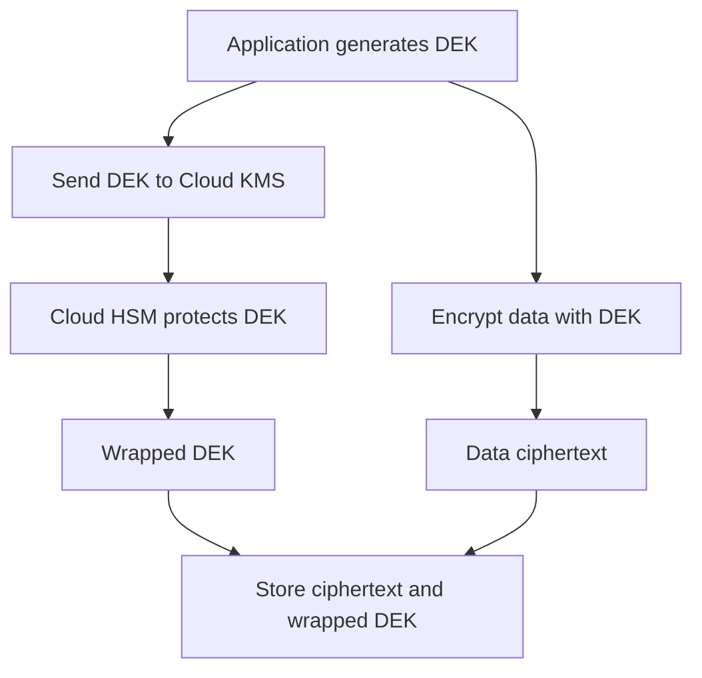
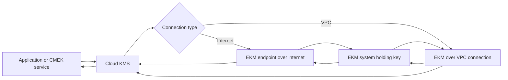

# Cloud HSM and Cloud External Key Manager

In the **Encryption Keys and Secrets** chapter of the `CLOUD_PROVIDERS_GCP` module, this lesson focuses on two key protection options with requirements beyond purely software-based Cloud KMS processing: **Cloud HSM** and **Cloud External Key Manager (Cloud EKM)**. The module helps learners understand how to organize projects, IAM, and VPCs; choose Compute Engine, GKE, Cloud Run, storage services, and databases; and then deploy, protect resources, automate releases, and monitor reliability and cost. Key management is an important part of that chain of decisions: a service may encrypt data at rest, but the organization still needs to determine who controls the keys, where the keys are protected, and what happens when a key becomes inaccessible.

Both Cloud HSM and Cloud EKM are used through **Cloud Key Management Service (Cloud KMS)**. The difference lies in where key material is stored and where cryptographic operations are executed. With Cloud HSM, keys are protected and processed inside HSM hardware operated by Google Cloud. With Cloud EKM, the primary key material resides in a key management system external to Google Cloud; Cloud KMS forwards requests to that system when operations need to be performed.

## Learning Objectives

After this lesson, learners will be able to:

- Explain the roles of Cloud KMS, Cloud HSM, Cloud EKM, and CMEK in Google Cloud data protection architecture.
- Distinguish between multi-tenant HSM, single-tenant HSM, EKM over the internet, and EKM over VPC.
- Describe the key usage flow, key version lifecycle, IAM permissions, and connectivity requirements for each option.
- Create sample HSM and EKM keys using `gcloud` in a test project.
- Assess the impact of location, latency, availability, CMEK compatibility, and key rotation procedures before production deployment.

## 1. Positioning Cloud HSM and Cloud EKM in Cloud KMS Architecture

Cloud KMS is Google Cloud's centralized key management plane. Applications can call the Cloud KMS API or client libraries to encrypt, decrypt, sign, and verify signatures. Google Cloud services with **Customer-Managed Encryption Key (CMEK)** integration can use Cloud KMS keys to protect the service's own data keys.

In the *envelope encryption* model, large data is encrypted using a data encryption key (DEK). Cloud KMS protects the DEK with a root key or key encryption key (KEK). The service stores the ciphertext along with the metadata required for decryption; when data needs to be read, the service asks Cloud KMS to unwrap the DEK and then uses the DEK to decrypt the data. Thus, the key managed in Cloud KMS does not have to directly encrypt every byte of a large file.

Cloud HSM and Cloud EKM are key protection levels within Cloud KMS. They do not replace IAM, network design, workload identity management, or storage policies. A bucket, database, or GKE workload still requires proper CMEK configuration, permissions granted to the appropriate service identity, and resource placement in a location compatible with the key.

### Resource hierarchy and key versions

Cloud KMS organizes resources according to the following hierarchy:

```text
Google Cloud organization
└── Key management project
    └── Location
        └── Key ring
            └── CryptoKey
                ├── CryptoKeyVersion 1
                ├── CryptoKeyVersion 2
                └── CryptoKeyVersion 3 (primary)
```

- **Project** defines the governance boundary and where Cloud KMS resources live. For critical systems, consider a dedicated key management project to separate key administration permissions from application operations permissions.
- **Location** defines the geographic location of the key ring and the keys within it. The location must support the selected protection level and be compatible with the service using CMEK.
- **Key ring** is a logical container for keys in the same location. Key ring names can be repeated in different locations, so you must always specify both project and location when referencing them.
- **CryptoKey** is the logical resource carrying the purpose, rotation configuration, version template, and IAM policy.
- **CryptoKeyVersion** represents a version of key material. Each version has its own state such as `ENABLED`, `DISABLED`, or pending destruction. The primary version is used for new encryption operations for symmetric keys; older versions generally need to be retained to decrypt previously encrypted data.

Example full resource name:

```text
projects/PROJECT_ID/locations/asia-southeast1/keyRings/app-ring/cryptoKeys/orders-key
```

Each `CryptoKey` has a `purpose`, such as symmetric encryption/decryption or asymmetric signing/verification. Valid algorithms depend on the purpose and protection level. When choosing Cloud HSM or Cloud EKM, check which algorithms are supported for that specific key type and EKM partner.

### How does CMEK differ from Secret Manager?

CMEK and Cloud KMS manage **cryptographic keys** used to protect data. Secret Manager stores **application secret values**, such as database passwords, API tokens, or certificates. An application might retrieve a password from Secret Manager and use a CMEK key to protect data in a storage service. The two services address different needs and can be used together.

## 2. Cloud HSM: Keys Protected in Hardware

### What is an HSM?

A Hardware Security Module (HSM) is a dedicated device designed to generate, store, and execute cryptographic operations within a protected hardware boundary. Cloud HSM provides HSMs hosted in Google Cloud data centers. Google manages the HSM cluster, scaling, availability, and hardware maintenance; users manage keys through Cloud KMS.

According to current Cloud HSM documentation, the HSMs used for the service are certified to **FIPS 140-2 Level 3**. This protection level suits organizations needing to demonstrate that key material and cryptographic operations are processed in certified hardware. Selecting an HSM does not automatically make the entire application compliant: identities, service configurations, logging, operational procedures, and the system's audit scope must still be evaluated separately.

Cloud HSM uses Cloud KMS as its management interface. Therefore, applications can generally continue using the existing Cloud KMS API or client libraries; there is no need to write a custom protocol simply because a key moves from `SOFTWARE` to `HSM`.

### Multi-tenant HSM and single-tenant HSM

Cloud HSM offers two primary hardware protection levels:

| Protection level | Model | When to consider |
|---|---|---|
| `HSM` | Keys are stored and processed in a multi-tenant HSM cluster owned and operated by Google. | Need FIPS Level 3 hardware protection while letting Google manage the HSM infrastructure. |
| `HSM_SINGLE_TENANT` | Keys are stored in dedicated HSM partitions for a single customer. The customer creates and manages single-tenant HSM instances according to the service's governance mechanisms. | Need higher cryptographic isolation and control over instance operations. |

Both levels are used through Cloud KMS. Single-tenant HSM requires an instance governance plan, an administrator group, and appropriate approval workflows; it should not be selected merely because of the label "single-tenant." You must identify which isolation requirements are satisfied by a dedicated partition and which still depend on projects, IAM, applications, or Google Cloud services.

### What Cloud HSM protects

When creating a key with protection level `HSM`, cryptographic operations using versions of that key are executed inside the HSM. Keys can be newly generated inside Cloud HSM or imported externally following supported import workflows. Common use cases include:

- Symmetric keys to encrypt and decrypt data or data encryption keys.
- Asymmetric keys to sign, verify signatures, or perform operations supported by the key's algorithm and purpose.
- CMEK keys protecting data at rest in Google Cloud services with compatible integrations.
- Keys called directly by applications via the Cloud KMS API or client libraries.

Cloud HSM fits when an organization needs to keep keys inside a Google-operated hardware boundary, needs evidence of hardware certification levels, or wants to reduce the burden of running its own HSM clusters. The project sending cryptographic requests consumes Cloud KMS operations quota; the project containing the HSM key consumes HSM QPM quota. High-traffic systems should verify both quotas before going to production.

### Creating a key ring and HSM key with gcloud

The following example creates a key ring and a multi-tenant symmetric key in the `asia-southeast1` location. Replace `PROJECT_ID` with your test project and confirm the location supports Cloud HSM before running.

```bash
gcloud config set project PROJECT_ID

gcloud services enable cloudkms.googleapis.com

gcloud kms keyrings create app-ring \
  --location=asia-southeast1

gcloud kms keys create orders-data-key \
  --keyring=app-ring \
  --location=asia-southeast1 \
  --purpose=encryption \
  --protection-level=hsm
```

To create a single-tenant HSM key, the protection level is `hsm-single-tenant` and you must specify the single-tenant HSM instance resource in `--crypto-key-backend`. The instance and key ring must be in the same location. Replace `LOCATION_SUPPORTING_SINGLE_TENANT_HSM` with a location that currently supports single-tenant HSM; do not assume the location used in the multi-tenant HSM example also supports this level. The example below assumes the `dedicated-ring` key ring and the HSM instance are created in that location:

```bash
gcloud kms keyrings create dedicated-ring \
  --location=LOCATION_SUPPORTING_SINGLE_TENANT_HSM

gcloud kms keys create orders-data-key-dedicated \
  --keyring=dedicated-ring \
  --location=LOCATION_SUPPORTING_SINGLE_TENANT_HSM \
  --purpose=encryption \
  --protection-level=hsm-single-tenant \
  --crypto-key-backend="projects/INSTANCE_PROJECT/locations/LOCATION_SUPPORTING_SINGLE_TENANT_HSM/singleTenantHsmInstances/INSTANCE_NAME"
```

`INSTANCE_PROJECT` and `INSTANCE_NAME` are the project and name of an instance already created, configured, and approved under the single-tenant Cloud HSM workflow. The example command does not create that instance itself.

After creation, inspect the key and version in Cloud KMS, verifying protection level, purpose, algorithm, state, and primary version. Do not roll a key out to a workload based solely on the creation command returning success.

### Using HSM keys for large data

Cloud HSM limits the size of user-supplied plaintext/ciphertext for direct cryptographic operations to **8 KiB**, including additional authenticated data. Therefore, you should not call Cloud KMS to directly encrypt individual large files or large application payloads.

For large data, use envelope encryption:

1. The application generates a random DEK using an appropriate cryptographic random number generator.
2. The application uses the DEK to encrypt data with an authenticated symmetric algorithm, such as AES-GCM.
3. The application sends the DEK to Cloud KMS to be encrypted (wrapped) using the HSM key.
4. The application stores the ciphertext, wrapped DEK, and necessary metadata such as key name, key version, and nonce.
5. On read, the application asks Cloud KMS to decrypt the DEK and then uses the DEK to decrypt the data.



When using built-in CMEK integration, the Google Cloud service typically manages the DEK and wrap/unwrap operations automatically. Operators only need to configure CMEK, key access permissions, and related policies according to the service's instructions.

## 3. Cloud External Key Manager: Keeping Key Material in External Systems

### Purpose and trust boundary

Cloud External Key Manager allows using keys generated and stored by a key management system external to Google Cloud. That system may be operated by the organization or provided by a supported EKM partner. Cloud KMS holds a reference to the external key and forwards cryptographic requests to the EKM when needed.

External key material is not sent to Google Cloud and is neither cached nor stored by Cloud EKM. For symmetric keys, Cloud KMS also generates separate internal key material to add a protection layer when communicating with the EKM. Therefore, you must clearly distinguish **external key material** from **Cloud KMS internal key material**. To decrypt data encrypted with Cloud EKM, both corresponding components are required; keeping only the URI or path to the EKM is not enough.

Each Cloud EKM version has the following core components:

- **External key material**: generated and stored in the EKM, never leaving that system.
- **Key reference**: URI or key path identifying the key inside the EKM. Cloud EKM uses this reference to dispatch requests.
- **Internal key material**: for symmetric keys, Cloud KMS generates and retains additional material to protect the exchange flow. This component does not apply in the same way to asymmetric signing keys.

Overview processing flow:



For symmetric operations, Cloud KMS and the EKM coordinate to process data according to the Cloud EKM protocol. The final result depends on both the Cloud EKM version and the key in the EKM. If the Cloud EKM version is lost or access to the external key material is lost, encrypted data may be unrecoverable.

### Two protection levels: EXTERNAL and EXTERNAL_VPC

| Protection level | Connection path | Considerations |
|---|---|---|
| `EXTERNAL` | Google Cloud communicates with the EKM over the internet. | Usable across many Cloud KMS locations, including some multi-regional locations. Depends on network quality and availability of the EKM endpoint. |
| `EXTERNAL_VPC` | Google Cloud communicates with the EKM over VPC via an EKM connection configuration. | Reduces reliance on the public internet and can improve availability. Currently supported only in eligible regional locations, not multi-regional locations. |

Choose the connection path based on actual network architecture and availability requirements. EKM over VPC still requires operating the EKM endpoint, VPC, connectivity, routing, access controls, and partner-side capacity. VPC does not automatically eliminate all network failures or EKM-side failures.

### Manually managed vs. coordinated external keys

Cloud EKM has two ways to manage key lifecycles:

**Manually managed external keys**

- An administrator creates the key in the EKM system first.
- An administrator grants permission for the Cloud EKM service identity to use that key.
- An administrator creates the corresponding key/version in Cloud KMS using the URI or key path.
- Rotation, disabling, and destruction must be coordinated in both Cloud KMS and the EKM in the proper order.
- EKM keys over the internet are always manually managed. Automatic rotation is not supported for manually managed external keys.

**Coordinated external keys**

- Used only with EKM over VPC and partners that support the Cloud EKM control plane.
- The EKM connection is configured in Cloud KMS-managed mode.
- When creating a key, Cloud KMS sends a request to the EKM; the EKM generates the key material and returns the key path.
- Operations to create a new version, rotate, or destroy can be initiated from Cloud KMS and coordinated with the EKM.
- Coordinated symmetric keys can support automatic rotation on a configured schedule.

Do not confuse rotating a version in Cloud KMS with rotating key material in the EKM. In the manual model, both sides must be updated and the primary version verified. In the coordinated model, you still must verify that the EKM partner completed the operation and that the new version is usable.

### Preparing and creating an EKM key over the internet

Before creating the key, complete the following:

1. Choose a Google Cloud project to manage Cloud KMS resources. For critical environments, consider a dedicated key project.
2. Enable the Cloud KMS API and create a key ring in a location that supports Cloud EKM, as close as possible to both the protected resource's location and the EKM.
3. Create or select the key in the EKM system. Record the key's URI.
4. Identify the project's Cloud EKM service account. A common format is `service-PROJECT_NUMBER@gcp-sa-ekms.iam.gserviceaccount.com`.
5. Grant this service account permission to use the key inside the EKM system. This is an EKM-side permission, independent of Cloud KMS IAM policies.
6. If choosing EKM over VPC, create and test the EKM connection before creating keys.

The example below creates a manually managed symmetric EKM key over the internet. Replace placeholders with actual values in your test environment. Do not use sample URIs or dummy service accounts in production.

```bash
gcloud config set project PROJECT_ID

gcloud services enable cloudkms.googleapis.com

gcloud kms keyrings create app-ekm-ring \
  --location=asia-southeast1

# Create an empty CryptoKey; the version will be linked in the next step.
gcloud kms keys create customer-data-ekm \
  --keyring=app-ekm-ring \
  --location=asia-southeast1 \
  --purpose=encryption \
  --protection-level=external \
  --skip-initial-version-creation \
  --default-algorithm=google-symmetric-encryption

# Link the Cloud EKM version to an existing key in the EKM.
gcloud kms keys versions create \
  --key=customer-data-ekm \
  --keyring=app-ekm-ring \
  --location=asia-southeast1 \
  --external-key-uri=EXTERNAL_KEY_URI \
  --primary
```

For keys over VPC, create the EKM connection first and configure the `external-vpc` protection level, then specify the connection in `--crypto-key-backend`. If the partner supports coordinated management mode, configure the EKM connection in Cloud KMS mode before creating keys. Exact syntax and required flags may differ depending on connection type and Google Cloud CLI version; check `gcloud kms keys create --help` and the partner's documentation before running.

After creation, verify the version state. If the URI is wrong, the EKM cannot find the key, or the service account lacks permission, the version may fail to be created. Fix the root cause on the EKM side or in configuration and retry; do not attach a key without a usable version to a workload.

### Key Access Justifications

If the organization uses Key Access Justifications (KAJ) with a supported EKM, each key access request can include an access reason code. The EKM partner can log and allow or deny requests based on the reason code according to configured policies.

KAJ is helpful when the organization needs additional evidence explaining why a key access operation was performed. However, KAJ does not replace IAM, audit logs, or change approval processes. Check EKM partner support, reason code policies, and behavior when a request is denied.

## 4. Comparing Cloud HSM and Cloud EKM

| Criterion | Cloud HSM | Cloud EKM |
|---|---|---|
| Where primary key material is held | HSM in Google Cloud infrastructure. | EKM system external to Google Cloud. |
| Where operations execute | Inside the HSM. | EKM performs the portion requiring the external key; Cloud KMS coordinates via the EKM protocol. |
| Protection level | `HSM` or `HSM_SINGLE_TENANT`. | `EXTERNAL` or `EXTERNAL_VPC`. |
| External connectivity | Does not require calling a customer EKM on every operation. | Requires connectivity to the EKM over internet or VPC. |
| Key control | Managed via Cloud KMS; Google operates the HSM infrastructure. | Organization/partner manages key material and EKM-side permissions; Cloud KMS manages references and corresponding versions. |
| Rotation | Rotation schedule can be configured for symmetric keys per Cloud KMS capabilities. | Manual requires two-sided coordination; coordinated over VPC can support automatic symmetric key rotation. |
| Key operational risks | Location, quotas, IAM permissions, HSM limits, and latency of some asymmetric operations. | Connectivity loss, EKM unavailability, revoked permissions, wrong URI/key path, and version desynchronization. |
| Best suited when | Need certified HSM hardware and want Google to manage HSM infrastructure. | Need to keep key material in a key management system outside Google Cloud or enforce access control on the EKM side. |

Neither option is universally better than the other. Cloud HSM generally fits when the primary requirement is certified HSM hardware, direct Cloud KMS integration, and reduced dependence on external cryptographic systems. Cloud EKM fits when the organization must keep key material in an external system or enforce centralized key policies at the EKM. In return, Cloud EKM increases reliance on the partner and the network connection.

## 5. IAM, Separation of Duties, and Monitoring

### Role-based permissions

Cloud KMS uses Identity and Access Management (IAM). Permissions can be granted at the key, key ring, project, folder, or organization level; permissions at parent levels inherit down to child resources.

Separate at least two groups of duties:

- **Key administration**: creating key rings, creating keys, updating policies, rotating, and scheduling version destruction. The `roles/cloudkms.admin` role carries broad administrative permissions, so grant it only to the team responsible for managing keys.
- **Key usage**: workloads or service agents only need permissions to perform cryptographic operations. For encryption/decryption use cases, the commonly used role is `roles/cloudkms.cryptoKeyEncrypterDecrypter` on the exact key needed.

For CMEK, identify the service agent of the service protecting the data and grant the required Cloud KMS permissions to that identity. For Cloud EKM, in addition to Cloud KMS IAM, grant separate permission to the Cloud EKM service account inside the EKM system. These two permission layers serve different boundaries; granting permission in one place does not automatically grant it in the other.

Practical guidelines:

- Prefer granting permissions at the key level rather than broadly at the project level when a workload only needs a single key.
- Use dedicated service accounts for workloads and Google Groups for administrators; avoid using individual user accounts as application identities.
- Separate principals permitted to use a key from principals permitted to destroy key versions if your risk model requires separation of duties.
- Review inherited permissions from folders and organizations; a parent-level binding can expand permissions unexpectedly.
- Never store private keys, URIs containing sensitive details, or EKM credentials in source code, images, shared environment variables, or application logs.

### Audit logs and operational observability

Cloud Audit Logs record Cloud KMS administrative and data access activity. You can find service records using the Logs Explorer query:

```text
protoPayload.serviceName="cloudkms.googleapis.com"
```

Admin Activity logs capture administrative changes. Data Access logs must be enabled according to project or organization logging configuration to track corresponding data access operations. With Cloud EKM, enable audit logging on the EKM system as well to correlate incoming requests from Google Cloud with allow/deny decisions on the partner side.

When monitoring, track:

- Encryption/decryption error rates and key access permission errors.
- Connection failures, timeouts, and responses from the EKM partner.
- Key version states, primary versions, and older versions still used by existing data.
- Cryptographic operation quotas, HSM quotas, and Cloud EKM-specific quotas.
- IAM changes, rotation operations, disabling, and scheduled version destruction.

With Cloud EKM, inability to access a key may surface as `FAILED_PRECONDITION`. Correlate error details across Cloud Audit Logs, Cloud KMS, and EKM partner logs to determine whether it is a network error, bad reference, missing permission, or unresponsive EKM.

## 6. Rotation, Disabling, and Destruction

Rotation creates a new key version. For symmetric keys, the new primary version is used for data encrypted after rotation. Older ciphertext still requires older versions to decrypt, so switching the primary version does not mean data has been re-encrypted with the new version.

A safe operational workflow should include:

1. Identify which systems use the key and which versions have protected existing data.
2. Create a new version according to the workflow appropriate for HSM or EKM.
3. Verify the new version is in a usable state and perform a controlled encrypt/decrypt test.
4. Switch the primary version if the intent is to use the new version for subsequent encryption operations.
5. Monitor for errors during the transition and retain older versions needed to decrypt existing data.
6. Only schedule destruction of older versions after confirming no data or systems still depend on them, while meeting retention and recovery requirements.

With manually managed EKM, execute changes in the EKM and Cloud KMS in the partner's specified sequence. Do not delete a key in the EKM merely because the Cloud KMS version was rotated. With coordinated EKM, verify the operation result in both systems and retain operational evidence.

`DISABLED` means the version cannot be used for cryptographic operations until re-enabled; if a service needs that version to read data, disabling it can render the data temporarily inaccessible. Destroying a version after its waiting period is irreversible; once the required key material is destroyed, data depending on it may be permanently lost.

## 7. Location, Compatibility, and Limits to Verify

### Key and resource location

For CMEK, the key location must match the exact location required by the protected service. This applies to regional, dual-region, and multi-regional locations per each integration's rules. Cloud HSM is not available in every location; single-tenant HSM is available in a subset of locations supporting multi-tenant HSM.

Cloud EKM should be placed near the EKM partner to minimize latency and timeout errors. EKM over the internet is available in many Cloud KMS locations, while EKM over VPC is only available in supported regional locations and not in multi-regional locations. Some locations such as `global` and `nam-eur-asia1` do not support Cloud EKM. Location availability can change; always check the Cloud KMS locations page before designing or deploying.

### CMEK service compatibility

Not every service supporting CMEK supports Cloud EKM. A service might support CMEK with software and HSM Cloud KMS keys but not EKM keys. Before choosing EKM, check the CMEK integrations list and the EKM-compatible filter for the exact resource type, such as bucket, dataset, database, disk, or GKE application-layer data.

### Availability and loss-of-access risk

Cloud HSM removes dependence on a customer-operated EKM, but still depends on supported locations, quotas, IAM, and Cloud KMS/HSM service health.

Cloud EKM introduces a direct dependency on an external system. If the EKM is unavailable, Cloud KMS cannot complete requests requiring that key. Consequences depend on the service: workloads may error, applications may fail to start, or data may become undecryptable. In some integrations, prolonged key unavailability can lead to severe consequences such as data loss. Rotating to a new version does not automatically recover data encrypted with an inaccessible older version.

Therefore, before using EKM for production data:

- Confirm SLAs and support processes for both Google Cloud and the EKM partner.
- Design endpoints, connectivity, and EKM capacity to withstand peak loads.
- Test connectivity loss, timeouts, permission revocation, and EKM recovery scenarios.
- Maintain backups and rehearse recovery following the storage or database service's exact procedures.
- Clearly define incident responders on each side and how to contact support.

## 8. Deployment Scenarios and Service Selection

### Scenario A: Bucket storing records requires an HSM key

An operations team stores customer records in Cloud Storage. Internal policy requires CMEK keys to be protected by a certified HSM. The team can:

1. Create a dedicated key management project within the same organization.
2. Select a location that supports Cloud HSM and matches the bucket's required location.
3. Create a key ring and a key with protection level `HSM`.
4. Grant key usage permissions to the Cloud Storage service agent per the service's CMEK documentation.
5. Create the bucket with the selected CMEK, enable required audit logs, and monitor key operations.
6. Test data reads/writes, data recovery, and rotation workflows before putting it into production use.

In this case, Cloud HSM meets hardware requirements without requiring the team to operate an external EKM system.

### Scenario B: Organization needs to keep keys in its own EKM

An organization already operates a supported EKM system and requires primary key material to stay inside that system. The deployment team:

1. Selects a Cloud KMS location near the EKM and compatible with the target CMEK service.
2. Decides between internet or VPC connectivity based on network, latency, and availability requirements.
3. Grants permission to the Cloud EKM service account inside the EKM.
4. Creates the Cloud EKM key using the URI/key path and verifies the version.
5. Configures IAM for the Google Cloud service's service agent to use the CMEK.
6. Enables audit logs in both Cloud KMS and the EKM, tests controlled permission revocation, and rehearses recovery.

If rotation needs to be managed from Cloud KMS, the team must confirm the partner supports coordinated external keys and that the EKM connection is configured in the appropriate mode. Otherwise, rotation workflows must be coordinated manually across both systems.

### Scenario C: High-traffic data with strict availability requirements

If every data read depends on an external EKM over the internet, EKM latency and availability become part of the data path. When an application has low fault tolerance, compare Cloud HSM against EKM over VPC, and check limits of the integrated service, expected load, SLAs, and cost. Do not choose EKM solely for greater control over key material if the organization cannot operate the EKM at the corresponding reliability level.

### Quick decision table

| Primary requirement | Initial selection direction |
|---|---|
| Need FIPS Level 3 HSM, Cloud KMS integration, and reduced hardware operations | Multi-tenant Cloud HSM (`HSM`). |
| Need dedicated HSM partitions and isolated instance management | Evaluate single-tenant Cloud HSM (`HSM_SINGLE_TENANT`). |
| Key material must reside in an EKM system outside Google Cloud | Cloud EKM (`EXTERNAL` or `EXTERNAL_VPC`). |
| Need private connectivity over VPC and partner supports lifecycle control from Cloud KMS | Cloud EKM over VPC with coordinated external keys. |
| Target service does not support Cloud EKM or workload cannot tolerate EKM dependency | Choose Cloud HSM or another suitable Cloud KMS protection level. |

## 9. Pre-Production Checklist for Keys

- [ ] Identified the data, workloads, and Google Cloud services to be protected by the key.
- [ ] Verified the target service supports CMEK and the chosen protection level.
- [ ] Selected the key management project, location, and key ring per organizational and data residency requirements.
- [ ] Chose `HSM`, `HSM_SINGLE_TENANT`, `EXTERNAL`, or `EXTERNAL_VPC` based on required trust boundaries.
- [ ] Separated key administration permissions from key usage permissions; granted least-privilege IAM to workloads/service agents.
- [ ] For EKM, confirmed the Cloud EKM service account is authorized on the partner side and connectivity has been tested.
- [ ] Defined the rotation schedule, handling of older versions, and when destruction is allowed.
- [ ] Enabled appropriate audit logs and checked logs in both Cloud KMS and the EKM partner if applicable.
- [ ] Tested quotas, latency, permission errors, connectivity failures, and recovery procedures.
- [ ] Documented runbooks, on-call contacts, support agreements, and recovery test evidence.

## 10. Conclusion

Cloud HSM provides key protection and processing inside Google Cloud-managed HSM hardware, suited for hardware certification requirements and Cloud KMS integration. Cloud EKM allows organizations to keep primary key material in an external key management system while using Cloud KMS to integrate with compatible Google Cloud services. The right choice depends on key control boundaries, data residency, compliance requirements, availability, operational capability, and target service support.

In real-world GCP architectures, treat keys as part of the overall security design: projects and IAM determine who manages and who uses keys; VPCs and locations affect connectivity paths; services such as Compute Engine, GKE, Cloud Run, Cloud Storage, and databases dictate how CMEK is integrated; and audit logs, quotas, and recovery drills sustain reliability. A sound key configuration must be verified at creation, during usage, across rotation, and during incidents.

## References

- [Cloud Key Management Service overview](https://cloud.google.com/kms/docs/key-management-service)
- [Cloud HSM](https://cloud.google.com/kms/docs/hsm)
- [Cloud External Key Manager](https://cloud.google.com/kms/docs/ekm)
- [Protection levels](https://cloud.google.com/kms/docs/protection-levels)
- [Create an external key](https://cloud.google.com/kms/docs/create-external-key)
- [Access control with IAM](https://cloud.google.com/kms/docs/iam)
- [Cloud KMS audit logging](https://cloud.google.com/kms/docs/audit-logging)
- [Cloud KMS locations](https://cloud.google.com/kms/docs/locations)
