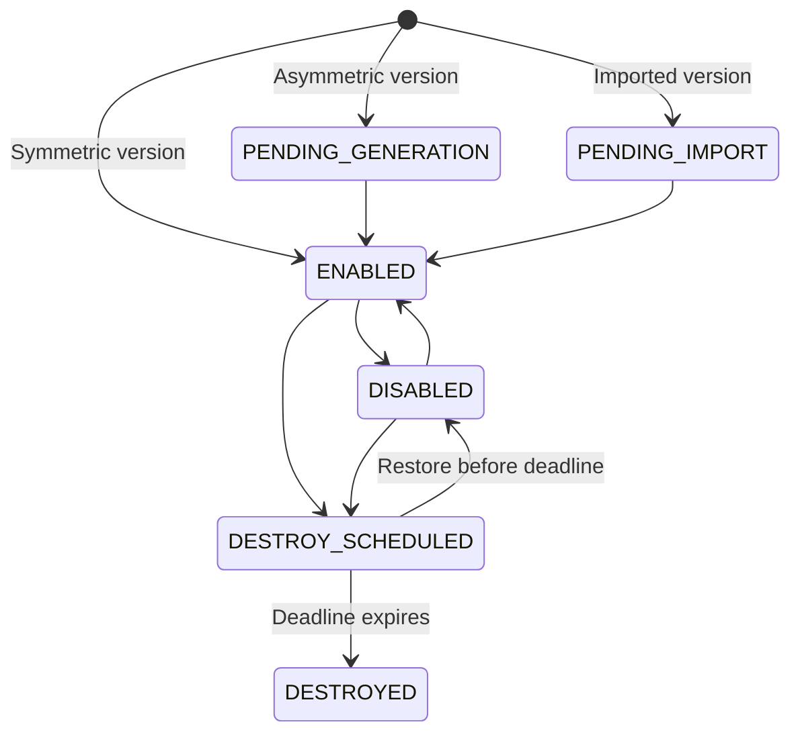
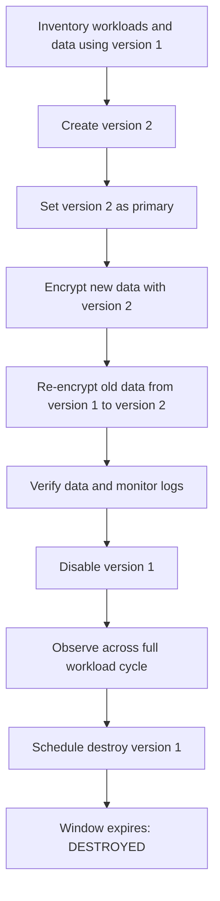

# Key Rotation, Disabling, Destruction, and Key Version Restoration

In Google Cloud, Cloud Key Management Service (Cloud KMS) manages key material used to encrypt, decrypt, sign, and verify data. A CryptoKey can have multiple CryptoKeyVersions. The lifecycle of each version determines whether applications can continue encrypting, decrypting, or verifying data.

This topic belongs to the **CLOUD_PROVIDERS_GCP** module, where learners explore organizing projects, IAM, VPC, Compute Engine, GKE, Cloud Run, storage, and databases. Key lifecycle management is a cross-cutting protection capability across those services: disabling or destroying a key at the wrong time can cause workloads to stop functioning or render data inaccessible.

After this lesson, you will be able to:

- Distinguish between CryptoKey and CryptoKeyVersion, and explain the role of the primary version.
- Set up a rotation schedule or manually create new versions.
- Choose the right time to disable a version to test retiring its usage.
- Distinguish destroy from delete and explain the recovery window.
- Build a workflow to inventory, migrate data, monitor, and retire old versions.

## 1. CryptoKey and CryptoKeyVersion

**CryptoKey** is the logical resource representing a key in Cloud KMS. **CryptoKeyVersion** contains the actual cryptographic key material. Each time a new version is created, Cloud KMS creates a new set of key material belonging to the same CryptoKey.

For symmetric encryption keys, one version is selected as the **primary version**. New encryption requests use the current primary version. Ciphertext generated by Cloud KMS stores information about the version used, so when decrypting, Cloud KMS can select the right older version as long as that version remains in the ENABLED state. Switching the primary version does not automatically convert existing ciphertext.

For asymmetric keys, the application specifies a particular version when encrypting or signing. The application must manage distributing the public key and choosing versions; there is no automatic rotation mechanism like symmetric encryption keys.

One key point to remember: **CryptoKey does not have an ENABLED or DISABLED state; state is assigned per CryptoKeyVersion.**

| State | Meaning | Usable for cryptographic operations? |
|---|---|---|
| PENDING_GENERATION | Cloud KMS is generating an asymmetric version | Not yet |
| PENDING_IMPORT | Cloud KMS is importing key material | Not yet |
| ENABLED | Version is ready for use | Yes |
| DISABLED | Key material still exists but version is blocked from use | No; can be re-enabled |
| DESTROY_SCHEDULED | Version is waiting for the destruction delay to expire | No; can be restored within the window |
| DESTROYED | Key material has been logically destroyed | No; cannot be normally restored |

Core state flow:



When restoring a version in DESTROY_SCHEDULED, the state after restoration is DISABLED. You must enable the version separately before using it for cryptographic operations.

## 2. Rotation: Creating a New Version and Switching Primary

Rotation is the process of creating new key material to use for subsequent encryption or signing operations. Rotation helps limit the amount of data protected by a single version and supports key governance policies.

### Automatic rotation

For symmetric encryption keys, you can configure:

- **Rotation period**: the interval between creating new versions.
- **Next rotation time**: the timestamp when the next rotation will execute.

When scheduled, Cloud KMS automatically creates a new version and sets it as primary. For example, a 90-day schedule creates a new primary version every 90 days. This number is only an example; the actual period should be based on security, operational, and organizational regulatory requirements.

Example updating the schedule for an existing key:

```bash
gcloud kms keys update orders-data-key \
  --keyring=application-keyring \
  --location=asia-southeast1 \
  --rotation-period=90d \
  --next-rotation-time=2026-12-01T00:00:00Z
```

Automatic rotation is not supported for asymmetric keys used for signing or encryption. For those keys, the operations team must create a new version, distribute the public key or update application configurations, and then transition workloads to the new version under a separate process.

### Manual rotation

You can create a new version immediately when needed, such as during a scheduled key replacement or when policy requires an algorithm change. Command to create a version:

```bash
gcloud kms keys versions create \
  --key=orders-data-key \
  --keyring=application-keyring \
  --location=asia-southeast1
```

This command creates a new version but **does not automatically set it as primary**. For symmetric keys, obtain the newly created version number, verify the version is in the ENABLED state, and then update primary:

```bash
gcloud kms keys update orders-data-key \
  --keyring=application-keyring \
  --location=asia-southeast1 \
  --primary-version=2
```

Replace 2 with the actual version just created. Only one version can be primary at a time. The version selected as primary must be in the ENABLED state.

### Rotation does not automatically re-encrypt old data

This is the most important difference between rotation and re-encryption:

- Rotation creates a new version and shifts new encryption operations to that version.
- Old ciphertext still depends on the version that encrypted it.
- Older versions are not automatically disabled or destroyed after rotation.
- Applications still need the older version to decrypt data previously encrypted with that version.

For example, version 1 encrypted 4 million records. After creating version 2 and setting it as primary, new records are encrypted with version 2; the 4 million older records still need version 1 to decrypt. If version 1 is disabled or destroyed too early, applications may lose the ability to read legacy data.

To remove dependency on an older version, the application must perform **re-encryption**:

1. Identify data, services, and workloads using the older version.
2. Read the ciphertext and decrypt it using the older version while it is still ENABLED.
3. Encrypt the plaintext using the new primary version.
4. Write the new ciphertext safely; verify data before replacing old records.
5. Reconcile record counts, test reads, data integrity, and error logs.
6. Only after confirming no dependencies remain, transition the older version through the disable and then destroy process.

Cloud KMS provides cryptographic operations but does not automatically locate and rewrite every copy of data stored by applications or other services. For resources using CMEK, check the rotation and re-encryption guidance for the service protecting that resource. Key usage tracking can assist with inventorying, though tracking data may be delayed or incomplete.

## 3. Disabling and Enabling Versions

**Disabling** is a temporary measure that blocks a version from cryptographic operations. The key material remains in Cloud KMS, so the version can be re-enabled. This is a useful step when:

- Verifying whether workloads still depend on an older version.
- Temporarily preventing use of a version during an incident investigation.
- Creating an observation period before scheduling destruction.

When a version is disabled, encryption, decryption, signing, or verification requests requiring that version fail. Data encrypted with this version may become temporarily inaccessible. If the version protects a resource needed to boot an instance or container, disabling it can cause a service outage.

Before disabling:

1. List resources and workloads that might be using the version.
2. Check key usage tracking, CMEK configurations, and application logs.
3. If this is a symmetric key and the version is currently primary, switch primary to another ENABLED version before disabling. A disabled primary version cannot perform encryption.
4. Execute within an appropriate change window and monitor errors afterward.

Commands to disable and enable:

```bash
# Temporarily block version 1
gcloud kms keys versions disable 1 \
  --key=orders-data-key \
  --keyring=application-keyring \
  --location=asia-southeast1

# Re-enable version 1
gcloud kms keys versions enable 1 \
  --key=orders-data-key \
  --keyring=application-keyring \
  --location=asia-southeast1
```

Disabling typically reaches consistency within about a minute; enabling typically takes effect almost immediately. Verify the version state and check service health after making changes rather than relying on estimated timings.

## 4. Destroy: Scheduling Destruction of Key Material

**Destroying** a CryptoKeyVersion asks Cloud KMS to schedule the permanent destruction of key material. This request does not delete the key material immediately. The version transitions to DESTROY_SCHEDULED and can no longer be used for cryptographic operations during the waiting period.

The default duration for the DESTROY_SCHEDULED state is **30 days**. When creating a CryptoKey, you can configure a custom duration between 24 hours and 120 days; this value cannot be changed after the key is created and applies to future versions of that key. Organization policies may require a minimum duration or mandate disabling a version before destroying it.

Example scheduling destruction of version 1:

```bash
gcloud kms keys versions destroy 1 \
  --key=orders-data-key \
  --keyring=application-keyring \
  --location=asia-southeast1
```

You can schedule destruction of a version that is ENABLED or DISABLED. However, safe operational practice is to disable first, monitor long enough, and schedule destruction only after confirming the version is no longer used. Some organizations use Organization Policy to enforce this workflow.

Before destroying, verify:

- No applications, scheduled jobs, or recovery processes still need that version.
- No data still requires that version for decryption; data has been re-encrypted and verified.
- CMEK resources have been handled according to the corresponding service's documentation.
- Logs show no version access errors after the disable period. For workloads running quarterly or seasonally, the observation window must cover that cycle.
- Retention, audit, and compliance periods allow key destruction.
- Approvals have been obtained under the organization's key governance process.

Key usage tracking is not guaranteed to detect every dependency. Combine that data with Cloud KMS logs, application logs, service configurations, and knowledge of actual run schedules.

When the DESTROY_SCHEDULED period expires, the version transitions to DESTROYED. Key material is logically erased from active Cloud KMS systems and customers cannot recover that version through the restore operation. Google documents that key material is removed from all active systems and backups within 45 days of the destruction time. Data encrypted with a destroyed version cannot be decrypted; this is the crypto-shredding mechanism.

**Destroy differs from delete**:

- Destroy destroys a version's key material. Identifiers and version numbers may still appear in resource listings.
- Delete removes the resource from Cloud KMS listings in supported cases. Delete is not a substitute for the key material destruction workflow.

If the key has an automatic rotation schedule, destroying current versions does not disable that schedule. If the goal is to stop creating new versions, remove the rotation schedule separately:

```bash
gcloud kms keys update orders-data-key \
  --keyring=application-keyring \
  --location=asia-southeast1 \
  --remove-rotation-schedule
```

## 5. Restoring a Version Pending Destruction

If you discover a version is still needed during the DESTROY_SCHEDULED window, you can send a restore request to cancel the destruction schedule:

```bash
gcloud kms keys versions restore 1 \
  --key=orders-data-key \
  --keyring=application-keyring \
  --location=asia-southeast1
```

After restoration, the version returns to the DISABLED state. Inspect its state and then enable it separately if needed:

```bash
gcloud kms keys versions describe 1 \
  --key=orders-data-key \
  --keyring=application-keyring \
  --location=asia-southeast1

gcloud kms keys versions enable 1 \
  --key=orders-data-key \
  --keyring=application-keyring \
  --location=asia-southeast1
```

Restore can only be performed while the version is still within the DESTROY_SCHEDULED window. Once the version transitions to DESTROYED, the restore operation cannot undo destruction. An exception supported by Cloud KMS is re-importing a previously imported key version using the exact original key material; this is not a general recovery capability for all key types and does not apply to recreating a destroyed Cloud EKM version.

## 6. Sample Operational Workflow

Suppose the ordering service uses the symmetric key **orders-data-key** to protect data. Version 1 is currently primary and version 2 has just been created.



This workflow can be adapted by scenario:

| Scenario | Appropriate action | What to verify |
|---|---|---|
| Periodic rotation | Create a new version or use automatic rotation; switch primary if created manually | Application encrypts new data with the new version and still reads old data |
| Suspected key compromise | Follow incident response procedures, create a new version, assess impacted data scope, and re-encrypt by priority | Decide whether to disable the old version based on risk and ability to continue decrypting data |
| Retiring a key | Inventory, re-encrypt, disable to observe, then schedule destroy | No workloads, stored data, or recovery procedures depend on the version |
| Accidental destroy | Restore while still within the window, then enable if needed | Application reads/writes succeed and the version is back in the desired state |

For asymmetric keys, the workflow needs additional steps to distribute the new version's public key and update applications. For data encrypted with an older public key, keep the corresponding private key version in the ENABLED state until the data is decrypted or migrated. For digital signatures, verification systems may still need older public keys to validate previously issued signatures.

## 7. IAM Permissions and Change Control

Assign permissions based on required operations and adhere to the principle of least privilege. Common Cloud KMS permissions:

| Task | IAM permission |
|---|---|
| Create key version | cloudkms.cryptoKeyVersions.create |
| Change primary or rotation schedule | cloudkms.cryptoKeys.update |
| Enable or disable version | cloudkms.cryptoKeyVersions.update |
| Schedule destroy | cloudkms.cryptoKeyVersions.destroy |
| Restore version | cloudkms.cryptoKeyVersions.restore |
| Decrypt and re-encrypt data | cloudkms.cryptoKeyVersions.useToDecrypt and cloudkms.cryptoKeyVersions.useToEncrypt |

The Cloud KMS Admin role (roles/cloudkms.admin) includes common key administration permissions. The Cloud KMS CryptoKey Encrypter/Decrypter role (roles/cloudkms.cryptoKeyEncrypterDecrypter) supports encryption and decryption operations. You can combine multiple roles or create narrower custom roles for each job function.

Separate key administration responsibilities from application data reading permissions when architecture permits. Record the actor, CryptoKey, version, reason for change, timestamp, verification results, and related approvals. Configure alerts for events when a version is scheduled for destruction so the operations team has a chance to detect unplanned actions.

## 8. Common Design Mistakes

- **Destroying immediately after rotation**: the old version may still be the only key able to decrypt stored data. Re-encrypt and verify first.
- **Creating a version but forgetting to switch primary**: manual version creation does not automatically switch primary. Verify the primary version after rotation.
- **Disabling a version actively used by workloads**: this can break applications or make CMEK data inaccessible. Inventory and monitor logs first.
- **Assuming restore enables the version**: restore only puts the version into DISABLED; you must enable it separately.
- **Relying solely on key usage tracking**: tracking data can be delayed or incomplete. Combine logs, configurations, and actual execution schedules.
- **Forgetting to remove the rotation schedule when retiring a key**: the schedule can still create new versions after existing versions have been scheduled for destruction.
- **Confusing destroy with delete**: deleting a resource and destroying key material have different impacts.

## 9. Self-Check

1. A symmetric CryptoKey currently has version 1 as primary. After manually creating version 2, what step must be taken so new encryption requests use version 2?
2. Why should version 1 not be destroyed immediately after switching primary to version 2?
3. What state does a version have immediately after being restored from DESTROY_SCHEDULED? What must be done to use it again?
4. What happens to data encrypted with a version after that version transitions to DESTROYED?
5. Why is key usage tracking insufficient by itself to conclude a version is no longer in use?

**Suggested answers**

1. Verify version 2 is ENABLED and then update the CryptoKey's primary version to version 2.
2. Older data still needs version 1 to decrypt until it is re-encrypted or handled by an appropriate migration plan.
3. The version returns to DISABLED; it must be enabled separately before being used for cryptographic operations.
4. Data cannot be decrypted with the destroyed version; key material cannot be normally recovered.
5. Tracking data may be delayed or incomplete, and some workloads run infrequently. You must also inspect logs, configurations, and operational schedules.

## References

- [Google Cloud: Rotate a key](https://cloud.google.com/kms/docs/rotate-key)
- [Google Cloud: Key version states](https://cloud.google.com/kms/docs/key-states)
- [Google Cloud: Enable and disable key versions](https://cloud.google.com/kms/docs/enable-disable)
- [Google Cloud: Destroy and restore key versions](https://cloud.google.com/kms/docs/destroy-restore)
- [Google Cloud: Control key version destruction](https://cloud.google.com/kms/docs/control-key-destruction)
