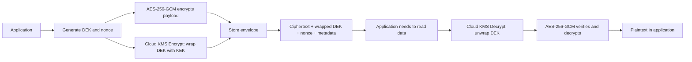

# Cloud KMS Envelope Encryption for Applications

When an application stores sensitive data in Cloud Storage, a database, or another storage system, encrypting the data reduces risk if backups, exports, or storage repositories are accessed without authorization. However, if the application uses a single key to encrypt all data, that key becomes a centralized point of risk: where to store it, how to assign permissions, how to rotate it, and how to recover older data when the key changes.

**Envelope encryption** solves this problem by using two layers of keys. The application generates a short-lived data key (*Data Encryption Key – DEK*) to encrypt the content. Google Cloud Key Management Service (Cloud KMS) protects the DEK with a managed key (*Key Encryption Key – KEK*). The application stores the ciphertext alongside the wrapped DEK; when reading is needed, the application asks Cloud KMS to unwrap the DEK and then decrypts the data on the application side.

This approach fits when the application needs to control encryption itself at the record or object level, while centrally managing key usage permissions in Google Cloud.

## 1. Objectives and Scope

After this lesson, you will be able to:

- Explain the roles of DEK, KEK, ciphertext, and wrapped key in envelope encryption.
- Describe the data encryption and decryption flow using Cloud KMS.
- Choose appropriate locations, key types, and IAM permissions for applications.
- Design a storage format that allows decrypting data after deploying new versions or rotating keys.
- Recognize common mistakes such as reusing nonces, writing keys to logs, or disabling a key version still needed to read data.

This lesson focuses on application-layer encryption. If a Google Cloud service already supports Cloud KMS with Customer-Managed Encryption Keys (CMEK), you can configure CMEK so that the service uses an organization-managed key. With application-performed envelope encryption, the application itself encrypts the payload with a DEK before storage. The two approaches can complement each other, but they are not the same mechanism.

## 2. Components of Envelope Encryption

| Component | Role |
|---|---|
| DEK (Data Encryption Key) | Random data key used to encrypt the payload with a symmetric algorithm such as AES-256-GCM. |
| KEK (Key Encryption Key) | Key in Cloud KMS used to encrypt or decrypt the DEK. The KEK never leaves Cloud KMS. |
| Wrapped DEK | The DEK after being encrypted by Cloud KMS with the KEK. The application can store this value alongside the data. |
| Ciphertext | Content encrypted with the DEK. Cloud KMS does not need to receive the full payload. |
| Nonce/IV | Input value for authenticated encryption mode. With AES-GCM, the nonce must be unique for every encryption under the same DEK. |
| AAD | Additional data that is authenticated but not encrypted, such as tenant ID or record ID. AAD binds the ciphertext to the exact context. |

In Cloud KMS, key resources have the structure:

- **Project** defines the governance and IAM boundary.
- **Location** defines the region where key resources are placed.
- **Key ring** groups keys with a common management purpose. A key ring is not a separate encryption layer.
- **CryptoKey** represents the logical key, such as a KEK used for `ENCRYPT_DECRYPT`.
- **CryptoKeyVersion** is a physical version of the key. During rotation, Cloud KMS creates a new version and can set it as the primary version.

Example resource name:

```text
projects/my-project/locations/asia-southeast1/keyRings/app-keyring/cryptoKeys/customer-data-kek
```

A KEK can have multiple versions over time. The application should store the CryptoKey name in the envelope metadata. With Cloud KMS symmetric keys, ciphertext produced by KMS contains the information KMS needs to identify the version used to encrypt; when calling `Decrypt`, the application passes the CryptoKey name. Older versions must remain available if older data still needs to be decrypted.

### Why use two layers of keys?

If a single KEK were used directly to encrypt every payload, the application would have to call Cloud KMS for each payload and would be constrained by the KMS operation input size limit. Envelope encryption only sends the small DEK to Cloud KMS to wrap or unwrap. The payload can be encrypted in the application using a standard cryptographic library, which accommodates larger data and reduces the bytes sent through KMS.

The KEK centralizes access control in Cloud KMS; the DEK isolates the actual data encryption. When replacing a KEK, the application can re-wrap the DEK without necessarily decrypting and re-encrypting the entire payload.

## 3. Architecture and Processing Flow

Encryption flow:

1. The application generates a random DEK using a cryptographically secure random number generator.
2. The application generates a unique nonce for the encryption operation and encrypts the payload with the DEK, typically using AES-256-GCM.
3. The application sends the DEK to Cloud KMS `Encrypt` to wrap the DEK with the KEK.
4. The application stores the ciphertext, wrapped DEK, nonce, and necessary metadata.

The decryption flow runs in reverse:

1. The application reads the envelope and validates the format and record context.
2. The application sends the wrapped DEK to Cloud KMS `Decrypt`.
3. Cloud KMS returns the plaintext DEK to the application.
4. The application uses the DEK, corresponding nonce, and AAD to verify and decrypt the ciphertext.
5. The application clears the DEK from controllable memory after use.



Cloud KMS receives the plaintext DEK in the `Encrypt` operation and returns the plaintext DEK in the `Decrypt` operation; therefore, permission to call KMS is a permission that can lead to data access. **The KEK never leaves Cloud KMS**, but the DEK appears in application memory during encryption or decryption. Envelope encryption avoids sending large payloads to KMS, rather than making an application with decrypt permissions harmless if the application process is compromised.

## 4. Preparing Cloud KMS

### 4.1. Choosing a location and creating keys

Choose a location based on key residency requirements, latency, organization policies, and workload placement. Key resource location must be chosen upfront because an existing CryptoKey cannot be moved to another location.

Example creating a key ring and symmetric key in `asia-southeast1`:

```bash
gcloud kms keyrings create app-keyring \
  --location=asia-southeast1

gcloud kms keys create customer-data-kek \
  --location=asia-southeast1 \
  --keyring=app-keyring \
  --purpose=encryption
```

A key with purpose `encryption` is a symmetric key used for encryption and decryption operations. Verify the active project before running commands:

```bash
gcloud config get-value project
```

The full CryptoKey name to configure for the application:

```text
projects/PROJECT_ID/locations/asia-southeast1/keyRings/app-keyring/cryptoKeys/customer-data-kek
```

Do not hardcode key names, project IDs, or sensitive environment details directly in source code. Retrieve them from deployment configurations or managed runtime configuration.

### 4.2. Granting IAM permissions per workload identity

Each workload should use a dedicated service account, such as a service account attached to a Cloud Run service or a workload running on GKE. Use Application Default Credentials (ADC) so Google Cloud libraries acquire the runtime identity; do not bundle service account JSON keys into containers or repositories.

Permissions can be granted at the CryptoKey scope to limit impact:

- Identity needing only to wrap DEKs: `roles/cloudkms.cryptoKeyEncrypter`.
- Identity needing only to unwrap DEKs: `roles/cloudkms.cryptoKeyDecrypter`.
- A workload needing both operations: `roles/cloudkms.cryptoKeyEncrypterDecrypter`.

Example granting DEK wrapping permission:

```bash
gcloud kms keys add-iam-policy-binding customer-data-kek \
  --location=asia-southeast1 \
  --keyring=app-keyring \
  --member="serviceAccount:app-encrypt@PROJECT_ID.iam.gserviceaccount.com" \
  --role="roles/cloudkms.cryptoKeyEncrypter"
```

Replace `PROJECT_ID` and the service account email with your deployment environment values. If the same service account performs both encryption and decryption, grant the role matching actual needs. Avoid granting `Owner` or `Editor` just to make KMS calls work.

Cloud KMS IAM permissions only determine which identity is allowed to use the key. The application must still verify whether the end user is permitted to read that record. Do not treat the service account's decrypt permission as a per-tenant data authorization mechanism.

## 5. Encrypting Data with a DEK

### 5.1. Generating DEK and nonce

With AES-256-GCM:

- The DEK is 32 bytes long.
- The nonce is typically 12 bytes long.
- The authentication tag is typically 128 bits long and is appended to the encryption output by the cryptographic library.

Generate the DEK and nonce using a CSPRNG, such as `SecureRandom` in Java. Do not use UUIDs, timestamps, incrementing counters, or standard `Random` as keys or nonces.

Never reuse the same nonce with the same DEK. Nonce reuse in AES-GCM severely weakens confidentiality and authenticity. A straightforward design is to generate a dedicated DEK per data object or per encryption unit, then generate a fresh nonce for that encryption.

### 5.2. Encrypting the payload in the application

Use a well-maintained cryptographic library and an AEAD algorithm such as AES-GCM. AEAD both encrypts content and detects unauthorized tampering. AAD is not encrypted, but is included in the authentication calculation.

For example, AAD can be constructed from tenant ID, record ID, and format version. Use deterministic serialization with strict rules for encoding and field ordering. If AAD changes between encryption and decryption, decryption must fail.

Do not invent custom encryption algorithms, do not strip the authentication tag, and do not ignore authentication failures. When tag verification fails, treat the data as untrusted and halt processing.

### 5.3. Wrapping the DEK with Cloud KMS

After encrypting the payload, the application calls Cloud KMS `Encrypt` with the CryptoKey name and plaintext DEK. KMS returns the ciphertext of the DEK; that value is the wrapped DEK to store.

Abbreviated Java example using the Cloud KMS library:

```java
import com.google.cloud.kms.v1.CryptoKeyName;
import com.google.cloud.kms.v1.KeyManagementServiceClient;
import com.google.protobuf.ByteString;

byte[] wrapDek(
        KeyManagementServiceClient kms,
        CryptoKeyName kekName,
        byte[] dek) {
    return kms.encrypt(kekName, ByteString.copyFrom(dek))
            .getCiphertext()
            .toByteArray();
}

byte[] unwrapDek(
        KeyManagementServiceClient kms,
        CryptoKeyName kekName,
        byte[] wrappedDek) {
    return kms.decrypt(kekName, ByteString.copyFrom(wrappedDek))
            .getPlaintext()
            .toByteArray();
}
```

Construct `CryptoKeyName` using project ID, location, key ring, and CryptoKey:

```java
CryptoKeyName kekName = CryptoKeyName.of(
        projectId,
        "asia-southeast1",
        "app-keyring",
        "customer-data-kek");
```

This snippet illustrates the two core KMS operations. In a production application, manage the `KeyManagementServiceClient` lifecycle alongside the application lifecycle, handle errors and timeouts, and do not create a new client for every record. The library uses ADC to authenticate the runtime identity.

If you need to bind the wrapped DEK to a specific context, you can provide `additionalAuthenticatedData` to the KMS `Encrypt` call and must provide the exact same value when calling `Decrypt`. This is the AAD of the DEK wrapping layer. It is independent of the AAD the application uses in AES-GCM to protect the payload.

### 5.4. Storing the envelope

An envelope can be represented in JSON as follows:

```json
{
  "formatVersion": 1,
  "kmsKey": "projects/my-project/locations/asia-southeast1/keyRings/app-keyring/cryptoKeys/customer-data-kek",
  "algorithm": "AES-256-GCM",
  "nonce": "BASE64_NONCE",
  "wrappedDek": "BASE64_KMS_CIPHERTEXT",
  "ciphertext": "BASE64_DATA_CIPHERTEXT",
  "context": {
    "tenantId": "tenant-42",
    "recordId": "invoice-2026-001"
  }
}
```

This is an illustrative format; the application must define a clear schema, size limits, and version upgrade rules. If AAD is reconstructed from `context` fields, specify exactly how those fields are canonicalized. You may store AAD separately if needed, but remember AAD is not secret and must be validated against the actual record context.

When storing envelopes:

- Never store the plaintext DEK.
- Never write the DEK, plaintext, wrapped DEK, or authentication tokens to application logs.
- Preserve the nonce, wrapped DEK, ciphertext, and complete format metadata; missing any component can make the data undecryptable.
- Store `kmsKey` so you know which CryptoKey to call during decryption.
- Validate field lengths and data types on read to prevent decryption errors or abnormal resource consumption.

## 6. Decrypting Data

When the application needs to read data:

1. Read the envelope and validate `formatVersion`, algorithm, sizes, and metadata.
2. Identify the CryptoKey from the stored `kmsKey`. Accept only key resources present in the application's trusted configuration list.
3. Call Cloud KMS `Decrypt` with the wrapped DEK and the KMS-layer AAD if used during encryption.
4. Use the returned DEK to decrypt the ciphertext with AES-GCM, using the exact payload nonce and AAD.
5. Return plaintext only to authorized processing paths.
6. Clear or overwrite the DEK buffer as permitted by the runtime after use.

AES-GCM verifies the authentication tag during `doFinal`. If the data, nonce, or AAD was modified, the library raises an authentication error. Never catch the exception and return unauthenticated data.

In Java, payload decryption looks like:

```java
Cipher cipher = Cipher.getInstance("AES/GCM/NoPadding");
cipher.init(
        Cipher.DECRYPT_MODE,
        new SecretKeySpec(dek, "AES"),
        new GCMParameterSpec(128, nonce));
cipher.updateAAD(aad);
byte[] plaintext = cipher.doFinal(ciphertext);
```

This code must sit within an execution flow with clear error handling and key lifecycle control. You can use `Arrays.fill(dek, (byte) 0)` in a `finally` block to overwrite the application-managed byte array. However, the JVM or cryptographic library may make internal copies; overwriting does not guarantee all copies in memory have vanished.

If Cloud KMS denies permission, cannot find the key, or cannot decrypt the wrapped DEK, the application must abort the read operation and return an appropriate error. There must be no fallback path to plaintext or another default key.

## 7. Key Rotation and Reading Older Data

KEK rotation is part of the data lifecycle, not just creating a new key version.

When Cloud KMS creates a new version and sets it as the primary version:

- New `Encrypt` operations use the current primary version.
- Older wrapped DEKs still require the version used to wrap them.
- KMS can decrypt ciphertext using older versions while those versions remain available.
- Creating a new version does not automatically re-encrypt stored wrapped DEKs or payloads.

There are two common levels of change:

**Rotating versions within the same CryptoKey.** The application continues calling `Encrypt` and `Decrypt` using the CryptoKey name. KMS uses the primary version for new encryption operations and identifies the appropriate version when decrypting older ciphertext. Do not disable or destroy older versions while data still depends on them.

**Switching to a different CryptoKey.** For each envelope, the application uses the old key to unwrap the wrapped DEK, then uses the new CryptoKey to re-wrap the DEK. The payload ciphertext does not need to change because the DEK stays the same. Only update `kmsKey` and the wrapped DEK after the re-wrap succeeds and the record is durably persisted.

A key migration process should be safely re-runnable: track per-record status, process in batches, verify decryptability after updates, and retain the old key during the recovery window. Only disable or schedule destruction of key versions after verifying that no data, backups, or exports still require that version. Destroying a key can make data unrecoverable.

## 8. Operational Safeguards

### Separating permissions and environments

- Use separate service accounts per workload and per environment.
- Grant only encrypt or decrypt permissions according to actual function.
- Scope IAM to the CryptoKey where appropriate; review inherited permissions from projects and organizations.
- Do not share service accounts across development, testing, and production environments without a clear reason.
- Use Workload Identity for GKE workloads or platform-supported runtime identities instead of storing long-lived service account keys.

### Monitoring and auditing

Enable and review appropriate Cloud Audit Logs for Cloud KMS operations. Monitor the identities calling `Encrypt`/`Decrypt`, timestamps, abnormal call frequencies, permission errors, and changes to IAM or CryptoKey configurations. Combine alerts with incident response procedures to detect unexpected key usage.

Application logs should contain request identifiers, permitted record IDs, and standardized error codes. Do not log plaintext, DEKs, or sensitive data just to aid debugging.

### Performance and resilience

Each envelope typically requires one KMS call to wrap the DEK and one call to unwrap the DEK on read. Cloud KMS has latency, quotas, and operational costs; measure under realistic load and design timeouts, bounded retries, and exponential backoff for transient errors. Do not retry indefinitely on configuration or permission errors.

If a workload processes many records, evaluate generating DEKs per object or per batch based on your threat model. Sharing a DEK longer can reduce KMS calls, but increases the impact if a DEK is compromised and makes nonce management more complex. If caching unwrapped DEKs is necessary, restrict their lifetime, sharing scope, and memory access permissions; by default, avoid retaining plaintext DEKs longer than the processing duration requires.

If Cloud KMS is temporarily unavailable, the application may retry according to a bounded policy. If the DEK cannot be unwrapped, the data must remain unreadable; never bypass encryption to keep operating.

## 9. Common Design Mistakes

| Mistake | Consequence | Remedy |
|---|---|---|
| Storing plaintext DEK alongside ciphertext | Anyone who can read the storage repository can decrypt the data. | Store only the wrapped DEK; keep the plaintext DEK in memory only as needed. |
| Reusing a nonce with the same DEK | Weakens AES-GCM security, potentially exposing content and allowing forgery. | Generate a fresh, unique nonce for each encryption under the same DEK. |
| Not storing the nonce or format metadata | Cannot reconstruct exact decryption parameters. | Store complete nonce, algorithm, format version, and wrapped DEK. |
| Omitting AAD or reconstructing AAD inconsistently | Ciphertext may no longer be bound to the right tenant or record; decryption fails. | Canonicalize AAD and validate it against the actual record context. |
| Granting overly broad KMS permissions | A compromised workload can use more keys than needed. | Use dedicated service accounts and CryptoKey-scoped permissions. |
| Destroying a key version too early | Older data and backups may lose decryptability. | Build a dependency inventory, test recovery, and destroy only after required retention periods. |
| Assuming rotating a key automatically re-encrypts data | Older wrapped DEKs still depend on the old version. | Establish a re-wrap workflow and verify each batch of data. |
| Writing DEKs or plaintext to logs | Secrets can leak into log systems and analytics tools. | Mask sensitive data, restrict logging, and review data paths. |
| Using KMS Encrypt directly on large payloads | Increases latency and hits KMS input size limits. | Encrypt payloads in the application; use KMS only to wrap DEKs. |

## 10. When to Use CMEK vs. Envelope Encryption?

| Requirement | Appropriate Direction |
|---|---|
| A Google Cloud service supports CMEK and you want to control the encryption key used by that service | Configure CMEK for that service. |
| Application needs to encrypt individual records or objects before writing to various storage backends | Application-layer envelope encryption. |
| Large payload, needs encryption in the application, and wants KMS to manage the root key | Use a DEK to encrypt the payload; use Cloud KMS to wrap the DEK. |
| Need to bind ciphertext to a tenant or record ID | Use AAD in AES-GCM and validate context during decryption. |
| Need to replace the KEK without re-encrypting the entire payload | Unwrap the wrapped DEK with the old key and re-wrap it with the new key. |

CMEK typically delegates data encryption to the Google Cloud service using a customer-managed key. Application-layer envelope encryption lets the application decide which data is encrypted, when it is encrypted, and what metadata is bound to the ciphertext. Choose based on control requirements and operational responsibilities; do not implement application-layer encryption solely because a service already offers CMEK.

## 11. Pre-Production Checklist

- [ ] Symmetric CryptoKey has purpose `ENCRYPT_DECRYPT` and an appropriate location.
- [ ] Application uses ADC with a dedicated service account for the workload.
- [ ] IAM grants only required encrypt/decrypt permissions at the narrowest possible scope.
- [ ] DEKs are generated with a CSPRNG; AES-GCM nonces are never reused under the same DEK.
- [ ] Payloads are encrypted using a maintained AEAD library.
- [ ] Wrapped DEK, ciphertext, nonce, AAD/context, and format version are stored consistently.
- [ ] Application verifies AAD and authentication tag before using plaintext.
- [ ] No DEKs, plaintext, or credentials appear in logs.
- [ ] Cloud Audit Logs, alerts, and KMS error-handling procedures are in place.
- [ ] Plans exist for rotation, re-wrapping, recovery, and retaining older key versions.
- [ ] Tested restoring from backups in a test environment.

## Conclusion

Cloud KMS envelope encryption combines flexible application-layer data encryption with centralized KEK management in Google Cloud. The application uses a DEK to encrypt payloads, Cloud KMS uses a KEK to protect the DEK, and the envelope stores both the encrypted data and the information required for future decryption.

The design is only secure when the full lifecycle is managed: proper key and nonce generation, least-privilege IAM, AAD verification, memory and log protection, and retention of KEK versions needed for older data.

## References

- [Cloud KMS: Envelope encryption](https://cloud.google.com/kms/docs/envelope-encryption)
- [Cloud KMS: Encrypt and decrypt data](https://cloud.google.com/kms/docs/encrypt-decrypt)
- [Cloud KMS: IAM roles and permissions](https://cloud.google.com/kms/docs/iam)
- [Cloud KMS: Key rotation](https://cloud.google.com/kms/docs/key-rotation)
- [Google Cloud: Customer-managed encryption keys (CMEK)](https://cloud.google.com/kms/docs/cmek)
