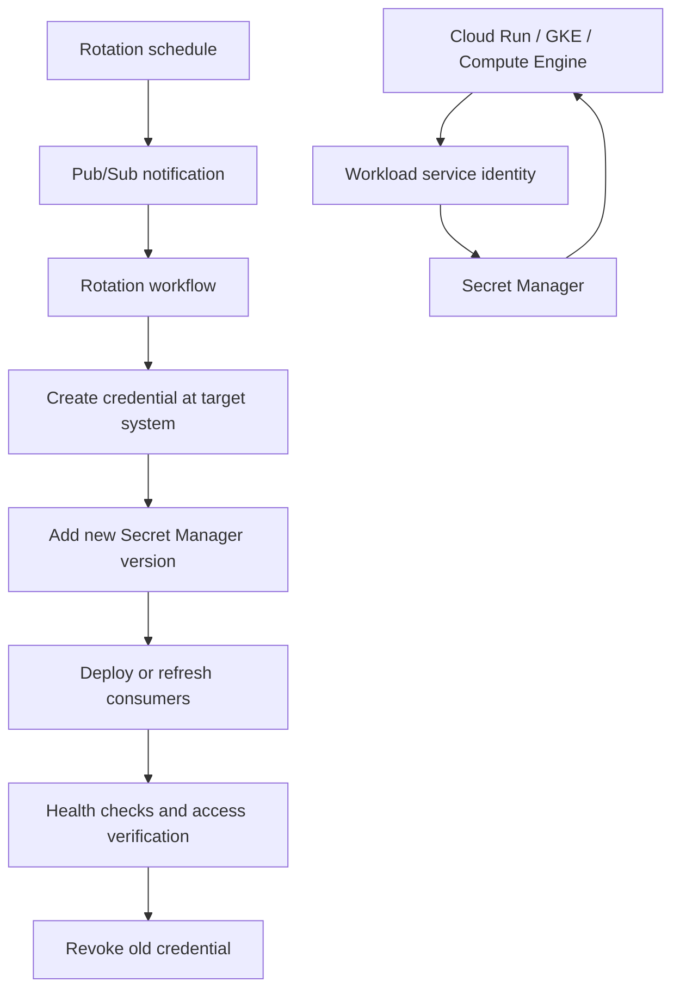

# Rotating Secrets and Distributing Sensitive Configuration

A secret is only managed safely when its entire lifecycle is controlled: generating a new value, storing a version, transitioning applications to that version, verifying system operation, and revoking the old value. On Google Cloud, **Secret Manager** provides storage and access control for secrets; **IAM**, service identities, and release workflows determine which applications can read a secret and when.

This lesson focuses on database passwords, API tokens, private keys, and service credentials. These principles also apply to other sensitive configurations that require controlled distribution across development, testing, and production environments.

## 1. Distinguishing Regular Configuration from Secrets

Not every configuration item needs to be stored in Secret Manager. Proper classification reduces the number of secrets that must be protected and avoids granting overly broad permissions.

| Data Type | Examples | Appropriate Management Approach |
|---|---|---|
| Non-secret configuration | Feature flag names, port numbers, connection limits, public bucket names | Environment variables, config files, or the platform's configuration management system |
| Authentication secrets | DB passwords, API tokens, webhook signing secrets | Secret Manager |
| Cryptographic keys | Keys used to encrypt or decrypt data | Cloud KMS when cryptographic key lifecycle management is required; Secret Manager when the application needs to distribute a key value as secret data |
| Configuration with integrity or change-control requirements | Internal endpoints, routing policies, security configurations | Configuration store with appropriate access controls, versioning, and approval workflows |

A useful rule of thumb is: **configuration describes how an application behaves; a secret allows a principal to authenticate or access a resource**. An internal endpoint may be operationally sensitive, but is not necessarily an authentication credential. Conversely, a short token string is still a secret even if it does not look critical.

It is also important to distinguish Secret Manager from Cloud KMS:

- Secret Manager stores and distributes values such as passwords, tokens, certificates, or private keys as secret data.
- Cloud KMS manages cryptographic keys and cryptographic operations such as encrypting, decrypting, signing, or verifying.
- Creating a new key version in Cloud KMS does not automatically change passwords or API tokens used by applications.
- Rotating a KMS key also does not automatically re-encrypt all data previously encrypted with the old key version.

## 2. Architecture for Secret Management and Distribution

In a typical architecture, Secret Manager serves as the centralized store. Each application uses a dedicated service identity to fetch only the secrets it needs. The rotation workflow has its own dedicated identity to create new versions and coordinate transitions.



Different components hold different responsibilities:

- **Secret Manager** stores secrets per secret and per version, enforces IAM policies, encrypts data, and records access activity.
- **Pub/Sub** delivers notifications when a configured rotation time arrives.
- **Cloud Run, Cloud Functions, or Workflows** can execute the workflow to create new credentials, add versions, and coordinate releases.
- **The application's service identity** has read permission only for the secrets the application actually requires.
- **The target system**, such as a database or third-party API, determines how long the old credential remains valid during the transition window.

Secret Manager can emit notifications on a configured rotation schedule, but those notifications do not automatically change passwords in a database, generate new API tokens, or update applications. The operations team must build a workflow to perform those steps.

## 3. Designing a Safe Rotation

Secret rotation is a process that changes state across multiple systems. If the old credential is revoked before all consumers switch to the new credential, applications may lose connectivity. If the old credential is kept active too long, the risk of a leaked credential remains.

For systems that support two concurrent valid credentials for a period of time, apply the principle: **create new first, verify, then revoke old**.

A rotation cycle can include the following steps:

1. **Determine the blast radius.** List the secret, target system, consuming applications, environments, and owners. Identify scheduled consumers and event-driven consumers as well.
2. **Create a new credential in the target system.** For example, create a new DB account with equivalent permissions scoped strictly to the application. If an API provider supports two simultaneous tokens, create the new token while the old token remains active.
3. **Store the new credential as a version.** Write the value to Secret Manager via a secure workflow. Record the version number and creation time, without writing the secret value to logs.
4. **Transition consumers to the new version.** Deploy a new revision, update workload configurations, or refresh secret files according to the chosen mechanism.
5. **Verify after transition.** Check health checks, DB connections, authentication error rates, access logs, and background jobs. Confirm completion only when all critical consumers are using the new credential.
6. **Revoke the old credential in the target system.** This step terminates usability of the old credential. Afterward, the corresponding version in Secret Manager can be disabled.
7. **Record operational evidence.** Log the secret, version, timestamp, deployment revision, verification results, and revocation status. Never store secret values in reports.

If the target system does not support two simultaneous credentials, a dedicated transition plan is needed. Options include a brief maintenance window, a forwarding proxy, or a coordinated update mechanism. Do not assume every API or database allows credential replacement with zero disruption.

### Example: rotating a database account

Suppose the `payments-api` service uses a database account to write transactions. Instead of changing the existing account's password immediately, the operations team can:

- Create an account `payments_api_next` with the exact required permissions.
- Generate a random password and store it in a new version of the `payments-db-password` secret.
- Update the service to use the new account and new version.
- Run read/write checks and monitor authentication errors.
- Revoke or lock the old account once instances, workers, and background jobs have switched over.

This creates a safe window to detect errors and fall back to the old credential before revoking it.

## 4. Managing Versions with Secret Manager

A secret in Secret Manager can contain multiple versions. Each time a value is updated, the system creates a new version; older versions can remain to support transitions or investigations.

### Creating a secret and adding a version

The examples below run in a shell environment with the Google Cloud CLI and the proper project selected:

```bash
gcloud secrets create payments-db-password \
  --replication-policy="automatic" \
  --project="PROJECT_ID"
```

Pass the new value into a version via standard input:

```bash
printf '%s' "$DB_PASSWORD" | \
  gcloud secrets versions add payments-db-password \
    --data-file=- \
    --project="PROJECT_ID"
```

The `DB_PASSWORD` variable must be supplied from a secure source within the runtime session. Do not place real values directly in commands, shell history, source code, or committed configuration files.

Secret Manager supports automatic replication and user-managed replication policies. Choose a policy aligned with your organization's data residency, availability, and compliance requirements. Do not put sensitive information in secret names or labels; metadata can also appear in administrative UIs and logs.

### Granting read permissions per secret

Suppose Cloud Run executes with the service account `payments-api@PROJECT_ID.iam.gserviceaccount.com`. Grant read access only to the required secret for this identity:

```bash
gcloud secrets add-iam-policy-binding payments-db-password \
  --member="serviceAccount:payments-api@PROJECT_ID.iam.gserviceaccount.com" \
  --role="roles/secretmanager.secretAccessor" \
  --project="PROJECT_ID"
```

Granting permissions at the secret scope limits impact if a workload is compromised. Avoid granting `roles/secretmanager.secretAccessor` at the project level if the application only needs a few secrets.

Application permissions and rotation workflow permissions should be separated:

- The application needs version access permission to read the secret.
- The rotation workflow needs permission to add new versions and needs read permission only if its logic genuinely must read the current value.
- The secret administration team needs permissions to manage configurations, IAM, and rotation schedules.
- Do not grant Secret Manager admin roles to an application's runtime service account merely for deployment convenience.

### Version states and revocation

Versions can be in states such as `ENABLED`, `DISABLED`, or `DESTROYED`. Disabling a version blocks access to that version; destroying a version is a destructive operation and must comply with the organization's data retention policy.

Example disabling an old version after confirming consumers have transitioned successfully:

```bash
gcloud secrets versions disable 7 \
  --secret="payments-db-password" \
  --project="PROJECT_ID"
```

Disabling a version in Secret Manager and revoking the credential in the target system are two separate actions. If the old credential remains valid in the database or API provider, anyone possessing that value can still use it. A complete workflow must handle both sides.

## 5. Automating Rotation Schedules

Secret Manager supports configuring rotation schedules and publishing notifications to Pub/Sub when action is due. A workflow can receive this notification and execute the business steps.

For example, a workflow using Cloud Run Jobs or Workflows can:

1. Receive the event from Pub/Sub.
2. Identify the secret and target system to rotate.
3. Check the most recent run to prevent duplicate processing.
4. Create a new credential in the target system.
5. Add a new version to Secret Manager.
6. Trigger consumer deployment or configuration updates.
7. Wait for health checks and verify results.
8. Revoke the old credential after the defined transition period.
9. Report success or failure status to the monitoring system.

Notifications may be redelivered if a subscriber fails or does not acknowledge the event. Therefore, the workflow must be **idempotent**: reprocessing the same event must not create uncontrolled extra credentials, disable the wrong version, or revoke an active credential. You can persist run IDs, secret identifiers, expected versions, and per-step status in a suitable state store.

A sound workflow should include:

- **Bounded retries:** retry transient errors with backoff; do not loop indefinitely on permission or configuration errors.
- **Dead-letter handling:** route unprocessable events to a separate stream for investigation.
- **Timeouts and alerts:** detect when a rotation hangs or runs abnormally long.
- **Dedicated permissions:** the workflow's service account only has permissions on secrets and target systems within its scope.
- **Concurrency control:** prevent two rotations for the same secret from running simultaneously.
- **Secret-free logs:** log only sanitized secret IDs, versions, statuses, and error codes.

Choose the rotation period based on sensitivity, target system requirements, credential lifetimes, and operational capability. Rotating too frequently without reliable automation can increase deployment failure risks. For suspected compromised credentials, use a separate emergency workflow; never wait for the periodic schedule.

## 6. Distributing Secrets to Workloads

Each application runtime platform retrieves secrets differently. Regardless of the method, workloads should authenticate using Google Cloud service identities rather than storing service account keys in images or hosts.

### Cloud Run

Cloud Run can inject secrets into environment variables or mount secrets as files. The service account attached to the service needs `roles/secretmanager.secretAccessor` on the secret.

Example updating an environment variable to reference a specific version:

```bash
gcloud run services update payments-api \
  --region="asia-southeast1" \
  --update-secrets="DB_PASSWORD=payments-db-password:8"
```

With environment variables, the secret value is fetched at instance startup. When using a pinned version, deploy a new revision referencing the new version so rollouts are predictable and controlled. This fits well when teams want to bind a specific revision explicitly to a secret version.

Mounting secrets as files suits applications that read configuration from files or TLS libraries requiring paths to certificates and keys. Explicitly design how the application reloads contents when a secret changes; do not assume every application automatically re-reads files or reloads connections. If using `latest`, verify the platform's update behavior and the application's caching mechanism before relying on it in rotation workflows.

### Google Kubernetes Engine (GKE)

With GKE, use Workload Identity Federation for GKE to map a Kubernetes ServiceAccount to a Google Cloud identity permitted to read the secret. The Secret Manager CSI driver can mount secrets into Pods as files for the application to read at runtime.

Considerations:

- Assign identities per workload or group of workloads with identical needs; avoid using one broad-privilege service account for the entire cluster.
- Mount secrets only into Pods that require them; do not expose every secret to every namespace.
- If syncing secrets into Kubernetes Secrets, an extra copy of the value exists inside the cluster. Protect Kubernetes Secret read permissions, etcd access, and at-rest encryption configurations per cluster policy.
- Clearly define how Pods are updated or applications reloaded when a new version is distributed.
- Never place secrets in ConfigMaps, committed manifests, or container images.

### Compute Engine and applications outside Google Cloud

Applications on Compute Engine can use the VM-attached service account and Application Default Credentials to call Secret Manager. Grant permissions to the workload's service account; do not download JSON keys onto the VM.

Applications running outside Google Cloud can use Workload Identity Federation to authenticate external identities without creating long-lived service account keys. Access should still be scoped per secret and per workload identity.

### CI/CD

Pipelines should read secrets only in the exact step that needs them, such as deployment or running migrations. Prefer federated identities and short-lived credentials over static service account keys. Do not print secret values to logs, pass secrets via recordable command-line arguments, or store them in build artifacts.

If using Terraform or IaC tools to manage Secret Manager, understand where state is stored. Certain ways of declaring secret payloads can cause values to appear in the state file even when the CLI marks the field as sensitive. Protect backend state, restrict read permissions, encrypt state at rest, and consider separating secret metadata creation from payload ingestion workflows.

## 7. Choosing How to Reference Versions

How a consumer selects a version directly affects rollout control.

| Reference Method | Operational Behavior | When Appropriate |
|---|---|---|
| Specific version, e.g., `8` | Consumer uses the exact tested value; requires config update or release upon rotation | Applications requiring controlled rollouts and reproducibility |
| Alias `latest` | Consumer references the newest version via the built-in alias; if that version is disabled or unavailable, reads fail | Systems with tested refresh mechanisms that tolerate changes over time |
| Mounted as a file | Application reads the secret via file path; update behavior depends on platform and reload mechanisms | Applications supporting file-based config reading or TLS libraries |

No single option fits every workload. For applications needing high reproducibility, pinned versions show exactly which revision uses which value. For applications needing secret updates without redeployment, dynamic references or file mounts can be considered, provided caching, refresh timing, and open connections are handled properly.

Avoid querying Secret Manager on every HTTP request. Doing so increases latency, API call volume, and dependency on the secret management service in the hot path. Generally, load secrets at startup or cache them in memory with a clear TTL, paired with a refresh plan during rotation. Never write cached contents to logs or diagnostic dumps.

## 8. Protecting Access and Audit Trails

Permission to read a secret is equivalent to permission to use that credential. Therefore, IAM must reflect application responsibility boundaries.

Recommended practices:

- Create separate service accounts for each application or workload with a distinct security boundary.
- Grant `roles/secretmanager.secretAccessor` at the secret level whenever possible.
- Separate runtime read permissions from version creation and IAM administration permissions.
- Periodically review principals retaining access, including legacy pipeline service accounts.
- Enable and review appropriate Data Access audit logs to monitor secret reads; check project logging configurations and retention requirements.
- Use Cloud KMS with customer-managed encryption keys (CMEK) when policy requires customer-managed encryption key control.
- Use service perimeter and network controls aligned with your organization's risk model.

Encryption at rest does not replace IAM controls. A principal with valid read permissions on a secret can still retrieve the value and use it. Therefore, combine authorization, monitoring, rotation workflows, and workload behavior controls.

Do not place secrets in:

- Source code, committed `.env` files, Dockerfiles, or container images.
- Command-line arguments, URLs, resource names, labels, or error messages.
- Application logs, CI/CD logs, test reports, or screenshots.
- Broadly readable state files or artifacts.
- Downloaded service account keys stored long-term on servers.

## 9. Monitoring and Error Handling During Rotation

A rotation succeeds only when consumers have switched over and the old credential has been revoked as planned. Successfully creating a new version is only an intermediate step.

Monitor at least the following signals:

| Signal | What to Detect |
|---|---|
| Last rotation timestamp and completion duration | Overdue secrets or abnormally stalled workflows |
| Number of enabled versions | Multiple old versions retained beyond the transition window |
| Pub/Sub backlog and dead-letter queue | Unprocessed or repeatedly failing events |
| Authentication errors from DB/API | Consumers have not switched to the new credential or the new credential is invalid |
| Secret Manager access errors | Missing IAM, wrong project, wrong secret name, or unavailable version |
| Running revisions and workloads | Some instances, workers, or jobs still running old configurations |

Common scenarios:

**Workflow receives the same event multiple times.** Use event IDs or idempotency keys, check previous run status, and avoid creating a new credential on every retry.

**New version created, but application still uses the old version.** Inspect deployment configuration, traffic-serving revisions, background workers, and application caches. Adding a version does not automatically update every consumer's configuration.

**Application switched over, but a background job still fails.** Compile a complete consumer inventory, including cron jobs, batch jobs, migrations, workers, and disaster recovery systems. Do not revoke the old credential until all critical consumers are verified.

**New credential is invalid.** Keep the old credential active if the target system allows. Halt rollout, check permissions and credential format, then publish a new version. Do not overwrite an already-published version; create the next version to preserve the audit trail.

**Old credential revoked too early.** Create or activate a replacement credential, save it as a new version, and restore consumers. Document the incident and adjust pre-revocation verification steps.

Rollback plans must be designed beforehand. While the old credential remains valid, rollback can be redeploying the revision referencing the old version. Once the old credential has been revoked on the target system, a replacement credential must be created; merely changing the Secret Manager reference will not reactivate a revoked credential.

## 10. Rotating Encryption Keys with Cloud KMS

KMS key rotation has a different lifecycle than password or API token rotation. A Cloud KMS key can have multiple key versions. When creating a new version and setting it as primary, new encryption operations can use the new primary version; previously encrypted data still needs the old version for decryption.

Therefore:

1. Identify data, services, and applications depending on the key.
2. Set a rotation schedule or create a new key version under governance procedures.
3. Verify applications encrypt new data with the new primary version.
4. Verify decryptability of older data.
5. If data needs to move to the new version, run a separate re-encryption workflow and verify the results.
6. Only disable or destroy older key versions when certain no ciphertext, backups, or stored data still need them.

Do not destroy an old key version merely because a new version was created. Historical data decryptability depends on retaining required versions and adhering to key retention policies.

## 11. Hands-On Scenario: Rolling Out a New DB Password for Cloud Run

An operations team needs to rotate the password for the `orders-api` service. The `orders-db-password` secret currently has version 12, and Cloud Run references that version.

A safe deployment workflow can proceed as follows:

1. Create a new credential in the database while keeping the old credential active.
2. Add the new password as version 13 of `orders-db-password`.
3. Confirm the `orders-api` service account has permission to read the secret.
4. Deploy a new Cloud Run revision referencing version 13.
5. Shift traffic according to the service's rollout strategy.
6. Verify health checks, read/write operations, authentication error rates, and related workers.
7. Once all consumers are confirmed on version 13, revoke the old credential in the database.
8. Disable version 12 after transition completes and in accordance with retention policy.

Sample commands illustrating deployment and metadata inspection:

```bash
gcloud secrets versions list orders-db-password \
  --project="PROJECT_ID"

gcloud run services update orders-api \
  --region="asia-southeast1" \
  --update-secrets="DB_PASSWORD=orders-db-password:13"
```

Listing versions displays only metadata and does not replace checking workload health. After updating, verify that the new revision actually receives traffic and connects to the DB successfully. Do not use secret-reading commands to print passwords to the terminal to prove distribution.

## 12. Operational Checklist

Before starting:

- [ ] Identified all applications, workers, jobs, and environments using the secret.
- [ ] Confirmed whether the target system supports two concurrent credentials or requires a maintenance window.
- [ ] Workflow has a dedicated identity and least-privilege permissions.
- [ ] Defined the new version, distribution method, and rollback procedure.

During rotation:

- [ ] New credential created in the target system.
- [ ] New version added to Secret Manager.
- [ ] Consumers updated or redeployed.
- [ ] Health checks and real operations confirm the new credential works.
- [ ] Logs contain no secret values.

Upon completion:

- [ ] All critical consumers have transitioned.
- [ ] Old credential revoked at the target system.
- [ ] Old version disabled per policy.
- [ ] Audit logs, workflow status, and verification results recorded.
- [ ] Alerts and the next rotation schedule remain active.

Effective secret management requires coordination among the storage location, workload identities, release workflows, and target systems. Secret Manager provides versioned storage and access control; a well-designed rotation workflow ensures new credentials are distributed, verified, and replace old credentials without disrupting service.
