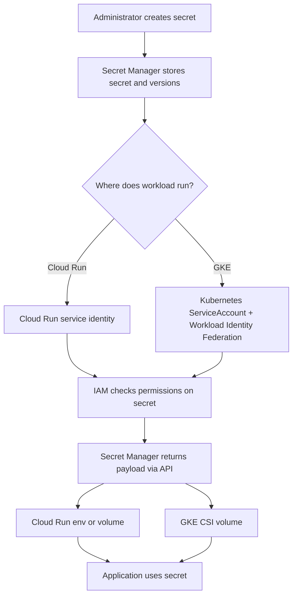

# Integrating Secret Manager with Cloud Run and GKE

When an application connects to a database, calls an external API, or signs a request, it typically needs passwords, API keys, tokens, or certificates. These values are **secrets**: if placed in source code, container images, public configurations, or logs, they can leak and become very difficult to revoke across the board.

Google Cloud Secret Manager provides a centralized store for secrets, version management, IAM access control, and access logging. Cloud Run and Google Kubernetes Engine (GKE) can fetch secrets from Secret Manager using the workload's runtime identity. This allows development teams to manage the secret lifecycle independently from the application release lifecycle.

## 1. Architecture and Responsibilities of Each Service

Three components carry three distinct responsibilities:

| Component | Responsibility |
| --- | --- |
| Secret Manager | Stores secret payloads, manages versions, IAM policies, version states, and access logs. |
| Cloud Run or GKE | Runs the application and requests Secret Manager to supply secrets when the workload needs them. |
| IAM and workload identity | Determines precisely which service account or Kubernetes ServiceAccount can read each secret. |

Overview access flow:



Secret Manager encrypts stored data using Google Cloud's default mechanism. If an organization needs encryption key control, Customer-Managed Encryption Keys (CMEK) can be configured via Cloud Key Management Service (Cloud KMS). Secret Manager manages secrets and versions; Cloud KMS manages encryption keys. The two services have related roles, but do not replace each other.

## 2. Preparing a Secret and Granting Least-Privilege Permissions

The running example throughout this lesson uses a secret named `db-password` for the `orders-api` application. Replace sample values such as `PROJECT_ID`, `REGION`, and service account names with your actual environment details.

### 2.1. Enabling the API and creating a secret

In the project holding the secret, enable the Secret Manager API:

```bash
gcloud services enable secretmanager.googleapis.com \
  --project=PROJECT_ID
```

Create a secret with an automatic replication policy:

```bash
gcloud secrets create db-password \
  --replication-policy=automatic \
  --project=PROJECT_ID
```

Add the first version from a protected local file:

```bash
gcloud secrets versions add db-password \
  --data-file=./db-password.txt \
  --project=PROJECT_ID
```

The `db-password.txt` file is merely a temporary input for this example. Do not commit this file to Git, include it in container images, or share its contents in logs or error tracking systems. In production environments, obtain values from an organization-approved secret provisioning workflow and restrict read permissions on input files.

Each time a new payload is added, Secret Manager creates a new **secret version**. The secret name remains stable, while versions allow applications to transition smoothly between old and new values. You do not need to create a new secret name for every password change.

### 2.2. Granting permissions on the exact secret

The standard payload read permission role is `roles/secretmanager.secretAccessor`. Grant this role on each individual secret the workload needs, rather than at the project level when the application only requires a few secrets.

Example creating a dedicated service account for Cloud Run:

```bash
gcloud iam service-accounts create run-orders \
  --display-name="Cloud Run identity for orders-api" \
  --project=PROJECT_ID
```

Grant read access to `db-password` for that service account:

```bash
gcloud secrets add-iam-policy-binding db-password \
  --project=PROJECT_ID \
  --member="serviceAccount:run-orders@PROJECT_ID.iam.gserviceaccount.com" \
  --role="roles/secretmanager.secretAccessor"
```

The runtime identity needs read access only to the secrets the application uses. The person deploying the service may need Cloud Run management permissions and `iam.serviceAccounts.actAs` permission (commonly granted via `roles/iam.serviceAccountUser`) on the service account. This is a deployer permission, distinct from the runtime permission to read payloads in Secret Manager.

When the secret resides in a different project from the workload, grant IAM on the secret in the secret-owning project to the exact runtime identity. At the same time, use the correct resource name and secret-holding project in the workload configuration.

## 3. Integrating with Cloud Run

Cloud Run uses a **service identity** to call Google Cloud APIs. When deploying, specify a dedicated service account for the service; do not rely on the user identity that ran the deploy command, and do not use the default service account with broad permissions unless necessary.

### 3.1. Injecting secrets into environment variables

Environment variables fit when an application or library only supports reading configuration from the environment. Example deploying a revision with a pinned secret version:

```bash
gcloud run deploy orders-api \
  --image=REGION-docker.pkg.dev/PROJECT_ID/apps/orders-api:TAG \
  --region=REGION \
  --service-account=run-orders@PROJECT_ID.iam.gserviceaccount.com \
  --update-secrets=DB_PASSWORD=db-password:5 \
  --project=PROJECT_ID
```

In this example, `DB_PASSWORD` is the environment variable name inside the container, `db-password` is the secret name, and `5` is the version number. Replace `5` with the approved version in your environment.

Cloud Run fetches environment variable values from Secret Manager when an instance starts. If the secret cannot be retrieved, the instance may fail to start. Therefore, Google recommends pinning environment variables to a specific version rather than using `latest`. When a new secret version is released, the operations team can test it and then update the configuration and create a new revision to switch the application to that version.

### 3.2. Mounting secrets as files

If the application can read files, mounting a secret as a volume is a convenient option for certificates, keys, or multi-line configurations. Example using Cloud Run YAML:

```yaml
apiVersion: serving.knative.dev/v1
kind: Service
metadata:
  name: orders-api
spec:
  template:
    spec:
      serviceAccountName: run-orders@PROJECT_ID.iam.gserviceaccount.com
      containers:
        - image: REGION-docker.pkg.dev/PROJECT_ID/apps/orders-api:TAG
          volumeMounts:
            - name: app-secrets
              mountPath: /var/secrets
      volumes:
        - name: app-secrets
          secret:
            secretName: db-password
            items:
              - version: latest
                path: db-password
```

After deployment, the application reads the value at `/var/secrets/db-password`. For volume-mounted secrets, Cloud Run fetches the latest version value when the application reads the file. This supports updating secrets without pinning a version number in configuration. However, the application must re-read the file when a new value is needed; if the application reads it only once and caches it in memory, design an appropriate reload or restart mechanism.

Choose the secret delivery method based on application characteristics:

| Approach | Best suited when | Operational notes |
| --- | --- | --- |
| Environment variable | Libraries require environment variables or values are loaded at startup. | Pin the version number; update configuration and revision when changing secrets. |
| Volume mount | Application can read files and needs to pick up new versions on subsequent reads. | Manage file paths and ensure the application re-reads when needed. |

Every Cloud Run configuration change creates a new revision. Therefore, verify the active revision configuration, startup state, and connectivity to dependencies after every secret change.

## 4. Integrating with Google Kubernetes Engine

On GKE, allow Pods to access Secret Manager using Workload Identity Federation for GKE. Each workload uses a Kubernetes ServiceAccount (KSA), and IAM maps that KSA identity to secret read permissions. This avoids creating, distributing, and rotating service account JSON key files.

GKE provides the Secret Manager add-on based on the Secrets Store CSI Driver. This add-on mounts secrets as files inside Pods via a CSI volume. It supports both Standard and Autopilot clusters; the cluster must have Workload Identity Federation for GKE configured appropriately.

### 4.1. Enabling the Secret Manager add-on

For an existing cluster, enable the add-on with:

```bash
gcloud container clusters update CLUSTER_NAME \
  --location=LOCATION \
  --enable-secret-manager \
  --project=PROJECT_ID
```

You can enable automatic rotation so volumes are updated when new secret versions appear:

```bash
gcloud container clusters update CLUSTER_NAME \
  --location=LOCATION \
  --enable-secret-manager \
  --enable-secret-manager-rotation \
  --secret-manager-rotation-interval=120s \
  --project=PROJECT_ID
```

Automatic rotation requires a GKE version that supports the feature; current documentation states a minimum of `1.32.2-gke.1059000`. If the cluster does not yet meet this requirement, upgrade following your organization's operational procedures before enabling rotation. The `120s` interval is an example value, not a mandatory setting for every workload.

### 4.2. Creating a KSA and granting secret read permissions

Create a dedicated namespace and KSA for the application:

```bash
kubectl create namespace orders
kubectl create serviceaccount orders-api -n orders
```

Grant Secret Accessor on the secret to the KSA identity. The example below uses the Workload Identity Federation for GKE principal; `CLUSTER_PROJECT_NUMBER` and `CLUSTER_PROJECT_ID` belong to the cluster's project, while `SECRET_PROJECT_ID` is the project holding the secret:

```bash
gcloud secrets add-iam-policy-binding db-password \
  --project=SECRET_PROJECT_ID \
  --role=roles/secretmanager.secretAccessor \
  --member="principal://iam.googleapis.com/projects/CLUSTER_PROJECT_NUMBER/locations/global/workloadIdentityPools/CLUSTER_PROJECT_ID.svc.id.goog/subject/ns/orders/sa/orders-api"
```

The namespace `orders` and KSA `orders-api` in the principal must match the Pod exactly. The principal must also use the cluster's project number and workload identity pool. If the secret and cluster are in the same project, both project IDs may be identical; if in different projects, still grant permission on the secret in the secret-owning project.

### 4.3. Declaring SecretProviderClass

Create a `SecretProviderClass` to specify the secret to mount and the filename inside the volume:

```yaml
apiVersion: secrets-store.csi.x-k8s.io/v1
kind: SecretProviderClass
metadata:
  name: orders-secrets
  namespace: orders
spec:
  provider: gke
  parameters:
    secrets: |
      - resourceName: "projects/SECRET_PROJECT_ID/secrets/db-password/versions/latest"
        path: "db-password"
```

Save as `orders-secrets.yaml` and apply:

```bash
kubectl apply -f orders-secrets.yaml
kubectl get secretproviderclass orders-secrets -n orders
```

`resourceName` uses the project holding the secret, secret name, and version to read. Use `latest` if you want the volume to track the newest version when rotation updates; use a specific version number if the workload requires a pinned tested value. For regional secrets, the resource path also includes `locations/LOCATION` before `secrets`.

### 4.4. Mounting the volume into a Pod

Minimal Deployment example:

```yaml
apiVersion: apps/v1
kind: Deployment
metadata:
  name: orders-api
  namespace: orders
spec:
  replicas: 2
  selector:
    matchLabels:
      app: orders-api
  template:
    metadata:
      labels:
        app: orders-api
    spec:
      serviceAccountName: orders-api
      # Add this nodeSelector on GKE Standard only when selecting
      # a node pool with Workload Identity Federation enabled.
      nodeSelector:
        iam.gke.io/gke-metadata-server-enabled: "true"
      containers:
        - name: orders-api
          image: REGION-docker.pkg.dev/PROJECT_ID/apps/orders-api:TAG
          volumeMounts:
            - name: app-secrets
              mountPath: /var/secrets
              readOnly: true
      volumes:
        - name: app-secrets
          csi:
            driver: secrets-store-gke.csi.k8s.io
            readOnly: true
            volumeAttributes:
              secretProviderClass: orders-secrets
```

Apply and monitor the rollout:

```bash
kubectl apply -f orders-deployment.yaml
kubectl rollout status deployment/orders-api -n orders
kubectl get pods -n orders
```

In GKE Standard, the node pool running the Pod must use Workload Identity Federation; the `nodeSelector` in the example ensures the Pod is scheduled onto a node with the GKE metadata server enabled. For Autopilot, all nodes already use Workload Identity Federation, so omit this `nodeSelector`.

When the Pod runs, the application reads the secret from `/var/secrets/db-password`. The Secret Manager add-on mounts secrets as files and does not sync secrets into Kubernetes Secrets. This avoids creating an additional copy of the payload in Kubernetes Secret objects. If an application strictly requires a Kubernetes Secret, separately evaluate supported sync mechanisms and their corresponding storage risks.

## 5. Safe Secret Rotation

Rotation is replacing an in-use secret value with a new value while ensuring applications and dependent systems transition successfully together. A controlled process typically includes:

1. Create a new version in Secret Manager; do not immediately delete or disable the currently running version.
2. Update the target system, such as changing the database password, to accept the new value. If the system supports a transition period, allow both old and new values briefly.
3. For Cloud Run using environment variables, update the revision to the new version number, check instance startup, and verify connectivity. For volume mounts, have the application re-read the file once the new version is available.
4. For GKE, use Secret Manager add-on rotation and reference `latest` if you want the volume to pick up the new version automatically. The application must re-read the file; an updated volume does not automatically mean the application replaced the value cached in memory.
5. Monitor authentication errors and access logs. Only disable or destroy the old version after confirming no valid workloads still use it and rollback procedures have been verified.

Do not rotate solely by creating a new version in Secret Manager if the target system still accepts only the old password. The update sequence must align with the transition capabilities of the database, API, or certificate consumer.

## 6. Inspection and Troubleshooting

You can verify configuration and state without printing secret payloads to the terminal.

| Symptom | Common Cause | Inspection Steps |
| --- | --- | --- |
| Cloud Run revision fails to start | Service identity lacks permission, wrong secret name or version, secret resides in another project. | Check the revision's service account, IAM binding on the exact secret, and secret reference config. |
| Cloud Run returns error when application reads file | Invalid volume mount or secret access permission; application uses wrong path. | Check mount path, filename, service identity, and access error logs. |
| GKE Pod cannot mount volume | Add-on not enabled, invalid `SecretProviderClass`, CSI driver or KSA permissions incorrect. | Check add-on status, `kubectl describe pod`, Pod events, namespace, KSA name, and IAM principal. |
| Pod reports `PermissionDenied` | Principal in IAM does not match project number, workload identity pool, namespace, or KSA. | Match every component of the principal against the actual cluster and Pod. |
| New secret does not appear in application | Pinned to old version, rotation not enabled, or application caches the value. | Check version reference, rotation interval, and how the application reloads files or configuration. |

Safe verification commands:

```bash
# Inspect version metadata and states; does not read payload.
gcloud secrets versions list db-password --project=PROJECT_ID

# Inspect Cloud Run service configuration.
gcloud run services describe orders-api \
  --region=REGION \
  --project=PROJECT_ID

# Inspect Pod, events, and mount configuration for a GKE workload.
kubectl describe pod POD_NAME -n orders
kubectl get secretproviderclass orders-secrets -n orders

# Only verify the mounted file exists and is non-empty; do not print contents.
kubectl exec POD_NAME -n orders -- sh -c 'test -s /var/secrets/db-password'
```

Never use payload-reading commands to put secrets into support logs or screenshots. When confirming an application has connected successfully, use health checks or dependency functionality checks rather than displaying secret values.

## 7. Security Principles to Maintain

- **Least privilege:** grant `roles/secretmanager.secretAccessor` at the secret level to the exact runtime identity. Avoid granting read access to all secrets at the project, folder, or organization level without clear justification.
- **Dedicated workload identities:** use dedicated service accounts for each Cloud Run service and dedicated KSAs for GKE workloads. Avoid sharing a single identity with permissions to read unrelated secrets.
- **Never bundle secrets:** never store payloads in Git, Dockerfiles, images, ConfigMaps, manifest files, build arguments, or logs. Manifests should contain only resource names and version references.
- **Prefer workload identity:** have workloads authenticate with managed identities; do not distribute long-lived JSON keys inside containers or Pods.
- **Access monitoring:** enable and review Data Access audit logs per organization policy; alert on anomalous access or out-of-process IAM changes.
- **Version management:** test new versions before switching production; maintain adequate recovery windows and disable old versions only after confirming zero dependencies remain.
- **Reduce redundant calls:** avoid calling Secret Manager on every request when unnecessary. Load and cache secrets for a reasonable duration, paired with a cache refresh plan during rotation.
- **Evaluate CMEK when required:** if key governance or compliance requirements demand it, design Cloud KMS key permissions and lifecycles alongside Secret Manager from the start.

## 8. Hands-On Exercise

A team runs `orders-api` on Cloud Run and an order-processing worker on GKE. Both need to read credentials to connect to the same data service.

Design a configuration meeting the following requirements:

1. Create a secret in Secret Manager and add its first version.
2. Create a dedicated service account for Cloud Run; grant read permission on the exact secret at the secret level.
3. Create a dedicated namespace and KSA for the GKE worker; use a Workload Identity Federation principal to grant read access to the same secret.
4. Configure Cloud Run to use environment variables with a pinned version or a volume mount depending on application characteristics.
5. Configure the GKE Secret Manager add-on, `SecretProviderClass`, and CSI volume to mount the secret as a file.
6. Add a new secret version, test the update process for both workloads, and verify the applications use the new value without exposing the payload in logs.

Once complete, explain why the deployer needs different permissions from the runtime identity, why IAM should be granted at the secret level, and the difference between how Cloud Run loads secrets via environment variables versus volumes.

## References

- [Configure secrets for Cloud Run services](https://docs.cloud.google.com/run/docs/configuring/services/secrets)
- [Use the Secret Manager add-on with Google Kubernetes Engine](https://docs.cloud.google.com/secret-manager/docs/secret-manager-managed-csi-component)
- [Secret Manager access control and IAM](https://docs.cloud.google.com/secret-manager/docs/access-control)
- [Secret Manager rotation recommendations](https://docs.cloud.google.com/secret-manager/docs/rotation-recommendations)
