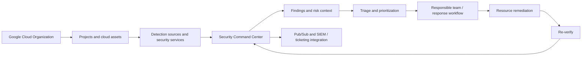
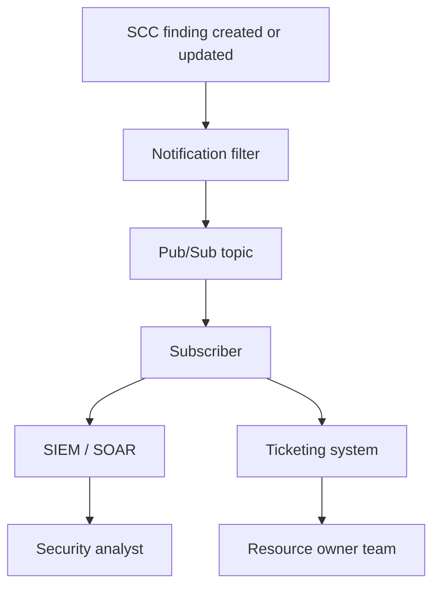

# Security Command Center and Centralized Risk Detection

When an organization operates multiple Google Cloud projects, security information is often scattered across resource configurations, logs, threat detection tools, and vulnerability management systems. Operations teams must simultaneously answer three questions: which resources are at risk, which systems are affected by that risk, and who needs to act first?

**Security Command Center (SCC)** provides a centralized point to observe cloud assets, aggregate security findings, and coordinate remediation workflows. Within the scope of the `CLOUD_PROVIDERS_GCP` module, SCC connects topics across project organization, IAM, VPC, VMs, GKE, serverless services, storage, and databases into a continuous risk management workflow. SCC helps teams see and prioritize issues; fixing configurations, revoking permissions, or isolating resources still needs to be carried out through appropriate operational procedures.

## 1. Why Centralize Risk Detection?

A Google Cloud environment can contain dozens or hundreds of projects. Each project may create additional VMs, buckets, service accounts, GKE clusters, databases, and network rules. If each team only monitors its own project, the organization can easily miss broad-impact issues:

- A firewall rule allowing Internet access to administrative ports on multiple VMs.
- A Cloud Storage bucket containing sensitive data configured for public access.
- A service account with overly broad permissions shared across multiple workloads.
- A workload showing signs of running malware, scanning, or exhibiting anomalous behavior.
- A critical resource failing to meet the organization's secure configuration requirements.

These issues differ in nature. A misconfiguration may persist for months without signs of exploitation; a suspicious behavior alert may require immediate investigation even when the current configuration looks normal. If all alerts are simply dumped into one list, teams will struggle to distinguish configuration remediation tasks from incidents requiring response.

SCC helps standardize detections into records with context, such as the detection source, issue category, associated resource, severity level, and detection timestamp. This enables the organization to apply a consistent triage and remediation workflow across multiple projects.

## 2. Where Does SCC Sit in Google Cloud Architecture?

SCC acts as a centralized security observability layer. Integrated sources detect issues; SCC stores and presents findings; security teams use findings to investigate, assign, and track remediation.



### Organization and Project Scope

For enterprise environments, activating SCC at the organization level is generally appropriate when cross-project visibility across the organization is needed. Security teams can aggregate findings from multiple projects, while application teams remain responsible for remediating resources within their scope.

Project-level activation fits small environments, pilots, or standalone projects requiring independent management. This scope does not automatically provide organization-wide visibility. Before choosing a scope, clearly define the organization, folder, and project structure, accountable teams, and permission requirements.

Available capabilities and detection sources depend on the activation level, SCC edition or service tier, resource types, regions, and associated APIs or services. Therefore, do not assume every project has identical coverage simply because SCC has been enabled in one place.

### Concepts to Distinguish

| Concept | Meaning in SCC | Usage |
|---|---|---|
| Asset | Cloud resource identified by SCC or an integrated source | Identify which VM, bucket, cluster, or resource a finding relates to |
| Source | Service or system that generated the detection | Trace the tool that identified the issue and how it evaluates it |
| Finding | Record describing a security issue or signal | Triage, investigate, assign an owner, and track status |
| Severity | Severity level of the finding | Help order remediation priority |
| Security mark | Additional label attached to a resource or finding where supported | Add context for filtering and internal workflows |
| Mute | Mechanism to temporarily hide a finding from normal triage queues | Controlled noise reduction; does not replace remediation |

A finding is the central unit of work, but not every finding proves a system has been compromised. A finding may describe an insecure configuration, a vulnerability, suspicious behavior, or an observation requiring verification. Handlers must read the context and evidence before drawing conclusions.

## 3. What Types of Risks Does SCC Detect?

SCC can combine built-in detection services with external sources. Each source has its own observation scope and operating prerequisites.

| Source Group | Example Capabilities | Question Operations Teams Must Answer |
|---|---|---|
| Security Health Analytics | Detects insecure resource configurations or permissions, such as overly permissive network rules or public storage resources | Which configurations are drifting from security policy? |
| Event Threat Detection | Analyzes log signals to identify suspicious activity | Is there behavior requiring investigation, such as anomalous access or signs of intrusion? |
| Container Threat Detection | Detects threat signals related to container workloads when features and environments meet requirements | Which workload or cluster shows signs of anomalous activity? |
| VM Threat Detection | Analyzes threat signals related to virtual machines within the supported service scope | Which VM exhibits indicators requiring investigation for malware or exploitation? |
| Web Security Scanner | Scans for selected web application security issues within configured scope | Which web application weaknesses need development team remediation? |
| External integrated sources | Third-party security tools, vulnerability management systems, or other operational platforms | Can findings from existing systems be centralized into one common workflow? |

The service names in the table identify capability groups; they do not imply every feature is automatically enabled or available in every SCC tier. During deployment, verify tier requirements, IAM permissions, APIs, resource types, and corresponding source configurations.

An important principle is **distinguishing configuration findings from threat findings**. For example, a firewall allowing Internet access to SSH is a risky configuration signal. If logs simultaneously record numerous failed logins or anomalous activity on the VM, the response team needs to investigate further to determine whether an attack is underway. Two findings can point to the same resource while requiring different response steps.

## 4. Designing an Organization-Wide SCC Deployment

Before enabling the service, define the governance model. A foundational design should answer the following:

1. **Management scope:** Which organization, folders, and projects need visibility?
2. **Resource owners:** Which teams own applications, data, networking, platform, and identity?
3. **Security administrators:** Who is allowed to configure SCC, manage detection sources, and configure notifications?
4. **Finding handlers:** Who is allowed to view, update, or acknowledge findings within each scope?
5. **Routing channels:** Which findings should be sent to Pub/Sub, SIEM, SOAR, or ticketing systems?
6. **Data requirements:** How long must the organization retain, export, and audit findings?

### Activation and Access Control

Deployment typically follows these steps:

1. Confirm the target organization or project and the SCC tier suited to requirements.
2. Verify permissions needed to activate SCC, configure detection sources, and read assets.
3. Enable SCC at the chosen scope; check the status of services and detection sources.
4. Verify that critical projects and asset types appear within the observation scope.
5. Grant role-based permissions: configuration administration, viewing findings, investigation, and executing remediation.
6. Create filters and notification channels for findings requiring timely action.
7. Test the end-to-end workflow from receiving a finding to closing the work item and verifying the result.

Apply the principle of least privilege. Do not grant SCC admin or organization admin permissions to all users just so they can view alerts. Security teams need appropriate permissions to investigate; application teams need permissions to remediate resources in their own projects; permissions to change SCC configuration should be restricted to a small administrative group.

SCC does not replace Google Cloud IAM. Access to the console, APIs, findings, and resources remains governed by IAM. When a user cannot see findings or cannot perform an action, check resource scope, granted roles, and permissions on the relevant service before concluding SCC failed to detect an issue.

## 5. Reading and Handling a Finding

When opening a finding, the handler should inspect at least the following fields:

- **Category and source:** type of detection and the source that generated it.
- **Resource:** resource name, project, and related location.
- **Severity:** severity level assigned by the detection source.
- **State:** whether the finding is `ACTIVE` or `INACTIVE`.
- **Event time and create time:** when the event occurred and when the record was created.
- **Description, evidence, and next steps:** conditions that triggered the finding, supporting data, and recommended remediation steps.
- **Mute:** whether the finding is currently muted or affected by a mute rule.

`ACTIVE` indicates the detected condition is still considered present; `INACTIVE` indicates the condition is no longer observed according to the source's logic. Mute is a separate management state and does not mean the finding has been fixed. A muted finding may still require review under organizational policy.

### Triage Workflow

1. **Verify:** check whether the resource still exists, whether the finding is recent, and whether the evidence is valid.
2. **Assess impact:** check whether the resource holds sensitive data, serves critical services, or has Internet exposure.
3. **Identify owner:** locate the team responsible for the project, workload, or configuration involved.
4. **Prioritize:** combine severity with exploitability, exposure level, blast radius, and business value of the asset.
5. **Remediate or respond:** fix configuration, revoke permissions, patch, investigate logs, or trigger incident response procedures.
6. **Re-verify:** check that the condition causing the finding has been resolved and the detection source has updated the state.
7. **Document:** record the assignee, deadline, disposition decision, and exception justification if applicable.

Do not sort strictly by severity alone. A `HIGH` finding on a low-impact test resource may warrant lower priority than a `MEDIUM` finding on a public-facing payment system. Severity is an input signal; the final decision requires business and technical context.

| Factor | Assessment Question | Impact on Priority |
|---|---|---|
| Severity | How severe did the source rate the issue? | Establishes initial triage order |
| Exposure | Is the resource reachable from the Internet or a broad network range? | High exposure generally increases priority |
| Exploitability | Is there evidence of exploitation, an attack path, or easily abused conditions? | High exploitability requires fast response |
| Asset criticality | Does the resource support mission-critical business functions or hold sensitive data? | Increases priority based on business impact |
| Blast radius | Do the permissions or configuration affect multiple projects or workloads? | Broad impact requires organization-level coordination |
| Active evidence | Do logs or signals show ongoing activity? | May escalate from configuration fix to incident response |

## 6. Searching Findings with Filters

Filters help security teams narrow down lists by state, severity, category, project, or attributes supported by SCC. For example, querying active high-severity findings across an organization:

```text
state="ACTIVE" AND severity="HIGH"
```

Filters can be applied in the SCC UI or queried using the Google Cloud CLI. The example command below illustrates retrieving active findings across sources in an organization:

```bash
gcloud scc findings list ORGANIZATION_ID \
  --source=- \
  --filter='state="ACTIVE" AND severity="HIGH"'
```

Replace `ORGANIZATION_ID` with the actual organization ID. The account running the command needs permission to read findings in that scope, and the environment needs a Google Cloud CLI version supporting SCC commands. If the command returns no results, check activation scope, IAM permissions, selected source, and filter syntax before concluding there are no risks.

During investigations, expand filters step by step. Start with the relevant project or category, then correlate resource, timestamp, and detection source. Too narrow a filter can hide related findings; too broad a filter increases noise and slows response.

## 7. Sending Centralized Notifications via Pub/Sub

Teams should not rely on operators continuously watching the console for new findings. SCC can send notifications for findings matching a filter to a Pub/Sub topic. Subscribers can forward events to ticketing systems, SIEMs, or an internal orchestration service.



Example creating a notification config for active high-severity findings:

```bash
gcloud scc notifications create high-risk-findings \
  --organization=ORGANIZATION_ID \
  --pubsub-topic=projects/SECURITY_PROJECT_ID/topics/scc-findings \
  --filter='state="ACTIVE" AND severity="HIGH"'
```

Before running the command, create the topic in a dedicated security project and confirm SCC is activated at the right scope. The account performing this action needs permissions to create notification configs and update the topic's policy. When creating the config, SCC creates a notification service account and automatically assigns `roles/securitycenter.notificationServiceAgent` on the topic; keep this role so notifications continue functioning. Subscribers need permissions to read the topic or subscription as designed. Do not grant publish permissions to an overly broad identity just to make the integration work.

Notifications serve a stream of new or updated events matching a filter; they should not be treated as a complete replica of full finding history. When reporting or querying history is needed, use appropriate SCC query and export capabilities. Event consumers should also handle duplicates safely: store the finding identifier, check already-processed events, and avoid creating multiple tickets for the same issue just because a notification was redelivered.

When designing filters, start with findings needing rapid response, such as high severity, threat indicators, or critical assets. Sending every finding to the same channel risks burying valuable alerts in high-volume notifications. Lower-severity findings should still be reviewed on schedule or via appropriate dashboards.

## 8. Practical Example: Detecting Risk on a Public VM

Suppose an organization has a project `payments-prod` containing a VM used for administrative tasks. SCC records a firewall rule allowing access from `0.0.0.0/0` to an administrative port. At the same time, the log analysis source generates another finding for anomalous login activity on the VM.

The response team should follow this sequence:

1. Open both findings and verify they both point to the VM and project `payments-prod`.
2. Inspect the firewall rule, source IP addresses, destination port, and business justification for the access path.
3. Consult with the workload owner to identify the approved administrative access method.
4. If public access is unnecessary, restrict access sources to trusted network ranges or an appropriate administrative access mechanism; avoid deleting rules before understanding operational dependencies.
5. Investigate login logs, associated identities, and actions taken after the suspicious access. If signs of compromise exist, trigger the organization's incident response process.
6. Re-check firewall configuration and finding state after remediation. Confirm the application team can still administer the system via the approved method.
7. Document root cause, resolution time, and measures to prevent recurrence.

This example illustrates that SCC delivers value when correlating multiple signals. The firewall finding describes an exposure point; the anomalous login finding provides a signal needing investigation. Operations teams must connect them to the same asset and business context to choose the right action.

## 9. Managing Noise and Exceptions

In large environments, certain findings may repeat, no longer apply to the current architecture, or be accepted under a time-bound exception. Mute rules can help reduce noise when used with governance.

Before muting, clearly document:

- Reason the finding does not require immediate remediation.
- Owner approving the exception.
- Applicable resource scope or conditions.
- Review deadline and criteria for unmuting.
- Compensating controls if the risk still exists.

Do not bulk-mute findings just to make dashboards look cleaner. If a finding reflects a recurring misconfiguration across many projects, the sustainable fix is updating deployment templates, policies, or resource provisioning workflows. Muting only adjusts how findings are displayed and routed; it does not close vulnerabilities, revoke permissions, or stop attacks.

## 10. Common Implementation Mistakes

| Mistake | Consequence | How to Check or Remediate |
|---|---|---|
| Enabling SCC on only one project when organization-wide visibility is needed | Other projects are missing from the desired view | Compare activation scope against the organization tree and project list |
| Missing required permissions or APIs for a detection source | Source does not operate fully or fails to collect data | Verify service status, APIs, service agents, and IAM per the source's guide |
| Routing all findings to a single notification channel | Critical alerts get buried under low-priority notifications | Split filters by severity, finding category, and responsible team |
| Treating severity as an absolute remediation order | Critical resources may be remediated too slowly | Combine exposure, exploitability, and business impact |
| Muting findings without an expiration | Risks remain hidden indefinitely | Require an owner, justification, expiration, and review schedule |
| Treating a finding as definitive proof of compromise | May lead to wrong actions or skipping verification | Check the source, evidence, logs, and resource state |
| Failing to re-verify after remediation | Findings may remain active or issues may recur | Verify the updated configuration and fresh state from the detection source |

## 11. Measuring Operational Effectiveness

An SCC program should be evaluated by the quality of risk remediation, not merely the number of findings viewed. Track the following metrics:

- Active findings by severity, category, project, and owning team.
- Mean time from finding creation to assignee acknowledgment.
- Mean time to remediate by severity and asset type.
- Percentage of overdue findings or findings reopening after closure.
- Percentage of muted findings, exceptions expiring soon, and exceptions lacking an owner.
- Coverage of detection sources across critical projects and asset types.
- Percentage of notifications converted into valid tickets and routed to the right team.

Metrics require consistent scope and definitions. For instance, remediation time can be measured from `event time`, `create time`, or ticket creation time; choose one baseline and stay consistent. Reporting should reveal projects lacking coverage, teams with growing backlogs, and frequently recurring misconfigurations.

## 12. Hands-On Exercise

Perform this in an organization or test project you are authorized to observe:

1. Open SCC and identify the currently activated scope.
2. Select an existing finding; record its source, category, resource, project, severity, state, and event time.
3. Access the associated resource using granted permissions, verify the condition that triggered the finding, and identify the owning team.
4. Create a filter showing only `ACTIVE` findings at `HIGH` severity, then narrow it down by project or category.
5. Design a Pub/Sub notification for a group of findings needing rapid response; identify the service agent, publish permissions, and subscriber.
6. Write out the workflow from receiving the notification to verifying remediation, including assignee and response SLA.
7. Propose one metric to evaluate whether risk detection or remediation time has improved.

Do not create public configurations or intentionally weaken production resources to generate findings for exercises. Use existing findings, sandbox environments, or simulated scenarios authorized by your organization.

## 13. Conclusion

Security Command Center helps Google Cloud organizations centralize assets, detection sources, and findings into a unified risk management workflow. SCC's value depends on proper activation scope, appropriate detection source coverage, clear access controls, and owner-driven remediation processes. When integrating SCC with Pub/Sub, SIEM, or ticketing systems, organizations can turn detections into action, track remediation, and continuously re-verify risk across the entire cloud environment.

## References

- [Google Cloud CLI: gcloud scc findings list](https://docs.cloud.google.com/sdk/gcloud/reference/scc/findings/list)
- [Google Cloud CLI: gcloud scc notifications create](https://docs.cloud.google.com/sdk/gcloud/reference/scc/notifications/create)
- [Security Command Center: Enable finding notifications for Pub/Sub](https://docs.cloud.google.com/security-command-center/docs/how-to-notifications)
