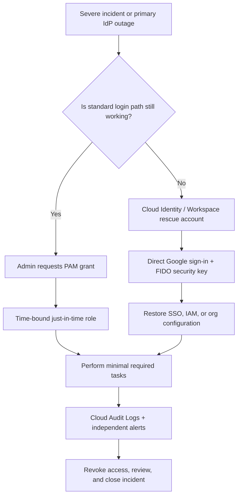

# Designing Emergency Administrative Access on GCP

An organization can lose the ability to administer Google Cloud right when incident response is needed most: the identity provider (IdP) goes down, SSO is misconfigured, admin accounts are locked out, security keys are lost, or an IAM policy leaves the admin team without permissions to fix configurations. If every login path and every recovery permission depends on the same failing system, the organization risks being locked out of its own environment.

**Emergency administrative access** (*emergency access* or *break-glass access*) is a backup access path prepared and tested in advance. This path is used only when standard administrative processes cannot handle a severe incident. A sound design must simultaneously ensure login capability, necessary recovery permissions, independent monitoring, and the ability to revoke permissions once resolved.

Google Cloud recommends that every organization with a Google Cloud organization establish emergency access, even without specialized business continuity mandates. This lesson combines rescue accounts in Cloud Identity or Google Workspace, Google Cloud IAM, Privileged Access Manager (PAM), Cloud Audit Logs, and operational procedures to build an exercisable model.

## 1. Objectives and Scope

After this lesson, you will be able to:

- Distinguish Cloud Identity/Google Workspace Super Admin accounts from the Organization Administrator role in Google Cloud IAM.
- Design rescue accounts capable of signing in when the primary SSO or IdP fails.
- Select IAM scopes and minimum permissions needed to recover an organization or workload.
- Use PAM to grant temporary administrative permissions on demand with appropriate justification, duration, and approval.
- Configure alerts, audit log retention, and workflows to activate, revoke, and audit emergency access.
- Test backup access capabilities without leaving an uncontrolled permanent admin account behind.

This article focuses on human administrative access on Google Cloud. Service accounts and workload identities still require separate protection; never use a service account JSON key as an administrator rescue account.

## 2. Distinguishing Administrative Permission Layers

A break-glass design typically involves two distinct permission planes: organizational identity administration and Google Cloud resource administration.

| Component | Permission Scope | Role in Recovery |
|---|---|---|
| Cloud Identity / Google Workspace Super Admin | Manages accounts, groups, authentication, SSO, and identity organization configuration | Recovers accounts, SSO configuration, or identity settings preventing users from signing in |
| Google Cloud Organization Administrator (`roles/resourcemanager.organizationAdmin`) | Manages IAM permissions and allow/deny policies at the organization level | Restores or distributes access permissions across groups, folders, and projects |
| Folder/project IAM roles | Manages a subset of resources within granted scope | Resolves incidents for a specific workload or environment |
| Privileged Access Manager (PAM) | Grants roles configured in an entitlement for a bounded duration | Just-in-time elevation, time-bound, and optionally approval-gated |
| Cloud Audit Logs and alerting systems | Records administrative and access activity | Detects, investigates, and preserves evidence after emergency access is activated |

**Super Admin is not synonymous with Organization Administrator.** Super Admin is an administrative role inside Cloud Identity or Google Workspace. Organization Administrator is an IAM role on the Google Cloud organization resource. When creating an organization resource, the initial Super Admin account may receive Organization Administrator automatically; however, Google recommends separating Super Admin accounts from the Organization Administrator group to maintain separation of duties.

Organization Administrator can manage allow/deny permission structures and grant IAM roles to others. This role does not automatically include every resource management operation, such as creating folders or projects. If a runbook requires those operations, identify and grant additional appropriate roles, such as Folder Admin or Project Creator.

Do not assign `roles/owner` as the default rescue permission. It is a legacy basic role with broad scope where modern access conditions are hard to apply; PAM also does not support the legacy basic roles Owner, Editor, and Viewer. List required incident operations first, then select matching predefined roles or custom roles.

## 3. Reference Architecture

The proposed model has three layers:

1. **Rescue login path:** dedicated Cloud Identity/Google Workspace accounts capable of signing in directly with Google when the primary SSO or IdP is down.
2. **Google Cloud elevation path:** PAM grants temporary roles to responders during routine or emergency operations; rescue Super Admin accounts can restore the identity plane and organization permissions when standard paths break.
3. **Independent monitoring path:** alerts on rescue account logins, recording IAM changes, centralized audit log collection, and protecting log access from the actor making changes.



PAM is the preferred path for controlled privilege elevation in anticipated scenarios. Rescue accounts handle situations where normal authentication or permission workflows cannot be used. Do not rely solely on PAM if the incident itself breaks the identities, SSO configuration, or admin permissions needed to operate PAM.

## 4. Creating and Protecting Rescue Accounts

### 4.1. Count and Scope

Create emergency access accounts in the Cloud Identity or Google Workspace tenant managing the Google Cloud environment. These accounts have the following traits:

- Hold Super Admin privileges to handle identity or organization configuration incidents.
- Not tied to any individual employee's lifecycle; not automatically revoked by standard Joiner, Mover, Leaver (JML) workflows.
- Configured to bypass SSO so they can sign in with Google credentials when the external IdP is down.
- Used strictly in emergencies and closely monitored.

Google recommends **two to five emergency access accounts per Cloud Identity or Google Workspace account**. A single account creates a single point of failure: a lost password, broken security key, or suspended account can wipe out the entire backup path. Do not create too many accounts because each carries extremely high privileges.

Ensure every environment requiring recovery has a suitable access path. If production, staging, and test use separate Cloud Identity/Workspace tenants, prepare and test emergency access for each tenant. If environments share one identity organization, verify rescue accounts can access the right Google Cloud organization and required resource scopes.

### 4.2. Separating OUs and Login Configuration

Create a dedicated Organizational Unit (OU), such as `/Emergency-Access`, to apply distinct policies to rescue accounts. Do not place these accounts in the same OU as regular users because SSO policies, account lifecycles, and authentication requirements differ.

For the rescue OU:

- Exempt from SSO to avoid external IdP dependency during emergencies.
- Enable 2-Step Verification and restrict methods to security keys only per policy.
- Use FIDO security keys; register at least two keys per account to guard against damage or loss.
- Prefer dedicated key sets per account to reduce shared-key risks.
- Use long, strong, unique passwords.
- Do not automate Super Admin password rotation using scripts or service accounts with Super Admin privileges. Google warns that such automation tools themselves become extremely high-privilege targets.
- If the organization does not rotate passwords manually, Google documentation recommends disabling password expiration for emergency access accounts. If manual rotation is chosen, document the schedule, accountable owner, and post-change login verification process.

### 4.3. Storing Credentials

Balance security with rapid retrieval under time pressure. Physical security safes or controlled handover procedures can be used:

- Store password copies across multiple secure physical locations so a single site issue does not block access.
- Store security keys in controlled locations accessible during emergencies.
- Store passwords and security keys in separate locations so a breach at one location does not expose both factors.
- Document who is authorized to retrieve them, who approves retrieval, and how handover timestamps are logged.
- Periodically inspect physical condition of keys, tamper-evident envelopes, and safe accessibility.

Never store rescue credentials in standard shared documents, public tickets, or source code. Rescue accounts are not used for daily logins, ad-hoc testing, or running automation.

### 4.4. Handling Context-Aware Access

Context-Aware Access can block logins when devices, networks, or locations fail conditions. During an incident, a misconfigured policy could lock out even rescue accounts.

Google recommends excluding **at least one emergency access account** from access levels in access policies to preserve a continuous access path. This is an intentional exception for a rescue account; protect the account with a strong password, FIDO security keys, handover controls, and alerting. Never extend this exception to regular admin accounts.

### 4.5. Alerting on Rescue Account Events

Any activity by a rescue account outside a declared incident must be treated as an indicator requiring investigation. In the Google Admin console, create reporting rules scoped to the emergency OU and monitor at least:

- Successful sign-ins.
- Failed sign-in attempts.
- Password changes or authentication factor changes.
- SSO configuration or security policy changes affecting the rescue OU.

Route alerts to the security on-call team over a channel independent of the primary IdP. If a rescue account signs in without an incident ID or accountable responder, open an investigation immediately.

## 5. Designing IAM Permissions for Emergencies

### 5.1. Break Down Tasks Before Selecting Roles

Do not start with the question "which Owner role do we need?". Start with the list of tasks that may be necessary during an emergency:

| Scenario | Permissions to Consider | Recommended Scope |
|---|---|---|
| Restore organization-level IAM permissions | Organization Administrator or equivalent custom permission set | Organization |
| Restore permissions on a folder | Folder Admin or appropriate IAM roles | Affected folder |
| Restore permissions on a project | Project IAM Admin (`roles/resourcemanager.projectIamAdmin`) | Specific project |
| Resolve Compute Engine incidents | Compute Engine roles matching required operations | Specific project or resource |
| Resolve GKE incidents | Relevant GKE/Kubernetes and IAM roles | Target cluster or project |
| Handle billing issues | Corresponding Cloud Billing roles | Billing account or project |

Required roles depend on incident type and service. A role granting IAM management does not necessarily allow starting VMs, modifying firewalls, editing GKE configs, or managing billing. Document supplementary roles in the runbook and validate them in a test environment.

### 5.2. Separating Super Admin Accounts and the Organization Admin Group

Maintain a dedicated Google Cloud admin group, such as `grp-gcp-org-admin@example.com`. Group members are administrators responsible for operating the organization; the group is granted `roles/resourcemanager.organizationAdmin` or a smaller permission set if suitable.

Rescue Super Admin accounts should be kept separate from the Organization Admin group. During an IAM incident, a Super Admin can restore organization admin permissions to a designated identity. This separation reduces daily use of the highest-privilege identity accounts in routine Google Cloud operations.

Example granting Organization Administrator to a designated recovery account during a recovery procedure:

```bash
gcloud organizations add-iam-policy-binding ORGANIZATION_ID \
  --member="user:recovery-admin@example.com" \
  --role="roles/resourcemanager.organizationAdmin"
```

Replace `ORGANIZATION_ID` and email with actual values confirmed in the runbook. The command above creates an organization-level binding, so the role takes effect down the resource hierarchy. Execute this only when an incident genuinely requires organization-level IAM administration; after recovery, transition permissions back to the regular admin group or revoke the emergency binding per the incident commander's decision.

Inspect the policy afterward with:

```bash
gcloud organizations get-iam-policy ORGANIZATION_ID
```

When revoking the direct binding created during the incident:

```bash
gcloud organizations remove-iam-policy-binding ORGANIZATION_ID \
  --member="user:recovery-admin@example.com" \
  --role="roles/resourcemanager.organizationAdmin"
```

Illustrative commands do not replace change approval workflows. Before running them, verify the right organization, principal, role, and revocation timing. If the organization uses PAM for temporary permissions, prefer pre-designed PAM entitlements over creating manual long-lived bindings.

### 5.3. Avoid Overly Broad Standing Permissions

- Use task-specific predefined roles or custom roles if narrower permissions are needed.
- Grant permissions at the project or folder level rather than organization level if the incident does not require broad scope.
- Avoid `roles/owner`, `roles/editor`, and unnecessary broad permissions.
- Do not use a high-privilege service account as a shared identity for administrators.
- Separate permissions to alter IAM, operate workloads, and view logs wherever possible.
- Define who can modify deny policies, organization policies, and access to the monitoring system itself.

Note that IAM allow bindings, IAM deny policies, organization policies, and Context-Aware Access operate through different mechanisms. Rescue accounts should not be assumed to bypass every restriction automatically. List all policies that could block recovery operations and rehearse how to handle them.

## 6. Using Privileged Access Manager for Temporary Access

Privileged Access Manager (PAM) enables *just-in-time* (JIT) elevation of privileges. Administrators create an **entitlement** specifying who can request which permissions, on which resources, for how long, and under what conditions.

An entitlement should specify:

- List of principals permitted to request grants.
- Roles to grant and resource scope: organization, folder, or project.
- Whether justification is mandatory.
- Maximum grant duration.
- Whether approvers are required and who the approvers are.
- Stakeholder groups notified on request, approval, or activation.
- IAM conditions if further resource or context restrictions are needed.

When a grant activates, PAM assigns configured roles for the grant duration and automatically revokes them when the duration expires. Entitlement creation, grant requests, approvals, and related operations are recorded in Cloud Audit Logs.

### 6.1. Two Entitlement Categories to Consider

| Entitlement Category | Control Mechanism | Scenario |
|---|---|---|
| Routine administrative access | Requires justification and peer approval; short duration | Planned maintenance, IAM changes, production deployments |
| Emergency response access | Allows selected responder group fast requests; may bypass waiting for approval during urgent incidents | Service recovery, severe incident response, halting spreading impact |

Not every PAM request should skip approval. Only entitlements scoped to designated responders with clear usage rules should permit an emergency no-approval flow. Even when bypassing prior approval, still require justification, send immediate notifications, and conduct post-incident review.

PAM supports predefined roles and custom roles, but does not support the legacy basic roles Owner, Editor, and Viewer. Determine exact roles before creating entitlements. If limiting access to specific resources within a project, folder, or organization is needed, use IAM Conditions as supported by the service.

### 6.2. Duration and Revocation

Grant duration must be sufficient to complete the task without extending longer than needed. For example, investigation access might need 30–60 minutes, whereas restoring a complex configuration might require a longer window per internal policy. These are reference values; base durations on actual operational timelines and organizational policy.

Responders should explicitly end grants as soon as the task finishes if privileges are no longer needed. Do not wait for automatic expiration. After an incident, inspect the list of active, expired, revoked, or ended grants to verify no unexpected permissions remain.

### 6.3. Using IAM Conditions for Time-Bound Permissions

In certain scenarios, conditional role bindings can restrict permissions by time. Example condition expression:

```text
request.time < timestamp('2026-12-01T00:00:00Z')
```

This condition renders the binding inactive after the specified UTC timestamp. Note:

- Timestamps must be authored and validated in RFC 3339 format.
- A conditional binding does not override an unconditional binding granting the same role to the principal.
- Do not rely on a static expiration date as the sole mechanism for a rescue account needed at an unpredictable future time.
- PAM is better suited when per-use requests, approvals, durations, and automatic revocation are required.

## 7. Independent Logging, Monitoring, and Alerting

### 7.1. Audit Log Sources to Enable

Cloud Audit Logs provide four primary log types:

| Log Type | Contents | Default State |
|---|---|---|
| Admin Activity | Configuration or metadata changes, such as IAM policy updates | Always recorded |
| System Event | System events generated by Google Cloud | Always recorded |
| Data Access | Reading configuration/metadata or accessing user data | Disabled by default on most services, except BigQuery |
| Policy Denied | Requests denied by policy | Configurable |

Admin Activity and System Event are essential sources for investigating permission changes. Data Access can generate high log volumes and cost; evaluate sensitive services to enable it selectively, such as services storing customer data or critical administrative data.

PAM also logs entitlement and grant events in Cloud Audit Logs. Ensure the security team can query these events even when the grant actor holds high administrative privileges.

### 7.2. Centralizing and Protecting Logs

Create aggregated log sinks at the organization or folder level to forward audit logs to a centralized security project, Cloud Storage, BigQuery, Pub/Sub, or a SIEM. Choose storage destinations and retention periods aligned with compliance requirements.

The log-receiving project requires separate IAM permissions. Break-glass accounts or workload admin teams should not have arbitrary permissions to delete logs, shorten retention, or alter monitoring sinks. Separate log administrators from personnel allowed to modify production IAM whenever feasible.

Cloud Logging provides `_Required` and `_Default` buckets. `_Required` stores Admin Activity and System Event logs; the default sink for this bucket cannot be customized. If routing logs to another project and storing them there, configure sinks in the destination project per retention requirements. Verify actual logs arrive at the destination before considering centralized logging complete.

### 7.3. Creating Alerts

At a minimum, alert on:

- Any successful or failed sign-in of a rescue account.
- Password, security key, or SSO configuration changes affecting rescue accounts.
- IAM policy changes at the organization, folder, or project level.
- Creation, modification, revocation, or activation of PAM entitlements/grants.
- Changes to log sinks, log buckets, retention, or IAM of the security project.
- Rescue principal activity outside a declared incident window.

Google recommends creating alerts for `SetIamPolicy()` calls to detect allow policy changes. You can begin inspecting in Logs Explorer with the query:

```text
log_id("cloudaudit.googleapis.com/activity")
protoPayload.methodName="SetIamPolicy"
```

To locate activity for a specific rescue account, filter by principal:

```text
protoPayload.authenticationInfo.principalEmail="gcp-breakglass-01@example.com"
```

Replace the email with the registered principal. For federated identities or other principal types, the identifying field may be `principalSubject`; inspect actual environment log schemas.

Never route alerts solely to the rescue account's own email or a channel dependent on the same failing IdP. Route to the security on-call team or SIEM over an independent delivery path with clear recipient permissions and acknowledgment procedures.

## 8. Emergency Access Activation Procedure

Runbooks must be concrete enough for an authorized responder to execute when primary administrators are unavailable.

### Step 1: Confirm Activation Criteria

Activate only when one of the predefined criteria is met, such as:

- Primary IdP or SSO cannot authenticate administrators.
- IAM/SSO configuration is broken and the admin team lacks permissions to recover.
- Severe security incident requires immediate action to halt damage.
- Routine admin accounts are compromised, locked, or missing authentication factors.

Record the incident ID, timestamp, incident commander, justification, and required access scope.

### Step 2: Notify and Apply Dual Control

Notify the incident commander and security team. Whenever conditions allow, two people jointly verify credential retrieval and observe operations. If the incident demands immediate response and cannot wait for a second person, document the reason and mandate post-incident review.

### Step 3: Retrieve Credentials per Procedure

Authorized personnel retrieve the password and FIDO security key from designated storage locations. Record the custodian, recipient, timestamp, seal number, and incident ID. Never send passwords or verification codes over chat or tickets.

### Step 4: Sign In and Verify the Right Organization

Use direct Google sign-in with the SSO-exempt rescue account. Confirm the right Cloud Identity/Workspace tenant, Google Cloud organization, project, and environment. Avoid making changes before confirming whether you are in production or staging.

### Step 5: Execute the Minimal Required Change

Perform the exact task matching the incident: restore SSO, fix an IAM binding, grant PAM access, or restore needed configuration. Use the narrowest permissions, set durations where possible, and log executed commands or changes. Do not use a rescue session for unrelated changes.

### Step 6: Verify and Hand Over

Verify services, access paths, and alerts have returned to expected state. Hand administrative control back to the routine operations team. Confirm essential users can sign in through normal channels before closing the incident.

### Step 7: Revoke and Conduct Post-Incident Review

- End or revoke any active PAM grants.
- Remove temporary direct IAM bindings if no longer needed.
- Restore SSO configurations and access policies to approved state.
- If credentials may have been exposed, manually rotate passwords and re-verify registered FIDO keys.
- Reconcile Cloud Audit Logs, Google Admin audit events, and the incident timeline.
- Archive justification, approvers, actors, changes, and revocation timestamps.
- Reseal rescue materials and update handover records.

Do not disable rescue accounts after every use if doing so destroys backup readiness. Keep accounts ready by design, rotate secrets if exposure is suspected, and re-verify login capability after closing the incident.

## 9. Maintaining Access During an IdP Outage

Emergency access primarily provides a last-resort administrative path. It does not ensure all employees can continue working when the primary IdP fails. For critical personnel, an authentication alternative can be prepared:

1. During normal operations, users sign in via SSO.
2. Critical accounts are pre-provisioned with Google sign-in credentials, such as passwords alongside security keys or passkeys.
3. Place these accounts in a dedicated OU so SSO profile assignments can be changed cleanly.
4. During a primary IdP outage, an authorized Super Admin can temporarily disable SSO for that critical OU or group per the runbook.
5. Once the IdP recovers, restore the SSO profile assignment and verify logins.

Post-SSO verification can be enabled for privileged user groups to require 2-Step Verification after SSO login. This reduces risk if the primary IdP is compromised or issues unsafe assertions.

If the organization must maintain access for large user populations during an IdP outage, a backup IdP can be established. Prepare SAML profiles, user provisioning synchronization, and signing certificate testing in advance. A backup IdP must maintain security equivalent to the primary IdP; a weaker backup IdP undermines overall security.

Do not confuse the three objectives:

| Objective | Solution |
|---|---|
| Administrators can still recover the organization when SSO/IdP fails | Emergency access users |
| Selected critical staff continue signing in when IdP fails | Authentication alternative for critical users |
| Large user populations continue signing in during primary IdP outages | Pre-staged and tested Backup IdP |

## 10. Periodic Drills and Testing

Rescue accounts are only valuable if the organization proves they work. Schedule periodic drills and re-test after major changes to Cloud Identity, SSO, IAM, Context-Aware Access, or governance workflows.

Drill checklist:

- [ ] At least two emergency access accounts exist per Cloud Identity/Workspace account per chosen model.
- [ ] Accounts sit in a separate OU, are exempt from SSO, and have dedicated authentication policies.
- [ ] Each account has at least two working FIDO security keys.
- [ ] Passwords and security keys can be retrieved from backup storage locations following procedure.
- [ ] At least one account remains accessible when Context-Aware Access is misconfigured.
- [ ] Can access the right Google Cloud organization and projects needing recovery.
- [ ] IAM recovery workflows have been tested, including granting and revoking roles.
- [ ] PAM entitlements specify exact requesters, roles, scopes, justification, duration, and approvals.
- [ ] Rescue login and IAM change alerts reach the on-call team.
- [ ] Audit logs route to the security project with appropriate retention.
- [ ] On-call staff know how to open incidents, retrieve credentials, execute, revoke, and audit afterward.
- [ ] Verified SSO, OU, IAM binding, and PAM states after the drill.

Prefer testing in staging environments or isolated test accounts. Do not alter production SSO or IAM purely for testing without a change plan, approvers, and rollback path.

## 11. Scenario Example: Primary IdP Outage

An organization uses an external IdP for SSO. When the IdP experiences an outage, routine administrators cannot sign in to the Google Cloud console.

Handling workflow:

1. The incident commander confirms the IdP outage and opens an incident.
2. A responder retrieves an emergency access account and FIDO key from the security safe.
3. The responder signs in directly via Google sign-in since the rescue account is SSO-exempt.
4. The responder checks SSO profile assignment status and identifies critical admin groups needing an authentication alternative.
5. A Super Admin applies the runbook-approved change allowing privileged user groups to use Google sign-in credentials during the IdP outage.
6. Cloud Audit Logs and Google Admin reporting rules record the activity; security receives alerts.
7. Once the IdP recovers, the responder restores the SSO profile assignment, tests normal login, and closes the incident.
8. Security reviews logs, audits rescue credentials, documents lessons learned, and reseals hardware tokens.

If the root cause is a broken IAM policy rather than an IdP outage, the rescue Super Admin can use the prepared recovery path to restore organization admin access, after which the IAM team fixes necessary bindings. Grant additional permissions only to the right principal and scope, and revoke them upon completion.

## 12. Mistakes to Avoid

| Mistake | Risk | Proper Design |
|---|---|---|
| Having only one rescue account | Losing the account or security key destroys the backup path | Maintain two or more accounts with backup keys and credentials |
| Rescue account still depends on primary SSO | If the IdP fails, rescue accounts cannot sign in either | Exempt emergency access users from SSO |
| Using Super Admin accounts daily | Increases exposure risk for ultra-high-privilege accounts | Separate rescue accounts from daily work accounts |
| Merging Super Admin and the Organization Admin group | Loses separation of duties between identity admin and GCP admin | Maintain separate roles and groups |
| Granting Owner for every scenario | Overly broad scope and hard to constrain | Pick task-specific roles and use PAM/JIT |
| Relying solely on PAM | PAM configuration or authentication paths may fail in the same incident | Maintain independent emergency identities for recovery |
| Ignoring login alerts | Fails to detect unauthorized rescue account usage | Alert on every sign-in and security change |
| Allowing production admins to delete audit logs | Incident actor could erase evidence | Separate log project, IAM, and log administrators |
| Never running drills | Discovers key, SSO, permission, or runbook flaws only during real incidents | Test periodically and after major changes |
| Failing to revoke emergency bindings | Temporary access becomes permanent privilege | Include post-incident review and revocation checklists |

## 13. Pre-Production Design Checklist

- [ ] Identified incidents that could cause access lockout and accountable activation owners.
- [ ] Provisioned emergency access users in Cloud Identity/Google Workspace for each environment needing recovery.
- [ ] Separated OUs, exempted from SSO, enabled FIDO 2-Step Verification, and registered backup keys.
- [ ] Established physical custody procedures for passwords and security keys.
- [ ] Defined roles for Super Admin, Organization Administrator, and routine operations teams.
- [ ] Listed rescue operations and least-privilege IAM roles per scope.
- [ ] Configured PAM entitlements for time-bound elevated permissions.
- [ ] Identified Context-Aware Access exceptions and policies that could block recovery.
- [ ] Enabled required audit logs, centralized logging, and separated log admin permissions.
- [ ] Created alerts for emergency accounts, SetIamPolicy, PAM grants, and monitoring config changes.
- [ ] Authored runbooks covering activation, verification, execution, revocation, and post-incident review.
- [ ] Rehearsed end-to-end from login to recovery, alert validation, and incident closure.

## Conclusion

Designing emergency administrative access on GCP requires a login path independent of primary SSO, an IAM model sufficient to recover resources, and a monitoring system independent of the account performing recovery. Cloud Identity/Google Workspace emergency access users restore the identity plane; Organization Administrator and clearly scoped IAM roles restore Google Cloud permissions; and PAM provides time-bound JIT privileges for administrative tasks.

A design's value is proven through drills: authorized responders can sign in, execute the right tasks, generate audit evidence, and revoke privileges once the incident ends.

## References

- [Google Cloud: Ensure continuous access to Google Cloud](https://cloud.google.com/docs/security/best-practices-continuous-access-to-google-cloud)
- [Google Cloud Resource Manager: Super administrator account best practices](https://cloud.google.com/resource-manager/docs/super-admin-best-practices)
- [Google Cloud Resource Manager: Set up a Google Cloud organization resource](https://cloud.google.com/resource-manager/docs/creating-managing-organization)
- [Google Cloud IAM: Privileged Access Manager overview](https://cloud.google.com/iam/docs/pam-overview)
- [Google Cloud IAM: Configure temporary access](https://cloud.google.com/iam/docs/configuring-temporary-access)
- [Google Cloud Logging: Best practices for Cloud Audit Logs](https://cloud.google.com/logging/docs/audit/best-practices)
- [Google Cloud Logging: Cloud Audit Logs overview](https://cloud.google.com/logging/docs/audit)
