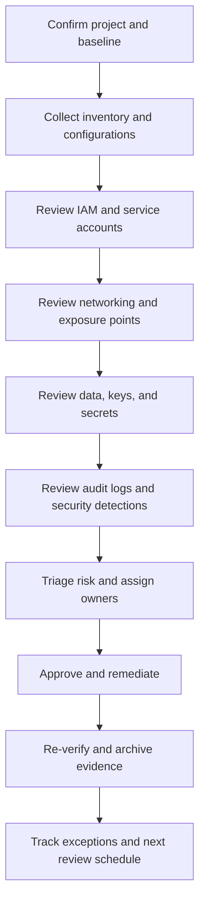

# Hands-On: Reviewing the Security Configuration of a Project

A Google Cloud project can contain VMs, GKE clusters, Cloud Run services, databases, storage buckets, service accounts, and many enabled APIs. Each resource has its own configuration and access permissions. Just one overly broad IAM binding, one firewall rule opening the wrong port, or one bucket allowing public access can put the project's data and workloads at risk.

A project security review is the activity of collecting evidence, comparing configurations against organizational requirements, assessing risk, and tracking remediation. The output must identify **which resource has an issue, who is accountable, what the impact is, what evidence confirms the issue, and when it must be remediated**.

In the Cloud Providers GCP module, this hands-on lesson connects concepts across projects, IAM, VPC, Compute Engine, GKE, Cloud Run, storage, databases, and logging into a repeatable inspection workflow. The illustrative commands primarily read configurations. Modifying production configurations requires an owner, impact assessment, and an appropriate change management process.

## 1. Review Objectives and Scope

After this lesson, learners will be able to:

- Identify the exact project, the identity conducting the review, and the scope of resources to inspect.
- Gather inventories of resources, enabled APIs, IAM policies, and effective Organization Policies.
- Detect high-risk configurations across identity, networking, data, encryption, and logging.
- Classify findings by risk level, assign owners, and propose remediation measures.
- Re-verify after remediation and archive evidence for audits.

A project review should clearly define four elements:

| Element | Question to Answer |
| --- | --- |
| Scope | Which project ID, which environment, and which resources and services are included? |
| Timestamp | When was evidence collected and across what time range? |
| Owners | Who is responsible for the project, workloads, data, and each finding? |
| Baseline | Which internal policy, security baseline, contractual requirement, or compliance framework is used? |

Reviewing one project does not prove the entire organization is compliant. Some permissions and constraints inherit from the organization or folders; some policies sit directly on resources such as buckets, service accounts, VMs, or databases. Inspect the right resource level and effective policies.

## 2. Overall Workflow



Collect evidence in read-only mode first. Changing IAM, firewalls, Organization Policies, encryption keys, or service configurations can disrupt workloads. Never delete an account, key, rule, or API merely because it appears unused; confirm dependencies with owners first.

## 3. Preparing the Review Session

### 3.1. Selecting the Project and Verifying Identity

Examples throughout this lesson use `PROJECT_ID` as a placeholder variable. Run commands in Cloud Shell or a terminal with the Google Cloud CLI installed, signed in with an account granted review permissions.

```bash
export PROJECT_ID="your-project-id"

# Confirm active authenticated account.
gcloud auth list --filter=status:ACTIVE

# Check default project in gcloud configuration.
gcloud config get-value project

# Read metadata of the exact project under review.
gcloud projects describe "$PROJECT_ID" \
  --format="yaml(projectId,projectNumber,name,lifecycleState,parent)"
```

Do not rely on the workstation's default project because the terminal might point to another environment. In subsequent commands, pass `--project="$PROJECT_ID"` explicitly to reduce the risk of inspecting the wrong project.

Record the project ID, project number, lifecycle state, parent resource, environment (development, staging, or production), start timestamp, and reviewer identity. If metadata cannot be read or the parent resource cannot be verified, pause assessments depending on that information and request proper read permissions.

### 3.2. Identifying Required Permissions

A read-only review requires read permissions on corresponding configurations. For example, viewing project IAM policies requires policy read permissions; searching resources via Cloud Asset Inventory requires `cloudasset.assets.searchAllResources`; searching resource IAM policies requires `cloudasset.assets.searchAllIamPolicies`; viewing Data Access audit logs in default log buckets requires private log read permissions. Security Command Center uses dedicated roles for viewing findings.

Organizations can grant a Security Reviewer role or suitable custom role combined with scoped read permissions. Do not grant Owner or Editor merely for review convenience. When lacking permissions, explicitly document which data could not be inspected; never treat empty output as proof of zero risk.

### 3.3. Setting Up a Secure Evidence Directory

Evidence may include CLI command outputs, screenshots of configuration pages, log queries, finding IDs, and owner confirmation records. Store evidence in a location with access control, retention policies, and change history. Avoid placing tokens, private keys, secret payloads, customer data, or sensitive log contents into broadly shared reports.

## 4. Inventorying Resources and Enabled Services

An inventory ensures no resource is overlooked. Start with the list of enabled APIs:

```bash
gcloud services list --enabled \
  --project="$PROJECT_ID"
```

An enabled API is not automatically a misconfiguration. Cross-reference each API with workloads, owning teams, and business purposes. Unused APIs can be considered for disabling after confirming no dependent resources remain.

Cloud Asset Inventory helps discover resources within the project scope:

```bash
gcloud asset search-all-resources \
  --scope="projects/$PROJECT_ID" \
  --format="table(assetType,name,location,state)"
```

This command requires `cloudasset.assets.searchAllResources` on the queried scope. If the Cloud Asset Inventory API is unavailable or the account lacks permission, document that limitation and use the management consoles of respective services. Do not enable APIs or grant additional permissions during a review without approval.

You can organize the inventory by category for easier reconciliation:

| Category | Resources to Inspect |
| --- | --- |
| Compute | VMs, disks, snapshots, images, external IP addresses, instance templates, and managed instance groups. |
| Container | GKE clusters, node pools, workloads, service accounts, and endpoint configurations. |
| Serverless | Cloud Run services, revisions, ingress, service identities, and invoke permissions. |
| Network | VPCs, subnets, firewall rules, routes, peering, load balancers, and Cloud NAT. |
| Data | Cloud Storage buckets, Cloud SQL, BigQuery datasets, databases, and backups. |
| Identity | IAM policies, service accounts, keys, impersonation permissions, and granted groups. |
| Security operations | Audit logs, log sinks, alerts, Security Command Center findings, and encryption configurations. |

Reconcile the inventory against a CMDB or approved service catalog. Resources lacking an owner, environment label, or clear purpose must be flagged for verification.

## 5. Reviewing IAM and Access Permissions

IAM is one of the most critical parts of the review. Determine who holds permissions on the project, which permissions are attached directly at the resource level, and which permissions are inherited from parent nodes.

### 5.1. Reading the Direct Project IAM Policy

```bash
gcloud projects get-iam-policy "$PROJECT_ID" \
  --format=yaml
```

This is the policy attached directly to the project. It is not a complete list of all effective permissions across every resource. A user may receive permissions from the organization, folders, project, or policies attached directly to child resources.

When reviewing each binding, check:

- Whether the principal is a user, group, service account, domain, or principal set.
- How broad the role's scope is and whether it is genuinely required for the job.
- Whether the binding includes an IAM Condition; whether the condition appropriately constrains resource, time, or context.
- Whether members outside the organization are granted permissions; whether that access is approved and has an expiration date.
- Whether `allUsers` or `allAuthenticatedUsers` appears. Public access may be required for a website or public API, yet data classification, authentication methods, and accompanying protections must be confirmed.

Pay special attention to basic roles `roles/owner`, `roles/editor`, and `roles/viewer`. Owner and Editor carry broad permissions. For production environments, prefer task-scoped predefined roles and least privilege. Never delete a binding automatically based solely on role name; first identify which workload, operational workflow, or team depends on that permission.

### 5.2. Finding Bindings on Resources Inside the Project

IAM policies can be attached directly to buckets, service accounts, VMs, or other resources. Cloud Asset Inventory can search policies within scope:

```bash
gcloud asset search-all-iam-policies \
  --scope="projects/$PROJECT_ID" \
  --format=json
```

This command requires `cloudasset.assets.searchAllIamPolicies`. You can filter by principal or role to investigate a specific concern. For example:

```bash
# Find bindings referencing public principals.
gcloud asset search-all-iam-policies \
  --scope="projects/$PROJECT_ID" \
  --query="policy:allUsers" \
  --format=json

# Find bindings with the Owner role.
gcloud asset search-all-iam-policies \
  --scope="projects/$PROJECT_ID" \
  --query="policy:roles/owner" \
  --format=json
```

Search results provide evidence for investigating resource-level policies. To answer definitively whether a principal can execute a specific permission on a specific resource, use Policy Analyzer or Policy Troubleshooter. These tools factor in related policies and access conditions; analysis data may exhibit brief lag immediately after policy changes.

### 5.3. Checking Effective Permissions and Inherited Permissions

Organization Policy and IAM policies follow different inheritance rules. IAM can grant a principal permissions from multiple hierarchy levels; deny policies and conditions also affect outcomes. Organization Policies inherit down the hierarchy and produce an effective policy at the project level.

In the Console, verify effective permissions using IAM Policy Analyzer/Policy Troubleshooter when confirming a specific principal. For Organization Policies, use the `describe --effective` command shown later. Record the exact source of a grant (organization, folder, project, or resource) so owners know where changes belong.

### 5.4. IAM Evaluation Criteria

| Signal | Verification Question | Handling Approach |
| --- | --- | --- |
| Owner or Editor assigned to an individual | Does the work truly need full permissions? Can a narrower role replace it? | Confirm business owner, design replacement, and reduce privilege via change request. |
| Public principal | Is the resource intentionally public? Does it hold sensitive data or allow writes? | Confirm public requirement, restrict data scope, and validate access mechanism. |
| External domain account | Does the partner still require access? Are there a contract, sponsor, and expiration date? | Verify identity, re-approve, and set an expiration date. |
| Binding without an owner | Which team uses it? Who is accountable during an incident? | Identify owner before revoking permissions. |
| Project-level role needed for only one resource | Can the binding be moved down to the specific resource? | Narrow scope after checking impact. |

## 6. Reviewing Service Accounts and Authentication Keys

Service accounts represent workloads or applications when calling Google Cloud APIs. An overly broad service account or an exposed long-lived key can create a direct path to data and resources.

List service accounts in the project:

```bash
gcloud iam service-accounts list \
  --project="$PROJECT_ID"
```

For each service account, identify the workload using it, its owner, assigned roles, and who can impersonate or attach the service account to resources. Pay close attention to default service accounts and accounts previously granted Editor automatically. Default permissions must be evaluated against current organizational policy and workload needs.

List user-managed keys for a service account:

```bash
gcloud iam service-accounts keys list \
  --iam-account="SERVICE_ACCOUNT_EMAIL" \
  --managed-by=user \
  --project="$PROJECT_ID"
```

The output shows key IDs and metadata such as creation or expiration timestamps; the command does not return private key material. Verify whether the key is still needed, where it is stored, who manages it, and whether it has an expiration date and revocation procedure. Keys without owners or persisting long-term without justification require investigation. Never delete or disable a key before confirming applications have migrated to another authentication mechanism.

Prefer managed workload identities such as service accounts attached to Compute Engine or Cloud Run, Workload Identity Federation for GKE, and controlled impersonation mechanisms. Use long-lived keys only when no viable alternative exists; never place keys in source code, images, build variables, logs, or unprotected repositories.

Inspect Organization Policies governing key creation and upload:

```bash
gcloud org-policies describe \
  iam.managed.disableServiceAccountKeyCreation \
  --project="$PROJECT_ID" \
  --effective

gcloud org-policies describe \
  iam.managed.disableServiceAccountKeyUpload \
  --project="$PROJECT_ID" \
  --effective
```

The effective policy reveals the active rule after inheritance. If the organization uses legacy constraints or another policy, verify exact constraint names and live environment state. Blocking key creation is generally a strong baseline, while exceptions for legacy workloads must have narrow scope, an owner, and a review deadline.

## 7. Reviewing Networking and Exposure Points

The goal is to understand which resources are reachable from the Internet, which sources are allowed to connect, and whether administrative paths are overly exposed.

### 7.1. Inspecting VPCs and Firewall Rules

```bash
gcloud compute networks list \
  --project="$PROJECT_ID"

gcloud compute firewall-rules list \
  --project="$PROJECT_ID" \
  --format=json

gcloud compute instances list \
  --project="$PROJECT_ID" \
  --format=json
```

For each firewall rule, examine direction, action, priority, source ranges, destination ranges, protocol, ports, target tags, target service accounts, disabled status, and logging configuration. Check both ingress and egress. Rules with source `0.0.0.0/0` or `::/0` require careful scrutiny, especially when permitting SSH (22), RDP (3389), databases, or management ports.

Not every rule with an Internet source is an error. Web services may need to accept HTTP/HTTPS from the Internet. What must be verified is that the rule opens only the exact ports and targets needed, includes appropriate protections, and does not unintentionally apply to more VMs than intended. SSH/RDP should typically route through IAP TCP forwarding, VPN, controlled bastions, or an organization-approved administrative solution.

`gcloud compute firewall-rules list` lists project VPC firewall rules. If the organization uses hierarchical firewall policies or network firewall policies, also inspect them at the organization/folder and policy levels; looking only at project rules can miss rules enforced from higher levels.

### 7.2. Inspecting Public IPs and Public Services

Compare the list of VMs, external IP addresses, load balancers, Cloud Run services, GKE clusters, and databases against the approved architecture diagram. A public IP is not automatically a bug, but must have a purpose, owner, and protective controls.

For Cloud Run, inspect ingress settings, authentication, `roles/run.invoker` permissions, and principals permitted to invoke the service. If `allUsers` holds invoke permission, confirm the endpoint truly needs to be public, returned data is non-sensitive, and protective layers such as API Gateway, load balancers, or Cloud Armor are properly designed.

For GKE, inspect control plane endpoints, authorized networks, private nodes, Workload Identity Federation, network policies, and how workloads access secrets. For Cloud SQL, check public IPs, authorized networks, private connectivity, SSL/TLS, backups, and database accounts. Specific attributes vary by service type; inspect each resource's actual configuration rather than inferring from project-level settings.

### 7.3. Network Logging

VPC firewall rules logging can record connection records for selected rules, both allow and deny. Logs help identify which rule affects which connections. This feature must be enabled per rule; logs can incur costs. It records TCP/UDP connections when established, not every packet. When broader network traffic visibility is needed, evaluate VPC Flow Logs and corresponding storage costs.

## 8. Reviewing Data, Storage, and Encryption

A project can contain multiple copies of data across buckets, databases, snapshots, backups, or logs. Map data by sensitivity, owner, storage location, access paths, and retention requirements.

### 8.1. Cloud Storage

List buckets in the project:

```bash
gcloud storage buckets list \
  --project="$PROJECT_ID"
```

For each critical bucket, inspect metadata and IAM:

```bash
gcloud storage buckets describe "gs://BUCKET_NAME" \
  --format="yaml(name,location,iamConfiguration,encryption,versioning,retentionPolicy,softDeletePolicy)"

gcloud storage buckets get-iam-policy "gs://BUCKET_NAME"
```

Pay attention to two attributes:

- **Uniform bucket-level access**: should be enabled to manage permissions uniformly via IAM at the bucket level instead of combining IAM with object-level ACLs.
- **Public access prevention**: should be enforced for data without public access requirements. Can be applied at the bucket level or via Organization Policy at the project, folder, or organization level.

Check for `allUsers` and `allAuthenticatedUsers` bindings in bucket policies. If a bucket holds intentionally public data by design, document the data category, approver, and controls preventing accidental upload of internal data. Also verify versioning, soft delete, retention policies, backups, and recovery procedures. These features serve different purposes; enabling versioning does not replace backups or access controls.

### 8.2. Databases, Snapshots, and Sensitive Data

For Cloud SQL, BigQuery, Spanner, or other data services, check access identities, dataset/database-level permissions, public endpoints, encryption, backups, retention, and audit logs. Verify whether production data is copied into development/test environments and whether copies maintain required protection levels.

Snapshots, disk images, and backups typically contain the same data as source systems. Therefore, they require appropriate read permissions, sharing policies, retention limits, and encryption. Never inspect only running databases while overlooking backups and data exports.

### 8.3. Cloud KMS and CMEK

Google Cloud encrypts data at rest by default. For workloads with dedicated key governance requirements, Customer-Managed Encryption Keys (CMEK) in Cloud KMS can be used. When reviewing CMEK, check:

- Which resources must use CMEK per data policy or contracts.
- Whether key rings and keys reside in locations compatible with protected resources.
- Who holds key administration permissions, who holds key usage permissions, and whether those two duties are separated.
- Whether keys have rotation schedules, version states, recovery plans, and clear owners.
- Which data could be affected if a key is disabled or destroyed.

Cloud KMS rotation creates a new key version. How CMEK-integrated services adopt new versions and handle previously encrypted data varies; never assume changing the primary version automatically re-encrypts all existing data. Before altering key state, understand the behavior of dependent services and recovery procedures.

## 9. Reviewing Organization Policy and Baselines

Organization Policy provides a mechanism to enforce centralized constraints. Policies configured at the organization level propagate down to folders and projects; project-level policies inherit or override following constraint rules.

List policies set directly on the project:

```bash
gcloud org-policies list \
  --project="$PROJECT_ID"
```

Inspect the effective policy for a specific constraint:

```bash
gcloud org-policies describe \
  storage.publicAccessPrevention \
  --project="$PROJECT_ID" \
  --effective

gcloud org-policies describe \
  iam.managed.disableServiceAccountKeyCreation \
  --project="$PROJECT_ID" \
  --effective
```

Depending on the organization's baseline, check additional constraints governing resource locations, domain-restricted sharing, external IPs, APIs, or permitted resource types. Do not enforce one rigid constraint list across every project: public websites, data analytics, and internal workloads have distinct requirements.

When a policy is not enforced, determine whether it is an approved exception, an incomplete configuration, or a constraint unsuitable for the workload. If a policy is inherited from a parent, project-level edits may lack permission or fail to alter the effective outcome. Policy updates must happen at the proper governance level after assessing impact on all affected workloads.

## 10. Reviewing Audit Logs and Detection Capabilities

Cloud Audit Logs provide a trail of activity on resources. Distinguish the log types:

| Audit Log Type | Contents | Default State |
| --- | --- | --- |
| Admin Activity | Metadata or resource configuration changes. | Always recorded and cannot be disabled. |
| System Event | Changes executed by Google Cloud systems or managed service agents. | Always recorded and cannot be disabled. |
| Policy Denied | Requests denied due to security policy violations. | Generated by default; may be excluded from buckets via log exclusions. |
| Data Access | Reading configuration/metadata or reading/writing user-provided data. | Usually disabled by default, except certain BigQuery services. |

Data Access audit logs are especially valuable for sensitive data, though they can generate large log volumes and costs. Select services, permission types (`ADMIN_READ`, `DATA_READ`, `DATA_WRITE`), and scope to record based on security requirements. Never enable all logs blindly without budgeting storage, retention, and cost; equally, never ignore data access logging simply because Admin Activity is enabled.

Inspect the project's log sinks:

```bash
gcloud logging sinks list \
  --project="$PROJECT_ID"
```

For each sink, verify that the filter covers the right logs, the destination remains active, the writer identity has destination write permissions, and logs are retained per policy. If organizational policy requires centralized monitoring, verify critical logs route to the central security project or system. Having a sink defined is insufficient; confirm logs actually arrive at the destination and are queryable.

### 10.1. Security Command Center

If Security Command Center is enabled at an appropriate scope, inspect Findings and filter by project, severity, category, asset type, and finding state. Focus on misconfigurations, vulnerabilities, external exposures, and identity or data findings.

Detection capabilities depend on service tier, configuration, data sources, and enabled detectors. Certain detectors or Security Health Analytics have availability prerequisites tied to tier and activation type. Therefore, seeing zero findings does not prove a project has no issues. Verify Security Command Center is active, required detection sources are configured, and no errors are interrupting scans.

Review each finding's affected asset, evidence, severity, and remediation guidance. After remediation, re-verify both the resource and finding state. Mute findings only with a documented reason, owner, and review expiration; muting does not fix the underlying misconfiguration.

## 11. Risk Classification and Reporting

Do not evaluate findings purely by count. A public firewall rule for a web server and a public rule for a database port carry vastly different risks. Combine the following factors:

- **Impact:** which data or service is affected, and does it contain sensitive information?
- **Reachability:** can the resource be reached from the Internet, across many projects, or only from a single internal workload?
- **Achievable privileges:** can a principal read data, alter configurations, mint credentials, or gain administrative control?
- **Exploitability:** does an actual access path, known vulnerability, or abusable misconfiguration exist?
- **Blast radius:** is one resource affected or multiple workloads and projects?
- **Compensating controls:** do MFA, private networking, WAF, approvals, monitoring, or other controls reduce risk?

Example internal classification scale:

| Level | Examples | Reference Action |
| --- | --- | --- |
| Critical | Bucket containing sensitive data is public; admin credential leaked and active; production management port exposed publicly with weak access control. | Notify owner and incident response team immediately; apply exposure reduction per emergency workflow. |
| High | Unidentified principal holds Owner/Editor; unmanaged service account keys; production database has unnecessary public access path. | Prioritize within security SLA; confirm impact and rollback plan. |
| Medium | Data Access logs not enabled for a critical data service; overly broad firewall rule with compensating controls; bucket lacks clear owner. | Schedule remediation, assign owner, and set due date. |
| Low | Missing resource labels, unclear service account description, or legacy rule with no usage evidence. | Add metadata, verify owner, and place in improvement backlog. |

This is an illustrative scale to standardize practice in this exercise, not an official Google Cloud severity scale. Organizations must map it to their own SLAs, frameworks, and incident workflows.

A finding record should include at minimum:

| Field | Contents to Record |
| --- | --- |
| Finding ID | Unique ticket or finding identifier. |
| Project / resource | Project ID, resource name, and resource type. |
| Evidence | Commands, policies, logs, or config snapshots with collection timestamps. |
| Risk | Severity level, impact, exploitability, and blast radius. |
| Owner | Team or individual responsible for verification and remediation. |
| Remediation | Required changes, dependencies, and post-change verification steps. |
| Due date / status | Deadline, status, exceptions, and next review date. |

## 12. Controlled Remediation

Once the report is compiled, prioritize by risk and exposure. For a production project, typical priority order is:

1. Reduce exposure of publicly accessible data and credentials.
2. Narrow overly broad administrative permissions and verify unidentified principals.
3. Address unnecessary service account keys after confirming workloads have migrated.
4. Tighten firewall rules and administrative endpoints per approved architecture.
5. Add missing audit logs, log routing, alerts, and finding tracking workflows.
6. Complete encryption, backup, retention, and data controls aligned with classification.

Before making changes, archive current configuration state in a protected evidence store. Identify dependent services, change windows, approvers, rollback plans, and post-change functional tests. Update a small batch, verify results, and then expand.

Example narrowing a project-level `roles/editor` binding:

```bash
# Run only after confirming the principal, replacement permissions, and change request.
gcloud projects remove-iam-policy-binding "$PROJECT_ID" \
  --member="user:USER_EMAIL" \
  --role="roles/editor"
```

This command modifies direct project permissions. If the binding inherits from the organization/folder or is attached to another resource, this command will not remove that source grant. After narrowing permissions, re-verify effective permissions using Policy Analyzer/Policy Troubleshooter and confirm legitimate tasks still succeed.

Certain changes can cause outages if rushed: disabling a key still used by a workload, altering firewall rules for management systems, enforcing a new Organization Policy, or destroying a KMS key version. When an owner or dependency cannot yet be identified, mark the finding for investigation and require verification before making changes.

## 13. Hands-On Scenario

Suppose the operations team takes over project `retail-prod-01`. The project runs a Cloud Run application, a GKE cluster, several background processing VMs, and a bucket storing sales reports. The team needs to complete a security review ahead of an audit.

After inventorying and inspecting configurations, the team discovers:

| Finding | Evidence to Collect | Verification Questions |
| --- | --- | --- |
| A user holds `roles/editor` at the project level | IAM binding, grant timestamp, related ticket or change request. | Is the user still in operations? Can a narrower role replace it? |
| A service account has an old user-managed key | Key ID, creation date, expiration date, owner, and using workload. | Does the workload still use this key? Can it migrate to workload identity or impersonation? |
| Firewall rule allows SSH from `0.0.0.0/0` | Rule name, network, source range, port, targets, and firewall logs. | Which VMs match the rule? Can IAP/VPN or fixed management ranges be used? |
| Reporting bucket does not enforce public access prevention | Bucket IAM policy, UBLA/PAP configuration, and data classification. | Does the bucket require public access? Are any objects or principals publicly accessible? |
| Data Access audit logs not enabled for sensitive data service | Audit Log configuration, services, and permission types. | Which monitoring mandates apply? What are estimated cost and retention? |

The team does not immediately delete the user, key, or firewall rule. They verify owners and dependencies, assess risk, open change tickets for each item, and prioritize the bucket and public SSH exposure. After remediation, the team re-collects policies, tests legitimate connectivity, confirms logs reach monitoring systems, and updates findings.

### Exercise

1. Select a test project you are authorized to inspect. Record the project ID, parent resource, environment, and review timestamp.
2. Run the API, resource, IAM policy, and Organization Policy inventory commands from this lesson. Save outputs in an access-controlled location.
3. Locate one overly broad IAM binding or principal needing verification. Use Policy Analyzer/Policy Troubleshooter to understand effective permissions.
4. List service accounts and user-managed keys. Record owners and dependent workloads for each key requiring review.
5. Inspect firewall rules, public IPs, and one key bucket. Evaluate against real data and workloads.
6. Inspect Data Access audit log settings, log sinks, and Security Command Center if enabled.
7. Document at least three findings with evidence, risk, owner, remediation, and due date. Propose a remediation order.
8. For the lab project, execute one approved change, then re-verify configuration and functionality. Record before/after evidence.

Your exercise output should answer: what resources exist in the project, which principals hold significant permissions, what points are externally reachable, how data is protected, where security events are logged, and which risks must be addressed first.

## 14. Quick Review Checklist

- [ ] Verified exact project ID, project number, parent resource, and environment.
- [ ] Reconciled resource inventory and enabled APIs with owners.
- [ ] Distinguished direct IAM, resource-level IAM, and inherited permissions.
- [ ] Verified public principals, external organization members, and overly broad roles.
- [ ] Reviewed service accounts, impersonation rights, and user-managed keys.
- [ ] Checked firewall rules, public IPs, Cloud Run ingress, GKE endpoints, and database exposure.
- [ ] Checked bucket IAM, UBLA, public access prevention, backups, and retention.
- [ ] Verified encryption and Cloud KMS permissions match data classification.
- [ ] Reviewed audit logs, Data Access configuration, log sinks, and Security Command Center.
- [ ] Documented evidence, risk, owner, remediation, due date, and status for every finding.
- [ ] Approved changes, verified post-change state, and archived evidence.
- [ ] Documented justification, approver, and expiration or review date for exceptions.

## 15. References

- [Cloud Asset Inventory: Search resources](https://docs.cloud.google.com/asset-inventory/docs/search-resources)
- [Cloud Asset Inventory: Search IAM policies](https://docs.cloud.google.com/sdk/gcloud/reference/asset/search-all-iam-policies)
- [IAM: Manage access to projects, folders, and organizations](https://docs.cloud.google.com/iam/docs/granting-changing-revoking-access)
- [Policy Analyzer for allow policies](https://docs.cloud.google.com/policy-intelligence/docs/policy-analyzer-overview)
- [Best practices for using service accounts securely](https://docs.cloud.google.com/iam/docs/best-practices-service-accounts)
- [Organization Policy overview](https://docs.cloud.google.com/organization-policy/overview)
- [Cloud Audit Logs: Enable Data Access audit logs](https://docs.cloud.google.com/logging/docs/audit/configure-data-access)
- [Best practices for Cloud Audit Logs](https://docs.cloud.google.com/logging/docs/audit/best-practices)
- [VPC firewall rules logging overview](https://docs.cloud.google.com/firewall/docs/vpc-firewall-rules-logging-overview)
- [Cloud Storage: Public access prevention](https://docs.cloud.google.com/storage/docs/public-access-prevention)
- [Cloud Storage: Uniform bucket-level access](https://docs.cloud.google.com/storage/docs/uniform-bucket-level-access)
- [Security Command Center: Use Security Health Analytics](https://docs.cloud.google.com/security-command-center/docs/how-to-use-security-health-analytics)
