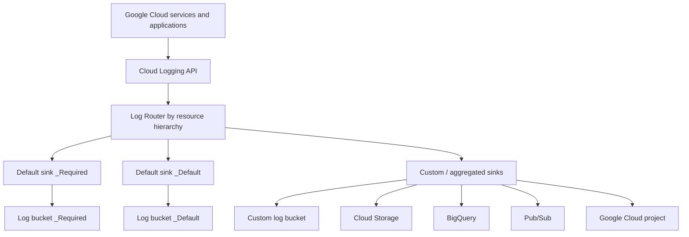
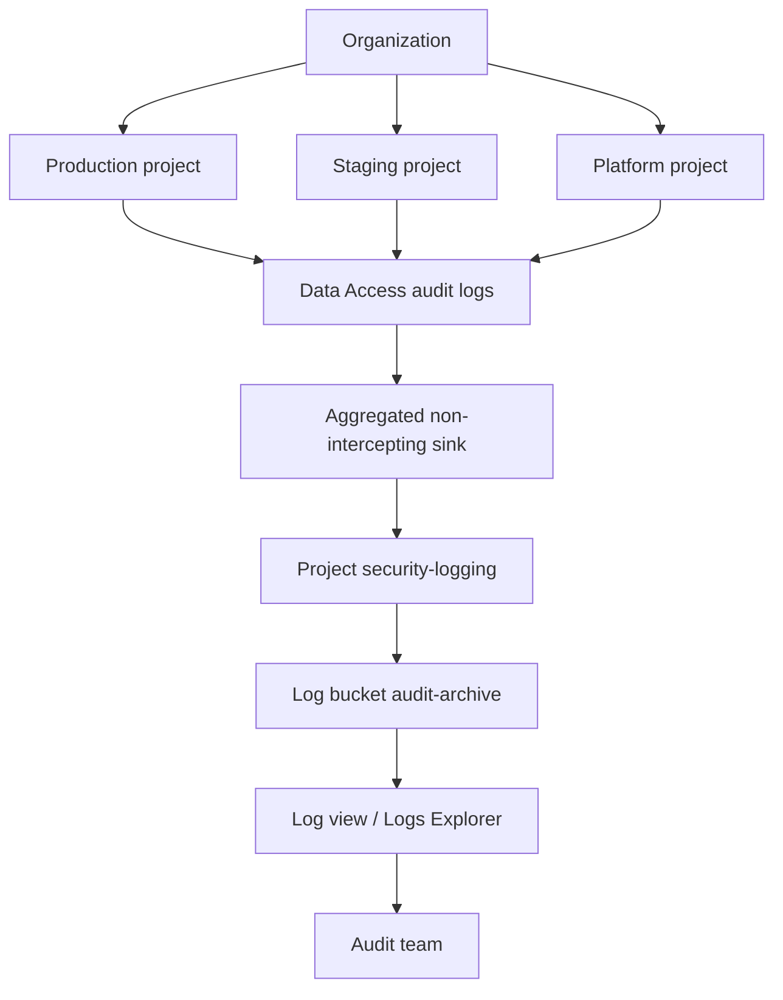

# Log Router, Sinks, Log Buckets, and Retention

A Google Cloud environment typically generates logs from many places: project and IAM administrative actions, firewall or VPC modifications, applications running on Compute Engine, GKE workloads, Cloud Run services, databases, and storage services. As the number of projects grows, keeping logs isolated in each project makes it difficult for operations teams to investigate incidents, audit changes, and satisfy retention requirements.

Cloud Logging provides **Log Router** to decide where log entries go, **log sinks** to route entries by filter, and **log buckets** to store and query logs. Retention settings determine how long logs remain in a bucket. Together, these components help organizations design log flows at the project or organization level while controlling data residency, access permissions, and cost.

Within the `CLOUD_PROVIDERS_GCP` module, this is the operational layer connecting cloud resources to observability: logs from IAM and Audit Logs help trace changes; logs from VPC and workloads support connectivity investigations; and application and database logs support error and reliability analysis. Log Router only processes log entries already sent to Cloud Logging. It does not automatically enable Data Access audit logs, install Ops Agent, or generate application logs.

## 1. Log Routing Flow in Cloud Logging

A log entry sent to Cloud Logging passes through the Log Router of the resource where the log originated. Every project, folder, organization, and billing account has a Log Router and sinks scoped to that resource. Sinks evaluate log entries against filters and forward matching records to configured destinations.



Log Router can temporarily buffer log entries during routing to absorb brief destination disruptions. This temporary buffer is not long-term storage and does not replace a log bucket. Nor does it protect against misconfigured filters, missing write permissions, or invalid destination configurations.

A sink only processes log entries received after the sink becomes active. Creating a sink today does not retroactively pull older log entries received beforehand. To copy historical logs from a bucket, an appropriate data copy or re-routing workflow is required.

## 2. How Log Sinks Work

A log sink is a routing configuration belonging to a project, folder, organization, or billing account. Each sink has:

- **Name and description:** identifies the sink and explains its intended purpose.
- **Destination:** where log entries are sent, such as a log bucket, Cloud Storage, BigQuery, Pub/Sub, or another project.
- **Inclusion filter:** criteria selecting which log entries to route.
- **Exclusion filters:** criteria excluding log entries from the sink even if they match the inclusion filter.
- **Writer identity:** the service identity used to write to the destination when the destination requires explicit permissions.

A sink has one inclusion filter and can have multiple exclusion filters. If no inclusion filter is specified, the sink matches all log entries. A record is sent to the destination when it matches the inclusion filter and does not match any enabled exclusion filter.

For example, the following filter selects logs with severity `ERROR` or higher from Compute Engine VMs:

```text
resource.type="gce_instance" AND severity>=ERROR
```

The following filter selects Data Access audit logs:

```text
LOG_ID("cloudaudit.googleapis.com/data_access") OR
LOG_ID("externalaudit.googleapis.com/data_access")
```

You can combine conditions on resource, project, log name, severity, payload fields, or labels. Filters use Logging query language, the same language used in Logs Explorer. Test filters in Logs Explorer or using the preview feature before enabling a sink broadly.

Each sink evaluates log entries independently. Consequently, a single log entry can be routed to multiple destinations if it matches multiple sinks. This is useful when you need both a central archive and a subset of logs forwarded to a SIEM; however, duplicate routing increases stored data volume and destination costs.

Exclusion filters are applied after log entries are received by Cloud Logging. Thus, exclusions reduce the volume of logs stored or forwarded through a sink, but they do not reduce `entries.write` calls or the log volume passing through ingestion. Do not use exclusions as a substitute for controlling log generation at the source.

## 3. Project, Folder, and Organization Sinks

### Project-Level Sinks

A project-level sink fits when a team needs to route logs from a single project to a dedicated destination. For example, the `payments-prod` project can send application error logs to BigQuery for analysis, or send audit logs to a dedicated archival bucket.

### Aggregated Sinks at Folder or Organization Level

When centralizing logs from multiple projects, you can create an **aggregated sink** on a folder or organization. This sink uses `--include-children` to receive logs from the selected resource and all child folders/projects. This allows security or platform teams to manage a single unified routing policy instead of creating identical sinks in every project.

There are two modes of operation:

| Aggregated Sink Mode | Behavior | When to Use |
|---|---|---|
| Non-intercepting | Routes matching records to the central destination; sinks in child projects continue evaluating those records | When you want to centralize an extra copy of logs while letting each project manage its own log flows |
| Intercepting | When a record matches the filter, routes it to the parent sink's destination and stops sinks in child resources from processing it; `_Required` on the source resource still receives its scoped logs | When the organization needs to enforce centralized routing policy and control downstream project sinks |

Intercepting sinks can alter routing behavior in child projects. A missing filter condition or erroneous exclusion can prevent logs from reaching destinations used by application teams. Therefore, test with a non-intercepting sink first, verify the results, and coordinate with project owners before enabling an intercepting sink.

### Example: Routing Logs Across an Entire Organization

The command below creates an organization-level sink to collect Data Access audit logs from the organization and its child resources, forwarding them to a log bucket in a centralized storage project:

```bash
gcloud logging sinks create org-data-access-to-central \
  logging.googleapis.com/projects/SECURITY_PROJECT_ID/locations/global/buckets/audit-archive \
  --organization=ORGANIZATION_ID \
  --include-children \
  --log-filter='LOG_ID("cloudaudit.googleapis.com/data_access") OR LOG_ID("externalaudit.googleapis.com/data_access")'
```

Replace `SECURITY_PROJECT_ID` and `ORGANIZATION_ID` with actual identifiers. The destination bucket must exist before creating the sink. For aggregated sinks, the creator needs permissions to manage sinks at the organization or folder level, such as `roles/logging.configWriter` or `roles/logging.admin` depending on assigned duties.

Note: a sink only routes audit logs that are actually generated. If a service does not have Data Access audit logging enabled or does not emit the filtered log type, the sink will have no matching data to forward.

## 4. Choosing a Sink Destination

The destination determines how teams store, analyze, or forward logs to other systems.

| Destination | Common Purpose | Key Considerations |
|---|---|---|
| Cloud Logging log bucket | Store logs for querying in Logs Explorer or Observability Analytics | Suitable when searching, analyzing, and managing retention inside Cloud Logging |
| Cloud Storage bucket | Archive or batch-export logs for long-term storage and data exchange | Must grant write access to writer identity; manage Cloud Storage lifecycle and costs separately |
| BigQuery dataset | Analyze logs using SQL and join with business data | Requires writable dataset; account for partitioning, queries, and BigQuery costs |
| Pub/Sub topic | Stream logs in near real time to SIEM, SOAR, or event-processing systems | Subscribers must be operated and monitored; handle duplicate messages safely |
| Google Cloud project | Forward logs to a central project so sinks in the receiving project route them further | Subject to a one-hop project forwarding limit; requires sink design in the target project |

If you want to use Logs Explorer, Error Reporting, or Cloud Logging's Observability Analytics, store logs in a log bucket. Routing logs directly to Cloud Storage, BigQuery, or Pub/Sub serves other goals and does not automatically store a copy in a Cloud Logging log bucket.

A project destination is a special case: logs forwarded to a target project can be routed further by sinks in that project, but Cloud Logging enforces a one-hop project forwarding limit. If you route directly to a log bucket in another project, log entries are written straight into that destination bucket and do not automatically pass through sinks in the bucket's project.

## 5. Writer Identity and Destination Write Permissions

Successfully creating a sink does not guarantee logs are arriving at the destination. For destinations outside the source project or target services requiring explicit authorization, the sink's writer identity must be granted appropriate write permissions. When a sink routes to a log bucket in the same project, a separate service account is usually not needed for writing.

Retrieve the writer identity with:

```bash
gcloud logging sinks describe org-data-access-to-central \
  --organization=ORGANIZATION_ID
```

The output may include a `writerIdentity` field, such as a principal formatted as `serviceAccount:...@gcp-sa-logging.iam.gserviceaccount.com`. Grant permissions on the project or destination holding the data using the appropriate role:

| Destination | Role Typically Needed for Writer Identity |
|---|---|
| Log bucket in another project | `roles/logging.bucketWriter` |
| Cloud Storage bucket | `roles/storage.objectCreator` |
| BigQuery dataset | `roles/bigquery.dataEditor` |
| Pub/Sub topic | `roles/pubsub.publisher` |

For sinks with a writer identity, also grant `roles/logging.logWriter` so the principal has permission to route log entries. The table above lists the additional destination-specific role. Sinks writing to a log bucket in the same project typically do not require a separate service account.

Example granting write permissions to a log bucket in a central project:

```bash
gcloud projects add-iam-policy-binding SECURITY_PROJECT_ID \
  --member="serviceAccount:WRITER_IDENTITY_EMAIL" \
  --role="roles/logging.logWriter"

gcloud projects add-iam-policy-binding SECURITY_PROJECT_ID \
  --member="serviceAccount:WRITER_IDENTITY_EMAIL" \
  --role="roles/logging.bucketWriter"
```

Replace `WRITER_IDENTITY_EMAIL` with the email address following the `serviceAccount:` prefix in `writerIdentity`; keep the `serviceAccount:` prefix in the `--member` value as shown. For dataset, bucket, or topic-level permissions, roles can be granted directly on the target resource if permitted by organizational IAM policy. Grant only the required write roles to the writer identity; never grant project-wide Owner or Editor just to fix routing errors.

If the destination resides inside a VPC Service Controls perimeter, verify ingress rules for the writer identity per VPC Service Controls guidance. Certain Pub/Sub configurations have data-region restrictions unsupported by Cloud Logging and can trigger `topic_region_not_allowed` errors.

## 6. Log Buckets and the Two Default Buckets

A log bucket is where Cloud Logging stores log entries to support searching, analysis, and lifecycle management. Every project, folder, organization, and billing account has two system sinks and buckets: `_Required` and `_Default`.

| Bucket | Primary Contents | Default Retention | Can Retention Be Changed? |
|---|---|---:|---|
| `_Required` | Mandatory audit logs such as Admin Activity, System Event, and Access Transparency | 400 days | No |
| `_Default` in project | Logs not automatically routed to `_Required`, typically Data Access, Policy Denied, application, and service logs | 30 days | Configurable from 1 to 3650 days |
| `_Default` in folder/organization | Logs per the system bucket configuration at that scope | 30 days | Cannot extend retention at this scope |
| User-created bucket in project | Log subsets routed for business or compliance needs | 30 days | Configurable from 1 to 3650 days |

The `_Required` bucket and sink are protected: their filter cannot be modified, the sink cannot be disabled, and the bucket cannot be deleted through standard actions; the 400-day retention is fixed. The `_Default` bucket cannot be deleted, though the `_Default` sink can be edited or disabled. When editing the default sink, understand clearly which log types will no longer be stored in the default bucket.

User-defined buckets can only be created at the project level, not directly inside a folder or organization. Each project can contain up to 100 log buckets; organize buckets by access requirements, data region, retention period, and analytics model rather than creating one bucket per small application.

### Organizing Buckets by Purpose

A common design separates logs by requirement:

- `audit-archive`: audit logs requiring longer retention for auditing and investigation.
- `platform-ops`: infrastructure, GKE, Cloud Run, and platform component logs.
- `application-prod`: production application logs needing frequent querying.
- `security-findings`: logs supporting security monitoring and analytics integrations.

These are illustrative bucket names, not system bucket names. When deciding to split buckets, determine who can view the data, who manages retention, which region the bucket resides in, and which logs route into it.

### Storage Location and Encryption

When creating a bucket, choose a location aligned with data residency, latency, query architecture, and internal policy requirements. A bucket's location cannot be changed after creation. To move to another region, create a new bucket, update sinks to route new logs there, and plan migration for older data.

Cloud Logging encrypts stored data by default. If customer-managed encryption keys (CMEK) are required, verify the key, region, and Cloud KMS permissions before creating the bucket. Encryption key management settings also cannot be changed after bucket creation. Organizational documentation should record location and encryption decisions before putting a bucket into production use.

## 7. Retention and Log Lifecycle

Retention is the number of days Cloud Logging keeps log entries in a bucket. Once expired, log entries are no longer queryable and are purged by the service's lifecycle mechanism. Retention is not the same as ingestion age limits: Log Router also enforces rules dropping log entries whose timestamps are too old or too far in the future.

For user-created buckets and project-level `_Default` buckets, retention can be configured from 1 to 3650 days. For example, extending the project's `_Default` bucket retention to one year:

```bash
gcloud logging buckets update _Default \
  --location=global \
  --retention-days=365
```

Example creating a dedicated bucket for audit logs with one-year retention:

```bash
gcloud logging buckets create audit-archive \
  --location=global \
  --description="Central audit log archive" \
  --retention-days=365
```

These commands apply to buckets within a project. You cannot change retention on `_Required`, nor extend retention on folder- or organization-level buckets. If organization-level logs must be kept longer than the default period, route those logs to a bucket in a central project and configure retention on that bucket.

Retention periods should be chosen according to usage purpose:

| Log Category | Questions for Choosing Retention |
|---|---|
| Audit logs | How long do audit policies, access investigations, and legal regulations require retention? |
| Security logs | How much historical data is needed for incident investigation and detecting persistent behavior? |
| Application logs | How long do development teams need to inspect errors after a release? |
| Operational logs | How long is needed to analyze error trends, performance, and configuration changes? |

Extending retention only affects data still retained; logs already expired and deleted cannot be recovered by increasing the day count afterward. When shortening retention, Cloud Logging provides a seven-day deletion grace period: expired logs are no longer queryable or visible during this window, but access can be restored if retention is reverted in time. Data in the grace period may still incur storage charges.

### Locking a Bucket

Cloud Logging supports locking a bucket to prevent property changes, retention modifications, and bucket deletion. Locking is **irreversible**. A locked bucket cannot be deleted through standard workflows, so only lock a bucket after verifying retention, location, CMEK, access permissions, sinks, and compliance procedures. To further protect a project containing a locked bucket, organizations can consider project liens per Google Cloud guidance.

## 8. End-to-End Example: Centralizing Organization Audit Logs

Suppose an organization has multiple projects for production, staging, and platform services. The security team wants to collect Data Access audit logs into a `security-logging` project, retain them for one year, and grant query access to the audit team.

Implementation workflow:

1. Create or select the central `security-logging` project and verify billing, location, and IAM permissions.
2. Create the `audit-archive` log bucket in a location compliant with data policy, setting retention to 365 days.
3. Create an aggregated sink at the organization level, enabling `--include-children` and filtering for Data Access audit logs.
4. Use `gcloud logging sinks describe` to obtain the writer identity.
5. Grant `roles/logging.logWriter` and `roles/logging.bucketWriter` to the writer identity on the target project per cross-project sink requirements.
6. Verify that child projects generate Data Access audit logs and confirm records appear in the central bucket.
7. Create log views or grant appropriate permissions so auditors see only the data they need.
8. Monitor sink errors, storage volume, incoming log volume, and cost over time.

Data flow diagram:



Example sink creation command:

```bash
gcloud logging sinks create org-data-access-to-central \
  logging.googleapis.com/projects/security-logging/locations/global/buckets/audit-archive \
  --organization=ORGANIZATION_ID \
  --include-children \
  --log-filter='LOG_ID("cloudaudit.googleapis.com/data_access") OR LOG_ID("externalaudit.googleapis.com/data_access")'
```

This example uses a non-intercepting sink because `--intercept-children` is omitted. Child projects can continue routing logs via their own sinks. If the goal is to override child project routing flows, evaluate intercepting sinks separately and test thoroughly before rollout.

## 9. Verifying and Troubleshooting Routing Errors

When logs do not appear at the destination, check along the chain from source to target:

1. **Is the source generating logs?** Open Logs Explorer in the source project and use a narrow filter on `resource.type`, `logName`, and time range.
2. **Is the sink scoped correctly?** Verify the sink belongs to the intended project, folder, or organization; aggregated sinks must include `--include-children` to capture child resources.
3. **Does the filter match?** Check inclusion filter, exclusion filters, log names, and project conditions. An empty filter matches all log entries.
4. **Does the destination exist?** Verify the bucket, dataset, topic, or project path; location and destination format must be exact.
5. **Does the writer identity have write permissions?** Run `gcloud logging sinks describe SINK_NAME` and inspect IAM bindings on the target resource.
6. **Are there network or perimeter restrictions?** Check VPC Service Controls, ingress rules, and Pub/Sub regional constraints if applicable.
7. **Are there configuration errors?** Check sink error logs and resource Essential Contacts; sink changes can take a few minutes to take effect.

Useful diagnostic commands:

```bash
# List sinks in the current project
gcloud logging sinks list

# List sinks at the organization level
gcloud logging sinks list --organization=ORGANIZATION_ID

# Describe an organization-level sink
gcloud logging sinks describe org-data-access-to-central \
  --organization=ORGANIZATION_ID

# List log buckets in the current project
gcloud logging buckets list

# Describe a specific bucket configuration
gcloud logging buckets describe audit-archive --location=global
```

A sink with a misconfigured filter may silently drop routing without interrupting log writes at the source. After fixing a configuration, verify new logs generated after the change; sinks do not automatically replay historical logs. To recover historical data, inspect the source bucket and use an appropriate log-copy workflow.

## 10. Costs and Operational Principles

The cost of a logging architecture depends on ingested log volume, stored data, retention, number of destinations, and services used for analysis or export. Retention longer than `_Default`'s default and user-created buckets can incur additional storage charges. A single log entry can match multiple sinks; each copy stored at a different destination can incur corresponding charges.

Recommended principles:

- Select logs to retain based on operational, security, and audit objectives; do not assume every log needs the same retention period.
- Write specific filters to route the right logs to the right destinations; preview filters before applying them organization-wide.
- Distinguish logs queried frequently from logs only archived or exported to external systems.
- Verify location and CMEK before creating buckets since these properties cannot be changed afterward.
- Monitor sink counts, bucket storage volume, retention settings, and BigQuery, Cloud Storage, or Pub/Sub costs.
- Use intercepting sinks only once governance teams understand the impact on child project sinks.
- Maintain an inventory of owner, purpose, filter, and destination for every sink to support audits and incident response.
- Periodically review exclusions, buckets nearing retention expiry, and unused sinks.

Do not lock a bucket solely to prevent accidental edits. Because locking is irreversible, require an approval process and retention verification before locking.

## 11. Hands-On Exercise

Perform in a sandbox project or environment approved by your organization:

1. Open Log Router and list the two default sinks, `_Required` and `_Default`.
2. Open Logs Explorer, pick a group of application logs or audit logs, and determine an appropriate filter.
3. Create a test log bucket with a chosen location and retention period.
4. Create a project-level sink routing a subset of `ERROR`-severity logs into the test bucket.
5. Use `gcloud logging sinks describe` to verify the destination and writer identity.
6. Confirm new log entries appear in the bucket; if no data shows up, check source, filter, and IAM.
7. Practice updating retention in the sandbox, inspect bucket configuration, and explain why retention cannot be set on `_Required`.
8. Design a filter for an organization-level aggregated sink and explain when to choose non-intercepting versus intercepting.

Do not lock buckets used for real production data in exercises. Do not modify `_Required` or disable `_Default` in production for experimentation.

## 12. Conclusion

Log Router orchestrates log entries through sinks across the resource hierarchy; sinks use filters to select data and destinations to store or forward it; log buckets provide storage with managed retention and access control. When scoped properly at the project or organization level, with accurate writer identity permissions and purpose-driven retention, organizations can centralize logs from IAM, VPC, Compute Engine, GKE, Cloud Run, storage, and databases to support investigation, auditing, and reliable operations.

## References

- [Route log entries — Cloud Logging](https://docs.cloud.google.com/logging/docs/routing/overview)
- [Configure log buckets — Cloud Logging](https://docs.cloud.google.com/logging/docs/buckets)
- [Store log entries — Cloud Logging](https://docs.cloud.google.com/logging/docs/store-log-entries)
- [Aggregated sinks — Cloud Logging](https://docs.cloud.google.com/logging/docs/export/aggregated_sinks)
- [gcloud logging sinks create — Google Cloud CLI](https://docs.cloud.google.com/sdk/gcloud/reference/logging/sinks/create)
- [Cloud Logging quotas and retention periods](https://docs.cloud.google.com/logging/quotas)
