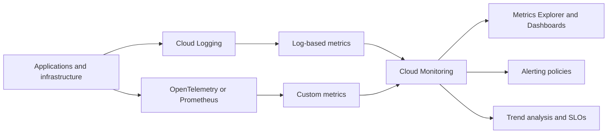

# Log-Based Metrics and Custom Metrics

Cloud Logging stores events occurring in applications and infrastructure; Cloud Monitoring converts measurements into time series for building charts, dashboards, and alerts. When needing to measure error counts, business states, or request latency, operations teams can extract metrics from logs using **log-based metrics**. When needing to measure a quantity the application knows directly at runtime—such as pending transactions, background jobs, or queue depth—the application can send **custom metrics** to Cloud Monitoring.

These two approaches complement each other. Log-based metrics leverage logs already recorded and fit structured events. Custom metrics capture measurements right at the source, enabling tracking of internal states or behaviors that logs do not fully express. Both can be used in Metrics Explorer, dashboards, and alerting policies.

In the `CLOUD_PROVIDERS_GCP` module, this lesson connects Cloud Observability with workloads running on Compute Engine, GKE, Cloud Run, storage services, and databases. The module helps learners organize projects, IAM, and VPCs, choose services, protect resources, automate releases, and monitor reliability and cost. Metrics are a critical part of that work: they turn logs and in-application signals into indicators that can be compared over time, thresholded, and used in operational workflows.

## Learning Objectives

After this lesson, learners will be able to:

- Explain metrics, metric descriptors, time series, monitored resources, and labels in Cloud Monitoring.
- Distinguish between system-defined log-based metrics, user-defined log-based metrics, and application-emitted custom metrics.
- Create counter metrics and distribution metrics from logs using Logging query language and `gcloud`.
- Design custom metrics using OpenTelemetry, Prometheus, or the Cloud Monitoring API.
- Choose metric kinds, value types, resource types, and labels suited to each measurement.
- Build charts and alerts, and monitor latency, cardinality, quotas, and costs.

## 1. Metrics in the Cloud Observability Model

### From Logs to Metrics

A log describes a specific event: which request was processed, which error appeared, which administrative operation occurred, or how a task finished. A metric represents a numeric measurement over time. A log might indicate that a `POST /orders` request returned HTTP 503; a metric can count total 5xx errors per minute or record the latency distribution across requests.



Cloud Logging can generate metrics from `LogEntry` contents. Cloud Monitoring ingests that data and manages the time series. For custom metrics, the application or collector sends data directly to Cloud Monitoring under a defined metric type and monitored resource.

### Metric Descriptor, Time Series, and Monitored Resource

A metric in Cloud Monitoring has three core components:

| Component | Meaning | Example |
|---|---|---|
| Metric type / descriptor | Defines the measured quantity, data type, unit, and labels. | `custom.googleapis.com/checkout/payment_success_count`. |
| Monitored resource | Identifies the resource producing the data. | A `gce_instance` VM, `k8s_container`, Cloud Run revision, or `global`. |
| Time series | Sequence of data points for one metric and monitored resource pair, with a specific label combination. | Successful transactions for service `checkout` in environment `prod`. |

`MetricDescriptor` describes the metric name, `metricKind`, `valueType`, unit, description, and labels. `MonitoredResource` describes where the data originated, such as project, zone, instance, or container. A data point (`Point`) has a value and its corresponding time interval.

One metric type can generate many time series. Each distinct combination of metric labels and resource labels creates a separate series. If a metric has an `environment` label with 3 values and `status_class` with 5 values, it can produce up to 15 combinations before even factoring in resource labels.

### Metric Kind and Value Type

`metricKind` describes how values are interpreted over time; `valueType` describes the value's data type.

| Property | Meaning | Common Use Cases |
|---|---|---|
| `GAUGE` | Value at a point in time. | Messages currently in a queue, active workers, temperature, or utilization at sample time. |
| `DELTA` | Change over a time interval. | Requests occurring per interval or latency distributions extracted from logs. |
| `CUMULATIVE` | Accumulated value since the start time of the series. | Total requests or total bytes since the process started. |
| `INT64` | 64-bit integer. | Request, task, or error counts. |
| `DOUBLE` | Floating-point number. | Ratios, temperatures, capacities, or numeric latencies. |
| `BOOL` | Boolean true/false value. | Certain system metrics representing state. |
| `DISTRIBUTION` | Distribution of multiple values, typically represented by histogram buckets. | Request latency, payload size, or processing duration. |

Not every combination of `metricKind` and `valueType` is valid for every metric category. For `custom.googleapis.com` custom metrics, adhere to Cloud Monitoring's supported combinations matrix; for example, `DELTA` with `INT64` or `DOUBLE` is not supported for this custom metric type. Custom counters typically use `CUMULATIVE` or `GAUGE`. Log-based distribution metrics use `DELTA` combined with `DISTRIBUTION`. `CUMULATIVE` metrics must be aligned/aggregated appropriately before being used directly in charts or alerts.

## 2. Distinguishing Log-Based Metrics and Custom Metrics

The term "custom metric" is sometimes used broadly. In Cloud Monitoring, user-defined log-based metrics are also a billable class of custom metrics. However, their creation mechanism and data source differ from custom metrics instrumented directly by an application.

| Criterion | User-Defined Log-Based Metric | Application-Emitted Custom Metric |
|---|---|---|
| Data source | Log entries already ingested by Cloud Logging. | Measurements recorded by applications, collectors, or Prometheus. |
| Where configured | Cloud Logging, Log-based Metrics page, or Logging API. | OpenTelemetry, Prometheus/Managed Service for Prometheus, or Cloud Monitoring API. |
| How values are produced | Filter selects logs; counter counts events or distribution extracts numbers. | Code instrumentation or collector sends data points. |
| Historical data | Counts only logs received after the metric is created; does not backfill old logs. | Has data points only from when the application begins emitting the metric. |
| Best suited for | Counting errors, audit events, business events already in logs, logged latencies. | Queue depth, worker count, cache hits/misses, active background tasks, or internal measurements. |
| Typical metric type | `logging.googleapis.com/user/METRIC_NAME`. | `custom.googleapis.com/...`, `workload.googleapis.com/...`, or source-specific namespace. |

The Cloud Monitoring API does not create log-based metrics. For log-based metrics, Cloud Logging creates the metric structure and forwards data to Cloud Monitoring. For custom metrics, the application/collector sends data or creates metric descriptors through the Cloud Monitoring API.

To alert immediately when a specific log message appears, use a log-based alerting policy to monitor logs directly. To track trends in counts or latencies per minute/hour, use a log-based metric. If a measurement exists only in application memory and is not logged, instrument it as a custom metric.

## 3. Log-Based Metrics in Cloud Logging

### System-Defined and User-Defined Metrics

Cloud Logging provides two categories of log-based metrics:

- **System-defined metrics**: defined by Google Cloud to monitor Logging activity, such as log entry counts or exported log volume. They are primarily counters, with some boolean system metrics. System-defined metrics are project-scoped.
- **User-defined metrics**: created by users to track specific events in applications or environments. User-defined log-based metrics support counters and distributions.

The metric type of a user-defined log-based metric takes the form:

```text
logging.googleapis.com/user/METRIC_NAME
```

### Project-Scoped and Bucket-Scoped Metrics

User-defined log-based metrics can apply either to a project or to a specific log bucket:

| Scope | Logs Counted | When to Use |
|---|---|---|
| Project-scoped | Logs received by the Logging API of the metric's project, regardless of the project's inclusion/exclusion filters. | Monitoring logs within a single project. |
| Bucket-scoped | Logs routed to and stored in the target bucket, regardless of which project the logs originally came from. | Using aggregated sinks or centralizing logs from multiple projects into one bucket. |

Log-based metrics cannot be created directly at the folder, organization, or billing account level. To observe multiple projects, use a bucket-scoped metric on a centralized bucket or configure a multi-project metrics scope so a monitoring project can view metric data across projects.

Important detail: project-scoped user-defined metrics count even logs excluded from storage by inclusion/exclusion filters; therefore, their totals can differ from the logs visible in a log bucket. Bucket-scoped metrics count only logs routed into the selected bucket. System-defined metrics count only logs stored in buckets per system rules.

### Structuring Logs for Metric Extraction

Applications should emit structured logs so metric filters and extractors can reference stable fields. Example log entry from a checkout service:

```json
{
  "severity": "ERROR",
  "resource": {
    "type": "cloud_run_revision",
    "labels": {
      "service_name": "checkout",
      "revision_name": "checkout-00042-abc",
      "location": "asia-southeast1"
    }
  },
  "jsonPayload": {
    "event": "payment_failed",
    "http_status": 503,
    "route_template": "/orders/{orderId}",
    "latency_ms": 245,
    "environment": "prod"
  }
}
```

In `LogEntry`, `resource` is the log's monitored resource; `jsonPayload` holds application-emitted fields. `route_template` is a route pattern with a bounded set of values, enabling breakdown by endpoint type. Never use full URLs containing user IDs or transaction IDs as labels.

Example filter matching payment failures for the checkout service:

```text
resource.type="cloud_run_revision"
resource.labels.service_name="checkout"
jsonPayload.event="payment_failed"
severity>=ERROR
```

Filters can use `LogEntry` fields, comparison operators, and Logging query language functions. Include `resource.type` to scope the metric to a single resource type; this helps Cloud Monitoring identify the source of the time series and makes the metric easier to locate when creating charts or alerts.

### Counter Metrics: Counting Errors

Counter metrics count log entries matching a filter per time interval. Use counters to track:

- 5xx error requests.
- Failed payments.
- Sensitive administrative actions performed.
- Service retries or timeouts.

Example creating a project-scoped counter metric:

```bash
gcloud config set project PROJECT_ID

gcloud services enable logging.googleapis.com monitoring.googleapis.com

gcloud logging metrics create checkout_payment_failures \
  --description="Number of failed checkout payments" \
  --log-filter='resource.type="cloud_run_revision" AND resource.labels.service_name="checkout" AND jsonPayload.event="payment_failed" AND severity>=ERROR'
```

The command above creates a metric counting log entries matching the filter. After creation, you can list and inspect the metric definition:

```bash
gcloud logging metrics list

gcloud logging metrics describe checkout_payment_failures
```

To create a metric scoped to a specific bucket, pass the bucket path to `--bucket-name`:

```bash
gcloud logging metrics create centralized_checkout_failures \
  --description="Checkout errors in central bucket" \
  --log-filter='resource.type="cloud_run_revision" AND severity>=ERROR' \
  --bucket-name="projects/PROJECT_ID/locations/global/buckets/central-logs"
```

Verify that the bucket path points to a real bucket and that a log sink is actively routing the target logs into that bucket.

### Distribution Metrics: Measuring Request Latency

Distribution metrics extract a numeric value from each matching log entry and aggregate values into histogram buckets. The metric stores count, mean, sum of squared deviations, and per-bucket counts; it does not retain individual raw samples.

Distributions are ideal for tracking latency, payload size, or processing duration. For instance, `latency_ms` in logs can be used to inspect latency distributions and estimate percentiles such as p50, p95, or p99 in Cloud Monitoring.

For distribution metrics, declare `valueExtractor` and `bucketOptions`. Example YAML configuration for `LogMetric`:

```yaml
name: checkout_request_latency
description: Checkout request latency distribution in milliseconds
filter: |
  resource.type="cloud_run_revision"
  resource.labels.service_name="checkout"
  jsonPayload.event="http_request_completed"
valueExtractor: EXTRACT(jsonPayload.latency_ms)
labelExtractors:
  environment: EXTRACT(jsonPayload.environment)
  status_class: REGEXP_EXTRACT(jsonPayload.http_status, "^([0-9])")
bucketOptions:
  exponentialBuckets:
    numFiniteBuckets: 12
    growthFactor: 2
    scale: 1
metricDescriptor:
  metricKind: DELTA
  valueType: DISTRIBUTION
  unit: ms
  labels:
    - key: environment
      valueType: STRING
      description: Deployment environment
    - key: status_class
      valueType: STRING
      description: Leading digit of HTTP status code
```

Save the configuration to a local file, such as `checkout-latency.yaml`, then create the metric:

```bash
gcloud logging metrics create checkout_request_latency \
  --config-from-file=checkout-latency.yaml
```

The `scale`, `growthFactor`, and bucket count values must fit the actual latency range. For millisecond latency metrics, verify that logs contain a valid numeric field before creating the metric. If a field has a suffix like `245ms`, use a regular expression in the extractor to extract the numeric portion.

### Labels and Extraction

Labels partition a metric into multiple time series. With log-based metrics, label extractors can capture an entire field or extract a substring using a regular expression. For example, extracting `environment`, `http_status`, or a route template from `jsonPayload`.

Key rules:

- Add labels only when needed to filter or group time series.
- Use bounded value domains, such as `prod`, `staging`, `2xx`, `4xx`, `5xx`.
- Never place emails, user IDs, IPs, request IDs, trace IDs, full URLs, or timestamps in labels.
- Never include sensitive data in filters or extractors; filters and labels are handled as service data.
- Each user-defined log-based metric supports at most 10 custom labels; once created, labels cannot be deleted, and their names and value types cannot be changed.

If a metric covers 100 VMs and one label has 20 values, it can produce up to 2,000 time series. A label holding a unique value per request can produce millions of series, causing metric throttling and higher costs.

### Recording Timing and Limitations of Log-Based Metrics

- Metrics count only log entries received after metric creation; historical logs are not backfilled.
- Data usually appears quickly in Cloud Monitoring, though delays can reach roughly 10 minutes.
- Logs with timestamps too far in the past or future may not be counted.
- Time series can have gaps; not every interval emits a zero sample.
- Metrics can be updated when late logs arrive within processing bounds.
- Filters cannot exceed 20,000 characters.
- A user-defined log-based metric has limits of roughly 30,000 active time series and at most 200 histogram buckets.

When alerting on log-based metrics, configure missing-data handling carefully. For example, a heartbeat metric might emit no sample in an interval; if a policy treats missing samples as zero, it may send false alerts. Prefer multi-event evaluation windows, pick appropriate alignment periods, and test behavior when no logs arrive.

## 4. Application-Generated Custom Metrics

### When Are Custom Metrics Needed?

Custom metrics fit when an application holds a state or measurement not fully captured by logs. Examples:

- Current message count in an internal queue.
- Active or idle worker counts.
- Cache hit and cache miss counts.
- Background jobs created, completed, or failed.
- Successful transactions by payment method.
- Duration of an internal processing step that the application does not log.

Cloud Monitoring supports custom metrics via OpenTelemetry, Prometheus, and the Cloud Monitoring API. Google recommends OpenTelemetry because it is an open, vendor-neutral framework supporting multi-language instrumentation.

### Naming Metric Types

Custom metric types must use a valid prefix, such as:

```text
custom.googleapis.com/checkout/payment_success_count
custom.googleapis.com/checkout/queue_depth
custom.googleapis.com/checkout/request_latency
```

Organize names hierarchically as `domain/component/measurement`, avoiding generic names like `count` or `value`. Metric type names must be unique within a project. A metric type is identified by the resource name:

```text
projects/PROJECT_ID/metricDescriptors/custom.googleapis.com/checkout/queue_depth
```

### Designing the Metric Descriptor

Before writing data, define:

1. **Metric type**: descriptive name under the custom namespace.
2. **Metric kind**: whether the value is gauge or cumulative.
3. **Value type**: `INT64`, `DOUBLE`, `BOOL`, or `DISTRIBUTION` per supported combinations.
4. **Unit**: units such as `1`, `ms`, `By`, `{request}`, or appropriate UCUM units.
5. **Labels**: bounded analytical dimensions such as `environment`, `region`, `status_class`.
6. **Monitored resource**: the actual resource producing the measurement, such as `gce_instance`, `k8s_container`, `cloud_run_revision`, or `global`.

Monitored resource and metric labels together form the time series identity. If the resource type already has a `zone` label, do not add another metric label repeating the same info. Choosing the right resource type helps Monitoring associate data with the exact VM, container, service, or project.

### Writing Custom Metrics with the Cloud Monitoring API

The Cloud Monitoring API uses `timeSeries.create` to write data. One request can contain at most 200 distinct time series; each time series in a request holds a single point. Each time series is identified by metric type, metric labels, and monitored resource.

Example request body writing a gauge value to `queue_depth`:

```json
{
  "timeSeries": [
    {
      "metric": {
        "type": "custom.googleapis.com/checkout/queue_depth",
        "labels": {
          "environment": "prod"
        }
      },
      "resource": {
        "type": "global",
        "labels": {
          "project_id": "PROJECT_ID"
        }
      },
      "points": [
        {
          "interval": {
            "endTime": "2026-11-19T07:00:00Z"
          },
          "value": {
            "int64Value": "42"
          }
        }
      ]
    }
  ]
}
```

This illustrates payload structure; `endTime` must be the actual measurement timestamp and `PROJECT_ID` must be the project receiving the metric. For applications on VMs, GKE, or Cloud Run, select the corresponding monitored resource type and supply full resource labels instead of `global` whenever distinguishing individual instances/revisions/containers.

Cloud Monitoring can auto-create a metric descriptor upon receiving a new metric type, though auto-created descriptors use default settings. In production systems, explicitly design descriptors before emitting data to control type, unit, and labels. If needed, call `projects.metricDescriptors.create` first, then send time series via `projects.timeSeries.create`.

### Sending Metrics via OpenTelemetry

OpenTelemetry decouples application instrumentation from backend delivery. The application records measurements into metric instruments; the SDK and collector/exporter handle aggregation, conversion, and telemetry transport.

Java example illustrating a counter and histogram via the OpenTelemetry API:

```java
import io.opentelemetry.api.common.AttributeKey;
import io.opentelemetry.api.common.Attributes;
import io.opentelemetry.api.metrics.LongCounter;
import io.opentelemetry.api.metrics.DoubleHistogram;
import io.opentelemetry.api.metrics.Meter;

public final class CheckoutMetrics {
    private final LongCounter paymentSuccess;
    private final DoubleHistogram requestLatency;

    public CheckoutMetrics(Meter meter) {
        paymentSuccess = meter.counterBuilder("checkout.payment.success")
                .setDescription("Number of successful payment transactions")
                .setUnit("{payment}")
                .build();

        requestLatency = meter.histogramBuilder("checkout.request.latency")
                .setDescription("Checkout request processing latency")
                .setUnit("ms")
                .build();
    }

    public void recordPaymentSuccess(String environment, String method) {
        paymentSuccess.add(1, Attributes.of(
                AttributeKey.stringKey("environment"), environment,
                AttributeKey.stringKey("payment_method"), method));
    }

    public void recordRequestLatency(double latencyMs, String route) {
        requestLatency.record(latencyMs, Attributes.of(
                AttributeKey.stringKey("route"), route));
    }
}
```

This snippet illustrates instrumentation only. For data to appear in Cloud Monitoring, the application must configure the OpenTelemetry SDK and an exporter/collector suited to the environment. On Compute Engine, use Ops Agent with its OTLP receiver or Google-built OpenTelemetry Collector. On GKE, use Google Cloud Managed Service for Prometheus or OpenTelemetry Collector. On Cloud Run, use the OpenTelemetry Collector sidecar per platform guidance.

When deploying, grant metric write permissions to the service account/collector via `roles/monitoring.metricWriter`, enable the Cloud Monitoring API, and verify data in Metrics Explorer. Applications running outside Google Cloud must configure Application Default Credentials appropriately; never embed service account keys in source code or container images.

### Sending Metrics from Prometheus

If an application already exposes Prometheus metrics, Google Cloud Managed Service for Prometheus can scrape and store data in Cloud Monitoring. This approach fits GKE/Kubernetes and workloads already using the Prometheus exposition format.

Before ingestion, control Prometheus labels. Labels like `pod`, `namespace`, or `cluster` are useful, whereas unbounded labels like `user_id`, request ID, or full URLs can blow up cardinality. Use relabeling to drop or normalize unnecessary labels.

## 5. Labels, Cardinality, and Cost

### What Is Cardinality?

Cardinality is the number of time series generated from combinations of metric labels and resource labels. If a metric has 3 labels with 4, 5, and 10 values respectively, it can generate up to 200 combinations. Once multiplied by VMs, containers, or revisions, actual time series counts can grow rapidly.

Suppose a custom metric has:

- `environment`: `prod`, `staging` (2 values).
- `status_class`: `2xx`, `4xx`, `5xx` (3 values).
- `region`: 3 regions (3 values).
- 50 monitored resources.

Estimated maximum time series:

```text
2 × 3 × 3 × 50 = 900 time series
```

This design is manageable. Adding `request_id` with millions of distinct values would push time series beyond limits and cause throttling.

### Label Design Principles

- Favor classification dimensions with small, stable value sets.
- Use route templates instead of concrete URLs.
- Use status classes or error categories instead of free-form error messages.
- Never use user IDs, emails, IPs, trace IDs, request IDs, timestamps, or transaction IDs as labels.
- Avoid duplicating information already present in monitored resource labels.
- Add a label only when dashboards, queries, or alerts genuinely need to split by that dimension.

### Reference Quotas

Current limits published in Google Cloud documentation may change over time; check the quotas page before large-scale rollouts.

| Metric Category | Notable Limits |
|---|---|
| User-defined log-based metrics | Up to 500 metric descriptors within documented limits; 10 labels/metric; 30,000 active time series/metric; 200 histogram buckets. |
| Custom metrics | Up to 10,000 custom metric descriptors/project; 30 labels/descriptor; 200 time series per write request; at most one point per time series per request. |
| Custom metric write frequency | Do not write to the same time series faster than one point every 5 seconds per Cloud Monitoring API. |
| Active time series for custom metrics | System limit per monitored resource; current documentation cites 200,000 active time series for custom metrics per monitored resource. |

A time series is considered active if it has received data within the last 24 hours. Check exact quotas for the metric domain and monitored resource type you use.

### Monitoring Metric Costs

User-defined log-based metrics and custom metrics are billable. Costs depend on ingested data and applicable pricing models. High cardinality increases time series counts, sample counts, and query data volumes; creating unused metrics also adds cost and complexity.

Cloud Monitoring provides the **Metrics Management** page to inspect ingestion volume, billable samples/bytes, cardinality, query counts, metric-write errors, and whether metrics are referenced by dashboards or alerts. Use this page to spot expensive low-value metrics and configure metric exclusion rules when ingestion is no longer needed.

Note: Metrics Management does not display user-defined log-based metrics prefixed with `logging.googleapis.com/user`. For those metrics, check quotas, configuration, and pricing in the corresponding Cloud Logging/Cloud Monitoring documentation.

## 6. IAM and Project Preparation

### APIs to Enable

Projects using Cloud Logging and Cloud Monitoring require an active billing account to use metric features per service guidelines. Verify billing and quotas before deploying to production. Depending on the collection path, projects may require:

```bash
gcloud services enable logging.googleapis.com monitoring.googleapis.com
```

When using OpenTelemetry, Prometheus, or other integrations, verify any additional APIs and components needed by the collector/exporter.

### Common IAM Roles

| Need | Commonly Used Role |
|---|---|
| Create, update, delete log-based metrics | Logs Configuration Writer (`roles/logging.configWriter`). |
| View log-based metric definitions | Logs Viewer (`roles/logging.viewer`) with `logging.logMetrics.get` and `logging.logMetrics.list`. |
| Read time series in Cloud Monitoring | Monitoring Viewer (`roles/monitoring.viewer`). |
| Write custom metrics from apps or collectors | Monitoring Metric Writer (`roles/monitoring.metricWriter`). |
| Create/edit dashboards, alerting policies, or Monitoring configs | Grant task-specific Monitoring roles following least privilege. |

Do not grant `roles/editor` solely to create metrics when narrower roles suffice. Especially for log-based metrics, label extractors can expose sensitive log data; grant metric configuration rights only to trusted teams and review filters/labels before creation.

## 7. Viewing Metrics, Building Charts, and Alerting

### Viewing Log-Based Metrics

In Google Cloud Console:

1. Select the target project.
2. Open **Logging → Log-based Metrics**.
3. Inspect the System metrics and User-defined metrics sections.
4. Select the metric to inspect and click **View in Metrics Explorer** to inspect its time series.

You can list metrics via the CLI:

```bash
gcloud logging metrics list
gcloud logging metrics describe checkout_payment_failures
```

The CLI displays metric definitions; to read time series data, use Cloud Monitoring Metrics Explorer or the Monitoring API.

### Metric Filters in Metrics Explorer

User-defined log-based metrics have metric types formatted as:

```text
logging.googleapis.com/user/checkout_payment_failures
```

When creating charts or alerts, select the metric type, then filter by resource labels or metric labels. If a metric does not appear when filtering by a specific resource type, check whether the log metric's filter specifies an appropriate `resource.type`.

### Creating Alerts from Metrics

For example, the operations team wants notifications when payment failures in a 5-minute window exceed a threshold. Create an alerting policy with:

1. Metric: `logging.googleapis.com/user/checkout_payment_failures`.
2. Resource filter: target only the Cloud Run service `checkout`.
3. Aggregation: sum over a 5-minute window.
4. Condition: value exceeds a threshold grounded in an actual baseline.
5. Evaluation behavior: configure appropriate missing-data handling and duration.
6. Notification channel: email, Pub/Sub, PagerDuty, or the organization's integrated channel.

For distribution metrics, build charts or alerts on percentile statistics to catch rising p95/p99 latency. For custom gauge metrics such as queue depth, set thresholds based on safe system capacity. Tie every alert to a runbook and clear owner, avoiding unactionable alerts.

### Multi-Project Metrics Scopes

By default, each project has a metrics scope containing only itself. You can configure a scoping project to view metrics from multiple projects within one metrics scope. This helps when an organization separates projects by environment or service but wants centralized dashboards.

A metrics scope only controls which projects are visible in Cloud Monitoring. It does not copy metric definitions, IAM policies, or log data across projects. View permissions must still be granted properly on each source project.

## 8. Sample Implementation Workflow for a Checkout Service

Suppose a system has a Cloud Run service `checkout` handling orders and payments. The team wants to monitor payment failures, request latency, and successful transactions.

### Step 1: Define Operational Questions

- How many payments fail every 5 minutes?
- Does checkout request p95 latency exceed its threshold?
- Are successful payments by method changing abnormally?
- Is the internal queue growing steadily?

### Step 2: Choose Metric Sources

| Question | Suitable Source | Metric |
|---|---|---|
| Payment error log count | Log-based counter | `checkout_payment_failures`. |
| Latency distribution recorded in logs | Log-based distribution | `checkout_request_latency`. |
| Successful transactions by method | Custom metric / OpenTelemetry counter | `checkout.payment.success`. |
| Pending messages in queue | Custom gauge | `checkout.queue_depth`. |

### Step 3: Standardize Logs and Instrument the Application

Logs must carry stable `event`, `http_status`, `latency_ms`, `environment`, and `route_template` fields. The application instruments a counter for successful payments and a histogram for latency if measuring directly in code. Avoid recording the exact same measurement as both a log-based metric and a custom metric unless needed for cross-validation, as doing so raises costs and causes confusion during analysis.

### Step 4: Create Metrics and Verify Data

Create the counter and distribution following the earlier examples. Configure the OpenTelemetry exporter/collector, grant Monitoring Metric Writer permissions, and verify metric types and resource labels in Metrics Explorer. Confirm log filters capture the intended events and extractors return valid numbers.

### Step 5: Build Dashboards and Alerts

The dashboard should include:

- Payment errors over time.
- Error ratio over total requests (using aligned success/failure metrics).
- p50, p95, and p99 latency.
- Queue depth and active worker count.

Alerts should focus on actionable signals: surging errors, p95 exceeding thresholds over a sustained interval, prolonged queue depth growth, or heartbeat metric absence. Test edge cases including delayed logs, missing samples, and scale-to-zero behavior.

### Step 6: Periodic Review

Periodically review which metrics remain in use, whether labels are spawning new values, whether cardinality is spiking unexpectedly, whether write errors occur, and how costs are changing. When retiring a metric, update associated dashboards, alerts, and runbooks before deleting descriptors or stopping exporters.

## 9. Troubleshooting Common Issues

| Symptom | Possible Cause | What to Check |
|---|---|---|
| Log metric has no data | Wrong filter, logs arrived before metric creation, or wrong project/bucket scope. | Preview logs, check `resource.type`, `jsonPayload` fields, scope, and metric creation time. |
| Distribution has no points | `valueExtractor` does not yield a number, bad regex, or missing field. | Open sample logs, verify extractor, unit, and data type. |
| Metric appears with gaps | No matching logs, delayed logs, or metric processing gaps. | Check log timestamps, metric error counts, and alert missing-data handling. |
| Resource type shows `undefined` | Logging resource type does not map directly to a Monitoring resource type. | Check Logging-only resource mappings and select the appropriate resource type. |
| Metric is throttled | High cardinality or active time series limit exceeded. | Inspect label values, monitored resource count, and quotas. |
| Custom metric not written | API disabled, missing service account permissions, invalid timestamp, or incompatible descriptor. | Check Monitoring API, `roles/monitoring.metricWriter`, API errors, and time intervals. |
| Metric missing in monitoring project | Source project not in metrics scope or missing view permissions. | Check metrics scope and IAM on the source metric project. |
| Metric cost rising | High-cardinality labels added, resource growth, or ingesting unused metrics. | Inspect Metrics Management, cardinality, and metric ingestion volume. |

Log-based metrics can lag by up to roughly 10 minutes. During investigations, do not rely solely on real-time charts; check source logs, filters, extractors, log ingestion times, and metric processing status.

## 10. Checklist for Good Metric Design

- [ ] Operational questions and threshold breach actions are defined.
- [ ] Chose log-based metrics where extractable from logs; chose custom metrics where direct app instrumentation is needed.
- [ ] Logs are structured with stable filter/extractor fields.
- [ ] Filters include appropriate `resource.type` and results were previewed.
- [ ] Distribution extractors return valid numbers with fitting units and histogram buckets.
- [ ] Metric kind, value type, and monitored resource are chosen accurately.
- [ ] Labels have bounded value sets and contain no PII or unique IDs.
- [ ] Quotas, cardinality, write rates, and estimated costs have been verified.
- [ ] Service accounts hold least-privilege required permissions.
- [ ] Dashboards and alerts handle missing data, latency, and scale-to-zero.
- [ ] Metrics have owners, descriptions, runbooks, and a retirement process when no longer needed.

## 11. Conclusion

Log-based metrics turn events recorded in Cloud Logging into numeric data to track counts and distributions over time. Counters fit event counting; distributions fit latency and distributed measurements. Custom metrics let applications emit tailored measurements not captured by logs or built-in metrics, with OpenTelemetry as Google Cloud's recommended instrumentation path.

Good metric design starts from operational questions, picks the right data source, resource type, and low-cardinality labels. Teams then build actionable dashboards and alerts while checking missing data, quotas, IAM permissions, and costs. Properly maintained, log-based metrics and custom metrics make workloads on Compute Engine, GKE, Cloud Run, storage, and databases more observable, diagnosable, and reliable to operate.

## References

- [Log-based metrics overview](https://docs.cloud.google.com/logging/docs/logs-based-metrics)
- [Configure counter metrics](https://docs.cloud.google.com/logging/docs/logs-based-metrics/counter-metrics)
- [Configure distribution metrics](https://docs.cloud.google.com/logging/docs/logs-based-metrics/distribution-metrics)
- [Configure labels on log-based metrics](https://docs.cloud.google.com/logging/docs/logs-based-metrics/labels)
- [Log-based metrics quotas and limits](https://docs.cloud.google.com/logging/quotas)
- [Troubleshoot log-based metrics](https://docs.cloud.google.com/logging/docs/logs-based-metrics/troubleshooting)
- [User-defined metrics overview](https://docs.cloud.google.com/monitoring/custom-metrics)
- [Create user-defined metrics with the API](https://docs.cloud.google.com/monitoring/custom-metrics/creating-metrics)
- [Add custom traces and metrics to your app with OpenTelemetry](https://docs.cloud.google.com/monitoring/custom-metrics/open-telemetry)
- [Components of the metric model](https://docs.cloud.google.com/monitoring/api/v3/metric-model)
- [Value types and metric kinds](https://docs.cloud.google.com/monitoring/api/v3/kinds-and-types)
- [Cloud Monitoring quotas and limits](https://docs.cloud.google.com/monitoring/quotas)
- [View and manage metric usage](https://docs.cloud.google.com/monitoring/docs/metrics-management)
- [Metric naming conventions](https://docs.cloud.google.com/monitoring/api/v3/naming-conventions)
- [Permissions for log-based metrics](https://docs.cloud.google.com/logging/docs/access-control)
