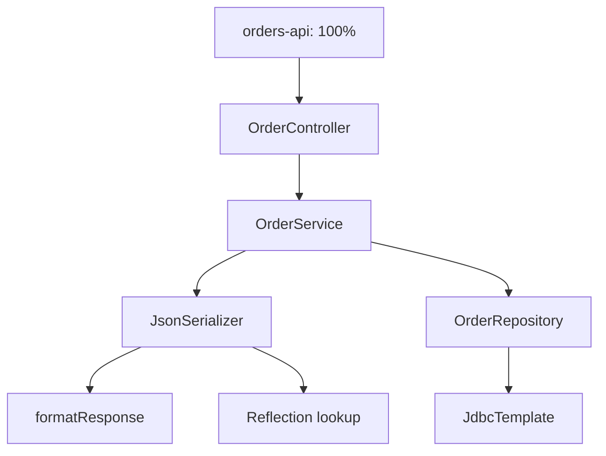

# Cloud Profiler and Java Application Analysis

A Java service can run smoothly in a test environment yet become slow in production. The reason often lies in real-world workloads: a JSON handler burning CPU, a call path allocating too many objects, or requests spending most of their time waiting on I/O and thread synchronization. Metrics show latency and resource consumption climbing; traces show which services a request passed through; but to pinpoint exactly which Java method is consuming CPU or allocating objects, development teams need profiling.

**Cloud Profiler** is Google Cloud's continuous profiling service. An agent runs alongside the application process, periodically collects performance samples, and sends profiles to the project. In the Profiler UI, developers inspect flame graphs, locate resource-heavy call stacks, and compare service versions. This surfaces hotspots under genuine production load rather than relying solely on benchmarks that may not mirror real traffic.

Within `CLOUD_PROVIDERS_GCP`, Cloud Profiler complements Cloud Monitoring and Cloud Logging: Monitoring surfaces service-level symptoms, Logging provides events and context, and Profiler traces resource consumption back to functions in Java code. Profiler does not replace metrics, distributed tracing, heap dumps, or Java Flight Recorder; each tool answers a different set of questions.

## 1. What Is Continuous Profiling?

Profiling is dynamic analysis performed while a program runs. A profiler observes execution samples or memory state, then aggregates data by function and call stack. With continuous profiling, an agent collects periodic samples across live instances in real environments. This reveals which execution paths consistently consume resources under actual load.

Cloud Profiler uses statistical sampling. The agent does not record every CPU instruction or every object allocation. The backend triggers an agent to collect a profile periodically; for CPU time and Wall time, one sample typically represents roughly 10 seconds of data. A Java Heap profile is captured at a point in time. Some other languages also support thread profiles, though Java does not support that profile type in Cloud Profiler. Collection frequency is distributed across replicas and randomized, so a single profile is not an exhaustive record of every request.

According to Google Cloud documentation, Profiler typically collects roughly one profile per minute per service, version, and zone combination for each profile type. When a service has multiple replicas, the backend rotates across instances for sampling. Overhead for CPU and heap allocation profiling during collection is typically under 5%; amortized over runtime and multiple replicas, average overhead is typically under 0.5%. These are reference figures, not performance guarantees across every workload or JVM configuration.

### What Questions Does Profiler Answer?

- Which function consumes the most CPU during the observation window?
- Which function has high cumulative execution time from calling downstream functions?
- Is the application spending more time executing on CPU or waiting on locks, threads, or I/O?
- Which call stacks are associated with the heap state captured in the profile?
- After releasing a new version, where did CPU or heap consumption shift?

Profiler does not automatically explain the business reason why a function is slow. Analysts still need to understand application architecture, input data, request flows, and when profiles were captured.

## 2. Profile Types Supported for Java

Cloud Profiler supports three profile types for Java. Specific availability depends on the Java runtime and deployment environment.

| Profile Type | Observed Data | Diagnostic Question |
|---|---|---|
| CPU time | Actual CPU time spent executing code in sampled call stacks | Which functions are consuming the most CPU cycles? |
| Wall time | Elapsed time from entry to exit of an execution segment, including wait time | Is the code slow due to computation or waiting on resources? |
| Heap | Heap information at the moment the profile was collected | Which allocations/call stacks contribute to the observed heap state? |

**CPU time and Wall time differ.** CPU time counts only CPU execution time. Wall time includes time waiting on locks, thread synchronization, I/O, and other stalls. If Wall time substantially exceeds CPU time, the function is likely waiting on resources or external dependencies. If the two values are close, the code tends to be CPU-bound.

**Heap is a point-in-time snapshot.** Cloud Profiler's Heap profile is not the same as Go's `Allocated heap` profile and is not a full JVM heap dump. Heap dumps typically provide an object graph and reference edges for dominator or retention-path analysis; Cloud Profiler provides a sampled profile to quickly locate heap-associated call stacks. Use specialized heap analysis tools when you need to identify exact object references holding memory.

Java-specific notes:

- CPU time is supported on HotSpot-based JVMs.
- Heap profiling requires Java 11 or later (or supported App Engine standard runtimes) and is disabled by default.
- Wall time is supported; the exception is the Java 8 App Engine standard environment.
- Java does not have Allocated heap, Contention, or Threads profile types in Cloud Profiler's current support matrix. When detailed deadlock, thread leak, or lock contention analysis is needed, use thread dumps, Java Flight Recorder, or other specialized tools.

## 3. Supported Environments and Prerequisites

Google Cloud's Java documentation lists supported environments including Compute Engine, Google Kubernetes Engine (GKE), App Engine flexible, App Engine standard, Managed Service for Apache Spark, and applications running outside Google Cloud with proper authentication configured. The Java agent supports HotSpot-based JVMs, including Oracle JDK and certain OpenJDK builds, on Java 8, Java 11, or newer versions.

The Java agent runs on Linux. Systems using `glibc` are supported; the agent for Alpine Linux using `musl` is currently in Alpha and documentation specifies support only for GKE configurations. Before deploying, check the runtime, image architecture, and agent version in use. Do not assume every container platform is automatically supported merely because it can run Java.

Cloud Profiler is not enabled by adding a regular Maven or Gradle dependency to a Spring Boot application. The Java agent is a native library loaded into the JVM via the `-agentpath` flag. Therefore, the agent must be compatible with the OS, C library, and JVM in the deployment image.

## 4. Preparing the Project and IAM Permissions

Before starting the agent, enable the Cloud Profiler API in the project receiving profile data:

```bash
gcloud services enable cloudprofiler.googleapis.com \
  --project=GCP_PROJECT_ID
```

The account enabling the API needs `serviceusage.services.enable`, typically granted via `roles/serviceusage.serviceUsageAdmin` or an equivalent role.

The agent needs permission to upload profiles to the project. If the application runs with Google Cloud's default service account and default permissions have not been altered, additional roles are usually unnecessary. If using a custom service account, modified default service account permissions, or Workload Identity on GKE, grant the **Cloud Profiler Agent** (`roles/cloudprofiler.agent`) role to the identity used by the agent.

Example granting the role to an application's service account:

```bash
gcloud projects add-iam-policy-binding GCP_PROJECT_ID \
  --member="serviceAccount:APP_RUNTIME_SA@GCP_PROJECT_ID.iam.gserviceaccount.com" \
  --role="roles/cloudprofiler.agent"
```

Users viewing profiles should be granted task-appropriate roles. `roles/cloudprofiler.viewer` allows listing and viewing profiles; `roles/cloudprofiler.user` supports querying and viewing Profiler data. `roles/cloudprofiler.admin` is for administrators needing broader management rights. Separate the runtime service account's profile-upload permission from engineers' view or admin permissions.

When running outside Google Cloud, in addition to granting permissions to the authenticated identity, configure credentials and the target project for the agent. Cloud Profiler's IAM documentation explicitly notes that the service does not support environments relying solely on Workload Identity Federation. On GKE, follow Java-specific Workload Identity guidance and grant the role to the Kubernetes service account or Google service account used by the workload; verify the cluster's exact identity setup before deploying.

## 5. Installing the Java Agent and Launching the Application

The Java agent is distributed as an archive containing the native library `profiler_java_agent.so`. Install the agent in the same runtime environment as the application. The example below illustrates installation on Linux with `glibc`:

```bash
sudo mkdir -p /opt/cprof
wget -q -O- \
  https://storage.googleapis.com/cloud-profiler/java/cloud-profiler-java-agent_20261026_RC00.tar.gz \
  | sudo tar xzv -C /opt/cprof
```

After extracting, verify `/opt/cprof/profiler_java_agent.so` exists. In production, pin a tested agent version inside the build pipeline so replicas do not unexpectedly pull differing versions.

### 2026 Agent Security Update

Google Cloud announced on October 29, 2026 that the Java agent requires a new bundled CA certificate to address security bulletin GCP-2026-071. Applications using the Cloud Profiler Java agent must upgrade to `cloud-profiler-java-agent_20261026_RC00` (GitHub release v0.5.0) or later, then rebuild and redeploy. For Alpine Linux using `musl`, use the corresponding `_alpine` archive. If unable to upgrade immediately, Google documentation instructs updating the host/container CA certificate store and pointing `GRPC_DEFAULT_SSL_ROOTS_FILE_PATH` to the updated PEM bundle. Do not continue deploying older archives lacking the updated CA bundle.

### Configuring JVM Arguments

When running the application, add `-agentpath` before `-jar`. Example for a Spring Boot application named `orders-api`:

```bash
java \
  -agentpath:/opt/cprof/profiler_java_agent.so=-cprof_service=orders-api,-cprof_service_version=2026.11.0,-logtostderr \
  -jar /app/orders-api.jar
```

Key flags:

| Flag | Purpose |
|---|---|
| `-agentpath` | Loads the Cloud Profiler native library into the JVM |
| `-cprof_service` | Sets the service name to group profiles across replicas of the same service |
| `-cprof_service_version` | Tags profiles with the deployment version for filtering and comparison |
| `-cprof_project_id` | Specifies the project when running outside Google Cloud |
| `-cprof_zone_name` | Specifies the zone if the agent cannot retrieve it from the metadata server |
| `-logtostderr` | Writes agent logs to standard error for diagnostics |

The service name must remain consistent across replicas and match the pattern `^[a-z0-9]([-a-z0-9_.]{0,253}[a-z0-9])?$`. Never use PIDs, random hostnames, or pod names with changing suffixes as the service name, because each distinct value creates a separate deployment and fragments profile data. Service version is optional but recommended per release, such as `2026.11.0`, a short Git SHA, or the application version number.

### Example Dockerfile for GKE

For Linux containers using `glibc`, install the agent inside the image and add the flag to `ENTRYPOINT`:

```dockerfile
FROM eclipse-temurin:21-jre

RUN apt-get update \
    && apt-get install -y --no-install-recommends ca-certificates wget \
    && rm -rf /var/lib/apt/lists/*

RUN mkdir -p /opt/cprof \
    && wget -q -O- https://storage.googleapis.com/cloud-profiler/java/cloud-profiler-java-agent_20261026_RC00.tar.gz \
       | tar xzv -C /opt/cprof

WORKDIR /app
COPY target/orders-api.jar /app/orders-api.jar

ENTRYPOINT ["java", \
  "-agentpath:/opt/cprof/profiler_java_agent.so=-cprof_service=orders-api,-cprof_service_version=2026.11.0,-logtostderr", \
  "-jar", "/app/orders-api.jar"]
```

In GKE, bind the Kubernetes ServiceAccount to the Google service account per your Workload Identity model and grant `roles/cloudprofiler.agent` to the Google identity used by the workload. Do not grant this role to every pod or node if only one application needs profiling. If using Alpine, use the Alpha Alpine archive and install `ca-certificates`; consider `glibc` images for production workloads unless Alpine is strictly required.

### Enabling Heap Profiling on Java 11+

Heap profiling is disabled by default. To enable it, add `-cprof_enable_heap_sampling=true` to the agent options string:

```bash
java \
  -agentpath:/opt/cprof/profiler_java_agent.so=-cprof_service=orders-api,-cprof_service_version=2026.11.1,-cprof_enable_heap_sampling=true \
  -jar /app/orders-api.jar
```

The default sampling interval is 512 KiB. You can select between 256 KiB and 1024 KiB:

```text
-cprof_heap_sampling_interval=262144
```

Smaller sampling intervals increase sample counts and granularity while potentially raising overhead. A 1024 KiB interval lowers sampling frequency. Start with defaults and measure impact in staging and production canary before tuning. The JVM supports only one heap profiler at a time; enabling multiple heap profilers simultaneously can cause all Java heap profiling to stop working. When enabling a new profile type, deploy with a new service version so Profiler recognizes the updated configuration.

## 6. Agent Options and Overhead Impact

Several options tune granularity and collection overhead:

| Option | Default / Impact | When to Consider |
|---|---|---|
| `-cprof_cpu_use_per_thread_timers=true` | Measures CPU time more accurately but increases per-thread overhead | When high accuracy is needed and actual overhead has been measured |
| `-cprof_force_debug_non_safepoints=false` | Disables debug info for JIT code outside safepoints, lowering overhead at the cost of reduced function/line precision | When agent overhead is noticeable and coarser detail is acceptable |
| `-cprof_wall_num_threads_cutoff` | By default skips wall profiles when total threads exceed 4096 | Raise only when the service truly needs it and stack-walk overhead is acceptable |
| `-cprof_heap_sampling_interval` | Default 512 KiB; supported range 256–1024 KiB | Tune heap profile granularity |

Do not turn on all high-detail options simultaneously without measuring. Start with defaults, observe CPU, memory, latency, and agent logs, and adjust one flag at a time to isolate impact.

## 7. Reading Flame Graphs and Finding Hotspots in Java

Once the agent uploads profiles, open Google Cloud Console, select the project, and go to **Profiler**. Select service, profile type, time range, zone, and version. Profile data is typically retained for 30 days. For long-term archival, profiles can be downloaded from the Profiler UI.

A flame graph represents call stacks as frames:

- Frame width represents the proportion of the selected metric consumed.
- Lower frames are callers; upper frames represent called functions.
- `Total` includes the function and its callees; `Self` counts only the metric directly attributed to that function.
- A wide frame indicates a call path contributing heavily to overall consumption, though that specific function is not necessarily the root cause.



This diagram illustrates a hypothetical call tree. When reading an actual flame graph, follow wide frames upward from bottom callers to child frames, then inspect `Self` and `Total` in the tooltip. If `OrderService` has high Total but low Self, most consumption happens inside child calls. If `formatResponse` has high Self, the logic directly inside that method may be the optimization target.

Flame graphs aggregate profiles matching the filters using up to 250 randomly selected profiles. Therefore, choose a representative time range and check multiple windows when traffic fluctuates. Avoid drawing conclusions from a single short profile or a single replica with atypical traffic.

### CPU Time: Finding Compute-Heavy Code

Suppose the CPU profile for `orders-api` shows `JsonSerializer.serialize()` and `OrderMapper.map()` dominating CPU. Investigation steps:

1. Select the frame to inspect the call stack from controller down to serializer or mapper.
2. Check `Self` and `Total` to see whether cost lies inside the method itself or its callees.
3. Correlate with request rate and latency in Cloud Monitoring to verify load during the profile window.
4. Inspect loops, regexes, reflection, data conversions, or repetitive per-request operations.
5. Make a small targeted change, deploy a canary, and compare the new version's CPU profile against baseline.

For example, if code compiles a `Pattern` on every request, consider pre-compiling the regex once and reusing it. However, optimize only when profiles confirm that code path is significant.

### Wall Time: Distinguishing CPU from Wait Time

If a function's Wall time is high while CPU time is low, the method is likely waiting on a database, HTTP service, lock, or executor. For instance, `OrderRepository.findOrders()` shows large Wall time and tiny CPU time. In that case, optimizing Java loops will not resolve latency. Cross-check traces, database metrics, connection pools, network latency, and thread dumps to locate the wait source.

If CPU time and Wall time are nearly equal, the application is spending its time in computation. Focus on wide CPU frames and examine algorithms, data structures, serialization/deserialization counts, and object allocation costs.

### Heap: Finding Notable Allocation Paths

Heap profiles help identify call stacks associated with heap usage at capture time. For example, if a profile shows substantial heap linked to `OrderMapper.toDto()` or buffer creation in `JsonSerializer`, the team can inspect temporary object creation, collection copying, caches, or large payload handling.

Do not conclude there is a memory leak merely because one frame holds a large share of the heap. Leaks must be verified through heap trends across multiple timestamps, GC behavior, and heap dump analysis tools. When you need to know exactly which objects retain references to others, capture a heap dump and analyze dominator/reference chains.

## 8. Comparing Profiles Across Java Service Versions

Service versions let operations teams compare profiles before and after a release. Set explicit versions in `-cprof_service_version`, such as `2026.11.0` for baseline and `2026.11.1` for the new release. In Profiler, choose the same service and profile type, then use **Compare to → Version** to diff the two versions.

Keep comparison conditions comparable:

- Same service name and profile type.
- Time windows with comparable traffic.
- Same zone or identical zone scope.
- Comparable workload mix and relative consumption when using the Weight filter.
- Both versions deployed under similar infrastructure conditions.

In comparison flame graphs, colors denote metric differences between the baseline and compared profile: gray indicates minimal difference, red indicates an increase, and green/blue indicates a decrease per chart convention. Check tooltips and the Focus table for both absolute and relative deltas. A function using more CPU is not necessarily a regression if traffic or work volume also rose; normalize by request rate or cross-check with metrics.

Post-release comparison workflow:

1. Record the service version of the stable production release as baseline.
2. Deploy the new release with a distinct service version.
3. Wait for the agent to gather sufficient profiles during a representative load window.
4. Compare CPU time and Heap (if enabled) between the two versions.
5. Inspect frames with steep increases, locate the associated code changes, and correlate with latency/error rate.
6. If a regression has clear impact, roll back or patch the release, then validate with fresh profiles.

## 9. Real-World Scenario: Spring Boot CPU Spike After Release

A Spring Boot order-processing application runs on GKE. After releasing version `2026.11.1`, CPU utilization climbs above baseline while request rate remains nearly flat. Cloud Monitoring alerts on high CPU; Cloud Logging shows no surge in errors. The development team opens Cloud Profiler and compares CPU profiles between `2026.11.0` and `2026.11.1`.

The hypothetical comparison reveals that the `OrderMapper.toDto()` frame grew sharply in the new release. The team discovers new code invoking a data-normalization helper inside a nested loop, recomputing the same lookup for every item. They fix it by precomputing and reusing the lookup, deploy a canary, and compare profiles again. CPU time on that call stack drops while request rate and latency remain steady.

This scenario demonstrates combining signals:

- Monitoring detects elevated CPU.
- Profiler pinpoints the CPU-consuming call stack.
- Logging and tracing provide request context and any related errors.
- Service versions enable before/after release comparison.
- Canary validates the fix under real traffic with bounded blast radius.

## 10. Security, Access Control, and Profile Data

The Profiler agent uploads profile data to the configured project. Use a dedicated service account for the workload and grant only `roles/cloudprofiler.agent`. Profile viewers need only appropriate read permissions, not project admin rights. If your organization uses VPC Service Controls, Cloud Profiler is a supported service inside perimeters; configure the perimeter to match your organization's security architecture.

Service names and versions should be deployment metadata—never include tokens, user emails, customer IDs, or sensitive data. Grant profile viewing rights only to engineers investigating performance. Profile data is retained for 30 days on the service; if downloading profiles for longer retention, enforce access and retention policies on the destination store.

## 11. Troubleshooting Common Issues

| Symptom | Possible Cause | What to Check |
|---|---|---|
| No profiles appear | Profiler API disabled or service account lacks `roles/cloudprofiler.agent` | Check API, target project, and runtime identity IAM |
| Agent fails to load | Wrong `.so` path, missing libraries in image, or JVM/OS incompatibility | Check startup logs, agent binary, and Linux runtime |
| Profiles appear under another service | `-cprof_service` differs across replicas or includes dynamic values | Use a stable service name without PID/pod ID |
| Cannot filter by version | Missing `-cprof_service_version` or inconsistent versions across replicas | Check startup flags and redeploy with unified version |
| Heap profile has no data | Heap sampling disabled, unsupported Java runtime, or multiple heap profilers active | Check Java 11+, `-cprof_enable_heap_sampling=true`, and ensure only one heap profiler |
| Wall profile missing | Java 8 App Engine standard or thread count exceeds default cutoff | Check runtime; wall profiles are skipped by default when total threads exceed 4096 |
| Agent reports TLS verification errors | Image lacks CA certificates or uses an older Java agent missing the new CA bundle | Install `ca-certificates`; upgrade agent to `cloud-profiler-java-agent_20261026_RC00` or later |
| Agent cannot fetch zone/project metadata | Workload cannot reach the metadata server | Check metadata access and permissions; pass `-cprof_zone_name` if needed |

To send agent logs to standard error, add `-logtostderr`. You can lower verbosity with `-minloglevel=2` to log only error and fatal messages. During initial integration, keep logs verbose enough to catch agent loading and authentication failures; once stable, tune log level to operational needs.

## 12. Deployment Checklist for Java Applications

Before bringing Cloud Profiler to production, verify:

- [ ] Application runs on a supported HotSpot-based JVM and environment.
- [ ] `cloudprofiler.googleapis.com` is enabled in the profile-receiving project.
- [ ] Runtime service account has `roles/cloudprofiler.agent` where required.
- [ ] Java agent matches the Linux image and is updated to a release containing the new CA bundle.
- [ ] `-agentpath` points to the exact `profiler_java_agent.so` file.
- [ ] `-cprof_service` is a stable name identical across replicas.
- [ ] `-cprof_service_version` accurately reflects the running release.
- [ ] Heap sampling is enabled only on compatible Java runtimes with no second heap profiler active.
- [ ] Metrics and tracing remain active to provide context for profiles.
- [ ] CPU, memory, latency, and error rate are monitored during canary rollout.
- [ ] Profile viewing permissions are granted to the right team; service accounts hold no unnecessary broad privileges.

## 13. Hands-On Exercise

In a permitted sandbox project or GKE namespace:

1. Enable the Cloud Profiler API and create a service account for a test application.
2. Grant `roles/cloudprofiler.agent` to the service account.
3. Install the current Java agent into a `glibc` Linux Spring Boot image.
4. Launch the application with service name `orders-api` and service version `1.0.0`.
5. Generate steady test load and wait for Profiler to receive CPU profiles.
6. Open the flame graph, identify a frame with high Self or Total, and explain its call stack.
7. Enable Heap sampling on Java 11 or later, deploy a new version `1.0.1`, and inspect the Heap profile.
8. Compare CPU profiles between the two versions and summarize changes in resource consumption.
9. Disable the agent in one test deployment to observe the difference between missing profile data and populated profiles.

Do not enable multiple heap profilers at the same time. Use simulated load or approved traffic; never place customer data or secrets in service or version names.

## 14. Conclusion

Cloud Profiler gives Java teams visibility into where applications consume CPU, wall time, and heap in live environments. By installing the right Java agent version, granting least-privilege IAM, setting consistent service names and versions, and reading flame graphs alongside metrics and traces, development teams can locate hotspots, evaluate post-release regressions, and optimize using real production evidence. Continuous profiling delivers the most value when embedded into release and operational workflows, with regular baselines, canaries, and profile comparisons.

## References

- [Profiling Java applications — Cloud Profiler](https://docs.cloud.google.com/profiler/docs/profiling-java)
- [Cloud Profiler overview](https://docs.cloud.google.com/profiler/docs/about-profiler)
- [Profiling concepts](https://docs.cloud.google.com/profiler/docs/concepts-profiling)
- [Control access with IAM](https://docs.cloud.google.com/profiler/docs/iam)
- [Cloud Profiler roles and permissions](https://docs.cloud.google.com/iam/docs/roles-permissions/cloudprofiler)
- [Interact with the flame graph](https://docs.cloud.google.com/profiler/docs/interacting-flame-graph)
- [Compare profiles](https://docs.cloud.google.com/profiler/docs/comparing-profiles)
- [Cloud Profiler release notes](https://docs.cloud.google.com/profiler/docs/release-notes)
