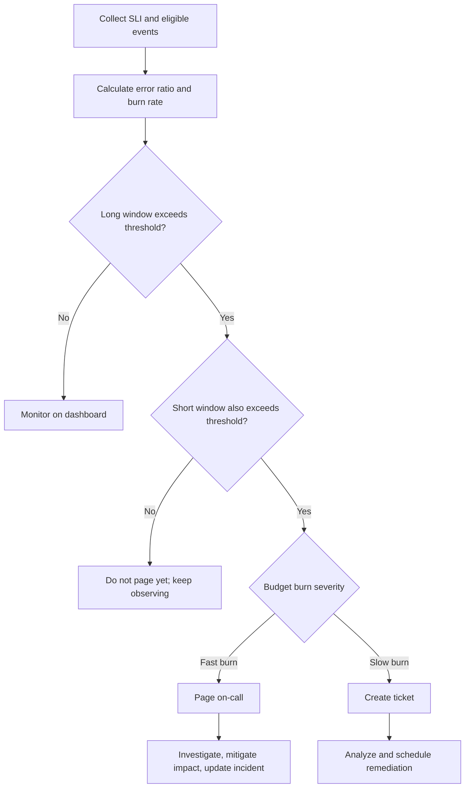

# Burn-Rate Alerting and Reducing Alert Noise

A system can experience many brief error spikes and still meet its SLO over the full evaluation period. Conversely, a prolonged period of errors at a modest rate can quietly drain the entire error budget before the operations team notices. Alerting only when an error rate crosses a fixed threshold for a few minutes often floods on-call engineers with low-value notifications or detects incidents too late.

**Burn-rate alerting** measures how fast the error budget is being consumed relative to the pace allowed by the SLO. Combining multiple thresholds and multiple time windows helps distinguish critical incidents that require paging on-call immediately from slower degradation trends suited for creating a ticket. On Google Cloud, you can use SLO-based alerting in Cloud Monitoring or PromQL with Google Cloud Managed Service for Prometheus when more flexible multi-window logic is needed.

This lesson belongs to the **SRE and Reliability** chapter of the **CLOUD_PROVIDERS_GCP** module. It connects SLOs, error budgets, Cloud Monitoring, telemetry, on-call operations, and reliability controls for workloads such as Cloud Run, GKE, and services running on Google Cloud.

## 1. Learning Objectives

After this lesson, you will be able to:

- Explain SLIs, SLOs, error budgets, and burn rate within a single model.
- Calculate burn rate from the bad-event ratio and SLO target.
- Design multi-window, multi-burn-rate alerts.
- Create SLO-based alerts with Cloud Monitoring and understand the limits of the SLO data selector.
- Use PromQL to implement multi-window rules when longer windows are required.
- Reduce alert noise while still detecting user-impacting incidents.
- Evaluate alert quality using precision, recall, detection time, and reset time.

## 2. From SLIs to Error Budgets

### 2.1. SLIs and SLOs

A **Service Level Indicator (SLI)** measures the experience or outcome that users receive. For an HTTP service, an availability SLI might be the ratio of successful requests to total eligible requests:

```text
SLI = good_events / eligible_events
error_ratio = bad_events / eligible_events
```

In a simple example, a successful request returns the correct result within the committed latency limit. Requests that fail or exceed the latency threshold are bad events. Good and bad event definitions must reflect real-world experience; do not assume every HTTP 4xx is a service error or measure only HTTP 5xx if business failures can occur without returning a 5xx status code.

A **Service Level Objective (SLO)** is the target for an SLI over a compliance period, such as 99.9% successful requests over 30 days. An SLO is a measurable reliability target, not a guarantee that every single request succeeds.

If the SLO target is 99.9%:

- Minimum good-event ratio: 99.9%.
- Maximum bad-event ratio: 0.1% or 0.001.
- With 1,000,000 eligible requests in the period, the maximum error budget is 1,000 failed requests.

An **Error budget** is the amount of failure allowed before the SLO is breached. For a good-event ratio SLO:

```text
error_budget_ratio = 1 - SLO_goal
error_budget_events = eligible_events * (1 - SLO_goal)
```

With a 99.9% SLO, the error budget ratio equals 0.001. If the system uses a 30-day rolling-window SLO, the budget is computed over eligible events in that window. If it uses a calendar period, the start and end dates of the evaluation period must be clearly defined.

### 2.2. What Is Burn Rate?

Burn rate tells you how many times faster the error budget is being consumed compared to the pace corresponding to the SLO:

```text
burn_rate = observed_error_ratio / (1 - SLO_goal)
```

Where:

- `observed_error_ratio` is the ratio of bad events to total eligible events in the window under evaluation.
- `SLO_goal` is the SLO target expressed as a decimal, such as 0.999.
- `1 - SLO_goal` is the allowed error ratio.

| Burn rate | Meaning |
|---:|---|
| 0 | No error budget consumed in the measurement window. |
| 1 | If this rate persists for the entire compliance period, the budget will run out right at the end of the period. |
| 2 | Consuming the budget at 2x the allowed rate. |
| 10 | Consuming the budget at 10x the allowed rate. |
| 14.4 | Over a 30-day period, if sustained continuously, the budget is exhausted in roughly 50 hours. |

A burn rate greater than 1 does not automatically mean the SLO has been breached. It indicates that the current error rate, if sustained, will cause the SLO to miss its target for the evaluation period.

### 2.3. Burn Rate Calculation Example

An API has a 99.9% SLO over 30 days. Over the most recent hour, 1.44% of eligible requests failed:

```text
SLO_goal = 0.999
allowed_error_ratio = 1 - 0.999 = 0.001
observed_error_ratio = 0.0144

burn_rate = 0.0144 / 0.001
          = 14.4
```

The service is consuming its budget 14.4 times faster than the allowed pace. Over one hour, the share of budget consumed is approximately:

```text
budget_spent = burn_rate * window / compliance_period
             = 14.4 * 1 hour / 720 hours
             = 0.02
             = 2%
```

Therefore, a 14.4x alert over one hour corresponds to roughly 2% of the 30-day error budget. If errors appeared only for a few minutes and vanished, the one-hour window still captures the impact and gradually decays over time. A shorter window helps confirm whether the errors are still ongoing.

## 3. Why Simple Error-Rate Alerting Often Causes Noise

A rule like "page if the 5-minute error rate exceeds 0.1%" is easy to set up, but it has two drawbacks.

**Overly sensitive alerts.** With a 99.9% SLO, a 0.1% error rate over 5 minutes touches the SLO ratio, yet the amount of budget spent across a 30-day period may be tiny. A few transient errors or a brief low-traffic dip can trigger a page even when immediate human intervention is unnecessary.

**Alerts fail to reflect budget burn speed.** The same error rate means very different things depending on duration. A high error rate for one minute and a moderate error rate lasting many hours should not always receive the same priority.

Increasing the hold duration via a `for` clause does not fully solve the problem either. Requiring errors to stay above threshold continuously for an hour can delay detection of a major outage. Conversely, intermittent errors repeatedly reset the timer and never trigger an alert.

Google SRE evaluates alerting strategies across four properties:

| Property | Question to Answer |
|---|---|
| Precision | What proportion of alerts actually correspond to an incident worth acting on? |
| Recall | What proportion of significant incidents are detected? |
| Detection time | How long does it take from when errors start until the responsible responder receives an alert? |
| Reset time | After an incident ends, how long does it take for the alert to clear back to normal? |

The goal is actionable alerts tied to user impact and error budget consumption. A metric behaving unusually without requiring human intervention may only belong on a dashboard or in a ticket.

## 4. Designing Multi-Window, Multi-Burn-Rate Alerts

### 4.1. Combining Long and Short Windows

A window pair consists of:

- **Long window:** measures enough cumulative impact to confirm the incident is meaningful to the error budget.
- **Short window:** checks that errors are still occurring near the evaluation time, helping the alert reset quickly once the incident ends.

In a paired condition, an alert fires only when both windows exceed the same burn-rate threshold:

```text
long_window_burn_rate > threshold
AND
short_window_burn_rate > threshold
```

The short window is typically around 1/12 of the long window per the Google SRE Workbook guidance—for example, 1 hour paired with 5 minutes, or 6 hours paired with 30 minutes. These are starting points for tuning; traffic volume, metric collection delay, and SLI behavior may require adjustment.

When an incident ends, the error rate in the short window drops first. The AND condition becomes false so the alert can reset early, even though the long window still retains traces of the incident. The long window remains helpful for assessing total impact and post-incident review.

### 4.2. Starter Alerting Levels

For a 99.9% SLO and a 30-day compliance period, the Google SRE Workbook suggests these starting values:

| Response Level | Long Window | Short Window | Burn Rate | Approx. Budget Consumed | Action |
|---|---:|---:|---:|---:|---|
| Critical | 1 hour | 5 minutes | 14.4x | 2% | Page on-call |
| High | 6 hours | 30 minutes | 6x | 5% | Page on-call |
| Monitor | 3 days | 6 hours | 1x | 10% | Create ticket, handle during business hours |

Formula to check the fraction of budget consumed:

```text
budget_spent_fraction = burn_rate * window_duration / compliance_period
```

For example, with a 30-day compliance period = 720 hours:

- 14.4x over 1 hour: 14.4 / 720 = 2%.
- 6x over 6 hours: 36 / 720 = 5%.
- 1x over 3 days (72 hours): 72 / 720 = 10%.

These values are a baseline for services with sufficient traffic and a 99.9% SLO. Do not copy them verbatim across every SLO, evaluation period, request class, or low-traffic service. When changing the SLO or compliance period, recalculate thresholds from the desired budget-consumption fraction and window duration.

### 4.3. Separating Pages, Tickets, and Dashboards

Not every error-budget consumption signal warrants waking an on-call engineer.

- **Page:** an ongoing incident likely to consume a significant share of the error budget in a short time and requiring immediate human intervention.
- **Ticket:** a sustained budget-consumption trend requiring investigation or scheduled work that can wait until business hours.
- **Dashboard:** data for observation, trend analysis, or diagnostic support, with no immediate evidence requiring work items.
- **Logs/traces:** detailed evidence for root-cause investigation; do not automatically turn every error log into a separate page.

Separate severity levels by impact and time remaining before budget exhaustion. If a single incident triggers both fast-burn and slow-burn alerts, configure routing or suppress lower-severity alerts while a higher-severity page is active so on-call responders do not receive duplicate notifications.

### 4.4. Decision Flow Diagram



## 5. Preparing SLOs and Telemetry on Google Cloud

Before creating alerts, define the service, SLI, SLO, and evaluation period. Good alerting cannot compensate for a flawed SLI or missing telemetry.

### 5.1. Selecting the Service and SLI

In Cloud Monitoring, Service Monitoring lets you declare services and SLOs to track performance. You can use supported integrations or declare custom services and SLIs tailored to your workload.

Example for a checkout service running on Cloud Run or GKE:

- Eligible event: requests to the checkout endpoint defined in the SLO.
- Good event: requests that complete business logic accurately and within the latency limit.
- Bad event: requests that fail or exceed the defined latency threshold.
- SLO: 99.9% good events over 30 days.

If a service handles request types with different criticality levels, split SLOs or group requests by reliability requirements. Do not let health checks, background polling, or low-priority endpoints distort signals for the primary user flow.

### 5.2. Validating Data Quality

Before using an SLI for paging, verify:

- Request and error counters share the exact same eligible-event definition.
- Labels used to match requests with errors share the same set of values.
- Counter resets, process restarts, and scrape gaps are handled properly.
- Requests excluded by SLO policy are omitted from the denominator.
- Traffic volume is high enough for the error ratio to be statistically meaningful.
- Separate alerts exist when telemetry drops or stops updating.

Do not interpret "no time series" as "zero errors." Missing data can indicate a broken telemetry pipeline, exporter, or collection path. Distinguish a no-data state from an SLI state with zero errors.

### 5.3. Defining the Compliance Period

The SLO's compliance period is the interval used to calculate target attainment and error budget. Burn-rate windows must be interpreted in the context of that same period.

Example for a 99.9% SLO over 30 days:

- Allowed error ratio for the full period: 0.1%.
- A 1-hour window samples only a slice of data to detect the current consumption speed.
- Burn rate is normalized by the SLO's allowed error ratio.
- The share of budget consumed depends on burn rate, window length, and compliance period together.

Document clearly in service docs whether the SLO uses a rolling window or a calendar period. If you change the evaluation period, re-evaluate thresholds, dashboards, and error budget policies.

## 6. Creating SLO-Based Alerts in Cloud Monitoring

### 6.1. Creating Alerts from the UI

A general workflow:

1. Open Google Cloud Console and select the right project.
2. Go to Cloud Monitoring and open Services or SLO monitoring.
3. Select the service and SLO to protect.
4. From the SLO status view, create an SLO alert.
5. Choose an appropriate burn-rate threshold and lookback period.
6. Select notification channels for the on-call team or ticketing queue.
7. Write documentation so recipients know which SLO is affected, which threshold was crossed, and which dashboard/runbook to open.
8. Save the policy, then verify policy status and notification delivery.

Google Cloud documentation provides starting points for two policies:

| Policy Type | Suggested Threshold | Suggested Lookback | Purpose |
|---|---:|---:|---|
| Fast burn | 10x | 1–2 hours | Detect major changes requiring rapid response. |
| Slow burn | 2x | 24 hours | Detect prolonged budget-consumption trends. |

These thresholds are Cloud Monitoring starting guidelines. Test them against historical metrics, account for time-of-day traffic variations, and adjust to match your operations team's response capacity.

### 6.2. Lookback Limit of the SLO Burn-Rate Selector

When creating an alerting policy via the Cloud Monitoring API, the `select_slo_burn_rate` data selector takes two arguments: the SLO name and the lookback period.

Example filter for a one-hour window:

```text
select_slo_burn_rate(
  "projects/PROJECT_ID/services/SERVICE_ID/serviceLevelObjectives/SLO_ID",
  "60m"
)
```

The lookback period also acts as the compliance period used to compute SLO performance and error budget for that query. Per current Cloud Monitoring documentation, SLO burn-rate alerts using this selector do not support compliance periods longer than 24 hours.

This means native SLO alerts with 1-hour, 6-hour, or 24-hour windows can work well; a 3-day window from the Google SRE Workbook baseline requires a different implementation, such as PromQL alerting with Google Cloud Managed Service for Prometheus or separately aggregated metrics. Do not assume `select_slo_burn_rate` accepts `3d`.

### 6.3. API Condition Structure

An SLO-based condition uses the metric-threshold type, where `filter` contains an SLO selector. Key fields include:

- `filter`: selector such as `select_slo_burn_rate`.
- `comparison`: comparison operator, typically `COMPARISON_GT`.
- `thresholdValue`: burn-rate threshold.
- `duration`: how long the condition must hold. With multi-window alerts, short/long windows already provide two perspectives; do not use a long duration to replace a window.
- `combiner`: how conditions within the same policy are combined.

Illustrative structure for a fast-burn policy: both the 1-hour and 5-minute windows must exceed 14.4x. Replace placeholders with actual project, service, SLO ID, and notification channel values:

```json
{
  "displayName": "Checkout SLO fast burn",
  "combiner": "AND",
  "conditions": [
    {
      "displayName": "Burn rate 1h above 14.4x",
      "conditionThreshold": {
        "filter": "select_slo_burn_rate(\"projects/PROJECT_ID/services/SERVICE_ID/serviceLevelObjectives/SLO_ID\", \"60m\")",
        "comparison": "COMPARISON_GT",
        "thresholdValue": 14.4,
        "duration": {
          "seconds": "0"
        }
      }
    },
    {
      "displayName": "Burn rate 5m above 14.4x",
      "conditionThreshold": {
        "filter": "select_slo_burn_rate(\"projects/PROJECT_ID/services/SERVICE_ID/serviceLevelObjectives/SLO_ID\", \"5m\")",
        "comparison": "COMPARISON_GT",
        "thresholdValue": 14.4,
        "duration": {
          "seconds": "0"
        }
      }
    }
  ],
  "notificationChannels": [
    "projects/PROJECT_ID/notificationChannels/CHANNEL_ID"
  ],
  "documentation": {
    "content": "Checkout is consuming its error budget at a fast burn rate. Check the checkout SLO dashboard and runbook.",
    "mimeType": "text/markdown"
  }
}
```

This is an illustrative condition structure showing how to combine two windows; verify the API schema and required fields for your environment before submitting a policy-creation request. `combiner: AND` requires both conditions to evaluate true simultaneously. For slow burn, create a separate policy with an appropriate threshold and window so it can route to a ticketing channel.

### 6.4. Cloud Monitoring SLO Alerts vs. PromQL Alerts

Cloud Monitoring SLO alerts are convenient when a service already has an SLO in Service Monitoring and you want to create policies directly from that SLO. The selector normalizes burn rate according to the SLO definition and lookback.

PromQL is a better fit when you need:

- Windows longer than 24 hours.
- Custom multi-window or multi-condition logic.
- Grouping requests, regions, or services by custom labels.
- Combining burn rate with minimum request-count conditions or synthetic signals.
- Reusing recording rules across multiple policies.

If using Google Cloud Managed Service for Prometheus, configure collection, rule evaluation, and alert routing to match your team's monitoring architecture. Ensure retention and query horizons are long enough for every range vector; a 3-day rule cannot work if required data is no longer retained.

## 7. PromQL Examples for Multi-Window, Multi-Burn-Rate Alerts

Suppose the checkout team has created recording rules:

```text
service:sli_error_ratio:rate5m
service:sli_error_ratio:rate30m
service:sli_error_ratio:rate1h
service:sli_error_ratio:rate6h
service:sli_error_ratio:rate3d
```

Each time series represents the ratio of bad events to eligible events over the corresponding window, grouped by the `service` label. Metric names here follow an illustrative convention; create recording rules based on your application's actual metrics.

An example recording rule for HTTP 5xx error ratio might look like:

```yaml
groups:
- name: checkout-sli-recording
  interval: 30s
  rules:
  - record: service:sli_error_ratio:rate5m
    expr: |
      sum by (service) (
        rate(http_requests_total{service="checkout", code=~"5.."}[5m])
      )
      /
      sum by (service) (
        rate(http_requests_total{service="checkout"}[5m])
      )
```

This calculation applies only when bad events are defined as HTTP 5xx responses. For a latency SLI, replace the numerator with requests exceeding the latency threshold. For a business SLI, use metrics reflecting business outcomes. Analogous recording rules can be created for 30m, 1h, 6h, and 3d windows.

### 7.1. Paging While Fast Burn Is Ongoing

With a 99.9% SLO, the allowed error ratio is 0.001. A fast-burn rule requires both the 1-hour and 5-minute windows to exceed 14.4x:

```yaml
groups:
- name: checkout-slo-alerts
  rules:
  - alert: CheckoutFastBurn
    expr: |
      (
        service:sli_error_ratio:rate1h{service="checkout"} > 14.4 * 0.001
      )
      and on (service)
      (
        service:sli_error_ratio:rate5m{service="checkout"} > 14.4 * 0.001
      )
    labels:
      severity: page
      team: checkout
    annotations:
      summary: "Checkout is consuming its error budget at a fast burn rate"
      description: "Burn rate exceeded 14.4x over both 1h and 5m. Check the SLO dashboard, latest deployment revision, and runbook."
      runbook_url: "https://RUNBOOK_URL"
```

The expression above assumes every metric shares the `service` label. If your system splits time series by region or cluster, decide explicitly whether to aggregate those dimensions away before comparing. Use `and on (service)` to join both windows on the same service and avoid accidentally matching series from different services.

### 7.2. Paging on Moderate but Prolonged Errors

An incident that looks moderate over a few minutes can still consume significant budget if it persists. The 6-hour and 30-minute pair at a 6x burn rate detects this scenario:

```promql
(
  service:sli_error_ratio:rate6h{service="checkout"} > 6 * 0.001
)
and on (service)
(
  service:sli_error_ratio:rate30m{service="checkout"} > 6 * 0.001
)
```

You can place this expression in a separate alert rule with `severity: page`, sharing the same team and runbook. Two page policies may fire simultaneously during an incident; verify deduplication and suppression in your alert receiver to avoid sending two independent pages for the same incident.

### 7.3. Creating Tickets for Slow Burn

With 3-day and 6-hour windows, a 1x burn rate corresponds to roughly 10% of the error budget over a 30-day period:

```promql
(
  service:sli_error_ratio:rate3d{service="checkout"} > 1 * 0.001
)
and on (service)
(
  service:sli_error_ratio:rate6h{service="checkout"} > 1 * 0.001
)
```

This level is typically better suited for a ticket investigated during business hours rather than an immediate page. If using only native `select_slo_burn_rate`, replace the 3-day pair with a policy capped at a 24-hour lookback—such as 24h and 2h with recalculated thresholds—or implement the 3-day window in PromQL when data retention and rule evaluation support it.

Never copy the expressions above into production without verifying recording rules, labels, metric types, units, and the SLO goal. A flawed PromQL query can leave alerts permanently silent or permanently firing.

## 8. Reducing Alert Noise in Operations

### 8.1. Page Only When Human Intervention Is Needed

A page should answer the question: "If the on-call engineer does not act shortly, will user impact or error budget consumption continue to grow significantly?"

If the answer is no, consider a ticket or dashboard instead. For example:

- CPU rises for a few minutes while request SLIs stay normal: put on a dashboard or diagnostic view.
- Error rate spikes on the checkout endpoint, exceeding thresholds on both long and short windows: page.
- 1x burn rate over several days with no after-hours intervention needed: ticket.
- An instance restarts while the service continues meeting its SLO: monitor, without necessarily paging.

Infrastructure metrics remain vital for root-cause analysis, but pages should prioritize user-facing symptoms or signals that predict severe incidents even before SLIs reflect them.

### 8.2. Using Short Windows to Reduce Reset Time

Using only a long window can keep an alert firing long after errors stop because older failures remain inside the window. Adding a short window via AND logic verifies that the system is still burning budget near the present moment.

Do not use a long `for` duration to replace a short window. Duration only requires an expression to stay true continuously over a span of time; it does not reflect cumulative budget spent and can miss flapping errors.

### 8.3. Deduplicating and Suppressing Duplicate Alerts

A major outage often triggers fast-burn, slow-burn, latency, HTTP 5xx, and several infrastructure alerts simultaneously. If every policy sends its own page, the on-call engineer gets flooded with notifications for a single incident.

Measures to take:

- Use consistent labels such as `service`, `team`, `environment`, and `severity` to group alerts.
- Use a shared incident key per service and cause in your alert-receiving tool if supported.
- With Alertmanager, configure grouping, deduplication, and inhibition so higher-severity pages suppress duplicate tickets or warnings for the same service.
- Keep alerts separate if they represent distinct failure domains or distinct remediation actions.
- Do not bundle all services into a single alert if doing so obscures which service is failing.

In Cloud Monitoring, organize notification channels by team and severity, write clear documentation, and avoid creating multiple policies with identical conditions solely to fan out to multiple channels. If complex cross-rule suppression is needed, consider handling it in an alert-routing layer compatible with Prometheus/Alertmanager architecture.

### 8.4. Reducing Cardinality and Per-Instance Alerting

Do not generate a separate page for each pod, instance, request ID, or user ID when the issue affects the whole service. High-cardinality labels both inflate time-series counts and cause a single incident to emit hundreds of notifications.

Typically, aggregate SLIs by service or request class. Only include region, cluster, or zone when they identify distinct failure domains with separate owners.

When per-pod diagnosis is needed, use dashboards, logs, and traces to drill down from a service-level alert. Do not pack every diagnostic dimension into notification keys.

### 8.5. Separating Alerts by Request Criticality

A single service might handle login, checkout, report exports, and background polling. These flows carry very different impact. Combining everything into one SLO allows background traffic to mask checkout errors or lets minor endpoints trigger unnecessary pages.

| Tier | Examples | Alert Handling |
|---|---|---|
| Critical | Login, checkout, transaction recording | Tight thresholds, page on fast burn. |
| High | Core interactions that tolerate retries or slight slowdowns | Page on significant burn, ticket on slow burn. |
| Low | Background polling, tasks not directly user-visible | Dashboard or trend-based ticket. |
| No SLO | Dark launches or experimental uncommitted features | Exclude from primary user-facing SLOs. |

Tiers must reflect product impact and be agreed upon with service owners. Do not lower an SLO merely to reduce page volume if doing so misrepresents commitments to users.

### 8.6. Handling Low-Traffic Services

Ratio-based burn rates can become hypersensitive when the denominator is small. If a service receives only 10 requests per hour, a single failed request pushes the error rate to 10%. Against a 99.9% SLO, that translates to a 1,000x burn rate even though it may be a transient glitch on one request.

Depending on actual impact, you can combine:

- Synthetic monitoring to provide continuous probe signals when real user traffic is absent.
- Grouping related endpoints or services sharing a failure domain to increase sample size while keeping separate alerts for critical failures.
- Lengthening observation windows or adding a minimum eligible-event count condition.
- Using retries with exponential backoff and jitter when retries are safe for business logic.
- Designing fallbacks or queues so transient failures do not become terminal user-facing errors.
- Re-evaluating the SLO with product owners if the impact of a single error does not warrant paging.

Use minimum sample-count conditions carefully: they reduce noise, but they can also hide a genuine outage on a low-traffic service. If a failed high-value request cannot be retried, you may need a direct event alert alongside overall burn-rate alerts.

Synthetic traffic also has limits. A probe checks only the flows and states it simulates; if probes succeed while a subset of real users fails, synthetic checks can create false confidence. Combine synthetic checks with telemetry from real requests.

### 8.7. Distinguishing Service Failures from Telemetry Failures

A silent alert caused by vanished metrics can be more dangerous than a noisy alert. Maintain separate checks for:

- Scrapers or exporters stopping.
- Cloud Monitoring not receiving fresh metrics.
- Prometheus rule evaluation or pipeline failures.
- Request counters flatlining despite active service traffic.
- Label or metric name changes after deployments breaking recording rule matches.

For each SLO, define what missing data means. Never treat no data as zero errors. Use dedicated alerts for telemetry pipeline freshness or availability, with appropriate owners and runbooks.

## 9. Documentation and Response Workflow

A useful notification must enable the recipient to start investigating immediately. Policy content should include:

- Affected service name, SLO, and request class.
- Burn rate, long window, short window, and breached threshold.
- Compliance period and estimated share of error budget consumed.
- Dashboard link pre-filtered to the right service, environment, and region.
- Runbook pointing to checks for recent deployments, dependencies, quotas, and config changes.
- Responsible team and corresponding incident channel.
- Instructions to verify whether errors are ongoing or have recovered.

Reference response workflow:

1. Confirm the alert is active and identify which SLO is affected.
2. Inspect both long and short windows to verify whether burn is ongoing.
3. Check traffic, bad-event ratio, latency, and breakdown by region or request class.
4. Correlate error start time with deployments, configuration changes, quotas, or dependency outages.
5. Mitigate impact first: roll back, disable feature flags, shed load, or switch to fallbacks where appropriate.
6. Watch the short window and confirm the alert resets.
7. Record duration, budget consumed, root cause, and follow-up actions in the postmortem.

Do not close an incident just because the alert auto-resets. Verify that users have recovered and any in-flight requests were resolved or routed into appropriate retry flows.

## 10. Testing and Tuning Alerts

Before enabling pages for all production traffic, test conditions against historical data and staging environments.

### 10.1. Historical Replay Checks

For each rule, verify:

- Does a total outage trigger within an acceptable timeframe?
- Does a brief spike cause an unnecessary page?
- Are intermittent errors missed due to duration logic?
- Once errors stop, how quickly does the alert reset?
- Does a single incident generate multiple duplicate pages?
- Does a low-traffic service produce an extreme burn rate from a single failed request?
- When telemetry stops updating, does the system alert on signal loss?

### 10.2. Controlled Testing

In a non-user-impacting environment, simulate scenarios such as:

- Sustained high error rate to test fast-burn alerts.
- Sustained low-level errors over a longer period to test slow-burn alerts.
- A brief spike followed by recovery to measure reset time.
- Errors isolated to one region or request class to verify grouping.
- Stopping an exporter or rule evaluation to verify telemetry alerts.

Record the time from error onset to alert firing, notification count, reset time, and error budget consumed. Never intentionally inject faults into production without an approved testing procedure and blast-radius controls.

### 10.3. Alert Quality Metrics

| Metric | How to Use |
|---|---|
| Actionable page ratio | Share of pages that genuinely required on-call intervention. |
| Pages per incident | Average number of duplicate pages generated per incident. |
| Detection time | Time to detect an SLO-impacting incident. |
| Reset time | Time from remediation until the alert stops firing. |
| Missed significant events | Critical incidents that failed to generate a corresponding alert. |
| Ticket aging | How long slow-burn tickets sit unresolved. |
| Error budget consumed before detection | Budget lost before the responder received the alert. |

If pages lack concrete actions or are routinely ignored, revisit the SLI, thresholds, windows, owner, and runbook. Do not simply raise thresholds to cut notification counts; doing so can blind you to real incidents.

## 11. Operational Rules and Change Management

### Standardizing Policies by Service Class

Across many microservices, do not let each service invent completely different windows and thresholds. Establish baselines per criticality tier, allowing exceptions only when backed by measurable justification.

Every policy needs an owner, linked SLO, severity, notification channel, and runbook. Whenever a service changes owners, metrics, or SLOs, update its alerts at the same time.

### Controlled Threshold Adjustments

When tuning a policy:

1. Document the rationale and data proving the current alert is noisy or slow to detect.
2. Re-evaluate historical metrics against the proposed threshold.
3. Assess impact on precision, recall, detection time, and reset time.
4. Roll out changes per service class or environment.
5. Monitor pages and tickets following the change.
6. Record the decision and a scheduled review date.

During an active incident, temporary routing or suppression adjustments may be needed to reduce duplicate noise. Record an explicit expiration time and restore standard configuration afterward; never let temporary muting become the default state.

### Access Control

Only teams responsible for operations should hold permissions to modify production alerting policies or notification channels. Apply IAM by role and project, reviewing permissions to edit policies, manage notification channels, and alter SLOs. Track changes via appropriate audit logs so disabled alerts or altered thresholds can be traced.

## 12. Production Paging Readiness Checklist

- [ ] SLIs measure real user experience and clearly define eligible, good, and bad events.
- [ ] SLO goals and compliance periods are agreed upon with service owners.
- [ ] Error budgets and burn rates use consistent units and event sets.
- [ ] Long/short windows and thresholds are chosen based on target budget consumption.
- [ ] Pages, tickets, and dashboards are separated by urgency.
- [ ] For Cloud Monitoring, the 24-hour lookback limit of `select_slo_burn_rate` has been accounted for.
- [ ] If windows longer than 24 hours are needed, PromQL or an alternative metric calculation is chosen and retention is verified.
- [ ] Fast, prolonged, intermittent, and low-traffic failure patterns have been tested.
- [ ] Deduplication, grouping, and suppression are configured for overlapping alerts.
- [ ] Dedicated alerts cover telemetry pipeline health and no-data states.
- [ ] Notifications include owners, dashboards, runbooks, and concrete actions.
- [ ] Paging, ticketing, incident response, and recovery verification workflows have been tested.
- [ ] A schedule exists to review alert noise and tune policies after incidents.

## Conclusion

Burn-rate alerting turns SLOs and error budgets into actionable operational signals. Rather than paging whenever an error rate crosses a short-term threshold, SRE teams evaluate budget consumption speed across multiple windows and tier responses by expected impact.

Multi-window, multi-burn-rate alerting balances fast detection, precision, and rapid reset time. On Google Cloud, Cloud Monitoring provides SLO-based alerting via `select_slo_burn_rate`; when windows longer than 24 hours or custom PromQL logic are required, Google Cloud Managed Service for Prometheus fills the gap. Ultimately, alert quality depends on accurate SLIs, reliable telemetry, traffic-appropriate thresholds, and on-call processes backed by clear ownership and runbooks.

## References

- [Google Cloud Observability: Alerting on your burn rate](https://docs.cloud.google.com/stackdriver/docs/solutions/slo-monitoring/alerting-on-budget-burn-rate)
- [Google Cloud Observability: Creating an SLO-based alerting policy by API](https://docs.cloud.google.com/stackdriver/docs/solutions/slo-monitoring/api/create-policy-api)
- [Google Cloud Monitoring: Alerting overview](https://docs.cloud.google.com/monitoring/alerts)
- [Google Cloud: SLO monitoring](https://docs.cloud.google.com/monitoring/slo-monitoring)
- [Google SRE Workbook: Alerting on SLOs](https://sre.google/workbook/alerting-on-slos/)
