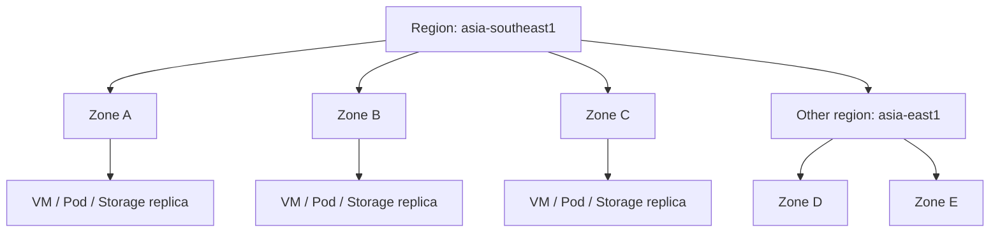
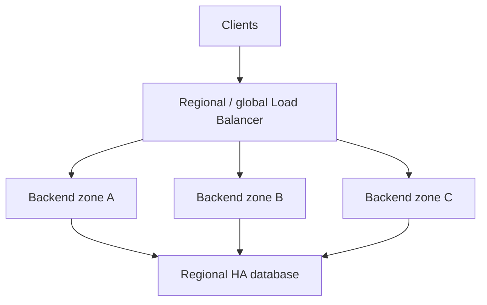
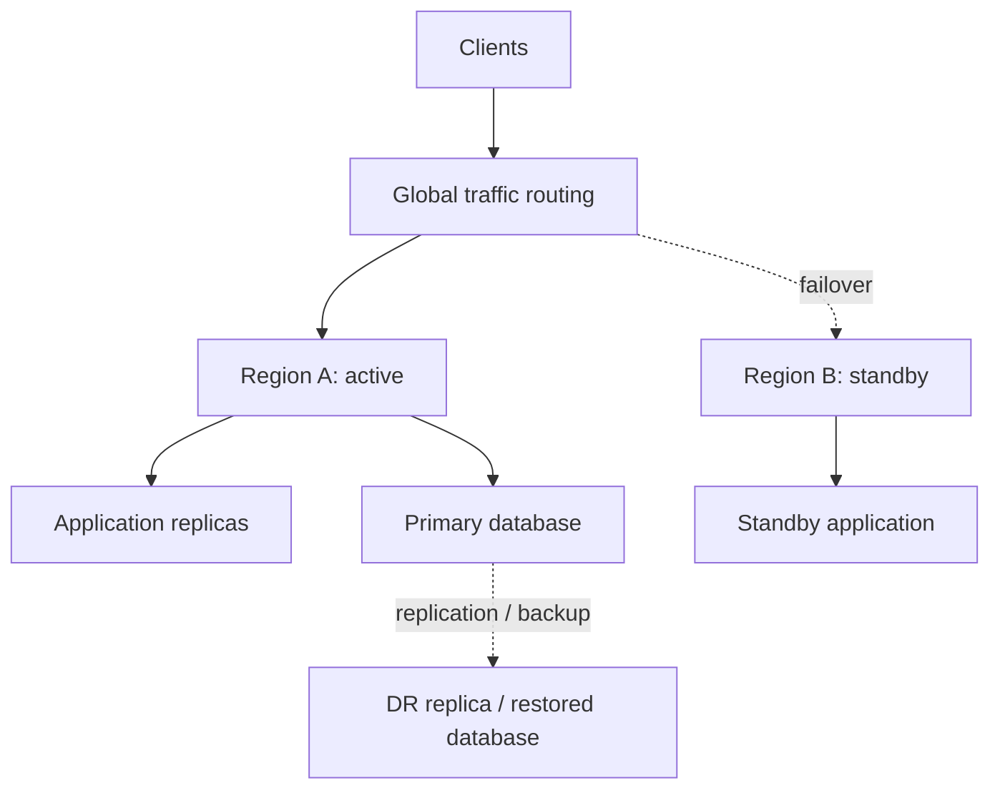
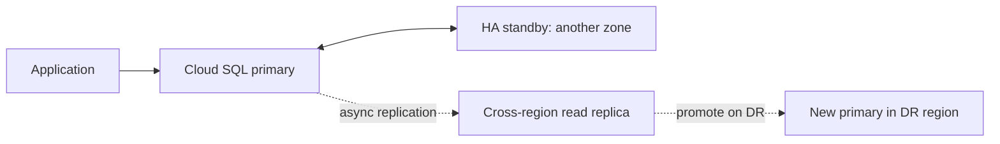
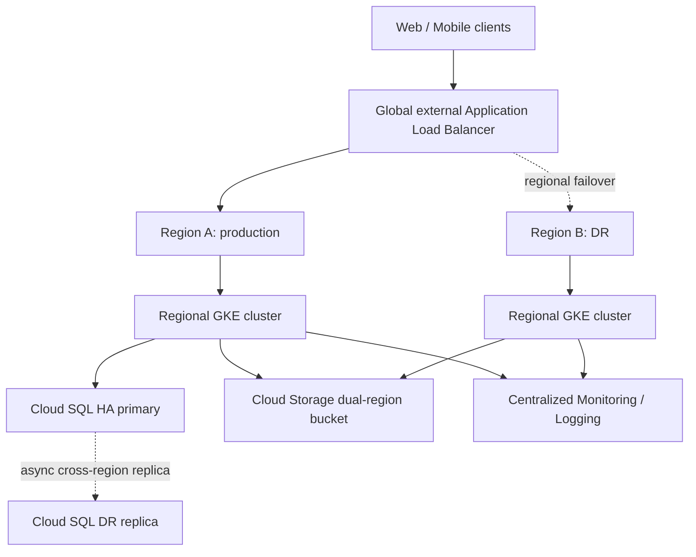

# Designing Zonal and Regional Fault Tolerance

An application can run on multiple VMs or multiple pods yet still go down when a single zone fails. Common causes include placing all replicas in the same zone, running a single primary database without failover, attaching zonal disks, or routing a load balancer to a single backend. Likewise, a system resilient to a zonal outage can still halt completely if an entire region becomes unavailable.

Fault-tolerant design requires clearly defining the failure scope a system must survive, how failures are detected, where traffic is shifted, and how data is preserved. On Google Cloud, a **zone** is a smaller failure domain inside a **region**; multi-zone deployments let applications keep running when one zone fails. Surviving a full regional outage requires a multi-region architecture spanning compute, data, networking, and tested failover procedures.

In the `CLOUD_PROVIDERS_GCP` module, this topic connects Compute Engine, GKE, Cloud Run, Cloud SQL, Spanner, Cloud Storage, Cloud Load Balancing, Cloud DNS, and Cloud Monitoring into an SRE design with explicit targets. Running multiple copies of resources provides fault tolerance only when those copies reside in independent failure domains, possess enough capacity to carry the load, and have tested failover mechanisms.

## 1. Understanding Failure Domains: Zones and Regions

Google Cloud organizes infrastructure across multiple geographic tiers. A region contains multiple independent zones. Each zone has isolated compute, storage, and networking infrastructure within the region. Zones within the same region are connected by low-latency networking, supporting services with synchronous replication. An incident affecting one zone does not necessarily disrupt other zones in the region.



Key terms to distinguish:

- **Zonal resource:** a resource bound to a single zone, such as a VM or a zonal Persistent Disk. When that zone becomes unavailable, the resource may become unreachable.
- **Regional resource:** a resource managed at the regional level or replicated across zones within one region, such as a regional Managed Instance Group, regional GKE cluster, or regional Persistent Disk.
- **Multi-region resource:** a service or architecture distributing data or workloads across multiple regions, such as a Spanner multi-region configuration, a Cloud Storage dual-region/multi-region bucket, or an application deployed across multiple regions.
- **Global resource:** a globally scoped resource such as certain load balancers and anycast IP addresses. A global frontend does not automatically make backends or data multi-region.

Not every service labeled "regional" automatically survives every failure inside a region. The actual protection scope depends on how the service replicates data, replica placement, control planes, and supported failure modes. Check each service's availability documentation and corresponding SLA before making commitments for an application.

### Which Failures Must Be Accounted For?

| Failure Domain | Examples | Design Questions |
|---|---|---|
| Instance/process | VM crash, JVM crash, pod killed | Can other replicas take traffic and replace it? |
| Zone | Power, network, or infrastructure failure in one zone | Does the workload retain enough replicas and capacity in other zones? |
| Region | Region loses connectivity or multiple services in the region go down | Are compute, data, endpoints, and operators available in another region? |
| Control plane/configuration | Misconfigured IAM, DNS, rollouts, or wide-reaching policy changes | Can we roll back, restore permissions, and limit blast radius? |
| External dependencies | Payment APIs, DNS, identity providers, or on-premises links failing | Does the app have proper timeouts, retries, fallbacks, and circuit breakers? |

Multi-zone design does not protect against a faulty configuration rolled out simultaneously to all zones. Nor does multi-region design protect against an application bug or data deletion replicated across every region. Pair redundancy with backups, change controls, access controls, and recovery procedures.

## 2. Starting from SLOs, RTO, and RPO

Before choosing zone or region counts, quantify the business impact of downtime and data loss.

- **SLO (Service Level Objective):** service quality target over a measurement window, such as request success rate or p99 latency.
- **RTO (Recovery Time Objective):** maximum acceptable time to restore service after an outage.
- **RPO (Recovery Point Objective):** maximum acceptable data loss, typically expressed as the time window of un-replicated or un-backed-up data.
- **MTTD:** mean time to detect an incident.
- **MTTR:** mean time to restore service.

For example, a system with a 30-minute RTO and 5-minute RPO must be able to bring the application back within 30 minutes and recover data with no more than 5 minutes of lag. Daily backups cannot meet a 5-minute RPO, even if stored in another region.

Set targets by workload tier instead of applying one expensive architecture to every service:

| Tier | Example Requirements | Typical Architectural Direction |
|---|---|---|
| Basic | Hours of downtime tolerable; data can be rebuilt | Single zone, periodic backups, and recovery runbooks |
| Critical production | Survives single-zone failure; brief downtime | Multi-zone within one region, health checks, and automated failover |
| Mission-critical | Must continue operating when a region fails | Multi-region, data replication, traffic routing, and DR drills |
| Global | Multi-geography users, low latency, and geographic fault tolerance | Active-active or global architecture with data designed for multi-region access |

The Google Cloud Well-Architected Framework provides reference infrastructure availability targets by deployment archetype: zonal, regional/multi-zone, and multi-region. These are not application SLAs. Actual availability depends on specific services, configurations, dependencies, software bugs, and operational processes. Combine each service's SLA with end-to-end SLOs to calculate your error budget.

## 3. Three Fault-Tolerant Architecture Patterns

### One Region, Multiple Zones

This is the common production choice when the primary requirement is surviving a single-zone outage. Compute is spread across multiple zones, load balancers route traffic only to healthy backends, and data uses services with cross-zone replication or regional HA mechanisms.



When zone A fails, the load balancer stops routing requests to backend A. Backends in B and C continue serving. For this architecture to hold, the remaining two zones must have sufficient capacity for the shifted load, and data or dependencies must not rely exclusively on zone A.

### One Primary Region and One DR Region

The active-passive pattern has one primary serving region and one standby region. The DR region can run as cold standby (provisioned only during incidents), warm standby (deployed with fewer replicas), or hot standby (provisioned to take load rapidly). Data is replicated or backed up to the DR region. When the primary region fails, operators or automation scale up compute, promote database replicas, and shift traffic.



The advantage is usually lower cost than active-active. Trade-offs include manual failover steps, potential lag from asynchronous replication, and insufficient DR capacity if only partially provisioned.

### Multiple Regions Serving Traffic Simultaneously

The active-active pattern deploys the application in at least two regions and distributes traffic across healthy regions. Data layers must support concurrent writes or enforce clear write-partitioning rules. This pattern can shorten traffic failover times, but increases complexity around synchronization, consistency, conflicts, latency, and cost.

Not every database fits multi-region writes. With a Cloud SQL primary and cross-region read replica, only one primary accepts writes; cross-region replicas are asynchronous and require promotion on failover. If managed multi-region writes with consensus are needed, evaluate services such as Spanner multi-region configurations along with their latency and cost trade-offs.

## 4. Fault Tolerance at the Compute Layer

### Compute Engine: Regional Managed Instance Groups

A Managed Instance Group (MIG) manages a group of identical VMs and provides autohealing, autoscaling, and automated updates. A **Regional MIG** distributes VMs across multiple zones within one region; when one zone goes down, instances in remaining zones keep serving traffic.

Deployment principles:

1. Use immutable, versioned instance templates tested before rollout.
2. Choose regional MIGs for stateless workloads needing zonal fault tolerance.
3. Set minimum instance counts so remaining zones can handle full load if one zone drops.
4. Pair load balancer health checks with autohealing health checks. Load balancer health checks determine whether a backend receives traffic; autohealing determines whether an instance needs replacement. Both check types should have tailored purposes and thresholds.
5. Verify quotas, IPs, subnets, capacity, and reservations in remaining zones.

A regional MIG remains a single-region resource; it does not expand automatically into a second region. For regional fault tolerance, create a separate MIG in the DR region and connect them via appropriate global or DNS-based traffic routing.

### GKE: Regional Clusters and Multi-Cluster

A regional GKE cluster places control plane replicas across multiple zones in the same region. By default, node pools in a regional Standard cluster are typically distributed across multiple zones; node locations can be customized. When one zone fails, control plane replicas in remaining zones keep managing the cluster and workloads can run on healthy nodes.

Regional clusters address the zonal failure domain. To survive regional outages, deploy **independent clusters across multiple regions**, then manage them using fleets, Gateway, or appropriate global traffic routing. A regional cluster does not automatically become multi-region.

Design points:

- Deployment replicas must configure topology spread constraints or pod anti-affinity to avoid clustering in one zone.
- PodDisruptionBudgets limit voluntary pod disruptions during maintenance; they do not replace spare replicas or extra capacity.
- Cluster Autoscaler and Horizontal Pod Autoscaler require sufficient limits, quotas, and capacity to scale when one zone is lost.
- StatefulSets and PersistentVolumes must account for storage topology. A zonal Persistent Disk binds pods to the disk's zone; never assume every PVC can attach in another zone.
- Each region needs equivalent network, DNS, secrets, Workload Identity, policies, image pulls, and observability.

Example creating two regional clusters across two different regions:

```bash
gcloud container clusters create orders-prod-a \
  --region=asia-southeast1 \
  --num-nodes=1 \
  --enable-ip-alias

gcloud container clusters create orders-prod-b \
  --region=asia-east1 \
  --num-nodes=1 \
  --enable-ip-alias
```

This is an illustrative command. `--num-nodes` in a Standard cluster applies per zone of the default node pool; configure node locations, machine types, release channels, networking, and autoscaling for actual load. For production, avoid leaving one node per zone if it cannot meet capacity and SLOs.

### Cloud Run: Multi-Region Service Deployment

A Cloud Run service is a regional resource. For regional fault tolerance, deploy the same application in multiple regions and use a global external Application Load Balancer with a serverless NEG for each Cloud Run service. Each NEG must reside in the same region as its corresponding Cloud Run service.

Important caveat: simply placing multiple Cloud Run backends behind a global load balancer does not guarantee automatic failover when one regional service stops responding or returns application errors. Cloud Run documentation explicitly notes that a basic multi-region setup does not automatically route requests to another region on every backend failure. Design Cloud Run service health, outlier detection, or appropriate failover mechanisms, then test with real faults in a staging environment.

Example deploying the same image in two regions:

```bash
gcloud run deploy orders-api \
  --image=REGION_A-docker.pkg.dev/PROJECT_ID/apps/orders-api:2026-11 \
  --region=asia-southeast1

gcloud run deploy orders-api \
  --image=REGION_B-docker.pkg.dev/PROJECT_ID/apps/orders-api:2026-11 \
  --region=asia-east1
```

After deploying, configure serverless NEGs and the global external Application Load Balancer per Cloud Run's multi-region guide. Using the same image reduces release drift; however, configurations, secrets, IAM, and database connections must also stay consistent or be managed intentionally.

## 5. Designing Traffic Routing and Health Checks

The load balancer sits directly on the failover path. It must detect healthy backends, stop sending traffic to failing backends, and redistribute load to backends with available capacity.

Common options:

| Mechanism | Scope | Role |
|---|---|---|
| Regional load balancer | One region | Distributes traffic across backends within a region |
| Global external Application Load Balancer | Global frontend; backends can span multiple regions depending on backend type | Single anycast address, routes to appropriate backends, and supports multi-region architectures |
| Cloud DNS routing policy | DNS records | Selects endpoints via weighted, geolocation, or failover policies with health checks |
| GKE Gateway / multi-cluster routing | Multiple clusters per Gateway config | Routes traffic to workloads across multiple clusters |

Health checks should verify business serving ability while avoiding cascading failovers. For instance, if a readiness endpoint returns an error whenever a database briefly slows down, every backend could be marked unhealthy simultaneously, leaving the load balancer with zero healthy backends. Separate liveness, readiness, and dependency health; use timeouts, retries, and circuit breakers so a single dependency blip does not knock the entire frontend out of rotation.

Cloud DNS can use health-checked failover policies to switch DNS answers to backup endpoints. However, resolvers and clients cache DNS records per TTL or local policies, so DNS failover does not always match load balancer traffic shifting in speed or consistency. Do not rely on DNS as the sole mechanism for very low RTO targets without measuring real caching behavior.

With multi-region Cloud Run, also verify service health and outlier detection because a basic load balancer does not automatically catch every application-layer error. For global external Application Load Balancers, inspect traffic distribution, health checks, and capacity spillover behavior for your specific backend type.

## 6. Data Determines the Limits of Fault Tolerance

Stateless application replicas can be recreated fairly easily. Databases, files, and session state are much harder. If compute is multi-region while the database still has only one primary in the primary region, the application still cannot process writes when that region goes down.

### Comparing Data Options on Google Cloud

| Service | Zonal Fault Tolerance | Regional Fault Tolerance | Key Considerations |
|---|---|---|---|
| Cloud SQL HA (regional availability) | Yes. Primary and standby in two zones; Cloud SQL fails over automatically on qualifying outages | Does not automatically protect against full regional loss | Preserves connection IP with zero data loss in HA zonal failover; requires cross-region read replicas or DR backups for regional outages |
| Cloud SQL cross-region read replica | The replica itself lives in another region | Supports DR after promotion | Asynchronous replication; lag may occur and RPO is non-zero; promotion is typically an explicit operation |
| Spanner regional | Yes. Regional configurations maintain read-write replicas across three zones in the region | Regional configuration does not survive full regional loss | Cross-zone replication providing in-region HA |
| Spanner dual-region / multi-region | Yes | Supports multi-region operation and automatic leader failover depending on configuration | Higher availability; write latency and costs can increase; choose configuration, edition, and data placement carefully |
| Regional Persistent Disk / Hyperdisk Balanced High Availability | Synchronous replication between two zones in the same region | No | Requires standby compute and application-level control plane failover; not a cross-region DR solution |
| Cloud Storage regional bucket | Data stored redundantly across at least two zones in the region | Does not protect against regional outages | Fits data needing zonal fault tolerance within one regional bucket |
| Cloud Storage dual-region / multi-region | Yes | Yes for data already replicated to another region | Default cross-region replication is asynchronous; newly written un-replicated objects may be temporarily unavailable if a region goes down |

### Cloud SQL: Distinguishing HA and DR

Cloud SQL regional HA places primary and standby instances in two zones within the same region, synchronizing data via regional persistent disks. When an instance fails or a zone goes down, Cloud SQL can automatically restart the instance in the surviving zone with the same IP and zero data loss under the HA model.

To survive a full regional outage, create a cross-region read replica or prepare a backup/restore plan in a second region. Cross-region replicas use asynchronous replication, meaning recent transactions may not have arrived if the primary region drops suddenly. DR procedures must check lag, decide when to promote, update write endpoints, and verify the application after cutover.

Illustrative topology:



Never call a cross-region read replica automatic HA. It is a DR component; promotion and client cutover must live in tested runbooks or automation. After failover, re-establish topology so the new database gains regional HA and a DR replica in another region.

### Spanner: An Option When Multi-Region Databases Are Required

A Spanner regional configuration places three read-write replicas across three zones in one region. It survives a single-zone failure while keeping the database online. Dual-region and multi-region configurations distribute replicas across multiple regions; certain configurations support automatic leader failover when a region is disrupted.

In return, read-write replicas must coordinate quorum across inter-region networks. That can increase write latency compared to regional configurations. When designing, place compute close to the leader region for write-heavy workloads, measure latency from user regions, and verify data residency requirements. Dual-region/multi-region configurations may depend on edition and supported location lists.

### Cloud Storage and Asynchronous Replication

Regional buckets store data redundantly across multiple zones in a region. Dual-region and multi-region buckets store data across multiple geographic regions, allowing continued access to replicated data when one region goes down. However, default cross-region replication is asynchronous. Google Cloud publishes a default replication goal for new objects of 99.9% within one hour and 100% within 12 hours. Turbo replication for dual-region buckets is designed to replicate 100% of new objects within a 15-minute RPO.

This means a multi-region bucket does not imply every newly written byte exists immediately in a second region. For critical data, monitor replication/RPO metrics, consider turbo replication if appropriate, and maintain backups/retention to guard against accidental deletion or application-logic corruption.

### Regional Persistent Disk Is Not Multi-Region Storage

Regional Persistent Disk and Hyperdisk Balanced High Availability replicate synchronously between two zones in the same region. They allow a VM to move to another zone when one zone fails, but they do not create a copy in a second region. Moving disks to standby VMs requires application-level orchestration or corresponding failover procedures. Add snapshots and backup copies in another region if DR is required.

## 7. Handling State, Consistency, and Split Brain

Data replication is only part of the problem. During failover, the system must determine which replica is allowed to accept writes to prevent two primaries from operating simultaneously.

Key principles:

- **Single writer when multi-writer is unsupported:** only one primary accepts writes; a standby is promoted only after confirming the old primary is fenced or stripped of write access.
- **Idempotency:** clients may retry when connections drop between commit and response delivery. Use idempotency keys or transaction identifiers to avoid duplicate writes.
- **Replication lag:** monitor replication lag and alert when lag exceeds RPO.
- **Consistency:** define where eventual consistency or stale reads are acceptable versus where strong consistency is mandatory for each data type.
- **Session state:** never store critical session state exclusively in one pod's or VM's memory. Use shared stores or stateless tokens; treat session affinity strictly as an optimization, never an HA mechanism.
- **Caches:** caches can be rebuilt, but assess database load spikes when a cold cache warms up in the DR region.
- **Outbox and event processing:** ensure unprocessed messages replay safely after failover; consumers must be idempotent with deduplication.

In active-active architectures, resolve write conflicts, event ordering, and data ownership. If business logic cannot handle conflicts, shard data by tenant or region, or choose a database whose consistency model matches requirements. Never enable concurrent writes to two independent databases expecting a load balancer to resolve conflicts.

## 8. Failover Procedures for Zonal or Regional Outages

Failover requires clear triggers, accountable owners, concrete steps, and verification criteria.

### Zonal Failover

1. Monitoring and health checks detect that backends or a zone lost serving capacity.
2. The load balancer stops routing traffic to unhealthy backends.
3. Regional MIGs or the GKE scheduler maintain/recreate replicas in surviving zones.
4. Database HA or regional storage performs service-managed failover.
5. Autoscalers add capacity if quotas and resources allow.
6. SREs verify error rates, latency, backlogs, and replica health before closing the incident.

With managed services, Google Cloud automates several steps. Even so, applications still need retries, timeouts, connection pool recovery, and post-failover consistency checks.

### Regional Failover

1. **Detect and assess:** confirm a regional outage rather than an isolated application, DNS, IAM, or dependency bug.
2. **Declare DR:** the incident commander confirms activation criteria, service scope, and failover authorization.
3. **Prevent split brain:** fence or disable the old primary's write path where possible; never let two primaries accept transactions simultaneously.
4. **Recover data:** inspect replication lag, select the appropriate replica/backup, and promote or restore per runbook.
5. **Recover compute:** scale the DR region to required capacity and verify secrets, configurations, service accounts, networking, and quotas.
6. **Shift traffic:** update backend health, load balancers, Cloud DNS, or application endpoints per design.
7. **Verify:** run smoke tests and inspect transactions, data consistency, error rates, latency, queue backlogs, and dependencies.
8. **Communicate and monitor:** publish incident status updates, keep monitoring, and leave the DR region as primary until a safe failback plan is ready.

Failback to the original region is a separate operation. It requires reverse data synchronization, consistency verification, scheduled traffic shifting, write-ownership transfer, and a rollback option if failback fails. Never shift traffic back automatically the moment the old region recovers.

## 9. Design Example: Zonal and Regional Fault-Tolerant Order API

Suppose a Java/Spring Boot ordering system includes a frontend, order API, database, and object storage. SLOs require surviving a single-zone outage; during a regional outage, the team must recover within an agreed DR window.

A reference active-passive design:



Key design decisions in this architecture:

- Each region runs a regional GKE cluster so control planes and nodes span multiple zones.
- GKE workloads run multiple replicas with topology spread constraints for zonal fault tolerance.
- The global load balancer receives traffic and distributes it to backends by health/capacity. Test behavior when an entire region goes unhealthy and verify requests actually fail over.
- Cloud SQL HA protects the primary against zonal failures in region A. The cross-region read replica in region B supports DR, requiring promotion and carrying potential data loss bounded by replication lag.
- A Cloud Storage dual-region bucket serves objects replicated across both regions; monitor replication RPO for freshly written data.
- Configs, secrets, images, IAM, and monitoring are prepared in both regions.
- Region B must hold adequate quotas and capacity for DR load; if using warm standby, the runbook must state scale-up times explicitly.

If the business requires continuous writes in both regions and cannot accept manual Cloud SQL promotion, evaluate Spanner multi-region or geographically partitioned data designs. Never pick a database solely on replication checkboxes; compare consistency, latency, migration effort, cost, and application requirements.

## 10. Monitoring Health and Recovery Readiness

SREs must monitor not only CPU or VM status, but also failure-domain availability and replication health.

Metrics to track:

- Availability, request success rate, p50/p95/p99 latency, and SLO error budgets.
- Healthy/unhealthy backend counts by region and zone; actual replicas versus desired replicas.
- Remaining capacity across surviving zones/regions when one failure domain is drained.
- Autoscaler backlogs, pending pods, MIG target sizes, quotas, and scale-up durations.
- Cloud SQL replication lag, HA status, failover times, and client reconnection behavior.
- Spanner CPU utilization, transaction latency, and replica health per configuration.
- Cloud Storage replication time/RPO and objects not yet replicated within target.
- DNS health checks, load balancer backend health, and regional traffic shares.
- Queue depth, retry rates, circuit breakers, connection pool saturation, and dependency errors.

Create dashboards broken down by region and zone to spot failures concentrated in a single failure domain. Alerts should reflect user impact or risks to RTO/RPO—for example, all backends in a region unhealthy, DR capacity below threshold, replication lag exceeding RPO, or insufficient replicas remaining after losing a zone.

## 11. Testing Fault Tolerance and Running DR Drills

An architecture is considered resilient only after the team proves it works under failure conditions. Start in production-equivalent staging or sandbox environments, then gradually expand test scope under change-management controls.

Scenarios to rehearse:

1. Terminate a VM or delete a pod to verify autohealing and traffic absorption.
2. Simulate losing one zone in a regional MIG or GKE regional cluster; check replica counts and latency in surviving zones.
3. Force a backend unhealthy to confirm the load balancer stops sending traffic to it.
4. Verify autoscaling when traffic concentrates into surviving zones.
5. Execute database failover in a test environment; measure reconnect times and verify data integrity.
6. Simulate primary region unavailability; execute the full runbook to promote replicas, scale DR, and shift traffic.
7. Restore from backups in another region to verify usability and measure real RTO/RPO.
8. Rehearse failback via its separate procedure, including data resync and write-ownership transfer.

During each drill, record:

- Detection time, incident declaration time, and service recovery time.
- Measured RTO and RPO compared against targets.
- Failed request counts, latency spikes, missing data, or duplicate transactions.
- Runbook steps that required manual intervention and required IAM permissions.
- Capacity, quota, DNS caching, replication lag, and dependency bottlenecks that slowed failover.
- Remediation action items, owners, and due dates.

Never simulate outages in production without defined scope, approvers, backups, rollbacks, and blast-radius mitigations. After every game day or real incident, update runbooks and automate repetitive steps.

## 12. Common Design Mistakes

| Mistake | Consequence | Remedy |
|---|---|---|
| Placing all replicas in one zone | A single zonal outage takes down the entire service | Spread workloads across multiple zones and verify actual placement topology |
| Confusing a regional GKE cluster with multi-region | A regional outage can still take down the cluster and workloads | Create a separate cluster in the DR region and configure multi-cluster routing |
| Global load balancer with backends in only one region | Global frontend has nowhere to serve when that backend region fails | Deploy backends in a second region and test health and failover |
| Treating Cloud SQL HA as cross-region DR | A regional outage can render the database unavailable | Pair with cross-region replicas or backup/restore and promotion runbooks |
| Promising RPO = 0 with an asynchronous cross-region replica | Un-replicated transactions can be lost during failover | Measure replication lag, set realistic RPOs, or pick a database with matching replication semantics |
| Provisioning only partial capacity in the DR region | Failover succeeds but the application immediately overloads | Maintain warm/hot capacity, quotas, and load-test degraded modes |
| Replicating the database while forgetting secrets and configs | DR compute fails to boot or cannot reach dependencies | Synchronize configs, IAM, secrets, networking, DNS, and artifacts |
| Unbounded retries or missing idempotency | Causes request storms, duplicate transactions, and cascading failures | Use exponential backoff, jitter, timeouts, circuit breakers, and idempotency keys |
| Having no failback plan | Old region returns leaving two primaries or diverged data | Define reverse sync, write cutover, and pre-failback verification |
| Skipping drills | Runbooks, permissions, and endpoints fail when actually needed | Run periodic game days and measure RTO/RPO |

## 13. Fault-Tolerant Design Checklist

Before putting a production system into operation, verify:

- [ ] SLOs, RTOs, and RPOs are defined based on business impact.
- [ ] Failure domains for every component are mapped out.
- [ ] Stateless compute is distributed across multiple zones within a region.
- [ ] A regional DR plan exists if SLOs require surviving a full regional outage.
- [ ] Load balancer health checks and traffic routing have been tested.
- [ ] Databases use HA/DR models aligned with consistency and RPO needs.
- [ ] Backups reside in independent locations and restores have been tested.
- [ ] Object replication and replication lag are monitored.
- [ ] Sessions, caches, queues, and event processing recover safely.
- [ ] IAM, secrets, KMS, DNS, networking, artifacts, and configs exist in the DR region.
- [ ] Quotas, IPs, subnets, capacity, and reservations suffice when a zone or region is lost.
- [ ] Failover, fencing, and failback runbooks exist with authorized operators.
- [ ] Dashboards and alerts cover regions, zones, SLOs, RTOs, and RPOs.
- [ ] Zonal outages, regional outages, and data recovery drills have been rehearsed.

## 14. Hands-On Exercise

Suppose you operate an ordering REST API on GKE, a Cloud SQL database, and invoice objects stored in Cloud Storage. Design fault tolerance for two objectives: continuing to serve during a single-zone outage, and recovering when the primary region becomes unavailable.

1. Diagram failure domains for the frontend, API, database, object storage, DNS, IAM, and monitoring.
2. Choose a regional GKE cluster or regional MIG for compute; determine the minimum replicas required after losing one zone.
3. Choose a global load balancer or Cloud DNS routing policy and describe how health checks shift traffic.
4. Set RTO/RPO targets for the API, database, and invoices; explain why they may differ.
5. Choose Cloud SQL HA with a cross-region read replica or a suitable multi-region database; describe the promotion/failover workflow.
6. Choose a Cloud Storage regional, dual-region, or multi-region bucket; explain how replication lag can affect RPO.
7. Write a regional failover runbook covering fencing, data recovery, scaling compute, shifting traffic, and verification.
8. Plan a game day to measure real RTO/RPO and test failback.

Evaluate your design by assuming the DR region must carry 100% of load while one external dependency remains broken. If the application cannot function, identify that dependency and add fallbacks or controlled feature degradation.

## 15. Conclusion

Zonal fault tolerance keeps workloads running when part of a region's infrastructure fails; multi-region design lets systems recover or keep serving when an entire region goes down. Achieving this requires distributing compute, picking databases and storage with matching replication, configuring traffic routing, reserving capacity, protecting state, and testing failover/failback. The ultimate goal is not simply having many copies, but proving the system upholds its SLOs and recovers data within committed RTO/RPO bounds.

## References

- [Google Cloud infrastructure reliability guide](https://docs.cloud.google.com/architecture/infra-reliability-guide)
- [Well-Architected Framework: Reliability pillar](https://docs.cloud.google.com/architecture/framework/reliability)
- [Design reliable infrastructure for your workloads](https://docs.cloud.google.com/architecture/infra-reliability-guide/design)
- [Regional managed instance groups](https://docs.cloud.google.com/compute/docs/instance-groups/regional-migs)
- [GKE regional clusters](https://docs.cloud.google.com/kubernetes-engine/docs/concepts/regional-clusters)
- [Serve traffic from multiple regions with Cloud Run](https://docs.cloud.google.com/run/docs/multiple-regions)
- [Availability in Cloud SQL](https://docs.cloud.google.com/sql/docs/availability)
- [Cloud SQL disaster recovery](https://docs.cloud.google.com/sql/docs/postgres/intro-to-cloud-sql-disaster-recovery)
- [Spanner regional, dual-region, and multi-region configurations](https://docs.cloud.google.com/spanner/docs/instance-configurations)
- [Cloud Storage data availability and durability](https://docs.cloud.google.com/storage/docs/availability-durability)
- [Synchronous disk replication with Regional Persistent Disk](https://docs.cloud.google.com/compute/docs/disks/about-regional-persistent-disk)
- [Cloud DNS routing policies and health checks](https://docs.cloud.google.com/dns/docs/routing-policies-overview)
- [Perform testing for recovery from failures](https://docs.cloud.google.com/architecture/framework/reliability/perform-testing-for-recovery-from-failures)
- [Perform testing for recovery from data loss](https://docs.cloud.google.com/architecture/framework/reliability/perform-testing-for-recovery-from-data-loss)
