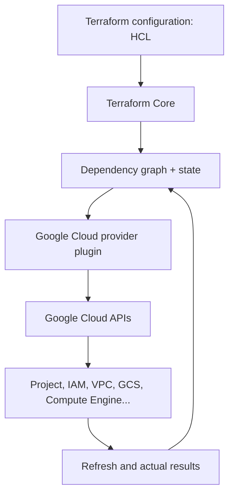

# Terraform and the Google Cloud Provider

When managing multiple projects, VPCs, service accounts, buckets, and workloads on Google Cloud, manual configuration through the Console or CLI commands easily creates discrepancies across environments. Infrastructure as Code (IaC) solves this problem by describing infrastructure in files that can be version-controlled, reviewed for changes before applying, and reused across development, staging, and production.

Terraform is a declarative IaC tool. Operators describe the desired state in HCL; Terraform compares the configuration with the state and actual resources, then generates a change plan. The Google Cloud provider (`hashicorp/google`) is a plugin that enables Terraform to communicate with Google Cloud APIs to read, create, update, and delete resources.

## 1. How Does Terraform Work?

Terraform Core reads the configuration, builds a dependency graph, and orchestrates execution. A provider plugin understands the schema of a specific platform. For Google Cloud, the provider maps HCL blocks such as `google_storage_bucket` or `google_compute_network` to their corresponding APIs.



Key components:

| Component | Role |
| --- | --- |
| Configuration | `.tf` files describing resources, variables, outputs, providers, and backends. |
| Terraform Core | Reads HCL, computes dependencies, creates plans, and orchestrates operations. |
| Provider | Plugin that provides resources and data sources for a platform. |
| Resource | An object whose lifecycle is managed by Terraform, such as a bucket or VPC. |
| Data source | Reads information about an existing resource whose lifecycle is not managed by the current configuration. |
| State | Maps resource addresses in the configuration to real objects and stores metadata needed for planning. |
| Backend | Where state is stored, which can be a local machine or a remote storage service. |

Terraform uses a declarative model: you describe the desired outcome without writing sequential commands to create resources one by one. For example, when a resource depends on an enabled API, Terraform uses the dependency graph to execute operations in the proper order.

## 2. Preparing the Google Cloud Environment

Before initializing Terraform, identify the target project, billing, deployment identity, and required APIs.

### 2.1. Tools and Access Permissions

Install the Terraform CLI and Google Cloud CLI (`gcloud`) according to the official instructions. Verify that the tools are ready:

```bash
terraform version
gcloud version
gcloud auth list
gcloud projects describe PROJECT_ID
```

The project must exist, have appropriate billing enabled, and the deployer must have permissions to perform the required operations. If Terraform enables APIs using `google_project_service`, the deployment identity needs permission to enable services in the project, typically via `serviceusage.services.enable`. Permissions to create resources also depend on the resource type, such as permission to create buckets in Cloud Storage.

Avoid using an identity with Owner permissions across all projects just to run Terraform. Separate deployment identities by environment and resource scope; grant the required permissions on the corresponding project or resource. The identity used by the runtime application should also be separated from the identity running Terraform.

### 2.2. Authenticating with Application Default Credentials

The Google Cloud provider can use Application Default Credentials (ADC). On a development machine, create ADC with:

```bash
gcloud auth application-default login
```

These credentials are used by applications and SDKs. Running `gcloud auth login` to log in to the CLI does not automatically replace creating ADC. The provider usually discovers ADC automatically, so the configuration does not need to contain access tokens or passwords.

For organizations that require using a dedicated service account, you can impersonate a service account. The operator logs in to ADC with an account permitted to impersonate:

```bash
gcloud auth application-default login \
  --impersonate-service-account=terraform-deployer@PROJECT_ID.iam.gserviceaccount.com
```

Alternatively, configure provider impersonation as shown in a later example. The initial identity must be granted permission to create tokens for the target service account, typically `roles/iam.serviceAccountTokenCreator` on that service account. The target service account receives the necessary infrastructure management permissions.

In CI/CD, prefer Workload Identity Federation so that pipeline workloads obtain a Google Cloud identity through a trusted identity provider. This avoids storing long-lived service account keys in repositories or pipeline secrets. If an environment requires using a credentials file, protect the file as a secret, restrict read permissions, and do not commit it to Git.

## 3. Declaring the Google Cloud Provider

A minimal Terraform configuration typically includes a `terraform` block to declare the required CLI and provider versions, along with a `provider` block to set the default project and region.

### 3.1. Pinning Terraform and Provider Versions

Create `versions.tf`:

```hcl
terraform {
  required_version = ">= 1.6.0, < 2.0.0"

  required_providers {
    google = {
      source  = "hashicorp/google"
      version = "~> 8.0"
    }
  }
}
```

`source` identifies the provider address on the Terraform Registry. `version` is the allowed version constraint. For example, `~> 8.0` accepts releases in the 8.x branch and will not automatically upgrade to major version 9. This is an example selecting a current provider branch at the time of writing; real projects should check supported versions and their own upgrade policies. When an organization upgrades a major version, read the changelog, check behavior changes, and run a plan in a test environment.

After the first `terraform init`, Terraform creates `.terraform.lock.hcl` to record the exact provider version and checksums. Commit this lock file to Git so team members and pipelines use the same selected provider set. The version constraint in `required_providers` and the locked version in the lock file serve two different purposes: one restricts the range, while the other records the actual selection.

Do not delete the lock file just to work around initialization errors. Only update the provider selection intentionally, typically via `terraform init -upgrade`, then review the lock file changes in a pull request.

### 3.2. Configuring the Default Provider

Create `provider.tf`:

```hcl
provider "google" {
  project = var.project_id
  region  = var.region
}
```

The provider block configures how the provider behaves and sets default values for resources. `project` specifies the default project; `region` is the default region for resources that support this attribute. Some resources require `zone`, or allow specifying project/region directly on the resource to override defaults.

Define variables in `variables.tf`:

```hcl
variable "project_id" {
  description = "Google Cloud project used to deploy infrastructure"
  type        = string
}

variable "region" {
  description = "Default region for regional resources"
  type        = string
  default     = "asia-southeast1"
}
```

Pass values through `terraform.tfvars` or the `TF_VAR_project_id` environment variable:

```hcl
project_id = "my-gcp-project"
region     = "asia-southeast1"
```

Do not hardcode the production project across many resources. Defining project and region as variables allows the same module to be reused across multiple environments while making the deployment target clear during plan reviews.

### 3.3. Authenticating with Service Account Impersonation in the Provider

When using the deployer's ADC and wanting the provider to impersonate a service account, you can configure:

```hcl
provider "google" {
  project                     = var.project_id
  region                      = var.region
  impersonate_service_account = "terraform-deployer@${var.project_id}.iam.gserviceaccount.com"
}
```

In this example, ADC is the base identity; the provider requests a short-lived token from Google Cloud for the deployment service account. Do not place static access tokens or JSON key contents directly in HCL. Impersonation configuration does not automatically grant permissions to the service account; IAM permissions must be prepared beforehand.

### 3.4. Managing Multiple Projects or Provider Configurations

If a configuration manages resources across multiple projects, declare a provider alias:

```hcl
provider "google" {
  project = var.application_project_id
  region  = var.region
}

provider "google" {
  alias   = "network"
  project = var.network_project_id
  region  = var.region
}

resource "google_compute_network" "shared" {
  provider                = google.network
  name                    = "shared-vpc"
  auto_create_subnetworks = false
}
```

The `google_compute_network.shared` resource uses the provider with alias `network`, so it is created in the network project. Resources that do not specify `provider` use the default configuration. For child modules, declare and pass the appropriate provider through the `providers` argument of the module block; do not assume a module automatically inherits aliases from its parent module.

## 4. Resources, Data Sources, and Dependencies

The Google Cloud provider supplies resources and data sources prefixed with `google_`.

- `resource` describes an object whose lifecycle is owned by Terraform. Terraform creates, updates, or deletes that object to match the configuration.
- `data` reads an existing object or piece of information. A data source does not mean Terraform will manage creating or deleting that object.

Example of reading information from an existing project:

```hcl
data "google_project" "current" {
  project_id = var.project_id
}

output "project_number" {
  description = "Project number of the deployment project"
  value       = data.google_project.current.number
}
```

Referencing outputs or attributes of another resource creates an implicit dependency. When you need to express a dependency that is not represented by an attribute reference, you can use `depends_on`. Prefer implicit dependencies because they communicate the relationship to Terraform more accurately.

For example, `google_storage_bucket` requires the Storage API to be enabled first. The `google_project_service` resource manages API state; the bucket depends on this resource. Some foundational APIs, such as the Service Usage API, may need to be pre-enabled by a bootstrap process before Terraform can manage other APIs.

## 5. Hands-On Example: Creating a Cloud Storage Bucket

This example creates a bucket in an existing project. The bucket uses uniform bucket-level access, public access prevention, and object versioning. Bucket names must be globally unique across Cloud Storage; replace the sample values before running.

### 5.1. Declaring Variables

Add to `variables.tf`:

```hcl
variable "bucket_name" {
  description = "Globally unique Cloud Storage bucket name"
  type        = string

  validation {
    condition     = length(var.bucket_name) >= 3 && length(var.bucket_name) <= 63
    error_message = "Bucket name must be between 3 and 63 characters long."
  }
}
```

`terraform.tfvars`:

```hcl
project_id = "my-gcp-project"
region     = "asia-southeast1"
bucket_name = "my-gcp-project-artifacts-unique"
```

Do not reuse the sample bucket name if it has already been registered by another project. Check Cloud Storage naming rules to ensure the name is valid beyond the length condition in the example.

### 5.2. Declaring Resources

Create `main.tf`:

```hcl
resource "google_project_service" "storage" {
  project = var.project_id
  service = "storage.googleapis.com"

  # Do not automatically disable the API when this resource is removed from state/config.
  disable_on_destroy = false
}

resource "google_storage_bucket" "artifacts" {
  name     = var.bucket_name
  project  = var.project_id
  location = upper(var.region)

  uniform_bucket_level_access = true
  public_access_prevention   = "enforced"
  force_destroy              = false

  versioning {
    enabled = true
  }

  depends_on = [google_project_service.storage]
}
```

Operational significance of these settings:

- `uniform_bucket_level_access = true` uses bucket-level IAM instead of per-object ACLs.
- `location = upper(var.region)` uses the uppercase region code format as displayed by Cloud Storage (for example `ASIA-SOUTHEAST1`); choosing the bucket location affects latency, pricing, and data residency requirements.
- `public_access_prevention = "enforced"` prevents granting public access through mechanisms supported by Cloud Storage.
- `versioning.enabled = true` retains previous object generations when an object is replaced or deleted, supporting data recovery within retention policy limits.
- `force_destroy = false` prevents Terraform from deleting the bucket while it still contains objects. This is the safer choice for examples that hold data.
- `disable_on_destroy = false` prevents deleting the API management resource from accidentally disabling a shared project API.

If the bucket holds critical data, consider `lifecycle { prevent_destroy = true }` so Terraform rejects plans that would delete the resource. When you need to modify or remove the bucket, review data protection and migration procedures separately.

### 5.3. Exporting Necessary Information

Create `outputs.tf`:

```hcl
output "bucket_name" {
  description = "Name of the created bucket"
  value       = google_storage_bucket.artifacts.name
}

output "bucket_url" {
  description = "URI of the bucket"
  value       = google_storage_bucket.artifacts.url
}
```

Outputs allow users or other modules to retrieve attributes returned by the provider. Do not export access tokens, passwords, or sensitive data. If an output contains sensitive information, mark it with `sensitive = true`; this flag hides part of the display output but does not replace protecting the state.

## 6. Terraform Workflow

A basic workflow consists of initializing, formatting, validating, planning, reviewing, and applying.

### 6.1. Initializing the Working Directory

```bash
terraform init
```

This command downloads required providers and modules, configures the backend, creates the `.terraform` directory, and creates or updates `.terraform.lock.hcl`. Re-run `terraform init` when changing providers, modules, or the backend. If changing the backend and migrating existing state, consider using `terraform init -migrate-state` after backing up and verifying the storage destination.

### 6.2. Formatting and Validating the Configuration

```bash
terraform fmt -recursive
terraform validate
```

`fmt` standardizes HCL formatting. `validate` checks configuration syntax and internal consistency after providers have been initialized; it does not verify IAM permissions, quotas, billing, or the ability to create resources in a real project.

### 6.3. Creating and Reviewing a Plan

```bash
terraform plan -out=tfplan
terraform show tfplan
```

The plan describes which resources will be created, updated, replaced, or deleted. Common symbols in a plan:

| Symbol | Meaning |
| --- | --- |
| `+` | Create resource. |
| `~` | Update in place. |
| `-/+` | Destroy and then recreate resource. |
| `-` | Destroy resource. |
| `<=` | Read data source. |

Before applying, check the project, region, IAM, network, data impact, changes that may cause downtime, and any destroy or replace operations. A plan file may contain sensitive data; store it under access control and do not commit it to Git.

### 6.4. Applying the Reviewed Plan

```bash
terraform apply tfplan
terraform output
```

When passing a saved plan file, Terraform applies that exact plan. If the configuration or state changes and invalidates the plan, generate a new plan and review it again. Do not bypass the review step by auto-applying production changes without a proper approval mechanism.

Terraform can detect drift when refreshing actual state and comparing it with state/configuration. If someone modifies a resource directly in the Console, the next plan may propose returning the resource to its declared configuration. Before applying, determine whether the manual change was intentional or drift that needs remediation.

## 7. State Management and Team Collaboration

State is a critical component of Terraform. It maintains the mapping between an address such as `google_storage_bucket.artifacts` and the real object on Google Cloud, and it may contain sensitive attributes read back by the provider. Therefore, state must be protected just like secret data.

### 7.1. Local State and Remote State

By default, Terraform can store state in a `terraform.tfstate` file in the working directory. This approach is only suitable for personal experimentation. When multiple people or CI/CD pipelines manage an environment together, use a remote backend for shared state and locking during operations.

The Google Cloud Storage backend is a common choice for Google Cloud infrastructure state. Example configuration:

```hcl
terraform {
  backend "gcs" {
    bucket = "company-terraform-state"
    prefix = "gcp/storage/production"
  }
}
```

The state bucket must be created beforehand via a bootstrap process or a separate state. The backend is initialized before providers execute resources, so you cannot use a resource in the same configuration to create the very bucket storing its state on the initial init. The GCS backend authenticates independently of the `provider "google"` block: setting `impersonate_service_account` in the provider does not automatically grant that identity to the backend. The identity accessing the backend also needs read/write permissions for state objects in the bucket, or must have impersonation configured separately per the backend documentation.

For the state bucket, enable object versioning, uniform bucket-level access, public access prevention, and least-privilege IAM. Only authorized pipelines and operators should be able to read/write state. The GCS backend supports state locking to prevent two Terraform processes from writing concurrently. When multiple people collaborate, always keep locks and state in the same agreed-upon backend; do not copy local state files back and forth between machines.

### 7.2. Protecting State and Plans

- Do not commit `terraform.tfstate`, state backups, plan files, or `.tfvars` files containing secrets.
- Add generated files to `.gitignore`, while still committing `.terraform.lock.hcl`.
- Restrict access to the state bucket; audit read and write operations according to organizational policy.
- Use an encrypted backend and consider CMEK if key governance requirements demand it.
- Do not treat `sensitive = true` as data encryption: sensitive attributes can still reside in state.
- Back up and test state recovery before major changes.

Example `.gitignore`:

```gitignore
.terraform/
*.tfstate
*.tfstate.*
tfplan
*.tfplan
crash.log
terraform.tfvars
*.auto.tfvars
*.tfvars.json
```

If a repository needs to commit a `.tfvars` file containing approved non-sensitive values, adjust the ignore rules intentionally. Never put keys, passwords, or tokens in that file.

### 7.3. Importing Existing Resources

If a bucket or VPC was created outside Terraform, do not declare the resource and let Terraform create a duplicate object. Write a configuration describing the existing resource, then import it into state. For example:

```bash
terraform import google_storage_bucket.artifacts EXISTING_BUCKET_NAME
terraform plan
```

After importing, read the plan and adjust the configuration to reflect the desired state. Importing only establishes the mapping in state; it does not automatically generate complete HCL configuration and does not guarantee the current configuration matches all attributes of the resource.

## 8. Project Structure and Environment Practices

For a small configuration, files can be organized by responsibility:

```text
terraform-gcp-storage/
├── versions.tf       # Terraform and provider requirements
├── provider.tf       # Google provider and project/region
├── backend.tf        # Remote state backend
├── variables.tf      # Input variables
├── main.tf           # Resources and data sources
├── outputs.tf        # Outputs
├── terraform.tfvars  # Non-sensitive environment values
└── .terraform.lock.hcl
```

Terraform reads all `.tf` files in the same directory as a unified configuration; filenames only help humans organize the content. As the system grows, split modules along responsibility boundaries such as network, IAM, storage, and workload. Modules should have clear inputs and outputs; avoid creating a module just to wrap a single resource without providing meaningful reuse or management boundaries.

You can use the same module for multiple environments by passing different projects, regions, resource names, and variables. Each environment requires its own separate state and separate IAM permissions to prevent accidental operations. Do not share state between development and production simply because the HCL configuration is identical.

## 9. Common Issues and Troubleshooting

| Symptom | Possible Cause | Resolution |
| --- | --- | --- |
| `Error: Failed to obtain application default credentials` | ADC has not been created or the pipeline has not configured an identity. | Run `gcloud auth application-default login` on the development machine or configure Workload Identity Federation/ADC in CI. |
| `403 Permission denied` | The provider identity lacks IAM permissions, lacks impersonation permission, or the API is not enabled. | Verify the actual principal, token creator role, resource permissions, and Service Usage API. |
| `Service Usage API has not been used` | The project has not enabled `serviceusage.googleapis.com` or bootstrap is incomplete. | Enable the API via the project governance process before managing other APIs. |
| Provider version constraint not satisfied | The lock file or version constraint does not allow the required version. | Check `required_providers`, then intentionally run `terraform init -upgrade` and review the lock file. |
| Bucket name already exists | Cloud Storage bucket names must be globally unique. | Choose another name that meets naming rules; check input variables before applying. |
| Resource already exists but Terraform wants to create a new one | The object has not been imported into state or a different state/backend is in use. | Verify the workspace/backend, then import the exact resource address; do not apply a duplicate-creating plan. |
| `Error acquiring the state lock` | Another process holds the lock or a previous run terminated abnormally. | Check running processes and the state backend; only force-unlock when certain the lock is orphaned and no process is running. |
| Plan proposes deleting or replacing a resource | Change to an immutable attribute, misconfiguration, or drift. | Read the plan details, assess data impact, and adjust the configuration before applying. |

Do not use `terraform state rm` or `terraform force-unlock` as default fixes. These commands alter how Terraform tracks resources or lock status; only use them after verifying the root cause and having a recovery plan.

## 10. Hands-On Exercise

A development team needs to create an artifact storage bucket in a Google Cloud project. The team wants to use the same configuration for development and production, have a review step before changes, and avoid storing service account keys in Git.

Complete the following requirements:

1. Install the Terraform CLI and Google Cloud CLI; create ADC for a test deployment account.
2. Declare `required_providers` for `hashicorp/google`, set a version constraint, and generate `.terraform.lock.hcl`.
3. Configure the provider to accept `project_id` and `region` via variables; verify the actual project before planning.
4. Use `google_project_service` to enable the Cloud Storage API and `google_storage_bucket` to create a bucket with uniform bucket-level access, public access prevention, and versioning.
5. Run `terraform fmt`, `init`, `validate`, generate a plan, and review every action before applying.
6. Set up a dedicated GCS backend for state after the state bucket has been bootstrapped; enable versioning and restrict IAM.
7. Create a second environment with a separate project and state; compare plans to verify environment variables do not cause unexpected configuration changes.
8. Try importing an existing resource in the lab environment and explain the difference between a resource in configuration and an object tracked in state.

Upon completion, explain how a provider differs from a backend, why ADC differs from regular `gcloud` login, what the lock file does, and why state and plan files must be protected like sensitive data.

## References

- [Terraform: Google Cloud Platform provider](https://registry.terraform.io/providers/hashicorp/google/latest/docs)
- [Terraform: Cloud Storage bucket resource](https://registry.terraform.io/providers/hashicorp/google/latest/docs/resources/storage_bucket)
- [Terraform: Google Cloud provider authentication](https://registry.terraform.io/providers/hashicorp/google/latest/docs/guides/provider_reference#authentication)
- [Terraform: Provider requirements](https://developer.hashicorp.com/terraform/language/providers/requirements)
- [Terraform: State](https://developer.hashicorp.com/terraform/language/state)
- [Terraform: Google Cloud Storage backend](https://developer.hashicorp.com/terraform/language/backend/gcs)
- [Google Cloud: Application Default Credentials](https://cloud.google.com/docs/authentication/application-default-credentials)
- [Google Cloud: Terraform authentication](https://cloud.google.com/docs/terraform/authentication)
- [Google Cloud: Cloud Storage locations](https://cloud.google.com/storage/docs/locations)
- [Google Cloud: Service account impersonation](https://cloud.google.com/iam/docs/service-account-impersonation)
- [Google Cloud: Workload Identity Federation](https://cloud.google.com/iam/docs/workload-identity-federation)
