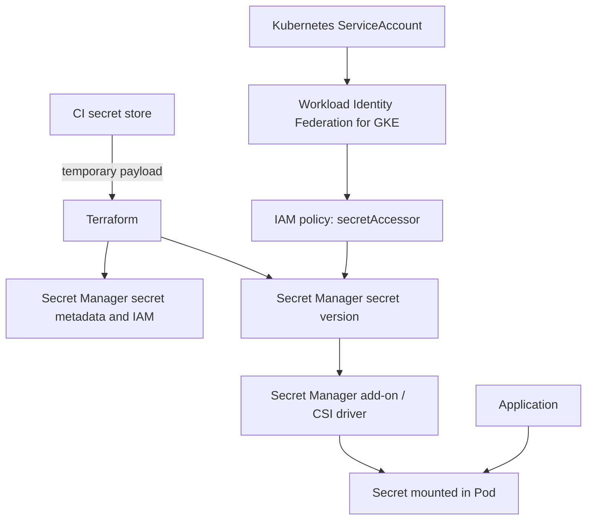

# Managing GKE and Sensitive Data in State

Terraform helps platform teams describe GKE in code, create consistent clusters and node pools, and manage IAM, networking, Workload Identity, and Google Cloud integrations. However, on every `terraform plan` or `terraform apply`, Terraform also maintains a record of status so it knows which resources exist and which configuration owns them. This record is called **state**.

State contains more than cluster names. It can hold resource attributes, values read by providers from APIs, outputs, metadata, and sensitive data used during infrastructure provisioning. Therefore, Terraform design for GKE must solve two problems simultaneously: managing predictable cluster lifecycles and protecting state as a critical data store.

In the `CLOUD_PROVIDERS_GCP` module, this lesson connects Terraform with Google Kubernetes Engine, IAM, Secret Manager, and deployment workflows. You will create separate clusters and node pools, grant identities to nodes and workloads, store state in Google Cloud Storage with locking/versioning, and avoid putting passwords or tokens into state when the provider supports write-only mechanisms.

## 1. Which Resources Does Terraform Use to Manage GKE?

The Google provider supplies the following primary resources:

| Resource | Responsibility | When to Use |
|---|---|---|
| `google_container_cluster` | Creates and manages the GKE control plane, networking, release channel, Workload Identity, security, and add-ons | Declaring a Standard or Autopilot cluster |
| `google_container_node_pool` | Manages independent node groups, machine types, autoscaling, auto-repair, auto-upgrade, and node configuration | Decoupling node pool lifecycle from cluster lifecycle |
| `google_service_account` | Creates IAM service accounts for nodes or services running on Google Cloud | Granting least-privilege identities |
| `google_project_iam_member` | Assigns an IAM role to a principal at the project level | Granting foundational permissions to the node service account or Terraform runner |
| `google_secret_manager_secret` | Manages metadata and configuration of a Secret Manager secret | Creating secret containers, replication, and policies |
| `google_secret_manager_secret_version` | Creates a secret version | Using a write-only argument if Terraform must send a payload without storing the payload in state |

Google Cloud documentation recommends managing node pools with separate `google_container_node_pool` resources. If node pools are declared inline inside `google_container_cluster`, removing a node pool can force cluster recreation. Separating resources makes adding, removing, or upgrading node pools more independent.

### Configuring the Provider and GKE Cluster

The example below illustrates a regional Standard cluster with private nodes, Workload Identity Federation for GKE, the Secret Manager add-on, and a separately managed node pool. Replace network values with your actual VPC and subnet.

```hcl
terraform {
  required_version = ">= 1.11.0"

  required_providers {
    google = {
      source  = "hashicorp/google"
      version = "~> 7.24"
    }
  }

  backend "gcs" {
    bucket = "org-terraform-state"
    prefix = "gke/prod"
  }
}

provider "google" {
  project = var.project_id
  region  = var.region
}

variable "project_id" {
  type = string
}

variable "region" {
  type    = string
  default = "asia-southeast1"
}

variable "network" {
  type = string
}

variable "subnetwork" {
  type = string
}

resource "google_service_account" "gke_nodes" {
  project      = var.project_id
  account_id   = "gke-prod-nodes"
  display_name = "GKE production node service account"
}

resource "google_project_iam_member" "gke_node_role" {
  project = var.project_id
  role    = "roles/container.defaultNodeServiceAccount"
  member  = "serviceAccount:${google_service_account.gke_nodes.email}"
}

resource "google_container_cluster" "primary" {
  name     = "orders-prod"
  location = var.region
  project  = var.project_id

  network    = var.network
  subnetwork = var.subnetwork

  deletion_protection = true
  release_channel {
    channel = "REGULAR"
  }

  workload_identity_config {
    workload_pool = "${var.project_id}.svc.id.goog"
  }

  ip_allocation_policy {}

  private_cluster_config {
    enable_private_nodes    = true
    enable_private_endpoint = true
    master_ipv4_cidr_block  = "172.16.0.0/28"
  }

  secret_manager_config {
    enabled = true
    rotation_config {
      enabled          = true
      rotation_interval = "120s"
    }
  }

  # GKE 1.36.4-gke.1469000+ can create a cluster without a default node pool.
  # For older supported versions, add:
  # remove_default_node_pool = true
  # initial_node_count       = 1
}

resource "google_container_node_pool" "general" {
  name     = "general"
  project  = var.project_id
  location = google_container_cluster.primary.location
  cluster  = google_container_cluster.primary.name

  autoscaling {
    total_min_node_count = 1
    total_max_node_count = 6
  }

  management {
    auto_repair  = true
    auto_upgrade = true
  }

  node_config {
    machine_type    = "e2-standard-4"
    service_account = google_service_account.gke_nodes.email
    oauth_scopes    = ["https://www.googleapis.com/auth/cloud-platform"]

    workload_metadata_config {
      mode = "GKE_METADATA"
    }
  }

  upgrade_settings {
    max_surge       = 1
    max_unavailable = 0
  }

  depends_on = [google_project_iam_member.gke_node_role]
}
```

This is an illustrative configuration for a regional Standard cluster. Starting with GKE version `1.36.4-gke.1469000`, clusters can be created without a default node pool; for older supported versions, `remove_default_node_pool = true` and `initial_node_count` of at least 1 are needed when managing node pools separately. In that legacy compatibility case, `initial_node_count` is the temporary node count of the default pool, not the autoscaling setting of the primary node pool.

`deletion_protection = true` causes Terraform to reject deleting the cluster. When planning to destroy a cluster, change the value to `false`, run `terraform apply` to update state, and only then execute the delete operation. Manage this through reviews and change approvals rather than disabling protection just to push a `destroy` through.

`enable_private_endpoint = true` means the control plane has only a private endpoint. Terraform runners and operators must have a network path to this endpoint when accessing the Kubernetes API. If the runner is outside the VPC, VPN, Interconnect, or an environment running inside an authorized network is required; do not enable a private endpoint without preparing administrative access paths.

### Separating Node Identity and Workload Identity

The node service account in the example receives only `roles/container.defaultNodeServiceAccount`, the minimal role required for GKE system tasks such as logging and monitoring. Do not use the node service account to grant database, bucket, or secret read permissions to every pod.

Workloads in pods should have dedicated Kubernetes ServiceAccounts and use **Workload Identity Federation for GKE** to receive IAM permissions directly. This creates distinct identities per namespace and service account, without storing service account JSON keys in images, Kubernetes Secrets, or Terraform variables.

Workload Identity Federation for GKE is enabled by default in Autopilot. In Standard clusters, it must be enabled on both the cluster and node pools; `workload_identity_config` in Terraform declares the workload pool at the cluster level, while `workload_metadata_config { mode = "GKE_METADATA" }` configures the node pool to use the GKE metadata server.

## 2. What Does State Contain and Why Must It Be Protected?

Terraform state is a JSON record of resources managed by Terraform. State typically contains:

- Resource addresses, IDs, and linkage information between resources.
- Configuration attributes and values returned by the provider after reading resources from Google Cloud APIs.
- Root module outputs and metadata needed for the next plan.
- Variable values or sensitive attributes that Terraform must store to track changes.
- Connection details or certificates returned by the provider if the resource has those attributes.

For `google_container_cluster`, Google provider documentation warns that all arguments and attributes, including certificate outputs, are stored in raw state in plaintext. This means a cluster may contain no application passwords, yet its state still requires protection. Never expose endpoints, CA certificates, or cluster access metadata in public outputs, CI logs, or uncontrolled artifacts.

Sources of sensitive data that often accidentally enter state:

| Source | Example | Risk |
|---|---|---|
| Input variable | Passwords, API tokens, private keys | Can be written into state and plans |
| Resource argument | `secret_data` of a Secret Manager version | Provider may store payload in raw state |
| Data source | Reading secret version contents | Read values can be stored in state |
| Output | Database connections or tokens | Outputs are saved in state even when CLI masks display values |
| Kubernetes resource | `kubernetes_secret` or manifests containing credentials | State may contain Base64-encoded Secret contents |
| GKE resource | Cluster attributes and certificate outputs | State contains cluster configuration and connection details |

Base64 is not encryption. Storing a value in a Kubernetes Secret field or masking it in `terraform plan` does not automatically make its copy in state safe.

State should be classified and protected almost like production credentials. Anyone with read access to state can read sensitive values stored by Terraform, even when Terraform displays `<sensitive>` in the UI.

## 3. How Do `sensitive`, `ephemeral`, and Write-Only Differ?

These are three distinct mechanisms. Choosing the wrong one can leave secrets inside state even when the plan hides them.

| Mechanism | Effect | Stored in State/Plan? | Minimum Terraform Version |
|---|---|---|---|
| `sensitive = true` | Masks value in CLI and supported UIs | Yes | 0.15 |
| `ephemeral = true` | Keeps value only during execution in allowed contexts | No | 1.10 |
| Write-only argument | Sends value to provider during operation without writing to state/plan | No | 1.11 and supported provider/resource |

### `sensitive` Only Masks Display

Example declaring a password variable:

```hcl
variable "database_password" {
  description = "Database connection password"
  type        = string
  sensitive   = true
}
```

Terraform masks the value in `plan` and `apply` output. However, Terraform still saves this value in state and plan files to track resources. Commands like `terraform output -raw`, `terraform output -json`, or reading state directly can reveal the real value. Therefore, `sensitive = true` is not a mechanism to remove secrets from state.

### `ephemeral` Excludes Values from State and Plan

Starting in Terraform 1.10, variables can be declared ephemeral:

```hcl
variable "runtime_token" {
  description = "Temporary token issued by CI during the Terraform run"
  type        = string
  sensitive   = true
  ephemeral   = true
}
```

Ephemeral values can only be used in contexts permitted by Terraform, such as provider configurations, locals, another ephemeral variable, ephemeral resources, child module ephemeral outputs, or write-only arguments. You cannot pass this value into a regular resource attribute and expect Terraform to omit it from state.

Root modules cannot declare ephemeral outputs. Child modules can declare ephemeral outputs to pass temporary values up to a parent module without writing to state.

### Write-Only Arguments

Starting in Terraform 1.11, provider resources can define write-only arguments. The provider receives the value to perform the API operation, but Terraform does not save that value in plans or state. This mechanism works only when the specific provider and resource support it.

Google provider 7.24.0 provides `secret_data_wo` on `google_secret_manager_secret_version`. The traditional `secret_data` field is still marked sensitive to mask it in plans, yet raw state still holds the data. When using write-only arguments, you must increment `secret_data_wo_version` to update the payload because Terraform does not store the old value for automatic comparison.

## 4. Creating a Secret Manager Secret Without Putting the Payload in State

A good pattern is to let Terraform manage metadata, IAM, and secret lifecycle; the secure pipeline supplies the payload via an ephemeral variable; and the Google provider writes the payload using a write-only argument.

```hcl
variable "secret_payload" {
  description = "Payload temporarily supplied by CI when creating or rotating a secret"
  type        = string
  sensitive   = true
  ephemeral   = true
}

variable "secret_rotation_version" {
  description = "Increment this number each time a new payload is published"
  type        = number
  default     = 1
}

resource "google_secret_manager_secret" "orders_db_password" {
  project   = var.project_id
  secret_id = "orders-db-password"

  replication {
    auto {}
  }
}

resource "google_secret_manager_secret_version" "orders_db_password" {
  secret = google_secret_manager_secret.orders_db_password.id

  secret_data_wo         = var.secret_payload
  secret_data_wo_version = var.secret_rotation_version
}
```

In CI, supply `TF_VAR_secret_payload` from the CI system's secret store or a protected temporary delivery channel. Never write the payload into `.tfvars`, HCL files, command-line arguments, shell history, or logs. On each rotation, update the secret payload and increment `secret_rotation_version`; without incrementing the version, Terraform has no previous value to detect that the write-only input changed.

The example above requires Terraform 1.11 or later and a Google provider supporting `secret_data_wo`. With older providers, `secret_data` will be saved in raw state. Check the provider version pinned in `.terraform.lock.hcl` before using this configuration.

If Terraform only needs to create the secret container and IAM, you do not need Terraform to create secret versions at all. An application release system or secret rotation job can write new versions directly to Secret Manager. This reduces how often secret payloads pass through Terraform.

### Avoiding Reading Secrets into Terraform When Only Metadata Is Needed

The `google_secret_manager_secret_version` data source fetches `secret_data` by default. If you only need metadata or the resource name, set `fetch_secret_data = false` or use a metadata-only resource/data source. Whenever Terraform reads secret contents, that value can enter state.

Do not use `terraform_remote_state` as a secret manager. Readers of remote state have access to the full state snapshot, not just a single output. Export only non-sensitive values between modules or pipelines.

## 5. Letting Pods Fetch Secrets Directly from Secret Manager

Once the secret is in Secret Manager, GKE workloads should fetch the secret at runtime using Workload Identity Federation for GKE. There is no need to place passwords in Terraform outputs, Kubernetes manifests, or Terraform-managed Kubernetes Secrets.

Access flow:



The GKE Secret Manager add-on uses the Secrets Store CSI Driver to mount secrets as files inside pods. Standard clusters require enabling Workload Identity Federation for GKE; Autopilot has it enabled by default. The Secret Manager add-on supports GKE Standard and Autopilot on Linux node images. Automatic rotation requires GKE version `1.32.2-gke.1059000` or later; the basic add-on requires GKE `1.27.14-gke.1042001` or later.

### Granting Permissions to the Kubernetes ServiceAccount

Create a dedicated Kubernetes ServiceAccount for the application, for example in namespace `orders`, service account `orders-api`. Then grant `roles/secretmanager.secretAccessor` on that exact secret to the corresponding principal:

```text
principal://iam.googleapis.com/projects/PROJECT_NUMBER/locations/global/workloadIdentityPools/PROJECT_ID.svc.id.goog/subject/ns/orders/sa/orders-api
```

Grant permissions per secret rather than project-wide when the application only needs a few secrets. Never use a shared node service account to read every secret in the cluster.

### Declaring SecretProviderClass

The manifest below contains only the resource name and mount filename; it contains no payload:

```yaml
apiVersion: secrets-store.csi.x-k8s.io/v1
kind: SecretProviderClass
metadata:
  name: orders-db
  namespace: orders
spec:
  provider: gke
  parameters:
    secrets: |
      - resourceName: "projects/PROJECT_ID/secrets/orders-db-password/versions/latest"
        path: "db-password"
```

The Pod uses the `orders-api` Kubernetes ServiceAccount and mounts the CSI volume:

```yaml
apiVersion: apps/v1
kind: Deployment
metadata:
  name: orders-api
  namespace: orders
spec:
  replicas: 2
  selector:
    matchLabels:
      app: orders-api
  template:
    metadata:
      labels:
        app: orders-api
    spec:
      serviceAccountName: orders-api
      containers:
        - name: app
          image: REGION-docker.pkg.dev/PROJECT_ID/apps/orders-api:VERSION
          volumeMounts:
            - name: db-secret
              mountPath: /var/secrets
              readOnly: true
      volumes:
        - name: db-secret
          csi:
            driver: secrets-store-gke.csi.k8s.io
            readOnly: true
            volumeAttributes:
              secretProviderClass: orders-db
```

The application reads `/var/secrets/db-password` when initializing connections. Never write the file contents to logs. If automatic rotation is enabled, the add-on updates the mounted file on the configured interval; the application must be able to reload credentials or reinitialize connection pools when the secret changes.

The GKE Secret Manager add-on does not sync secrets into Kubernetes Secrets via standard CSI sync behavior. This avoids creating an extra copy of the secret in the Kubernetes API. If you intentionally use the `SecretSync` feature to create Kubernetes Secrets, understand that the secret will also exist in the Kubernetes API and must be protected with appropriate access controls, encryption at rest, and backups.

## 6. Storing Terraform State in Google Cloud Storage

By default, Terraform stores state in a `terraform.tfstate` file on the machine running the command. This file is typically plaintext JSON. When multiple engineers or pipelines manage GKE together, local state is easily lost, out of sync, or leaked via Git, artifacts, and backups.

The GCS backend stores state as objects in an existing bucket. The backend supports state locking to prevent multiple processes from writing state simultaneously. HashiCorp recommends enabling Object Versioning on the bucket so state can be recovered after accidental deletion or bad overwrites.

Example backend configuration:

```hcl
terraform {
  backend "gcs" {
    bucket = "org-terraform-state"
    prefix = "gke/prod"
  }
}
```

The bucket must exist before running `terraform init`. The backend is initialized before Terraform builds the resource graph, so you cannot reference `google_storage_bucket` or Terraform variables directly inside the `backend` block. Create the state bucket via a separate bootstrap stack or an organization-managed platform process.

### Configuring the State Bucket

Example creating a dedicated bucket for state:

```hcl
resource "google_storage_bucket" "terraform_state" {
  name                        = var.state_bucket_name
  location                    = var.state_bucket_location
  uniform_bucket_level_access = true
  public_access_prevention    = "enforced"
  force_destroy               = false

  versioning {
    enabled = true
  }
}
```

If the organization requires CMEK, configure a default encryption key on the bucket or use `kms_encryption_key` in the GCS backend. The Cloud KMS key must have a location compatible with the bucket, and the service account running Terraform must have permission to use the key. Never delete a key protecting state; losing the key can make state undecryptable.

Example backend using CMEK:

```hcl
terraform {
  backend "gcs" {
    bucket           = "org-terraform-state"
    prefix           = "gke/prod"
    kms_encryption_key = "projects/SECURITY_PROJECT/locations/asia-southeast1/keyRings/tf-state/cryptoKeys/state-key"
  }
}
```

Object Versioning helps restore old versions, but also retains previous generations. If state ever held a secret, deleting or rotating the secret in the current version does not automatically erase the secret from older generations. Manage lifecycle, retention, and read permissions for object versions; do not turn on versioning and forget the historical store.

### IAM for the State Bucket

Only the Terraform runner and designated operators should read/write state. You can grant `roles/storage.objectAdmin` scoped to the dedicated bucket for the service account running Terraform because the backend needs to read, create, update, and delete state/lock objects. Do not grant this role at the project level if the runner only needs a single bucket.

```hcl
resource "google_storage_bucket_iam_member" "terraform_runner" {
  bucket = google_storage_bucket.terraform_state.name
  role   = "roles/storage.objectAdmin"
  member = "serviceAccount:${var.terraform_runner_service_account}"
}
```

If using CMEK, additionally grant `roles/cloudkms.cryptoKeyEncrypterDecrypter` on that exact key to the backend identity. Permissions to create buckets, modify IAM, or delete keys should belong to a separate platform administration team rather than every application deployment pipeline.

### Separating State by Environment and Permission Scope

Do not share a single state across all clusters or all environments. Separate state by ownership and blast radius, for example:

| State Prefix | Scope | Access Group |
|---|---|---|
| `gke/dev` | Development cluster | Development team |
| `gke/staging` | Staging cluster | Release and QA team |
| `gke/prod` | Production cluster | Platform/SRE team with production permissions |
| `security/iam` | Foundational IAM and policies | Security/platform team |

Terraform workspaces help manage multiple states with one configuration, but do not create security boundaries by themselves. If dev must not read production state, use separate buckets or projects and IAM, or at minimum a clearly scoped backend identity.

## 7. Authenticating Backend and Provider Without Long-Lived Keys

Terraform has two access paths to Google Cloud: the GCS backend to read/write state, and the Google provider to create resources. Both require authentication, and backend configuration is initialized before the provider. Ensure both use managed identities with distinct task-appropriate permissions.

On workstations, use Application Default Credentials. In CI running on Google Cloud, prefer a service account attached to the runner. For CI outside Google Cloud, use Workload Identity Federation to exchange the CI identity for short-lived tokens. You can configure impersonation for a dedicated Terraform service account; the source identity needs `roles/iam.serviceAccountTokenCreator` on the impersonated service account.

Never store service account JSON key files in repositories, Docker images, Terraform variables, `.tfvars` files, or GCS backend blocks. Avoid passing credentials directly via command-line arguments because they can appear in process lists or logs. Use ADC, federation, or short-lived tokens from CI.

## 8. Protecting Plans, Outputs, and CI/CD Workflows

A remote backend does not make every Terraform artifact automatically safe. Plan files, logs, and debug files can contain sensitive data.

| Artifact | Risk | Handling Rule |
|---|---|---|
| `terraform.tfstate` | May contain secrets and provider attributes | Never commit; access only via controlled backend |
| `terraform.tfstate.backup` | May retain old secrets | Protect like active state; securely delete per policy |
| Binary plan (`tfplan`) | Contains plan data and sensitive values | Store in a private artifact store, limit downloaders and retention |
| `terraform show -json` | May decode sensitive values into plaintext | Use only in trusted pipelines; never expose logs publicly |
| `terraform output -raw` / `-json` | May print sensitive output values | Never run in public logs or CI jobs not needing secrets |
| `TF_LOG=TRACE` and shell tracing | May log requests, variables, or debug data | Enable only under control; disable `set -x` when handling secrets |
| `.terraform/` and crash logs | Contain backend/provider metadata and diagnostic data | Never commit; restrict artifacts and clean up per policy |

A production pipeline should include these steps:

1. Obtain a short-lived CI identity and verify the target project/environment.
2. `terraform init` with the configured GCS backend.
3. `terraform fmt -check` and `terraform validate`.
4. Run `terraform plan -out=tfplan` on a trusted runner.
5. Store the plan artifact in a private store, tied to a specific commit and environment.
6. Review changes to IAM, GKE, node pools, networks, secrets, and state before applying.
7. Only an approved pipeline runs `terraform apply tfplan`.
8. Verify GKE rollout, Workload Identity, secret mounts, and workload health.
9. Delete sensitive artifacts per defined retention while keeping the required audit trail.

Do not print secret outputs into logs for debugging convenience. If you need to pass a value between jobs, use the CI secret store or Secret Manager with least-privilege read access, not Terraform outputs as a credential distribution channel.

## 9. Initializing the Backend and Migrating State Safely

When moving from local state to the GCS backend, follow this sequence:

1. Create the bucket and configure versioning, public access prevention, IAM, and CMEK if needed.
2. Verify the Terraform runner identity has object read/write permissions and KMS key permissions.
3. Add the `gcs` backend configuration with the environment-specific bucket and prefix.
4. Run `terraform init -migrate-state` so Terraform migrates existing state to the new backend.
5. Verify `terraform plan` does not propose unexpectedly recreating or deleting large numbers of resources.
6. Protect and clean up the local state copy per your organization's sensitive data handling policy.

Do not delete the local file before verifying the remote state exists and the next plan shows no abnormal changes. Do not copy state manually when the backend can perform the migration. Never edit state JSON directly; use `terraform state` commands or controlled import/move workflows.

The GCS backend supports state locking. Terraform automatically locks state before write-capable operations. If a lock cannot be acquired, the operation stops. Never use `-lock=false` to bypass locks. Only run `terraform force-unlock` after verifying the lock belongs to your own operation and that operation is no longer running.

## 10. Responding When State Has Exposed a Secret

If a secret has already entered state, merely switching to `sensitive = true` or `secret_data_wo` does not erase old copies. Treat the secret as compromised and execute an incident response workflow:

1. Identify which secret appeared, which resource/data source created it, and which state/plan artifacts are affected.
2. Rotate or revoke the secret at the source system; update workloads to the new secret version.
3. Inspect IAM and audit logs to determine who read the state bucket, plan artifacts, or CI logs.
4. Restrict access to state and artifacts; revoke access paths no longer needed.
5. Remove the secret from current configuration/outputs and adopt ephemeral/write-only or runtime secret access.
6. Use reviewed state surgery or state replacement procedures if needed; never edit state JSON directly in a text editor.
7. Check object generations, backups, artifact retention, caches, and local state. Delete or expire copies per organizational policy.
8. Document the incident and confirm the old secret is no longer used by any workload.

Deleting the current object generation does not mean all copies are gone. GCS Object Versioning, soft delete, CI backups, and local copies may retain older state. Old secrets should be invalidated before cleaning up copies to minimize risk if any copy remains.

## 11. Common Mistakes

| Mistake | Why It Is Dangerous | Proper Practice |
|---|---|---|
| Thinking `sensitive = true` removes secrets from state | It only masks display; raw state still contains the value | Use ephemeral and write-only where supported by the provider; protect state |
| Putting service account JSON keys in Terraform | Long-lived credentials can appear in config, plans, and state | Use ADC, Workload Identity Federation, or impersonation |
| Reading secret versions with the default data source | `secret_data` can be stored in state | Do not read payload if unnecessary; use `fetch_secret_data = false` for metadata |
| Using `secret_data` instead of `secret_data_wo` | Sensitive value remains in raw state | Use a provider supporting write-only and Terraform 1.11+ |
| Creating Kubernetes Secrets with Terraform for pods | Secret becomes duplicated in both state and Kubernetes API | Mount Secret Manager secrets via GKE Secret Manager add-on/CSI |
| Using one state bucket for every team | Anyone with read access to one state can see data from multiple environments | Separate buckets/prefixes and IAM by environment, team, and ownership |
| Committing plan files or state backups | Artifacts may contain secrets | Block with `.gitignore`, secret scanning, and CI policies |
| Disabling state locking when stuck | Two writers can overwrite or corrupt state | Verify lock owner, then `force-unlock` the exact lock ID when needed |
| Deleting old state generations while forgetting versioning | Old secrets remain in prior object generations | Review lifecycle and retention of state versions |
| Managing node pools inline inside the cluster | Difficult to change pool lifecycle independently | Use separate `google_container_node_pool` resources |
| Using Workload Identity but granting IAM to the node SA | Pods still use a broader node identity than needed | Grant IAM to the specific Kubernetes ServiceAccount principal |

## 12. Hands-On Exercise

Perform this exercise in a sandbox project and a test GKE cluster:

1. Create a `google_container_cluster` and a separate `google_container_node_pool`; enable Workload Identity Federation for GKE.
2. Create a custom node service account and grant `roles/container.defaultNodeServiceAccount`.
3. Create a GCS state bucket with uniform bucket-level access, public access prevention, and Object Versioning.
4. Configure the GCS backend, run `terraform init`, and verify state is stored under the right prefix.
5. Create a Secret Manager secret and version using `secret_data_wo`, an ephemeral variable, and a version counter.
6. Create a Kubernetes ServiceAccount for the workload and grant read permission to that exact secret via Workload Identity Federation.
7. Create a `SecretProviderClass`, mount the secret into a pod using the GKE Secret Manager add-on, and verify the app can read the file.
8. Run `terraform plan`, inspect outputs and state; confirm the payload does not appear in raw state.
9. Increment `secret_rotation_version`, provide a new payload, and verify the workload receives the new secret version.
10. Test creating a secret with `secret_data` in the sandbox to compare state behavior; delete/rotate test data after finishing.

Never use production credentials or customer data in the exercise. Never push raw state, plan files, or secret payloads to Git or public artifacts.

## 13. Pre-Deployment Checklist for GKE with Terraform

- [ ] Terraform and Google provider versions are pinned; `.terraform.lock.hcl` is committed.
- [ ] Cluster and node pools are managed by separate resources.
- [ ] `deletion_protection` is enabled for critical clusters.
- [ ] Dedicated node service account has only required foundational roles.
- [ ] Workload Identity Federation for GKE is enabled and workloads use dedicated Kubernetes ServiceAccounts.
- [ ] Pods access secrets via Secret Manager with IAM permissions scoped per secret.
- [ ] Payloads are not placed in `secret_data`, Kubernetes Secret resources, or Terraform outputs unnecessarily.
- [ ] GCS backend uses a dedicated bucket, Object Versioning, locking, and public access prevention.
- [ ] State bucket IAM is granted only to the Terraform runner and required operators.
- [ ] CMEK keys have protection and lifecycle procedures; key versions needed to decrypt state are not deleted and usage permissions are granted to the right identities.
- [ ] State, plans, backups, CI logs, and `.terraform/` are protected from Git and public artifacts.
- [ ] Environment states have access boundaries; workspaces are not treated as security boundaries.
- [ ] Procedures for migration, `force-unlock`, state restore, and secret-exposure response are documented.
- [ ] `terraform plan` is reviewed before applying to production.

## 14. Conclusion

Terraform helps manage GKE consistently when clusters, node pools, IAM, and add-ons are described with the right resources. However, state and plan files are data snapshots that can contain sensitive details, including GKE certificate outputs or secrets marked `sensitive` by providers. Store state in a GCS backend with locking, versioning, encryption, and restricted IAM; use ephemeral values and write-only arguments to keep payloads out of state; and have GKE workloads fetch secrets directly from Secret Manager via Workload Identity Federation. Combining these safeguards with controlled CI/CD and rotation workflows lets platform teams automate infrastructure while significantly reducing credential exposure risk.

## References

- [Provision GKE resources with Terraform — Google Cloud](https://docs.cloud.google.com/kubernetes-engine/docs/terraform)
- [google_container_cluster — Google provider](https://registry.terraform.io/providers/hashicorp/google/latest/docs/resources/container_cluster)
- [google_container_node_pool — Google provider](https://registry.terraform.io/providers/hashicorp/google/latest/docs/resources/container_node_pool)
- [google_secret_manager_secret_version — Google provider](https://registry.terraform.io/providers/hashicorp/google/latest/docs/resources/secret_manager_secret_version)
- [Write-only arguments in the Google Cloud provider](https://registry.terraform.io/providers/hashicorp/google/latest/docs/guides/using_write_only_arguments)
- [Manage sensitive data in your configuration — Terraform](https://developer.hashicorp.com/terraform/language/manage-sensitive-data)
- [Ephemeral values in resources — Terraform](https://developer.hashicorp.com/terraform/language/manage-sensitive-data/ephemeral)
- [Use temporary write-only arguments — Terraform](https://developer.hashicorp.com/terraform/language/manage-sensitive-data/write-only)
- [GCS backend — Terraform](https://developer.hashicorp.com/terraform/language/backend/gcs)
- [State locking — Terraform](https://developer.hashicorp.com/terraform/language/state/locking)
- [Authenticate to Google Cloud APIs from GKE workloads](https://docs.cloud.google.com/kubernetes-engine/docs/how-to/workload-identity)
- [Use Secret Manager add-on with GKE](https://docs.cloud.google.com/secret-manager/docs/secret-manager-managed-csi-component)
- [Best practices for hardening GKE cluster security](https://docs.cloud.google.com/kubernetes-engine/docs/how-to/hardening-your-cluster)
