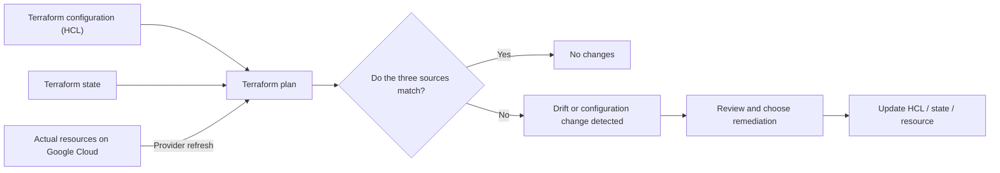
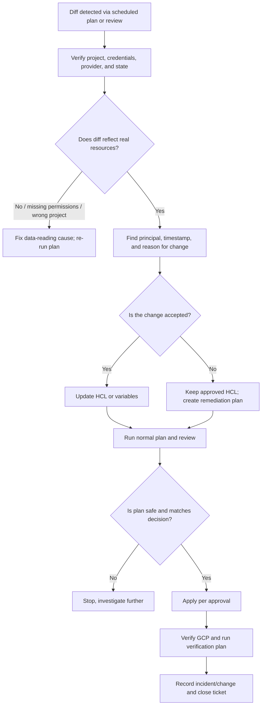

# Detecting Drift and Handling Out-of-Band Changes

Terraform manages infrastructure by comparing three sources of information: the configuration declared in code, the state storing the mapping between code and real resources, and the status of resources running on Google Cloud. When someone modifies a VM in the Console, changes IAM with a `gcloud` command, or a service automatically updates an attribute managed by Terraform, the three sources can fall out of sync. This discrepancy is called **configuration drift** or **resource drift**.

Drift does more than make deployment plans unpredictable. An out-of-process change can unintentionally open a firewall, grant overly broad permissions, alter server configuration, increase costs, or cause the next `terraform apply` to revert a hotfix protecting production. Therefore, operations teams must detect drift, verify its root cause, and explicitly decide which changes to keep and which to revert.

This lesson belongs to the **Infrastructure as Code with Terraform** chapter of the **CLOUD_PROVIDERS_GCP** module. It focuses on detecting and handling drift in Google Cloud, including Compute Engine, VPC, IAM, Cloud Storage, and Terraform-managed workloads.

## 1. Learning Objectives

After this lesson, you can:

- Distinguish between Terraform configuration, state, and actual resource status.
- Explain types of drift and common causes on Google Cloud.
- Use `terraform plan` and `terraform plan -refresh-only` to detect changes made outside Terraform.
- Choose how to proceed when accepting changes, reverting configurations, or transferring resource ownership.
- Update HCL, variables, and state following proper procedures.
- Avoid risks when handling IAM, deleted resources, state backends, and concurrent applies.
- Automate drift detection in CI/CD or HCP Terraform.

## 2. Three Sources of Truth Terraform Must Keep in Sync

Terraform works with three components:

| Component | Contents | Example |
|---|---|---|
| Configuration | HCL describing the desired state. | VM must use `e2-standard-4`, with tag `managed-by=terraform`. |
| State | Terraform's record of managed resources, including resource addresses, provider IDs, and read attributes. | `google_compute_instance.app.id` points to the instance ID on GCP. |
| Real infrastructure | Actual status returned by Google Cloud APIs. | VM is currently using `e2-standard-8` because an operator changed it in the Console. |

The flow can be visualized as follows:



State is not a complete copy of every attribute in Google Cloud. Providers read attributes supported by their schema and may normalize or omit certain fields. Therefore, plan output depends on provider version, API read permissions, provider configuration, and resource type.

### 2.1. Drift Differs from Intentional Configuration Changes

Not every change in a plan is drift.

- **Configuration change:** the team edits HCL or variables; Terraform sees the desired configuration differs from state.
- **Resource drift:** the real resource changed outside Terraform while HCL and state have not yet been updated to match.
- **State change:** state was altered or lost mappings, such as state restored from an older backup, renamed resource addresses, or improper state operations.
- **Provider/schema change:** a newer provider version reads or represents attributes differently from the prior version; this can produce a diff even though users did not modify the resource.

In a single plan, Terraform can detect multiple types of changes at once. Read the `Note: Objects have changed outside of Terraform` section and proposed actions to identify where each change originated.

### 2.2. Drift Example on GCP

A Terraform-managed VM has the configuration:

```hcl
resource "google_compute_instance" "app" {
  name         = "checkout-app"
  machine_type = "e2-standard-4"
  zone         = "asia-southeast1-b"

  tags = ["app", "managed-by-terraform"]

  boot_disk {
    initialize_params {
      image = "debian-cloud/debian-12"
    }
  }

  network_interface {
    network = google_compute_network.app.id
  }
}
```

An engineer changes the machine type to `e2-standard-8` in the Google Cloud Console to handle a traffic spike. The Terraform configuration still declares `e2-standard-4` and state records the previous value, while the actual VM is running `e2-standard-8`.

When running a normal plan, Terraform refreshes state from the provider and compares against HCL. If the attribute is managed by the provider and updatable in place, the plan may propose changing the VM back to `e2-standard-4`. For attributes that force resource replacement, the plan may propose destroy/create. Always inspect `~`, `-/+`, or `-` symbols in the plan before applying.

## 3. Causes of Drift in Google Cloud Environments

Drift typically arises from one of the following groups.

### 3.1. Manual Changes

Operators may modify resources via the Google Cloud Console or CLI:

- Changing VM machine type, disk, metadata, network tags, or status.
- Adding or deleting firewall rules, routes, subnets, or network attachments.
- Modifying IAM policies on projects, folders, service accounts, or resources.
- Adjusting Cloud Run, GKE, Cloud SQL, or bucket settings.
- Deleting resources during incident response or environment cleanup.

Manual changes are sometimes necessary to mitigate incident impact. Afterward, record the decision, operator, timestamp, reason, and plan to resynchronize Terraform.

### 3.2. Changes from Automation or Other Services

Some changes may come from another pipeline, controller, Google Cloud product, or governance tool:

- Another deployment pipeline modifying the same resource.
- A GKE controller or autoscaler changing node or replica counts per operational settings.
- A Google Cloud service updating system-managed fields.
- Another Terraform module managing the same IAM role or resource.
- Organization policies or security automation adjusting permissions.

Distinguish which fields represent dynamic service-controlled state versus Terraform-managed desired configuration. Do not force Terraform to manage the exact same attribute continuously adjusted by another controller.

### 3.3. Discrepancies from Provider, API, or Access Permissions

A plan may report resources disappearing or changing unexpectedly when:

- The provider uses the wrong project, zone, region, or impersonated service account.
- APIs return incomplete data because the identity lacks read permissions.
- The provider is upgraded and schemas or normalization logic change.
- A resource was moved across projects or renamed while state still holds the old ID.
- An API was disabled or a service temporarily failed to respond.

In particular, if many resources suddenly appear as deleted, check credentials, project, provider aliases, region, and APIs before applying any plan that updates state or recreates resources.

## 4. Detecting Drift with the Terraform CLI

### 4.1. Prepare the Workspace and Confirm the Right Project

Before reading or creating a plan:

1. Navigate to the exact root module directory.
2. Confirm the workspace and backend.
3. Verify the pinned Terraform and Google provider versions.
4. Authenticate with the right environment identity.
5. Confirm project, region, zone, and provider aliases.

Example:

```bash
terraform version
terraform workspace show
terraform providers
gcloud config get-value project
gcloud auth list
```

If the pipeline uses service account impersonation or Workload Identity Federation, verify the principal Terraform actually uses. Do not rely on a personal machine's default project if the root module configures its own project.

### 4.2. Run a Normal Plan

```bash
terraform plan
```

In normal planning mode, Terraform refreshes managed resources by default to read current status from the provider before deciding which changes to make. Refresh during planning updates an in-memory representation; state in the backend is only written when an apply operation completes.

If drift exists, output may state:

```text
Note: Objects have changed outside of Terraform

Terraform detected the following changes made outside of Terraform since the last "terraform apply":
  # google_compute_instance.app has changed
  ~ resource "google_compute_instance" "app" {
      ~ machine_type = "e2-standard-4" -> "e2-standard-8"
    }
```

This is an illustrative example. Actual output depends on resource schema and provider version.

A normal plan can both report changes made outside Terraform and propose actions to return resources to the HCL configuration. If the out-of-band change is unacceptable, those actions may be needed to restore desired state. If the change is an approved hotfix, do not apply that plan before updating the configuration per team decision.

### 4.3. Use refresh-only to Inspect State Changes Separately

`-refresh-only` creates a plan aimed at updating state and root module outputs to match the actual status read by the provider. It does not propose changing real resources to match HCL.

```bash
terraform plan -refresh-only
```

The output shows which attributes Terraform detected were changed out-of-band. This is a useful way to review drift before deciding whether to record the new status into state.

If you have verified the change is valid and want state to reflect current status:

```bash
terraform apply -refresh-only
```

Terraform displays the plan and prompts for confirmation. When approved, this operation updates state and outputs; it does not modify real resources on Google Cloud.

**Note:** `refresh-only` only synchronizes state with reality. It does not update HCL automatically. If HCL still declares the old value, a subsequent normal plan may propose reverting the real resource back to the old value. When accepting a hotfix, update the corresponding configuration and variables before considering the work done.

### 4.4. Save Plans for Review and Apply Exact Approved Content

In CI/CD or production changes, create a plan file:

```bash
terraform plan -out=tfplan
terraform show -no-color tfplan
```

After reviewers approve, apply the exact saved plan:

```bash
terraform apply tfplan
```

Do not generate a new plan after review and apply uninspected changes. Plan files may contain sensitive data from state or providers; restrict access, retention duration, and artifact storage locations.

### 4.5. Reading Exit Codes in Automation

With `-detailed-exitcode`, Terraform returns exit codes:

| Exit code | Meaning |
|---:|---|
| 0 | Plan succeeded with no changes. |
| 1 | Error generating plan. |
| 2 | Plan succeeded and changes need review. |

Example:

```bash
terraform plan -detailed-exitcode
plan_status=$?

if [ "$plan_status" -eq 0 ]; then
  echo "No changes"
elif [ "$plan_status" -eq 2 ]; then
  echo "Changes detected: review plan"
else
  echo "Terraform plan failed"
  exit "$plan_status"
fi
```

Pipelines must distinguish exit code 2 from errors. Treating every non-zero code as an error prevents the system from distinguishing drift from provider failures. Conversely, never auto-apply merely because `plan` returned 2.

## 5. Verifying Drift with Google Cloud Tools

`terraform plan` is a primary detection source, but for high-risk diffs, inspect resources directly with read-only commands or Cloud Console.

Example checking a VM:

```bash
gcloud compute instances describe checkout-app \
  --zone=asia-southeast1-b \
  --project=PROJECT_ID
```

Check a firewall rule:

```bash
gcloud compute firewall-rules describe allow-checkout \
  --project=PROJECT_ID
```

Check a project's IAM policy:

```bash
gcloud projects get-iam-policy PROJECT_ID \
  --format=json
```

Check a Cloud Run configuration:

```bash
gcloud run services describe checkout-api \
  --region=asia-southeast1 \
  --project=PROJECT_ID
```

Replace placeholders with real project, resource name, and location values. These commands only read information. Compare diff attributes against the real resource, change timestamp, and acting identity.

Cloud Audit Logs can help identify who changed a resource and which API was called. Depending on the service, Data Access logs must be enabled and readable when tracing data reads or Data Access APIs. Admin Activity logs record corresponding administrative activity. Not every change produces the same log category; identify the service, method, and audit log type before investigating.

An investigation should record:

- Terraform resource address and GCP resource ID.
- Attributes before and after the change.
- Detection time and estimated change time.
- Principal or pipeline that performed the change.
- Reason for the change: incident, manual operation, automation, or provider behavior.
- Impact on security, reliability, cost, and dependencies.

## 6. Choosing Remediation: Keep, Revert, or Transfer Ownership

After verifying drift, select one of the following paths. Decisions require the resource owner and appropriate reviewers, especially for IAM, networking, data, and production.

### 6.1. Keep Changes Made Outside Terraform

Use when the change is approved, such as a verified hotfix or a product team deciding to scale up VM capacity.

Procedure:

1. Verify the real change and its rationale.
2. Update HCL or input variables to represent the new desired state.
3. Check shared modules, environment overlays, and related docs in the same repository.
4. Run a normal plan to confirm Terraform does not propose reverting the change.
5. Review any remaining changes and apply per standard procedure.

Example updating machine type:

```hcl
resource "google_compute_instance" "app" {
  name         = "checkout-app"
  machine_type = "e2-standard-8"
  zone         = "asia-southeast1-b"

  # Keep other attributes per reviewed configuration.
}
```

If the value comes from a variable, update the appropriate variable source instead of hardcoding it in the resource:

```hcl
variable "checkout_machine_type" {
  type        = string
  description = "Machine type for the checkout workload."
  default     = "e2-standard-8"
}

resource "google_compute_instance" "app" {
  name         = "checkout-app"
  machine_type = var.checkout_machine_type
  zone         = "asia-southeast1-b"
}
```

Once configuration matches reality, verify with a normal plan that no unexpected diffs remain. Some attributes require replacing or stopping a VM when changed; inspect the plan and provider resource docs before applying.

### 6.2. Revert Unintended Changes

Use when the change was unauthorized, unapproved, or degrades security/reliability.

For example, a firewall rule was widened from an internal range to `0.0.0.0/0`:

- Assess impact and confirm the rule belongs to Terraform state.
- Ensure HCL still describes the approved ingress.
- Generate a normal plan and inspect exactly which rule will be modified or replaced.
- Verify no other resources are deleted or granted broader permissions out of scope.
- Apply the approved plan.
- Re-verify the actual firewall rule and retain evidence of remediation.

Do not automatically run `apply` as soon as drift is detected. If the out-of-band change is an active emergency mitigation reducing incident impact, reverting too early can worsen the outage.

### 6.3. Transfer Ownership to Another System

Some resources or attributes may need to be handed off to another controller, module, or owning team. Before removing Terraform management:

- Identify the new responsible system and authoritative configuration source.
- Ensure the new system already observes and properly manages the resource.
- Identify who owns updates, security, backups, and lifecycle.
- Use appropriate state operations to remove the mapping if the resource must remain running.
- Remove or adjust the corresponding Terraform configuration in the same reviewed change.

`terraform state rm` removes a resource from state without deleting the real resource. However, if the resource block remains in HCL, the next plan will propose creating a new resource because Terraform no longer has a mapping. Use it only when genuinely transferring ownership or splitting resources by plan.

## 7. Synchronizing State and HCL Properly

### 7.1. When a Change Is Accepted

Suppose an engineer added label `incident_approved=true` to a VM during an incident and the owner wants to keep that label long-term.

If tags belong to a `labels` attribute managed by Terraform, update HCL:

```hcl
resource "google_compute_instance" "app" {
  name         = "checkout-app"
  machine_type = "e2-standard-4"
  zone         = "asia-southeast1-b"

  labels = {
    environment = "production"
    managed_by  = "terraform"
    incident_approved = "true"
  }

  # Remaining blocks.
}
```

Then:

```bash
terraform plan
```

If the plan still proposes removing the tag, check variables, locals, module inputs, provider normalization, and resource address. Do not apply until you understand why HCL does not produce the expected result.

### 7.2. When Drift Must Be Recorded in State First

In some situations, the team wants to update state to record provider-read values before editing HCL. Run:

```bash
terraform plan -refresh-only
terraform apply -refresh-only
```

Then update HCL/variables to express the accepted state and run a normal plan. If `refresh-only` reports many resources deleted or values disappearing unexpectedly, stop and check permissions, project, and provider configuration. Never accept a state plan just to clean up output.

### 7.3. Resources Created Outside Terraform

If a valid resource is discovered that is not yet managed by Terraform, decide whether to adopt it into IaC or let another system manage it.

With Terraform versions supporting `import` blocks (v1.5 and later), you can declare:

```hcl
import {
  to = google_compute_instance.legacy
  id = "projects/PROJECT_ID/zones/asia-southeast1-b/instances/legacy-vm"
}

resource "google_compute_instance" "legacy" {
  name         = "legacy-vm"
  zone         = "asia-southeast1-b"
  machine_type = "e2-standard-4"

  # Declare complete configuration to manage.
}
```

Generate a plan and review the import details. Do not assume import automatically generates complete HCL or that every attribute will immediately be managed cleanly. After importing, continue adjusting the configuration until a normal plan proposes no unexpected changes.

The traditional `terraform import` command can also be used depending on version and workflow:

```bash
terraform import \
  google_compute_instance.legacy \
  projects/PROJECT_ID/zones/asia-southeast1-b/instances/legacy-vm
```

Importing adds the mapping to state; it does not create resources and does not synchronize HCL automatically. Ensure a resource address is imported into only one state/workspace, avoiding two root modules managing the same resource.

### 7.4. Resources Deleted Outside Terraform

If the provider confirms a resource was actually deleted, a normal plan may propose recreating the resource to satisfy HCL. Before applying, verify:

- Whether the resource was deleted intentionally.
- Whether persistent data, disks, IPs, DNS, IAM, or dependencies need recovery.
- Whether the resource name can be reused.
- Whether recreation causes data loss or downtime.
- Whether recovery from backup or migrating to a new resource is required.

If the resource appears missing because the provider used the wrong project or lacked permissions, do not apply. Fix authentication configuration and re-run the plan. Running `apply -refresh-only` in this case could remove the mapping from state and alter subsequent plans.

## 8. Handling Specific Scenarios on Google Cloud

### 8.1. IAM Drift and Authoritative Resources

The Google Cloud provider has IAM resources with different management semantics:

| Resource pattern | Management Scope | Impact of Out-of-Band Changes |
|---|---|---|
| `google_project_iam_policy` | Entire IAM policy of the project, authoritative. | Policy apply can replace the entire policy with HCL configuration. |
| `google_project_iam_binding` | Entire member list of a specific role, authoritative for that role. | Members added outside Terraform can be removed from the role on apply. |
| `google_project_iam_member` | Single member/role association, additive. | Terraform manages the declared membership without treating the whole role as exclusive. |

Example `google_project_iam_binding`:

```hcl
resource "google_project_iam_binding" "viewer" {
  project = var.project_id
  role    = "roles/viewer"

  members = [
    "user:platform-admin@example.com",
    "serviceAccount:reporting@PROJECT_ID.iam.gserviceaccount.com",
  ]
}
```

A binding is authoritative for members of `roles/viewer`. If another team adds a member outside Terraform, applying can delete that membership. This can disrupt a workload or operational access.

If you want to manage individual memberships additively, use `google_project_iam_member`:

```hcl
resource "google_project_iam_member" "reporting_viewer" {
  project = var.project_id
  role    = "roles/viewer"
  member  = "serviceAccount:reporting@PROJECT_ID.iam.gserviceaccount.com"
}
```

Never manage the same role with overlapping `binding` and `member` resources, as they can conflict or continuously overwrite each other's policy changes. Choose one clear management model per role. For broad project permissions, carefully review every member being added or removed and verify principals before applying.

### 8.2. Firewalls, Routes, and VPC

Network drift carries high risk because a small change affects many workloads:

- Adding an ingress rule widening source ranges.
- Deleting a rule allowing health checks or inter-service traffic.
- Changing routes or next hops.
- Attaching a new network tag to a VM, causing different firewall rules to apply.
- Changing subnet secondary ranges or Private Google Access settings.

Review both modified resources and dependent workloads. For firewalls, check direction, priority, target tags/service accounts, source ranges, protocol, and ports. Do not compare rule names alone.

### 8.3. Compute Engine and Disks

Changes to machine type, boot disks, attached disks, network interfaces, or metadata can have different impacts. Some attributes update in place; others require stopping the VM or replacing the resource. Disks holding data must be checked for backups and deletion protection before applying.

For example, if a plan shows `-/+` on `google_compute_instance`, understand Terraform may replace the instance. Check `boot_disk`, `attached_disk`, auto-delete, IPs, and startup metadata to avoid data loss or unexpected endpoint changes.

### 8.4. Cloud Storage and State Buckets

If application buckets are managed with Terraform, drift can appear in versioning, lifecycle, uniform bucket-level access, retention policies, encryption, or IAM. Attributes affecting data and compliance must be reviewed with the data owner.

The state backend on Cloud Storage is especially critical infrastructure. Protect the bucket, restrict access, and enable object versioning so previous state versions can be restored if needed. Google Cloud recommends the Cloud Storage backend for teams because it supports locking and separates state from source control.

Never share the same state bucket/prefix across unrelated workspaces if backend design does not isolate them. Only build systems and authorized admin groups should have permission to manage the state bucket.

## 9. State Commands and Safe Usage

Terraform provides commands to inspect or modify mappings in state:

| Command | Purpose | Notes |
|---|---|---|
| `terraform state list` | Lists resource addresses in state. | Read-only. |
| `terraform state show ADDRESS` | Inspects state attributes of a resource. | May display sensitive data. |
| `terraform state pull` | Pulls current state from backend to stdout. | State may contain secrets; protect output and backup files. |
| `terraform state mv` | Moves resource addresses in state. | Use when refactoring addresses, not to fix attribute drift. |
| `terraform state rm` | Removes mapping from state, keeping the real resource. | Resource may be recreated if still declared in HCL. |
| `terraform import` | Attaches a real resource to a state address. | Requires matching HCL and plan review. |

Google Cloud recommends never editing state files manually. When state changes are needed, use appropriate `terraform state` commands with backups, locking, and a review process.

Never use `state rm` to "erase drift" or make a plan look clean. Likewise, never use `state mv` to hide a change made outside Terraform. These commands alter how Terraform maps resources and do not replace verifying actual infrastructure state.

## 10. Options Commonly Misunderstood

### 10.1. Avoid Using `-refresh=false` for Drift Checks

```bash
terraform plan -refresh=false
```

This option skips the default refresh step. Terraform may miss changes made outside Terraform and produce an incomplete or inaccurate plan. It can be useful in special cases to reduce API calls, but is unsuitable for drift detection or before applying production changes.

### 10.2. Do Not Use `terraform refresh` as a Default Workflow

The `terraform refresh` command is deprecated. It is equivalent to an auto-approved `refresh-only` apply, risking state updates without reviewing changes first. Use `terraform plan -refresh-only` to preview and `terraform apply -refresh-only` after confirmation.

### 10.3. Do Not Overuse `-target`

`-target` restricts which part of the graph Terraform processes. It can help in special recovery scenarios, but is not a default way to handle drift. Targeting one resource can skip related changes or dependencies you need to see in a full plan.

### 10.4. Be Careful with `ignore_changes`

`lifecycle.ignore_changes` tells Terraform to ignore changes to one or more attributes in future plans. It is a tool for defining ownership boundaries when another system is authorized to manage that attribute, not a mute button for drift alerts.

Example:

```hcl
resource "google_compute_instance" "app" {
  name         = "checkout-app"
  machine_type = "e2-standard-4"
  zone         = "asia-southeast1-b"

  lifecycle {
    ignore_changes = [
      labels["autoscaler-managed"],
    ]
  }
}
```

Use it only when the provider/resource supports the attribute expression and the team has agreed on ownership. Never ignore whole blocks or critical attributes like IAM, firewalls, or disk encryption just to reduce diffs. Every ignore rule needs a rationale, owner, and review schedule.

## 11. Automating Drift Detection

### 11.1. Scheduling Plans Without Applying

A periodic pipeline can run:

1. Check out the approved commit.
2. Install the exact Terraform version and provider lock file.
3. Authenticate the runtime identity.
4. Initialize the backend and load state.
5. Run `plan` with default refresh.
6. Save output and report diffs.
7. Create a ticket or notify the owner when changes are detected.
8. Never apply without review and approval.

Example job commands:

```bash
terraform init -input=false
terraform plan -input=false -no-color -detailed-exitcode
```

In Cloud Build or another CI system, configure a dedicated service account with read permissions on resources to refresh and required backend permissions. A drift-detection-only job should not hold broader permissions than needed to read state and resources. If the job creates a plan artifact, control artifact storage because plans can contain sensitive details.

### 11.2. Schedule Cadence and Alert Handling

Choose frequency based on environment criticality and rate of change:

- Production networks, IAM, and security policies: check more frequently.
- Stable application workloads: check on a deployment schedule or daily.
- Short-lived test environments: check before each apply or at end of lifecycle.

Frequency does not replace review. When drift occurs, the ticket should record resource address, changed attributes, project, owner, detection timestamp, and a secure plan artifact. Avoid posting full state or secrets in chat channels.

### 11.3. HCP Terraform Health Assessments

If an organization uses HCP Terraform with health assessments/drift detection available for its edition and workspaces, periodic checks can be enabled. HCP Terraform runs non-applying refresh-only plans to compare configuration, state, and real resources. This helps detect out-of-workflow changes and surface drift status in the workspace.

Automated drift assessments do not resolve changes automatically. Owners must still review, update HCL, or restore resources per procedure. Check current feature availability, edition, and organizational workspace policies before designing workflows around this feature.

## 12. End-to-End Drift Handling Workflow

A consistent workflow prevents accidental applies:



Step-by-step details:

1. **Detect:** use normal plan or refresh-only plan to spot diffs.
2. **Verify readability:** check project, region, credentials, provider version, API permissions, and backend.
3. **Cross-check real resources:** use Console, `gcloud`, or read-only APIs to confirm.
4. **Investigate:** identify who or which pipeline made the change, timestamp, reason, and blast radius.
5. **Decide:** keep the change, revert it, or transfer ownership.
6. **Fix source of truth:** update HCL/variables or prepare a reviewed state operation.
7. **Review plan:** inspect resource add/change/destroy, ForceNew, IAM memberships, firewalls, and data impact.
8. **Apply:** use the exact approved plan and backend locking.
9. **Verify:** re-read real resources, run a fresh plan, and confirm no unexpected diffs remain.
10. **Document:** update the ticket/change record, owner, root cause, and preventive actions.

## 13. Protecting State and Preventing Recurring Drift

### 13.1. Use Remote State and Locking

For teams managing GCP, the Cloud Storage backend is a common choice. It supports state locking to prevent two processes from writing state simultaneously while separating state from source repositories.

Example backend:

```hcl
terraform {
  backend "gcs" {
    bucket = "company-terraform-state"
    prefix = "gcp/production/network"
  }
}
```

The bucket must be created and protected per organizational policy. Enable object versioning so previous state versions can be restored; restrict read, write, and bucket admin permissions. Never commit `terraform.tfstate` or plan artifacts that may contain secrets to Git.

State locking does not stop users from modifying resources directly on Google Cloud. It only protects concurrent state operations in the backend. Combine IAM, audit logs, change processes, and scheduled plans to reduce out-of-workflow changes.

### 13.2. Restrict Manual Modification Permissions

- Use dedicated service accounts or workload identities for Terraform pipelines.
- Limit production modification permissions to teams that truly need them.
- Separate read permissions, resource modification permissions, and state bucket management permissions.
- Limit operations using personal accounts with broad privileges.
- Use break-glass procedures for incidents and require logging changes.
- Review permissions of automation, controllers, and other Terraform modules.

It is impossible to eliminate every out-of-band change in practice. The goal is ensuring emergency changes remain traceable, reviewed, and resynchronized.

### 13.3. Establish Ownership Boundaries

A resource or attribute should have one authoritative management source. If the GKE autoscaler manages node counts, Terraform should manage autoscaling configuration and node pool policies rather than continually forcing node counts to a static value. If another team owns IAM memberships for a role, do not declare an authoritative binding in another module.

Document ownership clearly in module documentation and code reviews. When handing off resources, follow an import or state handoff procedure so two workspaces never manage the same resource simultaneously.

## 14. Common Mistakes and How to Avoid Them

| Mistake | Consequence | Resolution |
|---|---|---|
| Applying immediately upon seeing drift | Reverts hotfixes or replaces resources. | Verify the change and review the plan first. |
| Running refresh-only apply with provider on wrong project | State may mistakenly record resources as deleted. | Verify credentials, project, region, and read permissions. |
| Updating only state without updating HCL | Normal plans keep proposing reverting accepted changes. | Sync HCL/variables after accepting drift. |
| Using `-refresh=false` to make a plan look clean | Ignores out-of-band changes. | Use normal refresh or refresh-only to detect drift. |
| Using `terraform state rm` to hide diffs | Resource still exists unmanaged; plan may create a new resource. | Remove mappings only during planned ownership transfers. |
| Overlapping IAM bindings and IAM members | Configurations conflict and overwrite memberships. | Pick one management model per role. |
| Broadly enabling `ignore_changes` | Important drift is hidden. | Ignore only attributes owned by another system, with a named owner. |
| Editing state by hand | State may become corrupted or lose mappings. | Use `terraform state` commands and backups. |
| Two pipelines applying concurrently | Race conditions, lock contention, or plans based on stale state. | Use backend locking and serialize applies per workspace. |
| Failing to check ForceNew | VMs, disks, or resources may be replaced, causing downtime/data loss. | Check action plans, backups, and dependencies before applying. |

## 15. Checklist for Handling Drift on GCP

- [ ] Correct root module, workspace, backend, and commit are being inspected.
- [ ] Terraform/provider versions and lock file are confirmed.
- [ ] Credentials, impersonation, project, region, and zone match the environment.
- [ ] Normal plan runs with default refresh.
- [ ] Drift is verified via read-only API/Console or `gcloud` commands.
- [ ] Who changed it, when, and why are identified.
- [ ] Changes are classified to keep, revert, or transfer ownership.
- [ ] HCL/variables reflect approved decisions.
- [ ] Refresh-only is applied only after reviewing impact on state.
- [ ] Authoritative IAM bindings and additive members do not overlap.
- [ ] Firewalls, networking, disks, deletion protection, and ForceNew checked.
- [ ] State backend has locking, versioning, and restricted IAM.
- [ ] Plan artifacts, state backups, and logs are protected as sensitive data.
- [ ] Exact approved plan applied and real resources re-verified.
- [ ] Scheduled drift detection and ticket owners are in place.

## Conclusion

Drift indicates that declarative configuration, Terraform state, and Google Cloud infrastructure have diverged. Accurate detection requires refreshing from the provider with the right credentials, project, and provider version. Proper remediation requires deciding whether the change is accepted, then synchronizing HCL, state, or ownership through a reviewed workflow.

`terraform plan` is the daily check; `terraform plan -refresh-only` isolates changes Terraform reads from infrastructure, and `terraform apply -refresh-only` updates state only after confirmation. On Google Cloud, pay special attention to authoritative IAM resources, firewalls, disks, project identities, and the Cloud Storage state backend. Combining periodic plans, least-privilege IAM, audit trails, state locking, and clear ownership keeps Terraform a reliable source of truth for infrastructure.

## References

- [HashiCorp Terraform: Manage resource drift](https://developer.hashicorp.com/terraform/tutorials/state/resource-drift)
- [HashiCorp Terraform: Refresh-only mode](https://developer.hashicorp.com/terraform/cli/commands/plan)
- [HashiCorp Terraform: terraform refresh command (deprecated)](https://developer.hashicorp.com/terraform/cli/commands/refresh)
- [HashiCorp Terraform: terraform plan command](https://developer.hashicorp.com/terraform/cli/commands/plan)
- [Google Cloud: Best practices when working with Google Cloud resources](https://docs.cloud.google.com/docs/terraform/best-practices/working-with-resources)
- [Google Cloud: Best practices for Terraform operations](https://docs.cloud.google.com/docs/terraform/best-practices/operations)
- [Google Cloud: Best practices for Terraform security](https://docs.cloud.google.com/docs/terraform/best-practices/security)
- [Google Cloud: Store Terraform state in a Cloud Storage bucket](https://docs.cloud.google.com/docs/terraform/resource-management/store-state)
- [Terraform Google provider: google_compute_instance](https://registry.terraform.io/providers/hashicorp/google/latest/docs/resources/compute_instance)
