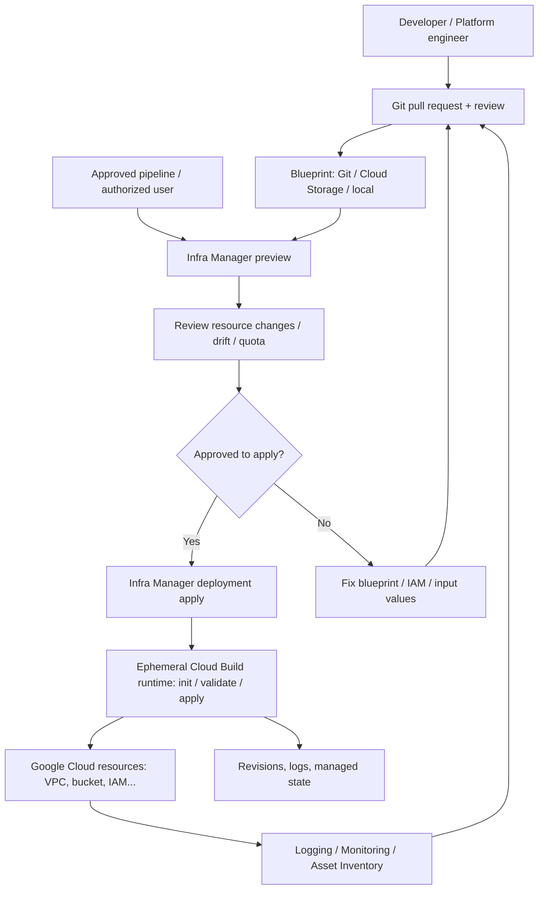
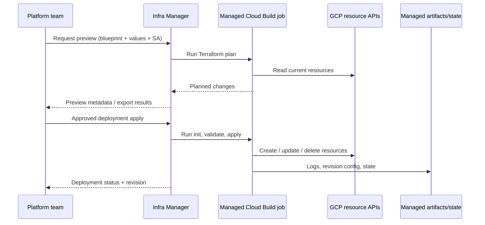
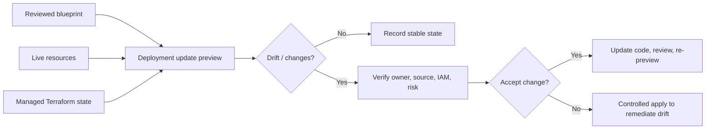
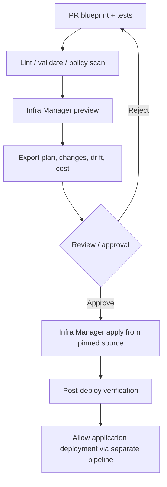

# Infrastructure Manager and Managed Terraform Execution

> **Chapter:** Infrastructure as Code with Terraform  
> **Module:** `CLOUD_PROVIDERS_GCP` — learning Google Cloud from project organization, IAM, and VPCs to Compute Engine, GKE, Cloud Run, storage, and databases; using deployment scenarios to select services, protect resources, automate releases, and monitor reliability and cost.  
> **Lesson scope:** Google Cloud **Infrastructure Manager (Infra Manager)**, executing Terraform configurations in a managed environment, IAM, previews, deployments, revisions, state, drift, cost, and operations. Commands below are examples only; replace placeholder values and obtain approval before running against real projects.

## 1. Learning Objectives

After this lesson, learners can:

1. Explain what Infra Manager does and how it differs from the Terraform CLI on a personal machine, Cloud Build, and application deployment products.
2. Describe the **Terraform blueprint → preview → deployment → revision → state → update/delete** flow on Google Cloud.
3. Prepare a project, APIs, service accounts, and IAM following the principle of least privilege.
4. Write a simple Terraform root module and supply it to Infra Manager via local source, Cloud Storage, or Git.
5. Read preview results and deploy in a controlled manner using `gcloud infra-manager`.
6. Analyze scenarios involving drift, out-of-IaC changes, failed deployments, state containing sensitive data, and resource deletion permissions.
7. Choose an appropriate workflow for `dev`/`staging`/`prod` with code review, approvals, and cost tracking.

**Problem statement:** A platform team manages VPCs, buckets, Pub/Sub, and service identities across dozens of projects. Running `terraform apply` from laptops easily leads to hard-to-control credentials, overlapping operations, scattered state, version mismatches, and missing approval trails. Infra Manager turns Terraform execution into a managed service workflow, though it does not replace IaC discipline and IAM governance.

## 2. What Is Infrastructure Manager?

**Google Cloud Infrastructure Manager** is a managed service for deploying and managing Google Cloud infrastructure resources described with **Terraform configurations**, also called *blueprints*. The service accepts a configuration source, launches the Terraform execution workflow, stores metadata, state, and revision information, and provides preview and deployment interfaces.

Under the hood, Infra Manager uses an **ephemeral Cloud Build environment** orchestrated by the service. This environment fetches the source code, initializes Terraform, validates the configuration, and runs the appropriate apply/delete operation. The runtime environment is reclaimed after the job completes; metadata, logs, artifacts, and Terraform state remain managed by Infra Manager across the deployment lifecycle.

Do not mistake this service for an always-running Terraform binary, a self-hosted Terraform server, or a **GitOps controller** that automatically detects every commit. To automate from Git events, configure corresponding triggers/pipelines.

### 2.1. Comparing Options

| Tool / Approach | Primary Role | Who Orchestrates Terraform / State? | When Appropriate |
|---|---|---|---|
| Terraform CLI on dev machine | Write, test, and drive Terraform directly | Team designs backend/locking and credentials itself | Small labs, local verification |
| Terraform CLI running in CI | Automated execution via custom-built pipeline | Team operates state, secrets, runners, concurrency | Need multi-cloud workflow control with existing tooling |
| **Google Cloud Infra Manager** | GCP service executing/monitoring blueprints, deployments/revisions | Service manages execution flow and deployment artifacts/state | GCP infrastructure wanting to reduce manual runner and state overhead |
| Cloud Build | General build/automation platform | Does not automatically turn Terraform into managed deployments | Building pipelines, running tests, and triggering Infra Manager |
| Cloud Deploy | Orchestrates application releases to supported runtimes | Does not replace managing VPCs/buckets with Terraform | Deploying application versions after infrastructure exists |

Infra Manager does **not** deploy application contents to Cloud Run or GKE in the sense of releasing container images. Terraform can provision infrastructure for applications; application pipelines still require their own build, test, rollout, and rollback strategies.

### 2.2. Components and Terminology

| Component | Meaning |
|---|---|
| **Blueprint** | Set of Terraform root module and child module files describing desired infrastructure state |
| **Source** | Local path, Cloud Storage URI, or Git repository containing the blueprint |
| **Deployment** | Infra Manager object representing a set of Terraform-managed resources |
| **Revision** | An update with a recorded trail of configuration, logs, state, and deployment resources |
| **Preview** | Result of running Terraform plan logic to inspect proposed changes without applying |
| **Input values** | Terraform variable values supplied at preview/apply time |
| **Execution service account** | Google Cloud identity used by Infra Manager to run infrastructure operations |
| **State** | Terraform information tracking relationships between resource addresses in code and real resources |
| **Drift** | Divergence between actual resources and the managed state/configuration |
| **Artifacts** | Logs, source/revision metadata, state, and outputs managed in Cloud Storage per service design |

One deployment can manage resources across **multiple projects and multiple locations**, provided the service account holds appropriate permissions. The **deployment's location** is where Infra Manager stores metadata/state and runs management operations; **resource locations** are determined by the Terraform configuration. The two locations do not have to match.

## 3. Managed Execution Architecture



**Critical control boundaries:**

1. **Code modification permission**: someone allowed to open a PR is not automatically allowed to deploy to production.
2. **Permission to invoke Infra Manager**: caller/pipeline is permitted to create previews or applies.
3. **Permission to use the execution service account**: caller must be authorized to use the exact service account.
4. **Resource API permissions**: execution service account has permissions to create/update/delete the exact target resources.
5. **State/log read permission**: someone permitted to manage deployments should not necessarily read every sensitive value in state.

Never put private keys into Terraform variables or outputs merely because execution is managed.

## 4. Lifecycle: Preview, Deployment, Revision, and State

### 4.1. Path of a Deployment



**Preview** lets you inspect resources scheduled to be created, modified, deleted, or replaced, without applying anything yet. A time gap between preview and apply can still introduce unexpected changes: resources modified directly, quota changes, changed input values, or a different Git ref. Therefore, keep **the exact reviewed source and consistent variable set**, and re-verify close to deployment time for sensitive systems.

**Deployment** is a long-lived management object. Each creation/update produces revision history and data for observability and process recovery. A revision is not an "automatic snapshot that can roll back any resource": reversing a Terraform change can still delete or replace data, or fail because real-world state has changed.

### 4.2. How Does Infrastructure Manager Manage State?

- When running the Terraform CLI directly, teams usually configure a `gcs` backend, locking, bucket permissions, encryption, and state synchronization.
- With Infra Manager, state is managed within the deployment lifecycle; the service creates/stores metadata and artifacts in Cloud Storage instead of relying on a laptop's `terraform.tfstate` file.
- State can contain sensitive attributes, even when a Terraform output is marked `sensitive = true`. Read/export permissions on state are high-security privileges; export only with an approved justification.
- **Never** manage the same resources concurrently with another state and Infra Manager. Two independent Terraform states can conflict and overwrite each other's configurations.
- Importing/exporting state must follow a migration plan, a change freeze window, backups, and testing. Never edit state manually as a first-resort fix.

**Principle:** configuration source and state map to a single authoritative manager; avoid running both local `terraform apply` and Infra Manager apply for the same deployment.

## 5. Prerequisites: Project, APIs, IAM, and Service Account

The hands-on exercise assumes two projects:

- `platform-iac-sandbox`: project running Infra Manager, holding managed metadata/logs/state.
- `app-sandbox-001`: resource project where the blueprint creates a Cloud Storage bucket.

These are **illustrative names only**; a single project can be used for a small lab. When operating cross-project, additionally review IAM and organization policies.

### 5.1. Enable APIs

Infra Manager uses the `config.googleapis.com` API. For optional quota validation, you can enable `cloudquotas.googleapis.com`. Cloud Billing must be configured, along with an up-to-date CLI and a principal permitted to enable services.

```bash
export IAC_PROJECT_ID="platform-iac-sandbox"
export TARGET_PROJECT_ID="app-sandbox-001"
export LOCATION="us-central1"        # Choose a location supported by Infra Manager
export DEPLOYMENT_ID="storage-foundation-dev"
export PREVIEW_ID="storage-foundation-dev-check01"

gcloud services enable config.googleapis.com \
  --project="$IAC_PROJECT_ID"

# If using quota validation:
gcloud services enable cloudquotas.googleapis.com \
  --project="$IAC_PROJECT_ID"
```

**Important:** example commands are not executed directly here. Do not enable APIs on real projects without authorization and change approval. The blueprint itself may require separate APIs such as `storage.googleapis.com`, `compute.googleapis.com`, or `run.googleapis.com` in the target project depending on resources.

### 5.2. Create an Execution Service Account

Infra Manager runs Terraform using a **user-managed service account** chosen by the deployer. Example creating the SA in the management project:

```bash
export SA_NAME="infra-deployer-dev"
export SA_EMAIL="$SA_NAME@$IAC_PROJECT_ID.iam.gserviceaccount.com"
export SA_RESOURCE="projects/$IAC_PROJECT_ID/serviceAccounts/$SA_EMAIL"

gcloud iam service-accounts create "$SA_NAME" \
  --project="$IAC_PROJECT_ID" \
  --display-name="Infra Manager executor for dev"
```

IAM layers:

| Subject | Permissions to Review | Scope |
|---|---|---|
| User/pipeline creating deployments/previews | `roles/config.admin` (or a narrower custom role) | Infra Manager management project |
| User/pipeline using the execution SA | `roles/iam.serviceAccountUser` | On the **execution SA** |
| Execution SA | `roles/config.agent` | Project running Infra Manager |
| Execution SA | Roles matching resources created/modified/deleted by the blueprint | Target project/resources |
| Execution SA | Read permissions on GCS Terraform source when cross-project | Corresponding bucket/source |

Example granting Infra Manager permissions to the execution SA:

```bash
gcloud projects add-iam-policy-binding "$IAC_PROJECT_ID" \
  --member="serviceAccount:$SA_EMAIL" \
  --role="roles/config.agent"
```

For the practice bucket, the minimum role to *create a new bucket* must include bucket creation permissions in the target project; a role with only `storage.objectViewer` is insufficient. Learning labs often use Storage Admin **inside an isolated sandbox project**, then refine down to custom roles or scoped roles matching the managed lifecycle. In production, avoid `roles/editor` or `roles/owner` for the execution SA.

Illustrative example for an **isolated sandbox**—do not copy verbatim to production:

```bash
gcloud projects add-iam-policy-binding "$TARGET_PROJECT_ID" \
  --member="serviceAccount:$SA_EMAIL" \
  --role="roles/storage.admin"
```

The caller also needs `roles/config.admin` in the management project and `roles/iam.serviceAccountUser` on the SA; the IAM admin team must grant these via an approval workflow, rather than letting a pipeline grant itself elevated privileges.

If the SA resides in a different project from the Infra Manager project, **cross-project service account usage requirements**, service agents, and organization policies also apply; do not simply grant roles in the target project and assume it is enough.

### 5.3. Easily Confused Permissions and Service Agents

- **Execution SA**: managed by your team and holds only permissions needed for Terraform resource APIs.
- **Infra Manager service agent**: identity created by the Google-managed service to operate the service.
- **Cloud Build service agent**: assists in building the execution environment.
- **Deployer**: user/CI issuing commands, holding Infra Manager permissions and corresponding `actAs` permission.

Do not mistakenly assign **service agent** roles to application SAs, and do not confuse `roles/iam.serviceAccountUser` with `roles/iam.serviceAccountTokenCreator`. For cross-project setups, read the official procedure and verify organization permissions before altering security constraints.

## 6. Writing a Minimal Terraform Blueprint

Directory structure used for the demo, **not files created by this lesson**:

```text
infra/
  main.tf
  variables.tf
  outputs.tf
  README.md                  # Optional, operator guide
```

### 6.1. `main.tf` — A Secure-by-Default Bucket

```hcl
terraform {
  required_version = ">= 1.3, < 2.0"

  required_providers {
    google = {
      source  = "hashicorp/google"
      version = "~> 6.0"
    }
  }
}

provider "google" {
  project = var.project_id
}

resource "google_storage_bucket" "reports" {
  project                     = var.project_id
  name                        = var.bucket_name
  location                    = var.bucket_location
  storage_class               = "STANDARD"
  uniform_bucket_level_access = true
  public_access_prevention    = "enforced"
  force_destroy               = false

  labels = {
    managed_by  = "infra-manager"
    environment = var.environment
  }
}
```

**Explanation:**

- The bucket name must be **globally unique** and comply with Cloud Storage rules; do not reuse shared example names.
- `uniform_bucket_level_access = true` enforces bucket IAM instead of fragmented object ACLs.
- `public_access_prevention = "enforced"` reduces the chance of accidental public access grants.
- `force_destroy = false` prevents Terraform from deleting a non-empty bucket via resource configuration; deletion permissions and data retention plans still require review.
- Labels aid inventory and cost allocation, not IAM replacement.
- `required_version` and provider constraints must align with **Terraform versions actually supported by Infra Manager**. Provider version `~> 6.0` is just a common compatibility example; verify your actual modules/providers before use.
- The example **does not declare an arbitrary Terraform backend**: Infra Manager orchestrates the deployment's state.

### 6.2. `variables.tf` — Explicit Variables

```hcl
variable "project_id" {
  description = "Google Cloud project receiving the resources"
  type        = string
}

variable "bucket_name" {
  description = "Globally unique bucket name"
  type        = string
}

variable "bucket_location" {
  description = "Bucket location, e.g. ASIA-SOUTHEAST1"
  type        = string
  default     = "ASIA-SOUTHEAST1"
}

variable "environment" {
  type    = string
  default = "dev"

  validation {
    condition     = contains(["dev", "staging", "prod"], var.environment)
    error_message = "environment must be dev, staging, or prod."
  }
}
```

### 6.3. `outputs.tf` — Export Only Required Data

```hcl
output "bucket_name" {
  description = "Name of the created bucket"
  value       = google_storage_bucket.reports.name
}

output "bucket_url" {
  description = "Cloud Storage URI"
  value       = google_storage_bucket.reports.url
}
```

**Input/output security:** never pass passwords, JSON keys, or tokens via `--input-values`; CLI history, request metadata, plans, and state can retain traces. For secrets, use Secret Manager and safe service/resource reference mechanisms instead of writing values directly into Terraform state.

## 7. Choosing a Configuration Source: Local, Cloud Storage, or Git

| Source | Advantages | Risks and Conditions |
|---|---|---|
| `--local-source=./infra` | Fast lab iteration, no repo push needed | Hard to guarantee provenance and exact code reproducibility; source is uploaded from local directory on invocation |
| `--gcs-source=gs://...` | Supports immutable objects/versions and dedicated ACLs | Requires source read access, exact config path, and avoiding overwriting mutable objects |
| `--git-source-repo` + directory/ref | Fits code review and Git-based workflows | Using a mutable branch can cause code at preview and apply to differ; private repos need Cloud Build/Developer Connect setup |

**Production recommendation:** use a governed Git commit SHA/tag and record module/provider versions, input variables, approver, and deployment ID. With GCS, use versioned/immutable source artifacts. Never use source files that can change silently without review.

### 7.1. Git Example

```bash
gcloud infra-manager deployments apply \
  "projects/$IAC_PROJECT_ID/locations/$LOCATION/deployments/$DEPLOYMENT_ID" \
  --service-account="$SA_RESOURCE" \
  --git-source-repo="https://github.com/ORG/infra-blueprints.git" \
  --git-source-directory="environments/dev/storage" \
  --git-source-ref="REVIEWED_COMMIT_OR_TAG" \
  --input-values="project_id=$TARGET_PROJECT_ID,bucket_name=UNIQUE_BUCKET_NAME,environment=dev"
```

This is illustrative syntax—**do not run before creating a real repository/commit**. If the repository is private, connect the Git host/repository using Cloud Build or Developer Connect per supported products; repository access IAM and resource permissions remain two separate layers.

## 8. Preview: Checking the Terraform Plan Before Creating Resources

**Preview** plans changes without modifying infrastructure, serving as a key control step in the pipeline.

### 8.1. Create a Preview from Local Source

Run from the parent directory containing `infra/` and substitute a unique bucket name:

```bash
export UNIQUE_BUCKET_NAME="my-company-dev-report-unique-id"

gcloud infra-manager previews create \
  "projects/$IAC_PROJECT_ID/locations/$LOCATION/previews/$PREVIEW_ID" \
  --service-account="$SA_RESOURCE" \
  --local-source="./infra" \
  --input-values="project_id=$TARGET_PROJECT_ID,bucket_name=$UNIQUE_BUCKET_NAME,bucket_location=ASIA-SOUTHEAST1,environment=dev" \
  --tf-version-constraint="=1.5.7"
```

**Note:** `1.5.7` is an example of a Free tier version supported by Infra Manager per documentation checked on November 19, 2026; check the active support list when deploying in the future. The local Terraform binary on your machine does not have to match the managed runtime version.

### 8.2. Inspecting the Preview and Changes

```bash
export PREVIEW_RESOURCE="projects/$IAC_PROJECT_ID/locations/$LOCATION/previews/$PREVIEW_ID"

gcloud infra-manager previews describe "$PREVIEW_RESOURCE"

# Export the plan for review; store results in a restricted-access location.
gcloud infra-manager previews export "$PREVIEW_RESOURCE"

# List resource changes in the preview.
gcloud infra-manager resource-changes list \
  --preview="$PREVIEW_RESOURCE"
```

During review, do not just count `add/update/delete`. Check:

1. Are there any unintended resource **deletes** or **replaces**? Why?
2. Are project names, regions, locations, and resource IDs right?
3. Do IAM bindings broaden permissions? Do VPCs/firewalls open public ingress?
4. Are `force_destroy`, retention policies, storage class, encryption, or networking altered?
5. Do input values contain secrets/PII? Is the exported plan protected?
6. Do the provider lock, module versions, and Terraform version match what was reviewed?
7. Have quotas, enabled APIs, budgets, and organization policy limits been checked?

**Do not treat a preview as a permanent deployment permit.** Source and live state can change over time; applying initiates a fresh execution. For sensitive production systems, keep approvals close to apply time and verify source provenance.

### 8.3. Drift and Previews

When an existing deployment exists, an update preview can also surface **drift**:

```bash
gcloud infra-manager resource-drifts list \
  --preview="$PREVIEW_RESOURCE"
```

Not every drift is an error to "fix with apply" immediately. A change made by another system might be a legitimate emergency change. Identify the owner, then either codify the change or revert it following an approved process.

## 9. First Deployment with Infra Manager

After reviewing the preview, use the exact same source code and variable values:

```bash
export DEPLOYMENT_RESOURCE="projects/$IAC_PROJECT_ID/locations/$LOCATION/deployments/$DEPLOYMENT_ID"

gcloud infra-manager deployments apply "$DEPLOYMENT_RESOURCE" \
  --service-account="$SA_RESOURCE" \
  --local-source="./infra" \
  --input-values="project_id=$TARGET_PROJECT_ID,bucket_name=$UNIQUE_BUCKET_NAME,bucket_location=ASIA-SOUTHEAST1,environment=dev" \
  --tf-version-constraint="=1.5.7"
```

`deployments apply` **creates the deployment if it does not exist** and **updates the deployment if it already exists**. Never share the same deployment ID across unrelated environments. Keep IDs stable for each managed resource group; changing the ID while keeping the same resource names can lead to two deployments competing for ownership or "already exists" errors.

Monitor progress:

```bash
gcloud infra-manager deployments describe "$DEPLOYMENT_RESOURCE"

gcloud infra-manager deployments list \
  --project="$IAC_PROJECT_ID" \
  --location="$LOCATION"
```

**Post-deploy verification:**

- Deployment status succeeded per the API.
- The actual bucket exists in the right project/region, with UBLA and public access prevention enabled.
- No unexpected resources outside the preview appeared, and no resources were unexpectedly deleted.
- Revision/source/inputs and logs are sufficient for traceability.
- Monitoring/Cloud Audit Logs and budgets are updated.
- If an operation fails, never conclude "nothing was created": inspect actual resources, revision/state, and partial apply effects.

### 9.1. Inside the Managed Execution Process

Infra Manager uses a service-operated Cloud Build environment to sequentially fetch source, run `terraform init`, `terraform validate`, and `terraform apply` (or `terraform destroy` when deleting). Depending on transient errors, the service may retry certain operations. The execution environment is ephemeral, but logs/artifacts/state do not automatically vanish after the job finishes.

This does **not** guarantee atomic transactions across all resources: Terraform may create some resources and then fail on a subsequent resource. Operators must diagnose/inspect state and decide on controlled retries or rollbacks.

## 10. Updating a Deployment and Managing Revisions

Suppose you need to add a `cost_center` label or change a storage policy:

1. Create a PR modifying the code.
2. Run static checks and get reviews from IAM/data specialists.
3. Create a preview against the **existing deployment** to inspect the update impact.
4. Confirm no unintended data deletion or replacement occurs.
5. Apply the approved code revision to the same deployment ID.
6. Verify the revision and actual resources.

Example update preview:

```bash
export UPDATE_PREVIEW_ID="storage-foundation-dev-check02"

gcloud infra-manager previews create \
  "projects/$IAC_PROJECT_ID/locations/$LOCATION/previews/$UPDATE_PREVIEW_ID" \
  --deployment="$DEPLOYMENT_RESOURCE" \
  --service-account="$SA_RESOURCE" \
  --local-source="./infra" \
  --input-values="project_id=$TARGET_PROJECT_ID,bucket_name=$UNIQUE_BUCKET_NAME,bucket_location=ASIA-SOUTHEAST1,environment=dev" \
  --tf-version-constraint="=1.5.7"
```

**Important to understand:** a Terraform root module describes the desired state of all resources in the deployment. Removing a resource block from code causes Terraform to plan **destroying** that resource. Renaming a Terraform resource address can produce a destroy/create plan unless `moved` blocks or planned imports are used.

### 10.1. What Does Rollback Mean?

A rollback "back to an old commit" means **executing a new Terraform plan** based on the old commit—it does not automatically recover lost data:

- IAM/firewall changes can usually be reversed in configuration.
- Deleting a bucket holding data, a database, a disk, or a network may not be trivially reversible.
- Changing regions or immutable attributes may force creating new resources.
- If the pipeline/SA lost permissions, rollback can also fail.

For stateful resources, establish backups, retention, migration runbooks, recovery tests, and dedicated cutover plans.

## 11. State, Locking, and Exporting Operational Data

Infra Manager provides commands to manage deployment/state/locks, but do not use them as routine daily tools without understanding their impact:

```bash
# View supported commands and flags in your active gcloud version:
gcloud infra-manager deployments --help

# Use only after verifying permissions, securing export paths, and checking runbooks:
gcloud infra-manager deployments export-statefile --help
gcloud infra-manager deployments import-statefile --help
gcloud infra-manager deployments lock --help
gcloud infra-manager deployments unlock --help
```

**State can contain sensitive values:** resource attributes, metadata, temporary credentials, or secret outputs if Terraform code puts them into state. Even though the CLI hides a sensitive output on screen, you must still restrict artifact access permissions, enable appropriate auditing, and define retention policies.

**Locking:** prevents multiple jobs from modifying the same deployment simultaneously. Never unlock simply because another command is blocked; verify active jobs, owners, and state consistency before intervening.

### 11.1. Rules for Migrating State from Legacy Systems

When migrating Terraform from self-built CI to Infra Manager:

1. Inventory existing resource/state backends, workspaces/modules, and owners.
2. Freeze legacy pipelines and disable cron applies; record commits, lockfiles, and Terraform/provider versions.
3. Back up state securely and check for sensitive data.
4. Follow import/migrate instructions **for the exact Infra Manager version**; use official procedures rather than manually copying state into metadata buckets.
5. Preview and reconcile all resources; **never** apply a plan with unexpected destroys/creates.
6. Only after confirming Infra Manager owns the right state/resources, decommission old backends/runners.
7. Retain planned recovery options, while never allowing both systems to apply in parallel.

Terraform state is neither a database backup nor a copy of business data.

## 12. Drift: Distinguishing Valid vs. Unauthorized Changes

Drift occurs when actual configuration diverges from the state Terraform expects, for example:

- An admin adds an emergency firewall rule via the Console.
- A bucket's IAM or retention is changed outside code.
- Another team deletes a resource with a separate script.
- A provider API auto-generates/adjusts an attribute the provider does not yet handle cleanly.



Never silence drift notices by arbitrarily editing state. If drift is caused intentionally by another management system, first separate ownership or establish a single source of truth.

**Periodic checks:** you can schedule an approved preview/assessment in automation, but Infra Manager is not automatically a continuous drift-checking daemon for every deployment. Scheduling sources, runner accounts, alert thresholds, and costs must be designed separately.

## 13. Deleting a Deployment: DELETE vs. ABANDON

Two behaviors must be clearly distinguished:

| Delete Policy | Behavior | When to Consider |
|---|---|---|
| `delete` | Infra Manager instructs Terraform to **destroy managed resources**, then deletes the deployment per workflow | Expired sandbox, environment teardown per runbook |
| `abandon` | Deletes management metadata while **retaining the resources** | Handing off ownership to another tool after planning ongoing governance |

Example **syntax**—**never run unconditionally**:

```bash
# WARNING: destroys managed infrastructure upon success.
gcloud infra-manager deployments delete "$DEPLOYMENT_RESOURCE" \
  --delete-policy=delete

# Retains resources while removing Infra Manager management.
gcloud infra-manager deployments delete "$DEPLOYMENT_RESOURCE" \
  --delete-policy=abandon
```

**ABANDON is not a rollback:** afterward, Infra Manager no longer manages the orphaned resources. Creating a new deployment targeting the same resources without an import/state workflow easily causes conflicts or duplicate resource creation. With `DELETE`, verify backups, system dependencies, delete permissions, `prevent_destroy`/`force_destroy`, and resource teardown order. In production, require independent approval and change management by default.

## 14. IAM, Data Protection, and Governance Boundaries

### 14.1. Separating Four Roles

- **Contributor**: edits blueprints via PRs only; lacks production apply permissions.
- **Reviewer**: inspects diffs, previews, policy changes, and cost impact.
- **Deployer**: allowed to call Infra Manager and `actAs` the exact execution SA.
- **Security/IAM administrator**: manages role grants, org policies, and exceptions; does not necessarily deploy every resource.

The execution SA should not become a "shared super-admin account for every project." Organize one SA per environment/project and constrain by folder/project/resource instead of granting a single org-wide SA `roles/owner`.

### 14.2. Key Controls

| Threat | Consequence | Control |
|---|---|---|
| Malicious PR modifies Terraform IAM | Self-grants permissions or creates backdoors | Protected branches, IAM owner review, policy-as-code |
| Pipeline has overly broad `config.admin` | Creates/deletes production deployments | Project isolation, custom roles where feasible, approvals |
| Execution SA has Owner/Editor | Terraform creates/deletes any resource type | Split SAs by workload/environment and use narrow resource roles |
| State contains secrets | Successful state read leaks secrets | Secret Manager, restrict export/read, auditing, encryption, retention |
| Mutable source ref | Apply differs from preview | Pin commits / immutable GCS objects; record source digest |
| Creating public GCS buckets | Data leak | UBLA, public access prevention, org policies, plan checks |
| Accidentally deleting stateful resources | Data loss | Backups, `prevent_destroy`, gates, change windows, runbooks |
| Two runners managing the same state | State divergence and conflicting changes | Enforce single owner, locking, decommission old runners |
| Insufficient APIs/quotas | Partial Terraform apply failure | Quota validation, preflight IAM/API checks, controlled retries |

Check both **permissions in the Infra Manager project** and **permissions in resource projects**. If one SA manages GKE, VPCs, databases, and secrets together, splitting deployments along trust boundaries usually provides greater safety than cramming everything into one state.

## 15. CI/CD Integration and Promotion Workflows

A typical production workflow:



**Note the distinction:** running `terraform validate` in CI cannot fully replace a preview: `validate` mainly checks structure/configuration, whereas `preview` uses providers, state, and remote APIs to construct a change plan.

### 15.1. Environment Chain: `dev` → `staging` → `prod`

| Stage | Gate | Primary Tasks |
|---|---|---|
| Dev | Minimal technical review | Preview/apply to isolated project, create temporary resources |
| Staging | Integration and policy checks | Preview, quotas, data residency, IAM tests |
| Production | Independent approval and frozen source | Preview from pinned commit, evaluate deletes/replaces, monitored apply |
| Post-deployment | Operational sign-off | Verify services, drift, error budget, billing, audit logs |

A deployment should have **only one active change execution stream at a time**. Across multiple teams, use queues, concurrency controls, and alerts for parallel operations. Never blindly retry a failed job indefinitely: permission, quota, or configuration errors will not heal through repeated runs.

### 15.2. Using Cloud Build to Trigger Infra Manager

Cloud Build can serve as the pipeline calling `gcloud infra-manager previews create`/`deployments apply`; Infra Manager then operates the internal Terraform session itself. These are **two distinct roles**: external Cloud Build handles triggers/approvals, while the service's internal Cloud Build environment handles execution.

Private Git sources may require host/repository connections. Do not put service account JSON private keys into Cloud Build triggers; use managed service accounts/federation with least-privilege permissions.

## 16. Terraform Versions, Providers, and Cost in 2026

### 16.1. Choosing the Right Terraform Version

Per official documentation checked on **November 19, 2026**, Infra Manager supports the following Terraform versions:

| Version | Published Status / Pricing Tier | Notes |
|---|---|---|
| `1.3.10` | Free tier | Review future lifecycle support |
| `1.4.7` | Free tier | Review future lifecycle support |
| `1.5.7` | Free tier | Default for new deployments/previews when no paid version is selected |
| `1.16.5` | Paid tier | Supported since November 2, 2026; constraint must be specified to use |
| `1.2.3` | End of support since February 8, 2026 | Do not use for new deployments |

This list may change as Google updates Infra Manager. **Do not** treat the table above as a permanent contract for future years. The Google provider version (`hashicorp/google` or a provider maintained by Infra Manager when features align) is a separate choice from the **Terraform engine version**.

### 16.2. Cost Implications

**Created Google Cloud resources always carry their own charges** per service, regardless of whether you choose a Free tier or Paid tier Terraform engine.

As of that date, Terraform `1.5.7` and corresponding Free tier versions carry no **Infra Manager management fee**; however, Cloud Storage, Compute Engine, GKE, Cloud Logging, Cloud Build, and related services may incur usage charges based on configuration, and created resources certainly require budgeting.

For the Terraform `1.16.5` Paid tier, Google announces **500 managed resources per month free per billing account**, beyond which management fees apply per resource and duration at a list rate of **1 USD / resource-year** (metered hourly). Previews do not incur management fees under this model. Pricing and policies are subject to change; check the live pricing page before approving budgets.

**Estimate accurately:** count resources managed per deployment, lifetimes, resource service charges, and monitoring/logging costs; do not use the number of `.tf` files or deployments as the sole metric.

### 16.3. Quotas and Locations

- Choose a **supported Infra Manager location**; metadata/state location has data residency implications.
- A deployment can create resources in other locations, provided the target service supports those resources in those regions.
- Check quotas for Infra Manager, target APIs, and Cloud Build/networking before scaling.
- Use quota validation where appropriate while still reviewing constraints, budgets, and execution risks.
- Use labels for environment, owning team, and cost center for cost tracking; never put PII into labels.

## 17. Observability and Troubleshooting

### 17.1. Signals to Collect

- Deployment/preview status, operation ID, and revision ID.
- Cloud Build runtime logs for the Infra Manager job.
- Terraform diagnostics: resource address, provider API request, error code.
- Cloud Audit Logs for Infra Manager operations, IAM, and corresponding resource APIs.
- Monitoring/billing: exhausted quotas, API latency, sudden cost spikes, resource drift.
- Change evidence: Git commit, approver, non-sensitive input vars, Terraform/provider versions.

**Never paste full logs/state into public tickets.** Logs can contain internal resource names or input data; state can contain secrets.

### 17.2. Layered Diagnostic Table

| Typical Error | Suspected Layer | Action |
|---|---|---|
| `API has not been used` | Project/API | Check `config.googleapis.com` and resource APIs in the right project |
| `PERMISSION_DENIED` on apply | Execution SA IAM | Verify `config.agent`, resource IAM, and corresponding `actAs` permissions |
| Cannot read Git/GCS source | Source access | Check repo connection, token/repository permissions, and bucket permissions |
| Terraform init failed | Engine/provider/module | Check version constraints, registry/network, provider dependencies |
| `403` creating bucket | Resource API/IAM | Check execution SA roles in the **resource project** |
| `409 already exists` | Resource ID/state | Determine whether resource is managed by another state or created manually |
| Unexpected resource replacement | Terraform plan | Check immutable property changes, resource renames, input values |
| Operation locked | Concurrency/state | Check active operations; avoid unlocking without verification |
| Preview differs from apply | Drift/source | Check commit/ref, input versions, out-of-IaC resource changes |
| Incomplete resource deletion | Dependencies/retention | Check `force_destroy`, retention policies, API errors, and resource dependencies |
| Cost spike after apply | Resource/billing | Cross-check resource inventory, pricing tier, Monitoring, and Billing |

### 17.3. Handling Failed Deployments

1. Record deployment ID, location, timestamp, revision/operation, Git commit, and non-sensitive input values.
2. Read Infra Manager status, then inspect Cloud Build/operation logs.
3. Isolate **permission**, **quota**, **Terraform syntax/provider**, **API**, **drift/state**, and **network** errors.
4. Check actual resources: some resources may have been created before the apply failed.
5. Verify deployment state/locks and conflicts with other jobs.
6. Fix blueprint/IAM/quotas in a PR and re-preview; do not blindly retry.
7. Re-apply under monitoring, then check drift, application health, and costs.
8. If recovery is needed, plan reverse changes and protect stateful data.

## 18. Controlled Hands-On Exercise

### Scenario

A team needs to standardize report-export buckets for two environments, `dev` and `staging`; both share a single Terraform blueprint while resources differ in project/name. The team wants **previews** before granting apply permissions, avoids JSON keys, and wants to prove `dev` engineers cannot create buckets in `production`.

### Steps

1. Prepare two sandbox projects with billing/budgets and required admin permissions; enable the Infra Manager API in the management project.
2. Write a `google_storage_bucket` blueprint with UBLA, public access prevention, and `project_id`/`bucket_name`/`environment` variables.
3. Create an execution SA for dev, grant `roles/config.agent` in the Infra Manager project and resource roles in the dev project—**not production**.
4. Grant the caller `roles/config.admin` (or an appropriate custom role) and `roles/iam.serviceAccountUser` on the permitted SA.
5. Create a preview for dev, export the plan, and verify `create 1` with no unexpected deletes/replaces.
6. Try passing `project_id` as the production project: preview/apply **must be denied** without resource permissions. Never grant production permissions just to make the exercise "pass."
7. After approval, apply dev, inspect the deployment/revision, and verify the real bucket.
8. Modify a label, create an update preview, and distinguish metadata update from replacement.
9. Modify the bucket via Console to simulate drift, inspect the preview; choose to codify the change or revert per procedure.
10. Test deleting the deployment **only in the sandbox** after confirming the bucket is empty, comparing `delete` and `abandon` effects across two independent test deployments.
11. Summarize evidence: commit, preview, approver, IAM policy, deployment status, logs, billing, and lessons learned.

### Acceptance Criteria

| Criterion | PASS When |
|---|---|
| Reproducibility | Same source and inputs yield consistent preview results, independent of personal laptops |
| Least-privilege IAM | Dev execution SA cannot modify the prod project |
| Plan review | Every delete/replace is confirmed before apply |
| State ownership | No other local backend/runner concurrently applies the same resources |
| Auditability | Can trace who approved, who triggered deploy, and which revision created resources |
| Security | No private keys, tokens, or passwords in Git/plans/outputs |
| Reliability | Runbooks exist for failed applies, retries, and drift |
| Cost control | Budgets configured, right version tier chosen, sandbox cleanup completed |

## 19. Production Checklist and Conclusion

**Before deployment**

- [ ] Resource owners and deployment boundaries identified by project/environment/trust zone.
- [ ] Root module blueprint, provider constraints, Terraform version, and input values locked/managed.
- [ ] Git/GCS source has provenance; branch/commit matches the reviewed version.
- [ ] Execution SA holds `roles/config.agent` and **properly scoped** resource permissions.
- [ ] Callers hold appropriate Infra Manager and `actAs` permissions, with no JSON keys.
- [ ] Preview generated, resource changes/drift inspected, and delete/replace operations reviewed.
- [ ] Quotas, org policies, regions/data residency, licensing limits, and pricing tiers evaluated.
- [ ] Separate production approval and rollback/backup plans in place.

**After deployment**

- [ ] Deployment/revision and actual resources verified.
- [ ] Logs, artifacts/state, and sensitive data protected/monitored.
- [ ] Inventory, owners, budgets, and alerts updated.
- [ ] No other Terraform runner modifies the same resources/state.
- [ ] Procedures exist for maintenance, drift checks, failed operations, and deployment deletion.
- [ ] Every change to stateful resources has a data recovery plan.

**Conclusion:** Infra Manager turns Terraform execution on Google Cloud into a managed workflow with **previews, deployments, revisions, logs, and state**. Its core value lies not in "avoiding typing `terraform apply`," but in standardizing **permissions, audit trails, state governance, and change control** across multi-project environments. The service does not eliminate risks from overly broad IAM, unreviewed plans, secrets in state, or accidental resource deletion. To operate safely, always pair Infra Manager with **source versioning, the principle of least privilege, pre-apply approvals, drift observation, cost controls, and incident runbooks**.

## 20. Official References

The links below are for checking up-to-date limits and commands at deployment time:

1. [Infrastructure Manager overview](https://docs.cloud.google.com/infrastructure-manager/docs/overview) — architecture, lifecycle, and Cloud Build runtime.
2. [Terraform and Infrastructure Manager](https://docs.cloud.google.com/infrastructure-manager/docs/infra-manager-terraform) — blueprints, supported Terraform versions, Free/Paid tiers.
3. [Enable the service](https://docs.cloud.google.com/infrastructure-manager/docs/enable-service) — `config.googleapis.com` API and activation steps.
4. [Configure service account](https://docs.cloud.google.com/infrastructure-manager/docs/configure-service-account) — IAM `roles/config.agent`, `actAs`, resource/cross-project permissions.
5. [Deploy infrastructure](https://docs.cloud.google.com/infrastructure-manager/docs/deploy-resources) — local, Git, Cloud Storage, deployments.
6. [Preview a deployment](https://docs.cloud.google.com/infrastructure-manager/docs/preview-deployment) — creating previews.
7. [Export and view preview results](https://docs.cloud.google.com/infrastructure-manager/docs/export-view-preview-results) — viewing resource changes/drift.
8. [Deployments, revisions and previews](https://docs.cloud.google.com/infrastructure-manager/docs/deployments-revisions) — state/artifact lifecycle.
9. [Delete a deployment](https://docs.cloud.google.com/infrastructure-manager/docs/delete-deployments) — `delete` and `abandon`.
10. [Infrastructure Manager release notes](https://docs.cloud.google.com/infrastructure-manager/docs/release-notes) — version and pricing updates over time.
11. [gcloud infra-manager deployments apply](https://docs.cloud.google.com/sdk/gcloud/reference/infra-manager/deployments/apply) — CLI parameters.
12. [gcloud infra-manager previews create](https://docs.cloud.google.com/sdk/gcloud/reference/infra-manager/previews/create) — preview CLI parameters.
