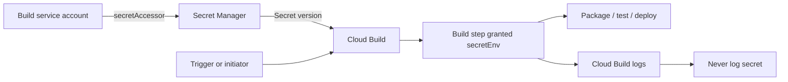

# Secret Manager in Cloud Build Pipelines

CI/CD pipelines often need tokens to download private packages, credentials to deploy services, or keys to sign artifacts. Putting these values into repositories, `cloudbuild.yaml` files, substitution variables, or build images increases the risk of secret exposure. **Secret Manager** provides secret storage and version management; **Cloud Build** can retrieve secrets from Secret Manager and inject them into the environment variables of the exact build step that needs them.

In the `CLOUD_PROVIDERS_GCP` module, learners explore Google Cloud from project organization, IAM, and VPC to Compute Engine, GKE, Cloud Run, storage services, and databases. Through deployment scenarios, learners know how to select services, secure resources, automate releases, and monitor reliability and cost. This lesson situates Secret Manager within the software supply chain: which identity executes the build, which source code is permitted to use secrets, how secrets are rotated, and which logs prove an access occurred must all be explicitly designed.

Secret Manager does not automatically protect an overly privileged pipeline or untrusted source code. If a build step is allowed to read a secret, commands running inside that step can use or exfiltrate the secret. Therefore, combine Secret Manager with least-privilege IAM, dedicated build service accounts, trigger controls, and code review processes.

## Learning Objectives

After this lesson, learners will be able to:

- Explain the role of Secret Manager and how Cloud Build retrieves secrets during pipeline execution.
- Create secrets, add versions, and grant Secret Accessor permissions to the build service account.
- Configure `availableSecrets.secretManager` and `secretEnv` in `cloudbuild.yaml`.
- Distinguish the Cloud Build service agent from the build execution service account.
- Use dedicated service accounts, secret-level IAM, and short-lived authentication following least-privilege principles.
- Rotate, disable, restore versions, and monitor secret access via audit logs.
- Protect pipelines against secret leakage from logs, plans, images, pull requests, and untrusted source code.

## 1. Secrets in the CI/CD Workflow

### Types of Secrets Commonly Found in Pipelines

A Cloud Build pipeline may need:

- Tokens to download dependencies or packages from private registries.
- API keys to call test systems or external services.
- Credentials to access databases or staging/production environments.
- Signing keys to sign artifacts, container images, or release packages.
- Tokens to deploy or call APIs of release systems.

These values are authentication material. If placed in Git, they persist in commit history even after the file is deleted. If placed in Cloud Build substitutions, build logs, or Docker build arguments, values can remain in metadata, logs, artifacts, or image layers.

### How Secret Manager and Cloud Build Work Together

Secret Manager stores secrets by resource and version. Cloud Build uses the build execution identity to call Secret Manager, fetch the specified version, and inject the value into the environment variable of the build step declaring `secretEnv`.



Basic flow:

1. An administrator creates a secret in Secret Manager and adds a version.
2. The build service account is granted `roles/secretmanager.secretAccessor` on the required secret.
3. The build config file declares the secret version in `availableSecrets.secretManager`.
4. The build step needing the secret declares the variable name in `secretEnv`.
5. Cloud Build retrieves the version using the build service account and provides the environment variable to the step.
6. The step uses the secret to perform its task, then exits without printing or storing the secret in artifacts.

Secrets are not embedded into source code or Docker images. A step receives an environment variable only if declared in that step's `secretEnv`.

## 2. Secret Manager: Resources, Versions, and Replication

### Resource Structure

Secret Manager organizes data as follows:

```text
Secret-managing project
└── Secret: deploy-token
    ├── Version 1
    ├── Version 2
    └── Version 3 (in use)
```

- **Secret** is a logical resource with a name, IAM policy, replication configuration, and metadata.
- **Secret version** holds the stored secret payload. Each time the value changes, add a new version rather than overwriting the old one.
- **Version aliases** such as `latest` reference the newest version according to Secret Manager rules.
- **Replication policy** defines how secret data is replicated across Google Cloud.

The full resource name has the form:

```text
projects/SECRET_PROJECT_ID/secrets/SECRET_ID/versions/VERSION_ID
```

The build project and secret project can differ. In that case, `versionName` must specify the project containing the secret, and IAM must be granted to the build service account on the secret in that project.

### Creating a Secret and Adding a Version

Example creating a secret for a deployment step:

```bash
gcloud config set project SECRET_PROJECT_ID

gcloud services enable secretmanager.googleapis.com

gcloud secrets create deploy-token \
  --replication-policy=automatic

# Read payload from a protected file; do not place literal secrets in commands.
gcloud secrets versions add deploy-token \
  --data-file=/secure/path/deploy-token.txt
```

The file `/secure/path/deploy-token.txt` must be created and protected according to your organization's credential management procedures. Do not commit the file, and do not expose its contents in shell history or terminal logs. After adding the version, restrict read permissions on the source file and delete temporary copies per retention policy.

For secrets requiring storage location control, use user-managed replication and specify organization-approved locations. Replication configuration is chosen at secret creation time; check data residency requirements before creating the resource.

### Versions Are Immutable

Secret Manager does not overwrite the payload of an existing version. When credentials change, create a new version. Versions have states such as `ENABLED`, `DISABLED`, or `DESTROYED`:

- `ENABLED`: can be retrieved if the caller has permission.
- `DISABLED`: cannot be retrieved until re-enabled.
- `DESTROYED`: payload has been destroyed and cannot be recovered.

Creating a new version does not automatically revoke the old credential in external systems. When rotating tokens, update the credential in the target issuing system, add a new version to Secret Manager, switch the pipeline to the new version, verify builds succeed, and only then revoke the old credential.

## 3. Choosing the Right Cloud Build Service Account

### Build Service Account and Service Agent Are Two Different Identities

Cloud Build uses multiple identities for different purposes:

- **Build service account** is the identity used by build steps when calling Google Cloud APIs. This is the principal that needs permission to read secrets in Secret Manager.
- **Cloud Build service agent** is the Google-managed service account used by Cloud Build to execute service operations. The service agent typically has the form `service-PROJECT_NUMBER@gcp-sa-cloudbuild.iam.gserviceaccount.com` and needs service roles such as `roles/cloudbuild.serviceAgent`.

Do not grant `roles/secretmanager.secretAccessor` to the Cloud Build service agent simply because its name contains Cloud Build. Grant permissions to the actual build service account attached to the build or trigger.

### Do Not Assume a Fixed Default Service Account

The default identity selected by Cloud Build can depend on project creation time, organization policies, project history, and trigger/build choices. Some environments use the legacy Cloud Build service account; others may use the Compute Engine default service account or an explicitly specified identity.

Before granting IAM, verify the `serviceAccount` field of the build or trigger in the Console/API. For production workloads, explicitly specify a clearly named user-managed build service account to avoid depending on defaults that vary by project configuration.

### Creating a Dedicated Build Service Account

Example creating a service account in the build project:

```bash
gcloud config set project BUILD_PROJECT_ID

gcloud iam service-accounts create cloud-build-deployer \
  --display-name="Cloud Build deployment identity"
```

Service account email:

```text
cloud-build-deployer@BUILD_PROJECT_ID.iam.gserviceaccount.com
```

The identity creating builds or configuring triggers needs `iam.serviceAccounts.actAs` on the build service account; the role commonly used to grant this is Service Account User (`roles/iam.serviceAccountUser`). The build service account also needs permissions to perform specific tasks such as deploying Cloud Run or updating GKE. Those permissions are independent of Secret Manager access. Grant only the deployment permissions needed for the target project or resource.

### Granting Secret Access at the Secret Level

Example of a build service account reading secret `deploy-token` in `SECRET_PROJECT_ID`:

```bash
gcloud secrets add-iam-policy-binding deploy-token \
  --project=SECRET_PROJECT_ID \
  --member="serviceAccount:cloud-build-deployer@BUILD_PROJECT_ID.iam.gserviceaccount.com" \
  --role="roles/secretmanager.secretAccessor"
```

The `roles/secretmanager.secretAccessor` role provides the `secretmanager.versions.access` permission. Granting permissions directly on the secret limits blast radius: the service account can read only granted secrets rather than every secret in the project.

Avoid granting `roles/secretmanager.admin` or `roles/owner` to a build service account. Builds only need to access versions—not create secrets, modify IAM, or destroy versions.

## 4. Configuring `availableSecrets` and `secretEnv`

### Basic Structure in cloudbuild.yaml

Cloud Build supports declaring secrets from Secret Manager in the `availableSecrets` section. Each entry specifies `versionName` and an environment variable name. Any build step requiring the secret declares that variable in `secretEnv`.

Example:

```yaml
steps:
  - id: deploy-application
    name: gcr.io/cloud-builders/gcloud
    entrypoint: bash
    args:
      - -c
      - |
        set +x
        ./scripts/deploy.sh
    secretEnv:
      - DEPLOY_TOKEN

availableSecrets:
  secretManager:
    - versionName: projects/SECRET_PROJECT_ID/secrets/deploy-token/versions/7
      env: DEPLOY_TOKEN

serviceAccount: projects/BUILD_PROJECT_ID/serviceAccounts/cloud-build-deployer@BUILD_PROJECT_ID.iam.gserviceaccount.com
```

In this example:

- `versionName` is the resource name of the secret version in Secret Manager.
- `env` is the environment variable name Cloud Build will provide to the step.
- `secretEnv` specifies which step receives that variable.
- `serviceAccount` specifies the build execution identity.
- `./scripts/deploy.sh` reads `DEPLOY_TOKEN` from its process environment.

Replace `SECRET_PROJECT_ID`, `BUILD_PROJECT_ID`, secret ID, and version with real values. Ensure the script file never prints environment variables, never enables shell tracing, and never writes the token into artifacts.

### Accessing Secrets in Inline Commands

If referencing the environment variable directly inside `args` in Cloud Build, use `$$` so Cloud Build does not treat the variable name as a build substitution:

```yaml
steps:
  - name: ubuntu
    entrypoint: bash
    args:
      - -c
      - |
        set +x
        printf '%s' "$$DEPLOY_TOKEN" | ./scripts/deploy-from-stdin.sh
    secretEnv:
      - DEPLOY_TOKEN

availableSecrets:
  secretManager:
    - versionName: projects/SECRET_PROJECT_ID/secrets/deploy-token/versions/7
      env: DEPLOY_TOKEN
```

Cloud Build turns `$$` into `$` so the shell receives the `DEPLOY_TOKEN` variable. If the command runs inside a script file invoked by the step, the script's contents are not subject to build config substitution; the script can read `$DEPLOY_TOKEN` normally.

Never use `echo $DEPLOY_TOKEN` to verify a secret. `echo`, `printf` to stdout, `env`, `printenv`, `set -x`, or debug commands can write values to Cloud Build logs. The example above only illustrates passing a secret via standard input to a properly designed script; the script must never log stdin or environment variables.

### One Secret Across Multiple Steps

If multiple steps need the same secret, declare `secretEnv` in each step that requires it. Do not add secrets to every step by default. Limiting steps reduces the amount of code capable of reading credentials.

```yaml
steps:
  - id: test-private-dependency
    name: gcr.io/cloud-builders/npm
    args: ["ci"]
    secretEnv: [NPM_TOKEN]

  - id: build-image
    name: gcr.io/cloud-builders/docker
    args: ["build", "-t", "IMAGE_URI", "."]

availableSecrets:
  secretManager:
    - versionName: projects/SECRET_PROJECT_ID/secrets/npm-token/versions/4
      env: NPM_TOKEN
```

This example supplies `NPM_TOKEN` only to the dependency installation step. If the image build step does not need the token, do not supply the variable to that step. Actual package manager configuration must ensure the token is not written into config files, caches, or image layers.

For example, an `.npmrc` file stored in the repository can reference an environment variable without containing the real token:

```text
//registry.npmjs.org/:_authToken=${NPM_TOKEN}
```

NPM reads the value from the step's environment. Check package manager caching and output settings to ensure the token is not written to logs or artifacts.

### Using `latest` or a Fixed Version?

You can reference a specific version:

```yaml
versionName: projects/SECRET_PROJECT_ID/secrets/deploy-token/versions/7
```

Or use an alias:

```yaml
versionName: projects/SECRET_PROJECT_ID/secrets/deploy-token/versions/latest
```

| Reference Method | Pros | Trade-offs |
|---|---|---|
| Specific version number | Reproducible builds; exact credential used is known. | Build config must be updated during rotation. |
| `latest` | New builds can pick up new versions without editing YAML. | Build behavior depends on whichever version is latest at fetch time. |

For production releases requiring reproducibility and rollback, prefer specific version numbers. Use `latest` when the organization has an established rotation process and accepts that subsequent builds automatically switch to the newest version. Secret Manager does not alter environment variables of an already-running build when a new version is added.

## 5. Triggers, Pull Requests, and Trust Boundaries

### Build Triggers Execute Code with the Build Service Account's Permissions

When a trigger starts a build, the steps in `cloudbuild.yaml` run under the build service account attached to the trigger/build. If that service account has `secretAccessor`, any command running inside a step granted the secret can read its value.

This means permission to edit `cloudbuild.yaml`, deployment scripts, or Dockerfiles can become indirect permission to use secrets. Anyone able to modify source code and fire the trigger could alter the pipeline to send secrets to an external endpoint if review controls are absent.

### Never Grant Production Secrets to Untrusted Source Code

Be especially careful with pull requests from forks, experimental branches, or external contributors. Never allow builds running from unreviewed code to access production tokens, signing keys, or deployment credentials.

A separated model can look like:

| Pipeline | Secret Permissions | Goal |
|---|---|---|
| Pull request validation | No production secrets; use mock data or isolated test secrets only. | Run lint, unit tests, and configuration checks. |
| Merge into protected branch | Only secrets needed for trusted builds/tests. | Build artifacts after successful code review. |
| Production release/deploy | Dedicated production service account and secrets; trigger restricted by branch/tag. | Deploy approved artifacts. |

### Controlling Triggers and Who Can Invoke Them

- Protect production branches with mandatory reviews and merge policies.
- Restrict who can create, update, or run production triggers.
- Use separate service accounts per environment or workload group.
- Prevent untrusted users from modifying the build config of triggers with production permissions.
- Use approvals or release gate processes before production deployment.
- Inspect build logs, trigger sources, and commit SHAs when investigating secret accesses.
- Separate test and production secrets, even when secret names are similar.

Cloud Build approvals and trigger configurations can control when a build is allowed to proceed; however, approvals do not replace source code protection and IAM. An approved build running malicious code can still expose secrets.

## 6. Building a Sample Pipeline Using Secret Manager

### Preparing Projects and APIs

In this example, the build project hosts Cloud Build and the secret project stores credentials. Both projects can be the same in simpler setups, provided permissions remain clearly separated.

```bash
gcloud services enable cloudbuild.googleapis.com \
  --project=BUILD_PROJECT_ID

gcloud services enable secretmanager.googleapis.com \
  --project=SECRET_PROJECT_ID
```

### Creating the Secret and Granting Permissions

```bash
gcloud secrets create deploy-token \
  --project=SECRET_PROJECT_ID \
  --replication-policy=automatic

gcloud secrets versions add deploy-token \
  --project=SECRET_PROJECT_ID \
  --data-file=/secure/path/deploy-token.txt

gcloud secrets add-iam-policy-binding deploy-token \
  --project=SECRET_PROJECT_ID \
  --member="serviceAccount:cloud-build-deployer@BUILD_PROJECT_ID.iam.gserviceaccount.com" \
  --role="roles/secretmanager.secretAccessor"
```

In practice, create the service account first and grant deployment permissions separately per target project/resource. If the service account does not yet exist, the IAM binding command cannot attach the binding to the right principal.

### Creating cloudbuild.yaml

```yaml
steps:
  - id: deploy-to-cloud-run
    name: gcr.io/cloud-builders/gcloud
    entrypoint: bash
    args:
      - -c
      - |
        set +x
        ./scripts/deploy-cloud-run.sh
    secretEnv:
      - DEPLOY_TOKEN

availableSecrets:
  secretManager:
    - versionName: projects/SECRET_PROJECT_ID/secrets/deploy-token/versions/1
      env: DEPLOY_TOKEN

serviceAccount: projects/BUILD_PROJECT_ID/serviceAccounts/cloud-build-deployer@BUILD_PROJECT_ID.iam.gserviceaccount.com
```

The `deploy-cloud-run.sh` script can read the token from the environment variable when calling deployment APIs or a release system. Never place the token in command-line arguments, URLs, logs, output files, or Dockerfiles. If the deployment tool supports reading credentials from stdin or a restricted temporary file, use that approach and delete the file immediately afterward.

### Running the Build

You can submit the build from the source directory:

```bash
gcloud builds submit \
  --project=BUILD_PROJECT_ID \
  --config=cloudbuild.yaml \
  .
```

The build will run under the service account specified in the configuration. For triggers, configure the service account on the trigger so the same runtime identity is used when the trigger fires. Afterward, inspect build status, logs, resource IAM, and confirm the secret was accessed successfully without printing its payload.

### Verifying Identity and Permissions

If the build returns `PERMISSION_DENIED`, check in order:

1. Did the build actually run under the expected service account?
2. Does that service account hold `roles/secretmanager.secretAccessor` on the exact secret?
3. Does the secret live in a different project from the build project?
4. Does `versionName` have the right project, secret ID, and version?
5. Is the version in the `ENABLED` state?
6. Is the Secret Manager API enabled in the project hosting the secret?
7. Is an organization policy, VPC Service Controls, or another policy blocking access?

Do not resolve the error by granting `roles/owner` or `roles/secretmanager.admin` to the build service account. Find the exact missing principal and permission.

## 7. Rotating and Revoking Secrets

### Safe Rotation Procedure

A token rotation can follow these steps:

1. Create a new credential in the target system, keeping the old credential active during the transition window if the system permits.
2. Add the new payload as a new Secret Manager version.
3. Verify the new version is in the `ENABLED` state.
4. If the pipeline uses numbered versions, update `versionName` in the build config or trigger configuration.
5. If the pipeline uses `latest`, run a test build to verify the new version is read and accepted by the target system.
6. Deploy and verify real-world operation.
7. Revoke the old credential in the issuing system.
8. Disable or destroy the old Secret Manager version according to retention and rollback policies.

Do not disable the old version immediately upon creating the new version if in-flight builds or rollbacks still need that credential. Plan the transition window and clarify ownership across both Secret Manager and the credential-issuing system.

### Rotation Schedules and Pub/Sub Notifications

Secret Manager supports configuring rotation schedules and sending notifications to a Pub/Sub topic. Notifications serve as a signal for systems or operators to initiate credential creation/rotation; they do not mean every target system automatically changes passwords/tokens and Secret Manager automatically records new versions.

A rotation workflow typically requires a subscriber or automation to: create a new credential in the target system, add a version to Secret Manager, test the pipeline, and then revoke the old credential. Design the workflow with retries, idempotency, auditing, and rollback.

### Disable, Destroy, and Rollback

- Use `DISABLED` when you need to temporarily halt usage of a version while retaining the ability to re-enable it after investigation.
- Use `DESTROY` only after confirming no workload needs the version and the policy-defined rollback window has elapsed.
- Retain version metadata and audit logs for investigations; never store secret payloads in tickets or logs.
- If a new version causes errors, revert the pipeline to the previous numbered version that remains `ENABLED`, verify, and investigate the root cause.

## 8. Protecting Secrets from Logs, Artifacts, and Images

### Never Print Secrets to Cloud Build Logs

Cloud Build logs can be stored in Cloud Logging or Cloud Storage depending on logging configuration. Any secret printed to stdout/stderr can become persisted data shared with anyone having log read access.

Never use the following commands in steps with secrets:

```bash
echo "$DEPLOY_TOKEN"
printenv
env
set -x
```

Do not rely on automatic masking in the log UI. Ensure commands and scripts never emit output containing tokens, including in error messages or stack traces.

### Never Store Secrets in Images

Avoid patterns like this in a Dockerfile:

```dockerfile
ARG PRIVATE_TOKEN
ENV PRIVATE_TOKEN=$PRIVATE_TOKEN
```

Build arguments and environment variables can be persisted in image metadata, layers, or caches. If a build step requires a package token, use the appropriate build tool's secret mount mechanism or fetch dependencies in a step granted the secret, then ensure the token does not remain in config files, caches, or image layers.

Do not write tokens to files in `/workspace` if those files could be used in later steps, uploaded as artifacts, or packaged into images. If a temporary file is unavoidable, use a restricted-permission directory, never upload it, and delete it immediately after use.

### Never Put Secrets in Substitutions

Cloud Build substitutions are meant for build parameters such as environment, tag, or artifact name. Substitution values can appear in build configs, metadata, or logs. Never pass secrets via `_API_TOKEN`, `_PASSWORD`, `--substitutions`, or trigger environment variables. Use Secret Manager integration to fetch payloads via IAM.

### Protecting Plans, Artifacts, and Caches

If pipelines run Terraform, Helm, or packaging tools that might store secrets inside plans/state/artifacts, protect those files as sensitive data. Never upload state, plans containing secrets, or `.env` files to public artifacts. Restrict read permissions and retention periods on Cloud Build artifacts.

## 9. Auditing and Monitoring Secret Access

### Cloud Audit Logs

Secret Manager integrates with Cloud Audit Logs. Admin Activity logs record administrative changes such as creating secrets, updating policies, or altering versions. Data Access logs record payload read operations such as `AccessSecretVersion`; Data Access logs must be enabled per organization/project logging configuration for the corresponding service.

You can query logs in Logs Explorer with the filter:

```text
protoPayload.serviceName="secretmanager.googleapis.com"
```

Then filter by principal, method name, secret resource, or timestamp. Audit logs reveal who accessed a secret and which operation occurred; do not expect logs to contain the secret payload.

### Signals to Monitor

- New principals granted `roles/secretmanager.secretAccessor`.
- Secret IAM policy changes outside change windows.
- Secret versions created, disabled, or destroyed.
- Build service accounts accessing secrets outside release schedules.
- `PERMISSION_DENIED` errors or abnormal spikes in access counts.
- Builds from triggers/branches outside the trusted list that hold production permissions.
- Cloud Build logs containing strings resembling tokens or credentials.

Export audit logs to log sinks, SIEMs, or anomaly detection systems. Restrict read access to logs because access metadata can reveal secret names, identities, timing, and system structure.

### Auditing Access History and IAM

When investigating an incident:

1. Identify the accessed secret ID and version.
2. Locate `principalEmail`, `methodName`, and timestamp in audit logs.
3. Correlate build ID, trigger, commit SHA, and the build's service account.
4. Review the current IAM policy and binding change history.
5. Determine whether the secret appeared in logs, artifacts, images, or caches.
6. Revoke the credential in the target system, create a new version, and re-run the pipeline after fixing the root cause.

## 10. Deployment Scenarios

### Scenario A: Token to Download Private Packages

A Java application uses packages from a private registry. Cloud Build needs a token to download dependencies during test/build steps.

The team creates secret `maven-registry-token`, grants `roles/secretmanager.secretAccessor` to the build service account, and adds `secretEnv` only to the step that downloads dependencies. That step configures Maven to read the token from the environment or a restricted temporary file, avoiding committing tokens to `settings.xml` or caching them in artifacts. Pull requests from forks run on a pipeline with no production secrets.

### Scenario B: Cloud Run Deployment Token

A release pipeline needs a token to call an API on a release management system. The team uses a dedicated `cloud-build-deployer` service account that only has permission to deploy the target service and read secret `release-api-token`. The trigger is restricted to protected release branches. The build config pins the numbered token version so releases are reproducible; during rotation, the team updates the version, runs a verification build, and revokes the old token after confirmation.

### Scenario C: Artifact Signing Key

A pipeline needs to sign artifacts with a private key. The team must evaluate whether the private key can be replaced with Cloud KMS asymmetric signing so key material never enters the build container. If the tool strictly requires a secret payload, supply the secret only to the signing step, restrict trigger permissions, and never store the key in images, workspace, or logs. For high key-control requirements, Cloud KMS reduces private key exposure compared to passing key material via environment variables.

## 11. Common Errors and Troubleshooting

| Symptom | Possible Cause | How to Check |
|---|---|---|
| Build reports `PERMISSION_DENIED` | Granted to Cloud Build service agent by mistake, or default service account differs from actual build SA. | Check the build/trigger `serviceAccount` and the IAM policy on the secret. |
| `NOT_FOUND` when accessing version | Wrong project ID, secret ID, or version number. | Verify full resource name and confirm version exists. |
| Secret version inaccessible | Version is `DISABLED` or `DESTROYED`. | Check version state; select an approved `ENABLED` version. |
| Build does not receive environment variable | Missing `secretEnv` on step or env name mismatches `availableSecrets`. | Compare `availableSecrets.secretManager[].env` and `steps[].secretEnv`. |
| Variable value substituted incorrectly | Using `$VAR` in inline args caused Cloud Build to treat it as a substitution. | Use `$$VAR` in build config or read the variable inside a script file. |
| Secret appears in logs | Script printed variable, enabled `set -x`, ran `env`, or used debug tools. | Halt pipeline, restrict log access, revoke credential, and rotate secret. |
| Fork PR pipeline reads secrets | Trigger uses a build SA with production permissions and runs untrusted code. | Separate secretless triggers, protect branches, and restrict trigger execution permissions. |
| New secret not picked up | Build config pins old version or build started before rotation. | Check `versionName`, build start time, and version state. |
| Deployment fails after rotation | New credential lacks permissions in target system or old version was disabled too early. | Check release system, revert to still-enabled old version, and complete rotation step by step. |

Never handle a secret leak solely by deleting logs or destroying the version in Secret Manager. Exposed credentials must be revoked in the target system, reissued, and investigated for copies lingering in artifacts, images, or caches.

## 12. Security Checklist for Secret Manager in Cloud Build

- [ ] Secrets are stored in Secret Manager, never in Git, build configs, substitutions, or Dockerfiles.
- [ ] Secret project and build project are chosen along clear governance boundaries.
- [ ] Build service account is explicitly specified and verified on the build/trigger.
- [ ] Cloud Build service agent retains required service roles; secretAccessor is not mistakenly granted to the service agent.
- [ ] `roles/secretmanager.secretAccessor` is granted only on the specific secrets required.
- [ ] `availableSecrets.secretManager` references the exact project, secret, and version.
- [ ] Only steps that genuinely need the secret declare `secretEnv`.
- [ ] Inline build args use `$$VAR` when escaping Cloud Build substitutions.
- [ ] Scripts never print secrets, enable `set -x`, run `env`/`printenv`, or log secrets.
- [ ] Secrets are never passed via command-line arguments, URLs, Docker `ARG`/`ENV`, artifacts, or caches.
- [ ] Pull requests from forks and untrusted branches have no access to production secrets.
- [ ] Production triggers are protected with branch policies, reviews, execution controls, and appropriate approvals.
- [ ] Rotation includes version creation, verification, build cutover, revoking old credentials, and rollback.
- [ ] Data Access audit logs and anomalous access alerts are configured as required.
- [ ] Pipeline has runbooks for `PERMISSION_DENIED`, disabled versions, and secret exposure incidents.

## 13. Conclusion

Secret Manager provides versioned secret storage with IAM; Cloud Build integrates with Secret Manager to inject secrets into the exact build steps needing them via `availableSecrets` and `secretEnv`. A secure implementation requires identifying the exact build service account, granting `roles/secretmanager.secretAccessor` per secret, and using numbered versions or the `latest` alias aligned with release and rotation strategies.

Secrets remain safe only when the entire pipeline is controlled. Untrusted code can abuse build service account permissions; logs, artifacts, images, and caches can retain credentials if scripts or build tools mishandle them. Combining least-privilege IAM, protected triggers, tested rotations, audit logging, and incident response procedures enables Cloud Build to use secrets for CI/CD without turning pipelines into credential leakage points.

## References

- [Use secrets from Secret Manager in Cloud Build](https://docs.cloud.google.com/build/docs/securing-builds/use-secrets)
- [Cloud Build service account](https://docs.cloud.google.com/build/docs/cloud-build-service-account)
- [Configure user-specified service accounts](https://docs.cloud.google.com/build/docs/securing-builds/configure-user-specified-service-accounts)
- [Cloud Build substitutions](https://docs.cloud.google.com/build/docs/configuring-builds/substitute-variable-values)
- [Cloud Build triggers](https://docs.cloud.google.com/build/docs/triggers)
- [Secret Manager overview](https://docs.cloud.google.com/secret-manager/docs/overview)
- [Create and manage secrets](https://docs.cloud.google.com/secret-manager/docs/creating-and-accessing-secrets)
- [Access control with IAM](https://docs.cloud.google.com/secret-manager/docs/access-control)
- [Secret Manager audit logging](https://docs.cloud.google.com/secret-manager/docs/audit-logging)
- [Rotate secrets](https://docs.cloud.google.com/secret-manager/docs/rotation-recommendations)
- [Secret Manager best practices](https://docs.cloud.google.com/secret-manager/docs/best-practices)
