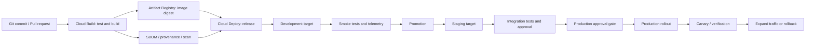

# Promotions, Approvals, and Multi-Environment Rollouts

A reliable CI/CD pipeline must answer three questions: which version was built, who authorized that version to advance, and how to deploy safely in each environment. If each environment rebuilds the image from the same source branch, the result can still differ due to changing dependencies, base images, or build environments. If Production receives changes without approval and post-deployment verification, a bug that already surfaced in Staging can still reach users.

**Promotion** is the process of advancing the exact same verified release from one environment to the next. **Approval** is a controlled decision allowing a rollout to proceed. **Progressive rollout** deploys in phases or to a fraction of traffic to measure impact before expanding.

In Google Cloud, Cloud Build can execute CI and produce artifacts, Artifact Registry stores artifacts, and Cloud Deploy orchestrates releases, targets, rollouts, and approvals. These components combine with IAM, Cloud Logging, Cloud Monitoring, Binary Authorization, and change management processes to create a traceable delivery chain.

This lesson is part of the **CI/CD and Software Supply Chain** chapter of the **CLOUD_PROVIDERS_GCP** module. Examples focus on applications running on GKE or Cloud Run across Development, Staging, and Production environments.

## 1. Learning Objectives

After this lesson, you will be able to:

- Distinguish between build, release, promotion, approval, and rollout.
- Design a workflow to build once and promote the same artifact across multiple environments.
- Organize GCP environments, projects, IAM, secrets, and deployment configurations.
- Use Cloud Deploy delivery pipelines, targets, releases, and rollouts.
- Establish approval gates for Production and separate release creator permissions from approvers.
- Implement canary or phased rollouts and post-deployment verification.
- Design rollbacks based on immutable artifacts and compatible data.
- Protect the software supply chain with provenance, SBOMs, vulnerability scanning, and Binary Authorization.
- Track release history, investigate failures, and improve processes.

## 2. Distinguishing Build, Release, Promotion, and Rollout

These terms are related but represent distinct steps.

| Concept | Meaning | Example |
|---|---|---|
| Build | Compile or package source code into an artifact. | Cloud Build creates a container image for the checkout API. |
| Artifact | Immutable build output identified by digest or version. | Image referenced by URI with a sha256 suffix. |
| Release | Release version binding an artifact with deployment config and metadata. | Cloud Deploy creates a release from image digest and manifests. |
| Promotion | Advancing a verified release to the next target. | From Development to Staging and then Production. |
| Approval | Authorized person's decision allowing a rollout to proceed. | Operations team approves Production rollout. |
| Rollout | A single deployment of a release to a target. | Cloud Deploy deploys a release to Production GKE. |
| Verification | Checks during or after rollout to confirm health and behavior. | Smoke tests, SLIs, health checks, integration tests. |

A pipeline can create one build, one release, and multiple rollouts to targets. Never treat every promotion as a new build.

### 2.1. The Build Once, Promote Many Principle

Suppose commit `a1b2c3d` is built into an image:

```text
asia-southeast1-docker.pkg.dev/acme-prod/apps/checkout@sha256:9a7f...e31c
```

That exact digest is deployed sequentially to Development, Staging, and Production. Each environment can use its own configuration such as hostname, replica count, autoscaling, secret references, and resource limits; the image contents remain unchanged.

Benefits:

- The artifact in Production is the exact artifact tested in Staging.
- You can trace back from the image digest to commit, build, SBOM, and provenance.
- Reduces risk from dependency or base image drift between two builds.
- Rollbacks are deterministic because the previous version is stored by digest.
- Approvals only need to reference a specific release and its evidence.

If you rebuild for each environment, the same commit is no longer guaranteed to produce the same binary. That approach weakens reproducibility and supply chain auditability.

### 2.2. Environment Configurations Allowed to Differ

Building once does not mean every environment must share identical runtime settings. Values that commonly differ:

- Project, cluster, namespace, or Cloud Run service.
- Domains, endpoints, and dependency connection settings.
- Replica count, CPU, memory, autoscaling, and quotas.
- Secret Manager secret names or secret versions referenced.
- Feature flags and traffic limits.
- Logging, monitoring, and network policies.

Store these configurations in reviewed manifests, Kustomize overlays, Helm values, or Skaffold profiles. Never embed credentials, private keys, or plaintext secrets in container images or committed configuration files.

## 3. Promotion Architecture on Google Cloud

A reference architecture:



Key components:

- **Source repository:** stores source code, pipeline definitions, manifests, and configuration.
- **Cloud Build:** runs tests, builds images, generates metadata, and pushes artifacts.
- **Artifact Registry:** stores container images by repository, tag, and digest.
- **Cloud Deploy:** manages delivery pipelines, targets, releases, rollouts, approvals, and deployment history.
- **Google Kubernetes Engine (GKE) or Cloud Run:** runtime receiving releases.
- **Cloud Monitoring and Cloud Logging:** track SLIs, metrics, logs, and rollout status.
- **Secret Manager:** provides secrets to workloads based on runtime identity.
- **Binary Authorization:** can enforce policies allowing only images meeting verification or attestation requirements to run on supported platforms.

Cloud Build and Cloud Deploy have separate responsibilities. Cloud Build typically validates source and produces artifacts; Cloud Deploy orchestrates delivering releases to targets along a delivery pipeline.

## 4. Designing Environments and Security Boundaries

### 4.1. Separating Environments by Project

For critical systems, a common choice is using separate projects for Development, Staging, and Production:

| Environment | Purpose | Permissions and Data |
|---|---|---|
| Development | Early integration, testing changes. | Controlled broader access; uses synthetic or anonymized data. |
| Staging | Testing close to Production. | Similar configuration, networking, and dependencies; controlled test data. |
| Production | Serving real users. | Least-privilege IAM, real data, mandatory approval, and full auditing. |

Separate projects isolate IAM, quotas, billing, networks, secrets, and blast radius. If an organization cannot split projects, at minimum isolate namespaces, service accounts, secrets, network policies, and deploy permissions. However, namespaces do not fully replace project boundaries.

A Cloud Deploy pipeline can orchestrate targets pointing to appropriate runtime resources. When a target resides in a different project from the pipeline, configure explicit cross-project access permissions for the execution identity. Never grant Owner at the organization level just so a pipeline can deploy.

### 4.2. Using Separate Identities for Each Role

Separate at least these roles:

- **Build identity:** reads necessary source, builds, and writes artifacts to the designated Artifact Registry repository.
- **Release identity:** creates releases or invokes Cloud Deploy from the pipeline.
- **Deployment execution identity:** deploys into the target cluster or runtime.
- **Approver identity:** approves rollouts in protected environments.
- **Runtime identity:** identity used by the application when calling Google Cloud APIs.

A service account used for builds should not automatically hold Production approval rights. Likewise, the running application does not need permission to create releases or modify delivery pipelines.

### 4.3. Secrets and Configuration

Use Secret Manager to store database passwords, API tokens, and required credentials. Manifests should only reference secret names or mount/injection mechanisms; never include plaintext secret values.

Each environment should have separate secrets and access permissions. Staging service accounts must not read Production secrets. When changing secrets, manage versions and rollout procedures so applications adopt new configurations safely.

### 4.4. Separating Promotion and Approval Permissions

Someone who can create releases or promote to Development should not necessarily be able to approve Production. Separating permissions reduces the risk that a single compromised account can build, self-approve, and deploy a dangerous change.

Use Google Groups or organizational identities to manage approver teams. Review membership periodically and revoke permissions when responsibilities change.

## 5. Immutable Artifacts in Artifact Registry

### 5.1. Using Digests Instead of Relying Only on Tags

Tags like `latest`, `staging`, or `prod` can be moved to point to different images. Digests identify image content and prove that environments run the exact same artifact.

Examples:

```text
# Convenient tag for lookup
asia-southeast1-docker.pkg.dev/acme-prod/apps/checkout:1.8.4

# Digest used to pin content
asia-southeast1-docker.pkg.dev/acme-prod/apps/checkout@sha256:9a7f...e31c
```

You can retain tags containing commit SHAs or release versions for human lookup, but production rollouts should reference verified digests. Do not overwrite published release tags if repository policies support immutable tags; prefer creating a new tag per build.

### 5.2. Building and Pushing Images

Illustrative command:

```bash
gcloud builds submit \
  --tag asia-southeast1-docker.pkg.dev/PROJECT_ID/apps/checkout:COMMIT_SHA \
  --project=PROJECT_ID
```

This command submits source to Cloud Build to build and push an image under the tag. In real pipelines, pin base images and dependencies, run tests, check build results, and then retrieve the digest stored by Artifact Registry.

Look up the digest:

```bash
gcloud artifacts docker images describe \
  asia-southeast1-docker.pkg.dev/PROJECT_ID/apps/checkout:COMMIT_SHA \
  --format="value(image_summary.digest)" \
  --project=PROJECT_ID
```

Once you have the digest, record it alongside the build ID, commit SHA, builder identity, and test metadata. Do not infer the digest by hashing source files yourself; image digests must come from the pushed artifact.

### 5.3. Recording Release Metadata

A release record should include:

- Git commit SHA and repository URL.
- Cloud Build build ID and build timestamp.
- Image URI and digest.
- Base image version, dependency lockfile, and toolchain.
- Unit, integration, and security test results.
- SBOM, provenance, and vulnerability scan results.
- Release name, delivery pipeline, and target history.
- Release creator, promoter, and approver.

This information helps on-call responders determine exactly what is running in Production and why it was authorized for deployment.

## 6. Configuring a Cloud Deploy Delivery Pipeline

Cloud Deploy uses these concepts:

- **Delivery pipeline:** describes the sequence of targets and deployment order.
- **Target:** represents a destination environment such as a GKE cluster or Cloud Run service.
- **Release:** release version created from source, manifests, and images.
- **Rollout:** an instance of deploying a release to a target.
- **Approval:** condition requiring rollout approval when configured on a target.

Example three-environment pipeline configuration for GKE:

```yaml
apiVersion: deploy.cloud.google.com/v1
kind: DeliveryPipeline
metadata:
  name: checkout-pipeline
description: Promotion from development to staging and production
serialPipeline:
  stages:
    - targetId: checkout-dev
    - targetId: checkout-staging
    - targetId: checkout-prod
---
apiVersion: deploy.cloud.google.com/v1
kind: Target
metadata:
  name: checkout-dev
description: Development GKE cluster
gke:
  cluster: projects/PROJECT_ID/locations/asia-southeast1/clusters/dev-cluster
---
apiVersion: deploy.cloud.google.com/v1
kind: Target
metadata:
  name: checkout-staging
description: Staging GKE cluster
gke:
  cluster: projects/PROJECT_ID/locations/asia-southeast1/clusters/staging-cluster
---
apiVersion: deploy.cloud.google.com/v1
kind: Target
metadata:
  name: checkout-prod
description: Production GKE cluster
requireApproval: true
gke:
  cluster: projects/PROJECT_ID/locations/asia-southeast1/clusters/prod-cluster
```

This is a basic structural example. Replace `PROJECT_ID`, cluster names, and locations with real values. Target resources must exist and the execution identity must have permission to deploy to the clusters. If environments reside in separate projects, configure cross-project IAM for the proper service accounts.

Apply the configuration:

```bash
gcloud deploy apply \
  --file=clouddeploy.yaml \
  --region=asia-southeast1 \
  --project=PROJECT_ID
```

After applying, verify the delivery pipeline and targets in the Cloud Deploy Console or using `gcloud deploy delivery-pipelines describe` and `gcloud deploy targets describe`. Pipeline configuration is infrastructure that must be reviewed like other production resources.

### 6.1. Binding Configuration per Environment

You can use Skaffold profiles to render different manifests for each stage. Example configuration skeleton:

```yaml
apiVersion: skaffold/v4beta11
kind: Config
metadata:
  name: checkout
manifests:
  raw:
    - k8s/base/*.yaml
deploy:
  kubectl: {}
profiles:
  - name: dev
    manifests:
      raw:
        - k8s/overlays/dev/*.yaml
  - name: staging
    manifests:
      raw:
        - k8s/overlays/staging/*.yaml
  - name: prod
    manifests:
      raw:
        - k8s/overlays/prod/*.yaml
```

Pipeline stages can select the corresponding profile for a target. With Kustomize or Helm configurations, organize overlays/values per environment while keeping the image digest passed into the release unchanged. Avoid building three separate images just to change a hostname or replica count.

Verify the Skaffold version supported by Cloud Deploy in your environment before choosing `apiVersion`. The sample above illustrates profile structure; manifests, artifact mappings, and rendering must match the actual application.

### 6.2. Creating a Release from a Built Artifact

Once the image is pushed and its digest is confirmed, create a release:

```bash
gcloud deploy releases create checkout-1-8-4 \
  --delivery-pipeline=checkout-pipeline \
  --region=asia-southeast1 \
  --source=. \
  --images=checkout=asia-southeast1-docker.pkg.dev/PROJECT_ID/apps/checkout@sha256:DIGEST \
  --project=PROJECT_ID
```

The left-hand name in `--images` must match the image name in the Skaffold configuration or manifests rendered by Cloud Deploy. `DIGEST` is the actual digest retrieved from Artifact Registry, not a placeholder left literal when running.

Cloud Deploy creates the release and begins a rollout to the first target in the pipeline. Inspect rendered manifests before rolling out to critical environments; profile-specific rendering differences must be treated as part of the release content.

## 7. Promoting Across Environments

### 7.1. Promotion Advances the Same Release to the Next Target

After the Development rollout finishes and checks pass, promote the release to Staging:

```bash
gcloud deploy releases promote \
  --release=checkout-1-8-4 \
  --delivery-pipeline=checkout-pipeline \
  --region=asia-southeast1 \
  --to-target=checkout-staging \
  --project=PROJECT_ID
```

After Staging completes integration tests and verification, promote the same release to Production:

```bash
gcloud deploy releases promote \
  --release=checkout-1-8-4 \
  --delivery-pipeline=checkout-pipeline \
  --region=asia-southeast1 \
  --to-target=checkout-prod \
  --project=PROJECT_ID
```

The release name stays the same across promotions. Cloud Deploy creates a corresponding rollout for the new target. If the Production target requires approval, the rollout pauses for authorization before executing protected deployment steps.

Do not create a new release just to move from Staging to Production if no buildable content changed. A new release breaks continuity of test evidence and provenance.

### 7.2. Conditions Required for Promotion

Before promoting, the pipeline or release operator must verify:

- The previous rollout completed.
- Smoke tests and integration tests passed.
- Image digest matches the tested release.
- Vulnerability scans have no policy-blocking findings.
- SBOM and build provenance are traceable.
- Environment configuration has been rendered and reviewed.
- No active incident would elevate the risk of further deployment.
- Service owners and approvers have complete context.

Checks can be automated via CI checks, policy engines, or verification jobs. A successful `promote` command only proves Cloud Deploy accepted the promotion request; it does not substitute for evidence that the application works properly.

### 7.3. Managing Multiple Release Streams

With multiple teams or parallel releases:

- Name releases by version or commit SHA; never reuse names.
- Track which release is currently active on each target.
- Avoid promoting two releases concurrently to the same target if they can overwrite each other's state.
- Define rules for handling older blocked or superseded releases.
- Clarify who is authorized to cancel rollouts or advance promotions.
- Retain artifacts and manifests long enough to support rollbacks within retention windows.

## 8. Approval Gates for Staging and Production

### 8.1. When Is Approval Needed?

Not every environment requires the same level of approval.

| Environment | Recommended Mechanism | Rationale |
|---|---|---|
| Development | Automatic after CI | Fast feedback for developers. |
| Staging | Automatic or risk-based approval | Integration testing and Production-like data. |
| Production | Explicit approval from authorized personnel | Protects users, data, and service continuity. |

Approval should be required when changes impact Production, data schemas, IAM, networking, billing, or high-risk releases. For routine changes, automation can still be safe if policies, tests, and rollbacks are well-established.

### 8.2. Requiring Approval in Cloud Deploy

In the Production Target, set:

```yaml
apiVersion: deploy.cloud.google.com/v1
kind: Target
metadata:
  name: checkout-prod
description: Production GKE target
requireApproval: true
gke:
  cluster: projects/PROJECT_ID/locations/asia-southeast1/clusters/prod-cluster
```

When a rollout reaches this target, Cloud Deploy requires approval. Users with approver permissions can inspect the release, rollout, and related details before deciding to approve or reject per organizational procedure.

Use an appropriate IAM role, such as `roles/clouddeploy.approver`, to grant approval rights. Scope permissions as narrowly as possible and use Google Groups for approver teams instead of granting broad permissions to individual accounts. Verify IAM roles and effective permissions in the project because organizations may apply custom roles or additional policies.

### 8.3. Approving Rollouts via CLI

After inspecting a rollout waiting for approval, an authorized user can approve it:

```bash
gcloud deploy rollouts approve ROLLOUT_ID \
  --delivery-pipeline=checkout-pipeline \
  --release=checkout-1-8-4 \
  --region=asia-southeast1 \
  --approve \
  --project=PROJECT_ID
```

Replace `ROLLOUT_ID` with the rollout awaiting approval. Never auto-approve simply because a rollout has waited a long time; if an approver is unresponsive, escalate or cancel per change management policy.

### 8.4. Approvals Must Include Sufficient Evidence

A solid approval request should provide:

- Release name, commit SHA, image digest, and build ID.
- Links to source changes, pull requests, and code reviewers.
- Results of unit, integration, smoke, and security tests.
- SBOM, provenance, and vulnerability scan results.
- SLO dashboards and current error budget status.
- List of environments that already received the release.
- Configuration changes and data migrations.
- Rollout strategy, observation window, and halt criteria.
- Rollback plan and designated owner.

Approval must not be a blind "Approve" button without context. Approvers need to know which artifact will run, expected impact, test evidence, and recovery plans.

### 8.5. Separation of Duties and Avoiding Self-Approval

Enforce separation of duties:

- The person creating a release should not self-approve Production if policy requires independent control.
- Code reviewers should not automatically hold permissions to alter IAM or deployment policies.
- Approvers do not need permissions to modify manifests or build artifacts.
- Pipeline service accounts must not impersonate approvers.
- Any break-glass exception must have an expiration, justification, and audit record.

Do not set up a rubber-stamp approval gate where the same identity can build, self-approve, and deploy the entire chain.

## 9. Progressive Rollout and Canary Deployment

Shifting 100% of traffic at once can expose all users to a new bug before it is detected. Progressive rollouts reduce blast radius by gradually expanding deployment scope and observing results at each step.

### 9.1. Rollout Strategies

| Strategy | How It Works | When Appropriate |
|---|---|---|
| Rolling update | Replaces instances or pods in batches. | Stateless services with health checks and spare capacity. |
| Canary | Deploys new version to a small slice of workloads or traffic first. | Measuring new release behavior with bounded risk. |
| Blue/green | Prepares a parallel new environment then switches traffic. | Fast cutover needed with ability to switch back to the old environment. |
| Traffic splitting | Distributes requests across revisions or backends. | Cloud Run or load balancers supporting percentage traffic routing. |
| All-at-once | Deploys to the entire target simultaneously. | Test environments or low-risk verified changes. |

Rolling update is a mechanism for replacing workloads in batches; canary is a strategy for verifying a new version before scaling out; blue/green maintains two environments for traffic cutover. No strategy replaces health checks, capacity planning, or rollbacks.

### 9.2. Traffic-Percentage Canary Example

For the checkout service, a team can roll out in stages:

| Stage | New Version Traffic | Criteria to Proceed |
|---|---:|---|
| Canary 1 | 5% | No critical errors; latency and error ratio within thresholds. |
| Canary 2 | 25% | SLIs remain stable across the chosen observation window. |
| Canary 3 | 50% | No regressions compared to baseline. |
| Complete | 100% | Verification passes and no critical SLO alerts fire. |

Percentages and observation durations must reflect traffic volume, risk level, and SLI sensitivity. Low-traffic services may need longer windows to gather sufficient samples. Changes impacting data or IAM need checks beyond traffic metrics alone.

### 9.3. Canary on GKE

Cloud Deploy supports deployment strategies for supported runtimes, including canary models for GKE. Rollouts can be split into phases using verification to decide whether to advance or halt.

For GKE, identify:

- The Deployment or workload being canaried.
- Services and how traffic routes to the new version.
- Pod ratios or counts for each phase.
- Health checks, readiness probes, and startup probes.
- Capacity of the old version during the rollout.
- Metrics used to compare canary against baseline.
- Halt and recovery conditions.

With a standard Kubernetes Deployment lacking traffic splitting, scaling up new replicas does not guarantee only 5% of traffic reaches the new version. A real routing mechanism such as a service mesh, gateway, or appropriate traffic management configuration is required.

### 9.4. Canary on Cloud Run

Cloud Run supports multiple revisions and traffic splitting across revisions. You can deploy a new revision at a small percentage, observe metrics, and gradually increase traffic. Cloud Deploy can orchestrate Cloud Run rollouts according to supported strategies.

Monitor:

- Request count and 5xx error rate by revision.
- Latency p50, p95, and p99.
- Container startup failures and instance errors.
- CPU/memory and concurrency.
- Synthetic test results and key business flows.

If the new revision shows higher error rates than baseline, stop increasing traffic and shift traffic back to the stable revision per the rollback procedure.

## 10. Post-Deployment Verification

An API-level rollout success does not prove the application is behaving correctly. Verify across multiple layers.

### 10.1. Technical Checks

- New workload or revision is ready.
- Readiness and health checks pass.
- Pods are not restarting repeatedly; containers are not crash-looping.
- Load balancers and routing point to the right target.
- Dependencies connect successfully.
- Logs show no unusual spikes in new errors.

### 10.2. Business Checks

Run smoke tests or synthetic transactions on critical user journeys:

- Authentication / login.
- Creating a test order or transaction.
- Reading and writing data along main flows.
- Checking access permissions and response contracts.
- Confirming events or messages are emitted properly.

Smoke tests must be safe, use test data, and be repeatable without creating unwanted real transactions.

### 10.3. Comparing SLIs Before and After Rollout

Track metrics by revision, version, target, or deployment label:

- Availability / error ratio.
- Latency distribution.
- Request volume and saturation.
- Retry rate and dependency errors.
- SLO burn rate and error budget.

Do not compare averages alone. p95/p99 latency and error breakdowns by region or request class can reveal regressions hidden by averages.

### 10.4. Proceed or Halt Rules

Define criteria before starting a rollout:

- Proceed when health checks, smoke tests, and SLIs all pass.
- Halt expansion when error ratio, latency, or crash rate exceeds thresholds.
- Roll back when regressions affect users or cannot be mitigated within the allowed window.
- Open an incident if real impact occurs or data impact is suspected.
- Never proceed merely because the observation timer expired if metrics lack sufficient samples or telemetry was interrupted.

## 11. Rollback and Recovery

Rollbacks must be prepared before deployment. They can involve shifting traffic to an old revision, redeploying a known-good image digest, or restoring previous manifests/configurations.

### 11.1. Retaining Known-Good Releases

Record the release name and digest of the previous Production version. When a new release fails:

1. Halt promotion or subsequent phases.
2. Determine blast radius and which version is currently serving.
3. Select a previously verified known-good release or artifact.
4. Create a recovery rollout via Cloud Deploy or runtime mechanisms.
5. Verify SLIs, health checks, and business flows.
6. Log an incident and preserve evidence of the faulty release.

Never use mutable tags like `latest` to roll back because the tag may already point to another image.

### 11.2. Cloud Run Rollback

Cloud Run retains revisions. If a new revision increases errors, adjust traffic back to the previous revision via Cloud Console, gcloud, or an appropriate Cloud Deploy workflow.

Illustrative command to list revisions:

```bash
gcloud run revisions list \
  --service=checkout \
  --region=asia-southeast1 \
  --project=PROJECT_ID
```

Then run a traffic update operation to route traffic back to the verified revision. Confirm the old revision still exists and its runtime configuration remains valid before shifting traffic.

### 11.3. GKE Rollback

For GKE, recovery options depend on deployment setup:

- Use a Cloud Deploy rollout or known-good release to redeploy prior manifests and images.
- Use Kubernetes Deployment rollback mechanisms when rollouts are managed directly via Deployment revisions and revision history is retained.
- If traffic is routed via Gateway, service mesh, or load balancer, restore routing to the stable version.
- Verify data migrations and API contracts before running the old version again.

Do not assume rolling back a workload reverts changed database schemas or data. If a migration breaks backward compatibility, a separate recovery plan is required.

### 11.4. Designing Compatible Database Migrations

Multi-environment rollouts require migration discipline:

- Use the expand-and-contract pattern: add compatible schema elements first, deploy new code, and only drop old schema elements after all versions have transitioned.
- Avoid renaming or dropping columns in the first release while older versions still read them.
- Establish backups or point-in-time recovery per data requirements.
- Test migrations in Staging with representative data.
- Ensure new code works after the new migration runs even if code rolls back to the previous version.
- For irreversible changes, prepare a forward-fix or restore plan and require separate approval.

Application rollback and data rollback are two distinct tasks. Never promise instant rollback if schemas or data cannot return to the prior state.

## 12. Securing the Software Supply Chain and Release Policies

### 12.1. Provenance and SBOM

Provenance records the origin and process used to create an artifact: source, builder, build process, and outputs. An SBOM lists software components and dependencies inside an artifact.

Before Production promotion, verify:

- Provenance matches the exact image digest.
- The builder is an organization-trusted identity.
- The source commit was reviewed and belongs to an allowed branch or release.
- An SBOM was generated and stored per policy.
- Dependency scans show no vulnerabilities exceeding policy thresholds.
- The artifact has not been altered after building.

### 12.2. Vulnerability Scanning and Binary Authorization

Artifact Registry integrates with Artifact Analysis to scan container images for vulnerabilities. Pair scan results with policies covering severity, exceptions, remediation deadlines, and owners.

For GKE, Binary Authorization can govern which images are allowed to deploy based on policies and attestations. Only images meeting provenance or attestation requirements are permitted to run. Design attestors, signers, key protection, and attestation creation workflows after required checks.

Cloud Deploy approvals and Binary Authorization answer two different questions:

- Approval confirms an authorized human permitted the rollout.
- Binary Authorization verifies whether the artifact satisfies deployment policies.

An approver should not be able to bypass artifact protection policies simply by clicking approve. If policy requires an attestation, the release must carry a valid attestation before the runtime admits the image.

### 12.3. Dependency and Base Image Management

- Pin dependencies with lockfiles and explicit versions.
- Use organization-approved base images.
- Track security updates for base images.
- Minimize unnecessary packages inside containers.
- Never fetch dependencies from unverified sources during builds.
- Store build caches securely and avoid sharing untrusted caches across workloads with differing security levels.

### 12.4. Policy as Code

Policies can be enforced before promotion to verify:

- Images use digests, not mutable tags.
- Releases carry provenance and SBOMs.
- Vulnerabilities do not exceed thresholds.
- Production manifests contain no plaintext secrets.
- Resource requests/limits, namespaces, service accounts, and security contexts meet baselines.
- Approval is required for Production or high-risk changes.

Policies should be version-controlled, tested, and reviewed like source code. Maintain clear exception processes with expiration dates and accountable owners.

## 13. Cloud Build and Cloud Deploy in CI/CD

A reference pipeline has two halves: Cloud Build produces artifacts, and Cloud Deploy creates releases and orchestrates rollouts.

### 13.1. Cloud Build Creating an Image

Simplified Cloud Build config example:

```yaml
steps:
  - name: gcr.io/cloud-builders/docker
    args:
      - build
      - -t
      - asia-southeast1-docker.pkg.dev/PROJECT_ID/apps/checkout:$SHORT_SHA
      - .

  - name: gcr.io/cloud-builders/docker
    args:
      - push
      - asia-southeast1-docker.pkg.dev/PROJECT_ID/apps/checkout:$SHORT_SHA

  - name: gcr.io/google.com/cloudsdktool/google-cloud-cli:stable
    entrypoint: bash
    args:
      - -ceu
      - |
        IMAGE="asia-southeast1-docker.pkg.dev/PROJECT_ID/apps/checkout:$SHORT_SHA"
        DIGEST="$(gcloud artifacts docker images describe "$IMAGE" \
          --format='value(image_summary.digest)')"
        test -n "$DIGEST"
        echo "$DIGEST" > /workspace/image-digest.txt

options:
  logging: CLOUD_LOGGING_ONLY
```

This is a minimal example demonstrating build, push, and digest retrieval. In a real pipeline, add unit tests, dependency scans, SBOMs, provenance, artifact retention, and error handling. `PROJECT_ID` and repositories must point to the proper artifact locations; never reuse the same tag across multiple builds.

### 13.2. Creating a Cloud Deploy Release

Once the digest is determined, a Cloud SDK step can create the release:

```bash
DIGEST="$(cat /workspace/image-digest.txt)"

gcloud deploy releases create "checkout-$SHORT_SHA" \
  --delivery-pipeline=checkout-pipeline \
  --region=asia-southeast1 \
  --source=. \
  --images="checkout=asia-southeast1-docker.pkg.dev/PROJECT_ID/apps/checkout@$DIGEST" \
  --project=PROJECT_ID
```

This step requires permission to create releases and read source configuration. The image name `checkout` must match the Skaffold configuration. For Production promotions to require approval, the corresponding Target must configure `requireApproval: true`.

Never grant approval permissions to the build service account. If the pipeline automatically promotes to Staging, use a release/promote identity with appropriate permissions; Production still waits for an independent approver.

### 13.3. Separating CI and CD Pipelines

You can separate:

- CI pipeline triggered on pull request or merge: test, build, scan, and generate artifacts and provenance.
- CD pipeline creating a release from an accepted digest, deploying to Development, and awaiting verification.
- Promotion workflow advancing the exact same release to Staging and Production once respective conditions are met.

Separating CI and CD avoids rebuilding during promotion and allows operations teams to control deployment permissions independently of source code write permissions.

## 14. IAM and Auditing for the Release Process

### 14.1. Cloud Build Permissions

The Cloud Build service account should only hold:

- Source read or trigger access as needed.
- Write access to the designated Artifact Registry repository.
- Release creation permissions if the build/CD step invokes Cloud Deploy.
- Secret or configuration read access only when the build genuinely needs it.

Never grant Owner or Editor to resolve permission errors. Identify the exact missing API and permission, then grant the appropriate role at the narrowest scope.

### 14.2. Cloud Deploy Permissions

Separate permissions by duty:

- Pipeline/rollout viewers need read-only permissions.
- Release creators or promoters need corresponding release/promote permissions.
- Approvers need rollout approval permissions.
- Execution service accounts need deployment permissions on GKE or Cloud Run targets.
- Only pipeline administrators need permissions to edit delivery pipelines and targets.

For GKE targets, the execution identity needs cluster access and Kubernetes RBAC permissions to apply resources. For Cloud Run, the deployment identity needs permissions to update services and use the configured runtime service account. Do not use the application's runtime permissions as deployment permissions.

### 14.3. Audit Trail

Track:

- Who triggered builds and created releases.
- Which source commit and digest were built.
- Who promoted a release and to which target.
- Who approved or rejected a rollout.
- When rollouts started, completed, halted, or rolled back.
- Which policies or IAM bindings changed.
- Verification results and related incidents.

Use Cloud Audit Logs, Cloud Build history, Cloud Deploy release/rollout history, and incident/change management systems. Retain logs long enough to satisfy organizational audit and security requirements.

## 15. Common Pitfalls

| Pitfall | Consequence | Resolution |
|---|---|---|
| Rebuilding images in each environment | Different artifacts despite identical commit. | Build once, promote verified digest. |
| Using mutable tags like `latest` | Cannot reliably determine what Production runs. | Use image digests and immutable release tags. |
| Production lacks an approval gate | Changes can deploy without review. | Enable `requireApproval` and separate approver roles. |
| Build author self-approves Production | Breaks separation of duties. | Use an independent approver group and audit. |
| Checking only that deploy API succeeded | Application may still fail post-rollout. | Add smoke tests, verification, and SLI checks. |
| Canary without traffic splitting | Canary percentage does not reflect real traffic. | Configure runtime-appropriate routing or service mesh. |
| Rolling back code while ignoring database | Older version may fail on new schema. | Use backward-compatible migrations and data recovery plans. |
| Approval lacking evidence | Approvers cannot assess risk. | Provide digest, tests, SBOM, provenance, SLOs, and rollback plan. |
| Overly permissive service accounts | Larger blast radius if credentials leak. | Separate identities and enforce least-privilege IAM. |
| Not retaining release history | Difficult investigation and recovery. | Retain release metadata, digests, rollouts, and audit logs. |
| Concurrent promotion of multiple releases | New releases overwrite or confuse environment state. | Serialize promotions per target and track release states. |
| No rollout halt criteria | Regressions spread before detection. | Define halt thresholds, verification, and decision owners. |

## 16. Pre-Production Promotion Checklist

- [ ] Release points to an immutable image digest.
- [ ] Digest was deployed and tested in Development and Staging.
- [ ] Build ID, commit SHA, provenance, and SBOM are traceable.
- [ ] Vulnerability scans satisfy policy.
- [ ] Production configuration has been rendered and reviewed.
- [ ] Project, target, cluster/service, and namespace match the environment.
- [ ] Secrets are referenced via Secret Manager, not stored in plaintext in images or manifests.
- [ ] Execution service account has minimum required permissions.
- [ ] Production target has approval gate enabled.
- [ ] Independent approvers reviewed full evidence and rollback plan.
- [ ] Canary/rollout strategy and halt criteria are defined.
- [ ] Smoke tests, health checks, SLIs, and dashboards are ready.
- [ ] Database migrations are backward-compatible or have a recovery plan.
- [ ] Prior artifacts and releases remain available during the rollback window.
- [ ] Cloud Build, Cloud Deploy, and IAM audit trails are retained.
- [ ] On-call owners are designated during rollout and traffic expansion.

## Conclusion

Promotion, approval, and rollout are three complementary control layers in CI/CD. Build once, promote many ensures the exact tested artifact progresses through each environment. Cloud Deploy orchestrates releases and rollouts; target approval gates establish an independent checkpoint before Production; canary and verification limit blast radius during releases.

A secure release process requires immutable artifacts, managed environment configurations, separated IAM, supply chain evidence, contextual approvals, and tested rollbacks. Combining Cloud Build, Artifact Registry, Cloud Deploy, Cloud Monitoring, and audit trails enables full traceability from commit to the version running in Production.

## References

- [Google Cloud Deploy: Overview](https://cloud.google.com/deploy/docs/overview)
- [Google Cloud Deploy: Delivery pipelines and targets](https://cloud.google.com/deploy/docs/deployment-pipelines)
- [Google Cloud Deploy: Approve a rollout](https://cloud.google.com/deploy/docs/approve-rollout)
- [Google Cloud Deploy: Promote a release](https://cloud.google.com/deploy/docs/promote-release)
- [Google Cloud Deploy: Deployment strategies](https://cloud.google.com/deploy/docs/deployment-strategies)
- [Google Cloud Deploy: Verify a deployment](https://cloud.google.com/deploy/docs/verify-deployment)
- [Cloud Build: Build and push Docker images](https://cloud.google.com/build/docs/building/build-containers)
- [Artifact Registry: Container image digests](https://cloud.google.com/artifact-registry/docs/docker/names)
- [Binary Authorization: Overview](https://cloud.google.com/binary-authorization/docs/overview)
- [Google Cloud: Secure CI/CD pipeline](https://cloud.google.com/architecture/secure-cicd-pipeline)
