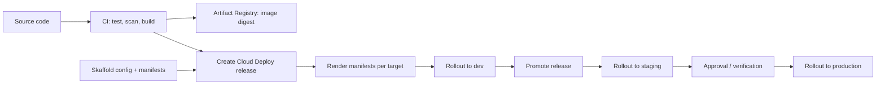

# Skaffold and Deployment Configuration for Cloud Deploy

A development team may successfully build container images yet still struggle to move the exact same application version across dev, staging, and production. Each environment has different clusters, network settings, replica counts, secrets, and approval requirements. If CI generates manifests separately per environment, deployment outputs can easily drift and make it difficult to trace which version ran where.

**Skaffold** standardizes how Kubernetes application builds, rendering, and deployments are described. **Cloud Deploy** manages the delivery flow across environments, creates releases and rollouts, tracks statuses, requires approvals, and supports canary strategies. Together, Skaffold defines how manifests are produced; Cloud Deploy decides which targets receive those manifests and in what order.

In the `CLOUD_PROVIDERS_GCP` module, this lesson places Skaffold and Cloud Deploy into the workload release flow on Google Kubernetes Engine (GKE), while connecting to Artifact Registry, Cloud Build, IAM, and software supply chain controls. CI is responsible for producing verifiable images; Cloud Deploy takes the immutable image alongside configuration code, renders manifests per target, and orchestrates deployment.

## 1. Distinguishing CI, Skaffold, and Cloud Deploy

| Component | Primary Responsibility | Output |
|---|---|---|
| Continuous Integration (CI) | Test code, build containers, scan for vulnerabilities, sign or generate provenance, push images to Artifact Registry | Built image identified by digest or immutable tag |
| Skaffold | Describe artifacts, manifests, renderers, and deployment method; support environment profiles | Rendered manifests and how to apply them to Kubernetes |
| Cloud Deploy | Manage delivery pipelines, targets, releases, rollouts, promotions, approvals, and rollbacks | Trackable release status across environments |



Cloud Deploy does not require CI to use Cloud Build. You can use Cloud Build, GitHub Actions, Jenkins, or another CI system, provided it builds the image and supplies configuration source and image references to Cloud Deploy. When creating a release, Cloud Deploy uses Cloud Build to execute rendering operations; during deployment, Cloud Deploy runs Skaffold to apply manifests to the target.

## 2. What Does Skaffold Do in a Kubernetes Workflow?

Skaffold is a tool that supports continuous development workflows for Kubernetes applications. A `skaffold.yaml` file can describe:

- **Build:** images built from Dockerfiles, Buildpacks, or other builders.
- **Artifacts:** logical image names and build directories/contexts.
- **Manifests:** Kubernetes manifests sourced directly or generated via Helm, Kustomize, or kpt.
- **Deploy:** how manifests are applied, e.g., `kubectl`.
- **Profiles:** configuration variations across dev, staging, or production.
- **Test and verify:** pre-/post-deploy checks according to supported capabilities.

Skaffold can run local inner loops with `skaffold dev`, build images with `skaffold build`, render manifests with `skaffold render`, and apply them with `skaffold apply`. In Cloud Deploy, you do not need Skaffold to build images if CI has already built and pushed them. Cloud Deploy needs the Skaffold configuration to know how to render and deploy manifests.

Cloud Deploy separates describing the delivery pipeline progression from how manifests are generated. The delivery pipeline declares dev → staging → production. Skaffold defines which manifests and renderer each target uses. When a release is created, Cloud Deploy invokes Cloud Build to run `skaffold diagnose` and `skaffold render`; when a rollout runs, Cloud Deploy runs `skaffold apply` to deploy the rendered manifests. Skaffold performs deployment health checks, and Cloud Deploy uses the results to update rollout status.

Cloud Deploy supports `kubectl` as the deployer for GKE. Helm and Kustomize can be used to render manifests, but Cloud Deploy does not use Helm or Kustomize directly as deployment tools. If a different deployer is needed, a custom target must be designed.

## 3. Minimal Structure of `skaffold.yaml`

For GKE, a minimal Skaffold file needs `apiVersion`, `kind`, a manifest list, and `deploy.kubectl`. Simple example using raw YAML manifests:

```yaml
apiVersion: skaffold/v4beta7
kind: Config
metadata:
  name: orders-api
manifests:
  rawYaml:
    - kubernetes/namespace.yaml
    - kubernetes/deployment.yaml
    - kubernetes/service.yaml
deploy:
  kubectl: {}
```

`apiVersion` must be a Skaffold schema version supported by Cloud Deploy. Cloud Deploy documentation currently illustrates `skaffold/v4beta7`; check the schema and tool versions provided by Cloud Deploy when upgrading configurations.

In manifests, images typically use a logical name so Skaffold substitutes the concrete image during rendering:

```yaml
apiVersion: apps/v1
kind: Deployment
metadata:
  name: orders-api
  namespace: orders
spec:
  replicas: 2
  selector:
    matchLabels:
      app: orders-api
  template:
    metadata:
      labels:
        app: orders-api
    spec:
      containers:
        - name: orders-api
          image: orders-api
          ports:
            - name: http
              containerPort: 8080
          readinessProbe:
            httpGet:
              path: /actuator/health/readiness
              port: http
            initialDelaySeconds: 5
            periodSeconds: 10
          livenessProbe:
            httpGet:
              path: /actuator/health/liveness
              port: http
            initialDelaySeconds: 15
            periodSeconds: 20
```

In the release creation command, CI maps the logical name `orders-api` to the pushed image, such as `asia-southeast1-docker.pkg.dev/PROJECT_ID/apps/orders-api@sha256:IMAGE_DIGEST`. Cloud Deploy/Skaffold replaces the image in the manifest with this full reference. Using a digest ensures every environment deploys the exact same image content, even if tags can be overwritten.

## 4. Using Kustomize and Skaffold Profiles per Environment

When dev, staging, and production need different configurations, avoid maintaining three near-identical manifest copies and editing them manually. Place shared definitions in `base`, create environment-specific overlays, and use Skaffold profiles to select the overlay.

```text
orders-api/
├── skaffold.yaml
├── clouddeploy.yaml
└── kubernetes/
    ├── base/
    │   ├── deployment.yaml
    │   ├── service.yaml
    │   └── kustomization.yaml
    └── overlays/
        ├── dev/
        ├── staging/
        └── prod/
```

Example `skaffold.yaml`:

```yaml
apiVersion: skaffold/v4beta7
kind: Config
metadata:
  name: orders-api
deploy:
  kubectl: {}
profiles:
  - name: dev
    manifests:
      kustomize:
        paths:
          - kubernetes/overlays/dev
  - name: staging
    manifests:
      kustomize:
        paths:
          - kubernetes/overlays/staging
  - name: prod
    manifests:
      kustomize:
        paths:
          - kubernetes/overlays/prod
```

Example `kubernetes/base/kustomization.yaml`:

```yaml
apiVersion: kustomize.config.k8s.io/v1beta1
kind: Kustomization
resources:
  - deployment.yaml
  - service.yaml
```

Example production overlay:

```yaml
apiVersion: kustomize.config.k8s.io/v1beta1
kind: Kustomization
resources:
  - ../../base
patches:
  - path: replicas-patch.yaml
```

`replicas-patch.yaml` can set `spec.replicas: 6`, while dev and staging use lower replica counts. Shared configuration such as labels, probes, Services, and container images remains in base. Never store passwords or tokens directly in overlays; use Secret Manager, Workload Identity, and runtime secret injection mechanisms.

In the delivery pipeline, stage `dev` binds profile `dev`, stage `staging` binds profile `staging`, and stage `prod` binds profile `prod`. Cloud Deploy uses the profile declared on the stage when rendering the release for the corresponding target.

## 5. Helm, Kustomize, and Raw Manifests

| Management Approach | Best Suited When | Configuration in Skaffold |
|---|---|---|
| Raw YAML | Small applications, few environments, simple manifests | `manifests.rawYaml` |
| Kustomize | Shared base with per-environment overlays | `manifests.kustomize.paths` |
| Helm | Applications with charts, values, and many configuration parameters | `manifests.helm.releases` |
| kpt | Managing Kubernetes packages and package-based config | `manifests.kpt` per supported Skaffold schema |

Example Helm renderer configuration:

```yaml
apiVersion: skaffold/v4beta7
kind: Config
metadata:
  name: orders-api
manifests:
  helm:
    releases:
      - name: orders-api
        chartPath: charts/orders-api
        valuesFiles:
          - charts/orders-api/values.yaml
deploy:
  kubectl: {}
```

Cloud Deploy uses Helm to render charts into Kubernetes manifests. Applying the manifests is still executed by `kubectl` through Skaffold. When values need to vary by target, use Skaffold profiles or Cloud Deploy deploy parameters.

Not every Skaffold feature works inside Cloud Deploy. For example, dynamic Skaffold modules and Skaffold lifecycle hooks are not supported in Cloud Deploy's execution model; static modules are supported. Check the supported feature list before introducing complex local Skaffold configurations into production pipelines.

## 6. Declaring Cloud Deploy Delivery Pipelines and Targets

Cloud Deploy uses two primary resources:

- **DeliveryPipeline:** describes target ordering and deployment strategies across stages.
- **Target:** defines a deployment environment, such as a GKE cluster, along with connectivity, approval, and execution environment properties.

You can place the pipeline and targets in the same `clouddeploy.yaml` file or split them into separate files. Combining them keeps small setups easy to follow; larger organizations may separate production targets so platform/security teams manage them independently.

Example `clouddeploy.yaml` with three targets—dev, staging, and production:

```yaml
apiVersion: deploy.cloud.google.com/v1
kind: DeliveryPipeline
metadata:
  name: orders-pipeline
description: Deliver orders-api through dev, staging and production
serialPipeline:
  stages:
    - targetId: orders-dev
      profiles: [dev]
    - targetId: orders-staging
      profiles: [staging]
    - targetId: orders-prod
      profiles: [prod]
---
apiVersion: deploy.cloud.google.com/v1
kind: Target
metadata:
  name: orders-dev
  labels:
    env: dev
description: Development GKE cluster
gke:
  cluster: projects/PROJECT_ID/locations/asia-southeast1/clusters/orders-dev
---
apiVersion: deploy.cloud.google.com/v1
kind: Target
metadata:
  name: orders-staging
  labels:
    env: staging
description: Staging GKE cluster
gke:
  cluster: projects/PROJECT_ID/locations/asia-southeast1/clusters/orders-staging
---
apiVersion: deploy.cloud.google.com/v1
kind: Target
metadata:
  name: orders-prod
  labels:
    env: prod
description: Production GKE cluster
requireApproval: true
gke:
  cluster: projects/PROJECT_ID/locations/asia-southeast1/clusters/orders-prod
```

Replace `PROJECT_ID` and cluster names with real values. `targetId` in each stage must match a Target's `metadata.name`. Targets and delivery pipelines are registered in the same Cloud Deploy project and region; the GKE clusters pointed to by targets can reside in other projects or regions, provided the execution service account has proper permissions and connectivity.

One delivery pipeline uses a single runtime type across its targets, e.g., all GKE or all Cloud Run. If you have both GKE and Cloud Run targets, design pipelines aligned to each runtime instead of mixing target types within the same progression.

### Registering Pipelines and Targets

```bash
gcloud deploy apply \
  --file=clouddeploy.yaml \
  --project=DEPLOY_PROJECT_ID \
  --region=asia-southeast1
```

This command registers the DeliveryPipeline and Targets declared in the file. When pipeline or target configurations change, re-run `gcloud deploy apply` to update the Cloud Deploy resources. Updating a pipeline does not automatically create new releases; each release preserves the pipeline configuration snapshot from the time it was created.

## 7. Releases, Rollouts, and Promotions

| Concept | Meaning |
|---|---|
| Delivery pipeline | Defines progression and target ordering |
| Target | Deployment environment, e.g., GKE dev or production |
| Release | A release instance tied to source, images, and rendered manifests per target |
| Rollout | Process of deploying a release to a specific target |
| Job | A unit of work in a rollout, e.g., render, deploy, verify, or postdeploy |
| Promotion | Advancing a release deployed on the current target to the next target |

When creating a release, Cloud Deploy automatically creates the first rollout to the first target in the pipeline (unless initial rollout is explicitly disabled). When promoting to the next target, Cloud Deploy creates a new rollout for that target. Thus, a single release can have multiple rollouts across dev, staging, and production.

### Creating a Release with a Built Image

CI must build and push the image before invoking Cloud Deploy. Example using an image identified by digest:

```bash
gcloud deploy releases create orders-20261119-01 \
  --delivery-pipeline=orders-pipeline \
  --project=DEPLOY_PROJECT_ID \
  --region=asia-southeast1 \
  --source=. \
  --images=orders-api=asia-southeast1-docker.pkg.dev/PROJECT_ID/apps/orders-api@sha256:IMAGE_DIGEST
```

`--source` points to the directory containing `skaffold.yaml`, manifests, charts, and files needed for rendering. If `--source` is omitted, Cloud Deploy uses the current directory and archives its contents and subdirectories for upload. Do not run the command from a home directory or overly broad repository root unnecessarily; use `.gcloudignore` to exclude unneeded files.

`--images` accepts one or more `image-name=full-image-path` pairs. The left-hand name must match the logical image name in manifests/Skaffold. Multiple images can be passed comma-separated.

If CI already ran `skaffold build` and generated a build artifacts output file, you can pass `--build-artifacts=PATH` instead of `--images`. These two flags are mutually exclusive. In pipelines using other builders, `--images` is typically the clearest way to pass built images.

### Promoting to Staging and Production

```bash
gcloud deploy releases promote \
  --release=orders-20261119-01 \
  --delivery-pipeline=orders-pipeline \
  --project=DEPLOY_PROJECT_ID \
  --region=asia-southeast1
```

If `--to-target` is omitted, the release is promoted to the next target in the pipeline. You can pass `--to-target=orders-prod` when selecting a specific permitted target in the progression.

When a target requires approval, the rollout waits for authorization before proceeding. Users with approver permissions can approve via:

```bash
gcloud deploy rollouts approve ROLLOUT_NAME \
  --delivery-pipeline=orders-pipeline \
  --release=orders-20261119-01 \
  --project=DEPLOY_PROJECT_ID \
  --region=asia-southeast1
```

Or reject via `gcloud deploy rollouts reject`. Approvers should inspect manifest diffs, image digests, test results, prior rollouts, and SLO status before approving production.

## 8. Canary Deployment for GKE

Canary delivers a new version to a portion of workloads or traffic first, observes results, and only then scales out. On GKE, Cloud Deploy rolls out the new version to a subset of pods and shifts traffic between old and new versions. Canary requires matching traffic management configuration, such as Service Networking or Gateway API.

Example adding a canary strategy to the production stage of a delivery pipeline:

```yaml
serialPipeline:
  stages:
    - targetId: orders-dev
      profiles: [dev]
    - targetId: orders-staging
      profiles: [staging]
    - targetId: orders-prod
      profiles: [prod]
      strategy:
        canary:
          runtimeConfig:
            kubernetes:
              serviceNetworking:
                service: orders-api
                deployment: orders-api
          canaryDeployment:
            percentages: [10, 50]
```

The snippet above replaces the corresponding `serialPipeline` section in the pipeline file. The Service and Deployment must exist in manifests and their names must match the canary configuration. Cloud Deploy creates phases `canary-10`, `canary-50`, and the final `stable` phase at 100%. After each phase, the team can inspect the rollout and decide whether to advance or halt.

For Gateway API, configure `runtimeConfig.kubernetes.gatewayServiceMesh` and the corresponding HTTPRoute. Declare route destinations and propagation wait times when the environment has route update latency. Do not use Service Networking configuration if the workload splits traffic via Gateway API.

Canary does not replace automated testing. Pair it with verify jobs, Cloud Monitoring metrics, error rates, latency, and logs. Increase traffic percentages only when the new version satisfies defined quality thresholds.

## 9. Verification, Hooks, and Automation

Cloud Deploy can run checks before or after deployment:

- **Predeploy:** checks preconditions before applying manifests, such as database migration checks or dependency verification.
- **Verify:** tests the application after deployment, such as smoke tests, HTTP health checks, or integration tests.
- **Analysis:** evaluates metrics/alerts to decide whether to continue canary or promotion.
- **Postdeploy:** runs tasks after a successful rollout, such as updating release records or sending notifications.

Verification can be enabled via `verify: true` if the Skaffold config includes an appropriate verify section, or by declaring Cloud Deploy tasks. Example standard stage with a verify task:

```yaml
serialPipeline:
  stages:
    - targetId: orders-staging
      profiles: [staging]
      strategy:
        standard:
          verify:
            tasks:
              - smoke-test
```

The `smoke-test` task must be defined according to Cloud Deploy tasks configuration. If the task does not exist or the execution service account lacks permissions, the rollout may halt at the verify step. Verify task names, runtimes, and permissions before registering the pipeline.

Cloud Deploy also supports automation to automatically promote releases or advance rollouts when conditions are met. For instance, after a staging rollout succeeds, automation can promote to production; or after `canary-10` meets metric thresholds, automation can advance to `canary-50`. Automation must be bounded by target, phase, release windows, and rollback criteria.

## 10. IAM and Execution Environment

Cloud Deploy uses multiple identities for different tasks. Do not grant GKE deployment permissions to all users or rely on an overly permissive default service account.

| Identity | Duty | Typically Required Permissions |
|---|---|---|
| User/CI creating releases | Create releases and trigger pipelines | `roles/clouddeploy.releaser` and `iam.serviceAccounts.actAs` on the execution service account as needed |
| User promoting releases | Create rollouts on the next target | Promotion permissions and `iam.serviceAccounts.actAs` on the configured deploy identity |
| Approver | Approve/reject rollouts | `roles/clouddeploy.approver` |
| Cloud Deploy service agent | Call Cloud Build, Pub/Sub, Audit Logs, and managed resources | Google-managed `roles/clouddeploy.serviceAgent` |
| Execution service account | Render and deploy manifests inside Cloud Build | `roles/clouddeploy.jobRunner`, GKE permissions like `roles/container.developer`, `roles/iam.serviceAccountUser`, and appropriate artifact bucket access |

The Cloud Deploy service agent has the form `service-PROJECT_NUMBER@gcp-sa-clouddeploy.iam.gserviceaccount.com`. Do not grant the service agent role to human users or application service accounts. That role is reserved exclusively for the service agent.

By default, Cloud Deploy may use the Compute Engine default service account as the execution identity. Because that account may be shared across services with broad permissions, best practice is creating a dedicated render/deploy service account and configuring it in target `executionConfigs`. Grant runtime permissions on the target GKE project; if the cluster resides in another project, grant permissions in that project.

Example execution service account configuration on a target:

```yaml
apiVersion: deploy.cloud.google.com/v1
kind: Target
metadata:
  name: orders-prod
gke:
  cluster: projects/GKE_PROJECT_ID/locations/asia-southeast1/clusters/orders-prod
executionConfigs:
  - usages:
      - RENDER
      - DEPLOY
    serviceAccount: cloud-deploy-executor@DEPLOY_PROJECT_ID.iam.gserviceaccount.com
```

This service account needs `roles/clouddeploy.jobRunner` in the Cloud Deploy project and access to the target cluster. When using a cross-project service account, configure additional impersonation/token creation permissions per Cloud Deploy service account documentation. Callers creating releases also need `actAs` permission on the service account used for rendering.

## 11. Deploying to Private GKE Clusters

Cloud Deploy must connect to the cluster's Kubernetes API server. For private GKE clusters, select the appropriate access method:

1. **DNS-based endpoint:** enable the DNS endpoint on GKE and set `dnsEndpoint: true` in the target. This is typically the simplest approach if supported by the cluster.
2. **Private IP:** set `internalIp: true` and configure a Cloud Build private worker pool with network access to the cluster's VPC.
3. **GKE attached clusters and Connect Gateway:** use when governance aligns with attached clusters and Connect Gateway.

Example target using a DNS endpoint:

```yaml
apiVersion: deploy.cloud.google.com/v1
kind: Target
metadata:
  name: orders-prod
gke:
  cluster: projects/GKE_PROJECT_ID/locations/asia-southeast1/clusters/orders-prod
  dnsEndpoint: true
```

Do not configure `dnsEndpoint` and `internalIp` simultaneously. When using a private worker pool, grant the Cloud Deploy service agent permission to use the worker pool and grant the execution service account access to the cluster and Cloud Storage artifact bucket. Check firewalls, routes, DNS, and IAM before assuming Skaffold is at fault.

## 12. Managing Versions of Skaffold and Rendering Tools

Cloud Deploy runs render/deploy inside a Google-managed execution image. That image contains tool versions such as Skaffold, kubectl, Helm, and Kustomize. Default versions can be updated regularly; Cloud Deploy allows selecting specific versions when creating a release.

Starting July 10, 2026, Cloud Deploy execution images use a Google-maintained fork of Skaffold. When inspecting a release with `gcloud deploy releases describe`, the Skaffold field may display `cd-skaffold` instead of an upstream version number. Release notes also announce that Skaffold will be removed from gcloud CLI releases after January 15, 2027, and the upstream Skaffold GitHub repository is archived on January 29, 2027. This change applies to the standalone Skaffold CLI and upstream repository; Cloud Deploy continues bundling its maintained fork to execute render/deploy.

Therefore:

- Cloud Deploy does not require installing Skaffold locally to perform render/deploy on the service.
- If using Skaffold locally for `dev`, builds, or tests, install it independently following Skaffold's instructions rather than relying on gcloud CLI after the cutoff.
- Check tool versions currently used by Cloud Deploy before upgrading configurations.
- Pin tool versions for production releases when rendering outputs must be strictly reproducible; Cloud Deploy saves the tool versions bound to a release and reuses them throughout that release's lifecycle.
- Avoid using `latest` keywords in pipelines needing strict reproducibility, as underlying tools can change between release creations.

View Cloud Deploy's default tool versions:

```bash
gcloud deploy get-config \
  --project=DEPLOY_PROJECT_ID \
  --region=asia-southeast1 \
  --format='yaml(defaultToolVersions)'
```

View tool versions bound to a release:

```bash
gcloud deploy releases describe orders-20261119-01 \
  --delivery-pipeline=orders-pipeline \
  --project=DEPLOY_PROJECT_ID \
  --region=asia-southeast1 \
  --format='yaml(toolVersions)'
```

If you need to pin versions at release creation time, pass flags such as `--skaffold-version`, `--kubectl-version`, or `--helm-version` from the list of versions supported by Cloud Deploy. Cloud Deploy ensures compatibility among the bundled tool versions in its images; if overriding individual versions, operators must verify compatibility across tools.

## 13. Securing the Software Supply Chain

Cloud Deploy orchestrates delivery; image quality and trustworthiness still depend on CI processes. A production release should reference an image already built and verified, rather than rebuilding from different sources for each environment.

Recommended practices:

- Build the image once in CI and promote the same digest across dev, staging, and production.
- Use private Artifact Registry repositories, enable vulnerability scanning, and scope push/pull permissions per service account.
- Attach commit SHA, build ID, and release metadata to image labels or provenance.
- Sign images and verify signatures/attestations per organizational policy before production release.
- Never use mutable tags like `latest` as the sole identifier for a release.
- Separate image push permissions from production deploy permissions.
- Retain source archives and rendered manifests linked to releases to trace deployed content.
- Review manifest diffs and changes to IAM, service accounts, network policies, and RBAC before promoting.
- Never store secrets directly in manifests, Skaffold profiles, or source archives; use Secret Manager and workload identities.

Cloud Deploy stores release details and rendered manifests, aiding auditing of render, deploy, and promotion actions. Combine that data with CI build provenance to answer: which commit produced the image, which digest was tested, who created the release, who approved it, and which digest is running in production.

## 14. Monitoring Rollouts, Rollbacks, and Troubleshooting

In Cloud Deploy, each release can have multiple rollouts. When a rollout fails, identify which job failed before retrying or rolling back.

| Symptom | Possible Cause | How to Check |
|---|---|---|
| Render fails | Invalid Skaffold schema, missing manifest, nonexistent profile, or Kustomize/Helm error | Check source archive, `skaffold.yaml`, profile referenced by stage, and render logs |
| Image not substituted | Logical name in `--images` does not match image in manifest | Compare image name in Deployment against the `name=full-path` pair |
| Target cannot find cluster | Wrong project/location/cluster name or missing permissions | Verify `projects/.../locations/.../clusters/...` resource path and execution service account |
| Deploy rejected | Execution service account lacks GKE IAM or Kubernetes RBAC | Check `roles/container.developer`, `roles/iam.serviceAccountUser`, and in-cluster permissions |
| Private cluster timeout | Cloud Build worker pool lacks network path to endpoint | Check DNS endpoint, private pool, VPC, routes, and firewalls |
| Rollout awaiting approval | Target sets `requireApproval: true` | Inspect rollout and `roles/clouddeploy.approver` permissions |
| Canary does not split traffic | Missing service/deployment or mismatched Service Networking/Gateway API config | Compare runtimeConfig against actual Service, Deployment, and HTTPRoute |
| Workload unhealthy post-deploy | Misconfigured probes, broken image, missing secrets/config, or unready dependencies | Check pod events, logs, readiness/liveness, image digest, and secret mounts |
| Promote reports pipeline mismatch | Pipeline or target changed after release creation | View pipeline snapshot bound to the release and read manifest diffs before confirming |

Common inspection commands:

```bash
gcloud deploy delivery-pipelines list \
  --project=DEPLOY_PROJECT_ID \
  --region=asia-southeast1

gcloud deploy releases describe orders-20261119-01 \
  --delivery-pipeline=orders-pipeline \
  --project=DEPLOY_PROJECT_ID \
  --region=asia-southeast1

gcloud deploy rollouts list \
  --delivery-pipeline=orders-pipeline \
  --release=orders-20261119-01 \
  --project=DEPLOY_PROJECT_ID \
  --region=asia-southeast1
```

Cloud Deploy supports rolling back a target to a previously successful release. Rollback creates a new rollout reusing the parameters of the earlier release; it does not delete release history or alter source code. Before rolling back, verify schema/database compatibility and stateful changes because reverting to an older image does not automatically undo data migrations.

## 15. Complete End-to-End Workflow Example for `orders-api`

Suppose a development team owns a Spring Boot application `orders-api` running across three GKE clusters: dev, staging, and production. CI tests, builds the image, scans for vulnerabilities, and pushes the image to Artifact Registry. Skaffold selects Kustomize overlays per target. Cloud Deploy manages progression and requires approval before production.

1. A developer opens a pull request; CI runs unit tests, integration tests, and manifest validation.
2. On merge, CI builds the image once, pushes it to Artifact Registry, and records the digest and commit SHA.
3. CI calls `gcloud deploy releases create`, passing source and the `orders-api=IMAGE_DIGEST` mapping.
4. Cloud Deploy renders manifests for `orders-dev` using the dev profile, then creates the initial rollout.
5. After the dev rollout succeeds, the pipeline runs smoke tests and promotes to staging.
6. Staging uses the staging profile, validating API contracts, latency, error rates, and database integration.
7. The release is promoted to production. Cloud Deploy waits for approval per target configuration.
8. The approver reviews image digest, manifest diff, test results, and SLO status, then approves.
9. The production rollout runs canary at 10%, then 50%, then stable at 100% as verify and metric analysis steps pass.
10. If canary error rates or latency exceed thresholds, halt advancement and roll back per runbook.
11. Record the release, rollouts, approver, and final running digest.

This flow ensures the exact same image digest traverses every environment. Differences in replicas, resource requests, policies, and configuration are handled through profiles/overlays, while promotion order and approvals are managed by Cloud Deploy.

## 16. Hands-On Exercise

Perform in a sandbox project with three GKE clusters or three appropriate namespaces/targets:

1. Create a minimal `skaffold.yaml` using `manifests.rawYaml` and `deploy.kubectl`.
2. Replace raw YAML with a Kustomize base and three overlays: dev/staging/prod.
3. Declare three corresponding Skaffold profiles and verify each profile renders the expected manifests.
4. Create `clouddeploy.yaml` with one DeliveryPipeline and three GKE Targets.
5. Register the pipeline with `gcloud deploy apply`.
6. Build a test image, push it to Artifact Registry, and record the digest.
7. Create a release using `--images` and verify the initial rollout to dev.
8. Promote the release to staging and confirm manifests match the overlay.
9. Enable `requireApproval` for production, test promoting, and perform approve/reject using an appropriately authorized account.
10. Configure a 10% and 50% canary using GKE Service Networking; observe phases and rollouts.
11. Simulate a readiness or verify failure to observe how the rollout halts and how the team responds.
12. Test rolling back to an earlier release and verify the running image digest.

Never use production clusters or real credentials for exercises. Clean up sandbox resources per procedure once finished.

## 17. Pre-Production Checklist for Cloud Deploy

- [ ] CI tests and builds images once; images are identified by digest.
- [ ] Private Artifact Registry, push/pull IAM, and vulnerability scanning are configured.
- [ ] `skaffold.yaml` uses a Cloud Deploy-supported schema and lists all manifests.
- [ ] Profiles referenced by stages exist and render the proper environment config.
- [ ] Helm/Kustomize are used strictly for rendering; GKE deploys via `kubectl` through Skaffold.
- [ ] `clouddeploy.yaml` has accurate progression, target IDs, and GKE resource paths.
- [ ] Pipelines and targets are registered in the right Cloud Deploy project/region.
- [ ] Execution service account has `roles/clouddeploy.jobRunner` and minimum required GKE permissions.
- [ ] Callers, approvers, and execution identities have separate permissions.
- [ ] Private clusters use DNS endpoints or private worker pools with appropriate network routes.
- [ ] Production targets require approval when manual control is needed by release processes.
- [ ] Canary configurations have Service Networking or Gateway API configs matching manifests.
- [ ] Verify/analysis steps inspect metrics, error rates, and latency before advancing.
- [ ] Tool versions and release metadata are traceable; avoid unexpected tool updates on active releases.
- [ ] Rollbacks and database compatibility have been rehearsed.
- [ ] Source archives, rendered manifests, image digests, and approval audits are retained per policy.

## 18. Conclusion

Skaffold standardizes how Kubernetes manifests are built, rendered, and applied; Cloud Deploy manages releases, rollouts, promotions, and approvals across targets. When CI builds an immutable image once, Skaffold profiles select the right configuration per environment, and Cloud Deploy orchestrates progression, development teams can release consistently from dev to production. Success depends on reproducible manifests, proper IAM for each identity, clear image provenance, post-deploy verification, and tested rollback procedures.

## References

- [Use Skaffold with Cloud Deploy](https://docs.cloud.google.com/deploy/docs/using-skaffold)
- [Get started with Skaffold in Cloud Deploy](https://docs.cloud.google.com/deploy/docs/using-skaffold/getting-started-skaffold)
- [Manage manifests in Cloud Deploy](https://docs.cloud.google.com/deploy/docs/using-skaffold/managing-manifests)
- [Deploy to a Google Kubernetes Engine cluster](https://docs.cloud.google.com/deploy/docs/gke-targets)
- [Create your delivery pipeline and targets](https://docs.cloud.google.com/deploy/docs/create-pipeline-targets)
- [Cloud Deploy configuration schema reference](https://docs.cloud.google.com/deploy/docs/config-files)
- [Deploy your application](https://docs.cloud.google.com/deploy/docs/deploying-application)
- [Overview of Cloud Deploy](https://docs.cloud.google.com/deploy/docs/overview)
- [Cloud Deploy service accounts](https://docs.cloud.google.com/deploy/docs/cloud-deploy-service-account)
- [Cloud Deploy IAM roles and permissions](https://docs.cloud.google.com/deploy/docs/iam-roles-permissions)
- [Use a canary deployment strategy](https://docs.cloud.google.com/deploy/docs/deployment-strategies/canary)
- [Promote your release and manage approvals](https://docs.cloud.google.com/deploy/docs/promote-release)
- [Manage Cloud Deploy tool versions](https://docs.cloud.google.com/deploy/docs/select-tool-version)
- [Cloud Deploy release notes](https://docs.cloud.google.com/deploy/docs/release-notes)
