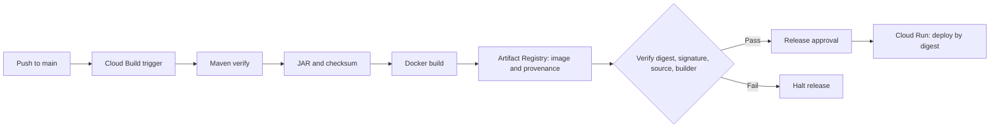

# Hands-On CI/CD for a Spring Boot Application with Artifact Verification

## 1. Problem Statement and Target Outcomes

A team developing a Spring Boot service wants to automatically run tests on every update to the `main` branch, package the application into a container, store the image in **Artifact Registry**, and release it to **Cloud Run**. A critical requirement is being able to answer: *From which source, by which build system, and with which exact bytes was the running version produced and deployed?*

Within the scope of **CI/CD and Software Supply Chain on Google Cloud**, this hands-on lab uses **Cloud Build** to test and package Java, **Artifact Registry** to store images along with build provenance, and **Cloud Run** to deploy the verified release. This concrete scenario provides practice in automating releases, protecting resources, and establishing software origin evidence across GCP infrastructure.

After this lesson, learners will be able to:

- Configure a CI flow that runs `mvn verify`, produces a Spring Boot JAR, and builds a Docker image.
- Verify the JAR's SHA-256 checksum, look up the image's **immutable digest**, and distinguish between the two values.
- Require Cloud Build to generate **build provenance**, verifying source and builder before permitting release.
- Deploy to Cloud Run using `image@sha256:...`, inspect revisions, detect failures, and perform rollbacks.
- Separate the CI identity from the release identity, keeping access permissions scoped to what is needed.

### Different Verification Layers

| Evidence | What Does It Verify? | Limitations |
|---|---|---|
| `mvn verify` | Tests and verification steps in the Maven lifecycle passed | Does not prove the artifact comes from a trusted origin |
| `sha256sum` of JAR | JAR contents stayed unchanged between checksum generation and packaging | A checksum created by the same actor can be altered alongside the artifact |
| OCI image digest (`sha256:...`) | Content identifier of the image pushed to the registry | A digest alone does not state who built the image |
| Signed build provenance | Links the artifact to the recorded builder, source, and build process | Must verify the signature **and** match source/builder against trust policy |
| Cloud Run revision | Deployed version with specific configuration, immutable per revision | Must compare the revision's image against the approved digest |

> **Principle:** Permit release only after tests pass, the image has a fixed digest, and provenance is verified against the expected source/builder. Never treat merely reading provenance JSON as verifying its signature.

## 2. Lab Architecture



The flow consists of **CI** (testing, building, and storing artifacts) and **CD** (verifying, approving, and deploying the exact built image). In this example, approval and deployment run from a separately authorized session/runner; in production environments, translate this principle into a protected release job or integrate Cloud Deploy. Separating the two phases guarantees Cloud Build finishes generating provenance **before** CD inspects it.

## 3. Preparing the Environment and Permissions

Assume a Google Cloud project with billing enabled, `gcloud` authenticated, a Git repository containing a Spring Boot application using **Maven and Java 21**, and an operator holding initial permissions to enable APIs, create repositories/service accounts, and bind IAM roles. The commands below use Bash (Cloud Shell or a Linux/macOS terminal). Replace `my-gcp-project` with your real project.

```bash
export PROJECT_ID="my-gcp-project"
export REGION="us-central1"
export REPO="spring-images"
export SERVICE="spring-demo"
export CI_SA="cb-spring-ci@${PROJECT_ID}.iam.gserviceaccount.com"
export CD_SA="cb-spring-cd@${PROJECT_ID}.iam.gserviceaccount.com"
export RUNTIME_SA="run-spring@${PROJECT_ID}.iam.gserviceaccount.com"

gcloud config set project "$PROJECT_ID"
gcloud services enable \
  cloudbuild.googleapis.com artifactregistry.googleapis.com \
  containeranalysis.googleapis.com run.googleapis.com \
  logging.googleapis.com iam.googleapis.com

gcloud artifacts repositories create "$REPO" \
  --repository-format=docker --location="$REGION" \
  --description="Container images for Spring Boot CI/CD"

gcloud iam service-accounts create cb-spring-ci \
  --display-name="Spring Boot CI build identity"
gcloud iam service-accounts create cb-spring-cd \
  --display-name="Spring Boot release identity"
gcloud iam service-accounts create run-spring \
  --display-name="Spring Boot Cloud Run runtime"
```

This example targets a new project; if the repository or service accounts already exist, inspect and reuse them rather than recreating them. With multiple environments, use separate projects/repositories and identities for staging and production.

Grant permissions so CI can **write images** and write logs, but **cannot deploy**:

```bash
gcloud artifacts repositories add-iam-policy-binding "$REPO" \
  --location="$REGION" \
  --member="serviceAccount:${CI_SA}" \
  --role="roles/artifactregistry.writer"

gcloud projects add-iam-policy-binding "$PROJECT_ID" \
  --member="serviceAccount:${CI_SA}" \
  --role="roles/logging.logWriter"
```

Permissions for the release identity (must be granted by an administrator before running CD):

```bash
gcloud artifacts repositories add-iam-policy-binding "$REPO" \
  --location="$REGION" \
  --member="serviceAccount:${CD_SA}" \
  --role="roles/artifactregistry.reader"

gcloud projects add-iam-policy-binding "$PROJECT_ID" \
  --member="serviceAccount:${CD_SA}" \
  --role="roles/run.developer"

gcloud iam service-accounts add-iam-policy-binding "$RUNTIME_SA" \
  --member="serviceAccount:${CD_SA}" \
  --role="roles/iam.serviceAccountUser"
```

The release identity also needs **permissions to read provenance/Container Analysis metadata** corresponding to your organization's verification approach; grant the necessary read permissions when testing `gcloud artifacts docker images describe --show-provenance` in a real environment. The **runtime** identity needs only permissions to access resources used by the application—it does not need Cloud Run Admin or Artifact Registry Writer. Whoever invokes builds with `--service-account` must be permitted to use the CI service account; permission to create builds and manage triggers belongs to the setup operator/process, not automatically to the CI identity. Note that `gcloud builds submit .` uploads source to Cloud Storage for Cloud Build to read: if source read errors occur, grant the CI SA `storage.objects.get` (such as `roles/storage.objectViewer`) **on that specific staging bucket**, alongside needed upload permissions for the submitting identity, rather than granting project-wide Storage Admin.

## 4. Preparing a Packageable Spring Boot Application

At the repository root, assume `pom.xml`, `src/main/java`, `src/test/java`, and Spring Boot Maven plugin configuration exist. So commands use a deterministic JAR filename, set `finalName` to `app` in the `<build>` section of `pom.xml` (merge into the existing `<build>` section; do not create two `<build>` sections):

```xml
<build>
  <finalName>app</finalName>
  <plugins>
    <plugin>
      <groupId>org.springframework.boot</groupId>
      <artifactId>spring-boot-maven-plugin</artifactId>
    </plugin>
  </plugins>
</build>
```

The example uses an application with `spring-boot-starter-web`, `spring-boot-starter-actuator`, and `spring-boot-starter-test` dependencies. A minimal test checks that the application context starts; real projects need unit tests, integration tests, and business logic tests:

```java
import org.junit.jupiter.api.Test;
import org.springframework.boot.test.context.SpringBootTest;

@SpringBootTest
class ApplicationContextTest {
    @Test
    void contextLoads() { }
}
```

In `src/main/resources/application.properties`, allow the application to bind to the port provided by Cloud Run:

```properties
server.port=${PORT:8080}
management.endpoints.web.exposure.include=health,info
```

Run on a developer workstation:

```bash
./mvnw -B -ntp clean verify
test -s target/app.jar
java -jar target/app.jar
```

If the repository lacks the Maven Wrapper, use `mvn`. Run `java -jar` separately and stop it with `Ctrl+C` after checking `http://localhost:8080/actuator/health`. If tests fail or `target/app.jar` is missing, fix the application/POM before configuring CI. Lock Spring Boot, plugin, and dependency versions in the POM/lockfile or an appropriate dependency management mechanism.

Create `Dockerfile` at the root directory of the repository:

```dockerfile
FROM eclipse-temurin:21-jre
WORKDIR /app

COPY app.jar ./app.jar
COPY artifact.sha256 ./artifact.sha256
RUN sha256sum -c artifact.sha256 && rm artifact.sha256

USER 10001:10001
EXPOSE 8080
ENTRYPOINT ["java", "-jar", "/app/app.jar"]
```

The `artifact.sha256` file is generated by CI from `app.jar` itself. `RUN sha256sum -c` confirms the JAR copied into the Docker build has the exact checksum of the freshly built JAR. If the project uses `.dockerignore`, ensure both `app.jar` and `artifact.sha256` are allowed in the Docker build context. In production, use a **vetted base image pinned by digest** rather than relying on a mutable tag like `21-jre`; the example keeps the tag for lab convenience.

## 5. Configuring CI: Testing, JAR Creation, Image Build, and Provenance

Place the following `cloudbuild.yaml` file in the repository:

```yaml
steps:
  - id: test-and-package
    name: 'maven:3.9-eclipse-temurin-21'
    entrypoint: bash
    args:
      - -ceu
      - |
        mvn -B -ntp clean verify
        test -s target/app.jar
        cp target/app.jar app.jar
        sha256sum app.jar > artifact.sha256
        sha256sum -c artifact.sha256

  - id: build-container
    name: 'gcr.io/cloud-builders/docker'
    args:
      - build
      - --pull
      - -t
      - '${_REGION}-docker.pkg.dev/$PROJECT_ID/${_REPO}/${_SERVICE}:$BUILD_ID'
      - .

images:
  - '${_REGION}-docker.pkg.dev/$PROJECT_ID/${_REPO}/${_SERVICE}:$BUILD_ID'

substitutions:
  _REGION: us-central1
  _REPO: spring-images
  _SERVICE: spring-demo

options:
  requestedVerifyOption: VERIFIED
  logging: CLOUD_LOGGING_ONLY
```

Explanation of easily overlooked details:

1. `mvn clean verify` runs tests and packaging, **halting the entire build on failure**. The sample project configures the Spring Boot plugin so `target/app.jar` is an executable JAR.
2. `/workspace` is shared across Cloud Build steps: `app.jar` and `artifact.sha256` created in the Maven step serve as inputs to the Docker build. Never bring a locally built JAR into CI.
3. `$BUILD_ID` is a unique identifier per build run, safer than a moving tag like `latest`. Cloud Build automatically substitutes `$PROJECT_ID`, `$BUILD_ID`, and `${_...}` at runtime.
4. The **`images`** field tells Cloud Build to push the image to Artifact Registry **after all steps complete**; combined with `requestedVerifyOption: VERIFIED`, the build is marked successful only if the required verification metadata was generated.
5. **Do not add an explicit `docker push` step** to this configuration: per Cloud Build documentation, pushing that way does not generate build provenance under this flow.
6. `CLOUD_LOGGING_ONLY` is meant for user-managed build service accounts holding `roles/logging.logWriter`. If using a log bucket, switch to a GCS config and grant separate permissions.

Command to test CI locally (this uses an uploaded source snapshot; suitable for testing config):

```bash
gcloud builds submit . \
  --region="$REGION" \
  --config=cloudbuild.yaml \
  --service-account="projects/${PROJECT_ID}/serviceAccounts/${CI_SA}" \
  --substitutions="_REGION=${REGION},_REPO=${REPO},_SERVICE=${SERVICE}"
```

When finished, note the `BUILD_ID` from the output or Cloud Build History page. This manual build may record its source as a Cloud Storage source snapshot; **do not use it to demonstrate policies requiring provenance to point to a specific GitHub repository**.

To run CI properly via Git, connect the GitHub repository to Cloud Build, create a **trigger on push to branch `^main$`**, select `cloudbuild.yaml`, the corresponding region, and the **CI service account**. Then commit/push a valid change and view Build History to capture the successful `BUILD_ID`. Protect the `main` branch with reviews and status checks, because anyone able to modify `cloudbuild.yaml` via Git can alter logic running under the build identity.

## 6. Verifying the Artifact Before Release

Assuming a successful build **from the Git trigger**, set `BUILD_ID` recorded in step 5 and the actual source URI:

```bash
export BUILD_ID="paste-successful-build-id-here"
export SOURCE_URI="github.com/example-org/spring-demo"
export IMAGE_BASE="${REGION}-docker.pkg.dev/${PROJECT_ID}/${REPO}/${SERVICE}"

export DIGEST="$(gcloud artifacts docker images describe \
  "${IMAGE_BASE}:${BUILD_ID}" \
  --format='value(image_summary.digest)')"

[[ "$DIGEST" =~ ^sha256:[a-f0-9]{64}$ ]] || {
  echo "Could not find a valid digest" >&2
  exit 1
}
export VERIFIED_IMAGE="${IMAGE_BASE}@${DIGEST}"
printf 'Selected artifact: %s\n' "$VERIFIED_IMAGE"
```

`IMAGE_BASE:BUILD_ID` is used only for **initial artifact lookup**. Thereafter, all verification and deployment steps must use `VERIFIED_IMAGE` formatted as `image@sha256:...`, because tags can be reassigned whereas digests represent exact content.

Inspect provenance metadata generated by Cloud Build:

```bash
gcloud artifacts docker images describe "$VERIFIED_IMAGE" \
  --show-provenance --format=json > provenance.json

test -s provenance.json
```

Downloading `provenance.json` checks only for the **presence** of metadata—it does not verify a valid signature. Use a verification tool supporting Cloud Build provenance, such as `slsa-verifier` version `v2.7.1` as shown in official guidance (requires Go, and update tool versions after organizational review):

```bash
go install github.com/slsa-framework/slsa-verifier/v2/cli/slsa-verifier@v2.7.1
export PATH="$(go env GOPATH)/bin:$PATH"
gcloud auth configure-docker "${REGION}-docker.pkg.dev" --quiet

slsa-verifier verify-image "$VERIFIED_IMAGE" \
  --provenance-path provenance.json \
  --source-uri "$SOURCE_URI" \
  --builder-id 'https://cloudbuild.googleapis.com/GoogleHostedWorker'
```

**Expected result:** the command exits with code `0` and prints a message like `PASSED: Verified SLSA provenance`. If the source repository or builder mismatches, the signature is invalid, metadata is missing, or the image digest does not match, **halt the release** and investigate; never bypass checks with `|| true`. Set `SOURCE_URI` to the exact repository URI actually recorded in provenance; the placeholder `example-org` will not manufacture a trusted source. When using manual Cloud Build source uploads, provenance typically lacks the Git trigger's repository identifier, so the `--source-uri` check above will intentionally fail as expected.

### Three Mandatory Questions During Approval

| Question | Required Evidence |
|---|---|
| Which image is being approved? | Full reference `.../spring-demo@sha256:<64-hex-chars>` and `BUILD_ID` |
| Who and which source produced the image? | Verified provenance; trusted Cloud Build builder, expected Git source; commit matched against a reviewed PR |
| What qualifies this build for release? | `mvn verify` passed, image emitted via `images`, `requestedVerifyOption: VERIFIED`, signature/source checks passed |

The SHA-256 of `app.jar` is a **JAR file checksum**, distinct from the container image's SHA-256 digest; do not compare them directly to assert equivalence. To retain JAR traceability post-build, configure Cloud Build to export the JAR and checksum file to an access-controlled CI artifacts bucket with retention, or publish the JAR to a Maven repository in Artifact Registry.

## 7. Releasing via CD Using the Verified Image Digest

Execute from a controlled release environment (e.g., a release runner running as `CD_SA`, or an operator account with **equivalent permissions**). Run the snippet below **only after** step 6 returns PASS. `VERIFIED_IMAGE` must come from the exact approved artifact; record it in the approval record or release config to avoid accidentally picking up a newer build.

```bash
gcloud run deploy "$SERVICE" \
  --project="$PROJECT_ID" \
  --region="$REGION" \
  --image="$VERIFIED_IMAGE" \
  --service-account="$RUNTIME_SA" \
  --no-allow-unauthenticated \
  --quiet
```

In an automated release job, apply approval/gate conditions and place the **provenance verification command (checking its exit code)** immediately before `gcloud run deploy`. Run both steps within the same protected workflow, passing a **fixed digest** rather than using `latest` or rebuilding from source. If production policy requires deploy-time enforcement, add Binary Authorization for Cloud Run with appropriate attestation verification policies.

Inspect the version recorded by Cloud Run:

```bash
REVISION="$(gcloud run services describe "$SERVICE" \
  --project="$PROJECT_ID" --region="$REGION" \
  --format='value(status.latestReadyRevisionName)')"

gcloud run revisions describe "$REVISION" \
  --project="$PROJECT_ID" --region="$REGION" \
  --format='value(spec.containers[0].image)'

gcloud run services describe "$SERVICE" \
  --project="$PROJECT_ID" --region="$REGION" \
  --format='value(status.url)'
```

Compare the revision's image/digest against `VERIFIED_IMAGE` and confirm the revision is ready. The service is configured to disallow unauthenticated access; to test `/actuator/health`, the calling identity must hold `roles/run.invoker` and supply an appropriate ID token:

```bash
SERVICE_URL="$(gcloud run services describe "$SERVICE" \
  --project="$PROJECT_ID" --region="$REGION" \
  --format='value(status.url)')"

curl -fsS \
  -H "Authorization: Bearer $(gcloud auth print-identity-token)" \
  "${SERVICE_URL}/actuator/health"
```

If the endpoint returns `401/403`, inspect the caller identity and invoke permissions; never open the service to the public Internet merely to work around authentication errors. When rolling back, select a **previously released and verified digest** and re-run deploy with `--image` pointing to the old digest, or route traffic back to the prior revision per team operational procedures.

## 8. Intentional Failure Experiments

1. **Test failure:** edit a test so an assertion fails on a lab branch, then run `gcloud builds submit` from that branch (or create a separate trigger for the lab branch). CI stops at `test-and-package`; no new image is registered from the failed build. The `^main$` trigger in the example does not fire when pushing only to the lab branch.
2. **JAR modified after checksum generation:** try altering `app.jar` after generating `artifact.sha256` and before the Docker build in the lab environment. `RUN sha256sum -c` must fail. This checks consistency between two steps; it does not replace provenance signatures.
3. **Wrong Git source:** pass a different repository to `slsa-verifier` via `--source-uri`. Even though the digest exists, the verification step must reject the release.
4. **Moved tag:** compare a tag's digest before and after reassigning the tag in a test environment. Deploying via `@sha256:...` still selects the approved content; deploying via `:tag` can select different content.
5. **Missing IAM:** temporarily revoke `roles/artifactregistry.writer` from the CI SA on the lab repository, run a build, and observe the image publish step fail. Restore the permission after the lab exercise.

Experiment only on lab/staging resources; never intentionally break production pipelines.

## 9. Common Errors and Root-Cause Identification

| Symptom | Common Cause | Resolution Path |
|---|---|---|
| `target/app.jar` does not exist | Different `finalName` or Spring Boot Maven plugin did not repackage | Check `pom.xml`, Maven logs, and actual JAR filename |
| Cloud Build Docker step succeeds but provenance is missing | Manual `docker push` used; `images` field missing or `requestedVerifyOption` missing | Use `images` and `requestedVerifyOption: VERIFIED`, re-run build |
| `PERMISSION_DENIED` when pushing image | CI SA lacks Artifact Registry write permission, or wrong repository/region | Check `roles/artifactregistry.writer` on the exact repository |
| `--show-provenance` cannot read metadata | Missing metadata/Container Analysis read permissions or image lacks provenance | Check IAM, APIs, digest, and Build History |
| `slsa-verifier` reports wrong source | Used local `builds submit` instead of Git trigger, or Git source mismatch | Run CI from Git trigger and compare source URI against provenance |
| Cloud Run rejects deployment | CD lacks `run.developer`, `iam.serviceAccountUser`, or image read permission | Check permissions of the **CD identity** on service/repository/runtime SA |
| Revision fails to become ready | Container wrong port, broken JAR, missing config/secrets | Check Cloud Run logs, use `${PORT:8080}`, fix and build a new artifact |

## 10. Completion Criteria and Scaling to Production

The lab is complete when learners can present **one continuous chain of evidence** comprising: reviewed Git commit/PR, successful `BUILD_ID`, `mvn verify` results, `image@sha256` in Artifact Registry, `PASS` provenance verification against the expected source and builder, Cloud Run revision name with deployed image, and application health verification results.

To apply this to larger services, add controls proportional to risk: dependency/image vulnerability scanning and severity-based release gating; SBOMs; secrets managed via Secret Manager; digest pinning for build/base images; dedicated runners with least-privilege IAM; approval/attestation policies in CD; staging releases followed by canary/traffic splitting, Cloud Monitoring metrics, and alerts. Retain build logs, provenance, release manifests, and approval history per organizational retention policies, alongside cleanup mechanisms for unused images.

### Official Documentation for Cross-Reference

- [Cloud Build – Build and test Java applications](https://cloud.google.com/build/docs/building/build-java)
- [Cloud Build – Generate and validate build provenance](https://cloud.google.com/build/docs/securing-builds/generate-validate-build-provenance)
- [Cloud Build – Build configuration file schema](https://cloud.google.com/build/docs/build-config-file-schema)
- [Cloud Build – Run builds with a user-managed service account](https://cloud.google.com/build/docs/securing-builds/configure-user-specified-service-accounts)
- [Artifact Registry – Manage Docker images](https://cloud.google.com/artifact-registry/docs/docker/manage-images)
- [Cloud Run – Deploy container images](https://cloud.google.com/run/docs/deploying)
- [Cloud Run – Deployment permissions](https://cloud.google.com/run/docs/reference/iam/roles)
