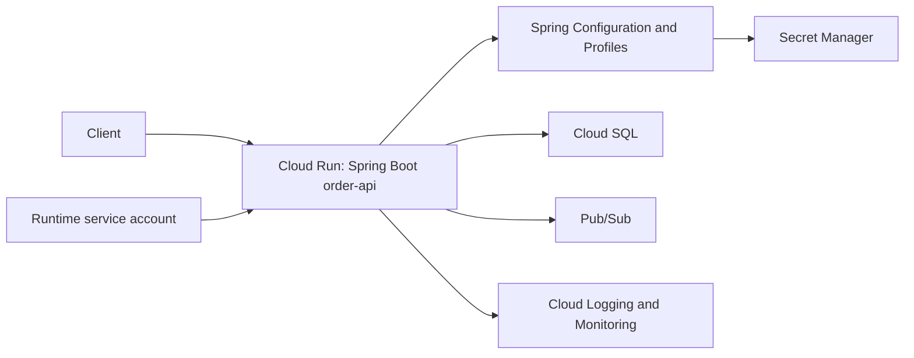

# Spring Framework on Google Cloud and Application Configuration

**Spring Framework on Google Cloud** is the suite of libraries integrating Spring with Google Cloud services, commonly known as **Spring Cloud GCP**. It provides auto-configuration, starter dependencies, and familiar Spring abstractions so Java applications can work with Pub/Sub, Cloud Storage, Cloud SQL, Secret Manager, and many other services. A Spring Boot application still runs on a compute environment such as Cloud Run, Google Kubernetes Engine (GKE), Compute Engine, or App Engine; Spring Framework on Google Cloud is not a standalone hosting service.

In the `CLOUD_PROVIDERS_GCP` module, learners explore Google Cloud from project organization, IAM, and VPCs to Compute Engine, GKE, Cloud Run, storage services, and databases. Through deployment scenarios, learners select services, protect resources, automate releases, and monitor reliability and cost. For Spring applications, these goals start with environment-accurate configuration, proper identities, separating secrets from source code, and choosing integrations based on actual requirements.

This lesson progresses from a minimal Spring Boot application to configuring profiles, Application Default Credentials (ADC), Secret Manager, Cloud SQL, Pub/Sub, Cloud Run, and production operations. Examples use placeholders such as `PROJECT_ID`, `REGION`, and `SERVICE_ACCOUNT_EMAIL`; replace them with authorized resources in your test project.

## Learning Objectives

After this lesson, learners will be able to:

- Distinguish Spring Framework, Spring Boot, Spring Framework on Google Cloud, and Google Cloud execution platforms.
- Select compatible Spring Boot/Spring Cloud GCP versions and use BOMs and starter dependencies.
- Design `application.yaml`, profiles, environment variables, and `@ConfigurationProperties` per environment.
- Use ADC, service accounts, and least-privilege IAM for applications calling Google Cloud APIs.
- Load sensitive configuration from Secret Manager using Spring Cloud GCP or Cloud Run secret integration.
- Configure Cloud SQL, Pub/Sub, and Cloud Storage using appropriate Spring integrations.
- Package and deploy Spring Boot applications to Cloud Run; analyze differences when running on GKE or Compute Engine.
- Test configuration, monitor applications, and troubleshoot common production issues.

## 1. The Big Picture: Spring and Google Cloud

### Distinguishing Four Layers

| Component | Role | Example |
|---|---|---|
| **Spring Framework** | Java foundation providing dependency injection, Web MVC, transactions, and application abstractions. | `@Component`, `@Service`, `@RestController`, `ApplicationContext`. |
| **Spring Boot** | Auto-configuration, starter dependencies, embedded server, and externalized configuration mechanisms. | `@SpringBootApplication`, `application.yaml`, Actuator. |
| **Spring Framework on Google Cloud (Spring Cloud GCP)** | Integrates Spring with Google Cloud through starters, templates, repositories, and auto-configuration. | Secret Manager config data, `PubSubTemplate`, Cloud SQL starter. |
| **GCP execution platform** | Runs workloads, supplies identity, handles networking, scales instances, and collects logs/metrics. | Cloud Run, GKE, Compute Engine, App Engine. |

A Spring Boot application can use Google Cloud Java Client Libraries directly without Spring Cloud GCP. Starters are convenient when you want Spring to auto-create beans and bind properties. When you need an API without an integration or want finer control, you can still declare Google Cloud client beans in standard Spring fashion.

### Sample Application Flow

Suppose an `order-api` service receives HTTP requests, persists orders in Cloud SQL, emits events to Pub/Sub, and retrieves an API key from Secret Manager.



Spring handles code structure and configuration binding; Google Cloud handles running containers, identity, IAM, networking, logging, and data services. Architects must verify both layers: correct dependencies without IAM still fail; sufficient IAM with a misconfigured project, region, or connection name still breaks the application.

## 2. Versions and Dependency Management

### Read the Compatibility Matrix Before Adding Starters

Spring Framework on Google Cloud depends on specific versions of Spring Boot, Spring Cloud, and Spring Framework. Do not blindly pick the latest version of each component independently. At the time of writing, project documentation lists these typical compatible branches:

| Spring Framework on Google Cloud | Spring Cloud | Spring Boot | Spring Framework |
|---|---|---|---|
| 7.x | 2025.0.x | 3.5.x | 6.2.8 or higher in the 6.2 branch |
| 6.x | 2024.0.x | 3.4.x | 6.2.x |
| 5.x | 2023.0.x | 3.2.x or 3.3.x | 6.1.x |

Examples in this lesson use **Spring Boot 3.5.x with Spring Framework on Google Cloud 7.x**. Project docs currently list BOM `7.5.2`; before production deployment, re-confirm the compatibility matrix and supported patch releases. Avoid Spring Cloud GCP 2.x examples or `org.springframework.cloud.gcp.*` packages in new projects, as modern classes use the `com.google.cloud.spring.*` namespace.

### Maven BOM and Starters

A BOM (*Bill of Materials*) manages dependency versions for Spring Framework on Google Cloud. For a Spring Boot project already using a compatible parent/BOM, add to `pom.xml`:

```xml
<dependencyManagement>
    <dependencies>
        <dependency>
            <groupId>com.google.cloud</groupId>
            <artifactId>spring-cloud-gcp-dependencies</artifactId>
            <version>7.5.2</version>
            <type>pom</type>
            <scope>import</scope>
        </dependency>
    </dependencies>
</dependencyManagement>

<dependencies>
    <dependency>
        <groupId>org.springframework.boot</groupId>
        <artifactId>spring-boot-starter-web</artifactId>
    </dependency>
    <dependency>
        <groupId>org.springframework.boot</groupId>
        <artifactId>spring-boot-starter-actuator</artifactId>
    </dependency>
    <dependency>
        <groupId>com.google.cloud</groupId>
        <artifactId>spring-cloud-gcp-starter-pubsub</artifactId>
    </dependency>
    <dependency>
        <groupId>com.google.cloud</groupId>
        <artifactId>spring-cloud-gcp-starter-secretmanager</artifactId>
    </dependency>
</dependencies>
```

This is a Maven snippet to add to an existing project using `spring-boot-starter-parent` or the Spring Boot BOM; it is not a complete `pom.xml`. Add only the starters actually used. If an app does not need Pub/Sub or Secret Manager, do not keep unused starters "just in case": auto-configuration can initialize clients, require credentials, or slow down startup.

Gradle example:

```kotlin
dependencies {
    implementation(platform("com.google.cloud:spring-cloud-gcp-dependencies:7.5.2"))
    implementation("org.springframework.boot:spring-boot-starter-web")
    implementation("org.springframework.boot:spring-boot-starter-actuator")
    implementation("com.google.cloud:spring-cloud-gcp-starter-pubsub")
    implementation("com.google.cloud:spring-cloud-gcp-starter-secretmanager")
}
```

Gradle also needs a compatible Spring Boot plugin version configured. Choose Maven or Gradle per project standards; both support the starters.

### Notable Starters

| Need | Reference artifact |
|---|---|
| Core project/credentials integration | `spring-cloud-gcp-starter` |
| Pub/Sub | `spring-cloud-gcp-starter-pubsub` |
| Cloud Storage Resource integration | `spring-cloud-gcp-starter-storage` |
| Cloud SQL PostgreSQL | `spring-cloud-gcp-starter-sql-postgresql` |
| Cloud SQL MySQL | `spring-cloud-gcp-starter-sql-mysql` |
| Secret Manager | `spring-cloud-gcp-starter-secretmanager` |
| Spring Data Spanner | `spring-cloud-gcp-starter-data-spanner` |
| Spring Data Datastore | `spring-cloud-gcp-starter-data-datastore` |

Official documentation describes many additional modules. Not every starter is needed in the same application.

## 3. Environment-Specific Spring Boot Configuration

### Externalized Configuration

Spring Boot reads configuration from `application.properties` or `application.yaml`, profile-specific files, environment variables, Java system properties, and command-line arguments. Multiple sources override each other according to Spring Boot's precedence rules. Practical guidelines:

- Use config files for **non-sensitive defaults** such as timeouts, retries, topic names, or health check settings.
- Use environment variables or environment-specific config files to pass values differing across local, staging, and production.
- Use Secret Manager for passwords, API tokens, private credentials, and values requiring rotation.
- Do not rely on `application-prod.yaml` unless the pipeline sets `SPRING_PROFILES_ACTIVE=prod` or an equivalent profile activation mechanism.
- Place critical settings under specific property names; avoid overly generic environment variable names that collide easily.

### Shared `application.yaml`

Example `src/main/resources/application.yaml`:

```yaml
spring:
  application:
    name: order-api

server:
  address: 0.0.0.0
  port: ${PORT:8080}

app:
  greeting: ${APP_GREETING:Hello}
  request-timeout: ${APP_REQUEST_TIMEOUT:3s}
  region: ${APP_REGION:asia-southeast1}

management:
  endpoints:
    web:
      exposure:
        include: health,info
  endpoint:
    health:
      probes:
        enabled: true
```

`${PORT:8080}` means using the `PORT` environment variable if present, defaulting to 8080 otherwise. Cloud Run supplies `PORT` automatically to the container. The application must listen on `0.0.0.0` and the provided port rather than hardcoding `localhost` or another port.

The names `APP_GREETING`, `APP_REQUEST_TIMEOUT`, and `APP_REGION` are application-defined variables, not Google Cloud-mandated variables. Spring resolves them via placeholders.

### Profiles for Dev and Production

`application-dev.yaml` can provide convenient local defaults:

```yaml
app:
  greeting: Hello from local
  request-timeout: 10s

logging:
  level:
    com.example.order: DEBUG
```

`application-prod.yaml` can enforce stricter policies:

```yaml
app:
  request-timeout: 2s

logging:
  level:
    root: INFO
    com.example.order: INFO
```

Run locally with a profile:

```bash
SPRING_PROFILES_ACTIVE=dev ./mvnw spring-boot:run
```

In Cloud Run, pass `SPRING_PROFILES_ACTIVE=prod` at deploy time or in revision configuration. Profiles separate logical configuration, yet they do **not** replace IAM or project boundaries. An application running with the `dev` profile under a production service account can still access production data if IAM allows it.

### Precedence Order and Configuration Binding

Suppose `application.yaml` sets `app.greeting: Hello`, `application-prod.yaml` sets `Hello production`, and Cloud Run sets `APP_GREETING=Hello API`. Environment variable values can override file settings via property binding or placeholders. Command-line arguments such as `--app.greeting=...` can also override file values. Control who is allowed to alter revision environments and startup commands.

For related groups of properties, prefer `@ConfigurationProperties` instead of scattering individual `@Value` annotations:

```java
package com.example.order;

import java.time.Duration;
import org.springframework.boot.context.properties.ConfigurationProperties;

@ConfigurationProperties(prefix = "app")
public record AppSettings(String greeting, String region, Duration requestTimeout) { }
```

Enable scanning in the application:

```java
package com.example.order;

import org.springframework.boot.SpringApplication;
import org.springframework.boot.autoconfigure.SpringBootApplication;
import org.springframework.boot.context.properties.ConfigurationPropertiesScan;

@SpringBootApplication
@ConfigurationPropertiesScan
public class OrderApplication {
    public static void main(String[] args) {
        SpringApplication.run(OrderApplication.class, args);
    }
}
```

And inject settings via constructor injection:

```java
package com.example.order;

import java.util.Map;
import org.springframework.web.bind.annotation.GetMapping;
import org.springframework.web.bind.annotation.RestController;

@RestController
public class HelloController {
    private final AppSettings settings;

    public HelloController(AppSettings settings) {
        this.settings = settings;
    }

    @GetMapping("/api/hello")
    public Map<String, String> hello() {
        return Map.of("message", settings.greeting(), "region", settings.region());
    }
}
```

In larger applications, pair `@Validated` with constraints like `@NotBlank`, `@Positive`, or custom validators to fail fast when URLs, timeouts, or regions are missing. Never return passwords, tokens, or full configuration dumps from REST endpoints.

### Environment Variables to Distinguish

| Variable | Source / purpose |
|---|---|
| `PORT` | Supplied by Cloud Run for container ingress; Spring uses `${PORT:8080}`. |
| `SPRING_PROFILES_ACTIVE` | Selects Spring profiles; configured by the deployer. |
| `APP_REGION` | Business config in our example, not auto-injected by Google Cloud. |
| `K_SERVICE`, `K_REVISION`, `K_CONFIGURATION` | Cloud Run environment metadata identifying the service/revision. |
| `GOOGLE_APPLICATION_CREDENTIALS` | Path to a credential file usable by ADC; avoid setting on Cloud Run since service identity is recommended. |

Cloud Run creates a new revision when environment variables change. For incremental updates on an existing service, use `--update-env-vars` rather than `--set-env-vars` if you do not want to replace the entire existing environment variable list.

## 4. Project ID, Application Default Credentials, and IAM

### Where Does Spring Cloud GCP Get the Project and Credentials?

Spring Framework on Google Cloud core provides `GcpProjectIdProvider` and `CredentialsProvider`. Integrations can infer the project ID and credentials from the Google Cloud environment or ADC. When calling across projects, specify the project per module—such as `spring.cloud.gcp.secretmanager.project-id` or `spring.cloud.gcp.pubsub.project-id`—rather than letting every service rely on an uncontrolled default.

**Application Default Credentials (ADC)** is the standard credential lookup chain used by Google Cloud client libraries. It checks an explicitly specified credential configuration, local logged-in ADC, or the runtime identity via the metadata server.

### Local Development

`gcloud auth login` authenticates the Google Cloud CLI; the commands below set up ADC for application libraries:

```bash
gcloud auth application-default login
gcloud config set project PROJECT_ID
```

`gcloud config set project` changes the CLI's default project, which does not mean every Spring integration automatically uses that project in every context. When using quota projects, multiple projects, or different credentials, configure per module documentation and verify which project ID the application actually resolves.

On workstations, never store service account JSON keys in repositories, `application.yaml`, or container images. Use developer ADC and restrict permissions in test environments. For CI outside Google Cloud, prefer Workload Identity Federation over long-lived keys whenever possible.

### Cloud Run Service Identity

On Cloud Run, applications call Google Cloud APIs using the service identity attached to the service/revision. With ADC, Cloud Client Libraries fetch tokens from the metadata server. Create a user-managed service account per application or group of workloads sharing identical permissions:

```bash
gcloud iam service-accounts create order-api-runtime \
  --project=PROJECT_ID \
  --display-name="Order API runtime"
```

Example least-privilege IAM roles for the sample service:

| Need | Role to grant | Scope to grant |
|---|---|---|
| Publish messages to a Pub/Sub topic | `roles/pubsub.publisher` | Specific topic. |
| Read an API key in Secret Manager | `roles/secretmanager.secretAccessor` | Specific secret. |
| Connect to Cloud SQL | `roles/cloudsql.client` | Appropriate project/instance; database-level privileges still required. |
| Read objects in Cloud Storage | `roles/storage.objectViewer` | Specific bucket. |
| Write objects in Cloud Storage | `roles/storage.objectCreator` or matching role | Target bucket, based on write/overwrite needs. |

Example granting Pub/Sub permissions at topic level and Secret Manager at secret level:

```bash
gcloud pubsub topics add-iam-policy-binding orders-created \
  --project=PROJECT_ID \
  --member="serviceAccount:order-api-runtime@PROJECT_ID.iam.gserviceaccount.com" \
  --role="roles/pubsub.publisher"

gcloud secrets add-iam-policy-binding partner-api-key \
  --project=PROJECT_ID \
  --member="serviceAccount:order-api-runtime@PROJECT_ID.iam.gserviceaccount.com" \
  --role="roles/secretmanager.secretAccessor"
```

Deployers also need Cloud Run deploy permissions and `roles/iam.serviceAccountUser` (or equivalent `iam.serviceAccounts.actAs` permission) to attach the service account to a revision. Never grant Owner/Editor to a runtime identity just to bypass `PERMISSION_DENIED`.

### Distinguishing Four Identities

- **Developer identity**: account running locally and invoking `gcloud`; holds permissions only in development environments.
- **Build identity**: service account used by Cloud Build or CI to build artifacts, needing permissions to pull dependencies and push to Artifact Registry.
- **Deployer identity**: user or pipeline running `gcloud run deploy`, needing deploy permissions and permission to attach service accounts.
- **Runtime identity**: service account used by the deployed Spring app; needs permissions to read Secret Manager, publish to Pub/Sub, or call other services.

These can all be separate identities. Granting runtime permissions to a build identity or deploy permissions to an application can create unintended privilege escalation paths.

## 5. Secret Manager for Sensitive Configuration

### Why Keep Secrets Out of YAML?

Passwords, tokens, API keys, and private credentials should never be committed to `application.yaml`, Dockerfiles, Cloud Build substitutions, or source code. Secret Manager lets you create secrets, add immutable versions, and grant IAM so applications read payloads only when needed.

Example creating a secret and adding a version in a test project:

```bash
gcloud services enable secretmanager.googleapis.com --project=PROJECT_ID

gcloud secrets create partner-api-key \
  --project=PROJECT_ID \
  --replication-policy=automatic

gcloud secrets versions add partner-api-key \
  --project=PROJECT_ID \
  --data-file=/secure/path/partner-api-key.txt
```

Avoid passing literal secrets directly as shell arguments so they do not end up in shell history. Protect the input file, keep it out of Git, and delete it after use per policy.

### Spring Cloud GCP Secret Manager Starter

Add the `spring-cloud-gcp-starter-secretmanager` dependency. With Spring Framework on Google Cloud **6.x/7.x**, the recommended syntax uses the `sm@` prefix. The older `sm://` syntax still appears in older documentation, but starting in 6.0 it emits deprecation warnings advising migration.

Example `application-prod.yaml`:

```yaml
spring:
  config:
    import: "sm@"
  cloud:
    gcp:
      secretmanager:
        project-id: PROJECT_ID

app:
  partner-api-key: "${sm@partner-api-key}"
```

`spring.config.import=sm@` enables Spring Boot Config Data integration for Secret Manager. Spring reads values from Secret Manager when resolving referenced properties. For a pinned version, use `${sm@partner-api-key/3}`; for a secret in another project, use `${sm@projects/OTHER_PROJECT_ID/secrets/partner-api-key/versions/3}`. For regional secrets, syntax includes `locations/REGION` per the library documentation.

Example binding sensitive settings into a bean (without returning them via endpoints):

```java
package com.example.order;

import org.springframework.boot.context.properties.ConfigurationProperties;

@ConfigurationProperties(prefix = "app")
public record PartnerSettings(String partnerApiKey) { }
```

Inject this bean only into the integration client calling the partner. Never write `partnerApiKey` to logs, `toString()`, HTTP responses, or health indicators. Because Java records generate a default `toString()` containing all fields, be especially careful not to log objects holding secrets directly.

### Two Ways to Supply Secrets on Cloud Run

| Approach | Mechanism | When to choose |
|---|---|---|
| Spring Cloud GCP `sm@` | App fetches secrets via the Secret Manager API and Spring Config Data. | Want secrets exposed as Spring properties, starter is already used, and app controls initialization. |
| Cloud Run secret integration | Cloud Run resolves Secret Manager versions and injects secrets as env vars or volume mounts per revision config. | Want env vars or mounted files without requiring the Spring Cloud GCP starter. |

For example, Cloud Run can bind a secret version to the `PARTNER_API_KEY` environment variable via the service's secret management settings. Spring then uses:

```yaml
app:
  partner-api-key: ${PARTNER_API_KEY}
```

This is an alternative to `sm@` inside Spring. Pick one clear approach per secret to avoid two conflicting configuration sources. File-mounted secrets behave differently on updates compared to startup environment variables; check Cloud Run documentation and rotation policies before choosing.

### Rotating Secrets

1. Create new credentials in the target system.
2. Add a new secret version in Secret Manager.
3. Verify runtime service account permissions and the new version's state.
4. Deploy with the new version or `latest` according to policy.
5. Verify the integration works, then revoke the old credentials in the target system.
6. Disable/destroy old versions once no longer needed for rollback.

Do not assume a property loaded at startup updates automatically when a new secret version is added. Usually a restart/redeploy or a controlled refresh mechanism is required; never expose Actuator `/refresh` publicly just to handle rotation. Production needs runbooks, audit logs, and a rollback plan.

## 6. Spring and Data Services on GCP

### Cloud Pub/Sub with `PubSubTemplate`

Pub/Sub uses topics to receive messages and subscriptions to consume them. The `spring-cloud-gcp-starter-pubsub` starter creates a `PubSubTemplate` bean supporting publishing and subscribing through Spring abstractions.

Minimal publisher example:

```java
package com.example.order;

import com.google.cloud.spring.pubsub.core.PubSubTemplate;
import org.springframework.stereotype.Service;

@Service
public class OrderEventPublisher {
    private final PubSubTemplate pubSubTemplate;

    public OrderEventPublisher(PubSubTemplate pubSubTemplate) {
        this.pubSubTemplate = pubSubTemplate;
    }

    public void publishCreated(String orderId) {
        String payload = "{\"event\":\"order.created\",\"orderId\":\"" + orderId + "\"}";
        pubSubTemplate.publish("orders-created", payload);
    }
}
```

This illustrates the publisher API and omits async result handling, JSON escaping, and delivery failure handling. In production, serialize with Jackson, handle futures/callbacks, configure bounded retries, use message ordering if needed, and enforce idempotency on consumers. Never equate "called `publish`" with "message durably persisted"; observe publish outcomes and handle errors explicitly.

Before running, create the topic and grant `roles/pubsub.publisher` at the topic level to the runtime service account. For subscribers, create a subscription and grant `roles/pubsub.subscriber` accordingly. Set `spring.cloud.gcp.pubsub.project-id` when using Pub/Sub in a different project from the running app.

### Cloud Storage

The `spring-cloud-gcp-starter-storage` starter integrates with Spring `Resource`, allowing Spring APIs to handle resources formatted as `gs://BUCKET_NAME/path/to/object`. This fits applications that frequently read/write files or use Spring Integration.

Applications can also use the Google Cloud Storage Java client directly for uploads/downloads, generation preconditions, signed URLs, or detailed metadata operations. Choose the tool matching your control needs; avoid adding the starter for one simple operation already served cleanly by the Java client.

Bucket names and object paths are non-sensitive configuration, though they can reveal internal structure; consider naming conventions and data residency. Grant the runtime service account least-privilege bucket roles; reading objects does not require write or delete permissions.

### Cloud SQL PostgreSQL or MySQL

Spring Framework on Google Cloud provides starters for Cloud SQL PostgreSQL and MySQL. The starter auto-configures a `DataSource` from Spring properties and the Google Cloud SQL connection name. For PostgreSQL, add:

```xml
<dependency>
    <groupId>com.google.cloud</groupId>
    <artifactId>spring-cloud-gcp-starter-sql-postgresql</artifactId>
</dependency>
```

Production configuration:

```yaml
spring:
  cloud:
    gcp:
      sql:
        instance-connection-name: "PROJECT_ID:asia-southeast1:orders-db"
        database-name: orders
  datasource:
    username: ${DB_USER}
    password: "${sm@orders-db-password}"
    hikari:
      maximum-pool-size: 5
```

This assumes Secret Manager config data is enabled via `spring.config.import=sm@` and the runtime can read `orders-db-password`. `spring.cloud.gcp.sql.instance-connection-name` follows `project:region:instance`; it differs from the database name inside the instance.

Beyond `roles/cloudsql.client`, the app needs database user accounts/privileges, the Cloud SQL Admin API enabled, and an appropriate network path. When using private IP, configure VPC, egress, and routing properly (such as Direct VPC egress or a VPC connector on Cloud Run). If choosing IAM database authentication, that mechanism has its own setup and requirements; do not assume Cloud SQL Client alone enables running SQL queries.

Cloud Run scales instance counts under load. If every instance opens a Hikari pool of 10 or 20 connections, total connections to Cloud SQL can exceed limits. Size pool counts against maximum instances, database quotas, latency targets, and retry behavior.

### When to Use Spanner, Datastore, or Firestore?

Spring Framework on Google Cloud also integrates with Cloud Spanner, Datastore, and Firestore. Choose based on data model and business requirements:

| Service | Typical problem fit | Key considerations |
|---|---|---|
| Cloud SQL | Relational apps needing PostgreSQL/MySQL and familiar SQL transactions. | Connectivity, pooling, HA, backups, schema migrations. |
| Cloud Spanner | Relational data requiring high horizontal scale and distribution. | Schema design, indexes, latency, cost, and transactions. |
| Firestore | Document/event-driven data fitting SDKs and NoSQL queries. | Document model, indexes, queries, security rules/IAM. |
| Datastore mode | NoSQL applications using entity, key, and query models. | Indexes, transactions, consistency, and access patterns. |

Having a Spring starter does not determine the right database. Select the data service first based on SLAs, access patterns, transactions, location, and cost—then pick the integration.

## 7. Deploying Spring Boot Applications to Cloud Run

### Web Application Requirements

Cloud Run runs containers receiving HTTP traffic on the platform-provided port. For Spring Boot:

- Set `server.port=${PORT:8080}` in `application.properties` or the YAML equivalent.
- Bind to `0.0.0.0`; avoid binding exclusively to loopback.
- Do not rely on the local filesystem for durable state; use Cloud Storage or a database.
- Do not assume an instance stays alive indefinitely; Cloud Run can scale to zero or swap revisions.
- Cap thread pools and database connection pools according to concurrency and instance limits.
- Prepare health check endpoints and startup times appropriate for JVM warm-up.

### Building from Source and Deploying

For a Maven Spring Boot project that already runs locally, Cloud Run supports source deployments via buildpacks:

```bash
gcloud config set project PROJECT_ID

gcloud services enable run.googleapis.com cloudbuild.googleapis.com artifactregistry.googleapis.com

gcloud run deploy order-api \
  --source . \
  --project=PROJECT_ID \
  --region=asia-southeast1 \
  --service-account=order-api-runtime@PROJECT_ID.iam.gserviceaccount.com \
  --set-env-vars=SPRING_PROFILES_ACTIVE=prod,APP_REGION=asia-southeast1
```

Run this from the project root directory. It requires billing, appropriate Cloud Run/Cloud Build/Artifact Registry permissions, permission to attach the service account, and enabled APIs. Cloud Run builds from source and creates a new revision. For production pipelines, build controlled artifacts, record digests, scan dependencies/images, and deploy by digest for version traceability.

If the service already has environment variables, `--set-env-vars` replaces the configured list for that deploy; use `--update-env-vars` to update select variables while preserving others. Supply secrets through Secret Manager integration or Spring Config Data as shown earlier—never pass API keys via `--set-env-vars`.

### Post-Deploy Verification

Inspect the service, revision, and URL:

```bash
gcloud run services describe order-api \
  --project=PROJECT_ID \
  --region=asia-southeast1
```

Then smoke-test `/api/hello` respecting the service's ingress/IAM policy. Do not expose an authenticated service publicly just for testing. Use an identity token or test runner authorized to invoke Cloud Run.

Check startup logs to confirm the `prod` profile, port, and project/region were picked up properly. Never log the entire Spring `Environment`, as it may contain secrets.

### Scaling and Performance Tuning

Characteristics of Spring Boot on Cloud Run:

- **Cold start**: the JVM and application context take time to initialize; trim unused dependencies, expensive eager initialization, and startup API calls.
- **Concurrency**: multiple requests share an instance; measure latency and CPU to size concurrency, instance limits, and memory.
- **Cloud SQL connections**: total connections scale with instances, so keep connection pools and max instances bounded appropriately.
- **Shutdown**: handle `SIGTERM`/graceful shutdown to complete or safely abort in-flight requests.
- **Request timeout**: align HTTP/DB/client timeouts and retries with Cloud Run limits.

Load-test realistic traffic before raising concurrency or instance caps. Adding "more resources" rarely cuts costs or improves reliability if the real bottleneck is the database or a downstream API.

## 8. When to Choose GKE or Compute Engine?

Cloud Run fits stateless APIs, jobs, and HTTP/event-driven services needing autoscaling with minimal cluster operations. However, some Spring workloads call for another execution model:

| Platform | Consider when | Configuration focus |
|---|---|---|
| Cloud Run | Stateless APIs/workers, revision-based deploys, simple operations preferred. | `PORT`, startup, concurrency, instance limits, service identity, secret references. |
| GKE | Need Kubernetes primitives, sidecars, deep network/runtime customization, multi-service clusters. | Deployments, Services, probes, resource requests/limits, Workload Identity Federation for GKE. |
| Compute Engine | Need OS/VM administration, long-lived processes, or specialized infrastructure. | `systemd`/container runtime, patching, instance service account, firewalls, load balancing. |
| App Engine | App fits App Engine runtimes and managed deployment model. | Runtime, service/version routing, app config, and IAM. |

### Spring on GKE

On GKE, `application.yaml` can be packaged inside the image; environment values go into `ConfigMap` or Deployment env vars, while secrets come via Secret Manager CSI integration or SDK/Workload Identity per design. Avoid storing Google Cloud service account key JSON files in Kubernetes `Secret` objects just to call APIs.

Example container snippet in a Deployment:

```yaml
containers:
  - name: order-api
    image: asia-southeast1-docker.pkg.dev/PROJECT_ID/apps/order-api:RELEASE_TAG
    ports:
      - containerPort: 8080
    env:
      - name: SPRING_PROFILES_ACTIVE
        value: prod
      - name: APP_REGION
        value: asia-southeast1
    readinessProbe:
      httpGet:
        path: /actuator/health/readiness
        port: 8080
    livenessProbe:
      httpGet:
        path: /actuator/health/liveness
        port: 8080
    resources:
      requests:
        cpu: 250m
        memory: 512Mi
```

This YAML is part of a Pod template, not a full Deployment manifest. `management.endpoint.health.probes.enabled=true` in Spring Boot enables the corresponding readiness/liveness health groups when Actuator is present. Tune startup probes, liveness timeouts, and resource limits based on JVM behavior, load time, and workload characteristics.

Workload Identity Federation for GKE allows workloads to use a Kubernetes identity and appropriate IAM binding to access Google Cloud APIs without long-lived JSON key files. Exact setup depends on cluster mode and chosen service account model.

## 9. Logging, Metrics, Health, and Tracing

### Structured Logging

Spring Boot commonly logs through SLF4J/Logback. On Cloud Run, stdout/stderr are collected into Cloud Logging. Use structured JSON logging or consistent fields with request correlation and trace IDs to make searching easier.

Never log passwords, bearer tokens, auth cookies, service account credentials, personal data, or full objects holding secrets. In production, `DEBUG`/`TRACE` log levels can leak sensitive details and drive up log ingestion costs.

### Actuator Health Endpoints

Spring Boot Actuator exposes health, metrics, and operational metadata. With `spring-boot-starter-actuator`, enable health probes:

```yaml
management:
  endpoints:
    web:
      exposure:
        include: health,info
  endpoint:
    health:
      probes:
        enabled: true
```

`/actuator/health` reports basic status; `/actuator/health/liveness` and `/actuator/health/readiness` integrate with probes. Never expose sensitive endpoints such as `/actuator/env`, `/actuator/beans`, `/actuator/configprops`, or `/actuator/heapdump` publicly without proper authentication and access restrictions.

### Metrics and Tracing

Micrometer provides metrics abstractions for Spring Boot. Use OpenTelemetry or supported integrations to export metrics and traces to Google Cloud Observability. Signals to monitor:

- Request rate, error rate, and HTTP p50/p95/p99 latency.
- JVM memory, GC pauses, thread pools, and startup duration.
- Cloud SQL connection pools, timeouts, query latency, and database errors.
- Pub/Sub publish errors, subscriber backlog, ack latency, and retries.
- Cloud Run instance count, concurrency, CPU, and memory.

Cloud Monitoring dashboards and alerting policies should reflect application SLIs/SLOs rather than just instance counts. Tie alerts to runbooks and designated responders.

## 10. Testing and Configuration Management in CI/CD

### Three Testing Layers

1. **Unit tests**: verify business logic, configuration binding, and validation; mock Google Cloud clients.
2. **Integration tests**: verify database, messaging, HTTP, or SDK interactions via emulators or Testcontainers where appropriate.
3. **Environment tests**: run on staging with equivalent service accounts, IAM, VPC, and Google Cloud resources to catch credential, network, or project issues.

Do not treat passing unit tests as proof that the application can connect to Cloud SQL or read Secret Manager in production. Those paths depend on real cloud resources and IAM.

### Avoiding Unintended Google Cloud Calls in Tests

Auto-configuration may initialize clients or validate settings when the Spring context starts. For unit tests that do not need Google Cloud, omit unused starters, mock the relevant beans, or disable auto-configuration per module documentation in the test profile.

Example test configuration without Cloud SQL:

```yaml
spring:
  cloud:
    gcp:
      sql:
        enabled: false
```

If production uses the Cloud SQL starter while tests use H2 or Testcontainers PostgreSQL, configure a separate `DataSource` and ensure `spring.cloud.gcp.sql.instance-connection-name` is absent in the test profile.

### CI/CD and Configuration Drift

In Cloud Build pipelines or other CI systems, verify:

- JDK, Spring Boot, and BOM versions are pinned/recorded.
- Dependencies have no critical known vulnerabilities; run scans per organizational policy.
- Testing, packaging, and container builds require no production secrets.
- Build and deploy use separate identities from runtime where appropriate.
- Revisions map to commit SHAs or image digests for rollback.
- Environment variables, IAM, and Secret Manager references are managed via Terraform or reviewed release configurations.

Never store `application-prod.yaml` containing credentials in the repository. When external configuration beyond the image is needed, use a controlled external config mechanism and keep regular configs separate from secrets.

## 11. Sample Deployment Scenario: Order API

### Requirements

A team runs a Spring Boot REST service `order-api` on Cloud Run. The service must:

- Serve `GET /api/hello` returning greeting and region.
- Read a partner API key from Secret Manager.
- Publish order-created events to Pub/Sub.
- Connect to Cloud SQL PostgreSQL in the same region.
- Run locally with the `dev` profile and on staging/production with dedicated profiles.

### Configuration Design

| Component | Configuration | Permission scope |
|---|---|---|
| Spring API | `application.yaml`, `application-prod.yaml`, and `@ConfigurationProperties`. | No secrets, validation enabled. |
| Secret Manager | `spring.config.import=sm@`, `app.partner-api-key=${sm@partner-api-key}`. | Secret Accessor on the specific secret. |
| Pub/Sub | Topic `orders-created`; Pub/Sub starter. | Pub/Sub Publisher on the topic. |
| Cloud SQL | `instance-connection-name`, database, username, password from Secret Manager. | Cloud SQL Client and database privileges. |
| Cloud Run | `PORT`, runtime service account, prod profile, timeout, concurrency. | Separate deployer identity; least-privilege runtime IAM. |

### Deployment Workflow

1. Choose the project and region, and enable only the APIs actually required: Cloud Run, Cloud Build, Artifact Registry, Secret Manager, Pub/Sub, and Cloud SQL Admin API.
2. Provision the Pub/Sub topic, Cloud SQL instance/database, and secret versions.
3. Create the runtime service account and grant least-privilege IAM on the topic, secret, and Cloud SQL.
4. Configure Spring Boot Maven/BOM on compatible branches, `application.yaml`, profiles, and property bindings.
5. Run unit/integration tests using dev/test configs without production secrets.
6. Deploy to staging on Cloud Run and verify startup, `/actuator/health`, order requests, Pub/Sub messages, and database connectivity.
7. Review logs, traces, connection pools, SLOs, costs, and IAM policies.
8. Promote the verified image to production using an approved revision/digest and retain rollback readiness.

### Debugging When One Integration Fails

If `GET /api/hello` succeeds while Pub/Sub publishing fails, the HTTP server is healthy while publisher IAM or topic ID is likely wrong. If startup fails because `${sm@partner-api-key}` cannot resolve, check Secret Manager IAM and secret version. If database connection errors spike after Cloud Run scales out, check total pool connections, network path, and Cloud SQL limits.

## 12. Troubleshooting

| Symptom | Possible cause | What to check |
|---|---|---|
| Spring context fails to start | Starter incompatible with Spring Boot, missing config property, or missing bean. | Check BOM/compatibility matrix, stack trace, and active profile. |
| `Could not resolve placeholder` | Missing environment variable or Secret Manager key. | Check property name, profile, Secret Manager import, and secret ID. |
| `PERMISSION_DENIED` calling APIs | Runtime service account lacks IAM, or app uses wrong credentials. | Check service identity, principal in audit logs, resource project, and narrow roles. |
| Project ID not found | ADC cannot infer project or cross-project call. | Set `spring.cloud.gcp.project-id`/module project ID or appropriate project context. |
| Secret fails to load | `sm@` Config Data import not enabled, wrong version, or secret disabled. | Check `spring.config.import`, `sm@` syntax, Secret Accessor role, and version state. |
| Cloud Run container not ready | Spring listens on wrong port, binds `127.0.0.1`, slow startup, or crash. | Check `${PORT:8080}`, `0.0.0.0`, startup logs, memory, and health checks. |
| Cloud SQL timeout | Wrong instance connection name, missing Cloud SQL Client, broken VPC route, or overloaded DB. | Check network, IAM, DB credentials, pool size, and connection capacity. |
| Pub/Sub fails to publish | Topic missing, missing publisher permission, or unhandled async future. | Check topic, project, IAM, and publish callback/result. |
| Production uses dev values | Profile not activated or env var overrides config file. | Check `SPRING_PROFILES_ACTIVE`, property sources, and revision config (without logging secrets). |
| Logs contain sensitive data | Debug logging, dumping config objects, or overly exposed Actuator endpoints. | Lower log level, restrict endpoints, rotate credentials, and inspect log sinks. |
| Scale-out breaks the DB | Each instance opens too large a pool. | Reconcile max instances, concurrency, Hikari pool size, and DB connection limits. |

When investigating, start with startup logs and the active revision, then verify IAM for the exact runtime identity, network paths, API enablement, resource names, and profiles. Never resolve missing permissions by granting Owner or Editor to a service account.

## 13. Pre-Production Checklist for Spring Applications

- [ ] Spring Boot, Spring Cloud, and Spring Framework on Google Cloud versions are compatible per current documentation.
- [ ] Maven/Gradle uses the BOM and declares only genuinely required starters.
- [ ] `application.yaml` holds non-sensitive defaults; profiles are activated explicitly.
- [ ] Spring binding (`@ConfigurationProperties`) and validation enforce required properties.
- [ ] Cloud Run port uses `${PORT:8080}` and the server binds to the right interface.
- [ ] Application uses ADC and a user-managed runtime service account, with no JSON keys embedded in images.
- [ ] IAM for Pub/Sub, Secret Manager, Cloud SQL, and Cloud Storage is scoped to exact resources.
- [ ] Secrets are fetched via `sm@` or runtime Secret Manager integration, with rotation/rollback plans.
- [ ] Cross-project APIs have project IDs, billing, and permissions verified.
- [ ] Cloud SQL connectors/networking, database privileges, and connection pools are load-tested.
- [ ] APIs never return secrets, logs never contain tokens, and Actuator endpoints are locked down.
- [ ] Dev/staging tests require no production credentials; cloud integrations are verified.
- [ ] Artifacts carry commit SHAs/image digests with defined promotion and rollback procedures.
- [ ] Cloud Logging, Monitoring, health probes, metrics, and alerts align with SLOs.
- [ ] Regional resources, quotas, concurrency, and costs have been evaluated.

## 14. Conclusion

Spring Framework on Google Cloud brings Google Cloud services into the familiar Spring development model through starter dependencies, bean auto-configuration, and Spring properties. Effective deployment requires picking compatible versions, separating configuration by environment, using `@ConfigurationProperties`, and avoiding long-lived credentials.

On Cloud Run, Spring Boot applications must listen on the supplied `PORT` and authenticate via service identity through ADC. On GKE or Compute Engine, the same principles apply, though identity injection, networking, probes, and workload lifecycles differ. Secret Manager, Cloud SQL, Pub/Sub, and Cloud Storage all require IAM, resource names, and networking aligned with the chosen architecture.

A well-operated Spring application features controlled configuration, least-privilege access, diagnostic logs and metrics, repeatable deployments, and clear recovery procedures. That forms the foundation for building secure, reliable, and scalable Java services on Google Cloud.

## References

- [Spring Framework on Google Cloud — Reference Documentation](https://googlecloudplatform.github.io/spring-cloud-gcp/reference/html/index.html)
- [Spring Framework on Google Cloud — Getting Started](https://googlecloudplatform.github.io/spring-cloud-gcp/reference/html/getting-started.html)
- [Spring Boot — Externalized Configuration](https://docs.spring.io/spring-boot/3.5/reference/features/external-config.html)
- [Spring Boot — Profiles](https://docs.spring.io/spring-boot/3.5/reference/features/profiles.html)
- [Spring Boot — Actuator Endpoints](https://docs.spring.io/spring-boot/3.5/reference/actuator/endpoints.html)
- [Cloud Run — Deploy a Java Spring Boot service](https://docs.cloud.google.com/run/docs/quickstarts/build-and-deploy/deploy-java-service)
- [Cloud Run — Configure environment variables](https://docs.cloud.google.com/run/docs/configuring/services/environment-variables)
- [Cloud Run — Service Identity](https://docs.cloud.google.com/run/docs/securing/service-identity)
- [Application Default Credentials](https://docs.cloud.google.com/docs/authentication/application-default-credentials)
- [Secret Manager — Overview](https://docs.cloud.google.com/secret-manager/docs/overview)
- [Cloud SQL — Connect from Cloud Run](https://docs.cloud.google.com/sql/docs/postgres/connect-run)
- [Pub/Sub — Overview](https://docs.cloud.google.com/pubsub/docs/overview)
- [Workload Identity Federation for GKE](https://docs.cloud.google.com/kubernetes-engine/docs/concepts/workload-identity)
- [Cloud Logging — Structured logging](https://docs.cloud.google.com/logging/docs/structured-logging)
