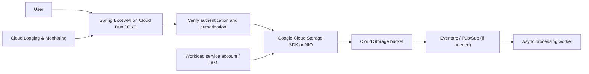

# Accessing Cloud Storage with Java NIO and the SDK

A Java application may need to store user images, generate CSV reports, download configuration files, or read data exported from other systems. On Google Cloud, **Cloud Storage** provides scalable object storage accessed via API. In Java, two common approaches are using the **Google Cloud Storage Java Client Library (SDK)** or the **Google Cloud Storage NIO FileSystem Provider** to work through `Path` and `Files`.

The two approaches serve different needs. NIO integrates cleanly with Java libraries expecting `Path` or `InputStream`, whereas the SDK explicitly surfaces bucket/object concepts, metadata, generations, preconditions, and administrative operations. Knowing which API to pick and understanding object storage semantics helps applications avoid overwriting data, over-allocating memory, or mishandling operations that superficially look like local filesystem calls.

This lesson sits in the **Java and Spring on GCP** chapter of the **CLOUD_PROVIDERS_GCP** module. It connects Java/Spring with Google Cloud storage services, IAM authorization, Cloud Run/GKE workload deployments, and reliability, security, and cost practices.

## 1. Learning Objectives

After this lesson, you will be able to:

- Explain buckets, objects, object names, generations, and differences between object storage and POSIX filesystems.
- Configure the Google Cloud Java SDK and NIO provider using the Maven BOM.
- Authenticate with Application Default Credentials (ADC) locally and in GCP environments.
- Read and write objects via `Files` and `CloudStorageFileSystem`.
- Upload, download, list, delete, and read metadata using `Storage` and `Blob`.
- Use streams/channels for large objects to limit memory allocation.
- Use generation preconditions to prevent unintended overwrites or deleting newer versions.
- Organize Spring Boot code, error handling, IAM, telemetry, and integration tests.

## 2. Understanding the Cloud Storage Model

### 2.1. Buckets, Objects, and URIs

Cloud Storage stores data as **objects** inside **buckets**. Each object has a name and byte content, plus metadata such as content type, size, CRC32C checksum, update time, and generation.

Example:

```text
Bucket:  acme-checkout-reports
Object: 2026/11/invoices/invoice-1042.pdf
URI:    gs://acme-checkout-reports/2026/11/invoices/invoice-1042.pdf
```

In the Java SDK:

- `BlobId` identifies an object by bucket, name, and optional generation.
- `BlobInfo` describes metadata used when creating or updating an object.
- `Blob` represents an existing object and holds its metadata.
- `Storage` is the interface for calling Cloud Storage APIs.

`BlobInfo` and `Blob` do not automatically hold all raw bytes of an object; content is read via methods such as `readAllBytes`, `reader`, or `downloadTo`.

### 2.2. Object Names Differ from OS Paths

Object names can contain `/` characters, such as `exports/2026/data.csv`. In a flat-namespace bucket, the string before `/` is simply part of the object name, not a true POSIX directory. The NIO provider simulates directories so Java code can work with `Path`.

Some buckets can enable hierarchical namespaces, where folder semantics differ from flat-namespace buckets. Applications must know the actual bucket configuration and library capabilities. In either mode, do not assume full POSIX permissions, file locking, in-place appends, or atomic renames like a local disk.

### 2.3. Generation and Metageneration

Whenever object content is written or overwritten, Cloud Storage assigns a new **generation**. Object metadata has a **metageneration**, which increments when metadata changes. These numbers enable concurrency control:

- Generation preconditions fit when replacing or deleting content.
- Metageneration preconditions fit when updating metadata.
- When a precondition fails to match, the API returns HTTP 412 (Precondition Failed).

This is essential for implementing safe uploads and controlled retries.

## 3. Choosing Java NIO or the Cloud Storage SDK?

| Criterion | Java NIO provider | Cloud Storage SDK |
|---|---|---|
| Model | `Path`, `Files`, `InputStream`, `OutputStream` | `Storage`, `BlobId`, `BlobInfo`, `Blob` |
| Goal | Reuse familiar file-manipulation code | Explicit object storage API interactions |
| Small reads/writes | `Files.readAllBytes`, `Files.write` | `readAllBytes`, `create` |
| Large data | `Files.newInputStream` and channels as supported | `reader`, `writer`, `createFrom`, `downloadTo` |
| Metadata | Via supported attribute views or extensions | Rich metadata APIs |
| Race control | Depends on provider-supported options | Generation/metageneration preconditions |
| Management features | Not the primary focus | List, copy, delete, IAM-related metadata, signed URLs |
| Semantics | Easy to mistake for local files if careless | Directly reflects object operations |

**Choose NIO** when an application relies on libraries accepting `Path` or reads files as streams. **Choose the SDK** when you need explicit control over uploads, generations, metadata, consistency, retries, or concurrent operations. An application can use both, though each layer should standardize on one abstraction to avoid conflicting writes.

## 4. Preparing Project, Bucket, and IAM

### 4.1. Prerequisites

To run the examples, you need:

1. A Google Cloud project with billing and the Cloud Storage API enabled.
2. An existing bucket, such as `acme-checkout-reports`.
3. JDK and Maven or Gradle build tools.
4. An identity with IAM permissions suited to the operations.
5. The Cloud Storage Java SDK or NIO provider library.

Examples use `PROJECT_ID` and `BUCKET_NAME` placeholders. Before running, substitute resources you are authorized to access and avoid writing test data into production buckets.

### 4.2. Least-Privilege IAM by Need

Common roles:

| Need | Common role | Recommended scope |
|---|---|---|
| Read and list objects | `roles/storage.objectViewer` | Target bucket to access |
| Create new objects only | `roles/storage.objectCreator` | Bucket dedicated to uploads |
| Read, create, update, delete objects | `roles/storage.objectUser` | Bucket genuinely requiring management |

Roles should be evaluated against permissions and organizational policies. Never grant `roles/storage.admin` just so an app can upload a file. If delete operations are needed, do not assume object creator includes delete permission.

On Cloud Run or GKE, use the workload's service account with bucket-level grants where appropriate. Never embed service account JSON keys in repositories, container images, or Spring configurations.

### 4.3. Application Default Credentials

Google Cloud libraries use **Application Default Credentials (ADC)** by default:

- On a workstation, run `gcloud auth application-default login` once appropriate permissions are granted.
- On Cloud Run, runtime identity comes from the execution environment.
- On GKE, use Workload Identity Federation for GKE or your organization's configured identity mechanism.
- For workloads outside Google Cloud, prefer Workload Identity Federation over long-lived keys.

Local development commands:

```bash
gcloud auth application-default login
gcloud auth application-default set-quota-project PROJECT_ID
```

`gcloud auth login` and `gcloud auth application-default login` serve separate authentication flows. The CLI can be logged in while the Java SDK still has no valid ADC, and vice versa. On HTTP 403, check the actual identity used by the app, IAM scope, project, bucket, and organizational policies.

## 5. Configuring Dependencies with Maven and Gradle

### 5.1. Maven BOM

Google Cloud maintains `com.google.cloud:libraries-bom` to align compatible client library versions. Example:

```xml
<dependencyManagement>
  <dependencies>
    <dependency>
      <groupId>com.google.cloud</groupId>
      <artifactId>libraries-bom</artifactId>
      <version>26.90.0</version>
      <type>pom</type>
      <scope>import</scope>
    </dependency>
  </dependencies>
</dependencyManagement>

<dependencies>
  <dependency>
    <groupId>com.google.cloud</groupId>
    <artifactId>google-cloud-storage</artifactId>
  </dependency>
  <dependency>
    <groupId>com.google.cloud</groupId>
    <artifactId>google-cloud-nio</artifactId>
  </dependency>
</dependencies>
```

Version `26.90.0` is an example listed in Google Cloud's Java NIO documentation; in real deployments, pick a supported BOM compatible with your app dependencies. With Spring Boot, reconcile the Spring and Google Cloud BOMs per your dependency management policy rather than forcing incompatible versions.

### 5.2. Gradle

```groovy
dependencies {
    implementation platform("com.google.cloud:libraries-bom:26.90.0")
    implementation "com.google.cloud:google-cloud-storage"
    implementation "com.google.cloud:google-cloud-nio"
}
```

`google-cloud-storage` supplies the SDK. `google-cloud-nio` registers the `FileSystemProvider` for accessing Cloud Storage paths via Java NIO.

## 6. Accessing Objects via Java NIO

### 6.1. Initializing a Filesystem for a Bucket

The clearest approach with minimal reliance on the Java Service Provider Interface (SPI) is `CloudStorageFileSystem.forBucket`.

```java
import com.google.cloud.storage.contrib.nio.CloudStorageFileSystem;
import java.nio.file.Path;

String bucketName = "BUCKET_NAME";
CloudStorageFileSystem fs = CloudStorageFileSystem.forBucket(bucketName);

Path report = fs.getPath("/reports/2026/summary.txt");
System.out.println(report.toUri());
```

The NIO provider maps `Path` to objects inside the bucket. Calling `forBucket` does not download the bucket's objects locally. With some packaging approaches (notably shaded/fat JARs), SPI registration can fail; calling `forBucket` directly avoids relying on service registration.

An alternative when SPI is active:

```java
import java.net.URI;
import java.nio.file.Path;
import java.nio.file.Paths;

Path report = Paths.get(
    URI.create("gs://BUCKET_NAME/reports/2026/summary.txt")
);
```

If URI resolution throws `FileSystemNotFoundException` or `ProviderNotFoundException`, inspect runtime dependencies and `META-INF/services` metadata in the packaged JAR.

### 6.2. Writing and Reading Small Text Files

```java
import com.google.cloud.storage.contrib.nio.CloudStorageFileSystem;
import java.nio.charset.StandardCharsets;
import java.nio.file.Files;
import java.nio.file.Path;

CloudStorageFileSystem fs =
    CloudStorageFileSystem.forBucket("BUCKET_NAME");

Path object = fs.getPath("/demo/hello.txt");
byte[] data = "Hello from Java NIO".getBytes(StandardCharsets.UTF_8);

Files.write(object, data);

byte[] downloaded = Files.readAllBytes(object);
System.out.println(new String(downloaded, StandardCharsets.UTF_8));
```

Here, `Files.write` issues an object write request to Cloud Storage, and `Files.readAllBytes` reads the entire object into memory. Use `readAllBytes` only for small files with known size bounds. For large objects, use streams.

Do not assume `Files.write` behaves identically to POSIX file writes: editing a few bytes mid-file, in-place appends, or file locking may not behave like a local filesystem.

### 6.3. Reading via Streams

```java
import java.io.InputStream;
import java.io.OutputStream;
import java.nio.file.Files;
import java.nio.file.Path;
import java.nio.file.Paths;

Path remote = fs.getPath("/exports/large-report.csv");
Path local = Paths.get("downloads/large-report.csv");
Files.createDirectories(local.getParent());

try (InputStream in = Files.newInputStream(remote);
     OutputStream out = Files.newOutputStream(local)) {
    in.transferTo(out);
}
```

`InputStream.transferTo` streams data incrementally, avoiding allocating a byte array as large as the entire object. If the application processes data directly instead of saving to disk, read blocks into a buffer and process incrementally.

### 6.4. Using NIO with Java Libraries

Many libraries accept `Path` or `InputStream`:

```java
Path csv = fs.getPath("/exports/daily.csv");

try (var reader = Files.newBufferedReader(csv, StandardCharsets.UTF_8)) {
    String line;
    while ((line = reader.readLine()) != null) {
        // Parse or process a single line.
    }
}
```

This is especially convenient when CSV, JSON, or config parsers already read from `InputStream`. However, if a library requires random-access writes, memory-mapped files, atomic renames, or POSIX attributes, check the NIO provider's capabilities carefully or download the object to scratch space before processing.

### 6.5. Pseudo-Directories and Non-POSIX-Equivalent Operations

In flat-namespace buckets, `reports/2026/` is merely a prefix in object names. Calling `Files.createDirectories` should not be mistaken for creating Linux directory inodes. With the NIO provider, pseudo-directories can be emulated and some directory calls perform no real I/O.

Cases requiring caution:

- `Files.move` may have to copy the object and then delete the source object; it is not atomic by default.
- Batch-renaming files is not a transaction.
- Partial content updates may require writing a brand-new object.
- Directory traversal can emit many API requests.
- `WatchService` file watching and file locks are not guaranteed to work.
- Options such as `ATOMIC_MOVE`, `APPEND`, or POSIX permissions may not behave as on local filesystems.

For explicit concurrency, versioning, and metadata needs, choose the SDK.

## 7. Using the Cloud Storage Java SDK

### 7.1. Initializing the Storage Client

```java
import com.google.cloud.storage.Storage;
import com.google.cloud.storage.StorageOptions;

Storage storage = StorageOptions.getDefaultInstance().getService();
```

The client uses the environment's ADC. In server applications, create the client once and reuse it across requests; never instantiate a new client per object read. Manage timeouts, retries, and observability per system requirements.

If the app runs in a different project from the bucket, bucket IAM still governs object access. The billing/quota project and runtime identity can reside in a different project from the data.

### 7.2. Creating a Small Object with Content Type and Precondition

```java
import com.google.cloud.storage.Blob;
import com.google.cloud.storage.BlobId;
import com.google.cloud.storage.BlobInfo;
import com.google.cloud.storage.Storage;
import java.nio.charset.StandardCharsets;

String bucketName = "BUCKET_NAME";
String objectName = "reports/summary.txt";

BlobInfo info = BlobInfo.newBuilder(BlobId.of(bucketName, objectName))
    .setContentType("text/plain; charset=utf-8")
    .build();

byte[] contents = "Monthly report".getBytes(StandardCharsets.UTF_8);

Blob created = storage.create(
    info,
    contents,
    Storage.BlobTargetOption.doesNotExist()
);

System.out.println("Generation: " + created.getGeneration());
```

`doesNotExist()` requires that the target object does not already exist. If another request created the object first, Cloud Storage returns a precondition failure (typically HTTP 412); the app must decide whether to keep the existing object or pick a new name. Never retry blindly by dropping the precondition, as doing so can overwrite another request's data.

### 7.3. Reading Metadata and Content

```java
import com.google.cloud.storage.Blob;
import com.google.cloud.storage.BlobId;
import java.nio.charset.StandardCharsets;

BlobId id = BlobId.of("BUCKET_NAME", "reports/summary.txt");
Blob blob = storage.get(id);

if (blob == null) {
    throw new IllegalStateException("Object does not exist");
}

System.out.println("Size: " + blob.getSize());
System.out.println("Content type: " + blob.getContentType());
System.out.println("Generation: " + blob.getGeneration());

byte[] bytes = storage.readAllBytes(id);
String contents = new String(bytes, StandardCharsets.UTF_8);
```

`storage.get` returns metadata or `null` when the object is missing. On missing permissions or API failures, the library throws `StorageException`; do not lump 403 and 404 errors together as "not found".

To read a specific version, construct `BlobId` with a generation and matching preconditions. Otherwise, reading by object name returns the latest version.

### 7.4. Listing by Prefix

```java
import com.google.api.gax.paging.Page;
import com.google.cloud.storage.Blob;
import com.google.cloud.storage.Storage;

Page<Blob> page = storage.list(
    "BUCKET_NAME",
    Storage.BlobListOption.prefix("reports/2026/"),
    Storage.BlobListOption.pageSize(100)
);

for (Blob item : page.iterateAll()) {
    System.out.println(item.getName() + " : " + item.getSize());
}
```

`prefix` filters object names; it is not a full-text search. `iterateAll` can fetch multiple pages automatically, issuing extra API calls. For very large buckets, use bounded paging, checkpoints, and early termination rather than scanning all objects inside an HTTP request.

A short prefix does not guarantee few objects. Design object names and data partitioning so queries stay scoped to what is needed.

### 7.5. Downloading an Object to a Local Path

```java
import com.google.cloud.storage.BlobId;
import java.nio.file.Files;
import java.nio.file.Path;
import java.nio.file.Paths;

BlobId id = BlobId.of("BUCKET_NAME", "exports/data.csv");
Path destination = Paths.get("downloads/data.csv");
Files.createDirectories(destination.getParent());

storage.downloadTo(id, destination);
```

`downloadTo` is convenient for downloading to a local path, while `readAllBytes` fits small payloads. Before writing local files, validate object names and destinations to prevent path traversal outside the intended directory. In containers without persistent disks, process data inline or persist outputs durably elsewhere.

## 8. Streaming Large Payloads with Streams and Channels

### 8.1. Uploading from a Path with createFrom

```java
import com.google.cloud.storage.BlobId;
import com.google.cloud.storage.BlobInfo;
import com.google.cloud.storage.Storage;
import java.nio.file.Path;
import java.nio.file.Paths;

Path source = Paths.get("reports/big-report.pdf");

BlobInfo info = BlobInfo.newBuilder(
    BlobId.of("BUCKET_NAME", "reports/big-report.pdf")
).setContentType("application/pdf").build();

storage.createFrom(
    info,
    source,
    Storage.BlobWriteOption.doesNotExist()
);
```

`createFrom` streams uploads and is much better suited for large files than loading everything into a `byte[]`. For `InputStream` data, an overload `createFrom(BlobInfo, InputStream, ...)` exists. Prefer this modern API over the deprecated `Storage.create(BlobInfo, InputStream)` overload, which cannot safely retry single-use input streams.

### 8.2. Reading with ReadChannel

```java
import com.google.cloud.ReadChannel;
import com.google.cloud.storage.BlobId;
import java.nio.ByteBuffer;
import java.nio.channels.WritableByteChannel;
import java.nio.file.Files;
import java.nio.file.Path;

BlobId id = BlobId.of("BUCKET_NAME", "exports/large.csv");
Path output = Path.of("downloads/large.csv");
Files.createDirectories(output.getParent());

try (ReadChannel reader = storage.reader(id);
     WritableByteChannel writer = Files.newByteChannel(
         output,
         java.nio.file.StandardOpenOption.CREATE,
         java.nio.file.StandardOpenOption.TRUNCATE_EXISTING,
         java.nio.file.StandardOpenOption.WRITE
     )) {
    ByteBuffer buffer = ByteBuffer.allocate(64 * 1024);
    while (reader.read(buffer) != -1) {
        buffer.flip();
        while (buffer.hasRemaining()) {
            writer.write(buffer);
        }
        buffer.clear();
    }
}
```

This example uses a 64 KiB buffer to avoid loading the whole object onto the heap. In production code, handle transient zero-byte `read` returns per the channel contract to avoid busy loops. Use `downloadTo` when you just need a local file; use `ReadChannel` when parsing, processing chunks, or integrating streaming libraries.

### 8.3. Never Hold Large Data in Memory

Avoid:

```java
// Unsuitable for large objects or untrusted inputs:
byte[] hugeFile = storage.readAllBytes(
    BlobId.of("BUCKET_NAME", "archive/large-export.zip")
);
```

For large files, use streams/channels, enforce expected object size caps, and process in blocks. Monitor heap, GC, request timeouts, network throughput, and operational costs.

## 9. Preventing Race Conditions with Generation Preconditions

### 9.1. Create Only If Missing

In the SDK API:

```java
storage.create(
    BlobInfo.newBuilder(BlobId.of(bucketName, objectName)).build(),
    payload,
    Storage.BlobTargetOption.doesNotExist()
);
```

This suits idempotent uploads when object names are deterministically derived from request IDs. If the precondition fails because the object already exists, confirm the existing object belongs to the matching request/version before treating it as a success.

### 9.2. Conditional Overwrite

When multiple processes can modify the same object, read the generation first and require a generation match:

```java
Blob current = storage.get(BlobId.of(bucketName, objectName));
if (current == null) {
    throw new IllegalStateException("Object does not exist");
}

long expectedGeneration = current.getGeneration();

Blob updated = storage.create(
    BlobInfo.newBuilder(BlobId.of(bucketName, objectName)).build(),
    newBytes,
    Storage.BlobTargetOption.generationMatch(expectedGeneration)
);
```

If the object changed after the read, the write fails on the precondition. The app can re-read the data and merge changes per business rules; never force an overwrite by stripping the precondition.

### 9.3. Deleting the Exact Generation

```java
Blob current = storage.get(BlobId.of(bucketName, objectName));
if (current != null) {
    boolean deleted = storage.delete(
        BlobId.of(bucketName, objectName),
        Storage.BlobSourceOption.generationMatch(current.getGeneration())
    );
    System.out.println("Deleted: " + deleted);
}
```

This prevents one process from accidentally deleting a newer object created after it read an older version. If the bucket enforces retention policies, object holds, or data protection rules, deletion will still be denied even when IAM permits it.

### 9.4. Generations and Retries

HTTP 412 signals that a condition is no longer true—not a transient network error to retry endlessly. HTTP 429, 500, and 503 can be transient; retry with exponential backoff and jitter per client library guidance. Retrying writes without preconditions can cause unintended overwrites if the server processed the first request before the client dropped the response.

## 10. Organizing Spring Boot Code

### 10.1. Declaring a Storage Bean

In Spring Boot, expose `Storage` as a shared bean:

```java
import com.google.cloud.storage.Storage;
import com.google.cloud.storage.StorageOptions;
import org.springframework.context.annotation.Bean;
import org.springframework.context.annotation.Configuration;

@Configuration
public class StorageClientConfig {
    @Bean
    Storage storage() {
        return StorageOptions.getDefaultInstance().getService();
    }
}
```

This enables constructor injection in services, avoids recreating clients, and makes swapping in fakes/stubs easy in unit tests.

### 10.2. Service for Saving and Reading Objects

```java
import com.google.cloud.storage.BlobId;
import com.google.cloud.storage.BlobInfo;
import com.google.cloud.storage.Storage;
import org.springframework.beans.factory.annotation.Value;
import org.springframework.stereotype.Service;

import java.nio.charset.StandardCharsets;

@Service
public class ReportStore {
    private final Storage storage;
    private final String bucket;

    public ReportStore(Storage storage,
                       @Value("${app.storage.bucket}") String bucket) {
        this.storage = storage;
        this.bucket = bucket;
    }

    public void saveNewReport(String reportId, String text) {
        String objectName = "reports/" + reportId + ".txt";
        BlobInfo info = BlobInfo.newBuilder(
            BlobId.of(bucket, objectName)
        ).setContentType("text/plain; charset=utf-8").build();

        storage.create(
            info,
            text.getBytes(StandardCharsets.UTF_8),
            Storage.BlobTargetOption.doesNotExist()
        );
    }

    public String loadSmallReport(String reportId) {
        String objectName = "reports/" + reportId + ".txt";
        byte[] content = storage.readAllBytes(BlobId.of(bucket, objectName));
        return new String(content, StandardCharsets.UTF_8);
    }
}
```

This is a simplified example for small payloads. In real applications, validate `reportId` against an allowed character whitelist and length limit, bound input sizes, check user authorization, and map `StorageException` to appropriate responses. Never accept arbitrary object names straight from URLs without validation, or callers may access data outside their scope.

In `application.yaml`:

```yaml
app:
  storage:
    bucket: acme-checkout-reports
```

Spring reads the bucket name from `app.storage.bucket` and injects it via `@Value`. Across environments, swap the value via environment variables or deployment configs without touching source code.

### 10.3. Handling MultipartFile Uploads

In Spring Web, `MultipartFile#getBytes()` allocates a full byte array. For large uploads, use streams and `createFrom`. Also:

- Cap request sizes in Spring and reverse proxies.
- Verify MIME types by content inspection where appropriate; never blindly trust `getContentType()`.
- Generate object names server-side instead of trusting original filenames directly.
- Enforce user authorization and rate limiting.
- Set appropriate metadata such as `Content-Type`.
- Scan content per security policies before allowing public downloads or downstream processing.

## 11. Cloud Storage in Cloud Run and GKE Architectures

Reference application architecture:



Store business metadata (owner, processing status, access rights, object name, generation) in a database when complex querying or authorization is required. Cloud Storage holds binary/object content. Never use object names alone as your sole authorization mechanism.

If uploads require multi-step processing (virus scanning, PDF conversion, image resizing), store objects in a private bucket and emit events to processing workers. Once workers finish, update application metadata. Events can be delivered multiple times; use object generation and idempotency keys to avoid reprocessing the same version unintentionally.

## 12. Signed URLs and Direct Data Transfers

When end users upload or download large files, proxying every byte through Spring Boot increases CPU/network load and intermediary costs. Consider short-lived **signed URLs** so clients talk directly to Cloud Storage.

Typical flow:

1. Client authenticates with the application.
2. Application checks permissions on the object or business entity.
3. Application generates a time-limited signed URL for the appropriate HTTP method.
4. Client uploads or downloads directly via the URL.
5. Application verifies object generation, size, content type, and processing status afterward.

A signed URL is a bearer capability: anyone holding the URL can use it within the signed conditions and expiration window. Never write signed URLs to public logs or send them to unintended recipients. Signing requires an identity or signer capable of signing; do not assume every ADC configuration can sign directly without additional setup.

For strict upload control, enforce preconditions, content-length/type constraints, and post-upload verification. Signed URLs do not replace application-level business authorization.

## 13. Security and Access Control

### 13.1. Uniform Bucket-Level Access and Public Access Prevention

Prefer IAM to manage bucket permissions. For buckets needing centralized control, enable **uniform bucket-level access** and evaluate **public access prevention** per organizational policy. Do not use per-object ACLs to build complex sharing schemes when IAM and signed URLs already serve cleanly.

### 13.2. Encryption

Cloud Storage encrypts data at rest. If your organization requires key control, use **Customer-Managed Encryption Keys (CMEK)** from Cloud KMS per service-supported bucket/object settings. Grant key usage permission to the Cloud Storage service agent and plan key rotation/destruction carefully; if a key is disabled or access is revoked, objects become unreadable.

### 13.3. Metadata Hygiene and Sensitive Data

Object names, metadata, signed URLs, exceptions, and logs can leak sensitive data. Avoid placing personal identifiers, tokens, or secrets in object names. Use neutral IDs and store mappings in a controlled database.

### 13.4. Untrusted Data

When accepting file uploads:

- Check sender permissions and quotas.
- Validate file type and size.
- Never execute files directly from a bucket.
- Decompress archives with strict limits to prevent zip bombs.
- Control serving inline content if file types can contain scripts.
- Set appropriate `Cache-Control` and `Content-Disposition` headers.
- Verify object generation during event processing to avoid TOCTOU issues.

## 14. Reliability, Performance, and Cost

### 14.1. Retrying the Right Errors

The SDK handles certain retries by default, yet applications still must understand status codes:

| Status | Common meaning | Action |
|---|---|---|
| 400 | Bad request, invalid metadata or parameters. | Fix the request. |
| 401 | Invalid authentication. | Check ADC/tokens. |
| 403 | Missing permissions or blocked by policy. | Check IAM, service account, and access conditions. |
| 404 | Bucket/object or related resource not found. | Check names and permissions; return appropriate response. |
| 412 | Generation/metageneration precondition failed. | Re-read and resolve conflict. |
| 429 | Rate limited. | Bounded backoff and smooth traffic. |
| 5xx | Transient service or infrastructure error. | Idempotent retry per policy with timeouts. |

When handling 404s, avoid inadvertently leaking whether another user's object exists. API paths should check business authorization before returning metadata.

### 14.2. Transfers and Memory

Use `readAllBytes` for small payloads; use streams/channels for large files. Avoid overwriting the exact same object name at high frequency when versioned object names can be used. Changing object names also helps CDNs and caches behave predictably, though lifecycle rules are needed to prevent unbounded accumulation.

### 14.3. Cost

Cloud Storage bills for storage volume, storage class, operation counts, retrievals, and network egress depending on configuration. Operations like `Files.exists`, metadata reads, or prefix listings still translate into API requests. Avoid full-bucket scan loops, redundant downloads, and unnecessary bulk copy/move operations.

### 14.4. Observability

Record metrics or traces per operation:

- Bucket or logical data class (never put secrets in labels).
- Operation type: upload, download, list, delete.
- Byte size, duration, and retry count.
- Normalized error codes.
- Error rates by service and environment.

Never log payloads, secrets, signed URLs, or file contents. For auditability, enable Cloud Audit Logs as needed and configure retention per policy.

## 15. Testing Applications

### 15.1. Unit Tests

Inject `Storage` via constructor so unit tests can pass stubs/fakes. Test:

- Object names are normalized and cross-tenant access is blocked.
- Content types are set accurately.
- New-object uploads apply `doesNotExist()`.
- 403, 404, and 412 errors map cleanly.
- Streaming code paths never load large payloads entirely onto the heap.

### 15.2. Integration Tests

Use a dedicated test bucket or a suitable emulator. Third-party emulators may not fully simulate IAM, checksums, generations, retention, signed URLs, or Cloud Storage semantics. Tests relying on real cloud behaviors should run against a controlled test project.

Key test scenarios:

1. Create an object and read it back intact.
2. Duplicate creation with `doesNotExist()` must fail with a conflict error.
3. Writing with a stale generation must fail.
4. Prefix listing paginates cleanly and excludes objects outside the prefix.
5. Large file transfer via streams matches byte count and checksum.
6. A read-only identity cannot create or delete objects.
7. Reading a missing object returns a clear business status.
8. Names containing Unicode, spaces, and special characters follow object naming rules.

After tests, clean up objects under a dedicated test prefix and restrict IAM permissions so other buckets can never be deleted accidentally.

## 16. Common Design Mistakes

| Mistake | Consequence | Fix |
|---|---|---|
| Treating `gs://` as a full POSIX filesystem | Wrong assumptions on directories, append, rename, locks. | Understand the object model and NIO provider limits. |
| Using `Files.readAllBytes` for large files | Heap bloat, GC pauses, and OOM. | Use streams/channels or SDK `downloadTo`. |
| Creating a `Storage` client per request | Wastes connections and increases latency. | Reuse a bean/singleton. |
| Overwriting without preconditions | Race conditions and lost writes from concurrent requests. | Use `doesNotExist`/`generationMatch`. |
| Treating HTTP 403 as "object not found" | Hides IAM bugs or produces misleading errors. | Separate permission denied from resource not found. |
| Using original filenames directly | Collisions, invalid names, and information leaks. | Generate server-side object IDs and store mappings. |
| Embedding long-lived JSON keys in images | Credential exposure and difficult rotation. | Use ADC and workload identity. |
| Listing an entire bucket inside API requests | Latency and cost scale poorly with object count. | Use prefixes, pagination, and appropriate caching. |
| Issuing long-lived signed URLs or logging them | Leaked URLs can be abused. | Short expirations, minimal scope, and no logging. |
| Assuming emulators mirror every policy | Tests pass locally yet fail on real Cloud Storage. | Run integration tests in a dedicated Google Cloud environment. |

## 17. Guided Hands-On Lab

You need a test bucket and an identity authorized to create, read, and delete objects in that bucket.

**Step 1 — Prepare:** Enable the Cloud Storage API, pick a bucket, set up ADC, and add both Java dependencies via the Maven BOM.

**Step 2 — NIO:** Use `CloudStorageFileSystem.forBucket` to write `labs/nio-hello.txt`. Read it back with `Files.newBufferedReader` and verify UTF-8 contents.

**Step 3 — SDK:** Use `Storage.create` with `BlobTargetOption.doesNotExist()` to create `labs/sdk-hello.txt`. Read metadata and note the object generation.

**Step 4 — Race condition:** Try recreating the same object name with `doesNotExist()`. Confirm the call fails on the precondition instead of overwriting. Next, test `generationMatch` using the observed generation.

**Step 5 — Streaming:** Upload a suitably large file using `createFrom`, download via `downloadTo` or `ReadChannel`, and compare byte counts and checksums.

**Step 6 — IAM:** Re-run creation using an identity holding only `roles/storage.objectViewer` to observe the permission error. Do not grant broad permissions just to make the test pass.

**Step 7 — Clean up:** Delete only the objects created under `labs/`, using generation preconditions where appropriate. Never delete the bucket or anyone else's data.

Upon completion, you should be able to explain why NIO fits file-oriented code and why the SDK fits when generation/metadata control is required.

## 18. Pre-Production Checklist

- [ ] Bucket and project come from environment configuration; no hardcoded credentials.
- [ ] Application uses ADC and a dedicated runtime service account.
- [ ] IAM grants only required permissions scoped to the bucket.
- [ ] NIO vs SDK was chosen based on actual operation semantics.
- [ ] Code never assumes POSIX file locks, appends, or atomic renames.
- [ ] Large payloads use streams/channels with enforced size limits.
- [ ] Create-only uploads use `doesNotExist()` where appropriate.
- [ ] Overwrites and deletes on critical data use generation preconditions.
- [ ] Errors 403, 404, 412, 429, and 5xx are handled properly.
- [ ] Object names and user permissions are validated server-side.
- [ ] Content types, metadata, retention, and encryption are clearly defined.
- [ ] Payloads, credentials, and signed URLs are never logged.
- [ ] Integration tests run against a test bucket with realistic IAM.
- [ ] Metrics/logs/tracing and SLO alerts are configured.
- [ ] Request, egress, and data lifecycle costs have been evaluated.

## Conclusion

Both Java NIO and the Cloud Storage SDK enable JVM applications to use Google Cloud Storage at two levels of abstraction. NIO offers a familiar experience with `Path`, `Files`, and streams; the SDK provides an explicit object storage API with control over metadata, generations, preconditions, and large-scale operations.

For Spring apps running on Cloud Run or GKE, authenticate with ADC via workload identity, enforce least-privilege IAM, reuse the `Storage` client, and stream large payloads. When multiple processes write or delete objects, generation preconditions are essential to prevent race conditions. Cloud Storage behaves differently from local filesystems; understanding those differences matters just as much as calling the right API.

## References

- [Google Cloud Storage: Java client API — Storage](https://docs.cloud.google.com/java/docs/reference/google-cloud-storage/latest/com.google.cloud.storage.Storage)
- [Google Cloud Storage: Java client API — BlobId](https://docs.cloud.google.com/java/docs/reference/google-cloud-storage/latest/com.google.cloud.storage.BlobId)
- [Google Cloud Storage: Java client API — BlobInfo](https://docs.cloud.google.com/java/docs/reference/google-cloud-storage/latest/com.google.cloud.storage.BlobInfo)
- [Google Cloud NIO: Overview](https://docs.cloud.google.com/java/docs/reference/google-cloud-nio/latest/overview.html)
- [Google Cloud NIO: CloudStorageFileSystem](https://docs.cloud.google.com/java/docs/reference/google-cloud-nio/latest/com.google.cloud.storage.contrib.nio.CloudStorageFileSystem)
- [Google Cloud Storage: Upload objects](https://docs.cloud.google.com/storage/docs/uploading-objects)
- [Google Cloud Storage: Request preconditions](https://cloud.google.com/storage/docs/request-preconditions)
- [Google Cloud: Application Default Credentials](https://cloud.google.com/docs/authentication/application-default-credentials)
- [Google Cloud Storage: IAM roles](https://cloud.google.com/storage/docs/access-control/iam-roles)
- [Google Cloud Storage: Signed URLs](https://cloud.google.com/storage/docs/access-control/signed-urls)
