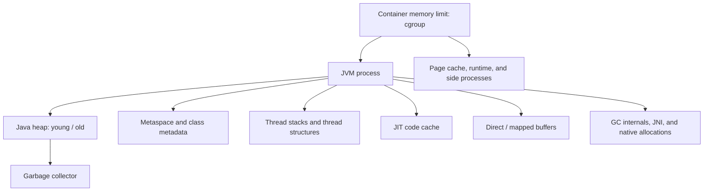
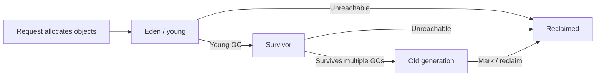

# JVM Memory, Garbage Collection, and Container Limits

A Spring Boot application may run smoothly on a developer workstation yet restart continuously on GKE. Dashboards show the Java heap using only about 600 MiB inside a 1 GiB container limit, yet the Pod is still `OOMKilled`. The reason is that JVM memory extends beyond the heap: in addition to Java objects, there is Metaspace, thread stacks, JIT code cache, direct buffers, native library memory, and container overhead. Looking solely at `-Xmx` causes operations teams to under-provision resources and misdiagnose failures.

In the **Java and Spring on GCP** section of the `CLOUD_PROVIDERS_GCP` module, this lesson explains how the HotSpot JVM uses memory, how garbage collection (GC) reclaims objects, and how the Linux kernel enforces container memory limits. Concepts are illustrated using Java 21/Spring Boot on Google Kubernetes Engine (GKE); the same principles apply to Cloud Run, Compute Engine, and containerized Java services. The goal is choosing sensible limits, observing symptoms accurately, and resolving incidents using real measurements.

## 1. Memory Regions of a Java Process

The JVM comprises multiple memory regions with distinct allocation and management mechanisms. The garbage collector primarily manages the **Java heap**, whereas most off-heap native memory is not reclaimed directly by GC.



| Component | What it holds | Inspection / limit tools |
|---|---|---|
| Java heap | Application objects, arrays, and data | `-Xms`, `-Xmx`, `-XX:MaxRAMPercentage`, `jvm.memory.*`, `jcmd GC.heap_info` |
| Metaspace | Loaded class metadata and class loaders | `jvm.memory.used` with `area=nonheap`; `-XX:MaxMetaspaceSize` if bounded |
| Thread stacks | Stack frames and native structures per platform thread | Thread count, `-Xss`, Native Memory Tracking (NMT) |
| Code cache | Machine code generated by the JIT compiler | NMT; `jcmd Compiler.codecache` if supported by JVM |
| Direct buffers | Off-heap memory used by `ByteBuffer.allocateDirect`, NIO/Netty | Buffer metrics, partial NMT, `-XX:MaxDirectMemorySize` when appropriate |
| GC/JVM native | GC structures, JIT compiler, VM internals, JNI | NMT, OS metrics, and RSS monitoring |
| Page cache and auxiliary processes | Linux page cache, sidecars, and other processes | Cgroup/Kubernetes metrics; each container has its own limit if set |

**Reserved, committed, and used** are three distinct concepts. The JVM can *reserve* large virtual address space, *commit* a portion to back it with memory, and only actually fault physical pages when written to. A large virtual memory size (`VIRT`/`VSZ`) does not mean the container is consuming that much RAM. Meanwhile, RSS measures resident physical pages of a process and does not map identically to every byte charged to the container's memory cgroup. Always cross-check heap, non-heap, and container memory metrics before concluding a leak exists.

### The Heap Is Not Total JVM Memory

For instance, a process with `-Xmx640m` using 540 MiB of heap can still consume hundreds of MiB of native memory. If the JVM spawns hundreds of platform threads, uses Netty direct buffers, or loads many classes, off-heap usage climbs substantially. Conversely, setting a 640 MiB container memory limit for a JVM configured with `-Xmx640m` leaves almost zero room for these components.

Heap dumps focus on object graphs inside the Java heap; they do not capture direct memory, thread stacks, or all memory allocated by native libraries. When container memory grows while post-GC heap remains flat, shift investigation to non-heap regions, native memory, page cache, and other processes in the container.

## 2. How Garbage Collection Works

Garbage collection automatically reclaims memory from objects no longer *reachable* from GC roots (such as active local variables, static fields, threads, and JVM-managed references). GC cannot reclaim an object that still has a reference path, even if the application no longer needs it. This underlies many Java memory leaks: caches, collections, listeners, thread-locals, or class loaders holding onto references.

Most modern collectors exploit the observation that most objects are short-lived. The heap is typically partitioned into generations:

- **Young generation:** where most new objects are allocated. Young GC cleans short-lived objects and promotes surviving objects to survivor spaces or the old generation per collector rules.
- **Old generation:** longer-lived objects. Pressure here triggers concurrent marking cycles, mixed collections, or full GCs depending on the collector.
- **Stop-the-world (STW) pause:** phases during which application threads pause so GC can perform certain work. Modern collectors perform much work concurrently with the application, yet none guarantee zero pauses across every operation.



Not every object marches sequentially through every region in the diagram. For example, G1 can allocate very large objects directly into humongous regions in the old generation. The JVM can also eliminate some allocations via escape analysis, meaning not every `new` in source code becomes an actual heap allocation.

### Common HotSpot Collectors

| Collector | Characteristics | When to consider |
|---|---|---|
| G1 GC | Largely concurrent; divides heap into regions, balancing throughput and pause latency | Sensible starting point for most Spring Boot services on server-class HotSpot |
| Parallel GC | Multi-threaded GC prioritizing throughput; pauses can be longer | Batch jobs or latency-tolerant workloads |
| ZGC | Focuses on ultra-low pauses, performing heavy work concurrently | Tail-latency-sensitive services with sufficient CPU/RAM headroom for the collector |
| Serial GC | Collects with minimal threads and low overhead | Small workloads or low-CPU environments; validate with benchmarks |

On most modern server-class HotSpot setups, **G1 is typically the default collector**, though actual selection depends on JDK, CPU count, memory, and runtime. Verify the active collector via JVM flags and GC logs rather than assuming from image names. Example options:

```bash
# Explicitly select G1 when a predictable baseline is needed
java -XX:+UseG1GC -jar app.jar

# Test ZGC only after verifying JDK support and measuring latency/throughput
java -XX:+UseZGC -jar app.jar
```

With G1, `-XX:MaxGCPauseMillis=200` is a soft goal (in milliseconds), **not a hard guarantee that every pause stays under 200 ms**. Setting the target too aggressively can increase GC CPU overhead and reduce throughput. Collector selection should be guided by p95/p99 latency, GC pauses, allocation rate, CPU, and post-GC live heap size.

### Signs of GC Trouble

- Young GC frequency rises with higher request or allocation rates: often normal if pauses stay short and the app meets SLOs.
- Post-GC old heap climbs steadily across cycles: suggests large caches, live-set growth, or a memory leak.
- Repeated Full GCs, long pauses, and heap pinning near `Xmx`: insufficient heap, objects held too long, or allocation outpacing reclamation.
- High GC CPU consumption paired with dropping request throughput: GC overhead or container CPU throttling.
- GC logs show low post-collection heap while container memory keeps rising: prioritize native memory, direct buffers, and thread counts.

Do not raise `-Xmx` solely because GC runs frequently. Compare actual live-set size, allocation sources, and SLOs before altering heap size.

## 3. Kubernetes Memory Limits Differ from `-Xmx`

Kubernetes manages resources at the **container level**. `resources.requests.memory` helps the scheduler place Pods on nodes with sufficient capacity; `resources.limits.memory` sets a ceiling enforced by the kernel via Linux cgroups. A container can be terminated by the kernel when memory usage exceeds the limit. Memory cannot be expanded simply by raising `-Xmx`.

| Setting | Meaning | Consequence if misconfigured |
|---|---|---|
| `requests.memory` | Memory used for Pod scheduling and partly determining QoS | Too low overcommits nodes and increases pressure/eviction risk |
| `limits.memory` | Container memory ceiling enforced by cgroups | Too low causes OOM kills even when heap is not full |
| `-Xmx` | Java heap ceiling | Too low causes `OutOfMemoryError: Java heap space`; too high starves native memory |
| `-XX:MaxRAMPercentage` | RAM fraction used by JVM to size max heap when `-Xmx` is unset | Too high leaves insufficient headroom for off-heap regions |
| `-Xss` | Stack size per platform thread | Too large inflates native memory; too small risks `StackOverflowError` |

When a container exceeds its memory limit, the kernel may send `SIGKILL` to the process; Kubernetes typically records `reason: OOMKilled` and exit code 137. Because the JVM has no chance to intercept `SIGKILL`, you may **see no `java.lang.OutOfMemoryError` or heap dump**. Exit code 137 typically corresponds to signal 9, yet it does not prove OOM without checking the termination reason or node logs; inspect container termination status and events.

In GKE, also distinguish **node-level** memory issues from containers hitting their own limits. Node `MemoryPressure` can trigger Pod eviction; system-level OOM can kill processes to protect the node. Thus `Evicted`, `OOMKilled`, and `CrashLoopBackOff` are not identical root causes. `CrashLoopBackOff` merely describes exponential backoff between restarts; inspect termination reasons and logs to find the root cause.

### HotSpot Container Awareness

On Linux with modern HotSpot releases such as Java 21/25, `-XX:+UseContainerSupport` is enabled by default. The JVM reads CPU/RAM limits from cgroups and picks heap sizing, GC threads, and ergonomics tailored to the container environment. Verify exact behavior for your JDK version and cgroup version (`v1`/`v2`), especially with older images or custom kernels.

Oracle JDK 21 documents defaults of `-XX:MaxRAMPercentage=25` and `-XX:InitialRAMPercentage=1.5625` for heap sizing relative to available RAM, with heuristics adjusting small heaps. The 25% figure is a **parameter default**, not a rule that every JVM gets exactly 25% of the container limit. Explicit `-Xmx` overrides percentage-based sizing; other flags and runtimes also affect outcomes.

Diagnostic commands for container awareness:

```bash
# Run inside a JDK container to inspect limits detected by the JVM
java -XshowSettings:system -version
java -XX:+PrintFlagsFinal -version 2>&1 | grep -E 'UseContainerSupport|MaxRAMPercentage|MaxHeapSize|ActiveProcessorCount'

# Inspect cgroup and container details as read by the JVM
java -Xlog:os+container=info -version
```

With Linux cgroup v2, inspect `memory.max` (`max` means no cgroup limit set at that level) and `memory.current` to check cgroup usage; cgroup v1 typically uses `memory.limit_in_bytes`. Actual files may reside under the process's specific cgroup path rather than the root `/sys/fs/cgroup/`. These files are for diagnostics; never edit cgroups directly for Kubernetes-managed Pods.

## 4. Calculating a Memory Budget for Spring Boot Containers

A useful rule of thumb:

```text
container memory limit
  >= actual Java heap used / Xmx ceiling
   + non-heap and native memory at peak load
   + cgroup-accounted memory outside those regions
   + headroom for variance, startup, and bursts
```

There is no single heap-to-container ratio fitting every application. Spring MVC with modest thread pools, Spring WebFlux/Netty with direct buffers, gRPC apps, JNI, and multi-classloader apps all have different native footprints. Start with conservative headroom, then measure under production-like load to tune.

### Example: Pod with a 1 GiB Limit

Suppose a Java 21/Spring Boot container has a `1Gi` (1024 MiB) limit. Picking `-Xmx640m` initially (roughly 640 MiB, or 62.5% of the limit) leaves around 384 MiB for Metaspace, stacks, code cache, direct buffers, GC, page cache, and variance. This is an initial sizing example, not a guarantee that 384 MiB always suffices.

| Illustrative line item | Reference budget |
|---|---:|
| Container memory limit | 1024 MiB |
| Max Java heap `-Xmx640m` | 640 MiB |
| Remaining off-heap + reserve | 384 MiB |

If the workload runs 400 platform threads with large stacks or Netty direct buffers reach hundreds of MiB, native usage can exceed 384 MiB. In that case, cut thread counts, bound buffers, optimize the workload, or raise the container limit. Watch **peaks** and high percentiles under realistic sustained load rather than 5-minute averages.

Two ways to size the heap—pick one primary method to avoid confusion:

```bash
# A. Cap heap using absolute sizes
java -Xms256m -Xmx640m -jar app.jar

# B. Cap heap as a percentage of JVM-detected memory
java -XX:InitialRAMPercentage=20.0 -XX:MaxRAMPercentage=60.0 -jar app.jar
```

In option B, if the JVM sees a 1 GiB limit without special heuristics intervening, the heap ceiling is roughly 614 MiB. This figure only illustrates the ratio; verify actual heap bounds with `jcmd VM.flags`, `jcmd GC.heap_info`, or JVM metrics. Never set both `-Xmx640m` and `-XX:MaxRAMPercentage=60` expecting Java to combine them.

`-Xms` can be smaller than `-Xmx` so the heap grows with load. Setting `-Xms` equal to `-Xmx` avoids heap expansion steps but commits memory upfront and should be tested against runtime characteristics. Do not treat `-Xms=-Xmx` as universally optimal for every microservice.

## 5. GKE Deployment Configuration for Spring Boot

The following example uses Java 21, a 1 GiB container limit, and a 640 MiB max heap. `requests.memory` indicates expected resources for Pod scheduling; `limits.memory` enforces the cgroup ceiling. `JAVA_TOOL_OPTIONS` is read by the JVM at startup, applying flags without modifying the application's Dockerfile.

```yaml
apiVersion: apps/v1
kind: Deployment
metadata:
  name: orders-api
  namespace: orders
spec:
  replicas: 3
  selector:
    matchLabels:
      app: orders-api
  template:
    metadata:
      labels:
        app: orders-api
    spec:
      containers:
        - name: app
          image: asia-southeast1-docker.pkg.dev/PROJECT_ID/apps/orders-api:VERSION
          ports:
            - name: http
              containerPort: 8080
          resources:
            requests:
              cpu: 500m
              memory: 768Mi
            limits:
              cpu: "2"
              memory: 1Gi
          env:
            - name: JAVA_TOOL_OPTIONS
              value: >-
                -Xms256m -Xmx640m
                -XX:+UseG1GC
                -Xlog:gc*,safepoint:stdout:time,uptime,level,tags
                -XX:+ExitOnOutOfMemoryError
          startupProbe:
            httpGet:
              path: /actuator/health/liveness
              port: http
            periodSeconds: 5
            failureThreshold: 30
          readinessProbe:
            httpGet:
              path: /actuator/health/readiness
              port: http
            periodSeconds: 10
          livenessProbe:
            httpGet:
              path: /actuator/health/liveness
              port: http
            periodSeconds: 20
```

This is a sample template for learning. The namespace, Actuator endpoints, image, Artifact Registry read permissions, and dependencies must be prepared beforehand. When using `JAVA_TOOL_OPTIONS`, confirm the image/runtime accepts the HotSpot flags. If an image launches multiple Java processes, this variable affects all of them.

`-XX:+ExitOnOutOfMemoryError` makes the JVM exit on `OutOfMemoryError` so the orchestrator can restart the broken process. It does not prevent kernel `OOMKilled`, does not create heap dumps by itself, and does not fix leaks. Avoid overly sensitive probes that repeatedly restart containers during JVM warm-up/JIT compilation or brief GC pauses. Startup probes grant a longer startup window before liveness checks activate; readiness solely controls whether a Pod receives traffic.

Here, `requests.memory` (768 MiB) is below `limits.memory` (1 GiB), so the Pod does not receive `Guaranteed` QoS from these settings alone. Kubernetes assigns QoS based on CPU and memory requests/limits across **all containers in the Pod**; choose QoS intentionally around capacity, workload needs, and node pressure risk rather than blindly setting requests equal to limits.

### Equivalent Configuration Using Percentages

If a team shares one image across multiple container sizes, replace `-Xmx640m` with `-XX:MaxRAMPercentage=60.0` and verify the JVM detects the memory limit accurately. This helps when GKE workloads span multiple environment profiles, though percentages must be load-tested because native memory does not always scale linearly with heap size.

On Cloud Run, each revision likewise has a memory limit and concurrency setting; concurrent requests increase objects, stacks, buffers, and peak memory. Keep JVM heap below the revision memory limit, observe under high concurrency, and tune memory and concurrency together. Cloud Run instance autoscaling does not shrink the memory footprint of requests already executing inside a single instance.

## 6. Distinguishing `OutOfMemoryError`, `OOMKilled`, and Eviction

These three failure classes look similar to end users (HTTP 5xx or Pod restarts), yet their mechanics and fixes differ.

| Symptom | Who detected it? | Typical evidence | Investigation direction |
|---|---|---|---|
| `java.lang.OutOfMemoryError: Java heap space` | JVM failed to allocate an object in Java heap | Stack trace; optional HPROF if dump enabled | Object graph, live heap, caches/leaks, allocation rate, and `Xmx` |
| `OutOfMemoryError: Metaspace` | JVM exhausted Metaspace or hit configured cap | Stack trace, high class loader counts | Class loading, dynamic proxies, classloader leaks, Metaspace limit |
| `OutOfMemoryError: Direct buffer memory` | Exceeded direct buffer limit or failed allocation | NIO/Netty stack trace | Direct buffer pooling, reference release, direct memory cap |
| `OutOfMemoryError: unable to create native thread` | JVM/OS could not spawn a new thread | Stack trace, high thread count, native resource error | Thread leaks, `-Xss`, PID limits, native RAM, ulimits |
| `OOMKilled` / exit code 137 | Linux kernel/cgroup killed the process | Container status `reason=OOMKilled`; often no Java exception | Container memory, native memory, limits, page cache, and node events |
| `Evicted` / `MemoryPressure` | Kubelet/node ran low on resources | Pod event citing node pressure | Total node requests/usage, QoS, scheduling, and node sizing |

A `java.lang.OutOfMemoryError` might not immediately exit the whole JVM if caught or isolated to one thread. Conversely, a kernel OOM kill terminates the process before the JVM can log anything. Never search solely for `OutOfMemoryError` and conclude a Pod did not suffer memory exhaustion.

### Step-by-Step Diagnosis on GKE

```bash
# Check Pod restarts and latest status
kubectl get pods -n orders
kubectl describe pod POD_NAME -n orders

# Inspect termination reason for the specific container
kubectl get pod POD_NAME -n orders \
  -o jsonpath='{.status.containerStatuses[?(@.name=="app")].lastState.terminated.reason}{"\n"}'

# Inspect logs from the previous run before container restart
kubectl logs POD_NAME -n orders -c app --previous

# Inspect current usage (requires Metrics Server or equivalent metrics source)
kubectl top pod -n orders --containers
```

If `kubectl describe` reports `Last State: Terminated`, `Reason: OOMKilled`, check the memory limit, container memory peak, and time of kill. If `OOMKilled` is absent yet node OOM is suspected, inspect GKE node logs and `MemoryPressure`. If logs show a `Java heap space` stack trace, analyze heap and GC. If `Direct buffer memory` or thread exhaustion appears, raising `-Xmx` will not directly solve it.

### Incident Analysis Examples

Suppose `orders-api` has a 1024 MiB limit and `-Xmx640m`. Heap usage normally fluctuates between 350–500 MiB, yet container memory climbs steadily to 1000 MiB and the Pod is `OOMKilled`. The team discovers platform threads grew from 120 to over 800 because a new thread pool was created per request without closing. This is **native/thread memory growth**, not a Java heap leak. The fix is using a managed executor, capping pool sizes, and closing resources properly; raising heap would worsen the problem by shrinking native headroom.

In another case, container memory still has headroom, yet heap hits `-Xmx640m`, GC reclaims very little, and the JVM throws `Java heap space`. Here, examine heap dumps, retained objects, caches, and collections holding data. Raising the container limit while leaving `-Xmx` unchanged will not clear a heap OOME.

## 7. Reading GC Logs and Correlating with Latency

Since Java 9, JVM unified logging supports `-Xlog`. Example writing GC and safepoint logs to stdout for GKE collection via Cloud Logging:

```bash
java \
  -Xms256m -Xmx640m \
  -Xlog:gc*,safepoint:stdout:time,uptime,level,tags \
  -jar app.jar
```

In production, pick an appropriate log verbosity to avoid excessive lines and logging costs. Use `-Xlog:gc=info:stdout:time,uptime,level,tags` if only basic GC events are needed. When writing to files, manage rotation, size caps, and centralized shipping; large GC logs must never fill container ephemeral storage.

Simplified G1 log example:

```text
[3.124s][info][gc] GC(11) Pause Young (Normal) (G1 Evacuation Pause) 220M->84M(640M) 15.4ms
[28.551s][info][gc] GC(72) Pause Young (Mixed) (G1 Evacuation Pause) 520M->370M(640M) 46.7ms
```

Reading the first line: before GC, heap used roughly 220 MiB; after GC, 84 MiB remained; committed/current heap capacity was 640 MiB; pause duration was 15.4 ms. The second line is a mixed collection reclaiming part of the old generation; post-GC heap remained 370 MiB. These figures are illustrative only, not logs from a specific application.

When analyzing:

1. Check whether GC **frequency** climbs with request rate or rises even at constant traffic.
2. Compare **pre/post-GC** heap to estimate the live set rather than watching instantaneous heap usage alone.
3. Correlate long pauses with p95/p99 latency spikes or timeouts.
4. Check CPU throttling: collectors need CPU; if a container is throttled during GC, wall-clock duration and latency rise.
5. Watch thread counts, allocation rates, Metaspace, and direct buffers before blaming everything on GC.

If GC pauses grow due to genuine heap scarcity, raise heap or shrink the live set. If heavy CPU throttling occurs, adjust CPU requests/limits or concurrency. If unneeded objects are retained, swapping collectors usually only delays failure.

## 8. JVM Tools for Incident Troubleshooting

When the image includes a JDK and process permissions allow, `jcmd` inspects live runtime state without restarting the app:

```bash
# Run inside the container; JVM often runs as PID 1 in many images
jcmd 1 VM.command_line
jcmd 1 VM.flags
jcmd 1 GC.heap_info
jcmd 1 Thread.print

# Inspect class counts and Java heap histogram when needed
jcmd 1 GC.class_histogram
```

Certain commands (notably heap histograms and heap dumps) can induce pauses or heavy CPU/RAM spikes. Evaluate impact before running in production. Minimal JRE or distroless runtime images omit `jcmd`; prepare debug images or organization-approved diagnostic workflows in advance. `jcmd` requires attach permission to the target JVM; security flags can disable attach.

### Native Memory Tracking (NMT)

HotSpot NMT breaks down JVM-managed native memory across Java Heap, Class, Thread, Code, GC, Compiler, and internal categories. **NMT must be enabled at JVM startup**; it cannot be turned on retroactively via `jcmd`. Choose `summary` for routine checks or `detail` for deeper analysis:

```bash
# JVM must start with this flag
java -XX:NativeMemoryTracking=summary -jar app.jar

# Once running, capture baseline and inspect deltas
jcmd 1 VM.native_memory summary scale=MB
jcmd 1 VM.native_memory baseline

# Capture again after load/time and diff against baseline
jcmd 1 VM.native_memory summary.diff scale=MB
```

NMT introduces overhead; Oracle documentation notes roughly 5–10% performance overhead when enabled. Enable it only for targeted diagnostics or when operational cost is accounted for. NMT does not track all third-party native library allocations and does not replace container memory metrics. Large `reserved` numbers do not equal resident RAM usage; distinguish `committed`, RSS, and cgroup usage.

### Heap Dumps, JFR, and Profilers

For Java heap OOMEs, you can enable:

```bash
java \
  -XX:+HeapDumpOnOutOfMemoryError \
  -XX:HeapDumpPath=/dumps \
  -jar app.jar
```

Heap dumps can be very large and hold sensitive data such as tokens, request payloads, or active user data in memory. Mount a suitably sized volume, restrict access, encrypt storage, and enforce deletion policies. When the kernel kills a container via `OOMKilled`, the JVM usually cannot write a dump; never treat a missing `.hprof` file as proof that no memory problem occurred.

Java Flight Recorder (JFR) samples allocations, GC, and runtime events over time. Cloud Profiler provides continuous profiling to pinpoint hot CPU/heap call stacks. To inspect retained objects and reference chains, heap dumps with specialized analyzers work best; to understand latency and allocation behavior over time, JFR and GC logs are more informative.

## 9. Monitoring JVM Alongside Kubernetes and Cloud Monitoring

Monitoring heap alone easily misses native memory issues. For Spring Boot on GKE, correlate **three telemetry layers**: JVM/GC (Micrometer), container/cgroup (Kubernetes/GKE), and user experience (request rate, errors, latency). Each layer isolates different root causes.

### Spring Boot Actuator and Micrometer

Spring Boot Actuator registers many JVM meters automatically via Micrometer. Depending on the classpath, common groups include `jvm.memory.*`, `jvm.gc.*`, `jvm.threads.*`, and `jvm.buffer.*` alongside process/system metrics. For Prometheus scraping, include the Prometheus registry dependency matching your Spring Boot/Micrometer version.

Example `application.yml`:

```yaml
management:
  endpoint:
    health:
      probes:
        enabled: true
  endpoints:
    web:
      exposure:
        include: health,info,prometheus
  metrics:
    tags:
      application: orders-api
```

Examples querying Actuator metrics when enabled and authorized:

```bash
curl http://127.0.0.1:8080/actuator/metrics/jvm.memory.used
curl 'http://127.0.0.1:8080/actuator/metrics/jvm.memory.max?tag=area:heap'
curl http://127.0.0.1:8080/actuator/metrics/jvm.gc.pause
curl http://127.0.0.1:8080/actuator/metrics/jvm.threads.live
```

`jvm.memory.used` breaks down by `area=heap|nonheap` and pool `id`. `jvm.gc.pause` reports GC pause timings; `jvm.threads.live` helps spot thread growth. Check actual available meter names at `/actuator/metrics`, as names and tags vary by runtime and registry. Protect `/actuator/prometheus` and restrict it to internal scraping; never expose it to the public Internet merely for scraping convenience.

With Managed Service for Prometheus on GKE, meters typically translate to Prometheus names like `jvm_memory_used_bytes` and `jvm_gc_pause_seconds_count`. Verify actual metric labels (`namespace`, `pod`, `application`, `area`, `id`) before writing PromQL; scraper-added labels vary by configuration.

Sample queries:

```promql
# Java heap used per pod
sum by (pod) (jvm_memory_used_bytes{area="heap"})

# Average GC pauses per second over 5 minutes
sum by (pod) (rate(jvm_gc_pause_seconds_count[5m]))

# Total GC pause time per observed second
sum by (pod) (rate(jvm_gc_pause_seconds_sum[5m]))
```

Adjust queries to match actual labels present. Total GC pause time per second highlights the fraction of time the app spent paused; for concurrent collectors, never equate total GC CPU cost solely with pause time.

### GKE Cloud Monitoring

GKE exports container- and Pod-level metrics. Useful metrics:

| Cloud Monitoring metric | Purpose |
|---|---|
| `kubernetes.io/container/memory/used_bytes` | Track container memory consumption |
| `kubernetes.io/container/memory/limit_utilization` | Ratio of current memory usage to container limit |
| `kubernetes.io/container/restart_count` | Detect abnormal restart spikes |
| `kubernetes.io/container/cpu/limit_utilization` | Observe CPU vs limit and GC context |
| `kubernetes.io/container/ephemeral_storage/used_bytes` | Track file/log/dump disk consumption inside container |

Metrics have their own sampling and accounting semantics; do not assume `memory.used_bytes` equals Java heap used or RSS exactly. Cloud Monitoring flags cgroup limit proximity, while Actuator reveals which JVM region is growing.

### Minimum Operational Dashboard

Align signals on a shared time axis with filters for service, environment, GKE cluster, namespace, and Pod:

- HTTP request rate, error rate, p95/p99 latency alongside SLOs.
- Container memory used/limit and restart/`OOMKilled` counts.
- JVM heap used/max, non-heap used, buffer memory, and live thread count.
- GC pause count/duration, full/mixed GC frequency, and allocation rate if available.
- Container CPU usage, CPU throttling metrics if available, and HPA replica count.
- GKE node memory pressure/evictions and readiness status.

Alert on **trends and impact**—such as sustained high and climbing memory limit utilization, `OOMKilled` restarts, steadily rising post-GC heap, or GC pauses coinciding with SLO latency breaches. Never alert merely because heap hits 80% of `Xmx` at a single point in time: the JVM intentionally lets heap fill comfortably before collecting.

## 10. Data-Driven GC and Memory Tuning

GC tuning should start only after establishing appropriate memory limits and live-set footprints. A GC change can improve p99 latency at the expense of higher CPU usage or lower throughput. Change one variable at a time and compare under equivalent traffic workloads.

| Observed signal | Question to check | Action to test |
|---|---|---|
| Post-GC heap rises continuously | Are caches/listeners/static maps retaining references? | Capture heap dump, bound caches, fix object lifecycles |
| Very frequent Young GC, yet low post-GC heap | Heavy temporary object churn or repeated serialization? | Use JFR/Profiler to find allocation hotspots; reduce churn |
| Long pauses under high load | G1 mixed/full GCs or CPU starvation? | Inspect GC logs, CPU throttling, live set, and heap budget |
| Heap flat yet container memory climbs | Growing native buffers, thread stacks, or page cache? | NMT, buffer/thread metrics, cgroup memory breakdown |
| `OutOfMemoryError: Metaspace` | Growing class/classloader counts? | Check for classloader leaks; raise Metaspace cap only if truly needed |
| Pod `OOMKilled` after raising `-Xmx` | Is native headroom still sufficient? | Lower heap or raise container memory limit and requests per load |
| Very high CPU yet low GC pauses | Hot application code or CPU throttling? | CPU profiling, thread dumps, container CPU metrics |

### Tuning Thread Counts and Concurrency

Thread stacks are one of the fastest-growing native memory consumers when thread counts spike. With Spring MVC/Tomcat, verify server and executor thread pool limits. With Spring WebFlux/Netty, verify event-loop thread counts, direct buffer allocators, and connection pools. With Java virtual threads, distinguish virtual thread count from platform carrier thread count; do not multiply virtual threads directly by `-Xss` like platform threads, though associated objects and state still consume heap.

Cap concurrency, queue depths, and timeouts so traffic bursts do not simultaneously spike object allocations, threads, and buffers. If a service handles 1,000 concurrent requests holding 1 MiB of heap data each, temporary payloads alone consume roughly 1 GiB before object headers and other regions.

### Horizontal Scaling Does Not Fix Memory Leaks

HPA adds replicas to split load. It helps when per-Pod memory scales with request concurrency, yet it **does not fix leaks inside each replica**. If every instance holds an unbounded cache or leaks threads, adding replicas just reproduces the failure across more Pods. Memory-based HPA can also scale unpredictably because the JVM retains heap after load spikes; consider CPU, request rate, or custom metrics reflecting actual demand.

VPA recommends or adjusts Pod resources depending on its mode; understand request/limit updates and Pod recreation behavior before enabling it in production. On GKE Autopilot, resource requests and limits follow platform-specific constraints; verify rules for your workload type and cluster version.

## 11. GKE Memory Incident Runbook

When alerted on Pod restarts, rising latency, or `OOMKilled`, follow this sequence:

1. **Assess blast radius:** service, namespace, cluster, image version, start time, affected Pods, and error rate. If SLOs are impacted, mitigate first via rollback or scaling replicas/capacity per standard procedures.
2. **Read termination reason:** run `kubectl describe pod`, check `lastState.terminated`, and inspect `kubectl logs --previous`. Confirm `OOMKilled`, Java OOME, eviction, or probe failure.
3. **Reconcile memory limits:** check actual container requests/limits, JDK version, and `-Xmx`/`MaxRAMPercentage`. Check whether `JAVA_TOOL_OPTIONS` is overridden or duplicated.
4. **Inspect time series:** container memory used, JVM heap used, non-heap, thread counts, GC pauses, CPU throttling, and request concurrency leading up to failure.
5. **Isolate the region:** if post-GC heap climbs, prioritize heap dumps/JFR; if container memory climbs while heap stays flat, prioritize NMT/native buffers/threads/page cache; on node `MemoryPressure`, review node capacity and scheduling.
6. **Apply short-term mitigation:** adjust memory limits/requests safely, reduce concurrency, roll back recent deploys, or disable heavy features—preserving native headroom.
7. **Verify the fix:** canary under representative traffic, measuring GC, peak memory, p99 latency, OOM/restarts, and resource cost.
8. **Document root cause:** update runbooks, memory budgets, load tests, and alerts to catch regressions earlier next time.

### Comparing Four Typical Cases

| Case | Metric signature | Priority diagnosis |
|---|---|---|
| A — Heap leak | Post-Full/Mixed-GC heap climbs, hits `Xmx`, Java OOME | Identify retained objects via heap dump or profiler |
| B — Native growth | Post-GC heap stays flat, container memory hits limit, `OOMKilled` | Thread stacks, direct buffers, JNI, and page cache |
| C — CPU throttling | GC pauses/latency climb while CPU is capped, heap modest | CPU requests/limits, GC threads, concurrency, and runtime bottlenecks |
| D — Node memory pressure | Multiple Pods evicted/restarted on same node without hitting container limits | Node capacity, requests, QoS, and Pod placement |

This classification is a starting point. Real incidents often combine factors—for example, a memory leak forces heavier GC, and CPU throttling slows processing further, causing backlog and request memory to keep climbing.

## 12. Sizing Tests Before Release

A tiny benchmark measuring only request latency cannot validate production limits. Run workloads with realistic payload distributions, concurrency, and duration long enough for GC to stabilize and caches to warm up.

Recommended testing steps:

1. Lock in the JVM image, JDK version (e.g., Java 21 HotSpot), and container memory/CPU requests and limits.
2. Capture a baseline in GKE staging under production-like traffic; record heap, non-heap, container memory, GC pauses, and p99 latency.
3. Ramp request rate or concurrency up to expected peak; sustain load long enough to observe old generation, caches, and direct buffers.
4. Test traffic bursts, large payloads, slow downstream connections, and GC during service warm-up.
5. Compare two `-Xmx` or `MaxRAMPercentage` settings, changing one parameter at a time.
6. Trigger a rolling update and verify liveness/readiness probes do not cause restarts during GC pauses.
7. Trigger an intentional `OOMKilled` Pod in a sandbox to confirm HPA recovery behavior and clean request failures.
8. Select a configuration with headroom above measured **peaks**, document the rationale, and set alerts close to risk thresholds.

For example, a 1 GiB container with 640 MiB heap is a reasonable starting point. If benchmarks show native memory routinely hitting 500 MiB, adjust settings because peak total exceeds the limit. If benchmarks show container memory peaking at 600 MiB with low post-GC heap and p99 latency well within SLOs, avoid needlessly raising limits; keep monitoring as workloads evolve.

## 13. Hands-On Exercise

Run this in a GKE sandbox with a Java 21 Spring Boot app exposing Actuator:

1. Create a Deployment with memory request `768Mi`, limit `1Gi`, and `-Xmx640m` as in the example.
2. Use `kubectl describe pod`, `kubectl top`, and JVM meters to record idle container memory and heap usage.
3. Generate HTTP load with a suitable load tool; observe heap used, GC pauses, CPU, and peak memory.
4. Enable GC logging to stdout, pick a Young GC line, and explain the before/after values and pause duration.
5. In the sandbox, intentionally set the heap too small (e.g., `-Xmx128m`) under an object-heavy workload; observe `OutOfMemoryError: Java heap space` and JVM logs.
6. In a separate test, set the container memory limit below measured peak memory; observe Pod termination reason and distinguish `OOMKilled` from Java OOME.
7. Enable `-XX:NativeMemoryTracking=summary` at startup, then run `jcmd VM.native_memory summary` before and after load to observe shifts.
8. Lower workload concurrency or thread counts and compare container memory, GC pauses, and latency.
9. Write a brief report justifying memory requests, limits, `Xmx`, native headroom, and configuration risks.

Only induce intentional OOMs in isolated sandboxes with appropriate quotas. Never run kill/eviction experiments on customer-facing workloads. Ensure any generated heap dumps contain zero real data and are never committed to repositories or public artifacts.

## 14. Production Checklist for Spring Boot

- [ ] JDK version, HotSpot collector, and cgroup mode are explicitly verified.
- [ ] JVM detects container memory/CPU limits accurately instead of host defaults.
- [ ] `-Xmx` or `MaxRAMPercentage` is chosen from measured peak memory.
- [ ] Headroom exists for Metaspace, thread stacks, code cache, direct buffers, and native memory.
- [ ] Kubernetes memory request reflects scheduling needs; memory limit covers total peak memory.
- [ ] Startup, readiness, and liveness probes are tested under load and GC pauses.
- [ ] GC logs and JVM metrics are accessible for diagnostics.
- [ ] Dashboards correlate heap, GC pauses, container memory, CPU, restarts, and request latency.
- [ ] Alerts distinguish JVM OOME, `OOMKilled`, and node pressure/eviction.
- [ ] Thread counts, connection pools, buffers, and concurrency are measured under high load.
- [ ] Heap dump/JFR/NMT procedures cover activation, storage, and access controls.
- [ ] Production-like benchmarks, canary tests, and rollback exist for memory config changes.
- [ ] HPA/VPA and GKE Autopilot resource policies are understood for the target environment.
- [ ] SLOs, resource costs, and memory budgets are reviewed after significant changes.

## 15. Conclusion

JVM memory encompasses both the Java heap and multiple native regions. GC manages heap objects, yet it cannot guarantee total container memory stays below `-Xmx`. On GKE, memory requests drive scheduling, memory limits are enforced by cgroups, and HotSpot sizes the heap via `-Xmx` or RAM percentages. To avoid restarts and latency spikes, reserve off-heap headroom, cross-reference JVM metrics with Cloud Monitoring, distinguish Java `OutOfMemoryError` from kernel `OOMKilled`, and measure GC impact with logs and realistic workloads. Effective tuning fixes allocation or retention root causes, validates resource adjustments with data, and monitors SLOs after deployment.

## References

- [The java Command — Oracle JDK 21](https://docs.oracle.com/en/java/javase/21/docs/specs/man/java.html)
- [The java Command — Oracle JDK 25](https://docs.oracle.com/en/java/javase/25/docs/specs/man/java.html)
- [Available Garbage Collectors — Oracle JDK 25](https://docs.oracle.com/en/java/javase/25/gctuning/available-collectors.html)
- [Garbage-First Garbage Collector — Oracle JDK 25](https://docs.oracle.com/en/java/javase/25/gctuning/garbage-first-g1-garbage-collector1.html)
- [Native Memory Tracking — Oracle Java](https://docs.oracle.com/en/java/javase/22/vm/native-memory-tracking.html)
- [Assign memory resources to containers and Pods — Kubernetes](https://kubernetes.io/docs/tasks/configure-pod-container/assign-memory-resource/)
- [Pod Quality of Service Classes — Kubernetes](https://kubernetes.io/docs/concepts/workloads/pods/pod-qos/)
- [Troubleshoot OOM events — GKE](https://docs.cloud.google.com/kubernetes-engine/docs/troubleshooting/oom-events)
- [Perform proactive monitoring with Cloud Monitoring — GKE](https://docs.cloud.google.com/kubernetes-engine/docs/troubleshooting/introduction-monitoring)
- [Metrics — Spring Boot Actuator](https://docs.spring.io/spring-boot/reference/actuator/metrics.html)
- [Actuator Endpoints — Spring Boot](https://docs.spring.io/spring-boot/reference/actuator/endpoints.html)
